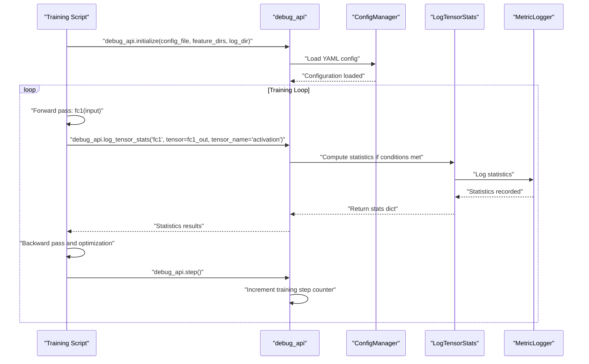
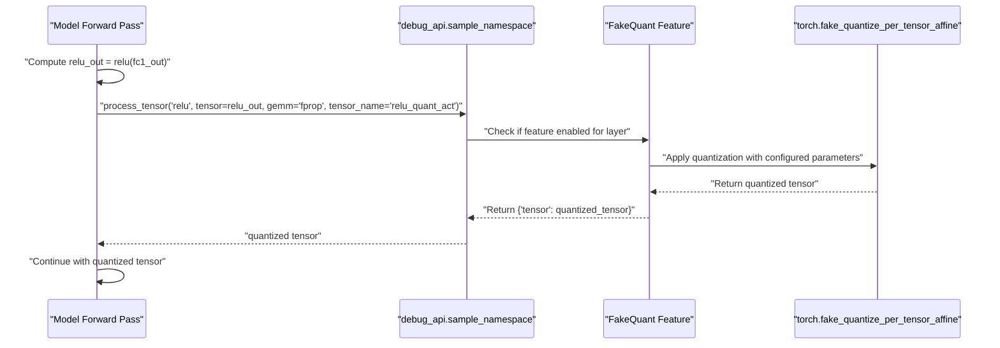
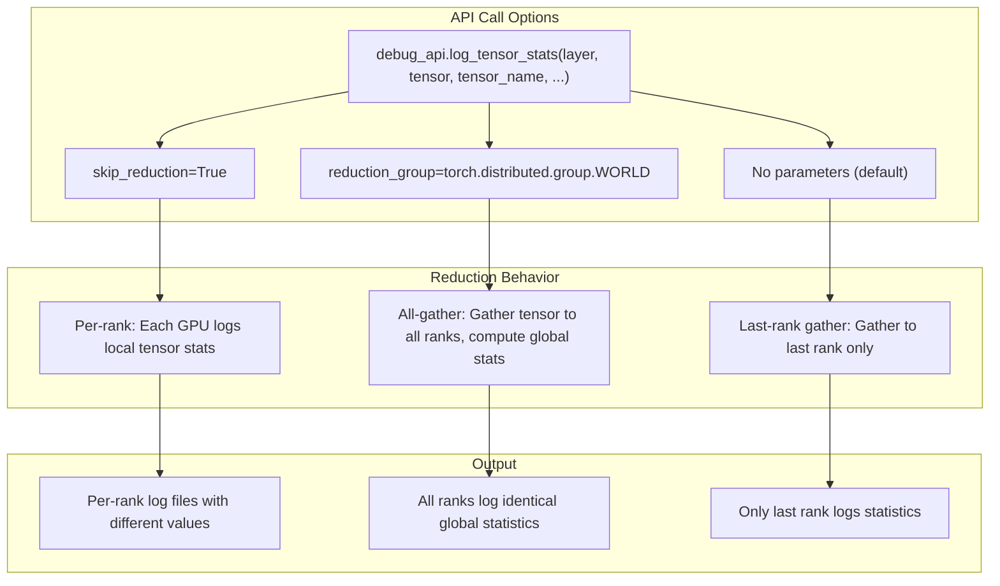
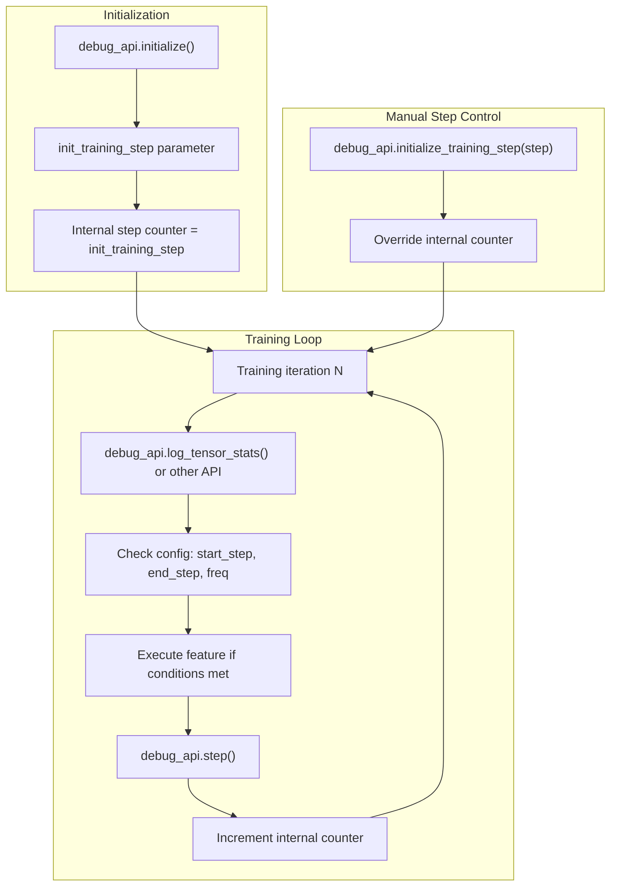

<!-- source: DeepWiki mcp.deepwiki.com · repo NVIDIA/nvidia-dlfw-inspect · page 2.3 Basic Usage Examples · fetched 2026-10-26 -->

# Basic Usage Examples

<details>
<summary>Relevant source files</summary>

The following files were used as context for generating this wiki page:

- [docs/getting_started.md](docs/getting_started.md)
- [examples/test_simple_model_train.py](examples/test_simple_model_train.py)
- [tests/unit/test_generic_features.py](tests/unit/test_generic_features.py)

</details>


This page demonstrates common usage patterns for `nvdlfw_inspect`, including tensor statistics logging, tensor manipulation (e.g., fake quantization), and integration with Distributed Data Parallel (DDP) training. These examples show how to integrate the tool into typical PyTorch training workflows with minimal code changes.

For initial setup and installation, see [Installation](#2.1). For a complete step-by-step tutorial, see [Quick Start](#2.2). For comprehensive configuration options, see [Configuration System](#4). For distributed training details, see [Distributed Training Support](#6.2).

**Sources:** [docs/getting_started.md:1-14](), [examples/test_simple_model_train.py:1-137]()
</thinking>

## Overview of Usage Patterns

The tool supports two primary debugging workflows:

| Workflow | Purpose | Key APIs | Configuration |
|----------|---------|----------|---------------|
| **Tensor Statistics Logging** | Monitor tensor statistics (mean, max, min, etc.) during training | `debug_api.log_tensor_stats()` | `LogTensorStats` feature |
| **Tensor Manipulation** | Modify tensors during training to test convergence and explore algorithms | `debug_api.<namespace>.process_tensor()` | Custom feature configs (e.g., `FakeQuant`) |

Both workflows require minimal code changes and are controlled through YAML configuration files.

**Sources:** [docs/getting_started.md:7-12](), [examples/test_simple_model_train.py:46-75]()

## Tensor Statistics Logging Example

The most common use case is logging tensor statistics during training. This workflow demonstrates how to instrument a simple neural network model with statistics logging.

### Complete Example: SimpleModel with DDP

Here is a complete example showing statistics logging integrated into a PyTorch DDP training script:

**Basic API Flow**



**Sources:** [examples/test_simple_model_train.py:36-78](), [docs/getting_started.md:29-68]()
</thinking>

### Code Integration

The example below shows how to add statistics logging to a model's forward pass:

```python
class SimpleModel(nn.Module):
    def __init__(self, input_size, hidden_size, output_size):
        super().__init__()
        self.fc1 = nn.Linear(input_size, hidden_size)
        self.fc2 = nn.Linear(hidden_size, output_size)
        self.relu = nn.ReLU()

    def forward(self, input_tensor):
        fc1_out = self.fc1(input_tensor)
        
        # Log fc1 activation statistics
        debug_api.log_tensor_stats(
            "fc1", 
            tensor=fc1_out, 
            tensor_name="activation", 
            skip_reduction=True
        )
        
        relu_out = self.relu(fc1_out)
        
        # Log ReLU activation statistics with reduction across all GPUs
        debug_api.log_tensor_stats(
            "relu",
            tensor=relu_out,
            tensor_name="activation",
            reduction_group=torch.distributed.group.WORLD
        )
        
        fc2_out = self.fc2(relu_out)
        
        # Log fc2 activation statistics (default reduction behavior)
        debug_api.log_tensor_stats(
            "fc2", 
            tensor=fc2_out, 
            tensor_name="activation"
        )
        
        return fc2_out
```

**Sources:** [examples/test_simple_model_train.py:43-76](), [docs/getting_started.md:36-67]()

### Training Loop Setup

Initialize the tool before training and call `debug_api.step()` after each iteration:

```python
# Initialization (once at start of training)
debug_api.initialize(
    "./configs/simple_model_train_sample.yaml",
    feature_dirs=["./sample_namespace"],
    log_dir="/tmp/nvdlfw_inspect"
)

# Training loop
for step in range(training_iterations):
    # Forward and backward pass
    output = model(input_tensor)
    loss = criterion(output, target)
    optimizer.zero_grad()
    loss.backward()
    optimizer.step()
    
    # Increment nvdlfw_inspect step counter
    debug_api.step()
```

**Sources:** [examples/test_simple_model_train.py:96-131](), [docs/getting_started.md:70-111]()

### Configuration for Statistics Logging

Here's a configuration that logs statistics for specific layers with temporal controls:

```yaml
sample_model_train_log_stats:
  enabled: True
  layers:
    layer_name_regex_pattern: .*(fc1|fc2|relu)
  LogTensorStats:
    enabled: True
    tensors_struct:
      - tensor: activation
        stats: [max, min]
        freq: 4
        start_step: 20
        end_step: 40
```

| Configuration Field | Description | Example Value |
|--------------------|-------------|---------------|
| `enabled` | Activates the configuration context | `True` |
| `layers.layer_name_regex_pattern` | Regex to match layer names | `.*(fc1\|fc2\|relu)` |
| `LogTensorStats.enabled` | Enables the LogTensorStats feature | `True` |
| `tensors_struct.tensor` | Name of the tensor to log | `activation` |
| `tensors_struct.stats` | Statistics to compute | `[max, min]` |
| `tensors_struct.freq` | Log every N steps | `4` |
| `tensors_struct.start_step` | Begin logging at this step | `20` |
| `tensors_struct.end_step` | Stop logging at this step | `40` |

**Sources:** [docs/getting_started.md:154-167](), [examples/configs/simple_model_train_sample.yaml]()

## Tensor Manipulation Example

The tool can modify tensors during training to test convergence and explore algorithms like quantization. This example demonstrates fake quantization using a custom feature.

### Fake Quantization Workflow

**API Flow for Tensor Manipulation**



**Sources:** [examples/test_simple_model_train.py:60-63](), [docs/getting_started.md:50-54](), [examples/sample_namespace/sample_feature.py]()

### Code Integration

Add tensor manipulation API calls in the forward pass:

```python
def forward(self, input_tensor):
    fc1_out = self.fc1(input_tensor)
    relu_out = self.relu(fc1_out)
    
    # Apply fake quantization if enabled in config
    relu_quant = debug_api.sample_namespace.process_tensor(
        "relu", 
        tensor=relu_out, 
        gemm="fprop", 
        tensor_name="relu_quant_act"
    )["tensor"]
    
    # Log quantized tensor statistics
    debug_api.log_tensor_stats(
        "relu",
        tensor=relu_quant,
        tensor_name="relu_quant_act",
        reduction_group=torch.distributed.group.WORLD
    )
    
    # Continue forward pass with quantized tensor
    fc2_out = self.fc2(relu_quant)
    return fc2_out
```

**Sources:** [examples/test_simple_model_train.py:60-72](), [docs/getting_started.md:50-62]()

### Configuration for Tensor Manipulation

Configure the `FakeQuant` feature in the YAML file:

```yaml
sample_model_train_log_stats:
  enabled: True
  layers:
    layer_name_regex_pattern: .*(relu)
  sample_namespace:
    FakeQuant:
      enabled: True
      gemms_struct:
        - gemm: fprop
          tensors_struct:
            - tensor: relu_quant_act
              scale: 1
              zero_point: 0
              quant_min: 0
              quant_max: 255
```

| Configuration Field | Description | Example Value |
|--------------------|-------------|---------------|
| `sample_namespace` | Custom feature namespace | User-defined |
| `FakeQuant.enabled` | Enables fake quantization | `True` |
| `gemms_struct.gemm` | GEMM operation type | `fprop`, `dgrad`, `wgrad` |
| `tensors_struct.tensor` | Tensor name to quantize | `relu_quant_act` |
| `tensors_struct.scale` | Quantization scale factor | `1` |
| `tensors_struct.zero_point` | Quantization zero point | `0` |
| `tensors_struct.quant_min` | Minimum quantization value | `0` |
| `tensors_struct.quant_max` | Maximum quantization value | `255` |

**Sources:** [docs/getting_started.md:171-181](), [examples/configs/simple_model_train_sample.yaml]()

## DDP Training Integration

The tool integrates with PyTorch Distributed Data Parallel (DDP) training with different tensor reduction strategies for multi-GPU scenarios.

### Tensor Reduction Strategies

**DDP Reduction Options**



**Sources:** [docs/getting_started.md:247-257](), [examples/test_simple_model_train.py:47-75]()

### Reduction Strategy Examples

The following table summarizes the three reduction strategies:

| Strategy | API Parameter | Behavior | Use Case |
|----------|--------------|----------|----------|
| **Per-rank logging** | `skip_reduction=True` | Each GPU logs local statistics independently | Debug rank-specific issues, verify data distribution |
| **All-gather to all ranks** | `reduction_group=torch.distributed.group.WORLD` | Gather tensor to all ranks, each computes and logs global stats | Unified view across all ranks, verify global behavior |
| **Last-rank gather** | Default (no parameters) | Gather tensor to last rank only, last rank logs global stats | Centralized logging, reduce I/O overhead |

**Code Examples:**

```python
# Strategy 1: Per-rank logging
debug_api.log_tensor_stats(
    "fc1", 
    tensor=fc1_out, 
    tensor_name="activation", 
    skip_reduction=True
)

# Strategy 2: All-gather to all ranks
debug_api.log_tensor_stats(
    "relu",
    tensor=relu_out,
    tensor_name="activation",
    reduction_group=torch.distributed.group.WORLD
)

# Strategy 3: Last-rank gather (default)
debug_api.log_tensor_stats(
    "fc2", 
    tensor=fc2_out, 
    tensor_name="activation"
)
```

**Sources:** [examples/test_simple_model_train.py:47-75](), [docs/getting_started.md:251-256]()

### DDP Setup Requirements

The tool must be initialized on all ranks in DDP training:

```python
def ddp_setup():
    init_process_group(backend="nccl")
    gpu_id = int(os.environ["LOCAL_RANK"])
    torch.cuda.set_device(gpu_id)
    return gpu_id

if __name__ == "__main__":
    gpu_id = ddp_setup()
    
    # Initialize on all ranks
    debug_api.initialize(
        "./configs/simple_model_train_sample.yaml",
        feature_dirs=["./sample_namespace"],
    )
    
    # Wrap model with DDP
    model = SimpleModel(input_size, hidden_size, output_size)
    model = model.to(gpu_id)
    model = DDP(model, device_ids=[gpu_id])
```

**Sources:** [examples/test_simple_model_train.py:22-34](), [examples/test_simple_model_train.py:82-113](), [docs/getting_started.md:22-26]()

### Running DDP Training

Execute the training script with multiple GPUs using `torchrun`:

```bash
torchrun --nproc_per_node=2 test_simple_model_train.py
```

**Sources:** [examples/test_simple_model_train.py:81](), [docs/getting_started.md:113-117]()

## Training Step Management

The tool maintains an internal training step counter that controls when features are active based on temporal configurations.

### Step Counter Lifecycle

**Step Management Flow**



**Sources:** [docs/getting_started.md:195-206](), [tests/unit/test_generic_features.py:75-119]()

### Basic Step Management

The `debug_api.step()` method must be called after each training iteration:

```python
for step in range(training_iterations):
    # Forward pass
    output = model(input_tensor)
    
    # Backward pass
    loss = criterion(output, target)
    optimizer.zero_grad()
    loss.backward()
    optimizer.step()
    
    # Increment nvdlfw_inspect internal step counter
    debug_api.step()
```

**Sources:** [examples/test_simple_model_train.py:117-131](), [docs/getting_started.md:104-106]()

### Resuming Training from Checkpoint

When resuming training, set the initial step counter during initialization:

```python
# Method 1: Set during initialization
debug_api.initialize(
    config_file="config.yaml",
    init_training_step=65  # Resume from step 65
)

# Training loop continues from step 65
debug_api.step()  # Now at step 66
stats = debug_api.log_tensor_stats("layer", tensor, "gradient")

# Method 2: Set after initialization
debug_api.initialize(config_file="config.yaml")
debug_api.initialize_training_step(99)  # Jump to step 99
stats = debug_api.log_tensor_stats("layer", tensor, "gradient")
```

**Sources:** [docs/getting_started.md:198-206](), [tests/unit/test_generic_features.py:76-108]()

### Temporal Configuration Controls

Features use the step counter to determine when to execute:

```yaml
LogTensorStats:
  tensors_struct:
    - tensor: activation
      stats: [max, min]
      freq: 4           # Log every 4 steps
      start_step: 20    # Begin at step 20
      end_step: 40      # Stop at step 40
    - tensor: gradient
      stats: [mean, max, min]
      freq: 2
      start_end_list: [[6, 10], [20, 24], [35, 42]]  # Multiple intervals
```

| Field | Description | Behavior |
|-------|-------------|----------|
| `freq` | Logging frequency | Log every N steps (e.g., steps 20, 24, 28 with `freq: 4`) |
| `start_step` | Start logging at step | No logging before this step |
| `end_step` | Stop logging at step | No logging after this step |
| `start_end_list` | Multiple intervals | Log during specified step ranges with frequency |

**Sources:** [docs/getting_started.md:162-170](), [examples/configs/simple_model_train_sample.yaml]()

## Common Usage Scenarios

### Activation Statistics During Forward Pass

Track activation statistics to monitor model behavior:

```python
# Log activation statistics
activation_stats = debug_api.log_tensor_stats(
    "decoder.1.mlp.fc1", 
    tensor=activation_tensor, 
    tensor_name="activation",
    iteration=101  # Optional explicit iteration
)

# Returns dictionary with computed statistics
# Example: {'mean': tensor_mean, 'std': tensor_std, 'l1_norm': l1_value}
```

**Sources:** [tests/unit/test_generic_features.py:34-36]()

### Gradient Statistics During Backward Pass

Monitor gradient flow and magnitudes:

```python
gradient_stats = debug_api.log_tensor_stats(
    "decoder.1.mlp.fc1",
    tensor=gradient_tensor,
    tensor_name="gradient",
    iteration=66
)

# Check specific statistics
assert gradient_stats["max"] == gradient_tensor.max()
```

**Sources:** [tests/unit/test_generic_features.py:37-39](), [tests/unit/test_generic_features.py:54]()

### Weight Statistics Monitoring

Track weight parameter statistics:

```python
weight_stats = debug_api.log_tensor_stats(
    "decoder.2.mlp.fc1",
    tensor=weight_tensor,
    tensor_name="weight", 
    iteration=90
)
```

**Sources:** [tests/unit/test_generic_features.py:40-42]()

### Conditional Logging

Statistics are only computed and returned when conditions are met (frequency, step range, etc.). Outside the configured conditions, an empty dictionary is returned:

```python
# Outside logging conditions
stats = debug_api.log_tensor_stats("layer", tensor, "activation", iteration=11)
assert stats == {}  # No statistics computed
```

**Sources:** [tests/unit/test_generic_features.py:67-69]()

---

