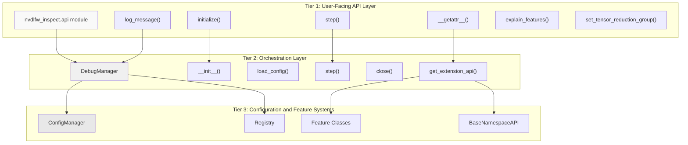
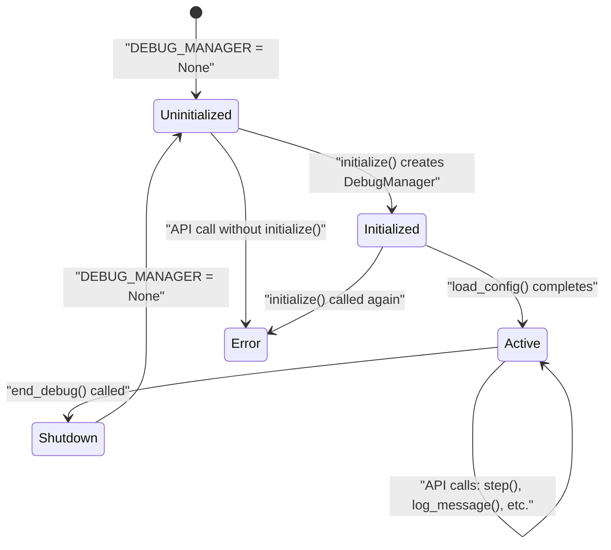
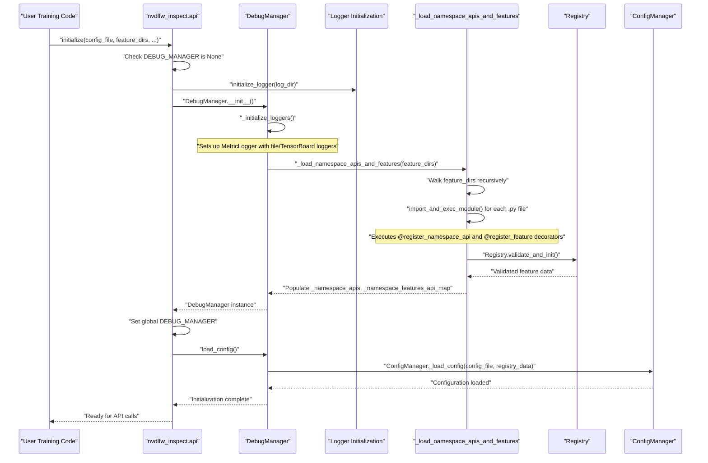
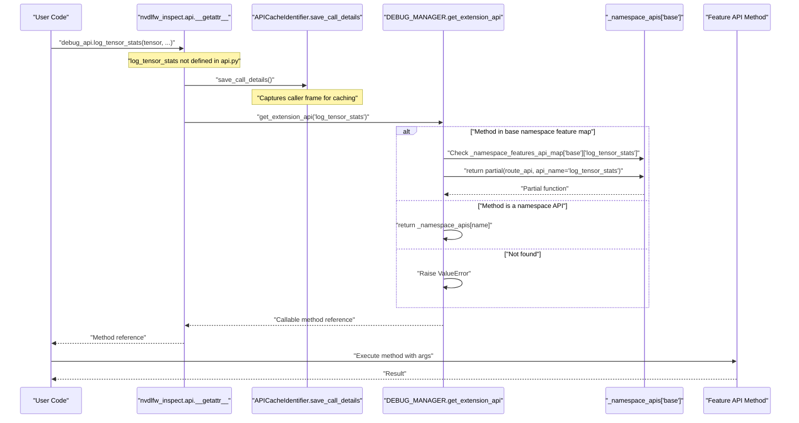
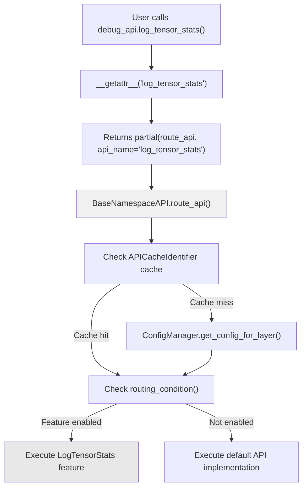
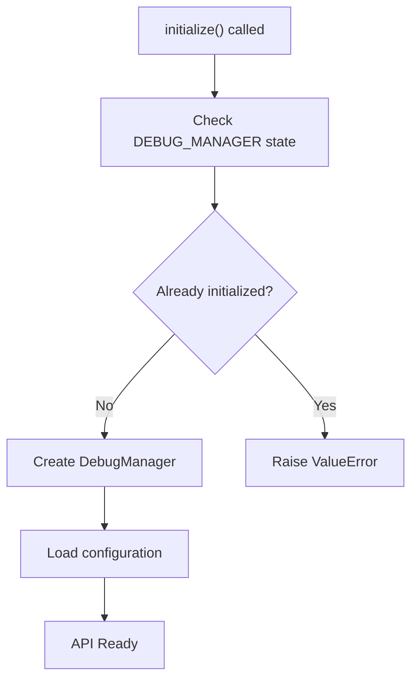

<!-- source: DeepWiki mcp.deepwiki.com · repo NVIDIA/nvidia-dlfw-inspect · page 3 API Reference · fetched 2026-10-26 -->

# API Reference

<details>
<summary>Relevant source files</summary>

The following files were used as context for generating this wiki page:

- [nvdlfw_inspect/api.py](nvdlfw_inspect/api.py)
- [nvdlfw_inspect/debug_manager.py](nvdlfw_inspect/debug_manager.py)

</details>


This document provides an overview of the public API exposed by `nvdlfw_inspect`. The API is organized into three tiers:

1. **User-Facing API** (`nvdlfw_inspect.api`) — Simple stateful interface for initialization, logging, and lifecycle management
2. **Configuration API** — Classes for managing YAML-based configuration (`ConfigManager`, `ConfigSpec`, `LayerSpec`)
3. **Debug Manager** — Internal orchestration component that coordinates features, configuration, and logging

The API is designed as a stateful system where a global `DEBUG_MANAGER` singleton coordinates all operations. Users primarily interact through functions in `nvdlfw_inspect.api`, which delegate to the `DebugManager` instance.

## API Organization

The following table summarizes the API components and where to find detailed documentation:

| Component | Module/Class | Purpose | Documentation |
|-----------|--------------|---------|---------------|
| Main API | `nvdlfw_inspect.api` | User-facing functions: `initialize()`, `step()`, `log_message()`, dynamic feature APIs | Page 3.1 |
| Configuration API | `ConfigManager`, `ConfigSpec`, `LayerSpec` | Load, validate, and query YAML configuration | Page 3.2 |
| Debug Manager | `DebugManager` | Orchestrate features, logging, and registry | Page 3.3 |
| Utility Functions | `APICacheIdentifier`, `SingleMessageLogger`, distributed utilities | Support functions for caching, logging, and distributed training | Page 3.4 |

**Sources:** [nvdlfw_inspect/api.py:1-182](), [nvdlfw_inspect/debug_manager.py:1-228](), [nvdlfw_inspect/config_manager.py:1-200]()

## API Architecture Overview

### Three-Tier Architecture

The API is structured in three layers, each serving distinct purposes:



**Tier 1: User-Facing API** — Simple functions in `nvdlfw_inspect.api` that users call from training code

**Tier 2: Orchestration** — `DebugManager` coordinates initialization, configuration loading, and feature routing

**Tier 3: Configuration and Features** — `ConfigManager` handles YAML parsing, `Registry` manages feature discovery, `BaseNamespaceAPI` routes to features

**Sources:** [nvdlfw_inspect/api.py:24-182](), [nvdlfw_inspect/debug_manager.py:32-228]()

### Global State Management

The API maintains a single global variable `DEBUG_MANAGER` in the `nvdlfw_inspect.api` module:



All API functions in `nvdlfw_inspect.api` check the `DEBUG_MANAGER` state and raise exceptions for invalid state transitions:
- `RuntimeError` if API called before `initialize()` ([nvdlfw_inspect/api.py:76-78]())
- `ValueError` if `initialize()` called when already initialized ([nvdlfw_inspect/api.py:59-60]())

**Sources:** [nvdlfw_inspect/api.py:24-89]()

## Initialization Flow

### `initialize()` Call Sequence

When `initialize()` is called, the following sequence of operations occurs:



**Key Steps:**
1. **Logger Setup** — `initialize_logger()` creates log directory structure ([nvdlfw_inspect/api.py:61]())
2. **DebugManager Creation** — Instantiates orchestrator ([nvdlfw_inspect/api.py:62-69]())
3. **Feature Loading** — `_load_namespace_apis_and_features()` discovers and imports features ([nvdlfw_inspect/debug_manager.py:102-160]())
4. **Registry Validation** — `Registry.validate_and_init()` checks feature completeness ([nvdlfw_inspect/debug_manager.py:150]())
5. **Configuration Loading** — `ConfigManager._load_config()` parses YAML ([nvdlfw_inspect/debug_manager.py:55]())

**Sources:** [nvdlfw_inspect/api.py:27-71](), [nvdlfw_inspect/debug_manager.py:33-56](), [nvdlfw_inspect/debug_manager.py:102-160]()

## Dynamic API Extension via `__getattr__`

The API uses Python's `__getattr__` mechanism to dynamically expose feature methods. When user code calls an unknown attribute on the `nvdlfw_inspect.api` module, `__getattr__()` intercepts it and routes to the appropriate feature.

### API Extension Resolution



**Namespace Resolution Logic** ([nvdlfw_inspect/debug_manager.py:161-172]()):
1. Check if method name exists in `_namespace_features_api_map["base"]` (base namespace features)
2. If yes, return `partial(BaseNamespaceAPI.route_api, api_name=name)`
3. Otherwise, check if method name is a namespace identifier in `_namespace_apis`
4. If yes, return the namespace API object
5. Otherwise, raise `ValueError`

**Sources:** [nvdlfw_inspect/api.py:174-182](), [nvdlfw_inspect/debug_manager.py:161-172]()

## API Routing to Features

### Feature API Resolution

Once a feature API method is obtained via `__getattr__`, the call is routed through `BaseNamespaceAPI.route_api()`:



**Caching Optimization:** `APICacheIdentifier` stores caller frame information to avoid repeated configuration lookups for the same call site.

**Sources:** [nvdlfw_inspect/base_routing.py:100-200](), [nvdlfw_inspect/debug_manager.py:161-172]()

## Error Handling and Validation

The API implements comprehensive error checking to ensure proper initialization and state management.

### Common Error Conditions

| Error Type | Trigger Condition | Exception | Location |
|------------|------------------|-----------|----------|
| Not Initialized | API call before `initialize()` | `RuntimeError` | [nvdlfw_inspect/api.py:76-78]() |
| Double Initialization | `initialize()` called twice | `ValueError` | [nvdlfw_inspect/api.py:59-60]() |
| Missing Debug Manager | Internal state corruption | `ValueError` | [nvdlfw_inspect/api.py:154-157]() |

### Initialization Validation



**Sources:** [nvdlfw_inspect/api.py:55-71]()

## Utility Functions

### Layer Name Assignment

#### `infer_and_assign_layer_names()`

Automatically assigns hierarchical names to PyTorch modules, with special handling for `ModuleList` containers and pipeline parallelism scenarios.

```python
def infer_and_assign_layer_names(model: torch.nn.Module | list)
```

The function recursively traverses the model hierarchy and:
- Assigns `name` attributes to each module
- Handles `ModuleList` with layer numbering support (for Megatron-Core compatibility)
- Supports both single models and model lists (for pipeline parallelism)

**Key Features:**
- **Pipeline Parallel Support**: Accepts model lists for multi-stage models
- **Layer Numbering**: Uses `layer_number` attribute when available for `ModuleList` children
- **Hierarchical Naming**: Creates dot-separated names reflecting model structure

**Sources:** [nvdlfw_inspect/api.py:114-150]()

---

