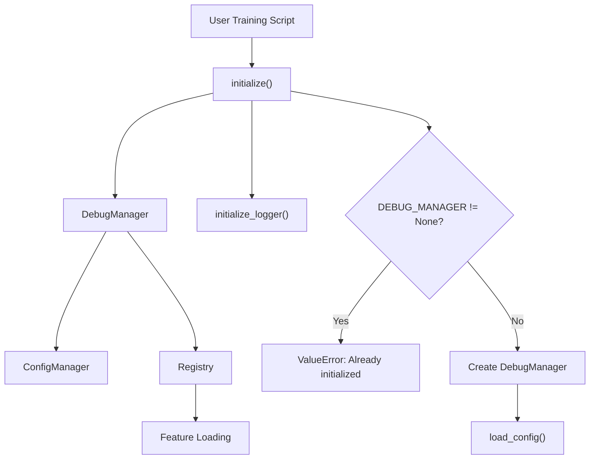
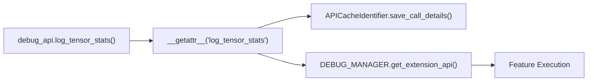
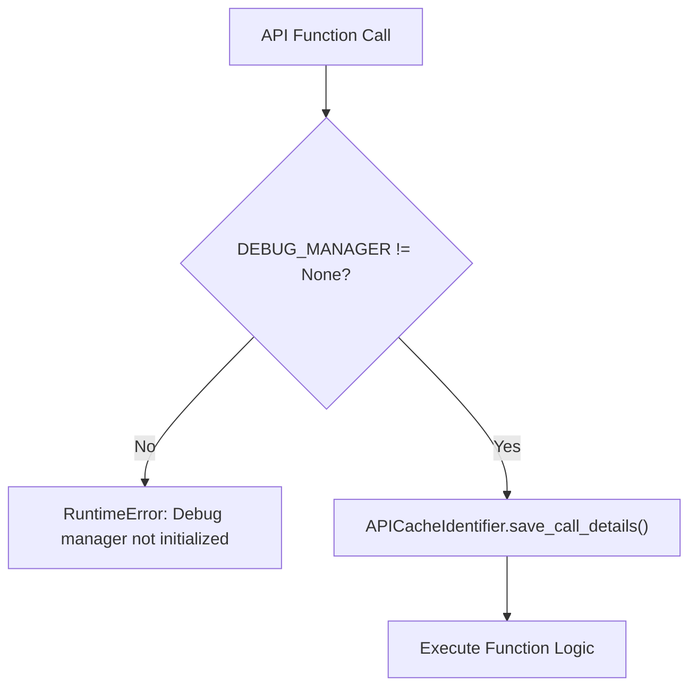

<!-- source: DeepWiki mcp.deepwiki.com · repo NVIDIA/nvidia-dlfw-inspect · page 3.1 Main API (nvdlfw_inspect.api) · fetched 2026-10-26 -->

# Main API (nvdlfw_inspect.api)

<details>
<summary>Relevant source files</summary>

The following files were used as context for generating this wiki page:

- [docs/getting_started.md](docs/getting_started.md)
- [nvdlfw_inspect/api.py](nvdlfw_inspect/api.py)

</details>


## Purpose and Scope

This document covers the primary user-facing API functions provided by the `nvdlfw_inspect.api` module. These functions constitute the main interface for integrating the debugging tool into PyTorch training scripts and managing debugging sessions.

For configuration management details, see [Configuration API](#3.2). For internal debug manager operations, see [Debug Manager](#3.3). For information about available debugging features, see [Built-in Features](#5.1).

## Core API Functions

The main API provides several categories of functions for managing debugging sessions and collecting tensor statistics:

| Function | Purpose | Required | Returns |
|----------|---------|----------|---------|
| `initialize()` | Initialize debugging session | Yes | None |
| `log_tensor_stats()` | Log tensor statistics | No | Dict of statistics |
| `step()` | Increment training step | No | None |
| `end_debug()` | Clean up debugging session | Recommended | None |
| `log_message()` | Log debug messages | No | None |
| `infer_and_assign_layer_names()` | Assign names to model layers | No | None |
| `set_tensor_reduction_group()` | Configure distributed reduction | No | None |

Sources: [nvdlfw_inspect/api.py:27-186]()

## API Initialization Flow



Sources: [nvdlfw_inspect/api.py:27-71]()

## Initialization and Lifecycle

### initialize()

The `initialize()` function must be called once on every rank before using any other API functions:

```python
def initialize(
    config_file="",
    feature_dirs=None,
    statistics_logger: BaseLogger | None = None,
    log_dir=".",
    init_training_step=0,
    **kwargs,
):
```

**Key Parameters:**
- `config_file`: Path to YAML configuration file specifying features and layer targets
- `feature_dirs`: Directories containing custom feature implementations  
- `statistics_logger`: Custom logger implementing `BaseLogger` interface
- `log_dir`: Directory for debug logs and statistics
- `init_training_step`: Starting training step for resumed training

**Optional kwargs:**
- `tb_writer`: TensorBoard writer instance
- `default_logging_enabled`: Enable default file logging

Sources: [nvdlfw_inspect/api.py:27-71]()

### end_debug()

Properly closes the debugging session and cleans up resources:

```python
def end_debug():
    global DEBUG_MANAGER
    if DEBUG_MANAGER is not None:
        DEBUG_MANAGER.close()
        DEBUG_MANAGER = None
```

Sources: [nvdlfw_inspect/api.py:85-89]()

## Tensor Statistics Logging

### Dynamic API Access

The primary tensor statistics logging function `log_tensor_stats()` is accessed through Python's `__getattr__` mechanism:



Sources: [nvdlfw_inspect/api.py:176-185]()

### Usage Pattern

Based on the test examples, `log_tensor_stats()` follows this pattern:

```python
stats = debug_api.log_tensor_stats(
    layer_name="decoder.1.mlp.fc1",
    tensor=tensor_data,
    tensor_name="activation",  # or "gradient", "weight"
    iteration=step_number      # optional
)
```

**Returns:** Dictionary containing computed statistics (e.g., `mean`, `std`, `l1_norm`, `l2_norm`) or empty dict if layer/step not configured for logging.

Sources: [tests/unit/test_generic_features.py:34-56]()

## Training Step Management

### step()

Increments the current training step across all features:

```python
def step():
    global DEBUG_MANAGER
    if DEBUG_MANAGER is not None:
        DEBUG_MANAGER.step()
```

### initialize_training_step()

Sets the training step to a specific value (useful for resuming training):

```python
def initialize_training_step(train_step: int):
    global DEBUG_MANAGER
    if DEBUG_MANAGER is not None:
        DEBUG_MANAGER.initialize_training_step(train_step)
```

Sources: [nvdlfw_inspect/api.py:92-101](), [tests/unit/test_generic_features.py:100-117]()

## Layer Name Management

### infer_and_assign_layer_names()

Automatically assigns hierarchical names to PyTorch modules for configuration targeting:

```python
def infer_and_assign_layer_names(model: torch.nn.Module | list):
```

**Key Features:**
- Handles `torch.nn.ModuleList` with special layer numbering logic
- Uses `layer_number` attribute from modules when available (Megatron-Core pattern)
- Assigns `name` attribute to each module
- Supports both single models and model lists
- Creates hierarchical names like `model.decoder.1.mlp.fc1`

Sources: [nvdlfw_inspect/api.py:114-149]()

## Distributed Training Support

### Tensor Reduction Configuration

```python
def set_tensor_reduction_group(group: torch.distributed.ProcessGroup, layer_name=None):
def get_tensor_reduction_group():
```

These functions manage process groups for reducing tensors across ranks before logging statistics. The reduction group enables collecting global statistics rather than per-rank statistics.

**Usage:**
- Call `set_tensor_reduction_group()` with a `torch.distributed.ProcessGroup`
- Individual API calls can override with `skip_reduction=True` or `reduction_group=custom_group`

Sources: [nvdlfw_inspect/api.py:152-173]()

## Feature Discovery

### list_features() and explain_features()

```python
def list_features():
    global DEBUG_MANAGER
    DEBUG_MANAGER.list_features()

def explain_features(features=None):
    global DEBUG_MANAGER
    DEBUG_MANAGER.explain_features(features)
```

These functions provide runtime introspection of available debugging features loaded from configured namespaces and feature directories.

Sources: [nvdlfw_inspect/api.py:104-111]()

## Message Logging

### log_message()

Provides cached message logging with caller frame tracking:

```python
def log_message(msg, layer_name=None, level=logging.INFO, extra_cachable_args=None):
```

**Features:**
- Uses `APICacheIdentifier` to track caller location
- Implements `SingleMessageLogger` for message deduplication
- Supports standard Python logging levels

Sources: [nvdlfw_inspect/api.py:73-82]()

## Error Handling

The API implements consistent error checking patterns:



Most API functions check for proper initialization and raise `RuntimeError` with descriptive messages if `initialize()` hasn't been called.

Sources: [nvdlfw_inspect/api.py:76-77](), [nvdlfw_inspect/api.py:178-181]()

---

