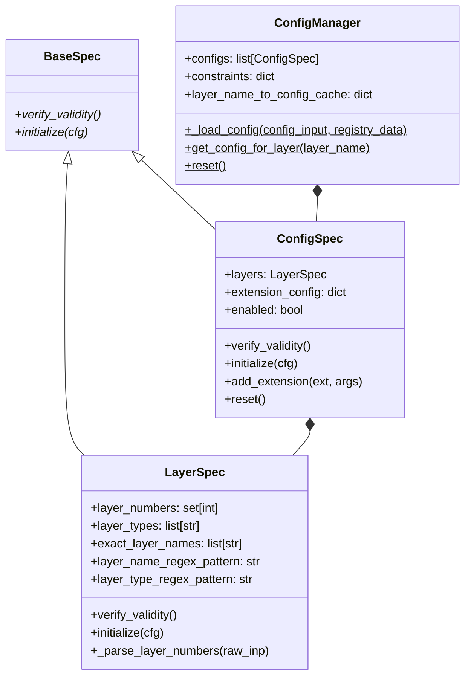
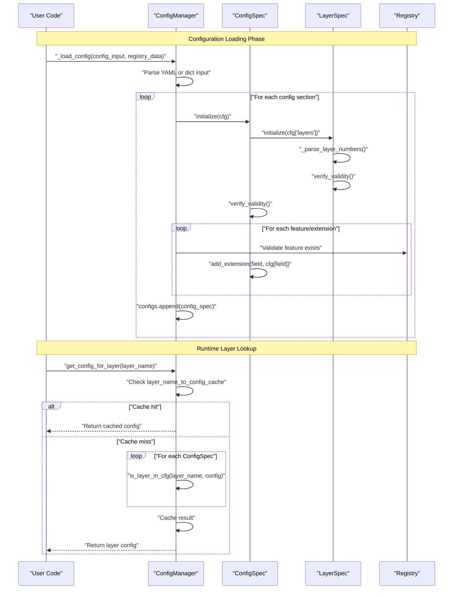
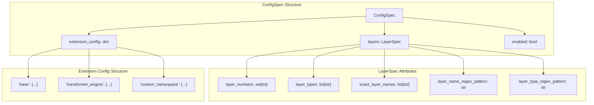

<!-- source: DeepWiki mcp.deepwiki.com · repo NVIDIA/nvidia-dlfw-inspect · page 3.2 Configuration API · fetched 2026-10-26 -->

# Configuration API

<details>
<summary>Relevant source files</summary>

The following files were used as context for generating this wiki page:

- [nvdlfw_inspect/config_manager.py](nvdlfw_inspect/config_manager.py)
- [tests/unit/test_config.py](tests/unit/test_config.py)

</details>


The Configuration API provides the core infrastructure for loading, parsing, validating, and managing YAML-based configuration files or Python dictionaries that control debugging features in nvidia-dlfw-inspect. This API handles the translation from user-defined configuration syntax to internal configuration objects and manages the efficient lookup of configuration data during model execution.

For information about the YAML configuration file format itself, see [Configuration File Structure](#4.1). For details about configuring specific features, see [Feature Configuration](#4.3). For the main user-facing API functions, see [Main API](#3.1).

## Core Configuration Classes

The Configuration API is built around several key classes that work together to parse, validate, and manage configuration data:



**Sources:** [nvdlfw_inspect/config_manager.py:30-147]()

## Configuration Loading and Processing Flow

The configuration loading process transforms YAML files or Python dictionaries into validated configuration objects that can be efficiently queried at runtime:



**Sources:** [nvdlfw_inspect/config_manager.py:154-223](), [nvdlfw_inspect/config_manager.py:225-241]()

## Layer Selection Mechanisms

The `LayerSpec` class provides multiple methods for targeting specific layers in a model. These selection criteria can be combined to create precise layer targeting rules:

| Selection Method | Description | Example Configuration | Matching Logic |
|------------------|-------------|----------------------|----------------|
| `layer_numbers` | Target layers by numeric index | `[1, 2, "5-10", "all"]` | Extracts numbers from layer names using regex `(?<!fc)\d+` |
| `layer_types` | Target layers by type string | `["mlp", "qkv", "all"]` | Creates regex pattern from list: `(mlp\|qkv)` |
| `exact_layer_names` | Target specific layer names | `["decoder.1.mlp.fc1"]` | Exact string matching |
| `layer_name_regex_pattern` | Custom regex pattern | `".*\.attention\..*"` | Direct regex matching against layer names |

### Layer Number Parsing

The `LayerSpec._parse_layer_numbers()` method supports flexible layer number specification:

- **Individual numbers**: `[1, 2, 3]` → `{1, 2, 3}`
- **Number ranges**: `["1-5"]` → `{1, 2, 3, 4, 5}`
- **Mixed format**: `[1, "3-5", 7]` → `{1, 3, 4, 5, 7}`
- **All layers**: `"all"` or `["all"]` → `{-1}` (special marker)

**Sources:** [nvdlfw_inspect/config_manager.py:58-123](), [nvdlfw_inspect/config_manager.py:250-304]()

## Configuration Specification Management

### ConfigSpec Class

The `ConfigSpec` class represents a complete configuration specification that includes layer targeting rules and feature configurations:



**Sources:** [nvdlfw_inspect/config_manager.py:125-146]()

### Configuration Validation

The configuration validation process ensures that:

1. **Required fields exist**: Each configuration must have an `enabled` field and `layers` section
2. **Layer specification validity**: At least one layer selection method must be provided
3. **Feature existence**: All referenced features must exist in the registry
4. **No duplicate targeting**: Multiple configurations cannot target the same layer

**Sources:** [nvdlfw_inspect/config_manager.py:130-137](), [nvdlfw_inspect/config_manager.py:186-210]()

## ConfigManager Class API

### Class Methods

#### `_load_config(config_input, registry_data)`

Loads configuration from either a YAML file path or Python dictionary:

- **Parameters**:
  - `config_input`: `str | pathlib.Path | dict` - YAML file path or configuration dictionary
  - `registry_data`: `dict` - Registry data for feature validation
- **Behavior**: Parses input, validates against registry, creates `ConfigSpec` objects
- **Error Handling**: Logs warnings for missing files, validates feature existence

#### `get_config_for_layer(layer_name)`

Retrieves configuration for a specific layer with caching:

- **Parameters**: `layer_name: str` - Full layer name (e.g., "decoder.1.mlp.fc1")
- **Returns**: `dict` - Extension configuration mapping for the layer
- **Caching**: Results are cached in `layer_name_to_config_cache` for performance
- **Validation**: Ensures no multiple configurations target the same layer

#### `reset()`

Clears all configuration state:

- Resets all `ConfigSpec` objects
- Clears the configurations list
- Empties the layer name cache

**Sources:** [nvdlfw_inspect/config_manager.py:148-248]()

## Caching and Performance Optimization

The Configuration API implements several performance optimizations:

### Layer Name to Configuration Cache

The `layer_name_to_config_cache` dictionary provides O(1) lookup for previously resolved layer configurations:

```python
# Cache structure: layer_name -> extension_config_dict
layer_name_to_config_cache = {
    "decoder.1.mlp.fc1": {
        "base": {"LogTensorStats": {...}},
        "transformer_engine": {"DisableFp8Gemm": {...}}
    }
}
```

### Regex Pattern Compilation

Layer type patterns and regex patterns are compiled once during initialization:

- `layer_types` list is converted to compiled regex pattern in `layer_type_regex_pattern`
- `layer_name_regex_pattern` string is compiled to regex object
- Number extraction uses pre-compiled pattern `(?<!fc)\d+`

**Sources:** [nvdlfw_inspect/config_manager.py:151](), [nvdlfw_inspect/config_manager.py:225-240](), [nvdlfw_inspect/config_manager.py:77-78](), [nvdlfw_inspect/config_manager.py:91]()

## Utility Functions

### `is_layer_in_cfg(layer_name, cfg)`

Determines if a layer matches a configuration specification:

- **Logic Flow**: Checks exact names → regex pattern → layer numbers + types
- **Number Extraction**: Uses regex `(?<!fc)\d+` to avoid matching "fc" layer suffixes  
- **Type Matching**: Uses compiled regex pattern for layer type matching
- **Special Cases**: Handles "all" keyword for universal matching

### Helper Functions

- `spec_attribute_iterator(spec)`: Iterates over non-magic attributes of a spec object
- `set_all_spec_attributes(spec, cfg)`: Bulk sets attributes from configuration dictionary
- `feature_not_found_error(feature_name, namespace)`: Generates standardized error messages

**Sources:** [nvdlfw_inspect/config_manager.py:250-304](), [nvdlfw_inspect/config_manager.py:43-56](), [nvdlfw_inspect/config_manager.py:26-28]()

---

