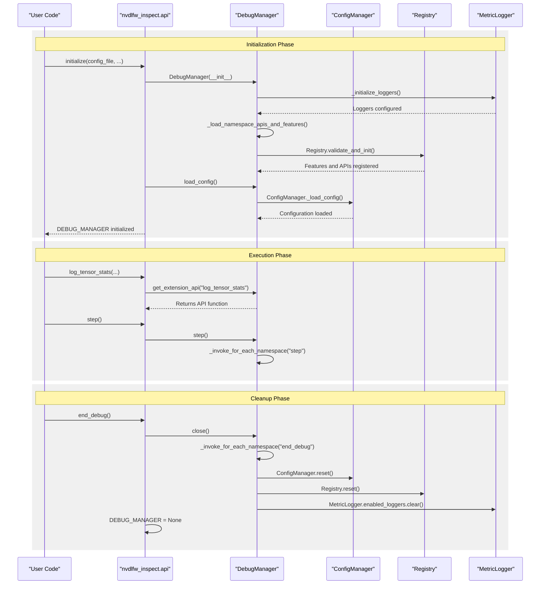
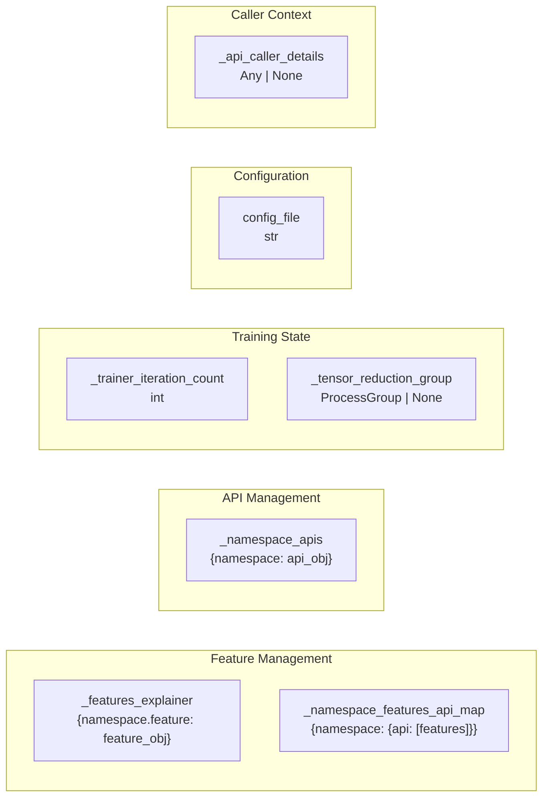
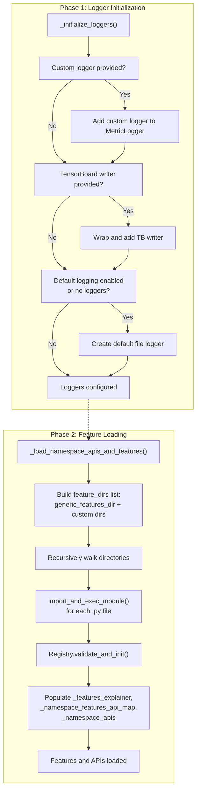
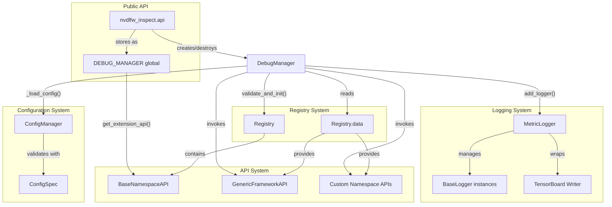

<!-- source: DeepWiki mcp.deepwiki.com · repo NVIDIA/nvidia-dlfw-inspect · page 3.3 Debug Manager · fetched 2026-10-26 -->

# Debug Manager

<details>
<summary>Relevant source files</summary>

The following files were used as context for generating this wiki page:

- [nvdlfw_inspect/api.py](nvdlfw_inspect/api.py)
- [nvdlfw_inspect/debug_manager.py](nvdlfw_inspect/debug_manager.py)

</details>


The `DebugManager` class is the central orchestrator of nvdlfw_inspect. It manages the complete lifecycle of a debugging session, coordinates all subsystems (configuration, logging, features, and namespaces), and provides the runtime infrastructure for executing debugging operations.

For information about the public API that wraps the `DebugManager`, see [Main API](#3.1). For configuration management details, see [Configuration API](#3.2).

## Overview

The `DebugManager` serves as the single source of truth for the debugging session state. It is instantiated as a global singleton through the `initialize()` function in the public API and coordinates:

- **Logging infrastructure** - Statistics loggers, file loggers, and TensorBoard writers
- **Feature loading** - Dynamic discovery and registration of debugging features
- **Namespace management** - Organization of features into namespaces with associated APIs
- **Configuration** - Loading and management of YAML configuration files
- **Training state** - Tracking of training step iterations
- **Distributed coordination** - Tensor reduction groups for multi-GPU scenarios

The `DebugManager` is created once per process and exists for the duration of the debugging session until `end_debug()` is called.

Sources: [nvdlfw_inspect/debug_manager.py:32-228](), [nvdlfw_inspect/api.py:24-182]()

## Class Structure

```mermaid
graph TB
    subgraph "DebugManager Core"
        DM["DebugManager"]
        Init["__init__()"]
        LoadConfig["load_config()"]
        Close["close()"]
    end
    
    subgraph "Initialization Methods"
        InitLoggers["_initialize_loggers()"]
        LoadFeatures["_load_namespace_apis_and_features()"]
    end
    
    subgraph "Feature Access"
        GetExtAPI["get_extension_api()"]
        ListFeats["list_features()"]
        ExplainFeats["explain_features()"]
    end
    
    subgraph "Training Lifecycle"
        InitStep["initialize_training_step()"]
        Step["step()"]
        InvokeNS["_invoke_for_each_namespace()"]
    end
    
    subgraph "Internal State"
        FeatExplain["_features_explainer: dict"]
        NSFeatMap["_namespace_features_api_map: dict"]
        NSApis["_namespace_apis: dict"]
        TrainCount["_trainer_iteration_count: int"]
        TensorGroup["_tensor_reduction_group: ProcessGroup"]
    end
    
    DM --> Init
    DM --> LoadConfig
    DM --> Close
    
    Init --> InitLoggers
    Init --> LoadFeatures
    
    DM --> GetExtAPI
    DM --> ListFeats
    DM --> ExplainFeats
    
    DM --> InitStep
    DM --> Step
    Step --> InvokeNS
    
    DM --> FeatExplain
    DM --> NSFeatMap
    DM --> NSApis
    DM --> TrainCount
    DM --> TensorGroup
```



**Diagram: DebugManager class structure showing methods and internal state**

Sources: [nvdlfw_inspect/debug_manager.py:32-228]()

## Lifecycle

The `DebugManager` follows a strict lifecycle managed through the public API:



**Diagram: DebugManager lifecycle from initialization to cleanup**

Sources: [nvdlfw_inspect/api.py:27-87](), [nvdlfw_inspect/debug_manager.py:33-56](), [nvdlfw_inspect/debug_manager.py:174-180]()

## Initialization Parameters

The `DebugManager` constructor accepts the following parameters:

| Parameter | Type | Default | Description |
|-----------|------|---------|-------------|
| `config_file` | `str` | Required | Path to YAML configuration file specifying features and layer selections |
| `feature_dirs` | `list[str] \| str \| None` | `None` | Directories containing custom features to load. Built-in features are always loaded |
| `statistics_logger` | `BaseLogger \| None` | `None` | Custom logger instance for statistics. Must inherit from `BaseLogger` |
| `log_dir` | `str` | `"."` | Directory where log files will be created |
| `init_training_step` | `int` | `0` | Initial training step counter value |
| `**kwargs` | `dict` | `{}` | Additional options: `tb_writer` (TensorBoard writer), `default_logging_enabled` (bool) |

Sources: [nvdlfw_inspect/debug_manager.py:33-41](), [nvdlfw_inspect/api.py:27-54]()

## Public Methods

### Configuration Management

#### `load_config()`

Loads the YAML configuration file specified during initialization. This method delegates to `ConfigManager._load_config()` with registry data.

```python
def load_config(self):
    ConfigManager._load_config(self.config_file, registry_data=Registry.data)
```

**Usage**: Called automatically during `initialize()` in the public API.

Sources: [nvdlfw_inspect/debug_manager.py:54-55]()

---

### Feature Discovery

#### `list_features()`

Prints all available features registered in the debugging session. Features are identified by their fully qualified names in the format `namespace.feature_name`.

**Output**: Prints list to stdout (rank 0 only in distributed settings)

Sources: [nvdlfw_inspect/debug_manager.py:182-183]()

#### `explain_features(features)`

Provides detailed documentation for specified features by printing their docstrings.

**Parameters**:
- `features` (`list | str | None`): 
  - `None`: Prints usage instructions
  - `str`: Single feature name or `"all"` for all features
  - `list`: List of feature names to explain

**Example**:
```python
# Via public API
debug_api.explain_features("base.LogTensorStats")
debug_api.explain_features(["base.LogTensorStats", "base.FakeQuant"])
debug_api.explain_features("all")
```

Sources: [nvdlfw_inspect/debug_manager.py:185-213](), [nvdlfw_inspect/api.py:107-109]()

---

### API Access

#### `get_extension_api(name)`

Returns the API function or namespace object for the specified name. This is the core method that enables dynamic API routing.

**Parameters**:
- `name` (`str`): API name or namespace name

**Returns**:
- For base namespace APIs (e.g., `"log_tensor_stats"`): Returns a partial function bound to `route_api`
- For other namespaces (e.g., `"transformer_engine"`): Returns the namespace API object

**Raises**:
- `ValueError`: If the API or namespace is not found

**Internal Logic**:
1. Check if `name` is a base namespace API → return partial function
2. Check if `name` is a registered namespace → return namespace object
3. Otherwise → raise ValueError

Sources: [nvdlfw_inspect/debug_manager.py:161-172]()

---

### Training Step Management

#### `initialize_training_step(train_step)`

Sets the training step counter to a specific value. Useful for resuming training from checkpoints.

**Parameters**:
- `train_step` (`int`): The training step number to set

Sources: [nvdlfw_inspect/debug_manager.py:215-216]()

#### `step()`

Increments the training step counter and invokes the `step()` method on all registered namespace APIs. This should be called once per training iteration.

**Effects**:
1. Increments `_trainer_iteration_count`
2. Calls `step()` on each namespace API (if implemented)

Sources: [nvdlfw_inspect/debug_manager.py:218-220]()

---

### Session Management

#### `close()`

Performs cleanup and releases all resources. This method:

1. Invokes `end_debug()` on all namespace APIs
2. Resets `ConfigManager`
3. Resets `Registry`
4. Clears internal dictionaries
5. Clears all enabled loggers

**Warning**: After calling `close()`, the `DebugManager` instance is invalid and a new instance must be created via `initialize()`.

Sources: [nvdlfw_inspect/debug_manager.py:174-180]()

## Internal State

The `DebugManager` maintains the following internal state:



**Diagram: Internal state variables of DebugManager**

| State Variable | Type | Purpose |
|----------------|------|---------|
| `_features_explainer` | `dict[str, object]` | Maps fully qualified feature names to feature class objects for documentation |
| `_namespace_features_api_map` | `dict[str, dict]` | Maps namespace to API-to-features mapping from Registry |
| `_namespace_apis` | `dict[str, object]` | Maps namespace names to API class instances |
| `_trainer_iteration_count` | `int` | Current training step counter |
| `_tensor_reduction_group` | `ProcessGroup \| None` | PyTorch distributed process group for tensor reductions |
| `_api_caller_details` | `Any \| None` | Reserved for storing API caller context information |
| `config_file` | `str` | Path to the configuration YAML file |

Sources: [nvdlfw_inspect/debug_manager.py:42-52]()

## Initialization Process

The initialization process consists of two major phases executed in the constructor:



**Diagram: Two-phase initialization process in DebugManager constructor**

### Logger Initialization Details

The `_initialize_loggers()` method [nvdlfw_inspect/debug_manager.py:57-100]() sets up the logging infrastructure:

1. **Custom Logger Validation**: If a `statistics_logger` is provided, validates it is a `BaseLogger` instance
2. **TensorBoard Integration**: If `tb_writer` is provided in kwargs, wraps it using `wrap_tensorboard_writer()`
3. **Default Logger Creation**: If no loggers are configured or `default_logging_enabled=True`, creates a default file logger

All loggers are registered with the `MetricLogger` singleton, which handles statistics aggregation.

Sources: [nvdlfw_inspect/debug_manager.py:57-100]()

### Feature Loading Details

The `_load_namespace_apis_and_features()` method [nvdlfw_inspect/debug_manager.py:102-159]() dynamically discovers and loads features:

1. **Directory Preparation**:
   - Always includes built-in features from `nvdlfw_inspect/debug_features`
   - Adds custom feature directories if provided
   - Validates all directories exist

2. **Recursive Import**:
   - Walks each directory recursively
   - Imports every `.py` file using `import_and_exec_module()`
   - This triggers `@register_namespace_api` and `@register_feature` decorators

3. **Registry Validation**:
   - Calls `Registry.validate_and_init()` to ensure all registrations are valid
   - Creates namespace API instances

4. **State Population**:
   - Populates `_features_explainer` with `namespace.feature_name` → feature object mappings
   - Populates `_namespace_features_api_map` from `Registry.data[namespace].feat_api_to_features`
   - Populates `_namespace_apis` from `Registry.data[namespace].api`

Sources: [nvdlfw_inspect/debug_manager.py:102-159]()

## Integration with Other Components



**Diagram: DebugManager integration with other nvdlfw_inspect components**

### Key Integration Points

1. **ConfigManager** [nvdlfw_inspect/config_manager.py]():
   - `load_config()` delegates to `ConfigManager._load_config()`
   - Configuration is loaded with registry data to enable feature validation

2. **Registry** [nvdlfw_inspect/registry.py]():
   - `_load_namespace_apis_and_features()` triggers `Registry.validate_and_init()`
   - `_namespace_apis` and related mappings are populated from `Registry.data`

3. **MetricLogger** [nvdlfw_inspect/logging/]():
   - `_initialize_loggers()` registers loggers with `MetricLogger`
   - All features use `MetricLogger` for statistics output

4. **Public API** [nvdlfw_inspect/api.py]():
   - Module maintains global `DEBUG_MANAGER` singleton
   - `__getattr__` delegates to `get_extension_api()` for dynamic API routing

Sources: [nvdlfw_inspect/debug_manager.py:54-55](), [nvdlfw_inspect/debug_manager.py:150-159](), [nvdlfw_inspect/debug_manager.py:57-100](), [nvdlfw_inspect/api.py:24-182]()

## Global Singleton Pattern

The `DebugManager` uses a global singleton pattern implemented in the public API module:

```python
# From nvdlfw_inspect/api.py
DEBUG_MANAGER = None

def initialize(...):
    global DEBUG_MANAGER
    if DEBUG_MANAGER is not None:
        raise ValueError("[NVDLFW INSPECT ERROR] Already initialized.")
    DEBUG_MANAGER = DebugManager(...)
    DEBUG_MANAGER.load_config()

def end_debug():
    global DEBUG_MANAGER
    if DEBUG_MANAGER is not None:
        DEBUG_MANAGER.close()
        DEBUG_MANAGER = None
```

**Constraints**:
- Only one `DebugManager` instance per process
- Must call `initialize()` before any other API calls
- Must call `end_debug()` to clean up before reinitializing

**Distributed Training**: Each rank in a distributed training job has its own `DEBUG_MANAGER` instance. The `initialize()` function must be called on all ranks.

Sources: [nvdlfw_inspect/api.py:24](), [nvdlfw_inspect/api.py:27-70](), [nvdlfw_inspect/api.py:83-87]()

## Error Handling

The `DebugManager` implements validation at multiple stages:

| Error Condition | Location | Exception Type | Message |
|----------------|----------|----------------|---------|
| Invalid logger type | `_initialize_loggers()` | `AssertionError` | "Loggers should be of type 'BaseLogger' but found..." |
| Feature directory not found | `_load_namespace_apis_and_features()` | `AssertionError` | "Could not find features path: {feat_dir}" |
| Invalid feature_dirs type | `_load_namespace_apis_and_features()` | `ValueError` | "Recieved type {type}. Expected type is either `List[str]` or `str`" |
| API/namespace not found | `get_extension_api()` | `ValueError` | "API for {name} not found. Make sure {name}.api.py is implemented correctly." |
| Already initialized | `api.initialize()` | `ValueError` | "Already initialized." |
| Not initialized | Various API calls | `RuntimeError` | "Debug manager not initialized. Call initialize first." |

Sources: [nvdlfw_inspect/debug_manager.py:77-81](), [nvdlfw_inspect/debug_manager.py:129-135](), [nvdlfw_inspect/debug_manager.py:144-147](), [nvdlfw_inspect/debug_manager.py:165-171](), [nvdlfw_inspect/api.py:59-60](), [nvdlfw_inspect/api.py:176-179]()

## Usage Example

```python
import nvdlfw_inspect.api as debug_api

# Initialize the DebugManager singleton
debug_api.initialize(
    config_file="config.yaml",
    feature_dirs=["./custom_features"],
    log_dir="./debug_output",
    init_training_step=0
)

# List available features
debug_api.list_features()

# Get documentation for specific features
debug_api.explain_features(["base.LogTensorStats"])

# Use debugging features (delegated through DebugManager)
for step in range(num_steps):
    output = model(input)
    debug_api.log_tensor_stats(output, layer_name="output")
    debug_api.step()  # Increments training step counter

# Clean up
debug_api.end_debug()
```

Sources: [nvdlfw_inspect/api.py:27-109]()

---

