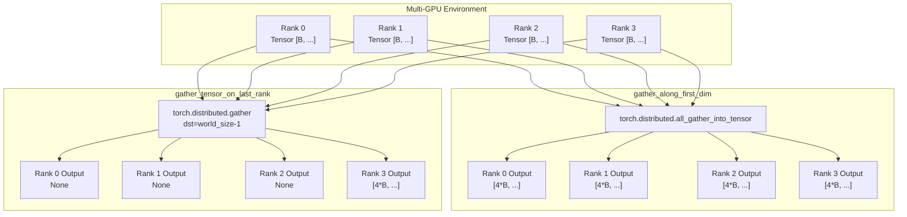
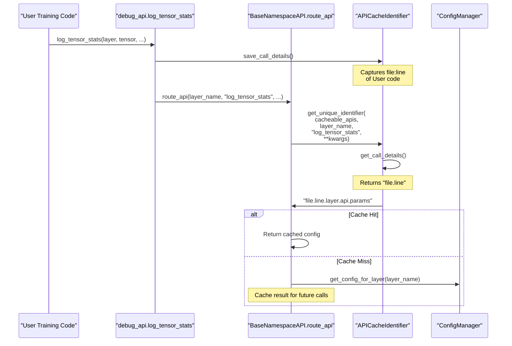
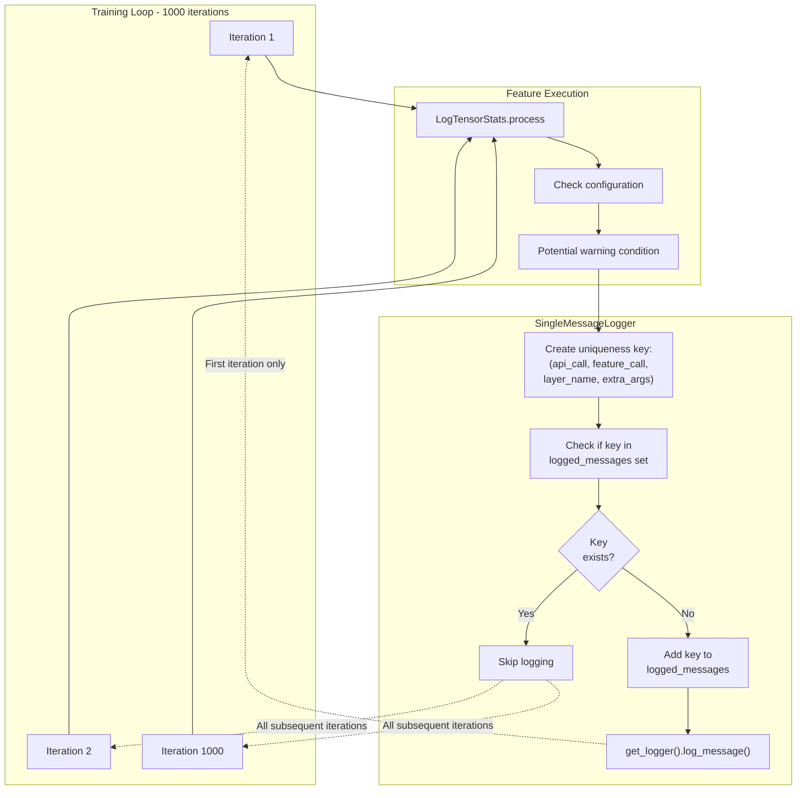
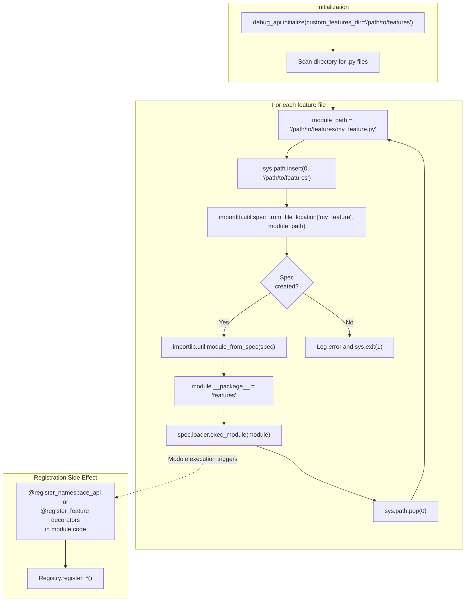
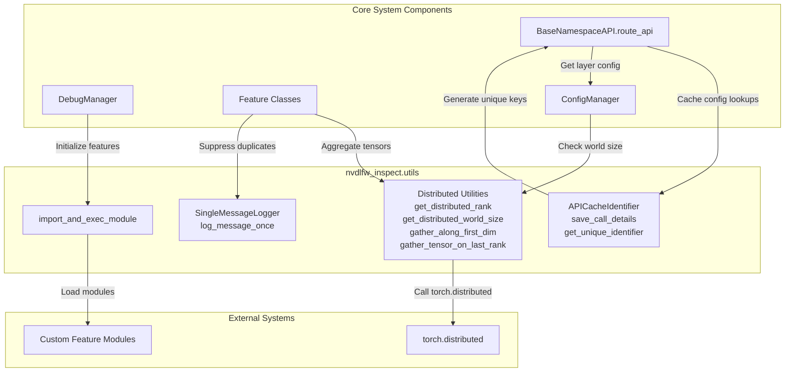

<!-- source: DeepWiki mcp.deepwiki.com · repo NVIDIA/nvidia-dlfw-inspect · page 3.4 Utility Functions · fetched 2026-10-26 -->

# Utility Functions

<details>
<summary>Relevant source files</summary>

The following files were used as context for generating this wiki page:

- [nvdlfw_inspect/utils.py](nvdlfw_inspect/utils.py)
- [tests/unit/test_cache.py](tests/unit/test_cache.py)

</details>


This page documents utility classes and functions provided by `nvdlfw_inspect` for distributed operations, caching, logging, and module management. These utilities support the core functionality of the framework and are primarily used internally, though some may be useful for custom feature development.

For information about the main API functions used in training code, see [Main API](#3.1). For distributed training configuration and usage patterns, see [Distributed Training Support](#6.2). For caching behavior and performance optimization, see [Caching and Performance](#6.3).

---

## Overview

The `nvdlfw_inspect.utils` module provides foundational utilities organized into four categories:

| Category | Components | Primary Use Case |
|----------|-----------|------------------|
| **Distributed Operations** | `get_distributed_world_size`, `get_distributed_rank`, `gather_along_first_dim`, `gather_tensor_on_last_rank` | Multi-GPU tensor gathering and rank management |
| **Caching** | `APICacheIdentifier` | Efficient API call deduplication and configuration lookup |
| **Logging** | `SingleMessageLogger` | Preventing duplicate warning/info messages |
| **Module Loading** | `import_and_exec_module` | Dynamic feature and namespace discovery |
| **Decorators** | `append_parent_docstring` | Documentation inheritance |

**Sources:** [nvdlfw_inspect/utils.py:1-192]()

---

## Distributed Training Utilities

The distributed utilities enable `nvdlfw_inspect` to work seamlessly across multiple GPUs, handling rank detection and tensor aggregation operations.

### Functions

#### `get_distributed_world_size(group=None)`

Returns the total number of processes in the distributed group. Returns 1 if PyTorch distributed is not initialized.

**Parameters:**
- `group` (dist.ProcessGroup | None): Process group to query. Defaults to the default process group.

**Returns:** `int` - Number of processes in the group.

**Location:** [nvdlfw_inspect/utils.py:28-32]()

#### `get_distributed_rank(group=None)`

Returns the rank of the current process within the distributed group. Requires PyTorch distributed to be initialized.

**Parameters:**
- `group` (dist.ProcessGroup | None): Process group to query. Defaults to the default process group.

**Returns:** `int` - Rank of the current process.

**Raises:** `AssertionError` if PyTorch distributed is not initialized.

**Location:** [nvdlfw_inspect/utils.py:35-38]()

#### `gather_along_first_dim(input_, process_group, async_op=False)`

All-gathers tensors from all processes and concatenates them along the first dimension. This is used when all ranks need a complete view of the gathered data.

**Parameters:**
- `input_` (torch.Tensor): Local tensor to gather.
- `process_group` (dist.ProcessGroup): Process group for the operation.
- `async_op` (bool): Whether to perform asynchronously. Default: False.

**Returns:** `tuple[torch.Tensor, Any]` - Concatenated output tensor and optional async handle.

**Location:** [nvdlfw_inspect/utils.py:41-68]()

#### `gather_tensor_on_last_rank(input_, process_group=None, async_op=False)`

Gathers tensors from all processes and concatenates them only on the last rank. This is the default gathering strategy used by `nvdlfw_inspect` for efficient centralized logging.

**Parameters:**
- `input_` (torch.Tensor): Local tensor to gather.
- `process_group` (dist.ProcessGroup | None): Process group for the operation. Defaults to the default process group.
- `async_op` (bool): Whether to perform asynchronously. Default: False.

**Returns:** `tuple[torch.Tensor, Any]` - Concatenated tensor on last rank (None on other ranks) and optional async handle.

**Location:** [nvdlfw_inspect/utils.py:71-97]()

### Distributed Gathering Patterns



**Distributed Gathering Strategies:** The diagram illustrates two tensor gathering approaches. `gather_along_first_dim` uses all-gather to produce identical concatenated tensors on all ranks, while `gather_tensor_on_last_rank` gathers only to the last rank for centralized logging.

**Sources:** [nvdlfw_inspect/utils.py:28-97]()

---

## API Caching System

The `APICacheIdentifier` class provides a mechanism to generate unique identifiers for API calls based on the calling context. This enables efficient caching of configuration lookups and prevents redundant processing.

### APICacheIdentifier Class

The `APICacheIdentifier` is a class-based singleton that tracks API call locations and generates cache keys.

**Location:** [nvdlfw_inspect/utils.py:125-149]()

#### Class Methods

##### `save_call_details()`

Captures the file path and line number of the caller's caller (two frames back from the API entry point). This must be called at the entry point of cacheable API functions.

**Implementation Detail:** Uses Python's `inspect.currentframe()` and navigates two frames back (`.f_back.f_back`) because the call stack is: user code → nvdlfw_inspect.api → this function.

**Location:** [nvdlfw_inspect/utils.py:129-133]()

##### `get_call_details()`

Retrieves the previously saved call details as a string in the format `"filename.line_number"`.

**Returns:** `str` - The cached call details.

**Location:** [nvdlfw_inspect/utils.py:135-137]()

##### `get_unique_identifier(cacheable_apis, layer_name, api_name, **kwargs)`

Generates a unique identifier string for cacheable API calls, incorporating call location, layer name, API name, and relevant parameters.

**Parameters:**
- `cacheable_apis` (dict): Dictionary mapping API names to lists of cacheable parameter names.
- `layer_name` (str): Name of the layer being processed.
- `api_name` (str): Name of the API being called.
- `**kwargs`: API call arguments.

**Returns:** `str | None` - Unique identifier string if the API is cacheable, None otherwise.

**Identifier Format:** `"file.line.layer_name.api_name.param1_value.param2_value..."`

Missing parameters are represented as `"0"` in the identifier string.

**Location:** [nvdlfw_inspect/utils.py:139-149]()

### Cache Identifier Flow



**API Caching Workflow:** The sequence shows how `APICacheIdentifier` enables efficient configuration caching by generating unique keys based on call location and parameters. This prevents redundant configuration lookups for repeated API calls.

**Sources:** [nvdlfw_inspect/utils.py:125-149](), [tests/unit/test_cache.py:1-91]()

### Usage Example

The following table shows example cache identifiers generated for different scenarios:

| Scenario | Call Location | Layer Name | API Name | Parameters | Generated Identifier |
|----------|--------------|------------|----------|------------|---------------------|
| Complete parameters | `train.py:42` | `layer1` | `log_tensor_stats` | `stat_type="mean"`, `reduction_group=None` | `train.py.42.layer1.log_tensor_stats.mean.None` |
| Missing parameters | `train.py:42` | `layer2` | `log_tensor_stats` | `stat_type="mean"` | `train.py.42.layer2.log_tensor_stats.mean.0` |
| Non-cacheable API | `train.py:42` | `layer1` | `non_cached_api` | Any | `None` |
| Same call, different layer | `train.py.42` | `layer3` | `log_tensor_stats` | `stat_type="mean"` | `train.py.42.layer3.log_tensor_stats.mean.0` |

**Sources:** [tests/unit/test_cache.py:41-86]()

---

## Logging Utilities

The `SingleMessageLogger` class prevents duplicate log messages from being emitted multiple times, which is crucial in training loops where the same code path is executed thousands of times.

### SingleMessageLogger Class

A class-based logger that tracks unique message contexts and ensures each unique message is logged only once.

**Location:** [nvdlfw_inspect/utils.py:152-178]()

#### Class Attributes

- `logged_messages` (set): Class-level set storing tuples of message contexts that have been logged.

#### Class Methods

##### `log_message_once(message, layer_name=None, level=logging.INFO, extra_cachable_args=None)`

Logs a message only once per unique combination of API call location, feature call location, layer name, and extra arguments.

**Parameters:**
- `message` (str): The message to log.
- `layer_name` (str | None): Optional layer name to include in the log message.
- `level` (int): Logging level (e.g., `logging.INFO`, `logging.WARNING`). Default: `logging.INFO`.
- `extra_cachable_args`: Additional arguments to include in the uniqueness check.

**Uniqueness Key:** The method creates a tuple `(api_call_line, feature_call_details, layer_name, extra_cachable_args)` to determine message uniqueness.

**Location:** [nvdlfw_inspect/utils.py:155-178]()

### Message Deduplication Mechanism



**Single Message Logging Flow:** The diagram shows how `SingleMessageLogger` prevents duplicate messages across training iterations by maintaining a set of logged message contexts.

**Sources:** [nvdlfw_inspect/utils.py:152-178]()

---

## Dynamic Module Loading

The `import_and_exec_module` function enables runtime discovery and loading of custom features and namespace APIs.

### import_and_exec_module(module_path)

Dynamically imports and executes a Python module from a file path, handling package setup and error reporting.

**Parameters:**
- `module_path` (str): Absolute or relative path to the Python module file.

**Behavior:**
1. Adds the module's directory to `sys.path` temporarily.
2. Creates a module spec using `importlib.util.spec_from_file_location`.
3. Sets the module's `__package__` attribute based on the directory name.
4. Executes the module using `spec.loader.exec_module`.
5. Removes the directory from `sys.path` to avoid pollution.
6. Logs errors and exits if module loading fails.

**Error Handling:** On failure, logs an error message and calls `sys.exit(1)`.

**Location:** [nvdlfw_inspect/utils.py:100-122]()

### Module Loading Flow



**Dynamic Module Loading Process:** The diagram illustrates how `import_and_exec_module` loads custom features, temporarily modifying `sys.path` and executing module code to trigger registration decorators.

**Sources:** [nvdlfw_inspect/utils.py:100-122]()

---

## Documentation Utilities

### append_parent_docstring(parent)

A class decorator that appends the parent class's docstring to the decorated class's docstring. This is useful for custom features that extend base classes.

**Parameters:**
- `parent` (class): The parent class whose docstring should be appended.

**Returns:** Decorator function that modifies the class's `__doc__` attribute.

**Behavior:** Concatenates the child class's existing docstring with the parent class's docstring, separated by two newlines.

**Location:** [nvdlfw_inspect/utils.py:181-191]()

**Example Usage Pattern:**
```python
@append_parent_docstring(BaseConfigAPIMapper)
class MyCustomMapper(BaseConfigAPIMapper):
    """Custom mapper for my feature."""
    pass
# MyCustomMapper.__doc__ will contain both the custom docstring
# and BaseConfigAPIMapper's docstring
```

**Sources:** [nvdlfw_inspect/utils.py:181-191]()

---

## Utility Integration in System Architecture



**Utility Integration Architecture:** This diagram shows how utility functions support core components. `APICacheIdentifier` optimizes `BaseNamespaceAPI`, distributed utilities enable multi-GPU features, `SingleMessageLogger` prevents spam, and `import_and_exec_module` enables custom feature discovery.

**Sources:** [nvdlfw_inspect/utils.py:1-192]()

---

## Summary Table

| Utility | Primary Consumer | Key Function | Performance Impact |
|---------|-----------------|--------------|-------------------|
| `APICacheIdentifier` | `BaseNamespaceAPI.route_api` | Generates unique cache keys for API calls | High - Prevents repeated config lookups |
| `SingleMessageLogger` | Feature classes | Deduplicates log messages | Medium - Reduces log volume |
| `gather_along_first_dim` | `LogTensorStats` | All-gather tensors across ranks | Low - Only when `reduction_group` specified |
| `gather_tensor_on_last_rank` | `LogTensorStats` | Default tensor aggregation | Low - Only when multi-GPU and not skipped |
| `get_distributed_rank` | `ConfigManager`, Features | Query process rank | Negligible |
| `get_distributed_world_size` | `ConfigManager`, Features | Query process count | Negligible |
| `import_and_exec_module` | `DebugManager._load_namespace_apis_and_features` | Load custom features | One-time initialization cost |
| `append_parent_docstring` | Custom feature developers | Documentation inheritance | None - Compile-time only |

**Sources:** [nvdlfw_inspect/utils.py:1-192]()

---

