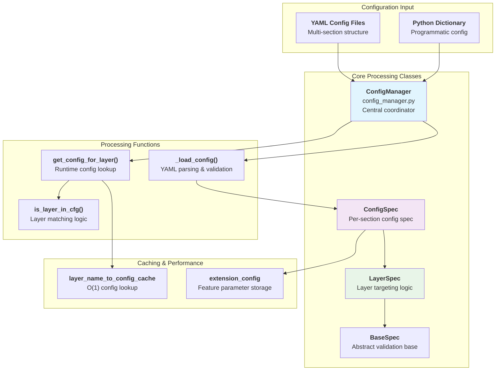
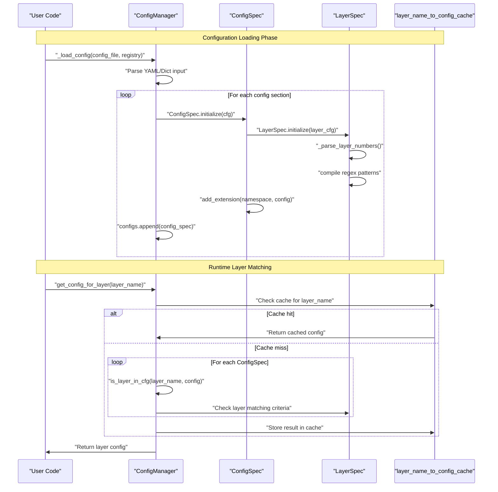
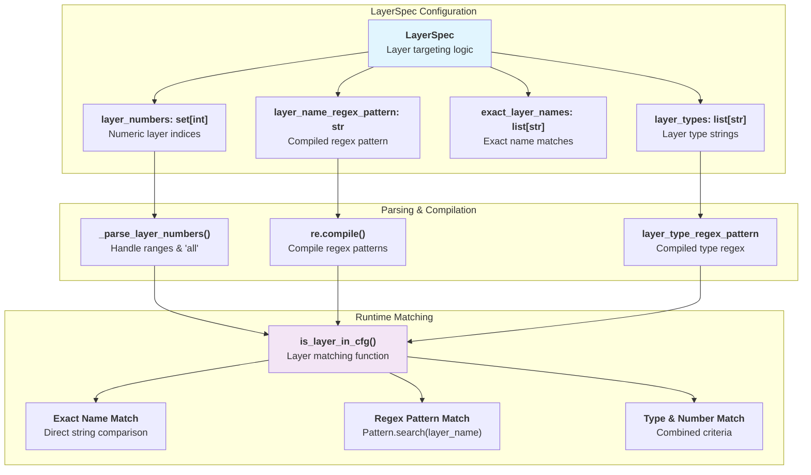
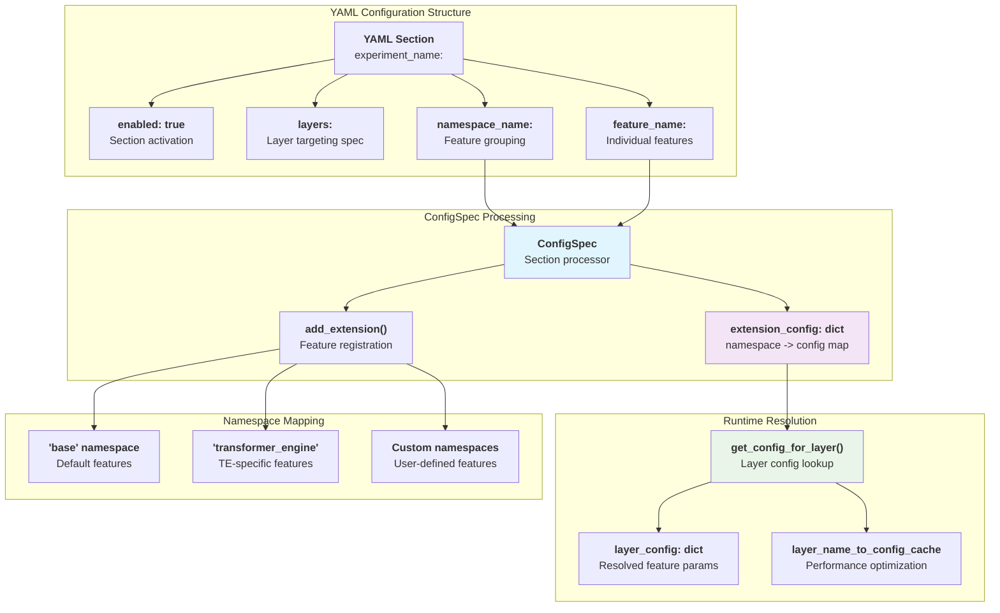

<!-- source: DeepWiki mcp.deepwiki.com · repo NVIDIA/nvidia-dlfw-inspect · page 4 Configuration System · fetched 2026-10-26 -->

# Configuration System

Relevant source files

The following files were used as context for generating this wiki page:

- [docs/getting_started.md](docs/getting_started.md)
- [nvdlfw_inspect/config_manager.py](nvdlfw_inspect/config_manager.py)

The Configuration System provides a YAML-based interface for controlling debugging features in nvidia-dlfw-inspect. It allows users to selectively enable features for specific layers using flexible targeting mechanisms and manage feature parameters through structured configuration files.

For information about individual feature configuration parameters, see [Feature Configuration](#4.3). For details on the underlying API that processes these configurations, see [Configuration API](#3.2).

## Core Architecture

The configuration system is built around three main components that work together to parse, validate, and apply YAML configuration files to debugging features.

### Configuration System Components

Sources: [nvdlfw_inspect/config_manager.py:148-305]()

### Configuration Data Flow

Sources: [nvdlfw_inspect/config_manager.py:154-223](), [nvdlfw_inspect/config_manager.py:224-248]()

## Configuration Processing Flow

The `ConfigManager` class processes configuration files through a multi-stage pipeline that parses, validates, and optimizes configuration data for runtime use.

### Input Processing

The system accepts two types of configuration input through the `_load_config` method:

| Input Type | Description | Processing |
|------------|-------------|------------|
| **YAML File Path** | String or `pathlib.Path` to config file | Uses `yaml.safe_load()` to parse file contents |
| **Python Dictionary** | Direct dictionary input | Processes dictionary directly without file I/O |

The `_load_config` method handles both input types uniformly: [nvdlfw_inspect/config_manager.py:154-184]()

### Section Processing

Each configuration file contains one or more named sections. For each section, the system:

1. **Validates Required Fields**: Checks for mandatory `enabled` field [nvdlfw_inspect/config_manager.py:188-190]()
2. **Creates ConfigSpec**: Instantiates a `ConfigSpec` object for enabled sections [nvdlfw_inspect/config_manager.py:193-194]()
3. **Processes Extensions**: Maps feature configurations to namespaces [nvdlfw_inspect/config_manager.py:196-209]()
4. **Validates Against Registry**: Ensures all specified features exist in the feature registry [nvdlfw_inspect/config_manager.py:201-208]()

Sources: [nvdlfw_inspect/config_manager.py:186-222]()

## Layer Selection Mechanisms

The `LayerSpec` class provides multiple methods for targeting specific model layers. Each mechanism offers different levels of precision and flexibility for layer selection.

### Layer Targeting Methods

Sources: [nvdlfw_inspect/config_manager.py:58-123](), [nvdlfw_inspect/config_manager.py:250-304]()

### Layer Number Parsing

The `_parse_layer_numbers` method supports flexible numeric targeting:

| Format | Example | Result |
|--------|---------|--------|
| **Single Integer** | `5` | `{5}` |
| **Range String** | `"1-5"` | `{1, 2, 3, 4, 5}` |
| **Mixed List** | `[1, "3-5", 7]` | `{1, 3, 4, 5, 7}` |
| **All Layers** | `"all"` or `["all"]` | `{-1}` (special marker) |

The method extracts layer numbers from layer names using regex pattern `(?<!fc)\d+`, which excludes numbers following "fc" to avoid false matches with fully-connected layer naming. [nvdlfw_inspect/config_manager.py:93-122]()

### Layer Matching Logic

The `is_layer_in_cfg` function implements a hierarchical matching strategy:

1. **Exact Name Matching** (highest priority): Direct string comparison against `exact_layer_names` [nvdlfw_inspect/config_manager.py:255-265]()
2. **Regex Pattern Matching**: Uses compiled `layer_name_regex_pattern` [nvdlfw_inspect/config_manager.py:267-269]()
3. **Combined Number/Type Matching**: Logical AND/OR of numeric and type criteria [nvdlfw_inspect/config_manager.py:271-304]()

Sources: [nvdlfw_inspect/config_manager.py:250-304]()

## Feature Configuration Mapping

The configuration system maps YAML feature specifications to runtime feature parameters through a namespace-based architecture that supports both built-in and custom features.

### Extension Configuration Architecture

Sources: [nvdlfw_inspect/config_manager.py:125-147](), [nvdlfw_inspect/config_manager.py:196-209]()

### Configuration Validation Process

The `add_extension` method validates feature configurations against the feature registry:

| Validation Type | Code Location | Purpose |
|----------------|---------------|---------|
| **Namespace Validation** | [nvdlfw_inspect/config_manager.py:199-204]() | Ensures namespace exists in registry |
| **Feature Validation** | [nvdlfw_inspect/config_manager.py:201-203]() | Confirms feature exists within namespace |
| **Base Namespace Fallback** | [nvdlfw_inspect/config_manager.py:206-209]() | Maps non-namespaced features to 'base' |

### Performance Optimization

The configuration system implements several performance optimizations:

- **Layer Config Caching**: The `layer_name_to_config_cache` dictionary provides O(1) lookup for frequently accessed layer configurations [nvdlfw_inspect/config_manager.py:225-227]()
- **Regex Compilation**: Layer matching patterns are pre-compiled during initialization to avoid repeated compilation overhead [nvdlfw_inspect/config_manager.py:90-91]()
- **Set-based Layer Numbers**: Layer numbers are stored as sets for O(1) membership testing [nvdlfw_inspect/config_manager.py:97]()

Sources: [nvdlfw_inspect/config_manager.py:224-248](), [nvdlfw_inspect/config_manager.py:83-91]()

---

