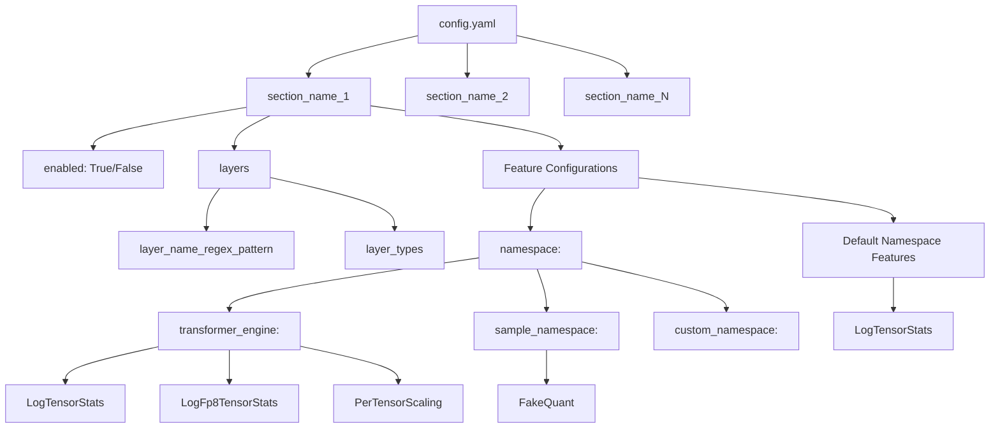
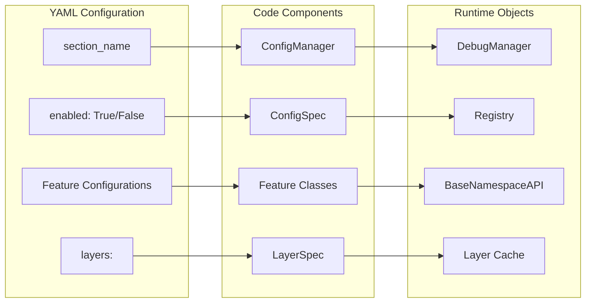
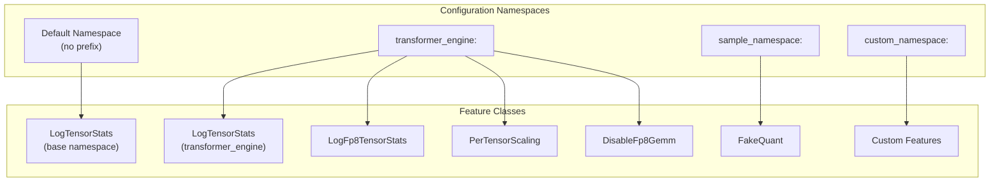
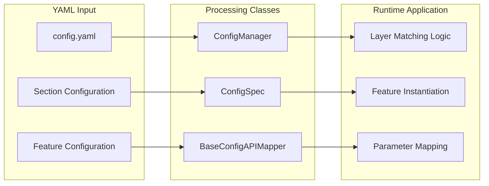

<!-- source: DeepWiki mcp.deepwiki.com · repo NVIDIA/nvidia-dlfw-inspect · page 4.1 Configuration File Structure · fetched 2026-10-26 -->

# Configuration File Structure

<details>
<summary>Relevant source files</summary>

The following files were used as context for generating this wiki page:

- [docs/getting_started.md](docs/getting_started.md)
- [nvdlfw_inspect/config_manager.py](nvdlfw_inspect/config_manager.py)
- [tests/unit/test_config.py](tests/unit/test_config.py)

</details>


## Purpose and Scope

This document describes the YAML configuration file format used by nvidia-dlfw-inspect to control debugging features and specify which layers to target during model execution. The configuration system allows fine-grained control over feature enablement, layer selection, and feature-specific parameters.

For information about specific feature configurations, see [Feature Configuration](#4.3). For details on layer selection methods, see [Layer Selection](#4.2).

## Overall YAML Structure

The configuration file uses a section-based structure where each section represents an independent debugging experiment. Each section can target different layers and enable different features.

### Configuration File Hierarchy



Sources: [docs/config_file.md:9-29](), [examples/configs/simple_model_train_sample.yaml:1-28]()

## Section Components

Each configuration section contains three essential components that work together to define a debugging experiment.

### Section Structure Mapping



Sources: [docs/config_file.md:31-34]()

### Enabled Field

The `enabled` field controls whether the entire section is active during debugging. When set to `False`, all features in that section are disabled regardless of their individual enabled status.

```yaml
section_name:
  enabled: True  # This section will be processed
  # ... other configuration
```

Sources: [docs/config_file.md:32]()

### Layer Selection

The `layers` field specifies which model layers the section's features apply to. The system supports multiple targeting methods:

| Method | Description | Example |
|--------|-------------|---------|
| `layer_name_regex_pattern` | Regular expression matching layer names | `.*\(fc1\|fc2\)` |
| `layer_types` | List of strings to match against layer names | `['fc1', 'layernorm_linear']` |

```yaml
# Regex pattern example (recommended)
layers:
  layer_name_regex_pattern: '.*(fc1|fc2)'

# Layer types example  
layers:
  layer_types: ['fc1', 'layernorm_linear']
```

Sources: [docs/config_file.md:51-68]()

### Feature Configuration

Features can be configured either in the default namespace or within specific namespaces like `transformer_engine` or `sample_namespace`.

```yaml
section_name:
  enabled: True
  layers:
    layer_name_regex_pattern: '.*fc1.*'
  
  # Default namespace feature
  LogTensorStats:
    enabled: True
    tensors: [activation]
    stats: [max, min]
  
  # Namespaced features
  transformer_engine:
    LogTensorStats:
      enabled: True
      tensors: [gradient]
      stats: [cur_amax]
```

Sources: [docs/config_file.md:14-28](), [examples/configs/simple_model_train_sample.yaml:5-16]()

## Namespace Organization

The configuration system supports organizing features into namespaces, allowing framework-specific or custom feature groupings.

### Namespace Structure



Sources: [docs/config_file.md:14-20](), [docs/config_file.md:81-99](), [examples/configs/simple_model_train_sample.yaml:17-27]()

## Advanced Configuration Patterns

The configuration system supports complex feature parameterization through structured specifications for tensors and GEMM operations.

### Structured Configuration Options

The system provides multiple ways to specify feature parameters:

#### Simple Lists
```yaml
Feature:
  enabled: True
  gemms: [gemm1, gemm2]
  tensors: [tensor1, tensor2]
```

#### Tensor Structures
```yaml
Feature:
  enabled: True
  tensors_struct:
    - tensor: tensor1
      feature_param1: value
    - tensor: tensor2
      feature_param1: value
```

#### GEMM Structures
```yaml
Feature:
  enabled: True
  gemms_struct:
    - gemm: gemm1
      tensors: [tensor1, tensor2]
      gemm_feature_param1: value
    - gemm: gemm2
      tensors_struct:
        - tensor: tensor1
          tensor_feature_param1: value
        - tensor: tensor2
          tensor_feature_param2: value
```

Sources: [docs/config_file.md:119-165]()

### Configuration Processing Flow



Sources: [docs/config_file.md:146-165]()

The configuration file structure provides a flexible foundation for controlling debugging behavior across different model layers and frameworks. The section-based organization allows multiple experiments to coexist in a single configuration file, while the namespace system enables framework-specific and custom feature extensions.

---

