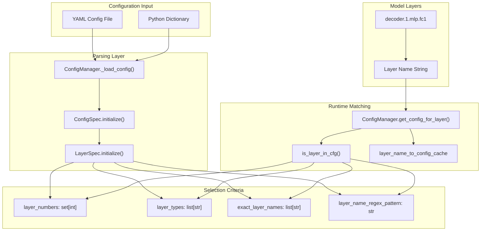
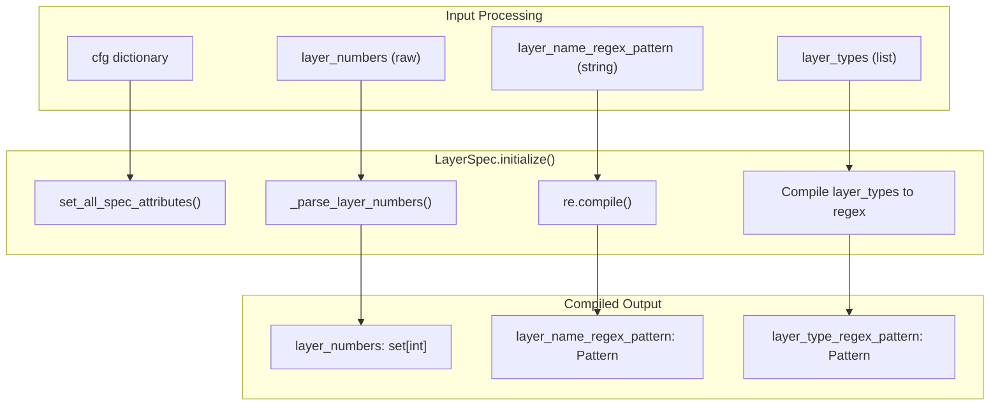
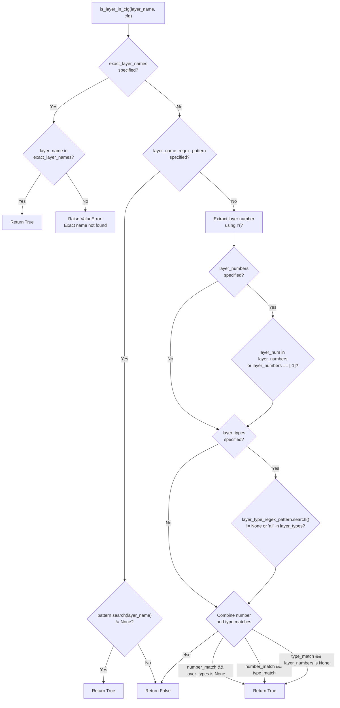
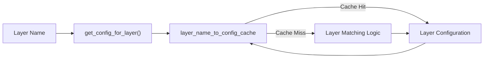

<!-- source: DeepWiki mcp.deepwiki.com · repo NVIDIA/nvidia-dlfw-inspect · page 4.2 Layer Selection · fetched 2026-10-26 -->

# Layer Selection

<details>
<summary>Relevant source files</summary>

The following files were used as context for generating this wiki page:

- [nvdlfw_inspect/config_manager.py](nvdlfw_inspect/config_manager.py)
- [tests/unit/test_config.py](tests/unit/test_config.py)

</details>


This page explains how to target specific layers in your PyTorch model using the nvidia-dlfw-inspect configuration system. Layer selection allows you to apply debugging features selectively to subsets of model layers based on various criteria including layer numbers, types, names, and regex patterns.

For information about the overall configuration file structure, see [Configuration File Structure](#4.1). For details about configuring specific features once layers are selected, see [Feature Configuration](#4.3).

## Overview

The layer selection system in nvidia-dlfw-inspect provides flexible targeting mechanisms to specify which model layers should have debugging features applied. The system supports four primary selection methods that can be used individually or in combination:

- **Layer Numbers**: Target layers by their numeric indices in the model hierarchy
- **Layer Types**: Target layers by their component type (e.g., "mlp", "attention", "qkv")  
- **Exact Names**: Target layers by their exact string names
- **Regex Patterns**: Target layers using regular expression pattern matching

## Layer Selection Architecture

**Diagram: Layer Selection Architecture**



*Sources: [nvdlfw_inspect/config_manager.py:58-304]()*

## Layer Selection Criteria

The `LayerSpec` class defines four attributes that control layer selection. At least one must be specified for a valid configuration:

| Criteria | Type | Description | Example Values |
|----------|------|-------------|----------------|
| `layer_numbers` | `set[int]` | Layer indices to target | `[1, 2, 3]`, `["1-5"]`, `"all"` |
| `layer_types` | `list[str]` | Layer type strings to match | `["mlp", "qkv", "attention"]` |
| `exact_layer_names` | `list[str]` | Exact layer names | `["decoder.1.mlp.fc1"]` |
| `layer_name_regex_pattern` | `str` | Regex pattern for names | `".*attention.*proj"` |

*Sources: [nvdlfw_inspect/config_manager.py:58-63]()*

## Configuration Structure

Layer selection is specified within the `layers` section of each configuration block:

```yaml
my_debug_config:
  enabled: true
  layers:
    layer_numbers: [1, 2, 3]
    layer_types: ["mlp", "attention"]
    # layer_name_regex_pattern: ".*decoder\.1\..*"
    # exact_layer_names: ["decoder.1.mlp.fc1"]
  LogTensorStats:
    tensors: ["activation"]
```

The `LayerSpec.initialize()` method parses these configuration values and performs validation and compilation:

**Diagram: LayerSpec Initialization Flow**



*Sources: [nvdlfw_inspect/config_manager.py:83-92](), [nvdlfw_inspect/config_manager.py:76-78]()*

## Layer Number Parsing

The `_parse_layer_numbers()` method supports flexible layer number specification:

| Input Format | Description | Result |
|--------------|-------------|---------|
| `[1, 2, 3]` | Explicit list | `{1, 2, 3}` |
| `["1-5"]` | Range notation | `{1, 2, 3, 4, 5}` |
| `["all"]` | All layers | `{-1}` (special marker) |
| `"all"` | All layers (string) | `{-1}` (special marker) |
| `5` | Single integer | `{5}` |

Mixed formats are supported: `[1, "3-5", 7]` becomes `{1, 3, 4, 5, 7}`.

*Sources: [nvdlfw_inspect/config_manager.py:93-123]()*

## Layer Matching Algorithm

The `is_layer_in_cfg()` function implements the core matching logic with the following precedence order:

1. **Exact Name Matching** (highest priority): If `exact_layer_names` is specified, only exact string matches are accepted. A `ValueError` is raised if the layer name is not found.
2. **Regex Pattern Matching**: If `layer_name_regex_pattern` is specified, the pattern is tested against the layer name.
3. **Combined Number and Type Matching** (lowest priority): If neither of the above is specified, layer numbers and types are evaluated together.

**Diagram: is_layer_in_cfg() Matching Logic**



The combined logic returns `True` if:
- `layer_number_match` is true and `layer_types` is not specified
- Both `layer_number_match` and `layer_type_match` are true
- `layer_type_match` is true and `layer_numbers` is not specified

*Sources: [nvdlfw_inspect/config_manager.py:250-304]()*

## Example Layer Matching

Based on the test cases, here are practical examples of layer selection:

### Layer Numbers Only
```yaml
layers:
  layer_numbers: [1, 2, 3]
```
- Matches: `decoder.1.mlp.fc1`, `decoder.2.mlp.fc1` 
- Doesn't match: `decoder.12.mlp.fc1`

### Combined Numbers and Types
```yaml
layers:
  layer_numbers: [1, 2, 3]
  layer_types: ["mlp", "qkv"]
```
- Matches: `decoder.1.mlp.fc1`, `decoder.3.attn.qkv`
- Doesn't match: `decoder.12.mlp.fc1`, `decoder.3.attn.proj`

### Regex Pattern
```yaml
layers:
  layer_name_regex_pattern: ".*1\\..*attn.*(proj|qkv)"
```
- Matches: `decoder.1.attn.qkv`
- Doesn't match: `decoder.1.mlp.fc1`, `decoder.12.attn.proj`

### All Layers
```yaml
layers:
  layer_numbers: ["all"]
  layer_types: ["all"]
```
- Matches: Any layer name

*Sources: [tests/unit/test_config.py:28-79]()*

## Layer Number Extraction

The system extracts layer numbers from layer names using the regex pattern `r"(?<!fc)\d+"` in the `is_layer_in_cfg()` function. This pattern:

- Matches digit sequences (`\d+`)
- Uses negative lookbehind (`(?<!fc)`) to avoid matching numbers immediately after "fc" (fully connected layer names)
- Handles layer names like `decoder.1.mlp.fc1` by extracting `1` (the decoder layer number, not the `1` in `fc1`)

**Example Extraction:**

| Layer Name | Extracted Number | Notes |
|------------|------------------|-------|
| `decoder.1.mlp.fc1` | `1` | Extracts decoder layer number, ignores `fc1` |
| `decoder.12.attention.qkv` | `12` | Extracts multi-digit layer number |
| `model.layers.5.ffn.gate` | `5` | Extracts from different naming scheme |

If the regex finds no matches or multiple matches (excluding those after "fc"), a `ValueError` is raised indicating that the layer number could not be uniquely determined.

*Sources: [nvdlfw_inspect/config_manager.py:277-286]()*

## Performance Optimization

The `ConfigManager` uses a caching mechanism to avoid repeated layer matching. Once a layer's configuration is determined during the first call to `get_config_for_layer()`, it is stored in the `layer_name_to_config_cache` dictionary for O(1) lookup on subsequent calls.

**Diagram: Layer Configuration Cache**



This optimization is particularly important during training, where the same layers are accessed repeatedly in each training step. The cache is cleared when `ConfigManager.reset()` is called.

*Sources: [nvdlfw_inspect/config_manager.py:224-241](), [nvdlfw_inspect/config_manager.py:243-247]()*

## Multiple Configuration Handling

The system validates that each layer matches at most one configuration. If a layer name matches multiple `ConfigSpec` objects, a `ValueError` is raised to prevent ambiguous feature application.

*Sources: [nvdlfw_inspect/config_manager.py:230-237]()*

---

