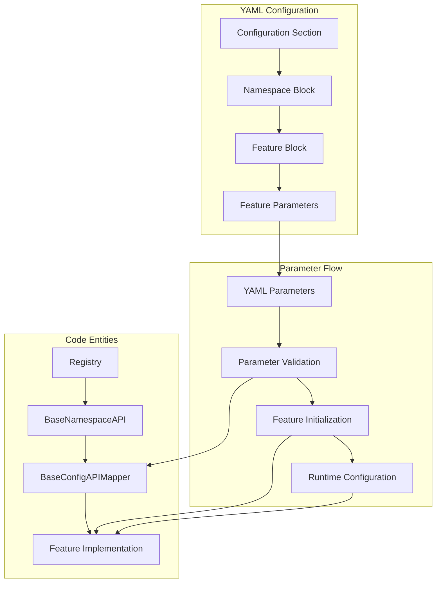
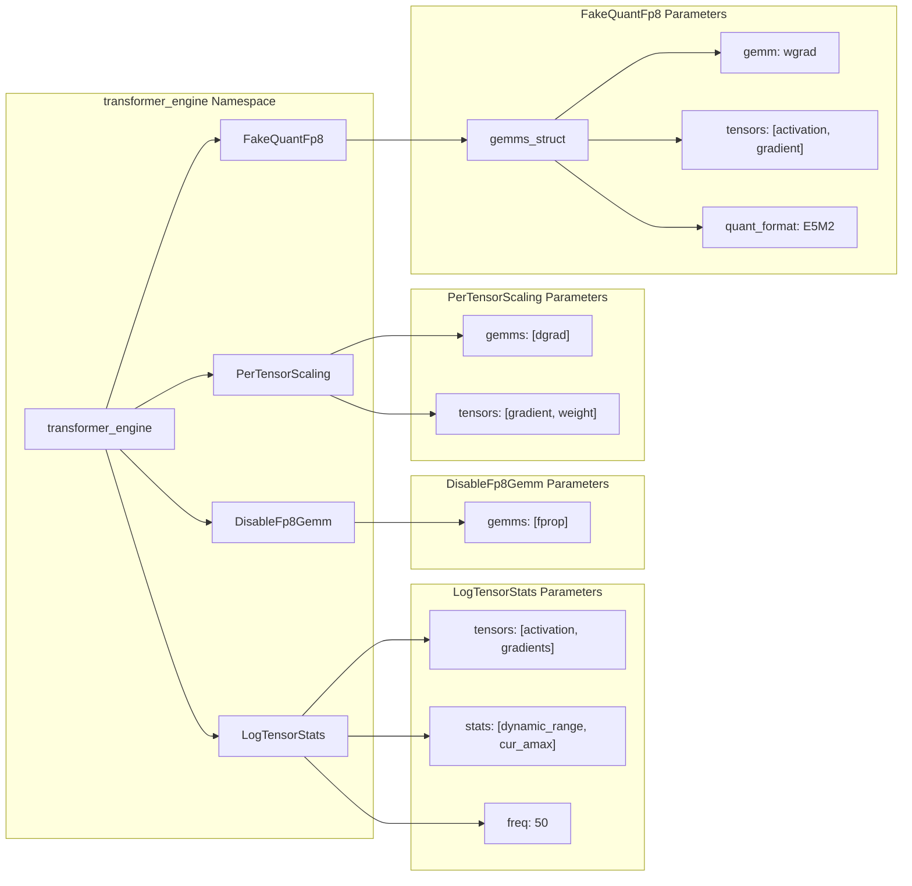
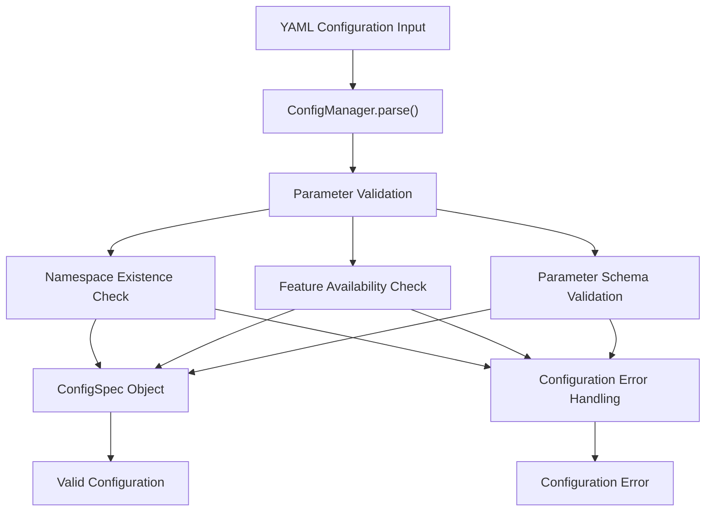

<!-- source: DeepWiki mcp.deepwiki.com · repo NVIDIA/nvidia-dlfw-inspect · page 4.3 Feature Configuration · fetched 2026-10-26 -->

# Feature Configuration

<details>
<summary>Relevant source files</summary>

The following files were used as context for generating this wiki page:

- [docs/features.md](docs/features.md)
- [docs/getting_started.md](docs/getting_started.md)
- [nvdlfw_inspect/config_manager.py](nvdlfw_inspect/config_manager.py)

</details>


This document covers how to configure specific debugging features within the nvidia-dlfw-inspect system. Feature configuration defines the parameters and behavior of individual debugging capabilities like `LogTensorStats`, `FakeQuantFp8`, and transformer_engine features.

For information about the overall configuration file structure, see [Configuration File Structure](#4.1). For layer targeting and selection, see [Layer Selection](#4.2). For details about available built-in features, see [Built-in Features](#5.1).

## Configuration Structure Overview

Features are configured within their respective namespaces in the YAML configuration file. Each feature has its own parameter schema that controls its debugging behavior, data collection frequency, and output format.

### Feature Configuration Mapping



Sources: [examples/configs/multi_tensor_stat_collection.yaml:1-26](), [examples/configs/transformer_engine_multiple_configs.yaml:1-33]()

## Built-in Feature Parameters

### LogTensorStats Configuration

The `LogTensorStats` feature supports two configuration formats: simple and structured.

#### Simple Configuration Format

```yaml
LogTensorStats:
  enabled: True
  tensors: [activation, gradient]
  stats: [mean, max, min]
  freq: 10
  start_step: 5
  end_step: 100
```

#### Structured Configuration Format

```yaml
LogTensorStats:
  enabled: True
  tensors_struct:
    - tensor: activation
      stats: [mean]
      freq: 10
      start_step: 5
      end_step: 100
    - tensor: gradient
      stats: [mean, max, min]
      freq: 10
      start_step: 5
      end_step: 100
```

| Parameter | Type | Description | Default |
|-----------|------|-------------|---------|
| `enabled` | boolean | Enable/disable the feature | `False` |
| `tensors` | list | Tensor types to monitor | `[]` |
| `stats` | list | Statistics to collect | `["mean"]` |
| `freq` | integer | Logging frequency in steps | `1` |
| `start_step` | integer | Step to start logging | `0` |
| `end_step` | integer | Step to stop logging | `∞` |
| `tensors_struct` | list | Per-tensor configuration | `[]` |

Sources: [examples/configs/multi_tensor_stat_collection.yaml:5-17](), [examples/configs/transformer_engine_multiple_configs.yaml:6-12]()

## Transformer Engine Features

The `transformer_engine` namespace provides specialized features for Transformer Engine debugging and manipulation.

### Feature Parameter Mapping



Sources: [examples/configs/transformer_engine_multiple_configs.yaml:19-32]()

### DisableFp8Gemm Configuration

Controls which GEMM operations run in high precision instead of FP8.

```yaml
transformer_engine:
  DisableFp8Gemm:
    enabled: True
    gemms: [fprop]  # Options: fprop, dgrad, wgrad
```

### PerTensorScaling Configuration

Enables per-tensor scaling for specified GEMM operations.

```yaml
transformer_engine:
  PerTensorScaling:
    enabled: True
    gemms: [dgrad]
    tensors: [gradient, weight]
```

### FakeQuantFp8 Configuration

Applies fake quantization to inputs while running high-precision GEMM operations.

```yaml
transformer_engine:
  FakeQuantFp8:
    enabled: True
    gemms_struct:
      - gemm: wgrad
        tensors: [activation, gradient]
        quant_format: E5M2  # Options: E4M3, E5M2
```

Sources: [examples/configs/transformer_engine_multiple_configs.yaml:20-32]()

## Advanced Configuration Patterns

### Multi-Feature Configuration

Multiple features can be configured simultaneously within the same configuration section:

```yaml
transformer_engine_mlp_manipulation:
  enabled: True
  layers:
    layer_name_regex_pattern: .*(fc1|fc2)
  transformer_engine:
    DisableFp8Gemm:
      enabled: True
      gemms: [fprop]
    PerTensorScaling:
      enabled: True
      gemms: [dgrad]
      tensors: [gradient, weight]
    FakeQuantFp8:
      enabled: True
      gemms_struct:
        - gemm: wgrad
          tensors: [activation, gradient]
          quant_format: E5M2
```

### Configuration Parameter Validation



The configuration system validates:
- Namespace existence in the registry
- Feature availability within namespaces
- Parameter schema compatibility
- Value type and range validation

Sources: [examples/configs/multi_tensor_stat_collection.yaml:1-26](), [examples/configs/transformer_engine_multiple_configs.yaml:15-32]()

## Parameter Reference Tables

### Common Feature Parameters

| Parameter | Type | Valid Values | Description |
|-----------|------|--------------|-------------|
| `enabled` | boolean | `true`, `false` | Feature activation state |
| `freq` | integer | `> 0` | Logging frequency in training steps |
| `start_step` | integer | `>= 0` | Training step to begin feature execution |
| `end_step` | integer | `> start_step` | Training step to end feature execution |

### Tensor Types

| Tensor Type | Description | Availability |
|-------------|-------------|--------------|
| `activation` | Layer activation tensors | All features |
| `gradient` | Gradient tensors | All features |
| `weight` | Weight parameter tensors | TE features |
| `gradients` | Alternative gradient reference | TE features |

### Statistics Types

| Statistic | Description | Output Format |
|-----------|-------------|---------------|
| `mean` | Tensor mean value | Single scalar |
| `max` | Maximum tensor value | Single scalar |
| `min` | Minimum tensor value | Single scalar |
| `dynamic_range` | FP8 dynamic range | Scalar ratio |
| `cur_amax` | Current absolute maximum | Single scalar |

Sources: [examples/configs/multi_tensor_stat_collection.yaml:8-16](), [examples/configs/transformer_engine_multiple_configs.yaml:8-11]()

---

