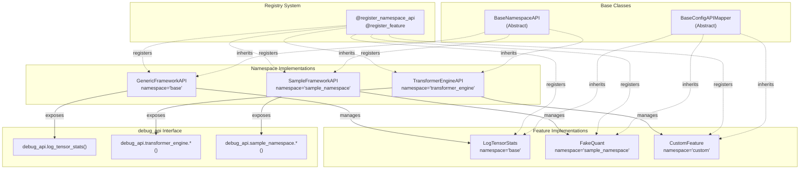
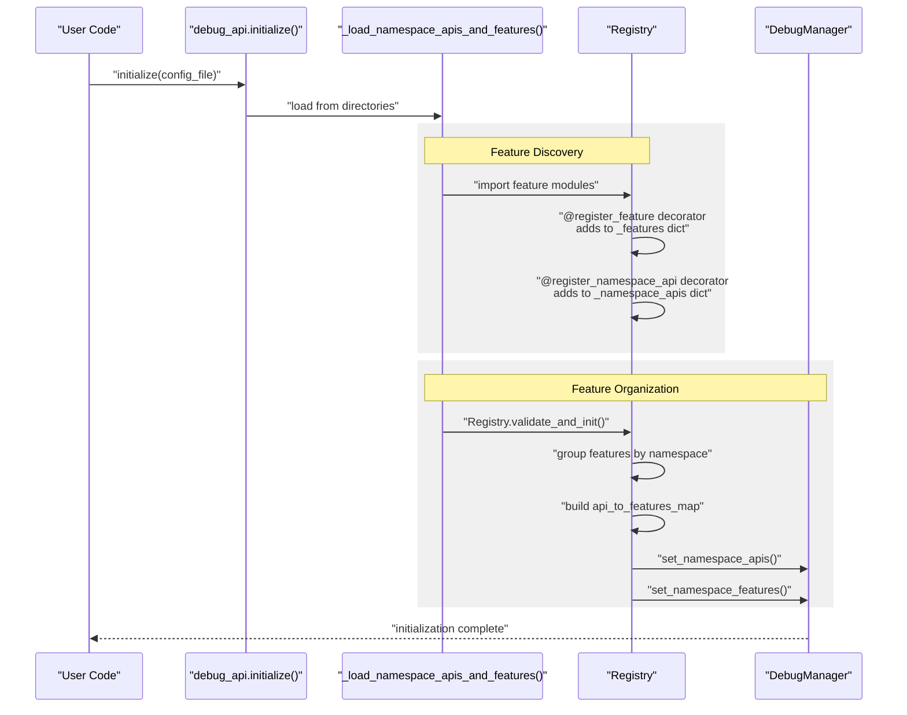
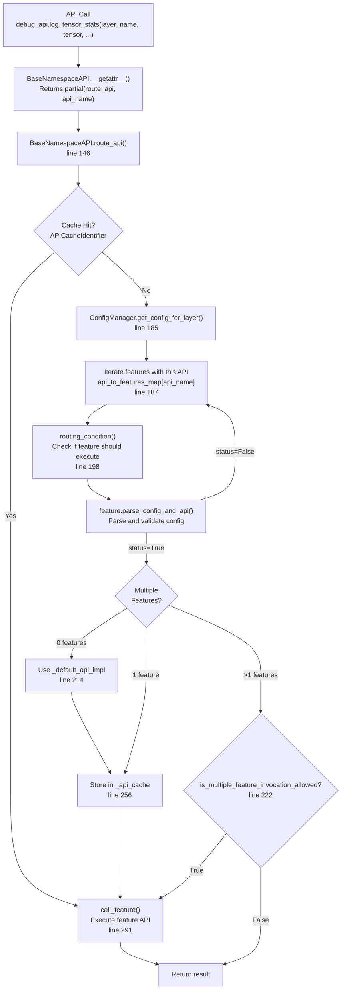
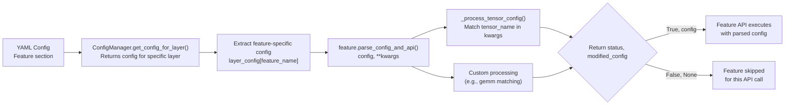
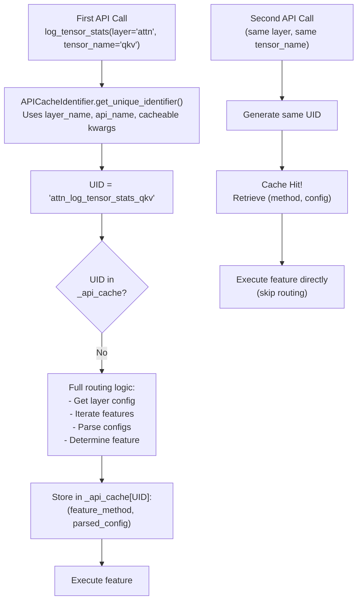
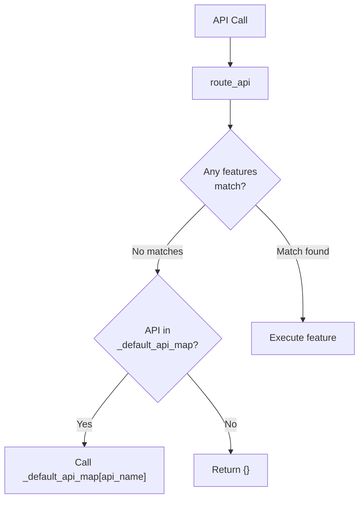

<!-- source: DeepWiki mcp.deepwiki.com · repo NVIDIA/nvidia-dlfw-inspect · page 5 Feature System · fetched 2026-10-26 -->

# Feature System

<details>
<summary>Relevant source files</summary>

The following files were used as context for generating this wiki page:

- [docs/features.md](docs/features.md)
- [docs/namespaces.md](docs/namespaces.md)
- [nvdlfw_inspect/base.py](nvdlfw_inspect/base.py)

</details>


This page provides an overview of the feature system architecture in nvdlfw-inspect. It explains how features are organized into namespaces, how features are discovered and registered, and how API calls are routed to the appropriate feature implementations at runtime.

For details on specific built-in features like `LogTensorStats`, see [Built-in Features](#5.1). For guidance on creating custom features and namespaces, see [Custom Features and Namespaces](#5.2). For detailed API documentation of base classes, see [Base Classes for Extension](#5.3).

## Core Concepts

The feature system is built around two primary abstractions:

**Features** are classes that implement specific debugging functionality (e.g., logging tensor statistics, applying fake quantization). Each feature:
- Belongs to a single namespace
- Implements one or more API methods decorated with `@api_method`
- Inherits from a `BaseConfigAPIMapper` to parse configuration files
- Is registered with the `Registry` using the `@Registry.register_feature` decorator

**Namespaces** are organizational containers that group related features and define the API surface for a specific framework or domain. Each namespace:
- Inherits from `BaseNamespaceAPI`
- Defines API routing logic and validation hooks
- Manages a collection of features that implement its APIs
- Is registered with the `Registry` using the `@Registry.register_namespace_api` decorator

Sources: [nvdlfw_inspect/base.py:27-304](), [docs/features.md:1-201](), [docs/namespaces.md:1-187]()

## Feature and Namespace Relationship

The following diagram illustrates how features and namespaces are structured and how they relate to the public API:



Sources: [nvdlfw_inspect/base.py:27-304](), [docs/namespaces.md:6-12](), [docs/features.md:13-18]()

## Feature Discovery and Registration

Features and namespaces are discovered and registered during the initialization phase using the `Registry` system. The registration process uses Python decorators to automatically catalog all available features and namespaces.

### Registration Flow



The `@Registry.register_feature(namespace="...")` decorator automatically adds feature classes to the registry when the module is imported. Similarly, `@Registry.register_namespace_api(namespace="...")` registers namespace API classes.

Sources: [docs/features.md:30-83](), [docs/namespaces.md:132-169]()

## API Routing Mechanism

When a user calls a debug API (e.g., `debug_api.log_tensor_stats(...)`), the request flows through the routing system to determine which feature should handle it. This routing is managed by the `BaseNamespaceAPI.route_api` method.

### Routing Flow



Sources: [nvdlfw_inspect/base.py:146-304]()

### Routing Components

The routing system consists of several key components:

| Component | Location | Purpose |
|-----------|----------|---------|
| `route_api` | [nvdlfw_inspect/base.py:146]() | Main routing method that coordinates API execution |
| `input_assertions_hook` | [nvdlfw_inspect/base.py:109]() | Validates required kwargs before routing |
| `routing_condition` | [nvdlfw_inspect/base.py:118]() | Determines if a feature should execute based on config and kwargs |
| `output_assertions_hook` | [nvdlfw_inspect/base.py:130]() | Validates return values after feature execution |
| `APICacheIdentifier` | [nvdlfw_inspect/base.py:164]() | Generates unique cache keys for API calls |
| `_api_cache` | [nvdlfw_inspect/base.py:81]() | Stores cached routing decisions |

Sources: [nvdlfw_inspect/base.py:61-304]()

## Configuration Parsing

Each feature implements configuration parsing logic by inheriting from `BaseConfigAPIMapper` and overriding the `parse_config_and_api` method. This method receives the feature's configuration from the YAML file and the API kwargs, then determines:

1. Whether the feature should be invoked for this specific API call
2. What subset of the configuration applies to the current tensor/layer/gemm

### Configuration Parsing Flow



The base class provides a helper method `_process_tensor_config` [nvdlfw_inspect/base.py:32-58]() that handles common patterns for extracting tensor-specific configuration from either a `tensors` list or `tensors_struct` list of dictionaries.

Sources: [nvdlfw_inspect/base.py:27-59](), [docs/namespaces.md:55-99]()

## Caching System

The API routing system implements caching to avoid redundant configuration parsing and routing decisions on subsequent training iterations. The cache key is generated using `APICacheIdentifier.get_unique_identifier()` based on:

- Layer name
- API name
- Cacheable kwargs (defined in `_cacheable_api_kwargs_map`)



The `_cacheable_api_kwargs_map` dictionary [nvdlfw_inspect/base.py:91]() defines which kwargs should be included in the cache key for each API. For example:

```python
self._cacheable_api_kwargs_map = {
    "process_tensor": ["tensor_name", "gemm"],
}
```

Sources: [nvdlfw_inspect/base.py:81-82,146-183](), [docs/namespaces.md:144-148]()

## Default Implementations

Each namespace can provide default implementations for its APIs that are used when:
- No configuration is provided
- The current layer is not selected in any configuration
- No feature matches the routing conditions

Default implementations are defined in a separate class and assigned to `_default_api_impl` [nvdlfw_inspect/base.py:85]() in the namespace's `__init__` method. The `set_default_api_impl()` method [nvdlfw_inspect/base.py:96-103]() builds a map from API names to default method implementations.



Example default implementation structure from the sample namespace:

```python
class SampleDefaultFeatures:
    def process_tensor(self, config, layer_name, **kwargs):
        """Default behavior: pass through tensor unchanged"""
        return {"tensor": kwargs["tensor"]}
```

Sources: [nvdlfw_inspect/base.py:85-103,211-218](), [docs/namespaces.md:107-124]()

## Multiple Feature Invocation

In most cases, only one feature should handle a given API call for a specific layer. However, some namespaces may allow multiple features to execute for the same API call. This is controlled by the `is_multiple_feature_invocation_allowed()` method [nvdlfw_inspect/base.py:140-144]().

When multiple features are allowed:
1. All matching features are executed in sequence [nvdlfw_inspect/base.py:226-243]()
2. Each feature's output is validated via `output_assertions_hook`
3. The `handle_multi_feature_output()` method [nvdlfw_inspect/base.py:282-289]() processes the results
4. By default, all features must return the same output, or an assertion error is raised

Sources: [nvdlfw_inspect/base.py:140-144,220-289]()

## Feature API Methods

API methods within features are decorated with `@api_method` to indicate they are externally callable. Each API method receives:

| Parameter | Description |
|-----------|-------------|
| `config` | Parsed configuration dictionary specific to this feature and API call |
| `layer_name` | Name of the layer where the API was called |
| `**kwargs` | Additional arguments passed by the user (e.g., `tensor`, `tensor_name`) |

Return values vary by API but are validated through the namespace's `output_assertions_hook`.

Sources: [docs/features.md:26-27,71-80]()

## Summary

The feature system provides a modular, extensible architecture for debugging deep learning models:

- **Features** implement specific debugging functionality and are organized into **namespaces**
- **Registry** decorators enable automatic discovery and registration of features and namespaces
- **API routing** directs calls to the appropriate feature based on configuration and runtime arguments
- **Caching** optimizes repeated API calls by storing routing decisions
- **Configuration parsing** allows features to flexibly handle various config structures
- **Default implementations** ensure graceful behavior when features are not configured

This architecture allows users to add new features and namespaces without modifying core framework code, and enables selective debugging of specific layers and operations through declarative configuration.

Sources: [nvdlfw_inspect/base.py:27-304](), [docs/features.md:1-201](), [docs/namespaces.md:1-187]()

---

