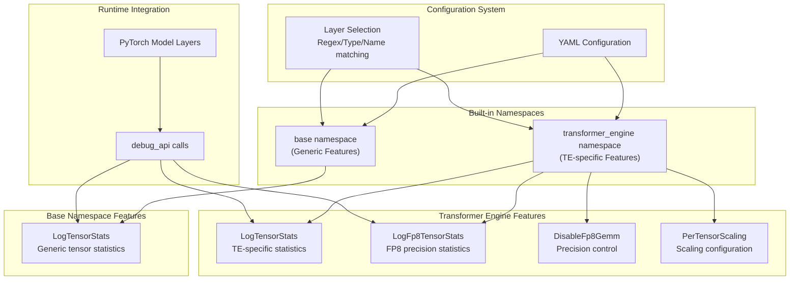
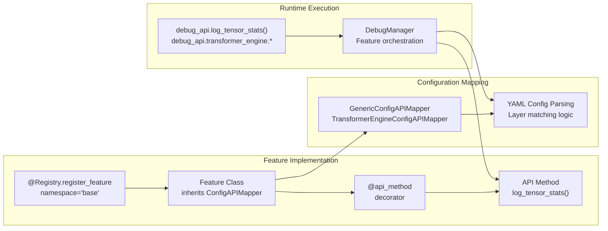

<!-- source: DeepWiki mcp.deepwiki.com · repo NVIDIA/nvidia-dlfw-inspect · page 5.1 Built-in Features · fetched 2026-10-26 -->

# Built-in Features

<details>
<summary>Relevant source files</summary>

The following files were used as context for generating this wiki page:

- [docs/features.md](docs/features.md)
- [docs/getting_started.md](docs/getting_started.md)
- [tests/unit/test_generic_features.py](tests/unit/test_generic_features.py)

</details>


This document covers the pre-built debugging features included with nvidia-dlfw-inspect. These features provide tensor statistics logging, precision control, and framework-specific debugging capabilities that can be enabled through YAML configuration without writing custom code.

For information about creating custom features, see [Custom Features and Namespaces](#5.2). For details on configuring these features, see [Feature Configuration](#4.3).

## Overview

The nvidia-dlfw-inspect tool organizes built-in features into namespaces based on their scope and target framework. Each feature is implemented as a class that inherits from configuration mappers and uses the `@api_method` decorator to expose debugging APIs.

### Feature Architecture



Sources: [docs/features.md:122-190](), [examples/configs/stat_collection_transformer_engine.yaml:1-27]()

### Feature Registration and APIs



Sources: [docs/features.md:36-37](), [docs/features.md:71-72](), [docs/features.md:122-123]()

## Base Namespace Features

The `base` namespace contains framework-agnostic features that work with any PyTorch model.

### LogTensorStats

The primary feature for collecting generic tensor statistics across training steps.

**Class**: `LogTensorStats`  
**Namespace**: `base`  
**API Method**: `log_tensor_stats()`  
**Inheritance**: `GenericConfigAPIMapper`

#### Key Capabilities

| Statistic Type | Description | Usage |
|---|---|---|
| `max` | Maximum tensor value | Gradient explosion detection |
| `min` | Minimum tensor value | Gradient vanishing detection |
| `mean` | Average tensor value | Distribution analysis |
| `std` | Standard deviation | Variance analysis |
| `l1_norm` | L1 norm calculation | Regularization monitoring |

#### Configuration Parameters

| Parameter | Type | Description | Default |
|---|---|---|
| `stats` | List[str] | Statistics to compute | Required |
| `tensors` | List[str] | Tensor names to monitor | Required |
| `freq` | int | Logging frequency in training steps | 1 |
| `start_step` | int | Step to begin logging | 0 |
| `end_step` | int | Step to end logging | -1 (unlimited) |
| `skip_reduction` | bool | Skip tensor reduction across GPUs | false |

#### Implementation Details

The feature implements frequency checking, tensor gathering across distributed processes, and statistics computation with caching to avoid duplicate messages.

Sources: [docs/features.md:122-190](), [examples/configs/stat_collection_transformer_engine.yaml:5-11]()

## Transformer Engine Namespace Features

The `transformer_engine` namespace provides specialized debugging features for NVIDIA Transformer Engine models, including FP8 precision monitoring and scaling control.

### LogTensorStats (TE-specific)

Enhanced tensor statistics collection with Transformer Engine-specific metrics.

**Class**: `LogTensorStats`  
**Namespace**: `transformer_engine`  
**Additional Statistics**: 
- `cur_amax`: Current activation maximum for FP8 scaling
- `dynamic_range`: FP8 dynamic range analysis

### LogFp8TensorStats

Specialized feature for monitoring FP8 precision behavior in Transformer Engine models.

**Class**: `LogFp8TensorStats`  
**Namespace**: `transformer_engine`  
**Key Statistics**:
- `underflows`: FP8 underflow detection
- `overflows`: FP8 overflow detection

#### FP8 Monitoring Configuration

```yaml
transformer_engine:
  LogFp8TensorStats:
    enabled: True
    stats: [underflows, overflows]
    tensors: [activation]
    freq: 100
    start_step: 10
    end_step: 1000
```

### DisableFp8Gemm

Runtime control feature for disabling FP8 GEMM operations in specific layers.

**Class**: `DisableFp8Gemm`  
**Namespace**: `transformer_engine`  
**Purpose**: Precision debugging by selectively disabling FP8 computation

### PerTensorScaling  

Feature for configuring per-tensor FP8 scaling parameters.

**Class**: `PerTensorScaling`  
**Namespace**: `transformer_engine`  
**Purpose**: Fine-grained control over FP8 scaling behavior

Sources: [examples/configs/stat_collection_transformer_engine.yaml:12-26]()

## Feature Usage Patterns

### Basic Tensor Statistics

```yaml
debug_config:
  enabled: True
  layers:
    layer_name_regex_pattern: .*(attention|mlp).*
  LogTensorStats:
    enabled: True
    stats: [max, min, mean, std]
    tensors: [input, output, weight, gradient]
    freq: 10
```

### Multi-Namespace Configuration

```yaml
combined_debugging:
  enabled: True
  layers:
    layer_type: [self_attention]
  LogTensorStats:  # base namespace
    enabled: True
    stats: [max, min, mean]
    tensors: [activation]
    freq: 50
  transformer_engine:  # TE namespace
    LogTensorStats:
      enabled: True
      stats: [cur_amax, dynamic_range]
      tensors: [activation]
      freq: 100
    LogFp8TensorStats:
      enabled: True
      stats: [underflows, overflows]
      tensors: [activation]
```

### API Integration

Features are invoked through the debug API during model execution:

```python
# Base namespace usage
debug_api.log_tensor_stats(
    layer_name="transformer.layer.0.attention", 
    tensor=hidden_states,
    tensor_name="activation"
)

# Transformer Engine namespace usage  
debug_api.transformer_engine.log_tensor_stats(
    layer_name="transformer.layer.0.attention",
    tensor=fp8_tensor,
    tensor_name="activation"
)
```

Sources: [docs/features.md:172-190](), [examples/configs/stat_collection_transformer_engine.yaml:1-27]()

## Feature Capabilities Summary

| Feature | Namespace | Primary Use Case | Key Statistics |
|---|---|---|---|
| `LogTensorStats` | `base` | Generic tensor monitoring | max, min, mean, std, l1_norm |
| `LogTensorStats` | `transformer_engine` | TE-specific monitoring | cur_amax, dynamic_range |
| `LogFp8TensorStats` | `transformer_engine` | FP8 precision debugging | underflows, overflows |
| `DisableFp8Gemm` | `transformer_engine` | Precision control | Runtime FP8 disable |
| `PerTensorScaling` | `transformer_engine` | Scaling configuration | FP8 scaling parameters |

Built-in features provide comprehensive debugging capabilities without requiring custom code implementation. They integrate seamlessly with the configuration system and support distributed training environments through automatic tensor reduction and gathering.

Sources: [docs/features.md:1-201](), [examples/configs/stat_collection_transformer_engine.yaml:1-27]()

---

