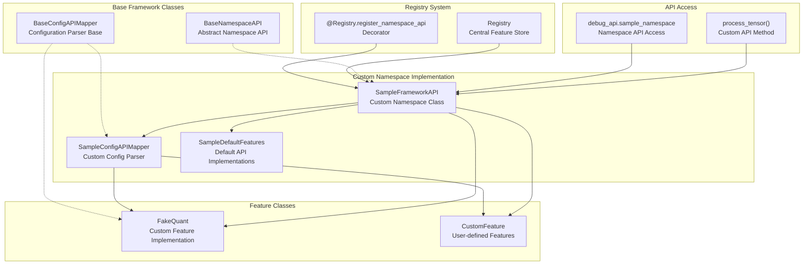
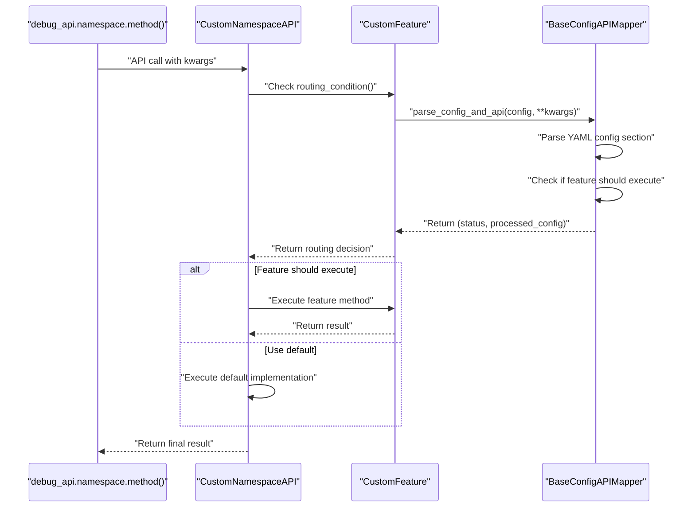
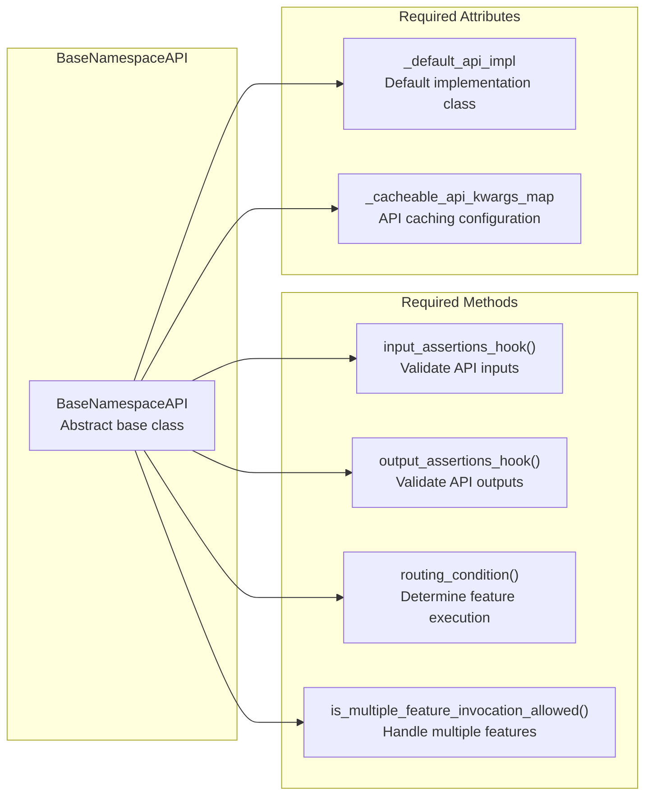
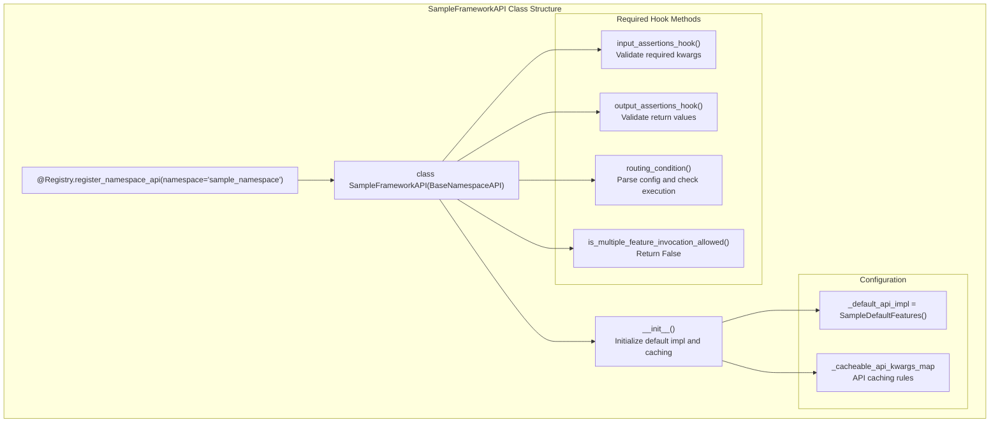
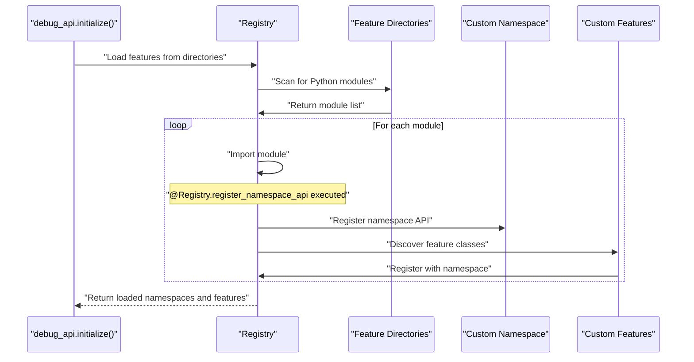
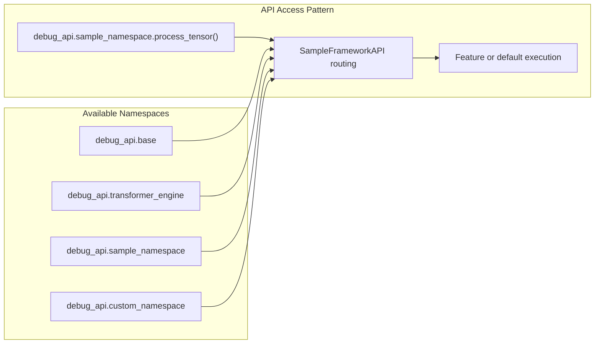
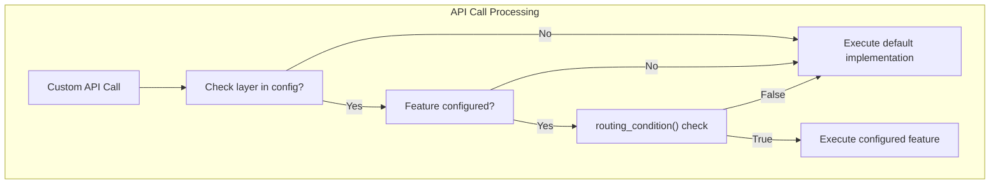

<!-- source: DeepWiki mcp.deepwiki.com · repo NVIDIA/nvidia-dlfw-inspect · page 5.2 Custom Features and Namespaces · fetched 2026-10-26 -->

# Custom Features and Namespaces

Relevant source files

The following files were used as context for generating this wiki page:

- [docs/features.md](docs/features.md)
- [docs/namespaces.md](docs/namespaces.md)
- [nvdlfw_inspect/base.py](nvdlfw_inspect/base.py)

This document explains how to create custom debugging features and organize them into namespaces for framework-specific functionality. It covers the extension architecture that allows users to build their own debugging capabilities beyond the built-in features provided by nvidia-dlfw-inspect.

For information about using existing built-in features, see [Built-in Features](#5.1). For detailed reference documentation on the base classes used for extension, see [Base Classes for Extension](#5.3).

## Architecture Overview

The nvidia-dlfw-inspect tool uses a namespace-based architecture that allows custom debugging features to be organized by framework or functionality. Each namespace provides a set of APIs that can be called through the main debug interface, with automatic feature discovery and configuration-driven execution.

### Custom Namespace Architecture

Sources: [docs/namespaces.md:1-187](), [examples/sample_namespace/__init__.py:1-14]()

## Creating Custom Features

Custom features are classes that implement specific debugging functionality. They must inherit from `BaseConfigAPIMapper` to handle configuration parsing and define API methods that can be called through the namespace.

### Feature Configuration Parsing

Each custom feature inherits from `BaseConfigAPIMapper` and implements the `parse_config_and_api` method to handle configuration parsing:

Sources: [docs/namespaces.md:58-99]()

### Configuration Structure Support

The `BaseConfigAPIMapper` class provides flexible configuration parsing capabilities. Custom features can support various YAML configuration structures:

| Configuration Type | Description | Example Use Case |
|-------------------|-------------|------------------|
| Simple tensor list | `tensors: [tensor1, tensor2]` | Basic tensor logging |
| Structured tensors | `tensors_struct: [tensor: name, param: value]` | Per-tensor parameters |
| GEMM-level config | `gemms: [gemm1, gemm2]` | Operation-specific settings |
| Nested structures | Combined GEMM and tensor configs | Complex framework features |

Sources: [docs/namespaces.md:30-57]()

## Creating Custom Namespaces

A custom namespace is implemented by creating a class that inherits from `BaseNamespaceAPI` and registers itself with the `@Registry.register_namespace_api` decorator.

### Namespace Implementation Requirements

Sources: [docs/namespaces.md:150-176]()

### Sample Namespace Implementation

The system includes a complete example implementation in the `sample_namespace` that demonstrates all required components:

Sources: [docs/namespaces.md:133-169]()

### Input and Output Validation

Namespaces define validation logic for API calls through assertion hooks:

| Hook Method | Purpose | Implementation |
|-------------|---------|----------------|
| `input_assertions_hook` | Validate required parameters are present | Check kwargs for required keys |
| `output_assertions_hook` | Validate API returns expected structure | Check return dict has required keys |
| `routing_condition` | Determine if feature should execute | Parse config and return status |
| `is_multiple_feature_invocation_allowed` | Handle multiple feature conflicts | Usually returns `False` |

Sources: [docs/namespaces.md:150-176]()

## Registration and Discovery

The feature discovery system automatically loads custom namespaces and features from specified directories during initialization.

### Registration Process

Sources: [docs/namespaces.md:1-13]()

### Namespace API Access

Once registered, custom namespaces become available through the main debug API:

Sources: [docs/namespaces.md:180-187]()

## Configuration Integration

Custom namespaces integrate with the YAML configuration system to enable selective feature activation based on layer patterns and feature parameters.

### Configuration Structure for Custom Features

The configuration system supports custom feature parameters through the namespace-specific configuration sections:

| Configuration Element | Purpose | Example |
|----------------------|---------|---------|
| `layers` section | Layer selection patterns | `layer_name_regex_pattern: ".*linear.*"` |
| Feature-specific config | Custom feature parameters | `tensors: [activation, weight]` |
| `enabled` flag | Feature activation control | `enabled: true` |
| Nested structures | Complex parameter hierarchies | `gemms_struct` with tensor configs |

Sources: [docs/namespaces.md:58-99]()

### Default vs Configured Behavior

The namespace system provides fallback behavior when features are not explicitly configured:

Sources: [docs/namespaces.md:107-125](), [docs/namespaces.md:180-187]()

---

