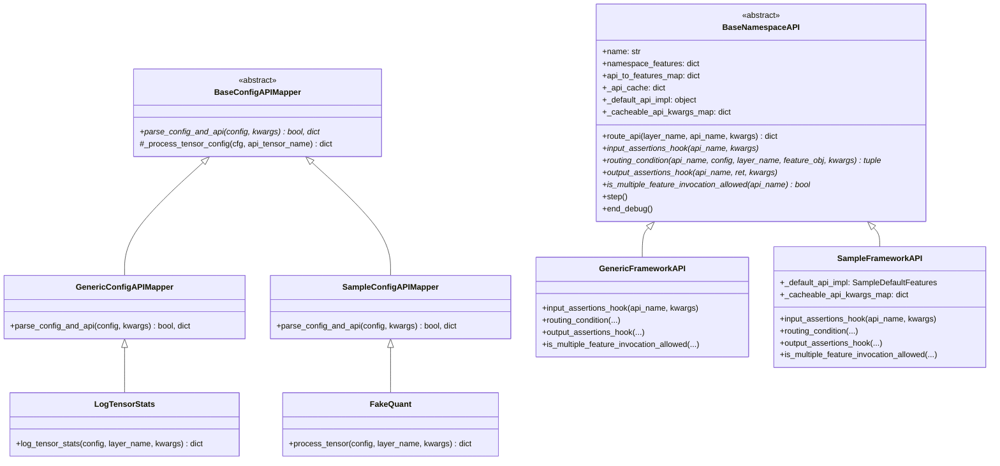
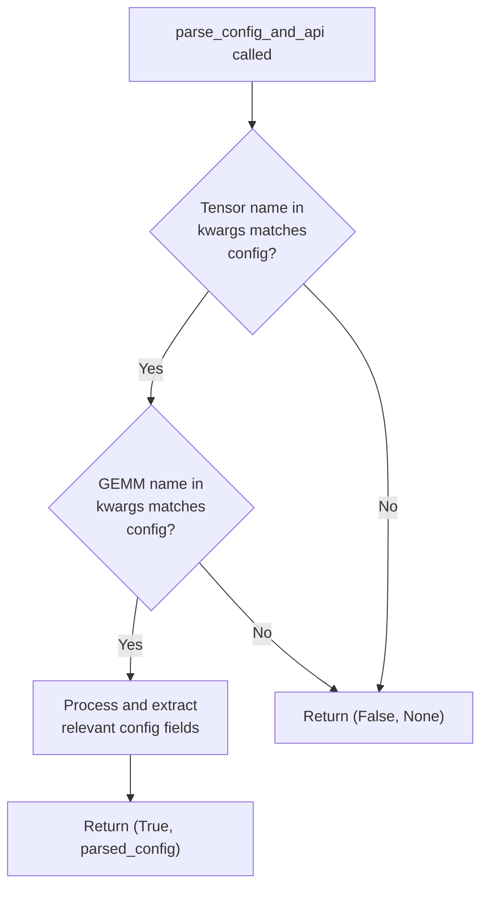
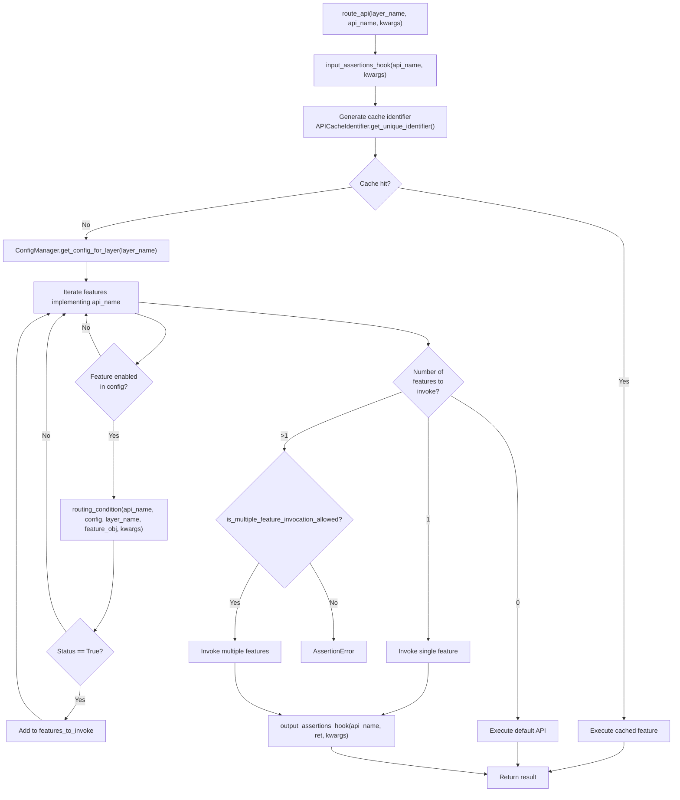
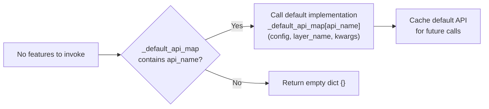
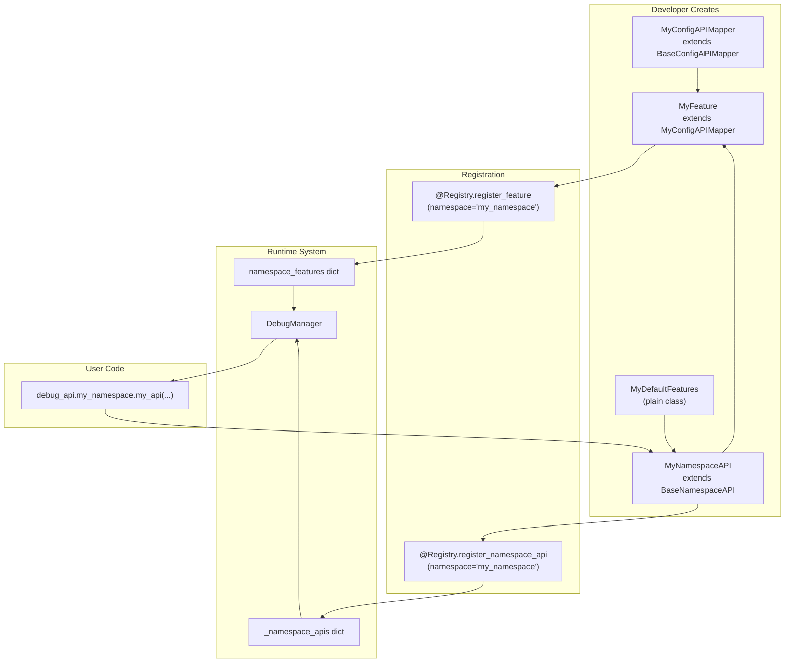

<!-- source: DeepWiki mcp.deepwiki.com · repo NVIDIA/nvidia-dlfw-inspect · page 5.3 Base Classes for Extension · fetched 2026-10-26 -->

# Base Classes for Extension

<details>
<summary>Relevant source files</summary>

The following files were used as context for generating this wiki page:

- [docs/features.md](docs/features.md)
- [docs/namespaces.md](docs/namespaces.md)
- [nvdlfw_inspect/base.py](nvdlfw_inspect/base.py)

</details>


This page documents the abstract base classes that developers must inherit from to extend nvdlfw_inspect with custom features and namespaces. These classes define the contracts and provide core functionality for configuration parsing, API routing, and feature execution.

For guidance on creating custom features using these base classes, see [Custom Features and Namespaces](#5.2). For documentation of the built-in implementations, see [Built-in Features](#5.1).

---

## Overview

The extension system in nvdlfw_inspect is built on two primary abstract base classes:

| Base Class | Purpose | Used By |
|------------|---------|---------|
| `BaseConfigAPIMapper` | Defines contract for parsing feature configurations from YAML | All feature implementations |
| `BaseNamespaceAPI` | Defines contract for namespace API routing and feature orchestration | All namespace implementations |

Both classes are defined in [nvdlfw_inspect/base.py](). Together, they enable a modular architecture where features and namespaces can be dynamically loaded and registered without modifying core system code.

**Sources:** [nvdlfw_inspect/base.py:1-304]()

---

## Class Hierarchy



**Sources:** [nvdlfw_inspect/base.py:27-304](), [docs/namespaces.md:1-187](), [docs/features.md:1-201]()

---

## BaseConfigAPIMapper

`BaseConfigAPIMapper` is an abstract base class that all feature implementations must inherit from. It defines the interface for parsing feature-specific configuration from YAML files and determining whether a feature should be invoked for a given API call.

### Purpose

The config mapper serves three primary functions:

1. **Configuration Parsing**: Extract and process feature-specific settings from the YAML configuration
2. **Invocation Checking**: Determine if the feature should execute based on API arguments and configuration
3. **Config Transformation**: Return parsed configuration ready for feature execution

### Abstract Method

```python
@abstractmethod
def parse_config_and_api(self, config, **kwargs):
    pass
```

**Parameters:**
- `config` (dict): The feature's configuration block from YAML (with `enabled` field removed)
- `**kwargs`: API-specific arguments passed during invocation

**Returns:**
- `tuple[bool, dict | None]`: 
  - `bool`: `True` if feature should be invoked, `False` otherwise
  - `dict | None`: Parsed configuration for the feature, or `None` if not applicable

**Sources:** [nvdlfw_inspect/base.py:27-30](), [docs/namespaces.md:58-98]()

### Helper Method: _process_tensor_config

The base class provides a helper method for processing tensor-specific configurations, which is commonly needed across different features.

```python
def _process_tensor_config(self, cfg, api_tensor_name):
```

This method handles two configuration patterns:

| Pattern | Description | Example |
|---------|-------------|---------|
| `tensors_struct` | List of dictionaries with tensor-specific settings | `[{"tensor": "activation", "stats": ["max", "min"]}]` |
| `tensors` | Simple list of tensor names with shared settings | `["activation", "gradient"]` |

The method returns a config dictionary specific to the requested tensor name, or `None` if the tensor is not found in the configuration.

**Sources:** [nvdlfw_inspect/base.py:32-58]()

### Implementation Example

A typical implementation matches API arguments against configuration fields:



**Sources:** [docs/namespaces.md:58-99](), [docs/features.md:122-189]()

---

## BaseNamespaceAPI

`BaseNamespaceAPI` is the abstract base class for all namespace implementations. It provides the core API routing mechanism, caching infrastructure, and hooks for customizing behavior at different stages of the API call lifecycle.

### Architecture

A namespace API acts as the orchestrator between:
- User API calls (e.g., `debug_api.sample_namespace.process_tensor(...)`)
- Configuration system (`ConfigManager`)
- Feature implementations registered to the namespace
- Default API implementations (when no features are enabled)

### Key Attributes

**Instance Attributes (initialized in `__init__`):**

| Attribute | Type | Purpose |
|-----------|------|---------|
| `name` | `str` | Unique identifier for the namespace |
| `namespace_features` | `dict` | Maps feature names to feature instances |
| `api_to_features_map` | `dict` | Maps API names to list of features implementing them |
| `_api_cache` | `dict` | Caches feature/config pairs for repeated API calls |
| `_default_api_impl` | `object` | Instance providing default API implementations |
| `_default_api_map` | `dict | None` | Maps API names to default implementation methods |
| `_cacheable_api_kwargs_map` | `dict` | Defines which kwargs should be used for cache keys |

**Sources:** [nvdlfw_inspect/base.py:71-92]()

### Abstract Methods

All namespace implementations must override the following abstract methods:

#### input_assertions_hook

```python
@abstractmethod
def input_assertions_hook(self, api_name, **kwargs):
    pass
```

**Purpose:** Validate that required keyword arguments are present before routing the API call.

**Parameters:**
- `api_name` (str): Name of the API being invoked
- `**kwargs`: Arguments passed to the API call

**Typical Implementation:** Check for required kwargs and raise assertion errors if missing.

**Sources:** [nvdlfw_inspect/base.py:108-115]()

#### routing_condition

```python
@abstractmethod
def routing_condition(
    self, api_name, config, layer_name, feature_obj, **kwargs
) -> tuple[bool, dict | None]:
    pass
```

**Purpose:** Determine if a feature should be invoked and return the parsed configuration.

**Parameters:**
- `api_name` (str): Name of the API being invoked
- `config` (dict): Feature's configuration from YAML
- `layer_name` (str): Layer name where API is called
- `feature_obj`: Instance of the feature class
- `**kwargs`: API call arguments

**Returns:**
- `tuple[bool, dict | None]`: Status and optional modified configuration

**Typical Implementation:** Delegates to the feature's `parse_config_and_api` method.

**Sources:** [nvdlfw_inspect/base.py:117-127]()

#### output_assertions_hook

```python
@abstractmethod
def output_assertions_hook(self, api_name, ret, **kwargs):
    pass
```

**Purpose:** Validate the return value from feature execution.

**Parameters:**
- `api_name` (str): Name of the API that was invoked
- `ret` (dict): Return value from the feature
- `**kwargs`: Original API call arguments

**Typical Implementation:** Assert required fields are present in return value.

**Sources:** [nvdlfw_inspect/base.py:129-137]()

#### is_multiple_feature_invocation_allowed

```python
@abstractmethod
def is_multiple_feature_invocation_allowed(self, api_name):
    pass
```

**Purpose:** Determine if multiple features can be executed for a single API call.

**Parameters:**
- `api_name` (str): Name of the API

**Returns:**
- `bool`: `True` if multiple features allowed, `False` otherwise (most common)

**Note:** When `True`, all invoked features must return identical values or the system will exit with an error.

**Sources:** [nvdlfw_inspect/base.py:139-144]()

---

## API Routing Mechanism

The `route_api` method is the core of the namespace API system. It handles caching, configuration lookup, feature selection, and execution.

### Routing Flow



**Sources:** [nvdlfw_inspect/base.py:146-280]()

### Cache Identifier Generation

The caching system uses `APICacheIdentifier` to generate unique identifiers based on:
- Layer name
- API name  
- Selected kwargs (as defined in `_cacheable_api_kwargs_map`)

This allows the system to skip configuration lookup and feature selection on subsequent calls with the same parameters, significantly improving performance during training loops.

**Sources:** [nvdlfw_inspect/base.py:164-166](), [nvdlfw_inspect/utils.py]()

### Default API Execution

When no features are enabled for a layer/API combination, the namespace can provide default implementations:



**Sources:** [nvdlfw_inspect/base.py:211-218]()

---

## Lifecycle Methods

Namespaces can optionally override lifecycle methods that are called at specific points during training:

### step()

```python
def step(self):
    pass
```

Called when `debug_api.step()` is invoked, typically at the end of each training iteration. Namespaces can use this to perform periodic operations like flushing buffers or updating state.

**Sources:** [nvdlfw_inspect/base.py:296-297]()

### end_debug()

```python
def end_debug(self):
    pass
```

Called when `debug_api.end_debug()` is invoked, typically at the end of training. Namespaces can use this for cleanup operations like closing files or writing final statistics.

**Sources:** [nvdlfw_inspect/base.py:299-300]()

---

## Dynamic Method Binding

The `__getattr__` method enables dynamic API exposure:

```python
def __getattr__(self, api_name):
    return partial(self.route_api, api_name=api_name)
```

This allows users to call namespace APIs naturally:
```python
debug_api.sample_namespace.process_tensor(layer_name="layer1", ...)
# Internally becomes: route_api(layer_name="layer1", api_name="process_tensor", ...)
```

**Sources:** [nvdlfw_inspect/base.py:302-303]()

---

## Implementation Requirements

When creating a custom namespace, developers must:

1. **Inherit from BaseNamespaceAPI:**
   ```python
   class MyNamespaceAPI(BaseNamespaceAPI):
       pass
   ```

2. **Register with the Registry:**
   ```python
   @Registry.register_namespace_api(namespace="my_namespace")
   class MyNamespaceAPI(BaseNamespaceAPI):
       pass
   ```

3. **Implement all abstract methods:**
   - `input_assertions_hook`
   - `routing_condition`
   - `output_assertions_hook`
   - `is_multiple_feature_invocation_allowed`

4. **Set default API implementation (optional):**
   ```python
   def __init__(self):
       super().__init__()
       self._default_api_impl = MyDefaultFeatures()
   ```

5. **Define cacheable API kwargs (optional but recommended):**
   ```python
   def __init__(self):
       super().__init__()
       self._cacheable_api_kwargs_map = {
           "process_tensor": ["tensor_name", "gemm"],
       }
   ```

**Sources:** [docs/namespaces.md:131-169]()

---

## Extension Pattern Summary



**Sources:** [nvdlfw_inspect/base.py:1-304](), [docs/namespaces.md:1-187](), [docs/features.md:1-201]()

---

## Related Documentation

- For creating custom features and namespaces using these base classes, see [Custom Features and Namespaces](#5.2)
- For examples of built-in implementations, see [Built-in Features](#5.1)
- For understanding the registry system that manages extensions, see [Registry](#3.3)
- For configuration structures that feed into these classes, see [Configuration System](#4)

---

