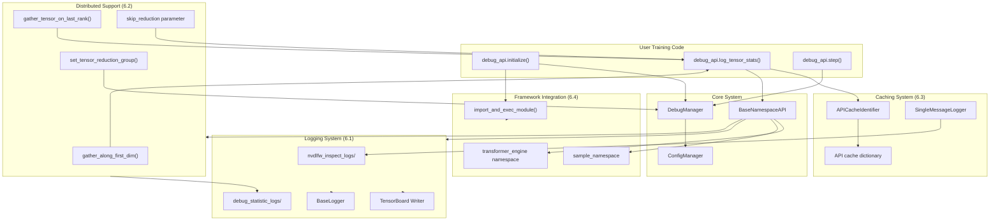
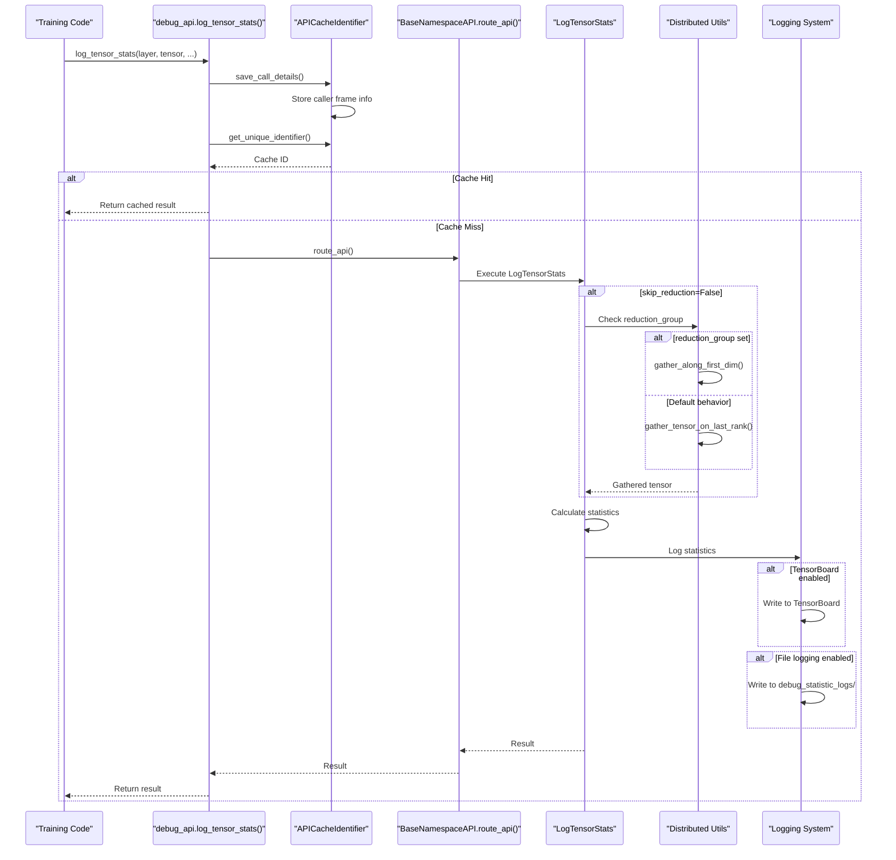
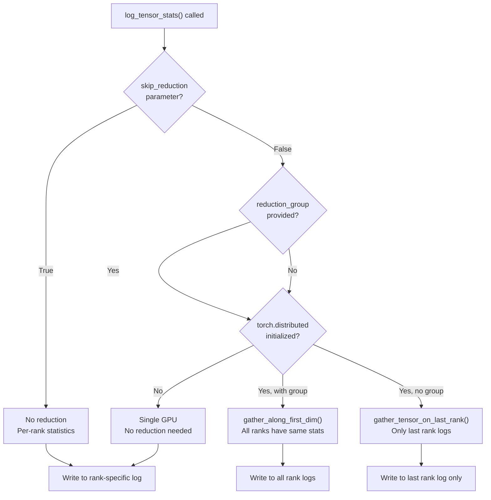

<!-- source: DeepWiki mcp.deepwiki.com · repo NVIDIA/nvidia-dlfw-inspect · page 6 Advanced Topics · fetched 2026-10-26 -->

# Advanced Topics

<details>
<summary>Relevant source files</summary>

The following files were used as context for generating this wiki page:

- [docs/getting_started.md](docs/getting_started.md)
- [docs/logging.md](docs/logging.md)
- [nvdlfw_inspect/utils.py](nvdlfw_inspect/utils.py)

</details>


This section covers advanced usage scenarios for `nvdlfw_inspect` that are essential for production deployments and complex training pipelines. The advanced features are organized into four main areas:

- **Logging and Statistics** (Section 6.1): Output directories, custom loggers, TensorBoard integration, and statistics aggregation
- **Distributed Training Support** (Section 6.2): Multi-GPU tensor reduction, per-rank logging, and pipeline parallelism handling
- **Caching and Performance** (Section 6.3): API caching mechanisms, performance optimization, and best practices for minimal overhead
- **Framework Integration** (Section 6.4): Integration with Transformer Engine, Megatron-LM, NeMo, and other frameworks

This overview demonstrates how these advanced components interact with the core architecture and provides context for the detailed subsections.

For basic usage, see [Getting Started](#2). For API details, see [API Reference](#3). For configuration basics, see [Configuration System](#4).

## Advanced System Integration Overview

The advanced features of `nvdlfw_inspect` work together to provide comprehensive debugging capabilities in production training environments. The following diagram shows how the four main subsystems interact during a typical training workflow.

### Advanced Features Integration Architecture



Sources: [nvdlfw_inspect/api.py:1-500](), [nvdlfw_inspect/debug_manager.py:1-300](), [nvdlfw_inspect/utils.py:1-192]()

### Key Components and Their Interactions

The advanced subsystems are built on several key utility classes and functions that provide cross-cutting functionality:

| Component | Location | Primary Function | Related Subsection |
|-----------|----------|------------------|-------------------|
| `APICacheIdentifier` | [nvdlfw_inspect/utils.py:125-150]() | Cache API calls by source location | 6.3 Caching |
| `SingleMessageLogger` | [nvdlfw_inspect/utils.py:152-179]() | Deduplicate log messages | 6.1 Logging |
| `gather_along_first_dim()` | [nvdlfw_inspect/utils.py:41-68]() | All-gather tensors across ranks | 6.2 Distributed |
| `gather_tensor_on_last_rank()` | [nvdlfw_inspect/utils.py:71-98]() | Gather tensors to last rank only | 6.2 Distributed |
| `get_distributed_world_size()` | [nvdlfw_inspect/utils.py:28-32]() | Query distributed configuration | 6.2 Distributed |
| `get_distributed_rank()` | [nvdlfw_inspect/utils.py:35-38]() | Query current rank | 6.2 Distributed |
| `import_and_exec_module()` | [nvdlfw_inspect/utils.py:100-123]() | Dynamic feature loading | 6.4 Framework Integration |

Sources: [nvdlfw_inspect/utils.py:1-192]()

## Call Flow for Advanced Features

Understanding how API calls flow through the advanced subsystems is essential for effective usage. The following diagram traces a typical `log_tensor_stats()` call through caching, distributed reduction, and logging.

### API Call Flow Through Advanced Subsystems



Sources: [nvdlfw_inspect/api.py:1-500](), [nvdlfw_inspect/utils.py:125-150](), [nvdlfw_inspect/utils.py:41-98](), [docs/getting_started.md:39-66]()

### Initialization Parameters for Advanced Features

The `debug_api.initialize()` function accepts several parameters that control advanced behavior. These parameters determine how the subsystems operate throughout the training session.

| Parameter | Type | Default | Controls | Subsection |
|-----------|------|---------|----------|------------|
| `log_dir` | str | "." | Output directory for logs and statistics | 6.1 |
| `statistics_logger` | BaseLogger | None | Custom statistics logger implementation | 6.1 |
| `tb_writer` | TensorBoard Writer | None | TensorBoard integration | 6.1 |
| `default_logging_enabled` | bool | True | Enable default file logging | 6.1 |
| `init_training_step` | int | 0 | Initial step counter value | 6.1 |
| `feature_dirs` | List[str] | [] | Custom feature directories to load | 6.4 |

Sources: [docs/getting_started.md:128-149](), [docs/logging.md:1-99]()

## Tensor Reduction in Distributed Training

The distributed training support provides three primary reduction strategies, each optimized for different use cases. The choice of strategy significantly impacts both performance and the semantics of the logged statistics.

### Reduction Strategy Decision Tree



Sources: [docs/getting_started.md:248-257](), [nvdlfw_inspect/utils.py:41-98](), [docs/logging.md:48-89]()

### Distributed Training Configuration Examples

The following table shows common distributed training scenarios and their recommended configurations:

| Scenario | Configuration | Behavior | Performance |
|----------|---------------|----------|-------------|
| **Data Parallel Only** | `skip_reduction=False` (default) | Last rank gathers and logs | Low overhead |
| **Tensor Parallel** | `set_tensor_reduction_group(tp_group)` | All ranks compute same stats | Medium overhead |
| **Pipeline Parallel** | `skip_reduction=True` | Each pipeline stage logs separately | Minimal overhead |
| **3D Parallelism** | `set_tensor_reduction_group(tp_dp_group)` + last PP rank | Reduce across TP/DP, log on last PP | Optimized |
| **Debug Per-Rank** | `skip_reduction=True` | Individual rank statistics | Minimal overhead |

Sources: [docs/logging.md:48-89](), [docs/getting_started.md:248-257]()

## Performance Considerations

### Memory Efficiency

The tool implements several optimizations to minimize memory overhead:

- **Lazy tensor copying**: Tensors are only copied when reduction is required
- **Asynchronous operations**: Distributed operations support `async_op=True` parameter
- **Selective statistics**: Only enabled features compute statistics

### Computational Overhead

Key performance optimizations include:

| Optimization | Implementation | Impact |
|--------------|----------------|---------|
| API Caching | `APICacheIdentifier` | Prevents redundant feature execution |
| Message Deduplication | `SingleMessageLogger` | Reduces logging overhead |
| Conditional Reduction | `skip_reduction` parameter | Avoids unnecessary communication |

### Configuration Best Practices

For production environments, consider these configuration patterns:

```yaml
# Performance-optimized configuration
LogTensorStats:
  layer_name_regex_pattern: ".*attention.*"  # Target specific layers
  extensions:
    log_frequency: 100  # Log every 100 steps
    
transformer_engine:
  LogFp8TensorStats:
    layer_name_regex_pattern: ".*linear.*"
    extensions:
      skip_reduction: true  # For per-rank analysis
```

Sources: [nvdlfw_inspect/utils.py:125-176](), performance considerations from architectural analysis

---

