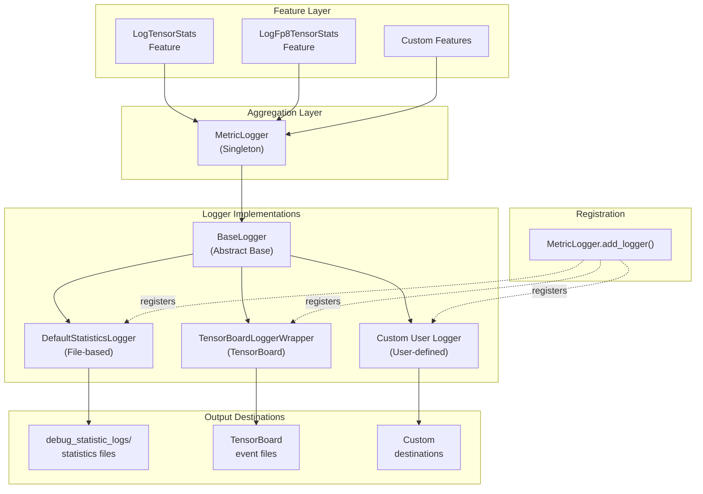
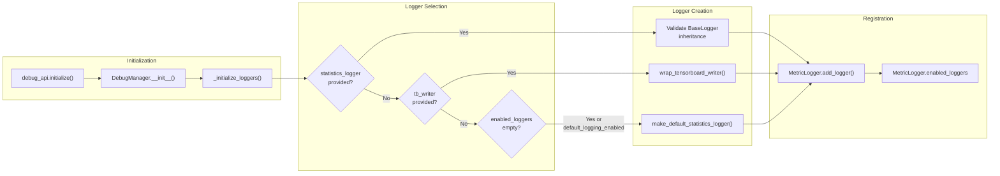
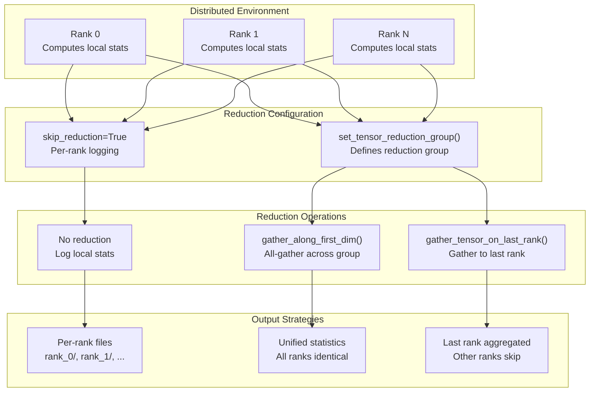

<!-- source: DeepWiki mcp.deepwiki.com · repo NVIDIA/nvidia-dlfw-inspect · page 6.1 Logging and Statistics · fetched 2026-10-26 -->

# Logging and Statistics

<details>
<summary>Relevant source files</summary>

The following files were used as context for generating this wiki page:

- [docs/logging.md](docs/logging.md)
- [nvdlfw_inspect/debug_manager.py](nvdlfw_inspect/debug_manager.py)
- [nvdlfw_inspect/utils.py](nvdlfw_inspect/utils.py)

</details>


This page documents the logging and statistics collection infrastructure in nvdlfw_inspect. The system provides two distinct logging mechanisms: general logging for tracking tool execution and debugging, and specialized statistics logging for collecting and aggregating tensor metrics during model training. For information about configuring which statistics to collect, see [Feature Configuration](#4.3). For details on the feature classes that produce statistics, see [Built-in Features](#5.1).

## Overview

The logging system is designed around two primary concerns:

| Logging Type | Purpose | Output Location | Configuration |
|--------------|---------|-----------------|---------------|
| **General Logging** | Tool execution, warnings, errors, debug messages | `{log_dir}/nvdlfw_inspect_logs/` | Environment variables, `log_dir` parameter |
| **Statistics Logging** | Tensor metrics (min, max, mean, norms, etc.) | `debug_statistic_logs/` or custom destinations | Custom loggers, TensorBoard, or default file logger |

The statistics logging system uses a plugin architecture where multiple logger implementations can be registered simultaneously, allowing statistics to be written to files, TensorBoard, and custom destinations in parallel.

## General Logging System

The general logging system tracks tool execution, configuration loading, feature registration, and any warnings or errors that occur during operation.

### Log Directory Configuration

The log directory is specified during initialization:

```python
debug_api.initialize(config_file, log_dir="/path/to/logs")
```

General logs are written to `{log_dir}/nvdlfw_inspect_logs/`. If not specified, `log_dir` defaults to the current directory.

### Environment Variables

The general logging system is controlled by three environment variables:

| Environment Variable | Values | Default | Purpose |
|---------------------|--------|---------|---------|
| `NVDLFW_INSPECT_LOG_LEVEL` | DEBUG, INFO, WARNING, ERROR, CRITICAL | INFO | Sets the minimum log level |
| `NVDLFW_INSPECT_ENABLE_LOG_OVERWRITE` | 0, 1 | 1 | Controls whether to overwrite existing log files |
| `NVDLFW_INSPECT_ENABLE_LOG_TIMESTAMP` | 0, 1 | 0 | Adds timestamps to log filenames |

### Programmatic Logging

After initialization, you can write to the general log using:

```python
import logging
debug_api.log_message("Your message here", level=logging.INFO)
```

This routes to the internal logger obtained via `get_logger()` from [nvdlfw_inspect/logging.py]().

**Sources:** [nvdlfw_inspect/debug_manager.py:46-100](), [docs/logging.md:1-15]()

## Statistics Logging Architecture

The statistics logging system aggregates tensor metrics from features and routes them to one or more registered loggers. The architecture is designed to be extensible and support multiple simultaneous output destinations.

### Logger Architecture Diagram



The `MetricLogger` class maintains a list of registered loggers in `MetricLogger.enabled_loggers` and broadcasts all statistics to each registered logger. Features call `MetricLogger` methods to log metrics, and the `MetricLogger` dispatches these calls to all registered implementations.

**Sources:** [nvdlfw_inspect/debug_manager.py:57-100](), [nvdlfw_inspect/logging.py]()

### BaseLogger Interface

Custom loggers must inherit from `BaseLogger`, which defines the interface for statistics logging. The abstract base class is located in [nvdlfw_inspect/logging.py]() and provides methods for logging different types of statistics.

To create a custom logger:

```python
from nvdlfw_inspect.logging import BaseLogger

class MyCustomLogger(BaseLogger):
    def log_statistics(self, layer_name, stats_dict, iteration, **kwargs):
        # Your logging implementation
        pass
```

The logger is registered during initialization by passing it to the `statistics_logger` parameter. The `DebugManager._initialize_loggers` method validates that the provided logger inherits from `BaseLogger` [nvdlfw_inspect/debug_manager.py:78-81]().

**Sources:** [nvdlfw_inspect/debug_manager.py:76-86](), [docs/logging.md:31-34]()

### Logger Registration Flow



The initialization process supports three logger registration paths:

1. **Custom Logger Path**: If `statistics_logger` is provided, it is validated to ensure it inherits from `BaseLogger` [nvdlfw_inspect/debug_manager.py:77-86]()
2. **TensorBoard Path**: If `tb_writer` is provided, it is wrapped using `wrap_tensorboard_writer()` [nvdlfw_inspect/debug_manager.py:88-92]()
3. **Default Logger Path**: If no loggers are registered or `default_logging_enabled=True`, a file-based logger is created via `make_default_statistics_logger()` [nvdlfw_inspect/debug_manager.py:94-100]()

Multiple loggers can be registered simultaneously. For example, you can use both TensorBoard and file logging by providing both `tb_writer` and setting `default_logging_enabled=True`.

**Sources:** [nvdlfw_inspect/debug_manager.py:57-100](), [docs/logging.md:30-46]()

### Default File Logger

When no custom logger is provided, or when `default_logging_enabled=True` is specified during initialization, the system creates a default file-based logger using `make_default_statistics_logger()`. This logger writes statistics to files in the `debug_statistic_logs` directory.

The default logger location is determined by the `log_dir` parameter:

```python
debug_api.initialize(config_file, log_dir="/path/to/logs")
# Statistics written to /path/to/logs/debug_statistic_logs/
```

**Sources:** [nvdlfw_inspect/debug_manager.py:94-100](), [docs/logging.md:41-46]()

### TensorBoard Integration

TensorBoard logging is enabled by passing a TensorBoard writer during initialization:

```python
from torch.utils.tensorboard import SummaryWriter

tb_writer = SummaryWriter(log_dir="/path/to/tensorboard")
debug_api.initialize(config_file, tb_writer=tb_writer)
```

The `wrap_tensorboard_writer()` function creates a `BaseLogger`-compatible wrapper around the TensorBoard writer, allowing it to be registered with `MetricLogger` [nvdlfw_inspect/debug_manager.py:88-92]().

**Sources:** [nvdlfw_inspect/debug_manager.py:88-92](), [docs/logging.md:36-39]()

## Output Directories and Files

The logging system writes to two distinct directory structures:

| Directory | Type | Contents | Configuration |
|-----------|------|----------|---------------|
| `{log_dir}/nvdlfw_inspect_logs/` | General logs | Tool execution logs, warnings, errors | `log_dir` parameter, environment variables |
| `{log_dir}/debug_statistic_logs/` | Statistics | Tensor statistics, metrics | Default logger location |
| User-specified | TensorBoard | TensorBoard event files | `tb_writer.log_dir` |
| User-specified | Custom | Custom logger outputs | User implementation |

The directory structure for general logs is created automatically. Statistics directories depend on the logger implementation being used.

**Sources:** [docs/logging.md:1-46]()

## Distributed Training Considerations

In distributed training environments, each GPU rank initializes its own instance of the debug API and computes statistics independently. The system provides flexible strategies for handling tensor statistics across multiple ranks.

### Tensor Reduction Strategies



**Sources:** [docs/logging.md:48-89](), [nvdlfw_inspect/utils.py:41-97]()

### Setting the Reduction Group

The reduction group determines which ranks participate in statistics aggregation:

```python
# Set reduction group for tensor and data parallelism
debug_api.set_tensor_reduction_group(tensor_and_data_parallel_group)
```

This group is stored in `DebugManager._tensor_reduction_group` [nvdlfw_inspect/debug_manager.py:51]() and is used by features when aggregating statistics.

### Skip Reduction for Per-Rank Logging

For debugging or when you want to see statistics from individual ranks, use `skip_reduction=True`:

```python
debug_api.log_tensor_stats(
    layer_name, 
    tensor=tensor, 
    tensor_name="weight",
    skip_reduction=True
)
```

This bypasses the reduction operations (`gather_along_first_dim()` and `gather_tensor_on_last_rank()` from [nvdlfw_inspect/utils.py:41-97]()) and logs statistics computed locally on each rank.

**Sources:** [docs/logging.md:58-70]()

### Pipeline Parallelism Logging

Pipeline parallelism presents a challenge because not all ranks may have loggers. Two strategies are available:

**Strategy 1: Per-rank file logging** (most efficient)

```python
debug_api.initialize(config_file, default_logging_enabled=True)
# In training loop:
debug_api.log_tensor_stats(layer_name, tensor=tensor, skip_reduction=True)
```

This logs statistics on every rank to separate files without reduction overhead. Statistics can be aggregated during post-processing.

**Strategy 2: Unified logging on last pipeline stage**

```python
tb_writer = None
if parallel_state.is_in_last_pipeline_model_parallel_group():
    tb_writer = create_tensorboard_writer(log_dir)

debug_api.initialize(config_file, tb_writer=tb_writer)
debug_api.set_tensor_reduction_group(tensor_and_data_parallel_group)
```

This logs only on ranks in the last pipeline parallel group, with statistics reduced across tensor and data parallel dimensions.

**Sources:** [docs/logging.md:63-89]()

## Training Step Counter

Features that log statistics require an iteration number to associate metrics with training progress. This can be provided in two ways:

### Explicit Iteration Parameter

Pass the iteration directly to API calls:

```python
debug_api.log_tensor_stats(
    layer_name,
    tensor=tensor,
    iteration=current_step
)
```

### Internal Step Counter

When the iteration is not available at the call site, use the internal counter maintained by `DebugManager._trainer_iteration_count` [nvdlfw_inspect/debug_manager.py:50]():

```python
# In training loop:
for epoch in range(num_epochs):
    for batch in dataloader:
        # ... forward/backward ...
        debug_api.step()  # Increments internal counter
```

The `step()` method increments the counter [nvdlfw_inspect/debug_manager.py:218-220]() and also invokes `step()` on all registered namespace APIs [nvdlfw_inspect/debug_manager.py:222-227](), allowing features to perform per-step cleanup or aggregation.

You can also initialize the counter to a specific value:

```python
debug_api.initialize_training_step(starting_iteration)
```

This sets `DebugManager._trainer_iteration_count` to the specified value [nvdlfw_inspect/debug_manager.py:215-216]().

**Sources:** [nvdlfw_inspect/debug_manager.py:215-220](), [docs/logging.md:91-98]()

## One-Time Message Logging

For logging messages that should appear only once per unique call site (to avoid log spam in training loops), use the `SingleMessageLogger` utility:

```python
from nvdlfw_inspect.utils import SingleMessageLogger

SingleMessageLogger.log_message_once(
    "Configuration warning message",
    layer_name=layer_name,
    level=logging.WARNING
)
```

The `SingleMessageLogger` tracks messages by a composite key including the API call location, feature call location, layer name, and optional extra arguments [nvdlfw_inspect/utils.py:152-178](). Messages with the same key are logged only once per process, preventing duplicate messages in training loops.

**Sources:** [nvdlfw_inspect/utils.py:152-178]()

---

