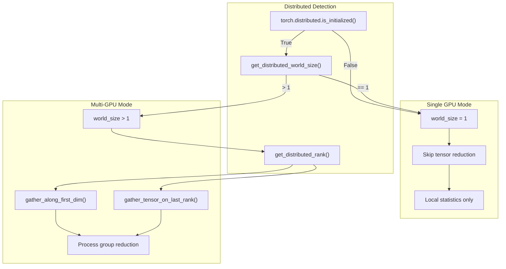
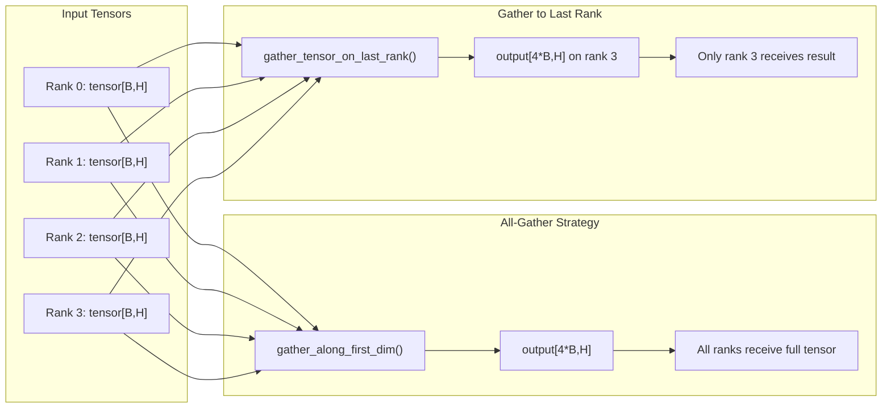
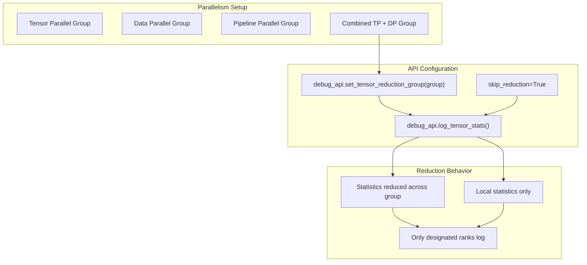
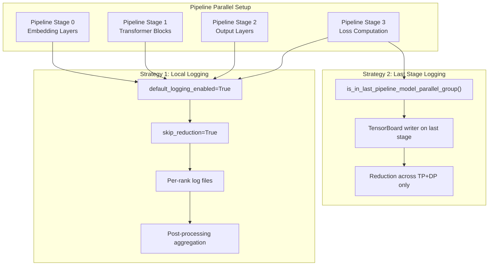
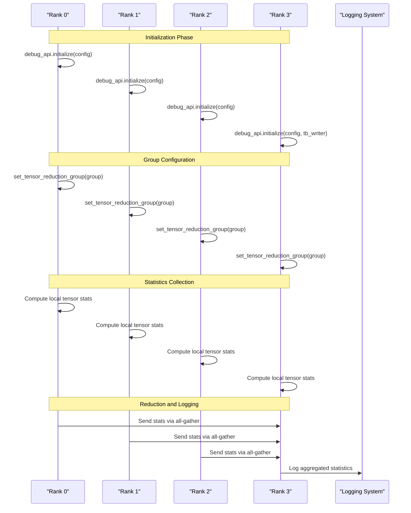

<!-- source: DeepWiki mcp.deepwiki.com · repo NVIDIA/nvidia-dlfw-inspect · page 6.2 Distributed Training Support · fetched 2026-10-26 -->

# Distributed Training Support

<details>
<summary>Relevant source files</summary>

The following files were used as context for generating this wiki page:

- [docs/getting_started.md](docs/getting_started.md)
- [docs/logging.md](docs/logging.md)
- [examples/test_simple_model_train.py](examples/test_simple_model_train.py)
- [nvdlfw_inspect/utils.py](nvdlfw_inspect/utils.py)

</details>


This page covers how to use the nvidia-dlfw-inspect tool in distributed training environments, including tensor reduction across process groups, multi-GPU logging strategies, and handling pipeline parallelism. The tool provides utilities for managing tensor statistics collection and aggregation across multiple ranks in data parallel, tensor parallel, and pipeline parallel training configurations.

For general logging configuration and statistics setup, see [Logging and Statistics](#6.1). For framework-specific distributed features, see [Framework Integration](#6.3).

## Overview

The nvidia-dlfw-inspect tool is designed to work seamlessly in distributed training environments where models are split across multiple GPUs using various parallelism strategies. Each GPU rank runs its own instance of the tool, collecting tensor statistics locally, which can then be reduced and aggregated across process groups before logging.

The distributed support includes:
- Automatic detection of distributed training setup
- Tensor reduction utilities for aggregating statistics across ranks
- Flexible logging strategies for different parallelism configurations
- Process group management for controlling which ranks participate in statistics collection

Sources: [docs/logging.md:48-89](), [nvdlfw_inspect/utils.py:28-98]()

## Rank Management and World Size Detection

### Distributed Training Detection

The tool automatically detects whether PyTorch distributed training is initialized and adapts its behavior accordingly. The core utilities handle both single-node and multi-node scenarios.



The `get_distributed_world_size()` function in [nvdlfw_inspect/utils.py:28-32]() returns 1 if distributed training is not initialized, allowing the tool to work seamlessly in both single-GPU and multi-GPU environments.

Sources: [nvdlfw_inspect/utils.py:28-38]()

### Process Group Support

All distributed utilities accept optional `process_group` parameters, enabling fine-grained control over which ranks participate in tensor operations. This is crucial for handling different parallelism strategies where statistics should only be reduced within specific groups.

| Function | Purpose | Process Group Usage |
|----------|---------|-------------------|
| `get_distributed_world_size()` | Get world size for group | Optional group parameter |
| `get_distributed_rank()` | Get rank within group | Optional group parameter |
| `gather_along_first_dim()` | All-gather with concatenation | Required group parameter |
| `gather_tensor_on_last_rank()` | Gather to highest rank | Optional group parameter |

Sources: [nvdlfw_inspect/utils.py:28-98]()

## Tensor Reduction and Statistics Gathering

### Tensor Reduction Strategies

The tool provides two main strategies for gathering tensor statistics across distributed processes:



**All-Gather Strategy**: The `gather_along_first_dim()` function concatenates tensors from all ranks along the first dimension and distributes the result to all participants. This is useful when all ranks need access to the complete tensor for statistics computation.

**Gather to Last Rank**: The `gather_tensor_on_last_rank()` function collects tensors only on the highest-numbered rank in the group. This reduces memory usage and communication overhead when only one rank needs to perform logging.

Sources: [nvdlfw_inspect/utils.py:41-98]()

### Asynchronous Operations

Both tensor gathering functions support asynchronous execution through the `async_op` parameter, returning a handle that can be used to synchronize the operation later. This allows overlapping computation with communication for better performance.

```python
# Example usage with async operations
output, handle = gather_along_first_dim(tensor, process_group, async_op=True)
# Perform other computation...
if handle is not None:
    handle.wait()  # Synchronize before using output
```

Sources: [nvdlfw_inspect/utils.py:44, 74]()

## Process Group Configuration

### Setting Reduction Groups

The tool allows users to specify which process group should be used for tensor reduction through the `set_tensor_reduction_group()` API. This is essential in complex parallelism setups where statistics should only be reduced within specific groups.



### Typical Configuration Patterns

| Parallelism Type | Recommended Group | Rationale |
|------------------|-------------------|-----------|
| Data Parallel Only | Data parallel group | Reduce across all data replicas |
| Tensor Parallel Only | Tensor parallel group | Combine sharded tensor statistics |
| TP + DP | Combined TP+DP group | Reduce across both dimensions |
| Pipeline Parallel | Per-stage groups | Avoid cross-stage communication |

Sources: [docs/logging.md:52-56]()

## Pipeline Parallelism Considerations

### Logging Challenges

Pipeline parallelism presents unique challenges for distributed logging because different pipeline stages may have different tensor shapes and statistics. The tool provides two strategies to handle this:



**Strategy 1: Local Logging with Post-Processing**
Each rank logs its own statistics to separate files, avoiding the need for cross-pipeline communication. This is the most efficient approach for performance-critical training.

**Strategy 2: Last Stage Aggregation**
Only ranks in the last pipeline stage create loggers and perform reduction across tensor and data parallel dimensions. This provides real-time aggregated statistics but requires careful setup.

Sources: [docs/logging.md:63-89]()

### Implementation Examples

The documentation provides specific implementation patterns for popular frameworks:

```python
# Strategy 1: Local logging example
debug_api.initialize(default_logging_enabled=True)
debug_api.log_tensor_stats(..., skip_reduction=True)
```

```python
# Strategy 2: Last stage logging example (Megatron-LM)
tb_writer = None
if parallel_state.is_in_last_pipeline_model_parallel_group():
    tb_writer = create_tensorboard_writer(log_dir)

debug_api.initialize(tb_writer=tb_writer)
debug_api.set_tensor_reduction_group(tensor_and_data_parallel_group)
```

Sources: [docs/logging.md:67-89]()

## Multi-GPU Logging Strategies

### Rank-Specific Initialization

Each GPU rank initializes its own instance of the nvidia-dlfw-inspect tool, allowing for rank-specific configuration while maintaining coordination for statistics collection.



### Logger Distribution Patterns

| Pattern | Logger Placement | Use Case |
|---------|-----------------|----------|
| **Rank 0 Only** | Single logger on rank 0 | Simple data parallel training |
| **Last Rank Only** | Logger on highest rank | Memory optimization |
| **Per-Pipeline Stage** | Logger on each pipeline stage | Pipeline parallel debugging |
| **All Ranks** | Logger on every rank | Maximum debugging detail |

Sources: [docs/logging.md:48-72]()

### Training Step Synchronization

The tool provides a step counter mechanism to maintain synchronized iteration counting across all ranks:

```python
# Training loop with step synchronization
for epoch in range(num_epochs):
    for batch in dataloader:
        # Forward pass and logging
        debug_api.log_tensor_stats(layer_name, tensor, tensor_name)
        
        # Synchronize step counter across all ranks
        debug_api.step()
```

This ensures that statistics logged from different ranks correspond to the same training iteration, enabling proper correlation during analysis.

Sources: [docs/logging.md:92-99]()

---

