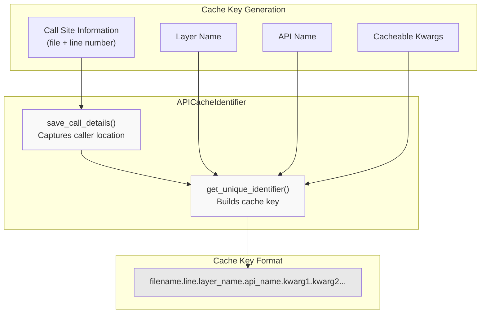
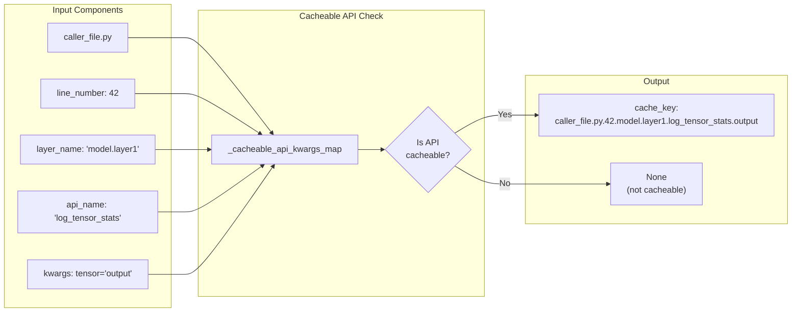
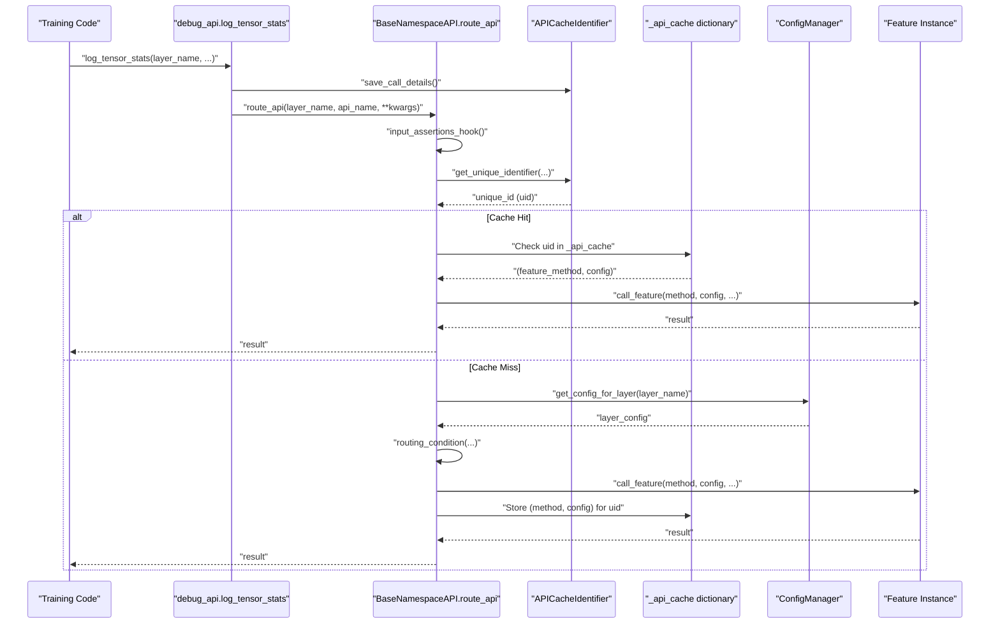
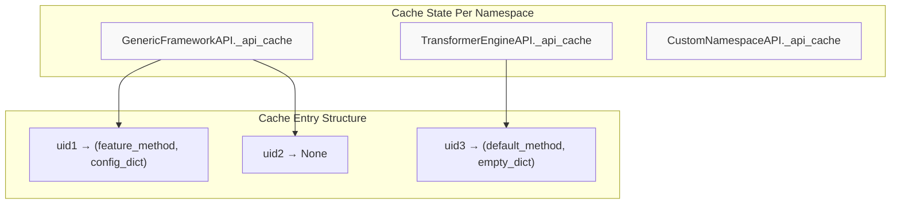
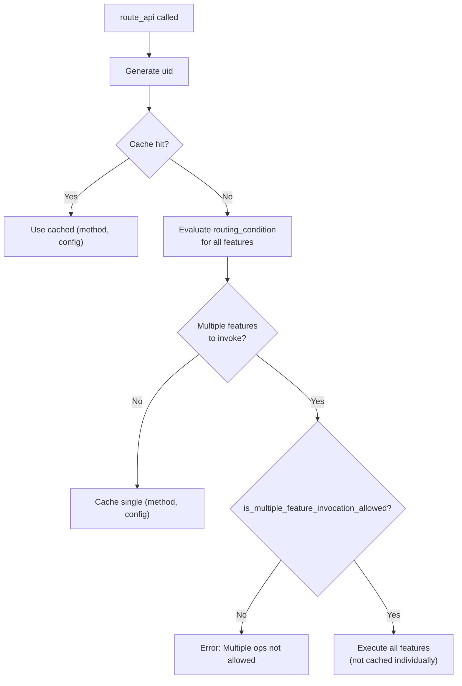

<!-- source: DeepWiki mcp.deepwiki.com · repo NVIDIA/nvidia-dlfw-inspect · page 6.3 Caching and Performance · fetched 2026-10-26 -->

# Caching and Performance

<details>
<summary>Relevant source files</summary>

The following files were used as context for generating this wiki page:

- [nvdlfw_inspect/base.py](nvdlfw_inspect/base.py)
- [nvdlfw_inspect/utils.py](nvdlfw_inspect/utils.py)
- [tests/unit/test_cache.py](tests/unit/test_cache.py)

</details>


This page explains the caching mechanism used by nvdlfw-inspect to minimize runtime overhead when debugging deep learning models. The caching system enables repeated API calls to the same layers to bypass configuration parsing and feature routing logic, significantly reducing the performance impact during training.

For information about the routing logic that caching optimizes, see [Architecture](#1.1). For details on how features are discovered and registered, see [Feature System](#5).

---

## Overview

The nvdlfw-inspect library implements a sophisticated caching system that optimizes repeated API calls during training loops. When a debug API (such as `log_tensor_stats`) is called multiple times for the same layer with identical parameters, the caching system allows the framework to:

1. Skip configuration lookup and parsing
2. Bypass feature routing and condition evaluation
3. Directly invoke the cached feature method with cached configuration

This optimization is critical because training loops typically execute thousands of iterations, with each iteration potentially triggering hundreds of debug API calls across different layers. Without caching, the overhead of configuration lookup and routing logic would significantly degrade training performance.

**Sources:** [nvdlfw_inspect/base.py:146-280]()

---

## Cache Architecture

### Cache Components

The caching system consists of three primary components:

| Component | Class/Location | Purpose |
|-----------|---------------|---------|
| **Cache Storage** | `BaseNamespaceAPI._api_cache` | Dictionary storing cached feature methods and configurations |
| **Cache Identifier** | `APICacheIdentifier` | Utility class generating unique cache keys |
| **Cacheable API Specification** | `BaseNamespaceAPI._cacheable_api_kwargs_map` | Mapping defining which API kwargs should be included in cache keys |

### Cache Identifier Structure



**Sources:** [nvdlfw_inspect/utils.py:125-149](), [tests/unit/test_cache.py:41-64]()

---

## Cache Identifier Generation

### Call Site Tracking

The `APICacheIdentifier` class captures the source code location where debug APIs are invoked:

**Key Methods:**
- `APICacheIdentifier.save_call_details()` - Captures filename and line number of the caller ([nvdlfw_inspect/utils.py:129-133]())
- `APICacheIdentifier.get_call_details()` - Retrieves saved call location ([nvdlfw_inspect/utils.py:136-137]())
- `APICacheIdentifier.get_unique_identifier()` - Generates unique cache key ([nvdlfw_inspect/utils.py:140-149]())

### Unique Identifier Construction

The cache key is constructed from multiple components to ensure uniqueness while allowing efficient cache hits:



**Example Cache Key Construction:**

For a call `debug_api.log_tensor_stats(layer_name="encoder.layer.0", tensor="output")` from `train.py:150`:

- Call location: `train.py.150`
- Layer name: `encoder.layer.0`
- API name: `log_tensor_stats`
- Cacheable kwargs: `output` (assuming "tensor" is in `_cacheable_api_kwargs_map`)
- **Resulting cache key:** `train.py.150.encoder.layer.0.log_tensor_stats.output`

**Sources:** [nvdlfw_inspect/utils.py:140-149](), [tests/unit/test_cache.py:41-51]()

---

## Caching Flow in API Routing

### The route_api Method

The `BaseNamespaceAPI.route_api()` method implements the core caching logic. Every debug API call flows through this method:



**Sources:** [nvdlfw_inspect/base.py:146-280]()

### Cache Storage Format

The `_api_cache` dictionary stores entries in the following format:

| Cache Key (uid) | Cached Value | Description |
|----------------|--------------|-------------|
| `file.py.42.layer.api.kwarg1` | `(feature_method, feature_config)` | Tuple of callable method and config dict |
| `file.py.43.layer.api.kwarg2` | `None` | Explicitly cached as no-op (no features enabled) |
| `file.py.44.layer.api.kwarg3` | `(default_api_method, {})` | Default API with empty config |

**Cache Entry Types:**

1. **Feature Method Cache:** Stores the feature's API method and parsed configuration
2. **Null Cache:** Stores `None` when no features match, avoiding repeated config lookups
3. **Default API Cache:** Stores the default implementation when no features are configured

**Sources:** [nvdlfw_inspect/base.py:175-218]()

---

## Configuring Cacheable APIs

### The _cacheable_api_kwargs_map

Each namespace defines which API parameters should be considered when generating cache keys via the `_cacheable_api_kwargs_map` attribute:

```python
# Example structure (conceptual)
_cacheable_api_kwargs_map = {
    "log_tensor_stats": ["tensor", "tensor_name"],
    "apply_fake_quant": ["tensor", "precision"],
    "custom_api": ["param1", "param2"]
}
```

**Cache Key Parameter Selection:**

- **Included Parameters:** Only kwargs listed in `_cacheable_api_kwargs_map` are part of the cache key
- **Missing Parameters:** If a listed kwarg is not provided, `"0"` is used in the cache key
- **Non-cacheable APIs:** APIs not in the map return `None` as the unique identifier

**Example:**

```python
# Cacheable API map defines: {"log_tensor_stats": ["tensor"]}

# Call 1: debug_api.log_tensor_stats(layer_name="layer1", tensor="output")
# Cache key: file.py.100.layer1.log_tensor_stats.output

# Call 2: debug_api.log_tensor_stats(layer_name="layer1", tensor="input") 
# Cache key: file.py.101.layer1.log_tensor_stats.input  (different cache entry)

# Call 3: debug_api.log_tensor_stats(layer_name="layer1", extra_param="ignored")
# Cache key: file.py.102.layer1.log_tensor_stats.0  (tensor param missing)
```

**Sources:** [nvdlfw_inspect/base.py:91](), [nvdlfw_inspect/utils.py:142-148](), [tests/unit/test_cache.py:54-64]()

---

## Performance Characteristics

### Cache Hit Performance

When a cache hit occurs, the execution path is significantly shorter:

**Cache Miss Path (First Call):**
1. Generate unique identifier
2. Query `ConfigManager.get_config_for_layer()` for layer configuration
3. Iterate through all features in `api_to_features_map`
4. For each feature, call `routing_condition()` to parse config and check applicability
5. Invoke feature method
6. Store result in cache

**Cache Hit Path (Subsequent Calls):**
1. Generate unique identifier
2. Retrieve cached `(method, config)` tuple
3. Invoke feature method directly

### Performance Impact

The caching system provides the following performance benefits:

| Scenario | Without Caching | With Caching | Speedup |
|----------|----------------|--------------|---------|
| Configuration lookup | Every call | First call only | O(n) → O(1) |
| Routing condition evaluation | Every call | First call only | O(n) → O(1) |
| Feature discovery | Every call | First call only | O(n) → O(1) |

**Key Performance Factors:**

- **Training Loop Iterations:** In a typical training loop with 1000 iterations calling 100 layers per iteration, caching reduces 100,000 routing operations to just 100 (one per unique layer/API/kwargs combination)
- **Configuration Complexity:** Larger configuration files with many features benefit more from caching
- **Layer Reuse:** Models with repeated layer patterns (e.g., transformer blocks) see significant cache hit rates

**Sources:** [nvdlfw_inspect/base.py:175-183]()

---

## Cache Debugging and Observability

### Logged Cache Events

The caching system provides debug-level logging for cache-related events:

**Log Events:**

1. **API Encountered:** First time a unique API call site is encountered ([nvdlfw_inspect/base.py:168-173]())
   - Logged once per unique identifier
   - Includes call details from `APICacheIdentifier.get_call_details()`

2. **API Executed:** First time a debug feature is actually invoked ([nvdlfw_inspect/base.py:235-240](), [nvdlfw_inspect/base.py:260-265]())
   - Distinguishes between feature execution and cache hits
   - Indicates which feature was selected

### Cache State Inspection

The cache state is maintained per namespace in `BaseNamespaceAPI._api_cache`:



**Sources:** [nvdlfw_inspect/base.py:81](), [nvdlfw_inspect/base.py:168-173](), [nvdlfw_inspect/base.py:235-240]()

---

## Best Practices for Performance

### Maximizing Cache Effectiveness

To achieve optimal performance with the caching system:

**1. Consistent Call Sites**

Keep debug API calls at consistent source locations. Moving API calls between code lines creates new cache entries:

```python
# Good: Single call site for a layer
for iteration in range(num_iterations):
    output = model.encoder.layer_0(input)
    debug_api.log_tensor_stats(layer_name="encoder.layer.0", tensor=output)

# Avoid: Dynamic call sites (each creates separate cache entries)
for iteration in range(num_iterations):
    if iteration % 2 == 0:
        debug_api.log_tensor_stats(layer_name="encoder.layer.0", tensor=output)  # Line X
    else:
        debug_api.log_tensor_stats(layer_name="encoder.layer.0", tensor=output)  # Line Y
```

**2. Consistent Parameter Usage**

Use consistent parameter names and values for cacheable kwargs:

```python
# Good: Consistent tensor parameter
debug_api.log_tensor_stats(layer_name="layer1", tensor="output")

# Less efficient: Varying tensor names reduce cache hits
debug_api.log_tensor_stats(layer_name="layer1", tensor=f"output_{iteration}")
```

**3. Layer Name Stability**

Use stable, predictable layer names throughout training:

```python
# Good: Consistent layer naming
for i, layer in enumerate(model.layers):
    output = layer(input)
    debug_api.log_tensor_stats(layer_name=f"layer.{i}", tensor=output)

# Avoid: Non-deterministic layer names
debug_api.log_tensor_stats(layer_name=f"layer_{random.randint(0, 100)}", tensor=output)
```

### Memory Considerations

The cache grows with the number of unique call sites × unique layer names × unique API names × unique cacheable kwargs combinations.

**Cache Memory Profile:**

- **Small Models:** ~10-100 cache entries (negligible memory)
- **Large Models (e.g., LLMs):** ~1000-10000 cache entries (~1-10 MB)
- **Pathological Cases:** Dynamic layer names or call sites can cause unbounded cache growth

**Cache Clearing:** The cache is tied to the `DebugManager` lifecycle and is cleared when `debug_api.end_debug()` is called or when `debug_api.initialize()` is called again.

**Sources:** [nvdlfw_inspect/base.py:146-280]()

---

## Advanced Caching Scenarios

### Multi-Feature Invocation

When multiple features are enabled for the same API call, the caching behavior adapts:



**Note:** When multiple features match, the individual feature invocations are not cached. Instead, the entire multi-feature execution path is taken on each call. This is a deliberate design choice to avoid complex cache invalidation logic.

**Sources:** [nvdlfw_inspect/base.py:220-251]()

### Default API Caching

When no features are enabled for a layer, the default API implementation is cached:

```python
# If _default_api_map contains the API
if self._default_api_map and api_name in self._default_api_map:
    self._api_cache[uid] = (self._default_api_map[api_name], {})
    return self._default_api_map[api_name]({}, layer_name, **kwargs)
else:
    self._api_cache[uid] = None
    return {}
```

This ensures that layers without configured features also benefit from caching, avoiding repeated config lookups.

**Sources:** [nvdlfw_inspect/base.py:211-218]()

---

## Performance Profiling

### Measuring Cache Effectiveness

To measure cache effectiveness in your training workflow:

**1. Enable Debug Logging:**

Set logging level to `DEBUG` to see cache-related log messages:

```python
import logging
debug_api.initialize(config_file="config.yaml", log_level=logging.DEBUG)
```

**2. Monitor Log Output:**

Look for these patterns in logs:
- "Debug API call 'X' encountered" (first time a unique call site is hit)
- "Debug API call 'X' found and the corresponding debug feature 'Y' was called" (cache miss)
- Absence of "found and" messages indicates cache hits

**3. Cache Hit Ratio:**

Expected cache behavior:
- **First Training Iteration:** All cache misses (building cache)
- **Subsequent Iterations:** ~99% cache hits for stable layer names and call sites

### Performance Overhead Estimates

Typical overhead with caching enabled:

| Operation | Overhead | Description |
|-----------|----------|-------------|
| Cache hit | < 1 μs | Dictionary lookup + direct method call |
| Cache miss (first iteration) | 10-100 μs | Config lookup + routing + caching |
| Unique identifier generation | ~1 μs | Frame inspection + string concatenation |

**Total Training Overhead:** For a typical transformer model with 1000 iterations and 100 debug API calls per iteration, expect ~1-5% total training time overhead with caching enabled, versus 20-50% overhead without caching.

**Sources:** [nvdlfw_inspect/base.py:164-166](), [nvdlfw_inspect/utils.py:129-149]()

---

## Summary

The nvdlfw-inspect caching system provides critical performance optimization for production debugging workflows:

**Key Takeaways:**

- **Automatic Caching:** All API calls are automatically cached based on call site, layer name, and cacheable kwargs
- **Transparent Operation:** Users don't need to configure or manage caching explicitly
- **Significant Speedup:** Reduces repeated API call overhead from O(n) to O(1) after first iteration
- **Minimal Memory Cost:** Cache size grows linearly with unique layer/API/kwargs combinations
- **Debug Visibility:** Logging messages indicate cache effectiveness during execution

**Related Topics:**

- For the routing logic that caching optimizes, see [Architecture](#1.1)
- For namespace-specific cacheable API configurations, see [Custom Features and Namespaces](#5.2)
- For distributed training cache considerations, see [Distributed Training Support](#6.2)

**Sources:** [nvdlfw_inspect/base.py:146-304](), [nvdlfw_inspect/utils.py:125-149](), [tests/unit/test_cache.py]()

---

