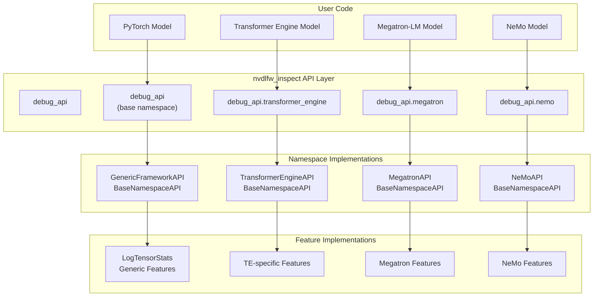
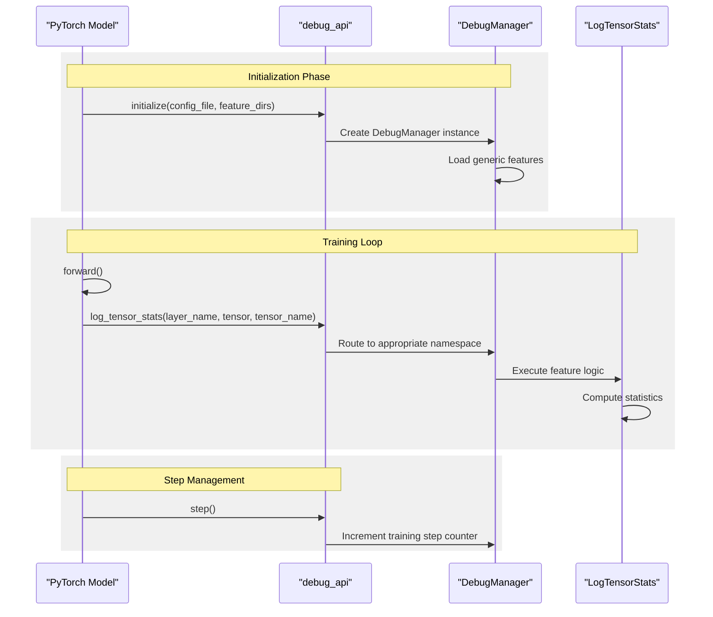
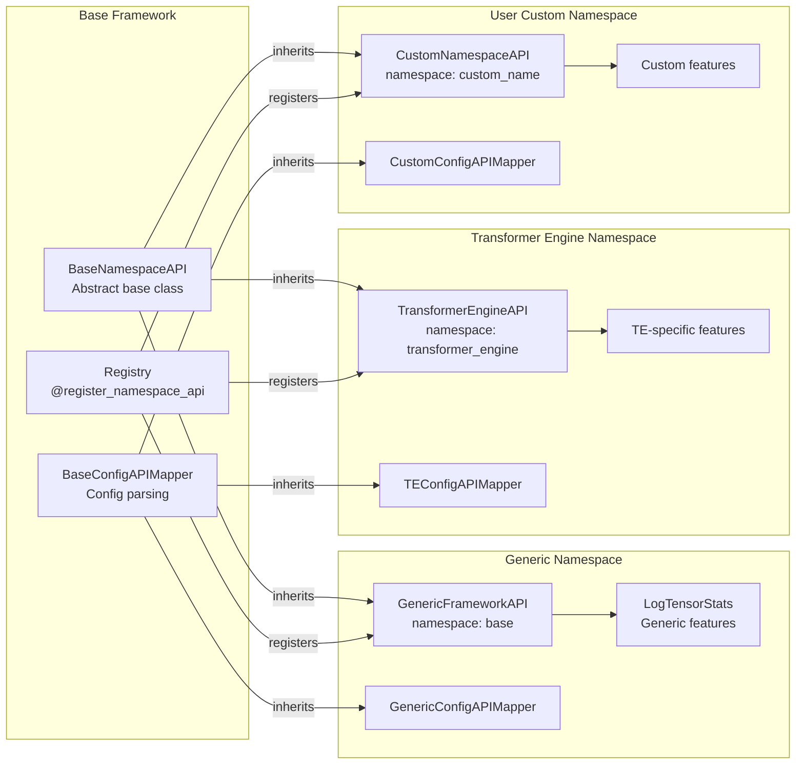
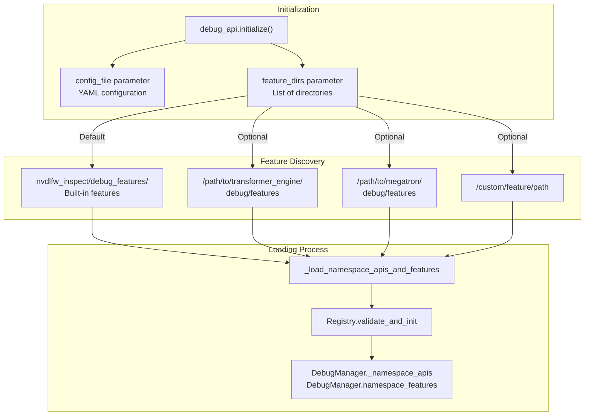
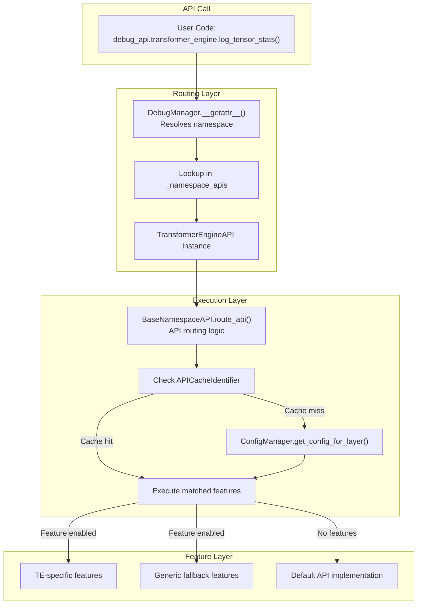
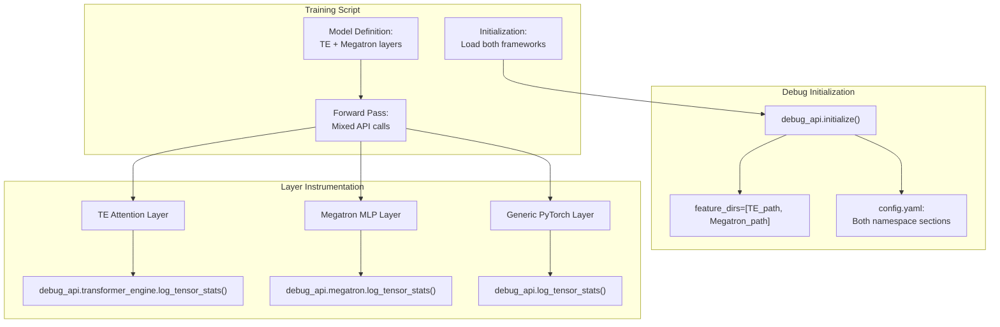

<!-- source: DeepWiki mcp.deepwiki.com · repo NVIDIA/nvidia-dlfw-inspect · page 6.4 Framework Integration · fetched 2026-10-26 -->

# Framework Integration

<details>
<summary>Relevant source files</summary>

The following files were used as context for generating this wiki page:

- [README.md](README.md)
- [docs/getting_started.md](docs/getting_started.md)
- [examples/test_simple_model_train.py](examples/test_simple_model_train.py)

</details>


## Purpose and Scope

This document explains how to integrate `nvdlfw_inspect` with specific deep learning frameworks, including Transformer Engine, Megatron-LM, and NeMo. It covers the namespace-based architecture that allows framework-specific features to coexist with generic debugging capabilities, and demonstrates how to load and use framework-specific APIs.

For general API usage and initialization, see [Main API](#3.1). For information about creating custom features, see [Custom Features and Namespaces](#5.2). For distributed training considerations, see [Distributed Training Support](#6.2).

## Integration Architecture

The `nvdlfw_inspect` system supports multiple frameworks through a namespace-based architecture that separates framework-agnostic features from framework-specific implementations. This design allows the tool to work with any PyTorch model while providing specialized capabilities for frameworks like Transformer Engine, Megatron-LM, and NeMo.

### Namespace-Based Framework Support



**Sources:** [README.md:1-97](), [docs/getting_started.md:1-269]()

Each framework namespace provides:
- **Framework-specific APIs**: Specialized methods that understand framework-specific tensor formats, layer types, and execution patterns
- **Framework-specific features**: Debug capabilities tailored to the framework's unique characteristics
- **Framework-agnostic fallback**: All namespaces inherit from `BaseNamespaceAPI`, allowing generic features to work across frameworks

## PyTorch Integration

### Basic Integration Pattern

The simplest integration uses the base namespace APIs, which work with any PyTorch model. This is the foundation for all framework-specific integrations.



**Sources:** [docs/getting_started.md:14-111](), [examples/test_simple_model_train.py:1-137]()

### PyTorch Model Instrumentation

To integrate `nvdlfw_inspect` with a PyTorch model, add API calls at key points in the forward pass:

| Integration Point | API Call | Purpose |
|-------------------|----------|---------|
| **Initialization** | `debug_api.initialize(config_file)` | Load configuration and features |
| **Layer Outputs** | `debug_api.log_tensor_stats(layer_name, tensor, tensor_name)` | Log tensor statistics |
| **Tensor Processing** | `debug_api.process_tensor(layer_name, tensor, ...)` | Apply transformations |
| **Step Tracking** | `debug_api.step()` | Increment iteration counter |
| **Cleanup** | `debug_api.end_debug()` | Finalize logging |

**Example Integration Points:**

[examples/test_simple_model_train.py:43-76]() demonstrates instrumentation within a PyTorch `nn.Module.forward()` method:

- **Layer 1 (fc1)**: Logs activation statistics with per-rank logging
- **Layer 2 (relu)**: Logs activation statistics with global reduction
- **Custom Processing**: Applies fake quantization via custom namespace
- **Layer 3 (fc2)**: Logs activation statistics with default reduction

**Sources:** [examples/test_simple_model_train.py:36-78]()

## Framework-Specific Namespaces

### Namespace Architecture

Framework-specific namespaces extend the base functionality to support framework-specific constructs such as:
- Custom tensor types and formats
- Framework-specific layer types
- Specialized execution patterns (e.g., expert parallelism, sequence parallelism)
- Framework-specific optimizations



**Sources:** [README.md:76-88]()

### Transformer Engine Integration

Transformer Engine integration provides specialized support for Transformer Engine's optimized CUDA kernels and custom tensor formats.

**API Access Pattern:**

```python
# Generic API (works with all frameworks)
debug_api.log_tensor_stats(layer_name, tensor=weight, tensor_name="weight")

# Transformer Engine-specific API
debug_api.transformer_engine.log_tensor_stats(layer_name, tensor=weight, tensor_name="weight")
```

**Key Differences:**
- **Tensor Format Support**: Handles Transformer Engine's FP8 and custom tensor formats
- **Layer Type Recognition**: Understands TE-specific layers (e.g., `LayerNormLinear`, `DotProductAttention`)
- **Execution Context**: Tracks forward/backward propagation and GEMM operations specific to TE

**Sources:** [README.md:84-87]()

### Loading Framework Features

Framework-specific features are loaded using the `feature_dirs` parameter during initialization:



**Sources:** [README.md:50-58](), [docs/getting_started.md:131-149]()

**Directory Structure Requirements:**

Each feature directory must contain:
- **Namespace API files**: Python files defining classes decorated with `@register_namespace_api`
- **Feature files**: Python files defining classes decorated with `@register_feature`
- **Mapper classes**: Configuration parsers inheriting from `BaseConfigAPIMapper`

**Example Loading Pattern:**

[docs/getting_started.md:131-137]() shows initialization with custom feature directories:
```python
debug_api.initialize(
    "config.yaml",
    feature_dirs=["./sample_namespace"],  # Load custom features
    log_dir="/tmp/nvdlfw_inspect"
)
```

**Sources:** [docs/getting_started.md:129-149]()

## API Access Patterns

### Namespace-Qualified API Calls

Framework-specific APIs are accessed through namespace attributes on the `debug_api` object:

| Framework | Namespace | Example API Call |
|-----------|-----------|------------------|
| **Generic (PyTorch)** | `debug_api` (base) | `debug_api.log_tensor_stats(...)` |
| **Transformer Engine** | `debug_api.transformer_engine` | `debug_api.transformer_engine.log_tensor_stats(...)` |
| **Megatron-LM** | `debug_api.megatron` | `debug_api.megatron.log_tensor_stats(...)` |
| **Custom Namespace** | `debug_api.<custom_name>` | `debug_api.sample_namespace.process_tensor(...)` |

**Sources:** [README.md:76-88](), [docs/getting_started.md:51-54]()

### API Method Resolution



**Sources:** [README.md:76-88]()

### Custom Namespace Example

[docs/getting_started.md:260-268]() demonstrates accessing a custom namespace API:

```python
# Custom namespace API call
relu_quant = debug_api.sample_namespace.process_tensor(
    "relu", 
    tensor=relu_out, 
    gemm="fprop", 
    tensor_name="relu_quant_act"
)["tensor"]
```

This pattern applies to any framework-specific namespace, with the namespace name determined by the `@register_namespace_api` decorator parameter.

**Sources:** [docs/getting_started.md:51-54](), [docs/getting_started.md:260-268]()

## Configuration for Framework Features

### Framework-Specific Configuration Sections

Configuration files support framework-specific sections using the namespace name as a key:

```yaml
config_name:
  enabled: True
  layers:
    layer_name_regex_pattern: .*(attention|mlp)
  
  # Generic feature (base namespace)
  LogTensorStats:
    enabled: True
    tensors_struct:
      - tensor: activation
        stats: [max, min]
  
  # Framework-specific feature (custom namespace)
  transformer_engine:
    TESpecificFeature:
      enabled: True
      # TE-specific parameters
  
  sample_namespace:
    FakeQuant:
      enabled: True
      # Custom feature parameters
```

**Configuration Section Mapping:**

| YAML Section | Namespace | Loaded From |
|--------------|-----------|-------------|
| Top-level features | `base` (GenericFrameworkAPI) | `nvdlfw_inspect/debug_features/` |
| `transformer_engine:` | `transformer_engine` | TE feature directory |
| `megatron:` | `megatron` | Megatron feature directory |
| `<custom_name>:` | `<custom_name>` | Custom feature directory |

**Sources:** [docs/getting_started.md:151-183]()

### Feature Discovery

To list available features after loading framework-specific directories:

```python
# Initialize with framework features
debug_api.initialize(
    config_file="config.yaml",
    feature_dirs=["/path/to/transformer_engine/features"]
)

# List all available features
debug_api.list_features()

# Get detailed information about specific features
debug_api.explain_features("transformer_engine.TEFeatureName")
debug_api.explain_features("base.LogTensorStats")
```

**Sources:** [README.md:61-72]()

## Integration Examples

### DDP Training Integration

[examples/test_simple_model_train.py:1-137]() demonstrates integration with PyTorch Distributed Data Parallel:

**Key Integration Points:**

1. **DDP Setup** [examples/test_simple_model_train.py:29-33]():
   - Initialize process group before `debug_api.initialize()`
   - Set CUDA device for each rank

2. **Debug Initialization** [examples/test_simple_model_train.py:96-100]():
   - Call on all ranks in global context
   - Provide configuration file and feature directories

3. **Model Instrumentation** [examples/test_simple_model_train.py:43-76]():
   - Add API calls within `forward()` method
   - Specify reduction strategy per API call

4. **Training Loop** [examples/test_simple_model_train.py:117-131]():
   - Call `debug_api.step()` after each optimizer step

**Sources:** [examples/test_simple_model_train.py:1-137](), [docs/getting_started.md:14-111]()

### Multi-Framework Training Integration

For codebases using multiple frameworks (e.g., Transformer Engine + Megatron-LM):



**Configuration Example for Multi-Framework:**

```yaml
multi_framework_config:
  enabled: True
  layers:
    layer_name_regex_pattern: .*(attention|mlp|fc)
  
  # Generic features work for all layers
  LogTensorStats:
    enabled: True
    tensors_struct:
      - tensor: activation
        stats: [max, min, mean]
  
  # TE-specific features for TE layers
  transformer_engine:
    TEFeature:
      enabled: True
      # TE-specific config
  
  # Megatron-specific features for Megatron layers
  megatron:
    MegatronFeature:
      enabled: True
      # Megatron-specific config
```

**Sources:** [README.md:1-97]()

## Framework-Specific Considerations

### Tensor Reduction Strategies

Different frameworks may require different tensor reduction strategies in distributed training:

| Framework | Recommended Strategy | Configuration |
|-----------|---------------------|---------------|
| **PyTorch DDP** | Default (last rank) or `skip_reduction=True` | [docs/getting_started.md:251-256]() |
| **Transformer Engine** | Framework-aware reduction | Via framework-specific APIs |
| **Megatron-LM** | Tensor/pipeline parallel-aware | Via framework-specific APIs |

**Example Configuration:**

```python
# Per-rank logging (no reduction)
debug_api.log_tensor_stats(
    "fc1", 
    tensor=fc1_out, 
    tensor_name="activation", 
    skip_reduction=True
)

# Global reduction (all ranks get same stats)
debug_api.log_tensor_stats(
    "relu", 
    tensor=relu_out, 
    tensor_name="activation", 
    reduction_group=torch.distributed.group.WORLD
)

# Default behavior (gather to last rank)
debug_api.log_tensor_stats(
    "fc2", 
    tensor=fc2_out, 
    tensor_name="activation"
)
```

**Sources:** [docs/getting_started.md:247-257]()

### Layer Name Matching

Framework-specific layers may have different naming conventions. Configuration supports regex patterns to match framework-specific layer naming:

| Framework | Typical Layer Names | Regex Pattern Example |
|-----------|---------------------|----------------------|
| **PyTorch** | `fc1`, `fc2`, `relu` | `.*(fc1\|fc2\|relu)` |
| **Transformer Engine** | `attention.qkv_proj`, `mlp.fc1` | `.*attention.*\|.*mlp.*` |
| **Megatron-LM** | `layers.0.attention`, `layers.0.mlp` | `.*layers\.\d+\.(attention\|mlp)` |

**Sources:** [docs/getting_started.md:151-183]()

## Best Practices

### Framework Integration Guidelines

1. **Initialize Once Per Rank**: Call `debug_api.initialize()` once in global context on all ranks before model creation
2. **Load Framework Features Early**: Specify all required `feature_dirs` during initialization
3. **Use Appropriate Namespace**: Call framework-specific APIs when available for better framework integration
4. **Configure Reduction Strategies**: Choose reduction strategy based on distributed training setup
5. **Match Layer Naming**: Use regex patterns in configuration that match your framework's layer naming convention
6. **Validate Configuration**: Use `debug_api.list_features()` and `debug_api.explain_features()` to verify loaded features

### Performance Considerations

For framework integration performance optimization:

- **Leverage Caching**: The API cache (see [Caching and Performance](#6.3)) is shared across all namespaces
- **Selective Feature Loading**: Only load framework features needed for your specific use case
- **Minimize Tensor Copies**: Framework-specific APIs may avoid tensor copies when using native formats
- **Configure Temporal Controls**: Use `freq`, `start_step`, `end_step` in configuration to limit overhead

**Sources:** [docs/getting_started.md:195-207](), [README.md:1-97]()

---

