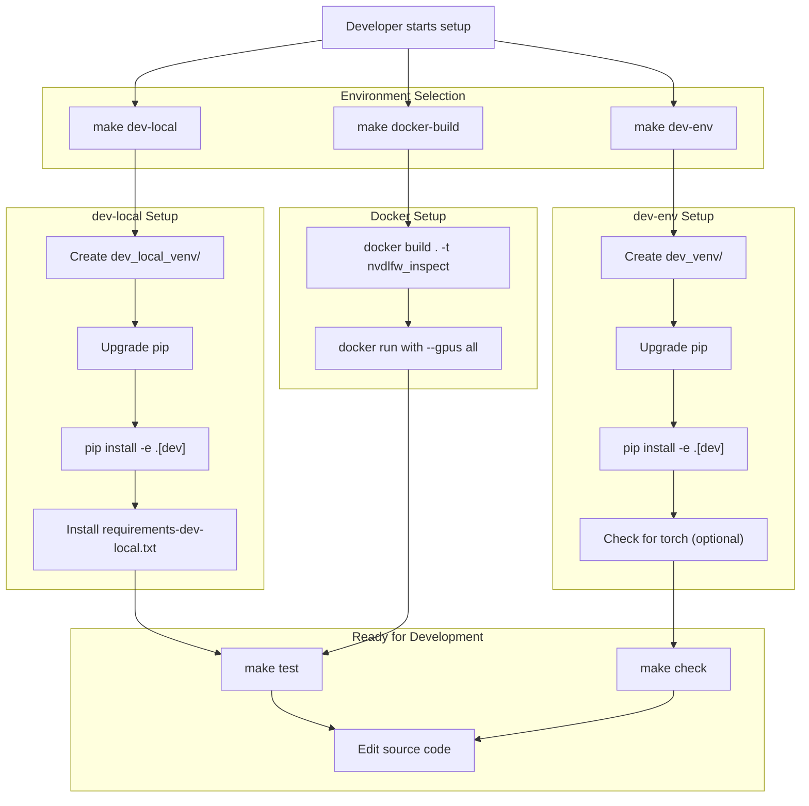
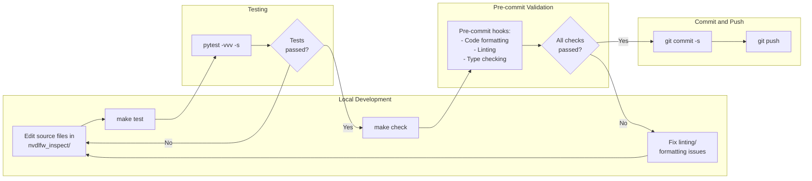
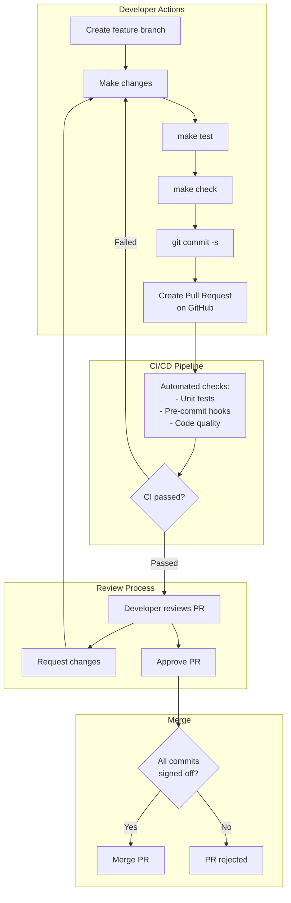
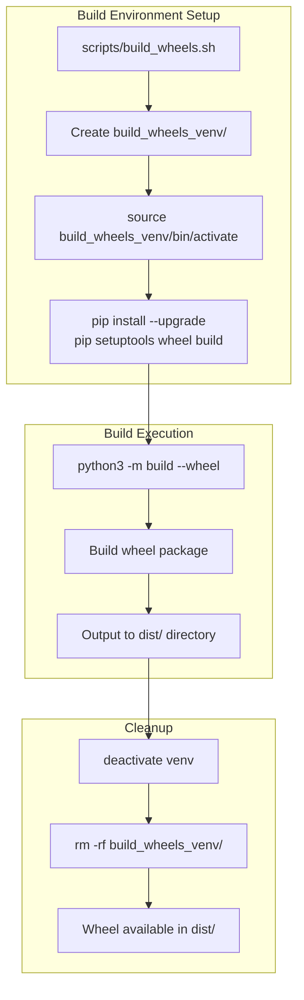

<!-- source: DeepWiki mcp.deepwiki.com · repo NVIDIA/nvidia-dlfw-inspect · page 7 Development · fetched 2026-10-26 -->

# Development

<details>
<summary>Relevant source files</summary>

The following files were used as context for generating this wiki page:

- [CONTRIBUTING.md](CONTRIBUTING.md)
- [Makefile](Makefile)
- [scripts/build_wheels.sh](scripts/build_wheels.sh)

</details>


This page guides contributors through the development workflow for nvdlfw_inspect, including environment setup, testing procedures, coding standards, and build/release processes. For information about using nvdlfw_inspect in your training workflows, see [Getting Started](#2). For details on extending the system with custom features, see [Custom Features and Namespaces](#5.2).

## Development Environment Setup

The nvdlfw_inspect project provides multiple development environment configurations through the Makefile, each suited to different development workflows.

### Development Environment Options

The project supports three distinct development environments:

| Environment | Target | Purpose | Includes Tests |
|-------------|--------|---------|----------------|
| **dev-local** | `make dev-local` | Full local development with PyTorch | Yes |
| **dev-env** | `make dev-env` | Pre-commit checks without PyTorch | Optional |
| **docker** | `make docker-build` | Containerized development environment | Yes |

**Development Environment Creation Flow**



**Sources:** [Makefile:30-60]()

### Creating the Development Environment

To set up a local development environment with full testing capabilities:

```bash
make dev-local
source dev_local_venv/bin/activate
```

The `dev-local` target performs the following operations:
- Creates a Python virtual environment at `dev_local_venv/` [Makefile:37-41]()
- Installs the package in editable mode with development extras: `pip install -e .[dev]` [Makefile:33]()
- Installs additional local development requirements from `requirements-dev-local.txt` [Makefile:34]()

For environments where PyTorch is already installed globally or you only need to run code quality checks:

```bash
make dev-env
source dev_venv/bin/activate
```

The `dev-env` target is lighter-weight and skips PyTorch installation by default, though it warns if PyTorch is not available [Makefile:51-53]().

### Docker Development Environment

For containerized development with GPU support:

```bash
make docker-build
make docker-run
```

The Docker setup:
- Builds an image named `nvdlfw_inspect` [Makefile:20-23]()
- Mounts the current directory to `/workspace/nvdlfw_inspect` in the container [Makefile:28]()
- Enables GPU access with `--gpus all` flag [Makefile:28]()

**Sources:** [Makefile:20-28]()

## Development Workflow

### Code Quality and Pre-commit Checks

The project uses pre-commit hooks to enforce code quality standards. Run all configured checks with:

```bash
make check
```

This executes `pre-commit run -a` which runs all registered pre-commit hooks across the entire codebase [Makefile:62-64]().

**Development Iteration Cycle**



**Sources:** [Makefile:43-45](), [Makefile:62-64]()

### Testing

Run the test suite using pytest:

```bash
make test
```

This executes `pytest -vvv -s` with verbose output and without capturing stdout [Makefile:43-45](). Tests are located in the repository and validate:
- Feature functionality
- Configuration parsing
- API routing behavior
- Distributed training support

For more details on the testing system, see [Testing](#7.2).

### Cleaning Build Artifacts

The Makefile provides several cleanup targets:

| Target | Command | Removes |
|--------|---------|---------|
| `clean-build` | `make clean-build` | `.egg-info`, `build/`, `dist/` directories |
| `clean-venv` | `make clean-venv` | `dev_venv/`, `dev_local_venv/` directories |
| `clean-docker` | `make clean-docker` | Docker image `nvdlfw_inspect` |
| `clean` | `make clean` | All of the above |

**Sources:** [Makefile:66-84]()

## Contributing

Contributions to nvdlfw_inspect are welcome and must follow the project's contribution guidelines.

### Sign-Off Requirements

All commits must be signed off using the Developer Certificate of Origin (DCO). This certifies that you have the right to submit the contribution under the project's license.

To sign off on a commit:

```bash
git commit -s -m "Add cool feature."
```

The `-s` or `--signoff` flag appends a `Signed-off-by` line to your commit message [CONTRIBUTING.md:49-58]().

**Important:** Pull requests containing commits without sign-off will not be accepted [CONTRIBUTING.md:43-47]().

The DCO (Developer Certificate of Origin Version 1.1) certifies that:
- The contribution is your original work, or
- You have rights to submit it under the same or compatible license, or
- The contribution was provided by someone who certified the above [CONTRIBUTING.md:74-98]()

### Coding Guidelines

Follow these guidelines when contributing code:

| Guideline | Description |
|-----------|-------------|
| **Simplicity** | Avoid unnecessary complexity to preserve maintainability and readability [CONTRIBUTING.md:17-18]() |
| **Concise PRs** | Keep pull requests focused on a single concern [CONTRIBUTING.md:20-26]() |
| **No Commented Code** | Remove commented-out code before submitting [CONTRIBUTING.md:22]() |
| **Imperative Mood** | Write PR and commit titles in imperative mood [CONTRIBUTING.md:28-31]() |
| **Commit Messages** | Follow structured commit message format |
| **License Compatibility** | Ensure no license or patent conflicts [CONTRIBUTING.md:33-34]() |
| **Testing** | Ensure unit tests and pre-commit checks pass [CONTRIBUTING.md:36]() |

**Contribution Review Flow**



**Sources:** [CONTRIBUTING.md:1-100]()

### Pull Request Process

1. **Create a focused PR** addressing a single concern [CONTRIBUTING.md:23-26]()
2. **Ensure all tests pass** locally before submitting [CONTRIBUTING.md:36]()
3. **Sign all commits** with `-s` flag [CONTRIBUTING.md:49]()
4. **Wait for review** by a project Developer [CONTRIBUTING.md:11-12]()
5. **Address feedback** if changes are requested
6. **Merge** occurs after approval and passing CI tests [CONTRIBUTING.md:11-12]()

## Building and Packaging

### Building Distribution Wheels

The project includes a script to build Python wheel distributions:

```bash
./scripts/build_wheels.sh
```

**Wheel Build Process**



The build script [scripts/build_wheels.sh:1-40]():
1. Creates a temporary virtual environment `build_wheels_venv` [scripts/build_wheels.sh:21-26]()
2. Installs build dependencies: `pip`, `setuptools`, `wheel`, `build` [scripts/build_wheels.sh:30]()
3. Builds the wheel with `python3 -m build --wheel` [scripts/build_wheels.sh:32]()
4. Cleans up the temporary environment [scripts/build_wheels.sh:36-37]()
5. Outputs the wheel to `dist/` directory [scripts/build_wheels.sh:39]()

**Sources:** [scripts/build_wheels.sh:1-40]()

### Docker Image Building

Build a Docker image for development or deployment:

```bash
make docker-build
```

This creates an image tagged as `nvdlfw_inspect` [Makefile:20-23](). The image includes:
- All project dependencies
- GPU support capabilities
- Development tools

To run the Docker container interactively:

```bash
make docker-run
```

This mounts the current directory to `/workspace/nvdlfw_inspect` for live code editing [Makefile:26-28]().

### Installation Targets

The Makefile provides an installation target for end users:

```bash
make install
```

This target [Makefile:15-18]():
1. Runs `pip install .` to install the package
2. Validates that `torch` and `yaml` are available in the environment
3. Exits with an error if prerequisites are missing

**Sources:** [Makefile:13-28]()

### Dependency Management

The project uses two dependency specifications:

| File | Purpose | Used By |
|------|---------|---------|
| `setup.py` or `pyproject.toml` | Core package dependencies and optional extras | `pip install .` and `pip install -e .[dev]` |
| `requirements-dev-local.txt` | Additional development dependencies | `make dev-local` |

Development extras are installed with the `[dev]` extra specifier [Makefile:33](), [Makefile:50]().

### Release Process

**Typical Release Workflow**

```mermaid
flowchart LR
    subgraph "Pre-release Preparation"
        UpdateVersion["Update version number"]
        RunAllTests["make test<br/>(all tests pass)"]
        UpdateDocs["Update documentation"]
    end
    
    subgraph "Build Artifacts"
        CleanPrevious["make clean-build"]
        BuildWheel["scripts/build_wheels.sh"]
        BuildDocker["make docker-build"]
    end
    
    subgraph "Verification"
        TestWheel["Test wheel installation"]
        TestDocker["Test Docker image"]
        ValidateFunc["Validate functionality"]
    end
    
    subgraph "Release"
        TagRelease["git tag version"]
        PushTag["git push --tags"]
        PublishArtifacts["Publish to registry<br/>(if applicable)"]
    end
    
    UpdateVersion --> RunAllTests
    RunAllTests --> UpdateDocs
    UpdateDocs --> CleanPrevious
    
    CleanPrevious --> BuildWheel
    CleanPrevious --> BuildDocker
    
    BuildWheel --> TestWheel
    BuildDocker --> TestDocker
    TestWheel --> ValidateFunc
    TestDocker --> ValidateFunc
    
    ValidateFunc --> TagRelease
    TagRelease --> PushTag
    PushTag --> PublishArtifacts
```



**Sources:** [Makefile:1-91](), [scripts/build_wheels.sh:1-40]()

## Makefile Command Reference

All make targets support the `make help` command to display available options [Makefile:86-90]().

| Command | Description | Source |
|---------|-------------|--------|
| `make install` | Install nvdlfw_inspect in current environment | [Makefile:15-18]() |
| `make dev-local` | Create full local development environment | [Makefile:30-35]() |
| `make dev-env` | Create lightweight dev environment | [Makefile:47-54]() |
| `make test` | Run pytest test suite | [Makefile:43-45]() |
| `make check` | Run pre-commit checks | [Makefile:62-64]() |
| `make docker-build` | Build Docker development image | [Makefile:20-23]() |
| `make docker-run` | Run Docker container interactively | [Makefile:25-28]() |
| `make clean-build` | Remove build artifacts | [Makefile:66-69]() |
| `make clean-venv` | Remove virtual environments | [Makefile:71-74]() |
| `make clean-docker` | Remove Docker image | [Makefile:76-80]() |
| `make clean` | Remove all artifacts | [Makefile:82-84]() |
| `make help` | Display help message | [Makefile:86-88]() |

**Sources:** [Makefile:1-91]()

---

