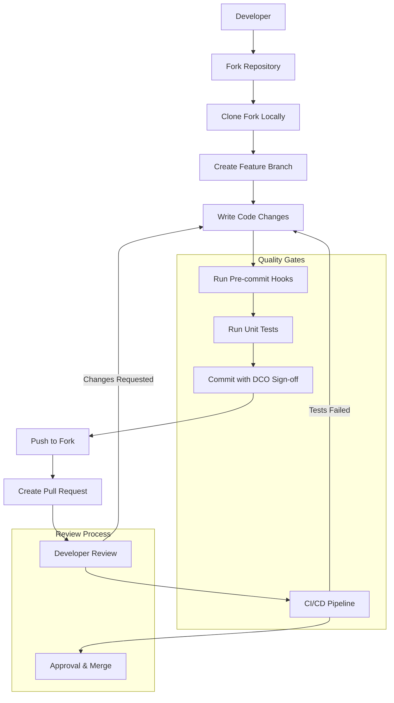
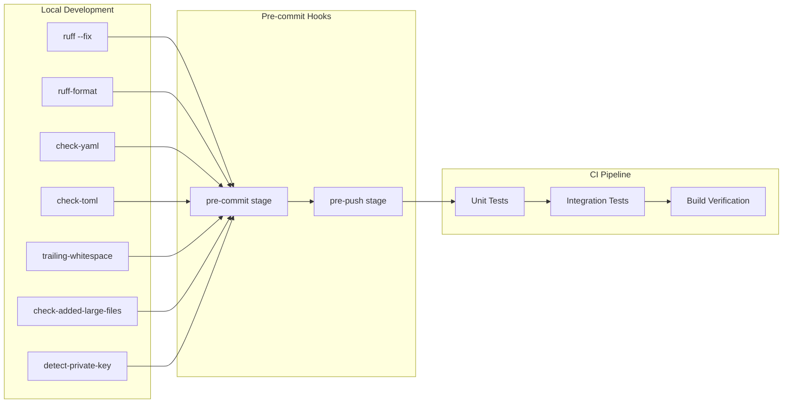
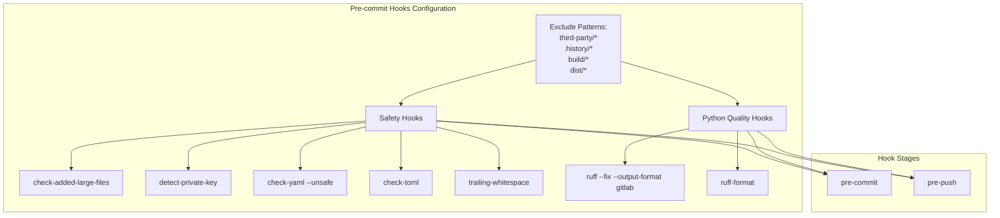
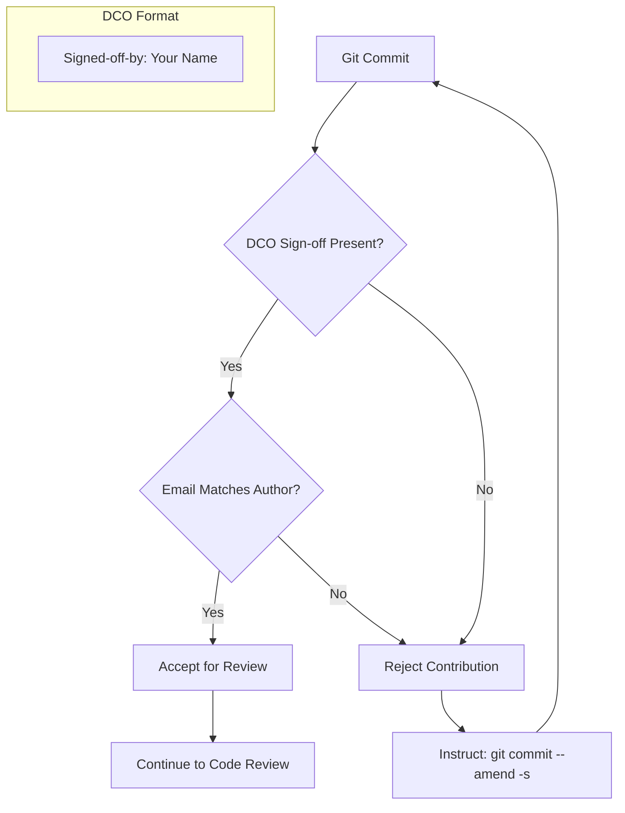
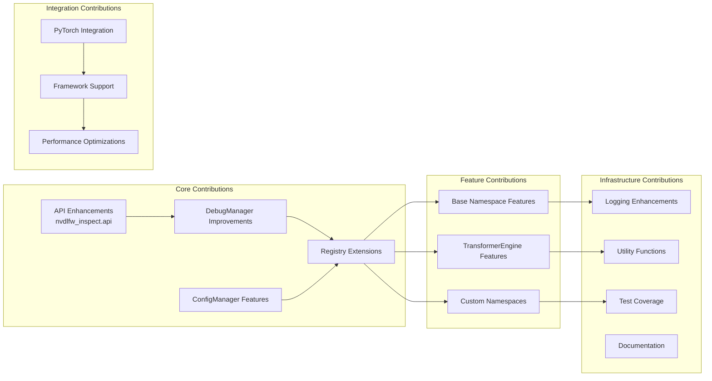

<!-- source: DeepWiki mcp.deepwiki.com · repo NVIDIA/nvidia-dlfw-inspect · page 7.1 Contributing · fetched 2026-10-26 -->

# Contributing

<details>
<summary>Relevant source files</summary>

The following files were used as context for generating this wiki page:

- [CONTRIBUTING.md](CONTRIBUTING.md)
- [Makefile](Makefile)

</details>


This document provides guidelines for contributing code, documentation, and features to the nvidia-dlfw-inspect project. It covers the development workflow, code quality standards, and legal requirements for all contributions.

For information about testing procedures and infrastructure, see [Testing](#7.2). For details about building and packaging, see [Building and Packaging](#7.3).

## Contribution Process

The nvidia-dlfw-inspect project welcomes contributions from the community. All contributions follow a standard GitHub pull request workflow with specific requirements for code quality and legal compliance.

### Contribution Workflow



**Sources:** [CONTRIBUTING.md:1-100]()

### Code Quality Pipeline

The project enforces code quality through automated checks at multiple stages:



**Sources:** [.pre-commit-config.yaml:1-36](), [CONTRIBUTING.md:36-36]()

## Code Quality Requirements

### Coding Guidelines

The project enforces specific coding standards to maintain code quality and readability:

| Guideline | Description | Enforcement |
|-----------|-------------|-------------|
| **Complexity Management** | Avoid unnecessary complexity in existing code | Manual review |
| **Concise Pull Requests** | Keep PRs focused on single concerns | Manual review |
| **No Commented Code** | Remove commented-out code before submission | Manual review |
| **Imperative Commit Messages** | Use imperative mood for PR and commit titles | Manual review |
| **Git Commit Format** | Follow structured commit message format | Manual review |

**Sources:** [CONTRIBUTING.md:14-32]()

### Pre-commit Configuration

The project uses `ruff` for Python linting and formatting, with the following configuration:



**Sources:** [.pre-commit-config.yaml:1-36]()

## Legal Requirements

### Developer Certificate of Origin (DCO)

All contributions must include a DCO sign-off to certify the legal right to contribute the code under the project's open source license.

#### DCO Sign-off Process

| Step | Command | Purpose |
|------|---------|---------|
| **Commit with Sign-off** | `git commit -s -m "Add cool feature."` | Automatically adds DCO sign-off |
| **Manual Sign-off** | Add `Signed-off-by: Your Name <your@email.com>` | Manual DCO certification |

#### DCO Certification Requirements

Contributors must certify one of the following conditions:

1. **Original Work** - The contribution was created by the contributor
2. **Derivative Work** - Based on previous open source work with appropriate rights
3. **Third-party Contribution** - Received from another person who certified (a) or (b)
4. **Public Record Understanding** - Acknowledgment that contribution becomes public record

**Sources:** [CONTRIBUTING.md:40-99]()

### DCO Compliance Check



**Sources:** [CONTRIBUTING.md:43-58]()

## Development Workflow

### Setting Up Development Environment

Before contributing, developers should set up the pre-commit hooks and development environment:

```bash
# Install pre-commit hooks
pre-commit install

# Run pre-commit on all files
pre-commit run --all-files

# Test specific hooks
pre-commit run ruff --all-files
pre-commit run ruff-format --all-files
```

### Pull Request Requirements

Each pull request must satisfy the following requirements before merge:

| Requirement | Verification Method | Blocking |
|-------------|-------------------|----------|
| **DCO Sign-off** | Automated check on all commits | Yes |
| **Pre-commit Checks** | Local and CI verification | Yes |
| **Unit Tests** | Automated test suite | Yes |
| **Code Review** | Manual developer review | Yes |
| **Coding Guidelines** | Manual review process | Yes |

**Sources:** [CONTRIBUTING.md:10-12](), [CONTRIBUTING.md:36-38]()

### Contribution Types

The project accepts various types of contributions that integrate with the feature system:



**Sources:** [CONTRIBUTING.md:8-12]()

---

