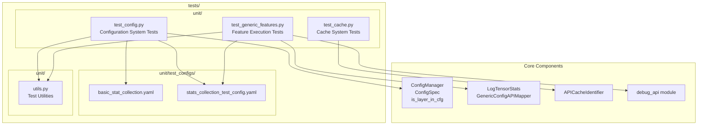
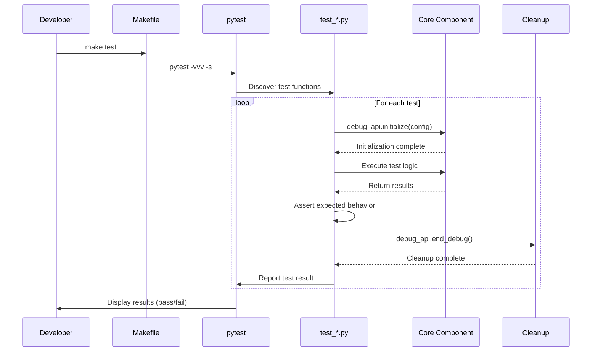
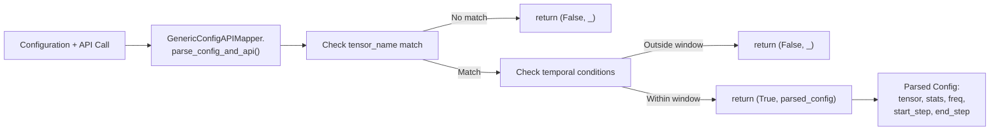
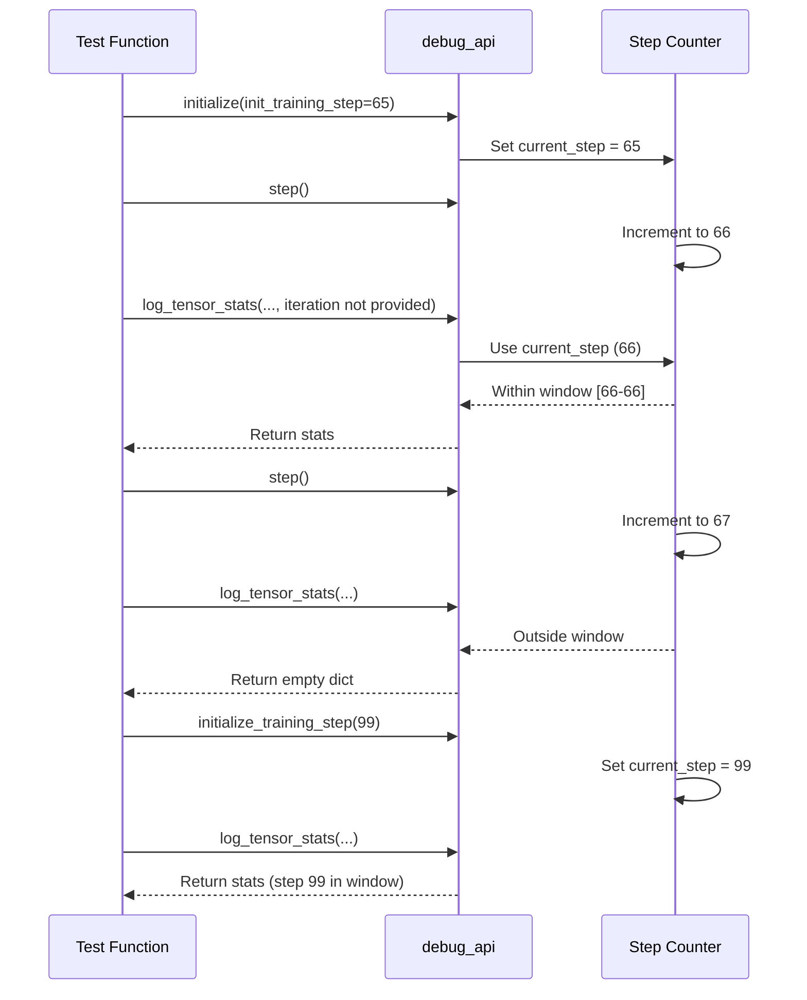
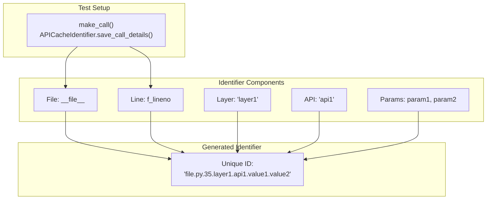
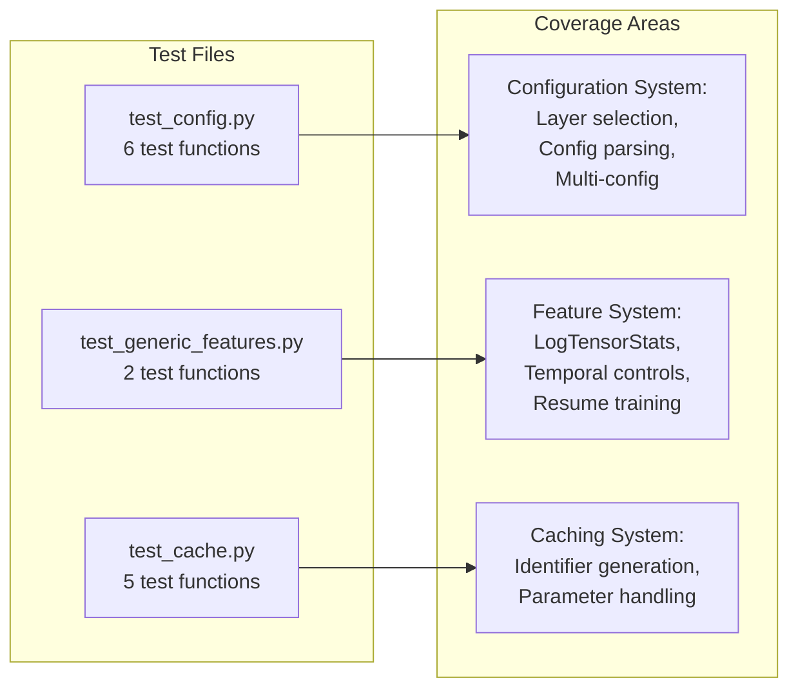

<!-- source: DeepWiki mcp.deepwiki.com · repo NVIDIA/nvidia-dlfw-inspect · page 7.2 Testing · fetched 2026-10-26 -->

# Testing

<details>
<summary>Relevant source files</summary>

The following files were used as context for generating this wiki page:

- [Makefile](Makefile)
- [tests/unit/test_cache.py](tests/unit/test_cache.py)
- [tests/unit/test_config.py](tests/unit/test_config.py)
- [tests/unit/test_generic_features.py](tests/unit/test_generic_features.py)

</details>


This page documents the test suite for nvdlfw_inspect, including test organization, execution procedures, test categories, and guidelines for writing new tests. The test suite validates configuration parsing, feature execution, caching mechanisms, and API behavior.

For information about contributing code changes, see [Contributing](#7.1). For details on building and packaging, see [Building and Packaging](#7.3).

---

## Overview

The nvdlfw_inspect test suite is organized under the `tests/` directory and uses `pytest` as the test framework. Tests are categorized into unit tests that validate individual components in isolation. The suite covers:

- **Configuration System**: Layer selection, config parsing, and validation
- **Features**: Statistics collection, temporal controls, and feature behavior
- **Caching**: API cache identifier generation and cache hit/miss scenarios
- **API Integration**: End-to-end workflows including initialization and cleanup

**Sources:** [Makefile:43-45](), [tests/unit/test_config.py](), [tests/unit/test_generic_features.py](), [tests/unit/test_cache.py]()

---

## Test Suite Organization

The test suite is organized by component, with each test file focusing on a specific subsystem:



### Test File Responsibilities

| Test File | Primary Focus | Key Components Tested |
|-----------|--------------|----------------------|
| `test_config.py` | Configuration system validation | `ConfigManager`, `ConfigSpec`, `is_layer_in_cfg`, layer selection logic |
| `test_generic_features.py` | Feature execution and statistics | `LogTensorStats`, temporal controls, step tracking, resume training |
| `test_cache.py` | Caching mechanism verification | `APICacheIdentifier`, unique identifier generation, cacheable APIs |

**Sources:** [tests/unit/test_config.py](), [tests/unit/test_generic_features.py](), [tests/unit/test_cache.py]()

---

## Running Tests

### Basic Test Execution

The primary method to run tests is via the `Makefile`:

```bash
make test
```

This executes `pytest -vvv -s`, which:
- Runs all tests in verbose mode (`-vvv`)
- Disables output capturing (`-s`) to show print statements
- Automatically discovers test files matching `test_*.py` patterns

**Sources:** [Makefile:43-45]()

### Development Environment Setup

Before running tests, set up the development environment:

```bash
# Create dev environment with PyTorch
make dev-local

# Activate the environment
source dev_local_venv/bin/activate

# Run tests
make test
```

Alternatively, for a minimal dev environment without PyTorch:

```bash
make dev-env
source dev_venv/bin/activate
```

**Sources:** [Makefile:30-41](), [Makefile:47-54]()

### Docker-Based Testing

For isolated testing in a containerized environment:

```bash
# Build the Docker image
make docker-build

# Run container with GPU access
make docker-run

# Inside container, run tests
make test
```

**Sources:** [Makefile:20-28]()

### Direct pytest Usage

For more granular test control, use `pytest` directly:

```bash
# Run specific test file
pytest tests/unit/test_config.py -v

# Run specific test function
pytest tests/unit/test_config.py::test_layer_selection -v

# Run with coverage report
pytest --cov=nvdlfw_inspect --cov-report=html

# Run tests matching pattern
pytest -k "test_statistics" -v
```

---

## Test Execution Flow



**Sources:** [Makefile:43-45](), [tests/unit/test_config.py](), [tests/unit/test_generic_features.py]()

---

## Test Categories

### Configuration Tests

The `test_config.py` file validates the configuration system's ability to parse YAML files, select layers, and manage multiple configurations.

#### Layer Selection Tests

**Function:** `test_layer_selection()`

Tests all layer selection mechanisms:

| Selection Method | Test Case | Expected Behavior |
|-----------------|-----------|-------------------|
| Layer Numbers | `layer_numbers: [1, 2, 3]` | Matches `decoder.1.mlp.fc1`, not `decoder.12.mlp.fc1` |
| Layer Numbers + Types | `layer_numbers: [1,2,3]`<br/>`layer_types: ["mlp", "qkv"]` | Matches `decoder.1.mlp.fc1` and `decoder.3.attn.qkv`, not `decoder.3.attn.proj` |
| All Layers | `layer_numbers: ["all"]`<br/>`layer_types: ["all"]` | Matches all layers in model |
| Regex Pattern | `layer_name_regex_pattern: ".*1\..*attn..*(proj\|qkv)"` | Matches `decoder.1.attn.qkv`, not `decoder.12.attn.proj` |

**Sources:** [tests/unit/test_config.py:28-78]()

#### Multiple Configuration Tests

**Functions:** `test_multiple_configs()`, `test_multiple_configs_dict()`

Validates:
- Loading configuration from YAML file path or Python dictionary
- Layer-specific configuration retrieval via `ConfigManager.get_config_for_layer()`
- Different tensor types (gradient vs. activation) for different layers
- Proper exception handling for unconfigured layers

**Test Configuration Structure:**
```yaml
- layers:
    layer_numbers: [1]
    layer_types: ["self_attention", "qkv"]
  LogTensorStats:
    tensors: ["gradient"]

- layers:
    layer_numbers: [2]
    layer_types: ["mlp", "fc1"]
  LogTensorStats:
    tensors: ["activation"]
```

**Sources:** [tests/unit/test_config.py:81-124]()

#### Configuration Parsing Tests

**Functions:** `test_config_parsing()`, `test_config_parsing_dict()`

Validates `GenericConfigAPIMapper.parse_config_and_api()` behavior:



**Test Assertions:**
- Wrong tensor name returns `(False, _)`
- Correct tensor name and step range returns `(True, parsed_config)`
- Parsed config contains expected fields: `tensor`, `stats`, `freq`, `start_step`, `end_step`

**Sources:** [tests/unit/test_config.py:126-222]()

---

### Feature Tests

The `test_generic_features.py` file validates feature execution, particularly the `LogTensorStats` feature and its temporal controls.

#### Statistics Collection Test

**Function:** `test_statistics_collection()`

Validates that:
1. Different layers collect different statistics based on configuration
2. Temporal controls (start_step, end_step, freq) are respected
3. Statistics match expected PyTorch tensor operations

**Test Flow:**
```python
# Initialize with config
debug_api.initialize(config_file=..., default_logging_enabled=False)

# Call API with different tensors and layers
activation_stats = debug_api.log_tensor_stats(
    "decoder.1.mlp.fc1", tensor=tensor1, tensor_name="activation", iteration=101
)

# Verify stats presence and correctness
assert "mean" in activation_stats
assert activation_stats["mean"] == tensor1.mean()
```

**Temporal Behavior Validation:**

| Iteration | Layer | Tensor | Start | End | Expected Result |
|-----------|-------|--------|-------|-----|-----------------|
| 101 | decoder.1.mlp.fc1 | activation | 100 | 500 | Stats returned |
| 11 | decoder.1.mlp.fc1 | activation | 100 | 500 | Empty dict (before start) |
| 190 | decoder.2.mlp.fc1 | weight | - | - | Empty dict (after end) |

**Sources:** [tests/unit/test_generic_features.py:23-73]()

#### Resume Training Test

**Function:** `test_statistics_collection_resume_training()`

Validates step tracking across training resumption:



**Key Validations:**
- `init_training_step` parameter sets initial step counter
- `debug_api.step()` increments the global step
- `initialize_training_step()` allows manual step reset
- Statistics collection respects the current step counter

**Sources:** [tests/unit/test_generic_features.py:75-120]()

---

### Cache Tests

The `test_cache.py` file validates the `APICacheIdentifier` utility used for caching API call results.

#### Cache Identifier Generation

**Test Flow:**


**Test Functions and Validations:**

| Test Function | Configuration | Expected Identifier |
|--------------|---------------|---------------------|
| `test_save_call_details()` | Saves caller line number | `{FILE_NAME}.{LINE_NUM}` |
| `test_get_unique_identifier_cacheable()` | Cacheable API with all params | `{FILE}.{LINE}.layer1.api1.value1.value2` |
| `test_get_unique_identifier_with_missing_params()` | Missing param2 | `{FILE}.{LINE}.layer1.api1.value1.0` |
| `test_get_unique_identifier_not_cacheable()` | Non-cacheable API | `None` |
| `test_get_unique_identifier_no_kwargs()` | No parameters provided | `{FILE}.{LINE}.layer1.api1.0.0` |

**Key Behaviors:**
- Caller file and line number are captured for cache uniqueness
- Missing parameters are replaced with default value `0`
- Non-cacheable APIs return `None` (no caching)
- Identifier format: `filename.line.layer.api.param_values`

**Sources:** [tests/unit/test_cache.py:31-90]()

---

## Writing New Tests

### Test Structure Guidelines

All test functions should follow this pattern:

```python
def test_feature_name():
    # 1. Initialize debug_api with test configuration
    debug_api.initialize(
        config_file=pathlib.Path(__file__).resolve().parent / "test_configs/config.yaml",
        default_logging_enabled=False  # Disable file logging in tests
    )
    
    # 2. Execute the functionality being tested
    result = debug_api.some_api_call(...)
    
    # 3. Assert expected behavior
    assert result == expected_value
    assert "key" in result
    
    # 4. Clean up
    debug_api.end_debug()
```

**Sources:** [tests/unit/test_generic_features.py:23-72]()

### Adding Configuration-Based Tests

When testing configuration parsing or layer selection:

1. **Create a test configuration file** in `tests/unit/test_configs/`:
   ```yaml
   nvdlfw_inspect:
     - layers:
         layer_numbers: [1]
       LogTensorStats:
         tensors: ["activation"]
         stats: ["mean", "std"]
   ```

2. **Initialize with the configuration:**
   ```python
   debug_api.initialize(
       config_file=pathlib.Path(__file__).resolve().parent / "test_configs/your_config.yaml"
   )
   ```

3. **Test layer matching and config retrieval:**
   ```python
   cfg = ConfigManager.get_config_for_layer("decoder.1.mlp.fc1")
   assert cfg["base"]["LogTensorStats"]["tensors"] == ["activation"]
   ```

**Sources:** [tests/unit/test_config.py:82-99]()

### Adding Feature Tests

When adding tests for new features:

1. **Use synthetic tensors:**
   ```python
   tensor = torch.rand((100, 100))
   ```

2. **Test with explicit iteration numbers:**
   ```python
   stats = debug_api.log_tensor_stats(
       "layer_name", 
       tensor=tensor, 
       tensor_name="activation", 
       iteration=101
   )
   ```

3. **Validate statistics correctness:**
   ```python
   assert stats["mean"] == tensor.mean()
   assert stats["max"] == tensor.max()
   ```

4. **Test temporal controls:**
   ```python
   # Inside configured window
   assert len(stats) > 0
   
   # Outside configured window
   assert stats == {}
   ```

**Sources:** [tests/unit/test_generic_features.py:23-73]()

### Test Utilities

The `tests/unit/utils.py` module provides test helper functions:

- `reset_debug_log()`: Cleans up logging state between tests

**Sources:** [tests/unit/test_generic_features.py:18]()

---

## Test Coverage

### Component Coverage Matrix

| Component | Test File | Coverage Areas |
|-----------|-----------|----------------|
| `ConfigManager` | `test_config.py` | Config loading (YAML/dict), layer matching, multi-config support |
| `ConfigSpec` | `test_config.py` | Initialization, reset, layer selection logic |
| `is_layer_in_cfg()` | `test_config.py` | All layer selection methods (numbers, types, regex, "all") |
| `GenericConfigAPIMapper` | `test_config.py` | Config parsing, tensor name matching, temporal validation |
| `LogTensorStats` | `test_generic_features.py` | Statistics collection, temporal controls, step tracking |
| `APICacheIdentifier` | `test_cache.py` | Call detail capture, unique ID generation, cacheable API detection |
| `debug_api` module | Multiple files | Initialize, step, log_tensor_stats, end_debug, initialize_training_step |

### Current Test Statistics



**Total Test Functions:** 13

**Sources:** [tests/unit/test_config.py](), [tests/unit/test_generic_features.py](), [tests/unit/test_cache.py]()

---

## Best Practices

### Test Isolation

1. **Always call `debug_api.end_debug()`** at the end of each test to reset global state
2. **Use `default_logging_enabled=False`** during initialization to avoid file I/O overhead
3. **Reset any test utilities** (e.g., `reset_debug_log()`) after tests that modify shared state

### Configuration Management

1. **Store reusable test configs** in `tests/unit/test_configs/`
2. **Use `pathlib.Path(__file__).resolve().parent`** for portable config path resolution
3. **Test both YAML file and dictionary inputs** for configuration APIs

### Assertion Clarity

1. **Use descriptive assertion messages** when behavior is non-obvious
2. **Test both positive and negative cases** (valid and invalid inputs)
3. **Validate exact values** (e.g., `stats["mean"] == tensor.mean()`) not just presence

### Temporal Testing

When testing features with temporal controls (start_step, end_step, freq):

1. **Test boundary conditions:** iterations at start_step-1, start_step, end_step, end_step+1
2. **Test frequency skipping:** validate that stats are only collected every `freq` steps
3. **Test resume scenarios:** use `init_training_step` to simulate training resumption

**Sources:** [tests/unit/test_generic_features.py:75-120](), [tests/unit/test_config.py:126-222]()

---

