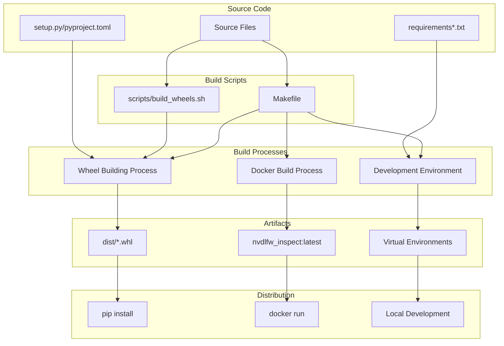
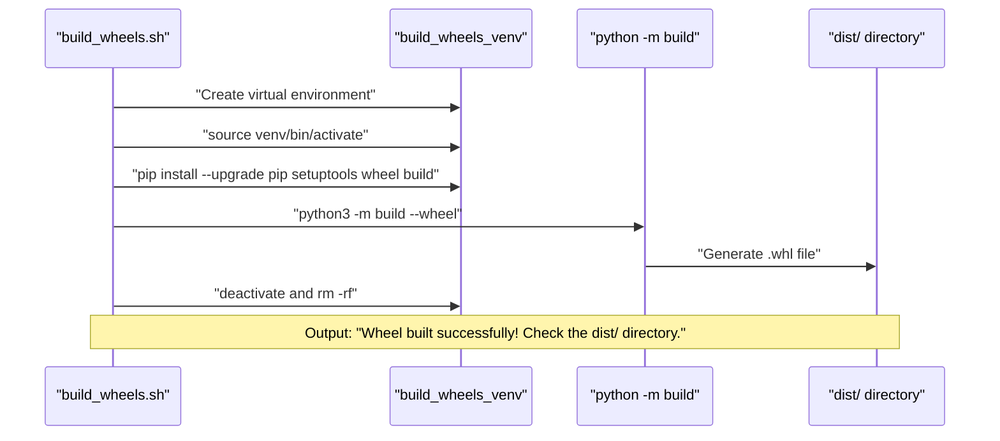
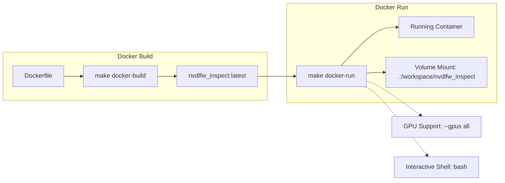
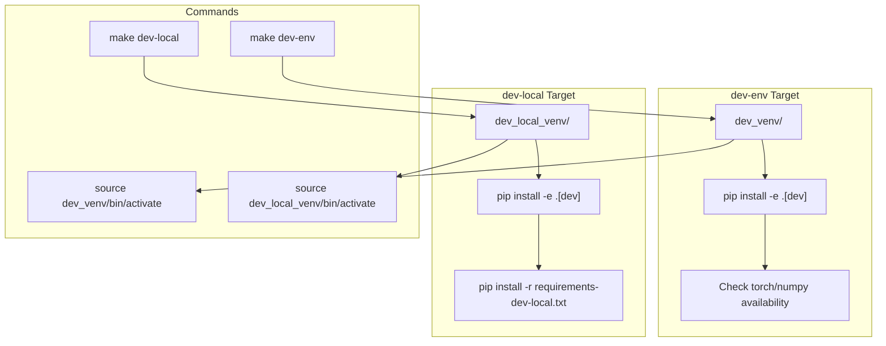
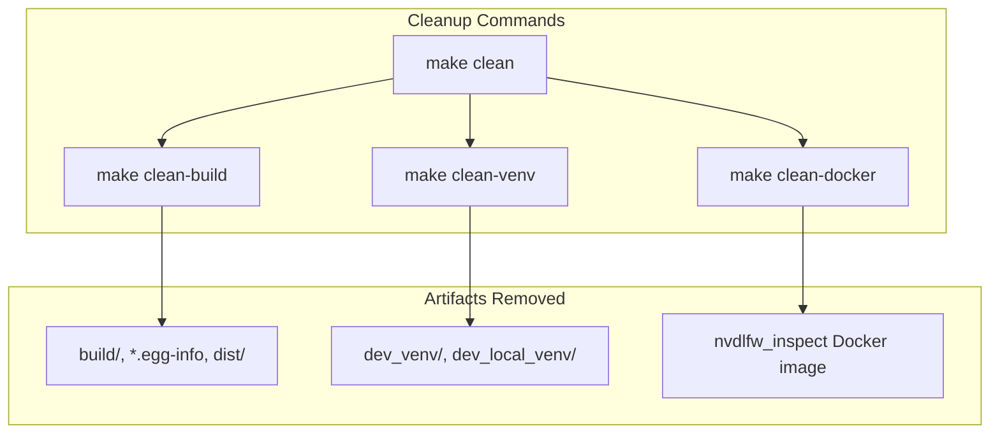

<!-- source: DeepWiki mcp.deepwiki.com · repo NVIDIA/nvidia-dlfw-inspect · page 7.3 Building and Packaging · fetched 2026-10-26 -->

# Building and Packaging

<details>
<summary>Relevant source files</summary>

The following files were used as context for generating this wiki page:

- [Makefile](Makefile)
- [requirements-dev-local.txt](requirements-dev-local.txt)
- [scripts/build_wheels.sh](scripts/build_wheels.sh)
- [setup.py](setup.py)

</details>


This document covers the build and packaging systems for the nvidia-dlfw-inspect tool, including wheel creation, Docker containerization, development environment setup, and installation procedures. The material focuses on the scripts and processes used to distribute and deploy the debugging tool.

For information about contributing to the project, see [Contributing](#7.1). For testing procedures, see [Testing](#7.2).

## Build Process Overview

The nvidia-dlfw-inspect tool provides multiple packaging and deployment methods to support different development and production environments. The build system is organized around automated wheel creation, Docker containerization, and development environment management.



*Sources: [scripts/build_wheels.sh:1-40](), [Makefile:1-91]()*

## Wheel Building

The primary packaging method uses Python wheels created through the `build_wheels.sh` script. This process creates distributable packages that can be installed via pip.

### Build Script Process

The wheel building process follows these steps:

1. **Environment Setup**: Creates an isolated virtual environment in `build_wheels_venv`
2. **Dependency Installation**: Installs build tools (`pip`, `setuptools`, `wheel`, `build`)
3. **Wheel Creation**: Uses `python3 -m build --wheel` to generate the package
4. **Cleanup**: Removes the temporary virtual environment



### Manual Wheel Building

Execute the build script directly:

```bash
./scripts/build_wheels.sh
```

The script creates wheels in the `dist/` directory and automatically cleans up build artifacts.

*Sources: [scripts/build_wheels.sh:16-39]()*

## Docker Packaging

Docker containerization provides a consistent runtime environment with all dependencies pre-installed.

### Docker Build Process

The Makefile provides Docker build and run targets:

| Target | Command | Purpose |
|--------|---------|---------|
| `docker-build` | `docker build . -t nvdlfw_inspect` | Build Docker image |
| `docker-run` | `docker run -it --gpus all -v .:/workspace/nvdlfw_inspect nvdlfw_inspect bash` | Launch container with GPU support |

### Docker Workflow



The Docker container includes GPU support via `--gpus all` and mounts the current directory for development workflow.

*Sources: [Makefile:20-28]()*

## Development Environment Setup

The build system provides two development environment configurations for different use cases.

### Environment Types

| Environment | Target | Dependencies | Purpose |
|-------------|--------|--------------|---------|
| `dev-env` | `$(DEV_VENV)` | `.[dev]` | Pre-commit checks and basic development |
| `dev-local` | `$(DEV_LOCAL_VENV)` | `.[dev]` + `requirements-dev-local.txt` | Full local development with additional tools |

### Development Environment Creation



### Environment Dependencies

Both environments install the package in editable mode (`-e .[dev]`) but differ in additional dependencies:

- **dev-env**: Minimal setup for pre-commit hooks and basic development
- **dev-local**: Includes additional tools from `requirements-dev-local.txt`

The build process validates PyTorch and NumPy availability but continues with warnings if missing.

*Sources: [Makefile:30-61]()*

## Installation Methods

The project supports multiple installation approaches depending on the target environment.

### Direct Installation

```bash
make install
```

This target performs:
1. `pip install .` - Install the package
2. Dependency validation for PyTorch and NumPy
3. Error exit if core dependencies are missing

### Editable Installation

For development workflows:

```bash
pip install -e .[dev]
```

This installs the package in editable mode with development dependencies.

### Container-based Installation

Using Docker for isolated environments:

```bash
make docker-build
make docker-run
```

*Sources: [Makefile:15-18]()*

## Cleanup and Maintenance

The build system includes comprehensive cleanup targets for managing build artifacts and environments.

### Cleanup Targets

| Target | Removes | Command |
|--------|---------|---------|
| `clean-build` | `build/`, `*.egg-info`, `dist/` | `rm -rf build/ *.egg-info dist/` |
| `clean-venv` | `dev_venv/`, `dev_local_venv/` | `rm -rf $(DEV_VENV) $(DEV_LOCAL_VENV)` |
| `clean-docker` | Docker image `nvdlfw_inspect` | `docker rmi -f $(DOCKER_IMAGE_NAME)` |
| `clean` | All above artifacts | Combines all cleanup targets |

### Cleanup Process Flow



All cleanup commands include error handling to continue execution if artifacts don't exist or permission issues occur.

*Sources: [Makefile:66-84]()*

## Build System Integration

The build system integrates with development workflows through Make targets that coordinate testing, linting, and packaging.

### Workflow Integration

| Target | Purpose | Dependencies |
|--------|---------|--------------|
| `test` | Run pytest suite | Development environment |
| `check` | Execute pre-commit hooks | `pre-commit run -a` |
| `help` | Display available targets | Built-in documentation |

The `help` target provides runtime documentation by parsing Makefile comments, making the build system self-documenting.

*Sources: [Makefile:43-90]()*