# Page: Overview

# Overview

<details>
<summary>Relevant source files</summary>

The following files were used as context for generating this wiki page:

- [README.md](README.md)
- [nvdlfw_inspect/api.py](nvdlfw_inspect/api.py)
- [setup.py](setup.py)

</details>


`nvdlfw_inspect` is a configuration-driven debugging framework for identifying and resolving convergence issues in large language model (LLM) training workflows. The tool provides runtime tensor inspection, statistical analysis, and extensible debugging features specifically designed for PyTorch models using NVIDIA libraries (Transformer Engine, Megatron-LM, NeMo).

For detailed installation instructions, see [Installation](#2.1). For step-by-step usage examples, see [Quick Start](#2.2). For information about creating custom debugging features, see [Custom Features and Namespaces](#5.2).

## Purpose and Capabilities

The primary purpose of `nvdlfw_inspect` is to facilitate debugging convergence issues and testing new algorithms/recipes for training LLMs. The tool addresses common debugging challenges through:

- **Tensor Statistics Logging**: Per-layer collection of statistical metrics (mean, std, max, min, L1/L2 norms) from activations, weights, and gradients during training
- **Algorithmic Testing**: Runtime tensor modification capabilities for testing new training recipes (e.g., fake quantization via `FakeQuant` feature, precision control)
- **Selective Layer Targeting**: YAML-based configuration controls which features execute on which model layers using regex patterns, layer numbers, or explicit names
- **Distributed Training Support**: Built-in multi-GPU support with configurable tensor reduction strategies (per-rank, all-gather, or last-rank-only)
- **Framework-Specific Features**: Plugin architecture organized by namespaces enables framework-specific debugging (generic PyTorch, Transformer Engine, or custom frameworks)
- **Minimal Performance Overhead**: API caching via `APICacheIdentifier` and conditional feature execution minimize impact on training performance

Sources: [README.md:1-8](), [setup.py:24]()

## Design Philosophy

The architecture follows several key design principles:

1. **Configuration Over Code**: Features are enabled/disabled through YAML configuration files rather than code modifications, allowing users to debug training runs without changing model implementations
2. **Namespace-Based Organization**: Features are organized into namespaces (generic, framework-specific, custom) to prevent naming conflicts and enable clean separation of concerns
3. **Lazy Evaluation and Caching**: The `BaseNamespaceAPI.route_api()` method and `APICacheIdentifier` class implement caching to minimize performance overhead from repeated API calls
4. **Registry-Based Discovery**: The `Registry` class uses decorator-based registration (`@register_namespace_api`, `@register_feature`) for automatic discovery of features from directories
5. **Global State Management**: A single global `DEBUG_MANAGER` instance in [nvdlfw_inspect/api.py:24]() coordinates all debugging operations across distributed ranks

Sources: [nvdlfw_inspect/api.py:24](), [README.md:1-8]()

## High-Level Architecture

The system implements a five-layer architecture with clear separation of concerns:

### System Architecture Diagram

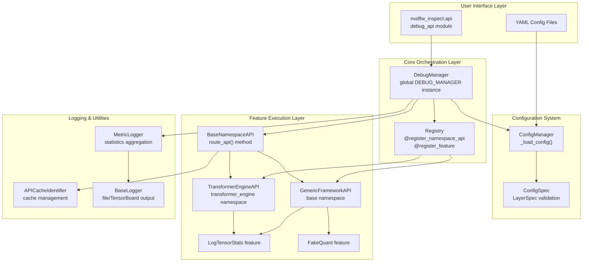

**Layer Responsibilities:**

| Layer | Components | Responsibilities |
|-------|-----------|-----------------|
| User Interface | `debug_api` module, YAML files | API exposure via `initialize()`, `log_tensor_stats()`, `step()`, `end_debug()` |
| Core Orchestration | `DebugManager`, `Registry` | Coordinate feature execution, manage training step, maintain global state |
| Configuration | `ConfigManager`, `ConfigSpec` | Parse YAML, validate layer selections, cache layer-to-feature mappings |
| Feature Execution | `BaseNamespaceAPI`, namespace classes, feature classes | Route API calls, execute enabled features, apply layer-specific logic |
| Logging & Utilities | `MetricLogger`, `APICacheIdentifier`, `BaseLogger` | Collect statistics, manage caching, write outputs to file/TensorBoard |

Sources: [nvdlfw_inspect/api.py:24-182]()

## Core Components

### API Layer (`nvdlfw_inspect.api` module)

The primary user interface exposes global functions that interact with the singleton `DEBUG_MANAGER` instance at [nvdlfw_inspect/api.py:24](). The module uses Python's `__getattr__()` at [nvdlfw_inspect/api.py:174-182]() to dynamically route namespace-specific API calls.

| Function | Implementation | Purpose |
|----------|---------------|---------|
| `initialize()` | [nvdlfw_inspect/api.py:27-71]() | Creates global `DEBUG_MANAGER`, loads config via `ConfigManager._load_config()`, discovers features |
| `log_tensor_stats()` | Routed via `__getattr__` | Dynamically dispatched to namespace-specific implementations (e.g., `GenericFrameworkAPI`) |
| `step()` | [nvdlfw_inspect/api.py:96-99]() | Calls `DEBUG_MANAGER.step()` to increment training iteration counter |
| `end_debug()` | [nvdlfw_inspect/api.py:83-87]() | Calls `DEBUG_MANAGER.close()` and resets global state |
| `set_tensor_reduction_group()` | [nvdlfw_inspect/api.py:150-163]() | Configures `DEBUG_MANAGER._tensor_reduction_group` for distributed training |
| `infer_and_assign_layer_names()` | [nvdlfw_inspect/api.py:112-148]() | Recursively assigns `.name` attribute to `torch.nn.Module` instances |

Sources: [nvdlfw_inspect/api.py:24-182]()

### Management Components

**`DebugManager` Class**: Central orchestrator that coordinates all debugging operations. It maintains:
- Global training step counter
- Registry of loaded namespace APIs and features
- Tensor reduction group for distributed training
- Statistics logger instances
- Configuration manager reference

The manager is instantiated at initialization in [nvdlfw_inspect/api.py:62-69]() and accessed throughout the API module.

**`ConfigManager` Class**: Parses YAML configuration files and provides layer-to-feature mappings. Key methods include:
- `_load_config()`: Parses YAML files into `ConfigSpec` instances
- `get_config_for_layer()`: Returns enabled features for a given layer name based on regex patterns, layer numbers, or explicit names
- Layer selection caching for runtime performance

**`Registry` Class**: Implements dynamic feature discovery using decorator-based registration:
- `@register_namespace_api`: Registers namespace API classes
- `@register_feature`: Registers feature classes to namespaces
- `validate_and_init()`: Validates feature availability and initializes namespace APIs
- Loads features from directories specified in `feature_dirs` parameter

Sources: [nvdlfw_inspect/api.py:57-70]()

### Feature System Architecture

The feature system uses inheritance and decorator-based registration to enable extensibility:

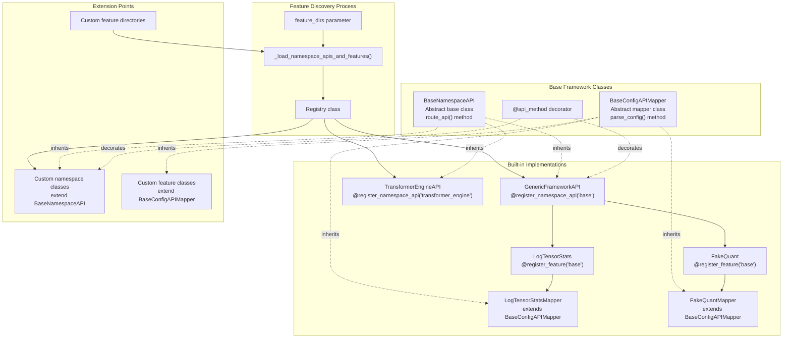

**Key Design Patterns:**

1. **Registry Pattern**: Features register themselves using decorators (`@register_namespace_api`, `@register_feature`)
2. **Strategy Pattern**: `BaseConfigAPIMapper` subclasses implement feature-specific configuration parsing via `parse_config()`
3. **Template Method Pattern**: `BaseNamespaceAPI.route_api()` defines the API routing algorithm, subclasses implement `routing_condition()`
4. **Plugin Architecture**: Features loaded from `feature_dirs` are dynamically imported and integrated without code changes

Sources: [README.md:50-58]()

## Runtime Execution Flow

The execution flow consists of three phases: initialization, runtime API routing, and cleanup.

### Initialization Sequence

```mermaid
sequenceDiagram
    participant user["User Training Script"]
    participant debug_api["debug_api module"]
    participant DebugManager["DebugManager instance"]
    participant ConfigManager["ConfigManager instance"]
    participant Registry["Registry class"]
    participant features["Feature classes<br/>(LogTensorStats, etc.)"]
    
    user->>debug_api: "initialize(config_file='config.yaml')"
    debug_api->>debug_api: "Create global DEBUG_MANAGER"
    debug_api->>DebugManager: "DebugManager.__init__()"
    DebugManager->>Registry: "_load_namespace_apis_and_features()"
    Registry->>features: "Import and @register_feature"
    Registry-->>DebugManager: "Return namespace_apis, features"
    
    debug_api->>DebugManager: "load_config()"
    DebugManager->>ConfigManager: "_load_config(config_file)"
    ConfigManager->>ConfigManager: "Parse YAML into ConfigSpec"
    ConfigManager-->>DebugManager: "Return config structures"
    DebugManager->>Registry: "validate_and_init(configs)"
    Registry->>features: "Validate feature availability"
    Registry-->>DebugManager: "Initialized namespace APIs"
```

### Runtime API Routing Flow

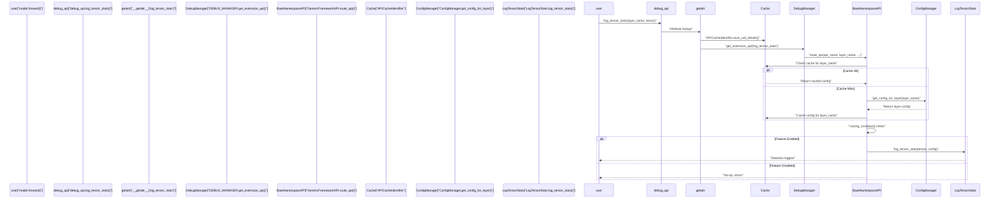

### Training Step Increment

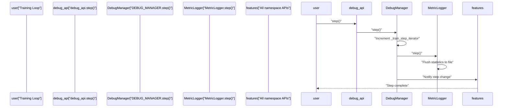

Sources: [nvdlfw_inspect/api.py:27-182]()

## Configuration-Driven Operation

The system uses YAML configuration files to control which features execute on which layers, without requiring code changes. The `ConfigManager` class parses YAML into `ConfigSpec` and `LayerSpec` instances, which define:

1. **Layer Selection**: Regex patterns, explicit layer names, layer numbers, or the `all` keyword
2. **Feature Enable/Disable**: Per-config-block and per-feature granularity
3. **Feature Parameters**: Feature-specific settings (tensor types, statistics types, temporal controls)
4. **Temporal Controls**: `start_step`, `end_step`, `freq` parameters control when features execute

Example configuration structure:

```yaml
config_name:
  enabled: True
  layers:
    layer_name_regex_pattern: .*(fc1|qkv)  # Matches layers ending with 'fc1' or 'qkv'
  LogTensorStats:
    enabled: True
    tensors_struct:
      - tensor: activation
        stats: [mean, std, l1_norm]
        freq: 4           # Log every 4 steps
        start_step: 20    # Start at training step 20
```

The `ConfigManager.get_config_for_layer()` method performs layer matching and returns applicable features. Results are cached in `BaseNamespaceAPI.route_api()` using `APICacheIdentifier` to avoid repeated regex matching during training.

Sources: [README.md:28-48]()

## Distributed Training Integration

The tool provides built-in support for distributed training environments through configurable tensor reduction strategies. Users can specify reduction groups, enable per-rank statistics, or use global reduction through the `set_tensor_reduction_group()` and related APIs.

The system automatically handles rank-specific logging and provides options for both local and globally-reduced tensor statistics collection.

Sources: [nvdlfw_inspect/api.py:152-174](), [docs/getting_started.md:249-257]()

## Extensibility Model

The architecture supports extensibility through custom namespaces and features. Users can create framework-specific debugging capabilities by implementing `BaseNamespaceAPI` and `BaseConfigAPIMapper` classes, then loading them via the `feature_dirs` parameter during initialization.

Custom features are automatically discovered and integrated into the configuration system, enabling seamless extension of debugging capabilities for specialized frameworks or algorithms.

Sources: [README.md:50-58](), [docs/getting_started.md:144]()

---

# Page: Architecture

# Architecture

<details>
<summary>Relevant source files</summary>

The following files were used as context for generating this wiki page:

- [nvdlfw_inspect/api.py](nvdlfw_inspect/api.py)
- [nvdlfw_inspect/base.py](nvdlfw_inspect/base.py)
- [nvdlfw_inspect/config_manager.py](nvdlfw_inspect/config_manager.py)
- [nvdlfw_inspect/debug_manager.py](nvdlfw_inspect/debug_manager.py)

</details>


This document provides a detailed explanation of the system architecture for nvidia-dlfw-inspect, a debugging and inspection tool for deep learning frameworks. It covers the relationships between core components like `DebugManager`, `ConfigManager`, `Registry`, and the extensible feature system. For information about specific APIs and their usage, see [Main API](#3.1). For details about configuration file structure and layer targeting, see [Configuration System](#4).

## Core Components Overview

The nvidia-dlfw-inspect system follows a layered architecture with clear separation of concerns across four main layers:

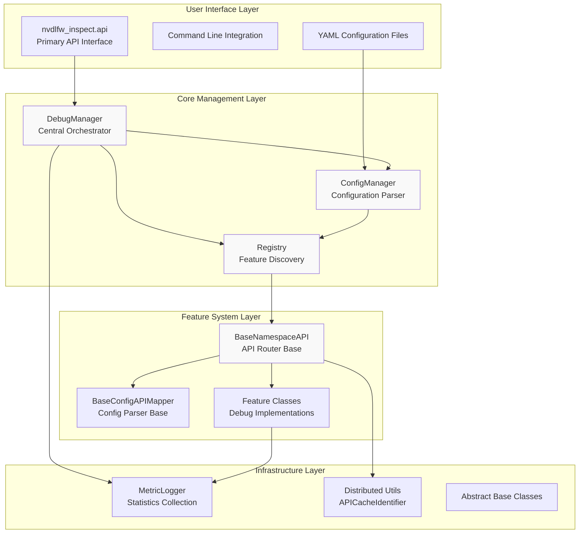

**Core Components:**

| Component | File | Primary Responsibility |
|-----------|------|----------------------|
| `DebugManager` | [nvdlfw_inspect/debug_manager.py:32-227]() | Central orchestration of debugging features and lifecycle management |
| `ConfigManager` | [nvdlfw_inspect/config_manager.py:148-248]() | YAML configuration parsing and layer-to-config mapping |
| `Registry` | Referenced in debug_manager.py | Feature discovery, registration, and namespace management |
| `BaseNamespaceAPI` | [nvdlfw_inspect/base.py:61-283]() | API routing and feature invocation base class |
| `BaseConfigAPIMapper` | [nvdlfw_inspect/base.py:27-58]() | Configuration parsing base class for features |

Sources: [nvdlfw_inspect/debug_manager.py:1-227](), [nvdlfw_inspect/config_manager.py:1-305](), [nvdlfw_inspect/base.py:1-283]()

## Component Interaction Flow

The following diagram shows how components interact during a typical debugging session:

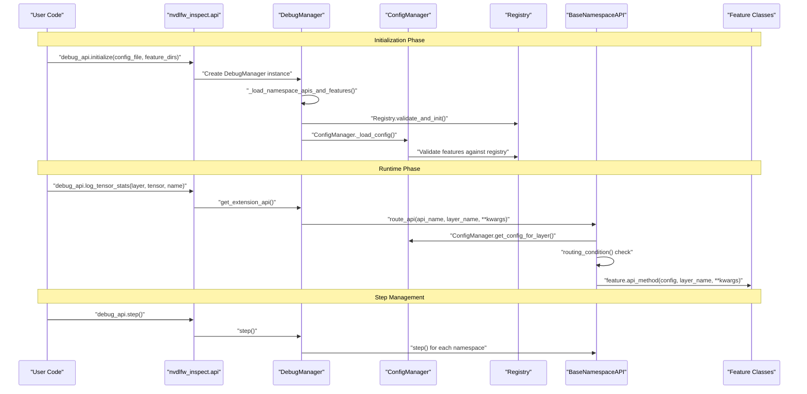

**Key Interaction Patterns:**

1. **Initialization Flow**: [nvdlfw_inspect/debug_manager.py:102-150]() loads features from directories, validates them through the Registry, and parses configuration
2. **API Routing**: [nvdlfw_inspect/base.py:146-273]() implements a sophisticated routing system with caching and configuration-based feature selection
3. **Configuration Resolution**: [nvdlfw_inspect/config_manager.py:224-240]() provides layer-to-config mapping with caching for performance

Sources: [nvdlfw_inspect/debug_manager.py:32-227](), [nvdlfw_inspect/base.py:146-273](), [nvdlfw_inspect/config_manager.py:148-248]()

## Configuration Architecture

The configuration system enables fine-grained control over which debugging features apply to which model layers:

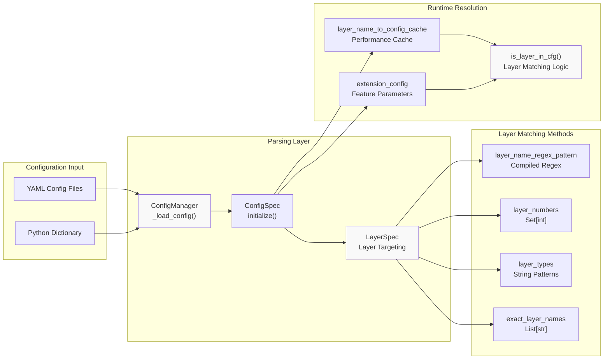

**Configuration Classes:**

| Class | Purpose | Key Methods |
|-------|---------|-------------|
| `ConfigSpec` | [nvdlfw_inspect/config_manager.py:125-146]() | Container for layer targeting and feature configuration |
| `LayerSpec` | [nvdlfw_inspect/config_manager.py:58-123]() | Layer matching logic with multiple targeting methods |
| `ConfigManager` | [nvdlfw_inspect/config_manager.py:148-248]() | Configuration parsing and layer-to-config resolution |

**Layer Matching Logic**: The `is_layer_in_cfg()` function [nvdlfw_inspect/config_manager.py:250-304]() implements a hierarchical matching system:
1. Exact layer names take precedence
2. Regex patterns for flexible matching 
3. Layer numbers with range support (e.g., "0-5")
4. Layer types with regex compilation

Sources: [nvdlfw_inspect/config_manager.py:125-304]()

## Feature System Architecture

The feature system uses a namespace-based architecture for organizing debugging capabilities:

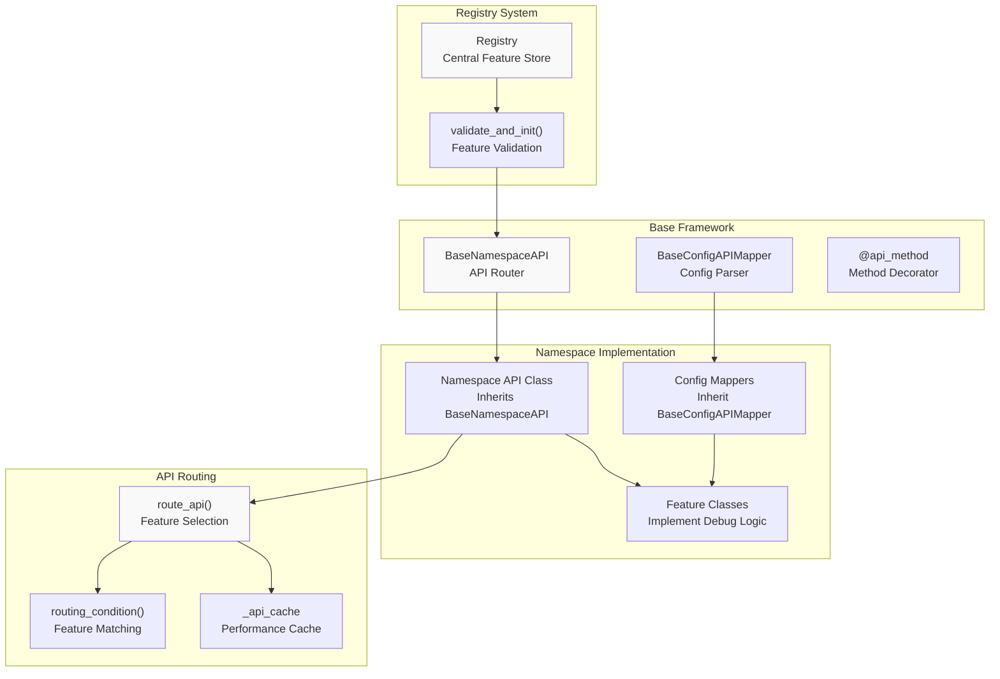

**Key Abstractions:**

- **BaseNamespaceAPI**: [nvdlfw_inspect/base.py:61-283]() provides the framework for API routing, feature management, and caching
- **BaseConfigAPIMapper**: [nvdlfw_inspect/base.py:27-58]() handles configuration parsing for features, including tensor-specific configurations
- **Registry Pattern**: Central feature discovery that loads features from directories and validates namespace implementations

**API Routing Mechanism**: The `route_api()` method [nvdlfw_inspect/base.py:146-273]() implements:
1. Input validation through `input_assertions_hook()`
2. Cache lookup using `APICacheIdentifier` 
3. Configuration resolution via `ConfigManager.get_config_for_layer()`
4. Feature selection through `routing_condition()`
5. Multiple feature invocation support with validation

Sources: [nvdlfw_inspect/base.py:61-283](), [nvdlfw_inspect/debug_manager.py:102-160]()

## API Routing and Caching

The system implements sophisticated API routing with performance optimizations:

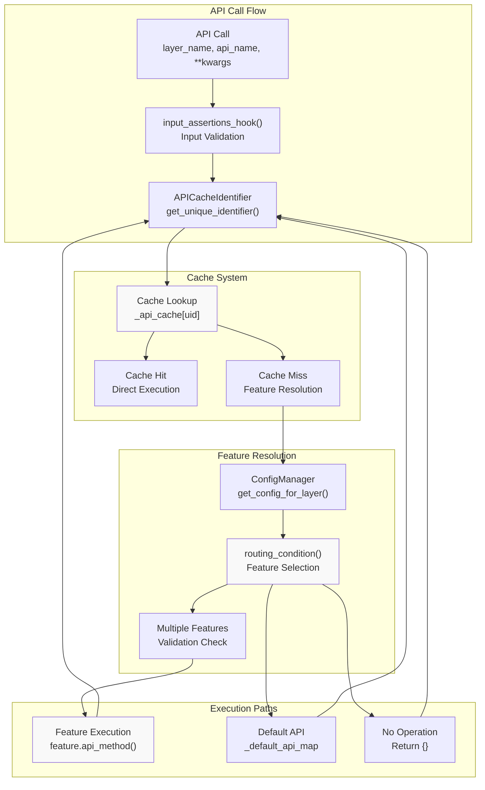

**Performance Optimizations:**

1. **API Caching**: [nvdlfw_inspect/base.py:174-180]() caches resolved feature methods and configurations to avoid repeated lookup overhead
2. **Layer Configuration Caching**: [nvdlfw_inspect/config_manager.py:225-240]() maintains a `layer_name_to_config_cache` for O(1) layer-to-config resolution
3. **Unique Identification**: `APICacheIdentifier` creates cache keys based on layer name, API name, and relevant kwargs

**Multi-Feature Support**: The system supports executing multiple features for a single API call when `is_multiple_feature_invocation_allowed()` returns True, with validation that all features return identical outputs [nvdlfw_inspect/base.py:217-242]().

Sources: [nvdlfw_inspect/base.py:146-283](), [nvdlfw_inspect/config_manager.py:224-248]()

---

# Page: Key Concepts

# Key Concepts

<details>
<summary>Relevant source files</summary>

The following files were used as context for generating this wiki page:

- [docs/features.md](docs/features.md)
- [docs/namespaces.md](docs/namespaces.md)
- [nvdlfw_inspect/base.py](nvdlfw_inspect/base.py)

</details>


This page defines the fundamental concepts and terminology used throughout the nvidia-dlfw-inspect tool. Understanding these concepts is essential for configuring, extending, and using the debugging capabilities effectively.

For detailed architecture information, see [Architecture](#1.1). For practical usage examples, see [Getting Started](#2).

## Core Terminology

### Features

A **feature** is a self-contained debugging capability that implements specific functionality for inspecting or modifying model behavior during training. Features are Python classes that provide APIs for operations like logging tensor statistics, applying quantization, or modifying tensor values.

Each feature must:
- Inherit from a `ConfigAPIMapper` class to parse YAML configurations
- Implement APIs marked with the `@api_method` decorator  
- Be registered to a specific namespace using `@Registry.register_feature(namespace="...")`

**Sources:** [docs/features.md:1-30](), [examples/sample_namespace/sample_feature.py]()

### Namespaces

A **namespace** groups related features by framework or functionality domain. Namespaces provide:
- API routing and method resolution
- Configuration parsing logic shared across features
- Input/output validation hooks
- Default implementations when no features are configured

Common namespaces include:
- `base` - Generic features usable with any framework
- `transformer_engine` - TransformerEngine-specific features  
- `sample_namespace` - Example custom namespace

**Sources:** [docs/namespaces.md:6-12](), [nvdlfw_inspect/base.py]()

### Layers

**Layers** are PyTorch model components (modules) that can be targeted for debugging. The tool identifies layers by:
- Automatically assigned names using `infer_and_assign_layer_names()`
- User-specified names set as module attributes
- Layer numbering for pipeline parallel models

Layer targeting supports multiple selection methods via configuration files.

**Sources:** [nvdlfw_inspect/api.py:114-150]()

### Configuration-Driven Debugging

The tool uses **YAML configuration files** to control which features execute on which layers without modifying training code. Configuration files specify:
- Layer selection patterns (regex, numbers, types, exact names)
- Feature enablement and parameters
- Execution frequency and timing controls

This approach enables non-intrusive debugging that can be toggled on/off via configuration changes.

**Sources:** [docs/namespaces.md:58-99](), [docs/features.md:87-100]()

## System Component Relationships

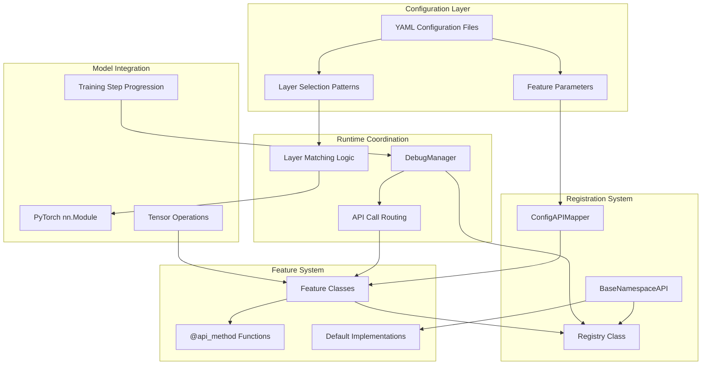

**Sources:** [nvdlfw_inspect/api.py:27-71](), [nvdlfw_inspect/debug_manager.py](), [nvdlfw_inspect/registry.py]()

## Code Entity Mapping

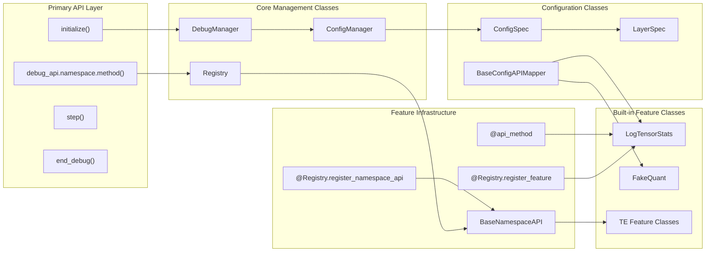

**Sources:** [nvdlfw_inspect/api.py:176-186](), [nvdlfw_inspect/registry.py](), [nvdlfw_inspect/base.py]()

## API Routing and Execution

The tool implements a sophisticated **API routing system** that maps user calls to appropriate feature implementations:

1. **Dynamic Method Resolution**: Calls like `debug_api.sample_namespace.process_tensor()` are resolved through `__getattr__` in the main API
2. **Feature Discovery**: The Registry locates features registered to the requested namespace  
3. **Configuration Matching**: Layer names and API parameters are matched against YAML configuration patterns
4. **Conditional Execution**: Features execute only when their `routing_condition()` returns True
5. **Result Aggregation**: Multiple features can contribute to a single API call result

**Sources:** [nvdlfw_inspect/api.py:176-186](), [docs/namespaces.md:158-176]()

## Training Integration Concepts

### Training Steps

The tool tracks **training progression** through step counters that features can use for:
- Frequency-based logging (every N steps)  
- Time-windowed analysis (between step ranges)
- Step-synchronized feature activation

**Sources:** [nvdlfw_inspect/api.py:92-102]()

### Tensor Statistics

**Tensor statistics** are numerical summaries computed from model tensors during training:
- Statistical measures: min, max, mean, standard deviation, norms
- Distribution analysis: histograms, quantiles  
- Custom metrics: framework-specific calculations
- Distributed aggregation: reduction across multiple GPUs

**Sources:** [docs/features.md:117-190]()

### Distributed Training Support

The tool provides **distributed training capabilities** including:
- Tensor reduction groups for multi-GPU aggregation
- Per-rank vs. aggregated statistics collection
- Pipeline parallelism awareness through layer numbering
- Process group management for custom reductions

**Sources:** [nvdlfw_inspect/api.py:152-174]()

## Configuration System Concepts

### Layer Selection Patterns

**Layer targeting** uses flexible pattern matching:

| Method | Description | Example |
|--------|-------------|---------|
| `layer_name_regex_pattern` | Regular expression matching | `.*attention.*` |
| `layer_numbers` | Explicit indices | `[0, 2, 5]` |
| `layer_types` | Module type matching | `Linear` |
| `exact_names` | Precise name matching | `model.layer.0.attention` |

**Sources:** Configuration documentation and layer matching logic

### Feature Parameters

**Feature configuration** supports hierarchical parameter specification:
- Global feature settings
- Per-layer parameter overrides  
- Tensor-level granular control
- Runtime parameter validation

Complex features like TransformerEngine support nested configuration structures for different operation types (GEMMs, tensors) with inheritance and override semantics.

**Sources:** [docs/namespaces.md:25-57](), [docs/features.md:87-99]()

---

# Page: Getting Started

# Getting Started

<details>
<summary>Relevant source files</summary>

The following files were used as context for generating this wiki page:

- [docs/getting_started.md](docs/getting_started.md)
- [docs/installation.md](docs/installation.md)

</details>


This page provides an overview of how to begin using the nvidia-dlfw-inspect tool for debugging deep learning models. It covers the essential setup steps, basic concepts, and initial usage patterns to get you productive quickly.

For detailed installation instructions, see [Installation](#2.1). For step-by-step tutorials, see [Quick Start](#2.2). For common usage patterns, see [Basic Usage Examples](#2.3).

## Prerequisites

Before using nvidia-dlfw-inspect, ensure you have:

- PyTorch environment (preferably NVIDIA PyTorch Docker container)
- Python 3.8 or higher
- CUDA-capable GPUs (for distributed training features)
- Basic familiarity with PyTorch model training

## Getting Started Workflow

The typical workflow for integrating nvidia-dlfw-inspect into your training pipeline follows these steps:

### Basic Integration Flow

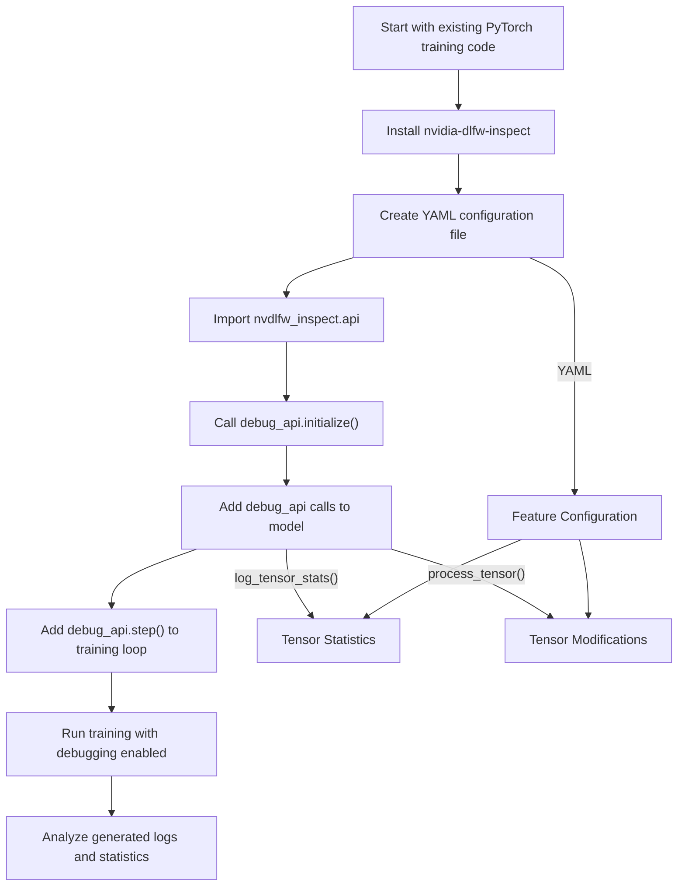

Sources: [docs/getting_started.md:1-269]()

### Code Integration Mapping

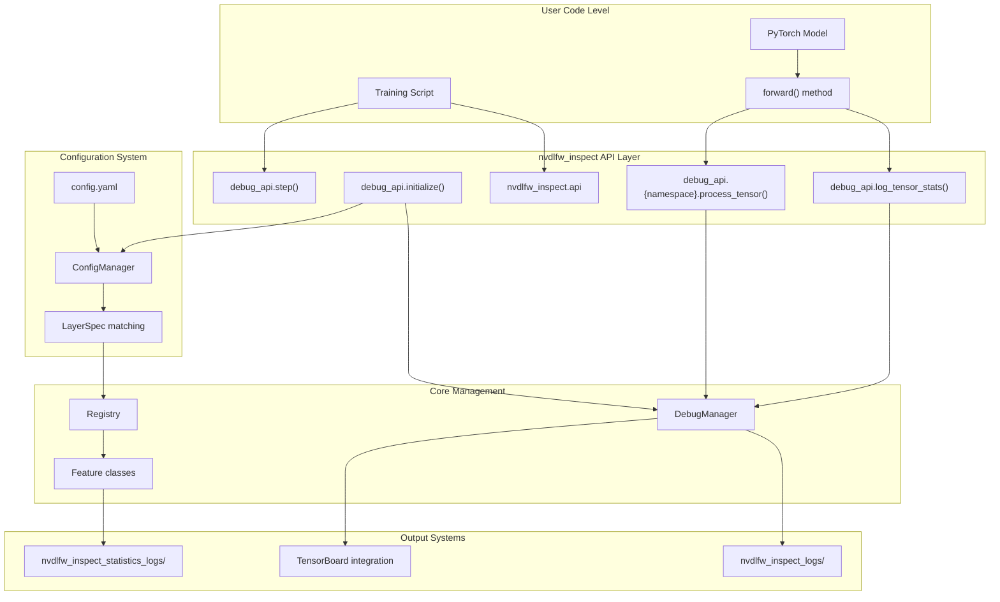

Sources: [docs/getting_started.md:20-137](), [nvdlfw_inspect/api.py](), [nvdlfw_inspect/core/debug_manager.py](), [nvdlfw_inspect/core/config_manager.py]()

## Essential Setup Steps

### 1. Installation

Install the tool using one of these methods:

```bash
# Direct from GitHub
pip install git+https://github.com/NVIDIA/nvidia-dlfw-inspect

# Or clone and install locally
git clone https://github.com/NVIDIA/nvidia-dlfw-inspect
cd nvidia-dlfw-inspect
pip install .
```

### 2. Import the API

Add the import statement to your training script:

```python
import nvdlfw_inspect.api as debug_api
```

Sources: [docs/getting_started.md:121-125]()

### 3. Initialize the Tool

Call the initialization function once per rank before training begins:

```python
debug_api.initialize(
    config_file="path/to/config.yaml",
    feature_dirs=["./custom_features"],  # Optional
    log_dir="/tmp/nvdlfw_inspect"        # Optional
)
```

Key parameters:
- `config_file`: Path to YAML configuration specifying which features to enable
- `feature_dirs`: Directories containing custom debugging features
- `log_dir`: Directory for output logs and statistics

Sources: [docs/getting_started.md:127-149]()

### 4. Create Configuration File

Create a YAML file specifying which layers and features to enable:

```yaml
debug_config_name:
  enabled: true
  layers:
    layer_name_regex_pattern: .*(fc1|fc2|relu)
  LogTensorStats:
    enabled: true
    tensors_struct:
      - tensor: activation
        stats: [max, min, mean]
        freq: 1
        start_step: 0
        end_step: 100
```

Sources: [docs/getting_started.md:150-183]()

## Basic Usage Pattern

### Minimal Integration Example

Here's the minimal code changes needed to add debugging to an existing PyTorch model:

| Integration Point | Code Change | Purpose |
|------------------|-------------|---------|
| Script initialization | `debug_api.initialize("config.yaml")` | Configure debugging features |
| Model forward pass | `debug_api.log_tensor_stats("layer_name", tensor=output, tensor_name="activation")` | Log tensor statistics |
| Training loop | `debug_api.step()` | Update internal step counter |

### Forward Pass Integration

```python
class SimpleModel(nn.Module):
    def forward(self, x):
        # Normal forward computation
        fc1_out = self.fc1(x)
        
        # Add debugging call
        debug_api.log_tensor_stats(
            "fc1", 
            tensor=fc1_out, 
            tensor_name="activation"
        )
        
        # Continue normal computation
        relu_out = self.relu(fc1_out)
        return self.fc2(relu_out)
```

Sources: [docs/getting_started.md:29-68]()

### Training Loop Integration

```python
for step in range(training_iterations):
    # Normal training step
    output = model(input_tensor)
    loss = criterion(output, target)
    optimizer.zero_grad()
    loss.backward()
    optimizer.step()
    
    # Add step counter update
    debug_api.step()
```

Sources: [docs/getting_started.md:91-108]()

## Output and Results

After running your instrumented training script, the tool generates two types of output:

### Log Files Structure

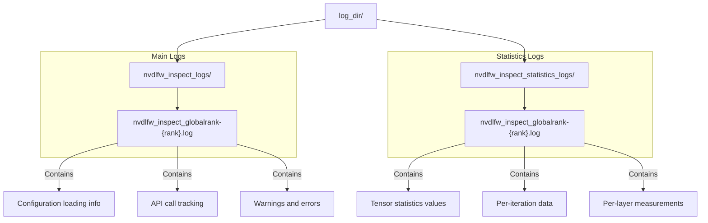

Sources: [docs/getting_started.md:208-244]()

### Example Log Output

Main log shows configuration and API usage:
```
INFO - Reading config from config.yaml
INFO - LAYER=fc1: Feature=LogTensorStats, API=log_tensor_stats, TENSOR=activation: Called
```

Statistics log shows numerical results:
```
INFO - fc1_activation_max    iteration=000020    value=1.4388
INFO - fc1_activation_min    iteration=000020    value=-1.4398
```

Sources: [docs/getting_started.md:214-243]()

## Next Steps

Once you have basic integration working:

1. **Explore Advanced Configuration**: Learn about layer selection patterns and feature parameters in [Configuration System](#4)
2. **Try Built-in Features**: Discover available debugging features in [Built-in Features](#5.1)
3. **Custom Features**: Create domain-specific debugging tools using [Custom Features and Namespaces](#5.2)
4. **Distributed Training**: Configure for multi-GPU environments in [Distributed Training Support](#6.2)

For hands-on tutorials and detailed examples, continue to [Quick Start](#2.2).

Sources: [docs/getting_started.md:1-269](), [docs/installation.md:1-55]()

---

# Page: Installation

# Installation

<details>
<summary>Relevant source files</summary>

The following files were used as context for generating this wiki page:

- [Dockerfile](Dockerfile)
- [Makefile](Makefile)
- [docs/installation.md](docs/installation.md)
- [setup.py](setup.py)

</details>


This document provides comprehensive installation instructions for the `nvdlfw_inspect` tool, covering multiple installation methods including Docker setup, direct pip installation, and development environment configuration. The tool is designed to work with deep learning frameworks, particularly PyTorch, and requires specific dependencies to function properly.

For information about basic usage after installation, see [Quick Start](#2.2). For advanced deployment scenarios, see [Distributed Training Support](#6.2).

## Prerequisites

The `nvdlfw_inspect` tool requires the following dependencies as defined in [setup.py:41-48]():

| Dependency | Minimum Version | Purpose | Verification Command |
|------------|-----------------|---------|---------------------|
| Python | 3.8 | Runtime environment | `python3 --version` |
| PyTorch | 2.1.0 | Deep learning framework integration | `python3 -c "import torch"` |
| PyYAML | 6.0.0 | Configuration file parsing | `python3 -c "import yaml"` |

The installation process includes dependency validation as shown in [Makefile:18](). When using NVIDIA PyTorch Docker containers, PyTorch is typically pre-installed, and the pip installation will skip reinstalling packages that already meet version requirements.

## Installation Methods Overview

**Installation Flow Diagram**

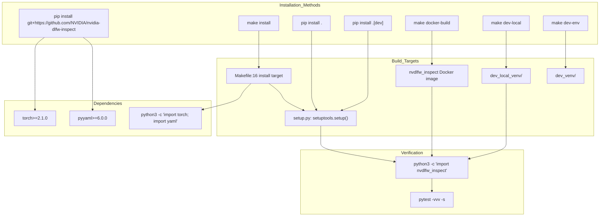

*Sources: [Makefile:15-18](), [setup.py:21-52](), [Dockerfile:1-18](), [docs/installation.md:17-34]()*

## Direct Installation Methods

### GitHub Installation

Install directly from the GitHub repository using pip:

```bash
pip install git+https://github.com/NVIDIA/nvidia-dlfw-inspect
```

This method automatically installs dependencies listed in [setup.py:42-48](). PyTorch should ideally be pre-installed (e.g., in NVIDIA PyTorch containers) to avoid version conflicts.

### Source Installation

Clone the repository and install from source:

```bash
git clone https://github.com/NVIDIA/nvidia-dlfw-inspect
cd nvidia-dlfw-inspect
make install
```

The `make install` target executes the following operations as defined in [Makefile:16-18]():
- Runs `pip install .` to invoke `setuptools.setup()` from [setup.py:21]()
- Validates PyTorch and PyYAML dependencies via `python3 -c "import torch; import yaml"`
- Exits with error code 1 if dependencies are missing

Alternatively, you can use pip directly:

```bash
pip install .        # Standard installation
pip install .[dev]   # Installation with development dependencies
```

*Sources: [Makefile:15-18](), [docs/installation.md:16-21]()*

## Docker Installation

### Docker Build Process

**Docker Build and Execution Flow**

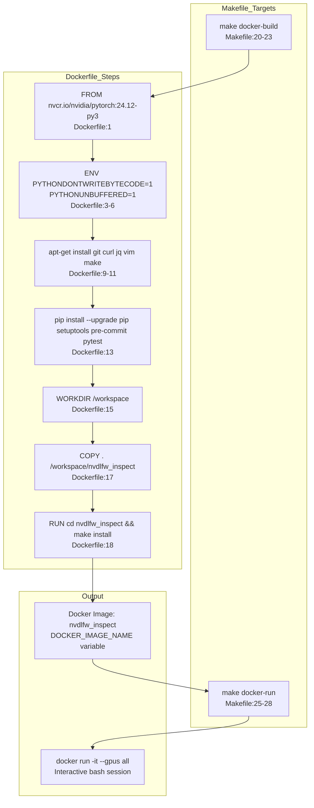

*Sources: [Dockerfile:1-18](), [Makefile:13](), [Makefile:20-28]()*

### Docker Setup Commands

1. **Build the Docker image:**
   ```bash
   make docker-build
   ```
   
   This executes [Makefile:22-23]() to build an image named `nvdlfw_inspect`.

2. **Run the Docker container:**
   ```bash
   make docker-run
   ```
   
   This launches an interactive container with GPU support as defined in [Makefile:27-28]().

The Docker container environment [Dockerfile:1-18]() provides:
- **Base Image**: `nvcr.io/nvidia/pytorch:24.12-py3` with PyTorch pre-installed
- **System Packages**: git, curl, jq, rsync, sshpass, uuid-runtime, vim, wget, make
- **Python Environment**: Upgraded pip, setuptools, pre-commit, pytest
- **Working Directory**: `/workspace/nvdlfw_inspect`
- **GPU Access**: Enabled via `--gpus all` flag in [Makefile:28]()

*Sources: [Dockerfile:1-18](), [Makefile:20-28]()*

## Development Environment Setup

### Development Environment Types

The project provides two development environment configurations:

| Environment | Target | Makefile Target | Virtual Environment |
|-------------|--------|-----------------|-------------------|
| Local Development | Running tool + pre-commit | `make dev-local` | `dev_local_venv` |
| Pre-commit Only | Code quality checks | `make dev-env` | `dev_venv` |

### Local Development Environment

Create a full development environment for running the tool:

```bash
make dev-local
source dev_local_venv/bin/activate
```

This environment setup process [Makefile:30-41]():
- Creates virtual environment `dev_local_venv` using Python venv module
- Upgrades pip via `$(DEV_LOCAL_PIP) install --upgrade pip`
- Installs package in editable mode: `$(DEV_LOCAL_PIP) install -e .[dev]`
- Installs additional development requirements from `requirements-dev-local.txt`
- Provides full tool functionality with development dependencies from [setup.py:50]()

### Pre-commit Development Environment

Create an environment for code quality checks only:

```bash
make dev-env
source dev_venv/bin/activate
make check
```

This lighter environment [Makefile:47-60]():
- Creates virtual environment `dev_venv` using Python venv module
- Upgrades pip via `$(DEV_PIP) install --upgrade pip`
- Installs development dependencies: `$(DEV_PIP) install -e .[dev]`
- Issues warning if PyTorch is not importable (tests will fail)
- Supports pre-commit hooks execution via `make check` [Makefile:63-64]()

*Sources: [Makefile:30-60](), [docs/installation.md:38-42]()*

## Installation Verification

### Import Test

Verify the installation by importing the package:

```bash
python3 -c "import nvdlfw_inspect"
```

This test is mentioned in [docs/installation.md:20]() as the standard verification method.

### Test Suite Execution

Run the complete test suite to verify functionality:

```bash
make test
```

The `make test` target [Makefile:44-45]() executes `pytest` to run all tests.

### Dependency Validation

The installation process automatically validates core dependencies as implemented in [Makefile:18]():

```bash
python3 -c "import torch; import yaml" || { 
    echo >&2 "Error: 'torch' and/or 'yaml' are not installed in your environment. Please ensure they are pre-installed."; 
    exit 1; 
}
```

This validation ensures that the required dependencies listed in [setup.py:42-48]() are available before completing installation.

*Sources: [Makefile:18](), [setup.py:42-48](), [docs/installation.md:33]()*

## Cleanup and Maintenance

### Cleanup Commands

| Command | Purpose | Makefile Location | Removes |
|---------|---------|-------------------|---------|
| `make clean-build` | Remove build artifacts | [Makefile:66-69]() | `.egg-info`, `build/`, `dist/` directories |
| `make clean-venv` | Remove virtual environments | [Makefile:71-74]() | `dev_venv`, `dev_local_venv` directories |
| `make clean-docker` | Remove Docker image | [Makefile:76-80]() | `nvdlfw_inspect` Docker image |
| `make clean` | Complete cleanup | [Makefile:82-84]() | All above targets combined |

### Build Artifacts

For distribution, create wheel packages:

```bash
./scripts/build_wheels.sh
```

The resulting wheel files are placed in the `dist/` directory as noted in [docs/installation.md:50-54]().

*Sources: [Makefile:66-84](), [docs/installation.md:48-54]()*

---

# Page: Quick Start

# Quick Start

<details>
<summary>Relevant source files</summary>

The following files were used as context for generating this wiki page:

- [docs/getting_started.md](docs/getting_started.md)
- [examples/test_simple_model_train.py](examples/test_simple_model_train.py)
- [nvdlfw_inspect/api.py](nvdlfw_inspect/api.py)

</details>


This page provides a minimal working example to help you quickly integrate `nvdlfw_inspect` into a PyTorch training script. You will learn how to initialize the tool, log tensor statistics, and view the resulting outputs.

For installation instructions, see [Installation](#2.1). For more comprehensive usage patterns including distributed training and custom features, see [Basic Usage Examples](#2.3).

---

## Minimal Example

The following example demonstrates the core workflow: initialize the debugging tool, add a single API call to log tensor statistics, increment the step counter, and clean up.

### Simple Training Script

```python
import torch
import torch.nn as nn
import torch.optim as optim
import nvdlfw_inspect.api as debug_api

# Define a simple model
class SimpleModel(nn.Module):
    def __init__(self):
        super().__init__()
        self.fc1 = nn.Linear(10, 5)
        self.fc2 = nn.Linear(5, 2)
    
    def forward(self, x):
        x = self.fc1(x)
        # Log tensor statistics for fc1 output
        debug_api.log_tensor_stats("fc1", tensor=x, tensor_name="output")
        x = torch.relu(x)
        x = self.fc2(x)
        return x

# Initialize the debugging tool
debug_api.initialize(
    config_file="config.yaml",
    log_dir="./debug_output"
)

# Standard training loop
model = SimpleModel()
optimizer = optim.SGD(model.parameters(), lr=0.01)
criterion = nn.MSELoss()

for step in range(10):
    # Forward pass
    inputs = torch.randn(4, 10)
    targets = torch.randn(4, 2)
    outputs = model(inputs)
    loss = criterion(outputs, targets)
    
    # Backward pass
    optimizer.zero_grad()
    loss.backward()
    optimizer.step()
    
    # Increment debug tool step counter
    debug_api.step()
    print(f"Step {step}, Loss: {loss.item():.4f}")

# Clean up
debug_api.end_debug()
```

### Configuration File

Create a file named `config.yaml` with the following content:

```yaml
basic_debug:
  enabled: true
  layers:
    layer_name_regex_pattern: fc1
  LogTensorStats:
    enabled: true
    tensors_struct:
      - tensor: output
        stats: [mean, max, min, std]
        freq: 2
        start_step: 0
        end_step: 10
```

Sources: [nvdlfw_inspect/api.py:27-71](), [examples/test_simple_model_train.py:36-78](), [docs/getting_started.md:18-111]()

---

## Understanding the Code

The minimal example involves four key integration points with `nvdlfw_inspect`:

### 1. Import the API Module

```python
import nvdlfw_inspect.api as debug_api
```

The `debug_api` module provides the public interface to all debugging functionality. All interactions with `nvdlfw_inspect` go through this module.

Sources: [nvdlfw_inspect/api.py:1-24](), [docs/getting_started.md:123-125]()

### 2. Initialize the Tool

```python
debug_api.initialize(
    config_file="config.yaml",
    log_dir="./debug_output"
)
```

The `initialize()` function must be called once before any debugging operations. In distributed training, it must be called on every rank.

**Key Parameters:**

| Parameter | Type | Default | Description |
|-----------|------|---------|-------------|
| `config_file` | `str` | `""` | Path to YAML configuration file specifying features and layers |
| `log_dir` | `str` | `"."` | Directory where logs will be written |
| `feature_dirs` | `List[str]` | `None` | Directories containing custom features (optional) |
| `init_training_step` | `int` | `0` | Initial training step counter value |
| `statistics_logger` | `BaseLogger` | `None` | Custom statistics logger (optional) |

The function creates a global `DebugManager` instance that orchestrates all debugging operations.

Sources: [nvdlfw_inspect/api.py:27-71](), [docs/getting_started.md:127-149]()

### 3. Log Tensor Statistics

```python
debug_api.log_tensor_stats("fc1", tensor=x, tensor_name="output")
```

The `log_tensor_stats()` function logs statistics for a tensor if enabled in the configuration. This call is typically placed immediately after computing a tensor of interest (e.g., layer outputs, gradients).

**Parameters:**
- `layer_name` (positional): String identifier for the layer (must match configuration)
- `tensor`: The PyTorch tensor to log statistics for
- `tensor_name`: Name identifier for the tensor (must match configuration)
- `skip_reduction` (optional): If `True`, log per-rank statistics without reduction
- `reduction_group` (optional): Process group for distributed tensor reduction

If the layer/tensor combination is not enabled in the configuration, this call returns immediately with minimal overhead.

Sources: [nvdlfw_inspect/api.py:174-182](), [docs/getting_started.md:40-66]()

### 4. Increment Step Counter

```python
debug_api.step()
```

The `step()` function increments the internal training step counter. Features use this counter to determine when to activate (e.g., logging between steps 10-20 at frequency 2).

Call this once per training iteration, typically after the optimizer step.

Sources: [nvdlfw_inspect/api.py:96-99](), [docs/getting_started.md:195-207]()

### 5. Clean Up (Optional)

```python
debug_api.end_debug()
```

The `end_debug()` function closes all loggers and releases resources. This is optional but recommended at the end of training.

Sources: [nvdlfw_inspect/api.py:83-87]()

---

## Initialization and API Call Flow

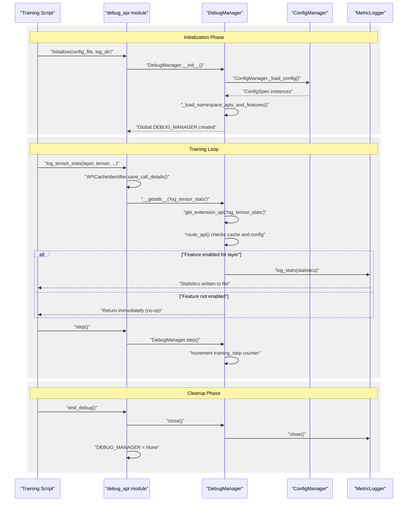

**Diagram: Initialization and Runtime API Flow**

This diagram shows how API calls flow through the system. The `initialize()` function creates the global `DebugManager` instance, which loads configuration and features. During training, `log_tensor_stats()` calls are routed through the manager, which uses caching and configuration to determine whether to execute the feature. The `step()` function updates internal counters used by temporal filters.

Sources: [nvdlfw_inspect/api.py:27-182](), [nvdlfw_inspect/debug_manager.py]()

---

## Component Relationships

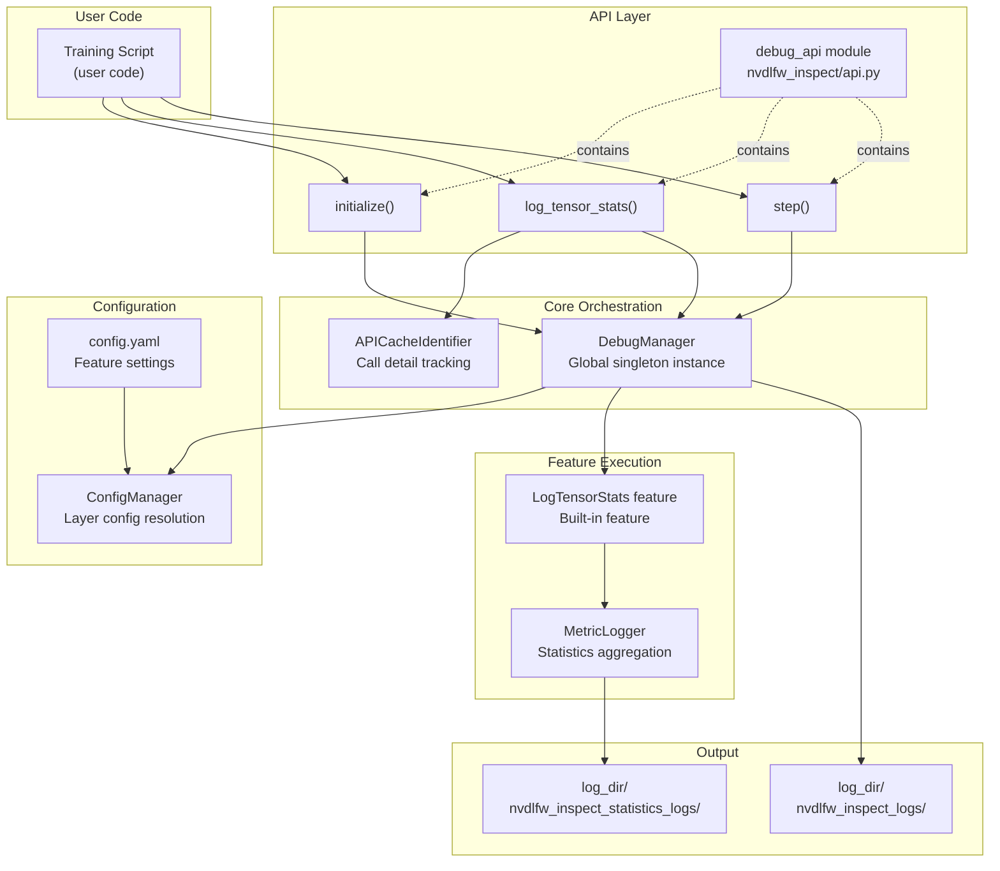

**Diagram: Component Relationships for Basic Usage**

This diagram shows the key components involved in a basic debugging session. The training script interacts only with the `debug_api` module. The `DebugManager` singleton orchestrates configuration lookup, feature execution, and logging. The `APICacheIdentifier` optimizes repeated calls to the same layer.

Sources: [nvdlfw_inspect/api.py](), [nvdlfw_inspect/debug_manager.py](), [nvdlfw_inspect/config_manager.py]()

---

## Running the Example

1. **Ensure installation is complete** (see [Installation](#2.1))

2. **Create the configuration file** `config.yaml` with the content shown above

3. **Run the training script:**
   ```bash
   python simple_train.py
   ```

4. **Expected console output:**
   ```
   Step 0, Loss: 0.8234
   Step 1, Loss: 0.7891
   Step 2, Loss: 0.7453
   ...
   ```

Sources: [examples/test_simple_model_train.py:80-136](), [docs/getting_started.md:113-117]()

---

## Viewing Outputs

After running the example, `nvdlfw_inspect` creates two subdirectories in the specified `log_dir`:

### 1. General Logs: `nvdlfw_inspect_logs/`

This directory contains general debugging information about tool behavior.

**File:** `nvdlfw_inspect_globalrank-0.log`

```
INFO - Default logging to file enabled at ./debug_output
INFO - Reading config from config.yaml.
INFO - Loaded configs for dict_keys(['basic_debug']).
INFO - LAYER=fc1: Feature=LogTensorStats, API=log_tensor_stats, TENSOR=output: Called
```

This log shows:
- Configuration loading status
- Which features and APIs were invoked for which layers
- Any warnings or errors

Sources: [docs/getting_started.md:212-226]()

### 2. Statistics Logs: `nvdlfw_inspect_statistics_logs/`

This directory contains the actual tensor statistics collected during training.

**File:** `nvdlfw_inspect_globalrank-0.log`

```
INFO - fc1_output_mean       iteration=000000    value=0.0234
INFO - fc1_output_max        iteration=000000    value=1.2341
INFO - fc1_output_min        iteration=000000    value=-0.9876
INFO - fc1_output_std        iteration=000000    value=0.4123
INFO - fc1_output_mean       iteration=000002    value=0.0198
INFO - fc1_output_max        iteration=000002    value=1.1234
INFO - fc1_output_min        iteration=000002    value=-0.8765
INFO - fc1_output_std        iteration=000002    value=0.3987
```

**Log Format:**
- **Naming:** `{layer_name}_{tensor_name}_{statistic}`
- **Iteration:** Training step when the statistic was logged
- **Value:** The computed statistic value

**Note:** Based on the configuration (`freq: 2`), statistics are logged every 2 steps (iterations 0, 2, 4, 6, 8).

Sources: [docs/getting_started.md:228-243]()

---

## Output Directory Structure

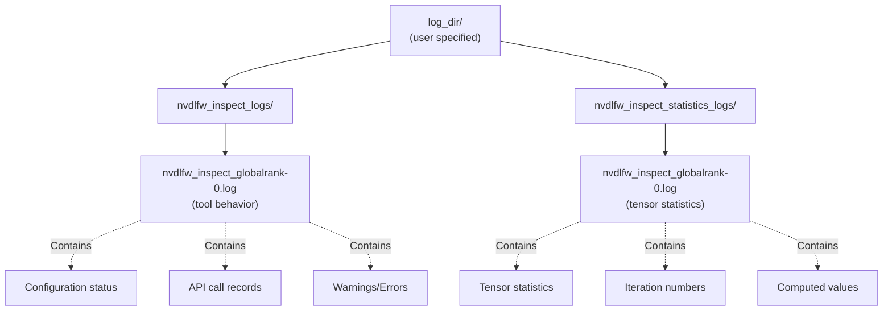

**Diagram: Output Directory Structure**

This diagram shows the organization of output files. In distributed training, each rank produces its own log files with rank-specific suffixes (e.g., `globalrank-0.log`, `globalrank-1.log`).

Sources: [nvdlfw_inspect/api.py:45-46](), [docs/getting_started.md:209-243]()

---

## Configuration Explained

The configuration file controls which layers and tensors are logged, what statistics to compute, and when to log them.

```yaml
basic_debug:                          # Configuration name (can be any identifier)
  enabled: true                       # Master enable/disable switch
  layers:                             # Layer selection rules
    layer_name_regex_pattern: fc1     # Regex pattern matching layer names
  LogTensorStats:                     # Feature name (built-in)
    enabled: true                     # Enable this feature for matched layers
    tensors_struct:                   # List of tensor configurations
      - tensor: output                # Tensor name (matches API call)
        stats: [mean, max, min, std]  # Statistics to compute
        freq: 2                       # Log every 2 training steps
        start_step: 0                 # Begin logging at step 0
        end_step: 10                  # Stop logging after step 10
```

**Key Configuration Elements:**

| Element | Description |
|---------|-------------|
| Configuration Context | Top-level name (`basic_debug`) for grouping settings |
| Layer Selection | Rules for matching layer names (regex, exact match, ranges) |
| Feature Configuration | Settings for each enabled feature |
| Tensor Specification | Which tensors to monitor and what statistics to compute |
| Temporal Controls | When to activate logging (`start_step`, `end_step`, `freq`) |

For detailed configuration options, see [Configuration System](#4).

Sources: [docs/getting_started.md:150-183](), [examples/configs/simple_model_train_sample.yaml]()

---

## Next Steps

Now that you have a working minimal example, you can:

1. **Explore distributed training:** Learn how to use `nvdlfw_inspect` with multi-GPU training in [Basic Usage Examples](#2.3)

2. **Understand features:** See the full list of built-in features and their capabilities in [Built-in Features](#5.1)

3. **Advanced configuration:** Learn about layer selection patterns, multiple configurations, and feature parameters in [Configuration System](#4)

4. **Custom features:** Create your own debugging features tailored to your specific needs in [Custom Features and Namespaces](#5.2)

5. **API reference:** Review all available API functions and their parameters in [Main API](#3.1)

Sources: [docs/getting_started.md]()

---

## Common Patterns

### Pattern 1: Multiple Layers

Log statistics for multiple layers by adjusting the regex pattern:

```yaml
layers:
  layer_name_regex_pattern: .*(fc1|fc2|relu)
```

This matches any layer containing `fc1`, `fc2`, or `relu`.

### Pattern 2: Different Statistics Per Tensor

Configure different statistics for activations versus gradients:

```yaml
tensors_struct:
  - tensor: activation
    stats: [mean, max, min]
  - tensor: gradient
    stats: [norm, max, min]
```

### Pattern 3: Conditional Logging

Log only during specific training phases:

```yaml
tensors_struct:
  - tensor: output
    stats: [mean, std]
    start_end_list: [[0, 10], [50, 60], [100, 110]]
```

This logs during steps 0-10, 50-60, and 100-110 only.

Sources: [docs/getting_started.md:154-182](), [examples/configs/simple_model_train_sample.yaml]()

---

# Page: Basic Usage Examples

# Basic Usage Examples

<details>
<summary>Relevant source files</summary>

The following files were used as context for generating this wiki page:

- [docs/getting_started.md](docs/getting_started.md)
- [examples/test_simple_model_train.py](examples/test_simple_model_train.py)
- [tests/unit/test_generic_features.py](tests/unit/test_generic_features.py)

</details>


This page demonstrates common usage patterns for `nvdlfw_inspect`, including tensor statistics logging, tensor manipulation (e.g., fake quantization), and integration with Distributed Data Parallel (DDP) training. These examples show how to integrate the tool into typical PyTorch training workflows with minimal code changes.

For initial setup and installation, see [Installation](#2.1). For a complete step-by-step tutorial, see [Quick Start](#2.2). For comprehensive configuration options, see [Configuration System](#4). For distributed training details, see [Distributed Training Support](#6.2).

**Sources:** [docs/getting_started.md:1-14](), [examples/test_simple_model_train.py:1-137]()
</thinking>

## Overview of Usage Patterns

The tool supports two primary debugging workflows:

| Workflow | Purpose | Key APIs | Configuration |
|----------|---------|----------|---------------|
| **Tensor Statistics Logging** | Monitor tensor statistics (mean, max, min, etc.) during training | `debug_api.log_tensor_stats()` | `LogTensorStats` feature |
| **Tensor Manipulation** | Modify tensors during training to test convergence and explore algorithms | `debug_api.<namespace>.process_tensor()` | Custom feature configs (e.g., `FakeQuant`) |

Both workflows require minimal code changes and are controlled through YAML configuration files.

**Sources:** [docs/getting_started.md:7-12](), [examples/test_simple_model_train.py:46-75]()

## Tensor Statistics Logging Example

The most common use case is logging tensor statistics during training. This workflow demonstrates how to instrument a simple neural network model with statistics logging.

### Complete Example: SimpleModel with DDP

Here is a complete example showing statistics logging integrated into a PyTorch DDP training script:

**Basic API Flow**

```mermaid
sequenceDiagram
    participant TrainingScript as "Training Script"
    participant DebugAPI as "debug_api"
    participant ConfigManager as "ConfigManager"
    participant LogTensorStats as "LogTensorStats"
    participant MetricLogger as "MetricLogger"
    
    TrainingScript->>DebugAPI: "debug_api.initialize(config_file, feature_dirs, log_dir)"
    DebugAPI->>ConfigManager: "Load YAML config"
    ConfigManager-->>DebugAPI: "Configuration loaded"
    
    loop Training Loop
        TrainingScript->>TrainingScript: "Forward pass: fc1(input)"
        TrainingScript->>DebugAPI: "debug_api.log_tensor_stats('fc1', tensor=fc1_out, tensor_name='activation')"
        DebugAPI->>LogTensorStats: "Compute statistics if conditions met"
        LogTensorStats->>MetricLogger: "Log statistics"
        MetricLogger-->>LogTensorStats: "Statistics recorded"
        LogTensorStats-->>DebugAPI: "Return stats dict"
        DebugAPI-->>TrainingScript: "Statistics results"
        
        TrainingScript->>TrainingScript: "Backward pass and optimization"
        TrainingScript->>DebugAPI: "debug_api.step()"
        DebugAPI->>DebugAPI: "Increment training step counter"
    end
```

**Sources:** [examples/test_simple_model_train.py:36-78](), [docs/getting_started.md:29-68]()
</thinking>

### Code Integration

The example below shows how to add statistics logging to a model's forward pass:

```python
class SimpleModel(nn.Module):
    def __init__(self, input_size, hidden_size, output_size):
        super().__init__()
        self.fc1 = nn.Linear(input_size, hidden_size)
        self.fc2 = nn.Linear(hidden_size, output_size)
        self.relu = nn.ReLU()

    def forward(self, input_tensor):
        fc1_out = self.fc1(input_tensor)
        
        # Log fc1 activation statistics
        debug_api.log_tensor_stats(
            "fc1", 
            tensor=fc1_out, 
            tensor_name="activation", 
            skip_reduction=True
        )
        
        relu_out = self.relu(fc1_out)
        
        # Log ReLU activation statistics with reduction across all GPUs
        debug_api.log_tensor_stats(
            "relu",
            tensor=relu_out,
            tensor_name="activation",
            reduction_group=torch.distributed.group.WORLD
        )
        
        fc2_out = self.fc2(relu_out)
        
        # Log fc2 activation statistics (default reduction behavior)
        debug_api.log_tensor_stats(
            "fc2", 
            tensor=fc2_out, 
            tensor_name="activation"
        )
        
        return fc2_out
```

**Sources:** [examples/test_simple_model_train.py:43-76](), [docs/getting_started.md:36-67]()

### Training Loop Setup

Initialize the tool before training and call `debug_api.step()` after each iteration:

```python
# Initialization (once at start of training)
debug_api.initialize(
    "./configs/simple_model_train_sample.yaml",
    feature_dirs=["./sample_namespace"],
    log_dir="/tmp/nvdlfw_inspect"
)

# Training loop
for step in range(training_iterations):
    # Forward and backward pass
    output = model(input_tensor)
    loss = criterion(output, target)
    optimizer.zero_grad()
    loss.backward()
    optimizer.step()
    
    # Increment nvdlfw_inspect step counter
    debug_api.step()
```

**Sources:** [examples/test_simple_model_train.py:96-131](), [docs/getting_started.md:70-111]()

### Configuration for Statistics Logging

Here's a configuration that logs statistics for specific layers with temporal controls:

```yaml
sample_model_train_log_stats:
  enabled: True
  layers:
    layer_name_regex_pattern: .*(fc1|fc2|relu)
  LogTensorStats:
    enabled: True
    tensors_struct:
      - tensor: activation
        stats: [max, min]
        freq: 4
        start_step: 20
        end_step: 40
```

| Configuration Field | Description | Example Value |
|--------------------|-------------|---------------|
| `enabled` | Activates the configuration context | `True` |
| `layers.layer_name_regex_pattern` | Regex to match layer names | `.*(fc1\|fc2\|relu)` |
| `LogTensorStats.enabled` | Enables the LogTensorStats feature | `True` |
| `tensors_struct.tensor` | Name of the tensor to log | `activation` |
| `tensors_struct.stats` | Statistics to compute | `[max, min]` |
| `tensors_struct.freq` | Log every N steps | `4` |
| `tensors_struct.start_step` | Begin logging at this step | `20` |
| `tensors_struct.end_step` | Stop logging at this step | `40` |

**Sources:** [docs/getting_started.md:154-167](), [examples/configs/simple_model_train_sample.yaml]()

## Tensor Manipulation Example

The tool can modify tensors during training to test convergence and explore algorithms like quantization. This example demonstrates fake quantization using a custom feature.

### Fake Quantization Workflow

**API Flow for Tensor Manipulation**

```mermaid
sequenceDiagram
    participant Model as "Model Forward Pass"
    participant DebugAPI as "debug_api.sample_namespace"
    participant FakeQuant as "FakeQuant Feature"
    participant TorchAPI as "torch.fake_quantize_per_tensor_affine"
    
    Model->>Model: "Compute relu_out = relu(fc1_out)"
    Model->>DebugAPI: "process_tensor('relu', tensor=relu_out, gemm='fprop', tensor_name='relu_quant_act')"
    DebugAPI->>FakeQuant: "Check if feature enabled for layer"
    FakeQuant->>TorchAPI: "Apply quantization with configured parameters"
    TorchAPI-->>FakeQuant: "Return quantized tensor"
    FakeQuant-->>DebugAPI: "Return {'tensor': quantized_tensor}"
    DebugAPI-->>Model: "quantized tensor"
    Model->>Model: "Continue with quantized tensor"
```

**Sources:** [examples/test_simple_model_train.py:60-63](), [docs/getting_started.md:50-54](), [examples/sample_namespace/sample_feature.py]()

### Code Integration

Add tensor manipulation API calls in the forward pass:

```python
def forward(self, input_tensor):
    fc1_out = self.fc1(input_tensor)
    relu_out = self.relu(fc1_out)
    
    # Apply fake quantization if enabled in config
    relu_quant = debug_api.sample_namespace.process_tensor(
        "relu", 
        tensor=relu_out, 
        gemm="fprop", 
        tensor_name="relu_quant_act"
    )["tensor"]
    
    # Log quantized tensor statistics
    debug_api.log_tensor_stats(
        "relu",
        tensor=relu_quant,
        tensor_name="relu_quant_act",
        reduction_group=torch.distributed.group.WORLD
    )
    
    # Continue forward pass with quantized tensor
    fc2_out = self.fc2(relu_quant)
    return fc2_out
```

**Sources:** [examples/test_simple_model_train.py:60-72](), [docs/getting_started.md:50-62]()

### Configuration for Tensor Manipulation

Configure the `FakeQuant` feature in the YAML file:

```yaml
sample_model_train_log_stats:
  enabled: True
  layers:
    layer_name_regex_pattern: .*(relu)
  sample_namespace:
    FakeQuant:
      enabled: True
      gemms_struct:
        - gemm: fprop
          tensors_struct:
            - tensor: relu_quant_act
              scale: 1
              zero_point: 0
              quant_min: 0
              quant_max: 255
```

| Configuration Field | Description | Example Value |
|--------------------|-------------|---------------|
| `sample_namespace` | Custom feature namespace | User-defined |
| `FakeQuant.enabled` | Enables fake quantization | `True` |
| `gemms_struct.gemm` | GEMM operation type | `fprop`, `dgrad`, `wgrad` |
| `tensors_struct.tensor` | Tensor name to quantize | `relu_quant_act` |
| `tensors_struct.scale` | Quantization scale factor | `1` |
| `tensors_struct.zero_point` | Quantization zero point | `0` |
| `tensors_struct.quant_min` | Minimum quantization value | `0` |
| `tensors_struct.quant_max` | Maximum quantization value | `255` |

**Sources:** [docs/getting_started.md:171-181](), [examples/configs/simple_model_train_sample.yaml]()

## DDP Training Integration

The tool integrates with PyTorch Distributed Data Parallel (DDP) training with different tensor reduction strategies for multi-GPU scenarios.

### Tensor Reduction Strategies

**DDP Reduction Options**

```mermaid
graph TB
    subgraph "API Call Options"
        LogCall["debug_api.log_tensor_stats(layer, tensor, tensor_name, ...)"]
        SkipReduction["skip_reduction=True"]
        ReductionGroup["reduction_group=torch.distributed.group.WORLD"]
        DefaultBehavior["No parameters (default)"]
    end
    
    subgraph "Reduction Behavior"
        PerRankLocal["Per-rank: Each GPU logs local tensor stats"]
        AllGather["All-gather: Gather tensor to all ranks, compute global stats"]
        LastRankGather["Last-rank gather: Gather to last rank only"]
    end
    
    subgraph "Output"
        PerRankFiles["Per-rank log files with different values"]
        UnifiedStats["All ranks log identical global statistics"]
        LastRankOnly["Only last rank logs statistics"]
    end
    
    LogCall --> SkipReduction
    LogCall --> ReductionGroup
    LogCall --> DefaultBehavior
    
    SkipReduction --> PerRankLocal
    ReductionGroup --> AllGather
    DefaultBehavior --> LastRankGather
    
    PerRankLocal --> PerRankFiles
    AllGather --> UnifiedStats
    LastRankGather --> LastRankOnly
```

**Sources:** [docs/getting_started.md:247-257](), [examples/test_simple_model_train.py:47-75]()

### Reduction Strategy Examples

The following table summarizes the three reduction strategies:

| Strategy | API Parameter | Behavior | Use Case |
|----------|--------------|----------|----------|
| **Per-rank logging** | `skip_reduction=True` | Each GPU logs local statistics independently | Debug rank-specific issues, verify data distribution |
| **All-gather to all ranks** | `reduction_group=torch.distributed.group.WORLD` | Gather tensor to all ranks, each computes and logs global stats | Unified view across all ranks, verify global behavior |
| **Last-rank gather** | Default (no parameters) | Gather tensor to last rank only, last rank logs global stats | Centralized logging, reduce I/O overhead |

**Code Examples:**

```python
# Strategy 1: Per-rank logging
debug_api.log_tensor_stats(
    "fc1", 
    tensor=fc1_out, 
    tensor_name="activation", 
    skip_reduction=True
)

# Strategy 2: All-gather to all ranks
debug_api.log_tensor_stats(
    "relu",
    tensor=relu_out,
    tensor_name="activation",
    reduction_group=torch.distributed.group.WORLD
)

# Strategy 3: Last-rank gather (default)
debug_api.log_tensor_stats(
    "fc2", 
    tensor=fc2_out, 
    tensor_name="activation"
)
```

**Sources:** [examples/test_simple_model_train.py:47-75](), [docs/getting_started.md:251-256]()

### DDP Setup Requirements

The tool must be initialized on all ranks in DDP training:

```python
def ddp_setup():
    init_process_group(backend="nccl")
    gpu_id = int(os.environ["LOCAL_RANK"])
    torch.cuda.set_device(gpu_id)
    return gpu_id

if __name__ == "__main__":
    gpu_id = ddp_setup()
    
    # Initialize on all ranks
    debug_api.initialize(
        "./configs/simple_model_train_sample.yaml",
        feature_dirs=["./sample_namespace"],
    )
    
    # Wrap model with DDP
    model = SimpleModel(input_size, hidden_size, output_size)
    model = model.to(gpu_id)
    model = DDP(model, device_ids=[gpu_id])
```

**Sources:** [examples/test_simple_model_train.py:22-34](), [examples/test_simple_model_train.py:82-113](), [docs/getting_started.md:22-26]()

### Running DDP Training

Execute the training script with multiple GPUs using `torchrun`:

```bash
torchrun --nproc_per_node=2 test_simple_model_train.py
```

**Sources:** [examples/test_simple_model_train.py:81](), [docs/getting_started.md:113-117]()

## Training Step Management

The tool maintains an internal training step counter that controls when features are active based on temporal configurations.

### Step Counter Lifecycle

**Step Management Flow**

```mermaid
flowchart TD
    subgraph "Initialization"
        Init["debug_api.initialize()"]
        InitStep["init_training_step parameter"]
        CurrentStep["Internal step counter = init_training_step"]
    end
    
    subgraph "Training Loop"
        TrainIter["Training iteration N"]
        APICall["debug_api.log_tensor_stats() or other API"]
        ConfigCheck["Check config: start_step, end_step, freq"]
        FeatureExec["Execute feature if conditions met"]
        StepCall["debug_api.step()"]
        Increment["Increment internal counter"]
    end
    
    subgraph "Manual Step Control"
        ManualSet["debug_api.initialize_training_step(step)"]
        OverrideStep["Override internal counter"]
    end
    
    Init --> InitStep
    InitStep --> CurrentStep
    CurrentStep --> TrainIter
    TrainIter --> APICall
    APICall --> ConfigCheck
    ConfigCheck --> FeatureExec
    FeatureExec --> StepCall
    StepCall --> Increment
    Increment --> TrainIter
    
    ManualSet --> OverrideStep
    OverrideStep --> TrainIter
```

**Sources:** [docs/getting_started.md:195-206](), [tests/unit/test_generic_features.py:75-119]()

### Basic Step Management

The `debug_api.step()` method must be called after each training iteration:

```python
for step in range(training_iterations):
    # Forward pass
    output = model(input_tensor)
    
    # Backward pass
    loss = criterion(output, target)
    optimizer.zero_grad()
    loss.backward()
    optimizer.step()
    
    # Increment nvdlfw_inspect internal step counter
    debug_api.step()
```

**Sources:** [examples/test_simple_model_train.py:117-131](), [docs/getting_started.md:104-106]()

### Resuming Training from Checkpoint

When resuming training, set the initial step counter during initialization:

```python
# Method 1: Set during initialization
debug_api.initialize(
    config_file="config.yaml",
    init_training_step=65  # Resume from step 65
)

# Training loop continues from step 65
debug_api.step()  # Now at step 66
stats = debug_api.log_tensor_stats("layer", tensor, "gradient")

# Method 2: Set after initialization
debug_api.initialize(config_file="config.yaml")
debug_api.initialize_training_step(99)  # Jump to step 99
stats = debug_api.log_tensor_stats("layer", tensor, "gradient")
```

**Sources:** [docs/getting_started.md:198-206](), [tests/unit/test_generic_features.py:76-108]()

### Temporal Configuration Controls

Features use the step counter to determine when to execute:

```yaml
LogTensorStats:
  tensors_struct:
    - tensor: activation
      stats: [max, min]
      freq: 4           # Log every 4 steps
      start_step: 20    # Begin at step 20
      end_step: 40      # Stop at step 40
    - tensor: gradient
      stats: [mean, max, min]
      freq: 2
      start_end_list: [[6, 10], [20, 24], [35, 42]]  # Multiple intervals
```

| Field | Description | Behavior |
|-------|-------------|----------|
| `freq` | Logging frequency | Log every N steps (e.g., steps 20, 24, 28 with `freq: 4`) |
| `start_step` | Start logging at step | No logging before this step |
| `end_step` | Stop logging at step | No logging after this step |
| `start_end_list` | Multiple intervals | Log during specified step ranges with frequency |

**Sources:** [docs/getting_started.md:162-170](), [examples/configs/simple_model_train_sample.yaml]()

## Common Usage Scenarios

### Activation Statistics During Forward Pass

Track activation statistics to monitor model behavior:

```python
# Log activation statistics
activation_stats = debug_api.log_tensor_stats(
    "decoder.1.mlp.fc1", 
    tensor=activation_tensor, 
    tensor_name="activation",
    iteration=101  # Optional explicit iteration
)

# Returns dictionary with computed statistics
# Example: {'mean': tensor_mean, 'std': tensor_std, 'l1_norm': l1_value}
```

**Sources:** [tests/unit/test_generic_features.py:34-36]()

### Gradient Statistics During Backward Pass

Monitor gradient flow and magnitudes:

```python
gradient_stats = debug_api.log_tensor_stats(
    "decoder.1.mlp.fc1",
    tensor=gradient_tensor,
    tensor_name="gradient",
    iteration=66
)

# Check specific statistics
assert gradient_stats["max"] == gradient_tensor.max()
```

**Sources:** [tests/unit/test_generic_features.py:37-39](), [tests/unit/test_generic_features.py:54]()

### Weight Statistics Monitoring

Track weight parameter statistics:

```python
weight_stats = debug_api.log_tensor_stats(
    "decoder.2.mlp.fc1",
    tensor=weight_tensor,
    tensor_name="weight", 
    iteration=90
)
```

**Sources:** [tests/unit/test_generic_features.py:40-42]()

### Conditional Logging

Statistics are only computed and returned when conditions are met (frequency, step range, etc.). Outside the configured conditions, an empty dictionary is returned:

```python
# Outside logging conditions
stats = debug_api.log_tensor_stats("layer", tensor, "activation", iteration=11)
assert stats == {}  # No statistics computed
```

**Sources:** [tests/unit/test_generic_features.py:67-69]()

---

# Page: API Reference

# API Reference

<details>
<summary>Relevant source files</summary>

The following files were used as context for generating this wiki page:

- [nvdlfw_inspect/api.py](nvdlfw_inspect/api.py)
- [nvdlfw_inspect/debug_manager.py](nvdlfw_inspect/debug_manager.py)

</details>


This document provides an overview of the public API exposed by `nvdlfw_inspect`. The API is organized into three tiers:

1. **User-Facing API** (`nvdlfw_inspect.api`) — Simple stateful interface for initialization, logging, and lifecycle management
2. **Configuration API** — Classes for managing YAML-based configuration (`ConfigManager`, `ConfigSpec`, `LayerSpec`)
3. **Debug Manager** — Internal orchestration component that coordinates features, configuration, and logging

The API is designed as a stateful system where a global `DEBUG_MANAGER` singleton coordinates all operations. Users primarily interact through functions in `nvdlfw_inspect.api`, which delegate to the `DebugManager` instance.

## API Organization

The following table summarizes the API components and where to find detailed documentation:

| Component | Module/Class | Purpose | Documentation |
|-----------|--------------|---------|---------------|
| Main API | `nvdlfw_inspect.api` | User-facing functions: `initialize()`, `step()`, `log_message()`, dynamic feature APIs | Page 3.1 |
| Configuration API | `ConfigManager`, `ConfigSpec`, `LayerSpec` | Load, validate, and query YAML configuration | Page 3.2 |
| Debug Manager | `DebugManager` | Orchestrate features, logging, and registry | Page 3.3 |
| Utility Functions | `APICacheIdentifier`, `SingleMessageLogger`, distributed utilities | Support functions for caching, logging, and distributed training | Page 3.4 |

**Sources:** [nvdlfw_inspect/api.py:1-182](), [nvdlfw_inspect/debug_manager.py:1-228](), [nvdlfw_inspect/config_manager.py:1-200]()

## API Architecture Overview

### Three-Tier Architecture

The API is structured in three layers, each serving distinct purposes:

```mermaid
graph TB
    subgraph "Tier 1: User-Facing API Layer"
        API["nvdlfw_inspect.api module"]
        INIT["initialize()"]
        STEP["step()"]
        LOG["log_message()"]
        GETATTR["__getattr__()"]
        EXPLAIN["explain_features()"]
        TENSOR_REDUCE["set_tensor_reduction_group()"]
    end
    
    subgraph "Tier 2: Orchestration Layer"
        DM["DebugManager"]
        DM_INIT["__init__()"]
        DM_LOAD["load_config()"]
        DM_STEP["step()"]
        DM_CLOSE["close()"]
        DM_GETAPI["get_extension_api()"]
    end
    
    subgraph "Tier 3: Configuration and Feature Systems"
        CM["ConfigManager"]
        REGISTRY["Registry"]
        FEATURES["Feature Classes"]
        NSAPI["BaseNamespaceAPI"]
    end
    
    API --> DM
    INIT --> DM_INIT
    STEP --> DM_STEP
    LOG --> DM
    GETATTR --> DM_GETAPI
    
    DM --> CM
    DM --> REGISTRY
    DM_GETAPI --> FEATURES
    DM_GETAPI --> NSAPI
    
    style API fill:#f9f9f9
    style DM fill:#f0f0f0
    style CM fill:#e8e8e8
```

**Tier 1: User-Facing API** — Simple functions in `nvdlfw_inspect.api` that users call from training code

**Tier 2: Orchestration** — `DebugManager` coordinates initialization, configuration loading, and feature routing

**Tier 3: Configuration and Features** — `ConfigManager` handles YAML parsing, `Registry` manages feature discovery, `BaseNamespaceAPI` routes to features

**Sources:** [nvdlfw_inspect/api.py:24-182](), [nvdlfw_inspect/debug_manager.py:32-228]()

### Global State Management

The API maintains a single global variable `DEBUG_MANAGER` in the `nvdlfw_inspect.api` module:

```mermaid
stateDiagram-v2
    [*] --> Uninitialized: "DEBUG_MANAGER = None"
    
    Uninitialized --> Initialized: "initialize() creates DebugManager"
    
    Initialized --> Active: "load_config() completes"
    
    Active --> Active: "API calls: step(), log_message(), etc."
    
    Active --> Shutdown: "end_debug() called"
    
    Shutdown --> Uninitialized: "DEBUG_MANAGER = None"
    
    Uninitialized --> Error: "API call without initialize()"
    Initialized --> Error: "initialize() called again"
```

All API functions in `nvdlfw_inspect.api` check the `DEBUG_MANAGER` state and raise exceptions for invalid state transitions:
- `RuntimeError` if API called before `initialize()` ([nvdlfw_inspect/api.py:76-78]())
- `ValueError` if `initialize()` called when already initialized ([nvdlfw_inspect/api.py:59-60]())

**Sources:** [nvdlfw_inspect/api.py:24-89]()

## Initialization Flow

### `initialize()` Call Sequence

When `initialize()` is called, the following sequence of operations occurs:

```mermaid
sequenceDiagram
    participant User as "User Training Code"
    participant API as "nvdlfw_inspect.api"
    participant DM as "DebugManager"
    participant Logger as "Logger Initialization"
    participant LoadFeatures as "_load_namespace_apis_and_features"
    participant Registry as "Registry"
    participant CM as "ConfigManager"
    
    User->>API: "initialize(config_file, feature_dirs, ...)"
    
    API->>API: "Check DEBUG_MANAGER is None"
    API->>Logger: "initialize_logger(log_dir)"
    
    API->>DM: "DebugManager.__init__()"
    
    DM->>DM: "_initialize_loggers()"
    Note over DM: "Sets up MetricLogger with file/TensorBoard loggers"
    
    DM->>LoadFeatures: "_load_namespace_apis_and_features(feature_dirs)"
    LoadFeatures->>LoadFeatures: "Walk feature_dirs recursively"
    LoadFeatures->>LoadFeatures: "import_and_exec_module() for each .py file"
    Note over LoadFeatures: "Executes @register_namespace_api and @register_feature decorators"
    
    LoadFeatures->>Registry: "Registry.validate_and_init()"
    Registry-->>LoadFeatures: "Validated feature data"
    
    LoadFeatures-->>DM: "Populate _namespace_apis, _namespace_features_api_map"
    
    DM-->>API: "DebugManager instance"
    API->>API: "Set global DEBUG_MANAGER"
    
    API->>DM: "load_config()"
    DM->>CM: "ConfigManager._load_config(config_file, registry_data)"
    CM-->>DM: "Configuration loaded"
    
    DM-->>API: "Initialization complete"
    API-->>User: "Ready for API calls"
```

**Key Steps:**
1. **Logger Setup** — `initialize_logger()` creates log directory structure ([nvdlfw_inspect/api.py:61]())
2. **DebugManager Creation** — Instantiates orchestrator ([nvdlfw_inspect/api.py:62-69]())
3. **Feature Loading** — `_load_namespace_apis_and_features()` discovers and imports features ([nvdlfw_inspect/debug_manager.py:102-160]())
4. **Registry Validation** — `Registry.validate_and_init()` checks feature completeness ([nvdlfw_inspect/debug_manager.py:150]())
5. **Configuration Loading** — `ConfigManager._load_config()` parses YAML ([nvdlfw_inspect/debug_manager.py:55]())

**Sources:** [nvdlfw_inspect/api.py:27-71](), [nvdlfw_inspect/debug_manager.py:33-56](), [nvdlfw_inspect/debug_manager.py:102-160]()

## Dynamic API Extension via `__getattr__`

The API uses Python's `__getattr__` mechanism to dynamically expose feature methods. When user code calls an unknown attribute on the `nvdlfw_inspect.api` module, `__getattr__()` intercepts it and routes to the appropriate feature.

### API Extension Resolution

```mermaid
sequenceDiagram
    participant User as "User Code"
    participant API as "nvdlfw_inspect.api.__getattr__"
    participant Cache as "APICacheIdentifier.save_call_details"
    participant DM as "DEBUG_MANAGER.get_extension_api"
    participant NS as "_namespace_apis['base']"
    participant Feature as "Feature API Method"
    
    User->>API: "debug_api.log_tensor_stats(tensor, ...)"
    Note over API: "log_tensor_stats not defined in api.py"
    
    API->>Cache: "save_call_details()"
    Note over Cache: "Captures caller frame for caching"
    
    API->>DM: "get_extension_api('log_tensor_stats')"
    
    alt "Method in base namespace feature map"
        DM->>NS: "Check _namespace_features_api_map['base']['log_tensor_stats']"
        DM->>NS: "return partial(route_api, api_name='log_tensor_stats')"
        NS-->>DM: "Partial function"
    else "Method is a namespace API"
        DM->>DM: "return _namespace_apis[name]"
    else "Not found"
        DM->>DM: "Raise ValueError"
    end
    
    DM-->>API: "Callable method reference"
    API-->>User: "Method reference"
    
    User->>Feature: "Execute method with args"
    Feature-->>User: "Result"
```

**Namespace Resolution Logic** ([nvdlfw_inspect/debug_manager.py:161-172]()):
1. Check if method name exists in `_namespace_features_api_map["base"]` (base namespace features)
2. If yes, return `partial(BaseNamespaceAPI.route_api, api_name=name)`
3. Otherwise, check if method name is a namespace identifier in `_namespace_apis`
4. If yes, return the namespace API object
5. Otherwise, raise `ValueError`

**Sources:** [nvdlfw_inspect/api.py:174-182](), [nvdlfw_inspect/debug_manager.py:161-172]()

## API Routing to Features

### Feature API Resolution

Once a feature API method is obtained via `__getattr__`, the call is routed through `BaseNamespaceAPI.route_api()`:

```mermaid
graph TB
    USER["User calls debug_api.log_tensor_stats()"]
    GETATTR["__getattr__('log_tensor_stats')"]
    PARTIAL["Returns partial(route_api, api_name='log_tensor_stats')"]
    ROUTE_API["BaseNamespaceAPI.route_api()"]
    CACHE_CHECK["Check APICacheIdentifier cache"]
    GET_CONFIG["ConfigManager.get_config_for_layer()"]
    ROUTING_COND["Check routing_condition()"]
    FEATURE_EXEC["Execute LogTensorStats feature"]
    DEFAULT["Execute default API implementation"]
    
    USER --> GETATTR
    GETATTR --> PARTIAL
    PARTIAL --> ROUTE_API
    ROUTE_API --> CACHE_CHECK
    
    CACHE_CHECK -->|"Cache miss"| GET_CONFIG
    CACHE_CHECK -->|"Cache hit"| ROUTING_COND
    
    GET_CONFIG --> ROUTING_COND
    
    ROUTING_COND -->|"Feature enabled"| FEATURE_EXEC
    ROUTING_COND -->|"Not enabled"| DEFAULT
    
    style ROUTE_API fill:#f0f0f0
    style FEATURE_EXEC fill:#e8e8e8
```

**Caching Optimization:** `APICacheIdentifier` stores caller frame information to avoid repeated configuration lookups for the same call site.

**Sources:** [nvdlfw_inspect/base_routing.py:100-200](), [nvdlfw_inspect/debug_manager.py:161-172]()

## Error Handling and Validation

The API implements comprehensive error checking to ensure proper initialization and state management.

### Common Error Conditions

| Error Type | Trigger Condition | Exception | Location |
|------------|------------------|-----------|----------|
| Not Initialized | API call before `initialize()` | `RuntimeError` | [nvdlfw_inspect/api.py:76-78]() |
| Double Initialization | `initialize()` called twice | `ValueError` | [nvdlfw_inspect/api.py:59-60]() |
| Missing Debug Manager | Internal state corruption | `ValueError` | [nvdlfw_inspect/api.py:154-157]() |

### Initialization Validation

```mermaid
graph TD
    INIT_CALL["initialize() called"]
    CHECK_MGR["Check DEBUG_MANAGER state"]
    ALREADY_INIT{"Already initialized?"}
    CREATE_MGR["Create DebugManager"]
    LOAD_CONFIG["Load configuration"]
    READY["API Ready"]
    ERROR["Raise ValueError"]
    
    INIT_CALL --> CHECK_MGR
    CHECK_MGR --> ALREADY_INIT
    ALREADY_INIT -->|Yes| ERROR
    ALREADY_INIT -->|No| CREATE_MGR
    CREATE_MGR --> LOAD_CONFIG
    LOAD_CONFIG --> READY
```

**Sources:** [nvdlfw_inspect/api.py:55-71]()

## Utility Functions

### Layer Name Assignment

#### `infer_and_assign_layer_names()`

Automatically assigns hierarchical names to PyTorch modules, with special handling for `ModuleList` containers and pipeline parallelism scenarios.

```python
def infer_and_assign_layer_names(model: torch.nn.Module | list)
```

The function recursively traverses the model hierarchy and:
- Assigns `name` attributes to each module
- Handles `ModuleList` with layer numbering support (for Megatron-Core compatibility)
- Supports both single models and model lists (for pipeline parallelism)

**Key Features:**
- **Pipeline Parallel Support**: Accepts model lists for multi-stage models
- **Layer Numbering**: Uses `layer_number` attribute when available for `ModuleList` children
- **Hierarchical Naming**: Creates dot-separated names reflecting model structure

**Sources:** [nvdlfw_inspect/api.py:114-150]()

---

# Page: Main API (nvdlfw_inspect.api)

# Main API (nvdlfw_inspect.api)

<details>
<summary>Relevant source files</summary>

The following files were used as context for generating this wiki page:

- [docs/getting_started.md](docs/getting_started.md)
- [nvdlfw_inspect/api.py](nvdlfw_inspect/api.py)

</details>


## Purpose and Scope

This document covers the primary user-facing API functions provided by the `nvdlfw_inspect.api` module. These functions constitute the main interface for integrating the debugging tool into PyTorch training scripts and managing debugging sessions.

For configuration management details, see [Configuration API](#3.2). For internal debug manager operations, see [Debug Manager](#3.3). For information about available debugging features, see [Built-in Features](#5.1).

## Core API Functions

The main API provides several categories of functions for managing debugging sessions and collecting tensor statistics:

| Function | Purpose | Required | Returns |
|----------|---------|----------|---------|
| `initialize()` | Initialize debugging session | Yes | None |
| `log_tensor_stats()` | Log tensor statistics | No | Dict of statistics |
| `step()` | Increment training step | No | None |
| `end_debug()` | Clean up debugging session | Recommended | None |
| `log_message()` | Log debug messages | No | None |
| `infer_and_assign_layer_names()` | Assign names to model layers | No | None |
| `set_tensor_reduction_group()` | Configure distributed reduction | No | None |

Sources: [nvdlfw_inspect/api.py:27-186]()

## API Initialization Flow

```mermaid
graph TD
    UserCode["User Training Script"]
    Initialize["initialize()"]
    DebugManager["DebugManager"]
    ConfigManager["ConfigManager"]
    Registry["Registry"]
    Features["Feature Loading"]
    Logger["initialize_logger()"]
    
    UserCode --> Initialize
    Initialize --> Logger
    Initialize --> DebugManager
    DebugManager --> ConfigManager
    DebugManager --> Registry
    Registry --> Features
    
    Initialize --> CheckGlobal{"DEBUG_MANAGER != None?"}
    CheckGlobal -->|Yes| ValueError["ValueError: Already initialized"]
    CheckGlobal -->|No| CreateManager["Create DebugManager"]
    CreateManager --> LoadConfig["load_config()"]
```

Sources: [nvdlfw_inspect/api.py:27-71]()

## Initialization and Lifecycle

### initialize()

The `initialize()` function must be called once on every rank before using any other API functions:

```python
def initialize(
    config_file="",
    feature_dirs=None,
    statistics_logger: BaseLogger | None = None,
    log_dir=".",
    init_training_step=0,
    **kwargs,
):
```

**Key Parameters:**
- `config_file`: Path to YAML configuration file specifying features and layer targets
- `feature_dirs`: Directories containing custom feature implementations  
- `statistics_logger`: Custom logger implementing `BaseLogger` interface
- `log_dir`: Directory for debug logs and statistics
- `init_training_step`: Starting training step for resumed training

**Optional kwargs:**
- `tb_writer`: TensorBoard writer instance
- `default_logging_enabled`: Enable default file logging

Sources: [nvdlfw_inspect/api.py:27-71]()

### end_debug()

Properly closes the debugging session and cleans up resources:

```python
def end_debug():
    global DEBUG_MANAGER
    if DEBUG_MANAGER is not None:
        DEBUG_MANAGER.close()
        DEBUG_MANAGER = None
```

Sources: [nvdlfw_inspect/api.py:85-89]()

## Tensor Statistics Logging

### Dynamic API Access

The primary tensor statistics logging function `log_tensor_stats()` is accessed through Python's `__getattr__` mechanism:

```mermaid
graph LR
    UserCall["debug_api.log_tensor_stats()"]
    GetAttr["__getattr__('log_tensor_stats')"]
    APICacheId["APICacheIdentifier.save_call_details()"]
    ExtensionAPI["DEBUG_MANAGER.get_extension_api()"]
    FeatureExecution["Feature Execution"]
    
    UserCall --> GetAttr
    GetAttr --> APICacheId
    GetAttr --> ExtensionAPI
    ExtensionAPI --> FeatureExecution
```

Sources: [nvdlfw_inspect/api.py:176-185]()

### Usage Pattern

Based on the test examples, `log_tensor_stats()` follows this pattern:

```python
stats = debug_api.log_tensor_stats(
    layer_name="decoder.1.mlp.fc1",
    tensor=tensor_data,
    tensor_name="activation",  # or "gradient", "weight"
    iteration=step_number      # optional
)
```

**Returns:** Dictionary containing computed statistics (e.g., `mean`, `std`, `l1_norm`, `l2_norm`) or empty dict if layer/step not configured for logging.

Sources: [tests/unit/test_generic_features.py:34-56]()

## Training Step Management

### step()

Increments the current training step across all features:

```python
def step():
    global DEBUG_MANAGER
    if DEBUG_MANAGER is not None:
        DEBUG_MANAGER.step()
```

### initialize_training_step()

Sets the training step to a specific value (useful for resuming training):

```python
def initialize_training_step(train_step: int):
    global DEBUG_MANAGER
    if DEBUG_MANAGER is not None:
        DEBUG_MANAGER.initialize_training_step(train_step)
```

Sources: [nvdlfw_inspect/api.py:92-101](), [tests/unit/test_generic_features.py:100-117]()

## Layer Name Management

### infer_and_assign_layer_names()

Automatically assigns hierarchical names to PyTorch modules for configuration targeting:

```python
def infer_and_assign_layer_names(model: torch.nn.Module | list):
```

**Key Features:**
- Handles `torch.nn.ModuleList` with special layer numbering logic
- Uses `layer_number` attribute from modules when available (Megatron-Core pattern)
- Assigns `name` attribute to each module
- Supports both single models and model lists
- Creates hierarchical names like `model.decoder.1.mlp.fc1`

Sources: [nvdlfw_inspect/api.py:114-149]()

## Distributed Training Support

### Tensor Reduction Configuration

```python
def set_tensor_reduction_group(group: torch.distributed.ProcessGroup, layer_name=None):
def get_tensor_reduction_group():
```

These functions manage process groups for reducing tensors across ranks before logging statistics. The reduction group enables collecting global statistics rather than per-rank statistics.

**Usage:**
- Call `set_tensor_reduction_group()` with a `torch.distributed.ProcessGroup`
- Individual API calls can override with `skip_reduction=True` or `reduction_group=custom_group`

Sources: [nvdlfw_inspect/api.py:152-173]()

## Feature Discovery

### list_features() and explain_features()

```python
def list_features():
    global DEBUG_MANAGER
    DEBUG_MANAGER.list_features()

def explain_features(features=None):
    global DEBUG_MANAGER
    DEBUG_MANAGER.explain_features(features)
```

These functions provide runtime introspection of available debugging features loaded from configured namespaces and feature directories.

Sources: [nvdlfw_inspect/api.py:104-111]()

## Message Logging

### log_message()

Provides cached message logging with caller frame tracking:

```python
def log_message(msg, layer_name=None, level=logging.INFO, extra_cachable_args=None):
```

**Features:**
- Uses `APICacheIdentifier` to track caller location
- Implements `SingleMessageLogger` for message deduplication
- Supports standard Python logging levels

Sources: [nvdlfw_inspect/api.py:73-82]()

## Error Handling

The API implements consistent error checking patterns:

```mermaid
graph TD
    APICall["API Function Call"]
    CheckInit{"DEBUG_MANAGER != None?"}
    RuntimeError["RuntimeError: Debug manager not initialized"]
    CacheCall["APICacheIdentifier.save_call_details()"]
    ExecuteLogic["Execute Function Logic"]
    
    APICall --> CheckInit
    CheckInit -->|No| RuntimeError
    CheckInit -->|Yes| CacheCall
    CacheCall --> ExecuteLogic
```

Most API functions check for proper initialization and raise `RuntimeError` with descriptive messages if `initialize()` hasn't been called.

Sources: [nvdlfw_inspect/api.py:76-77](), [nvdlfw_inspect/api.py:178-181]()

---

# Page: Configuration API

# Configuration API

<details>
<summary>Relevant source files</summary>

The following files were used as context for generating this wiki page:

- [nvdlfw_inspect/config_manager.py](nvdlfw_inspect/config_manager.py)
- [tests/unit/test_config.py](tests/unit/test_config.py)

</details>


The Configuration API provides the core infrastructure for loading, parsing, validating, and managing YAML-based configuration files or Python dictionaries that control debugging features in nvidia-dlfw-inspect. This API handles the translation from user-defined configuration syntax to internal configuration objects and manages the efficient lookup of configuration data during model execution.

For information about the YAML configuration file format itself, see [Configuration File Structure](#4.1). For details about configuring specific features, see [Feature Configuration](#4.3). For the main user-facing API functions, see [Main API](#3.1).

## Core Configuration Classes

The Configuration API is built around several key classes that work together to parse, validate, and manage configuration data:

```mermaid
classDiagram
    class BaseSpec {
        +verify_validity()* 
        +initialize(cfg)*
    }
    
    class LayerSpec {
        +layer_numbers: set[int]
        +layer_types: list[str]
        +exact_layer_names: list[str]
        +layer_name_regex_pattern: str
        +layer_type_regex_pattern: str
        +verify_validity()
        +initialize(cfg)
        +_parse_layer_numbers(raw_inp)
    }
    
    class ConfigSpec {
        +layers: LayerSpec
        +extension_config: dict
        +enabled: bool
        +verify_validity()
        +initialize(cfg)
        +add_extension(ext, args)
        +reset()
    }
    
    class ConfigManager {
        +configs: list[ConfigSpec]
        +constraints: dict
        +layer_name_to_config_cache: dict
        +_load_config(config_input, registry_data)$
        +get_config_for_layer(layer_name)$
        +reset()$
    }
    
    BaseSpec <|-- LayerSpec
    BaseSpec <|-- ConfigSpec
    ConfigSpec *-- LayerSpec
    ConfigManager *-- ConfigSpec
```

**Sources:** [nvdlfw_inspect/config_manager.py:30-147]()

## Configuration Loading and Processing Flow

The configuration loading process transforms YAML files or Python dictionaries into validated configuration objects that can be efficiently queried at runtime:

```mermaid
sequenceDiagram
    participant User as "User Code"
    participant ConfigManager as "ConfigManager"
    participant ConfigSpec as "ConfigSpec"  
    participant LayerSpec as "LayerSpec"
    participant Registry as "Registry"
    
    Note over User,Registry: Configuration Loading Phase
    User->>ConfigManager: "_load_config(config_input, registry_data)"
    ConfigManager->>ConfigManager: "Parse YAML or dict input"
    
    loop "For each config section"
        ConfigManager->>ConfigSpec: "initialize(cfg)"
        ConfigSpec->>LayerSpec: "initialize(cfg['layers'])"
        LayerSpec->>LayerSpec: "_parse_layer_numbers()"
        LayerSpec->>LayerSpec: "verify_validity()"
        ConfigSpec->>ConfigSpec: "verify_validity()"
        
        loop "For each feature/extension"
            ConfigManager->>Registry: "Validate feature exists"
            ConfigSpec->>ConfigSpec: "add_extension(field, cfg[field])"
        end
        
        ConfigManager->>ConfigManager: "configs.append(config_spec)"
    end
    
    Note over User,Registry: Runtime Layer Lookup
    User->>ConfigManager: "get_config_for_layer(layer_name)"
    ConfigManager->>ConfigManager: "Check layer_name_to_config_cache"
    
    alt "Cache hit"
        ConfigManager-->>User: "Return cached config"
    else "Cache miss"
        loop "For each ConfigSpec"
            ConfigManager->>ConfigManager: "is_layer_in_cfg(layer_name, config)"
        end
        ConfigManager->>ConfigManager: "Cache result"
        ConfigManager-->>User: "Return layer config"
    end
```

**Sources:** [nvdlfw_inspect/config_manager.py:154-223](), [nvdlfw_inspect/config_manager.py:225-241]()

## Layer Selection Mechanisms

The `LayerSpec` class provides multiple methods for targeting specific layers in a model. These selection criteria can be combined to create precise layer targeting rules:

| Selection Method | Description | Example Configuration | Matching Logic |
|------------------|-------------|----------------------|----------------|
| `layer_numbers` | Target layers by numeric index | `[1, 2, "5-10", "all"]` | Extracts numbers from layer names using regex `(?<!fc)\d+` |
| `layer_types` | Target layers by type string | `["mlp", "qkv", "all"]` | Creates regex pattern from list: `(mlp\|qkv)` |
| `exact_layer_names` | Target specific layer names | `["decoder.1.mlp.fc1"]` | Exact string matching |
| `layer_name_regex_pattern` | Custom regex pattern | `".*\.attention\..*"` | Direct regex matching against layer names |

### Layer Number Parsing

The `LayerSpec._parse_layer_numbers()` method supports flexible layer number specification:

- **Individual numbers**: `[1, 2, 3]` → `{1, 2, 3}`
- **Number ranges**: `["1-5"]` → `{1, 2, 3, 4, 5}`
- **Mixed format**: `[1, "3-5", 7]` → `{1, 3, 4, 5, 7}`
- **All layers**: `"all"` or `["all"]` → `{-1}` (special marker)

**Sources:** [nvdlfw_inspect/config_manager.py:58-123](), [nvdlfw_inspect/config_manager.py:250-304]()

## Configuration Specification Management

### ConfigSpec Class

The `ConfigSpec` class represents a complete configuration specification that includes layer targeting rules and feature configurations:

```mermaid
graph TB
    subgraph "ConfigSpec Structure"
        ConfigSpec["ConfigSpec"]
        LayerSpec["layers: LayerSpec"]
        ExtensionConfig["extension_config: dict"]
        Enabled["enabled: bool"]
    end
    
    subgraph "LayerSpec Attributes"
        LayerNumbers["layer_numbers: set[int]"]
        LayerTypes["layer_types: list[str]"]
        ExactNames["exact_layer_names: list[str]"]
        NameRegex["layer_name_regex_pattern: str"]
        TypeRegex["layer_type_regex_pattern: str"]
    end
    
    subgraph "Extension Config Structure"
        BaseExt["'base': {...}"]
        TEExt["'transformer_engine': {...}"]
        CustomExt["'custom_namespace': {...}"]
    end
    
    ConfigSpec --> LayerSpec
    ConfigSpec --> ExtensionConfig
    ConfigSpec --> Enabled
    
    LayerSpec --> LayerNumbers
    LayerSpec --> LayerTypes
    LayerSpec --> ExactNames
    LayerSpec --> NameRegex
    LayerSpec --> TypeRegex
    
    ExtensionConfig --> BaseExt
    ExtensionConfig --> TEExt
    ExtensionConfig --> CustomExt
```

**Sources:** [nvdlfw_inspect/config_manager.py:125-146]()

### Configuration Validation

The configuration validation process ensures that:

1. **Required fields exist**: Each configuration must have an `enabled` field and `layers` section
2. **Layer specification validity**: At least one layer selection method must be provided
3. **Feature existence**: All referenced features must exist in the registry
4. **No duplicate targeting**: Multiple configurations cannot target the same layer

**Sources:** [nvdlfw_inspect/config_manager.py:130-137](), [nvdlfw_inspect/config_manager.py:186-210]()

## ConfigManager Class API

### Class Methods

#### `_load_config(config_input, registry_data)`

Loads configuration from either a YAML file path or Python dictionary:

- **Parameters**:
  - `config_input`: `str | pathlib.Path | dict` - YAML file path or configuration dictionary
  - `registry_data`: `dict` - Registry data for feature validation
- **Behavior**: Parses input, validates against registry, creates `ConfigSpec` objects
- **Error Handling**: Logs warnings for missing files, validates feature existence

#### `get_config_for_layer(layer_name)`

Retrieves configuration for a specific layer with caching:

- **Parameters**: `layer_name: str` - Full layer name (e.g., "decoder.1.mlp.fc1")
- **Returns**: `dict` - Extension configuration mapping for the layer
- **Caching**: Results are cached in `layer_name_to_config_cache` for performance
- **Validation**: Ensures no multiple configurations target the same layer

#### `reset()`

Clears all configuration state:

- Resets all `ConfigSpec` objects
- Clears the configurations list
- Empties the layer name cache

**Sources:** [nvdlfw_inspect/config_manager.py:148-248]()

## Caching and Performance Optimization

The Configuration API implements several performance optimizations:

### Layer Name to Configuration Cache

The `layer_name_to_config_cache` dictionary provides O(1) lookup for previously resolved layer configurations:

```python
# Cache structure: layer_name -> extension_config_dict
layer_name_to_config_cache = {
    "decoder.1.mlp.fc1": {
        "base": {"LogTensorStats": {...}},
        "transformer_engine": {"DisableFp8Gemm": {...}}
    }
}
```

### Regex Pattern Compilation

Layer type patterns and regex patterns are compiled once during initialization:

- `layer_types` list is converted to compiled regex pattern in `layer_type_regex_pattern`
- `layer_name_regex_pattern` string is compiled to regex object
- Number extraction uses pre-compiled pattern `(?<!fc)\d+`

**Sources:** [nvdlfw_inspect/config_manager.py:151](), [nvdlfw_inspect/config_manager.py:225-240](), [nvdlfw_inspect/config_manager.py:77-78](), [nvdlfw_inspect/config_manager.py:91]()

## Utility Functions

### `is_layer_in_cfg(layer_name, cfg)`

Determines if a layer matches a configuration specification:

- **Logic Flow**: Checks exact names → regex pattern → layer numbers + types
- **Number Extraction**: Uses regex `(?<!fc)\d+` to avoid matching "fc" layer suffixes  
- **Type Matching**: Uses compiled regex pattern for layer type matching
- **Special Cases**: Handles "all" keyword for universal matching

### Helper Functions

- `spec_attribute_iterator(spec)`: Iterates over non-magic attributes of a spec object
- `set_all_spec_attributes(spec, cfg)`: Bulk sets attributes from configuration dictionary
- `feature_not_found_error(feature_name, namespace)`: Generates standardized error messages

**Sources:** [nvdlfw_inspect/config_manager.py:250-304](), [nvdlfw_inspect/config_manager.py:43-56](), [nvdlfw_inspect/config_manager.py:26-28]()

---

# Page: Debug Manager

# Debug Manager

<details>
<summary>Relevant source files</summary>

The following files were used as context for generating this wiki page:

- [nvdlfw_inspect/api.py](nvdlfw_inspect/api.py)
- [nvdlfw_inspect/debug_manager.py](nvdlfw_inspect/debug_manager.py)

</details>


The `DebugManager` class is the central orchestrator of nvdlfw_inspect. It manages the complete lifecycle of a debugging session, coordinates all subsystems (configuration, logging, features, and namespaces), and provides the runtime infrastructure for executing debugging operations.

For information about the public API that wraps the `DebugManager`, see [Main API](#3.1). For configuration management details, see [Configuration API](#3.2).

## Overview

The `DebugManager` serves as the single source of truth for the debugging session state. It is instantiated as a global singleton through the `initialize()` function in the public API and coordinates:

- **Logging infrastructure** - Statistics loggers, file loggers, and TensorBoard writers
- **Feature loading** - Dynamic discovery and registration of debugging features
- **Namespace management** - Organization of features into namespaces with associated APIs
- **Configuration** - Loading and management of YAML configuration files
- **Training state** - Tracking of training step iterations
- **Distributed coordination** - Tensor reduction groups for multi-GPU scenarios

The `DebugManager` is created once per process and exists for the duration of the debugging session until `end_debug()` is called.

Sources: [nvdlfw_inspect/debug_manager.py:32-228](), [nvdlfw_inspect/api.py:24-182]()

## Class Structure

```mermaid
graph TB
    subgraph "DebugManager Core"
        DM["DebugManager"]
        Init["__init__()"]
        LoadConfig["load_config()"]
        Close["close()"]
    end
    
    subgraph "Initialization Methods"
        InitLoggers["_initialize_loggers()"]
        LoadFeatures["_load_namespace_apis_and_features()"]
    end
    
    subgraph "Feature Access"
        GetExtAPI["get_extension_api()"]
        ListFeats["list_features()"]
        ExplainFeats["explain_features()"]
    end
    
    subgraph "Training Lifecycle"
        InitStep["initialize_training_step()"]
        Step["step()"]
        InvokeNS["_invoke_for_each_namespace()"]
    end
    
    subgraph "Internal State"
        FeatExplain["_features_explainer: dict"]
        NSFeatMap["_namespace_features_api_map: dict"]
        NSApis["_namespace_apis: dict"]
        TrainCount["_trainer_iteration_count: int"]
        TensorGroup["_tensor_reduction_group: ProcessGroup"]
    end
    
    DM --> Init
    DM --> LoadConfig
    DM --> Close
    
    Init --> InitLoggers
    Init --> LoadFeatures
    
    DM --> GetExtAPI
    DM --> ListFeats
    DM --> ExplainFeats
    
    DM --> InitStep
    DM --> Step
    Step --> InvokeNS
    
    DM --> FeatExplain
    DM --> NSFeatMap
    DM --> NSApis
    DM --> TrainCount
    DM --> TensorGroup
```

**Diagram: DebugManager class structure showing methods and internal state**

Sources: [nvdlfw_inspect/debug_manager.py:32-228]()

## Lifecycle

The `DebugManager` follows a strict lifecycle managed through the public API:

```mermaid
sequenceDiagram
    participant User as "User Code"
    participant API as "nvdlfw_inspect.api"
    participant DM as "DebugManager"
    participant CM as "ConfigManager"
    participant Registry as "Registry"
    participant ML as "MetricLogger"
    
    rect rgb(240, 240, 240)
    Note over User,ML: Initialization Phase
    User->>API: initialize(config_file, ...)
    API->>DM: DebugManager(__init__)
    DM->>ML: _initialize_loggers()
    ML-->>DM: Loggers configured
    DM->>DM: _load_namespace_apis_and_features()
    DM->>Registry: Registry.validate_and_init()
    Registry-->>DM: Features and APIs registered
    API->>DM: load_config()
    DM->>CM: ConfigManager._load_config()
    CM-->>DM: Configuration loaded
    API-->>User: DEBUG_MANAGER initialized
    end
    
    rect rgb(240, 240, 240)
    Note over User,ML: Execution Phase
    User->>API: log_tensor_stats(...)
    API->>DM: get_extension_api("log_tensor_stats")
    DM-->>API: Returns API function
    User->>API: step()
    API->>DM: step()
    DM->>DM: _invoke_for_each_namespace("step")
    end
    
    rect rgb(240, 240, 240)
    Note over User,ML: Cleanup Phase
    User->>API: end_debug()
    API->>DM: close()
    DM->>DM: _invoke_for_each_namespace("end_debug")
    DM->>CM: ConfigManager.reset()
    DM->>Registry: Registry.reset()
    DM->>ML: MetricLogger.enabled_loggers.clear()
    API->>API: DEBUG_MANAGER = None
    end
```

**Diagram: DebugManager lifecycle from initialization to cleanup**

Sources: [nvdlfw_inspect/api.py:27-87](), [nvdlfw_inspect/debug_manager.py:33-56](), [nvdlfw_inspect/debug_manager.py:174-180]()

## Initialization Parameters

The `DebugManager` constructor accepts the following parameters:

| Parameter | Type | Default | Description |
|-----------|------|---------|-------------|
| `config_file` | `str` | Required | Path to YAML configuration file specifying features and layer selections |
| `feature_dirs` | `list[str] \| str \| None` | `None` | Directories containing custom features to load. Built-in features are always loaded |
| `statistics_logger` | `BaseLogger \| None` | `None` | Custom logger instance for statistics. Must inherit from `BaseLogger` |
| `log_dir` | `str` | `"."` | Directory where log files will be created |
| `init_training_step` | `int` | `0` | Initial training step counter value |
| `**kwargs` | `dict` | `{}` | Additional options: `tb_writer` (TensorBoard writer), `default_logging_enabled` (bool) |

Sources: [nvdlfw_inspect/debug_manager.py:33-41](), [nvdlfw_inspect/api.py:27-54]()

## Public Methods

### Configuration Management

#### `load_config()`

Loads the YAML configuration file specified during initialization. This method delegates to `ConfigManager._load_config()` with registry data.

```python
def load_config(self):
    ConfigManager._load_config(self.config_file, registry_data=Registry.data)
```

**Usage**: Called automatically during `initialize()` in the public API.

Sources: [nvdlfw_inspect/debug_manager.py:54-55]()

---

### Feature Discovery

#### `list_features()`

Prints all available features registered in the debugging session. Features are identified by their fully qualified names in the format `namespace.feature_name`.

**Output**: Prints list to stdout (rank 0 only in distributed settings)

Sources: [nvdlfw_inspect/debug_manager.py:182-183]()

#### `explain_features(features)`

Provides detailed documentation for specified features by printing their docstrings.

**Parameters**:
- `features` (`list | str | None`): 
  - `None`: Prints usage instructions
  - `str`: Single feature name or `"all"` for all features
  - `list`: List of feature names to explain

**Example**:
```python
# Via public API
debug_api.explain_features("base.LogTensorStats")
debug_api.explain_features(["base.LogTensorStats", "base.FakeQuant"])
debug_api.explain_features("all")
```

Sources: [nvdlfw_inspect/debug_manager.py:185-213](), [nvdlfw_inspect/api.py:107-109]()

---

### API Access

#### `get_extension_api(name)`

Returns the API function or namespace object for the specified name. This is the core method that enables dynamic API routing.

**Parameters**:
- `name` (`str`): API name or namespace name

**Returns**:
- For base namespace APIs (e.g., `"log_tensor_stats"`): Returns a partial function bound to `route_api`
- For other namespaces (e.g., `"transformer_engine"`): Returns the namespace API object

**Raises**:
- `ValueError`: If the API or namespace is not found

**Internal Logic**:
1. Check if `name` is a base namespace API → return partial function
2. Check if `name` is a registered namespace → return namespace object
3. Otherwise → raise ValueError

Sources: [nvdlfw_inspect/debug_manager.py:161-172]()

---

### Training Step Management

#### `initialize_training_step(train_step)`

Sets the training step counter to a specific value. Useful for resuming training from checkpoints.

**Parameters**:
- `train_step` (`int`): The training step number to set

Sources: [nvdlfw_inspect/debug_manager.py:215-216]()

#### `step()`

Increments the training step counter and invokes the `step()` method on all registered namespace APIs. This should be called once per training iteration.

**Effects**:
1. Increments `_trainer_iteration_count`
2. Calls `step()` on each namespace API (if implemented)

Sources: [nvdlfw_inspect/debug_manager.py:218-220]()

---

### Session Management

#### `close()`

Performs cleanup and releases all resources. This method:

1. Invokes `end_debug()` on all namespace APIs
2. Resets `ConfigManager`
3. Resets `Registry`
4. Clears internal dictionaries
5. Clears all enabled loggers

**Warning**: After calling `close()`, the `DebugManager` instance is invalid and a new instance must be created via `initialize()`.

Sources: [nvdlfw_inspect/debug_manager.py:174-180]()

## Internal State

The `DebugManager` maintains the following internal state:

```mermaid
graph LR
    subgraph "Feature Management"
        FE["_features_explainer<br/>{namespace.feature: feature_obj}"]
        NFAM["_namespace_features_api_map<br/>{namespace: {api: [features]}}"]
    end
    
    subgraph "API Management"
        NA["_namespace_apis<br/>{namespace: api_obj}"]
    end
    
    subgraph "Training State"
        TIC["_trainer_iteration_count<br/>int"]
        TRG["_tensor_reduction_group<br/>ProcessGroup | None"]
    end
    
    subgraph "Configuration"
        CF["config_file<br/>str"]
    end
    
    subgraph "Caller Context"
        ACD["_api_caller_details<br/>Any | None"]
    end
```

**Diagram: Internal state variables of DebugManager**

| State Variable | Type | Purpose |
|----------------|------|---------|
| `_features_explainer` | `dict[str, object]` | Maps fully qualified feature names to feature class objects for documentation |
| `_namespace_features_api_map` | `dict[str, dict]` | Maps namespace to API-to-features mapping from Registry |
| `_namespace_apis` | `dict[str, object]` | Maps namespace names to API class instances |
| `_trainer_iteration_count` | `int` | Current training step counter |
| `_tensor_reduction_group` | `ProcessGroup \| None` | PyTorch distributed process group for tensor reductions |
| `_api_caller_details` | `Any \| None` | Reserved for storing API caller context information |
| `config_file` | `str` | Path to the configuration YAML file |

Sources: [nvdlfw_inspect/debug_manager.py:42-52]()

## Initialization Process

The initialization process consists of two major phases executed in the constructor:

```mermaid
graph TB
    subgraph "Phase 1: Logger Initialization"
        Start1["_initialize_loggers()"]
        CheckCustom["Custom logger provided?"]
        AddCustom["Add custom logger to MetricLogger"]
        CheckTB["TensorBoard writer provided?"]
        AddTB["Wrap and add TB writer"]
        CheckDefault["Default logging enabled<br/>or no loggers?"]
        AddDefault["Create default file logger"]
        End1["Loggers configured"]
        
        Start1 --> CheckCustom
        CheckCustom -->|Yes| AddCustom
        CheckCustom -->|No| CheckTB
        AddCustom --> CheckTB
        CheckTB -->|Yes| AddTB
        CheckTB -->|No| CheckDefault
        AddTB --> CheckDefault
        CheckDefault -->|Yes| AddDefault
        CheckDefault -->|No| End1
        AddDefault --> End1
    end
    
    subgraph "Phase 2: Feature Loading"
        Start2["_load_namespace_apis_and_features()"]
        BuildDirs["Build feature_dirs list:<br/>generic_features_dir + custom dirs"]
        Walk["Recursively walk directories"]
        Import["import_and_exec_module()<br/>for each .py file"]
        Validate["Registry.validate_and_init()"]
        Populate["Populate _features_explainer,<br/>_namespace_features_api_map,<br/>_namespace_apis"]
        End2["Features and APIs loaded"]
        
        Start2 --> BuildDirs
        BuildDirs --> Walk
        Walk --> Import
        Import --> Validate
        Validate --> Populate
        Populate --> End2
    end
    
    End1 -.-> Start2
```

**Diagram: Two-phase initialization process in DebugManager constructor**

### Logger Initialization Details

The `_initialize_loggers()` method [nvdlfw_inspect/debug_manager.py:57-100]() sets up the logging infrastructure:

1. **Custom Logger Validation**: If a `statistics_logger` is provided, validates it is a `BaseLogger` instance
2. **TensorBoard Integration**: If `tb_writer` is provided in kwargs, wraps it using `wrap_tensorboard_writer()`
3. **Default Logger Creation**: If no loggers are configured or `default_logging_enabled=True`, creates a default file logger

All loggers are registered with the `MetricLogger` singleton, which handles statistics aggregation.

Sources: [nvdlfw_inspect/debug_manager.py:57-100]()

### Feature Loading Details

The `_load_namespace_apis_and_features()` method [nvdlfw_inspect/debug_manager.py:102-159]() dynamically discovers and loads features:

1. **Directory Preparation**:
   - Always includes built-in features from `nvdlfw_inspect/debug_features`
   - Adds custom feature directories if provided
   - Validates all directories exist

2. **Recursive Import**:
   - Walks each directory recursively
   - Imports every `.py` file using `import_and_exec_module()`
   - This triggers `@register_namespace_api` and `@register_feature` decorators

3. **Registry Validation**:
   - Calls `Registry.validate_and_init()` to ensure all registrations are valid
   - Creates namespace API instances

4. **State Population**:
   - Populates `_features_explainer` with `namespace.feature_name` → feature object mappings
   - Populates `_namespace_features_api_map` from `Registry.data[namespace].feat_api_to_features`
   - Populates `_namespace_apis` from `Registry.data[namespace].api`

Sources: [nvdlfw_inspect/debug_manager.py:102-159]()

## Integration with Other Components

```mermaid
graph TB
    DM["DebugManager"]
    
    subgraph "Configuration System"
        CM["ConfigManager"]
        CS["ConfigSpec"]
    end
    
    subgraph "Registry System"
        Reg["Registry"]
        RegData["Registry.data"]
    end
    
    subgraph "Logging System"
        ML["MetricLogger"]
        BL["BaseLogger instances"]
        TBW["TensorBoard Writer"]
    end
    
    subgraph "API System"
        BaseNS["BaseNamespaceAPI"]
        GenericAPI["GenericFrameworkAPI"]
        CustomNS["Custom Namespace APIs"]
    end
    
    subgraph "Public API"
        API["nvdlfw_inspect.api"]
        GlobalDM["DEBUG_MANAGER global"]
    end
    
    DM -->|"_load_config()"| CM
    CM -->|validates with| CS
    
    DM -->|"validate_and_init()"| Reg
    DM -->|"reads"| RegData
    Reg -->|"contains"| BaseNS
    RegData -->|"provides"| GenericAPI
    RegData -->|"provides"| CustomNS
    
    DM -->|"add_logger()"| ML
    ML -->|"manages"| BL
    ML -->|"wraps"| TBW
    
    API -->|"creates/destroys"| DM
    API -->|"stores as"| GlobalDM
    GlobalDM -->|"get_extension_api()"| BaseNS
    
    DM -->|"invokes"| GenericAPI
    DM -->|"invokes"| CustomNS
```

**Diagram: DebugManager integration with other nvdlfw_inspect components**

### Key Integration Points

1. **ConfigManager** [nvdlfw_inspect/config_manager.py]():
   - `load_config()` delegates to `ConfigManager._load_config()`
   - Configuration is loaded with registry data to enable feature validation

2. **Registry** [nvdlfw_inspect/registry.py]():
   - `_load_namespace_apis_and_features()` triggers `Registry.validate_and_init()`
   - `_namespace_apis` and related mappings are populated from `Registry.data`

3. **MetricLogger** [nvdlfw_inspect/logging/]():
   - `_initialize_loggers()` registers loggers with `MetricLogger`
   - All features use `MetricLogger` for statistics output

4. **Public API** [nvdlfw_inspect/api.py]():
   - Module maintains global `DEBUG_MANAGER` singleton
   - `__getattr__` delegates to `get_extension_api()` for dynamic API routing

Sources: [nvdlfw_inspect/debug_manager.py:54-55](), [nvdlfw_inspect/debug_manager.py:150-159](), [nvdlfw_inspect/debug_manager.py:57-100](), [nvdlfw_inspect/api.py:24-182]()

## Global Singleton Pattern

The `DebugManager` uses a global singleton pattern implemented in the public API module:

```python
# From nvdlfw_inspect/api.py
DEBUG_MANAGER = None

def initialize(...):
    global DEBUG_MANAGER
    if DEBUG_MANAGER is not None:
        raise ValueError("[NVDLFW INSPECT ERROR] Already initialized.")
    DEBUG_MANAGER = DebugManager(...)
    DEBUG_MANAGER.load_config()

def end_debug():
    global DEBUG_MANAGER
    if DEBUG_MANAGER is not None:
        DEBUG_MANAGER.close()
        DEBUG_MANAGER = None
```

**Constraints**:
- Only one `DebugManager` instance per process
- Must call `initialize()` before any other API calls
- Must call `end_debug()` to clean up before reinitializing

**Distributed Training**: Each rank in a distributed training job has its own `DEBUG_MANAGER` instance. The `initialize()` function must be called on all ranks.

Sources: [nvdlfw_inspect/api.py:24](), [nvdlfw_inspect/api.py:27-70](), [nvdlfw_inspect/api.py:83-87]()

## Error Handling

The `DebugManager` implements validation at multiple stages:

| Error Condition | Location | Exception Type | Message |
|----------------|----------|----------------|---------|
| Invalid logger type | `_initialize_loggers()` | `AssertionError` | "Loggers should be of type 'BaseLogger' but found..." |
| Feature directory not found | `_load_namespace_apis_and_features()` | `AssertionError` | "Could not find features path: {feat_dir}" |
| Invalid feature_dirs type | `_load_namespace_apis_and_features()` | `ValueError` | "Recieved type {type}. Expected type is either `List[str]` or `str`" |
| API/namespace not found | `get_extension_api()` | `ValueError` | "API for {name} not found. Make sure {name}.api.py is implemented correctly." |
| Already initialized | `api.initialize()` | `ValueError` | "Already initialized." |
| Not initialized | Various API calls | `RuntimeError` | "Debug manager not initialized. Call initialize first." |

Sources: [nvdlfw_inspect/debug_manager.py:77-81](), [nvdlfw_inspect/debug_manager.py:129-135](), [nvdlfw_inspect/debug_manager.py:144-147](), [nvdlfw_inspect/debug_manager.py:165-171](), [nvdlfw_inspect/api.py:59-60](), [nvdlfw_inspect/api.py:176-179]()

## Usage Example

```python
import nvdlfw_inspect.api as debug_api

# Initialize the DebugManager singleton
debug_api.initialize(
    config_file="config.yaml",
    feature_dirs=["./custom_features"],
    log_dir="./debug_output",
    init_training_step=0
)

# List available features
debug_api.list_features()

# Get documentation for specific features
debug_api.explain_features(["base.LogTensorStats"])

# Use debugging features (delegated through DebugManager)
for step in range(num_steps):
    output = model(input)
    debug_api.log_tensor_stats(output, layer_name="output")
    debug_api.step()  # Increments training step counter

# Clean up
debug_api.end_debug()
```

Sources: [nvdlfw_inspect/api.py:27-109]()

---

# Page: Utility Functions

# Utility Functions

<details>
<summary>Relevant source files</summary>

The following files were used as context for generating this wiki page:

- [nvdlfw_inspect/utils.py](nvdlfw_inspect/utils.py)
- [tests/unit/test_cache.py](tests/unit/test_cache.py)

</details>


This page documents utility classes and functions provided by `nvdlfw_inspect` for distributed operations, caching, logging, and module management. These utilities support the core functionality of the framework and are primarily used internally, though some may be useful for custom feature development.

For information about the main API functions used in training code, see [Main API](#3.1). For distributed training configuration and usage patterns, see [Distributed Training Support](#6.2). For caching behavior and performance optimization, see [Caching and Performance](#6.3).

---

## Overview

The `nvdlfw_inspect.utils` module provides foundational utilities organized into four categories:

| Category | Components | Primary Use Case |
|----------|-----------|------------------|
| **Distributed Operations** | `get_distributed_world_size`, `get_distributed_rank`, `gather_along_first_dim`, `gather_tensor_on_last_rank` | Multi-GPU tensor gathering and rank management |
| **Caching** | `APICacheIdentifier` | Efficient API call deduplication and configuration lookup |
| **Logging** | `SingleMessageLogger` | Preventing duplicate warning/info messages |
| **Module Loading** | `import_and_exec_module` | Dynamic feature and namespace discovery |
| **Decorators** | `append_parent_docstring` | Documentation inheritance |

**Sources:** [nvdlfw_inspect/utils.py:1-192]()

---

## Distributed Training Utilities

The distributed utilities enable `nvdlfw_inspect` to work seamlessly across multiple GPUs, handling rank detection and tensor aggregation operations.

### Functions

#### `get_distributed_world_size(group=None)`

Returns the total number of processes in the distributed group. Returns 1 if PyTorch distributed is not initialized.

**Parameters:**
- `group` (dist.ProcessGroup | None): Process group to query. Defaults to the default process group.

**Returns:** `int` - Number of processes in the group.

**Location:** [nvdlfw_inspect/utils.py:28-32]()

#### `get_distributed_rank(group=None)`

Returns the rank of the current process within the distributed group. Requires PyTorch distributed to be initialized.

**Parameters:**
- `group` (dist.ProcessGroup | None): Process group to query. Defaults to the default process group.

**Returns:** `int` - Rank of the current process.

**Raises:** `AssertionError` if PyTorch distributed is not initialized.

**Location:** [nvdlfw_inspect/utils.py:35-38]()

#### `gather_along_first_dim(input_, process_group, async_op=False)`

All-gathers tensors from all processes and concatenates them along the first dimension. This is used when all ranks need a complete view of the gathered data.

**Parameters:**
- `input_` (torch.Tensor): Local tensor to gather.
- `process_group` (dist.ProcessGroup): Process group for the operation.
- `async_op` (bool): Whether to perform asynchronously. Default: False.

**Returns:** `tuple[torch.Tensor, Any]` - Concatenated output tensor and optional async handle.

**Location:** [nvdlfw_inspect/utils.py:41-68]()

#### `gather_tensor_on_last_rank(input_, process_group=None, async_op=False)`

Gathers tensors from all processes and concatenates them only on the last rank. This is the default gathering strategy used by `nvdlfw_inspect` for efficient centralized logging.

**Parameters:**
- `input_` (torch.Tensor): Local tensor to gather.
- `process_group` (dist.ProcessGroup | None): Process group for the operation. Defaults to the default process group.
- `async_op` (bool): Whether to perform asynchronously. Default: False.

**Returns:** `tuple[torch.Tensor, Any]` - Concatenated tensor on last rank (None on other ranks) and optional async handle.

**Location:** [nvdlfw_inspect/utils.py:71-97]()

### Distributed Gathering Patterns

```mermaid
graph TB
    subgraph "Multi-GPU Environment"
        R0["Rank 0<br/>Tensor [B, ...]"]
        R1["Rank 1<br/>Tensor [B, ...]"]
        R2["Rank 2<br/>Tensor [B, ...]"]
        R3["Rank 3<br/>Tensor [B, ...]"]
    end
    
    subgraph "gather_along_first_dim"
        AllGather["torch.distributed.all_gather_into_tensor"]
        
        Out0["Rank 0 Output<br/>[4*B, ...]"]
        Out1["Rank 1 Output<br/>[4*B, ...]"]
        Out2["Rank 2 Output<br/>[4*B, ...]"]
        Out3["Rank 3 Output<br/>[4*B, ...]"]
    end
    
    subgraph "gather_tensor_on_last_rank"
        Gather["torch.distributed.gather<br/>dst=world_size-1"]
        
        None0["Rank 0 Output<br/>None"]
        None1["Rank 1 Output<br/>None"]
        None2["Rank 2 Output<br/>None"]
        Out3L["Rank 3 Output<br/>[4*B, ...]"]
    end
    
    R0 --> AllGather
    R1 --> AllGather
    R2 --> AllGather
    R3 --> AllGather
    
    AllGather --> Out0
    AllGather --> Out1
    AllGather --> Out2
    AllGather --> Out3
    
    R0 --> Gather
    R1 --> Gather
    R2 --> Gather
    R3 --> Gather
    
    Gather --> None0
    Gather --> None1
    Gather --> None2
    Gather --> Out3L
```

**Distributed Gathering Strategies:** The diagram illustrates two tensor gathering approaches. `gather_along_first_dim` uses all-gather to produce identical concatenated tensors on all ranks, while `gather_tensor_on_last_rank` gathers only to the last rank for centralized logging.

**Sources:** [nvdlfw_inspect/utils.py:28-97]()

---

## API Caching System

The `APICacheIdentifier` class provides a mechanism to generate unique identifiers for API calls based on the calling context. This enables efficient caching of configuration lookups and prevents redundant processing.

### APICacheIdentifier Class

The `APICacheIdentifier` is a class-based singleton that tracks API call locations and generates cache keys.

**Location:** [nvdlfw_inspect/utils.py:125-149]()

#### Class Methods

##### `save_call_details()`

Captures the file path and line number of the caller's caller (two frames back from the API entry point). This must be called at the entry point of cacheable API functions.

**Implementation Detail:** Uses Python's `inspect.currentframe()` and navigates two frames back (`.f_back.f_back`) because the call stack is: user code → nvdlfw_inspect.api → this function.

**Location:** [nvdlfw_inspect/utils.py:129-133]()

##### `get_call_details()`

Retrieves the previously saved call details as a string in the format `"filename.line_number"`.

**Returns:** `str` - The cached call details.

**Location:** [nvdlfw_inspect/utils.py:135-137]()

##### `get_unique_identifier(cacheable_apis, layer_name, api_name, **kwargs)`

Generates a unique identifier string for cacheable API calls, incorporating call location, layer name, API name, and relevant parameters.

**Parameters:**
- `cacheable_apis` (dict): Dictionary mapping API names to lists of cacheable parameter names.
- `layer_name` (str): Name of the layer being processed.
- `api_name` (str): Name of the API being called.
- `**kwargs`: API call arguments.

**Returns:** `str | None` - Unique identifier string if the API is cacheable, None otherwise.

**Identifier Format:** `"file.line.layer_name.api_name.param1_value.param2_value..."`

Missing parameters are represented as `"0"` in the identifier string.

**Location:** [nvdlfw_inspect/utils.py:139-149]()

### Cache Identifier Flow

```mermaid
sequenceDiagram
    participant User as "User Training Code"
    participant API as "debug_api.log_tensor_stats"
    participant Route as "BaseNamespaceAPI.route_api"
    participant Cache as "APICacheIdentifier"
    participant Config as "ConfigManager"
    
    User->>API: log_tensor_stats(layer, tensor, ...)
    API->>Cache: save_call_details()
    Note over Cache: Captures file:line<br/>of User code
    
    API->>Route: route_api(layer_name, "log_tensor_stats", ...)
    Route->>Cache: get_unique_identifier(<br/>cacheable_apis,<br/>layer_name,<br/>"log_tensor_stats",<br/>**kwargs)
    
    Cache->>Cache: get_call_details()
    Note over Cache: Returns "file.line"
    
    Cache->>Route: "file.line.layer.api.params"
    
    alt Cache Hit
        Route->>Route: Return cached config
    else Cache Miss
        Route->>Config: get_config_for_layer(layer_name)
        Note over Route: Cache result for future calls
    end
```

**API Caching Workflow:** The sequence shows how `APICacheIdentifier` enables efficient configuration caching by generating unique keys based on call location and parameters. This prevents redundant configuration lookups for repeated API calls.

**Sources:** [nvdlfw_inspect/utils.py:125-149](), [tests/unit/test_cache.py:1-91]()

### Usage Example

The following table shows example cache identifiers generated for different scenarios:

| Scenario | Call Location | Layer Name | API Name | Parameters | Generated Identifier |
|----------|--------------|------------|----------|------------|---------------------|
| Complete parameters | `train.py:42` | `layer1` | `log_tensor_stats` | `stat_type="mean"`, `reduction_group=None` | `train.py.42.layer1.log_tensor_stats.mean.None` |
| Missing parameters | `train.py:42` | `layer2` | `log_tensor_stats` | `stat_type="mean"` | `train.py.42.layer2.log_tensor_stats.mean.0` |
| Non-cacheable API | `train.py:42` | `layer1` | `non_cached_api` | Any | `None` |
| Same call, different layer | `train.py.42` | `layer3` | `log_tensor_stats` | `stat_type="mean"` | `train.py.42.layer3.log_tensor_stats.mean.0` |

**Sources:** [tests/unit/test_cache.py:41-86]()

---

## Logging Utilities

The `SingleMessageLogger` class prevents duplicate log messages from being emitted multiple times, which is crucial in training loops where the same code path is executed thousands of times.

### SingleMessageLogger Class

A class-based logger that tracks unique message contexts and ensures each unique message is logged only once.

**Location:** [nvdlfw_inspect/utils.py:152-178]()

#### Class Attributes

- `logged_messages` (set): Class-level set storing tuples of message contexts that have been logged.

#### Class Methods

##### `log_message_once(message, layer_name=None, level=logging.INFO, extra_cachable_args=None)`

Logs a message only once per unique combination of API call location, feature call location, layer name, and extra arguments.

**Parameters:**
- `message` (str): The message to log.
- `layer_name` (str | None): Optional layer name to include in the log message.
- `level` (int): Logging level (e.g., `logging.INFO`, `logging.WARNING`). Default: `logging.INFO`.
- `extra_cachable_args`: Additional arguments to include in the uniqueness check.

**Uniqueness Key:** The method creates a tuple `(api_call_line, feature_call_details, layer_name, extra_cachable_args)` to determine message uniqueness.

**Location:** [nvdlfw_inspect/utils.py:155-178]()

### Message Deduplication Mechanism

```mermaid
graph TB
    subgraph "Training Loop - 1000 iterations"
        I1["Iteration 1"]
        I2["Iteration 2"]
        I1000["Iteration 1000"]
    end
    
    subgraph "Feature Execution"
        Feature["LogTensorStats.process"]
        Check["Check configuration"]
        MaybeWarn["Potential warning condition"]
    end
    
    subgraph "SingleMessageLogger"
        CreateKey["Create uniqueness key:<br/>(api_call, feature_call,<br/>layer_name, extra_args)"]
        CheckSet["Check if key in<br/>logged_messages set"]
        
        InSet{"Key<br/>exists?"}
        AddToSet["Add key to<br/>logged_messages"]
        Log["get_logger().log_message()"]
        Skip["Skip logging"]
    end
    
    I1 --> Feature
    I2 --> Feature
    I1000 --> Feature
    
    Feature --> Check
    Check --> MaybeWarn
    MaybeWarn --> CreateKey
    
    CreateKey --> CheckSet
    CheckSet --> InSet
    
    InSet -->|No| AddToSet
    AddToSet --> Log
    
    InSet -->|Yes| Skip
    
    Log -.->|"First iteration only"| I1
    Skip -.->|"All subsequent iterations"| I2
    Skip -.->|"All subsequent iterations"| I1000
```

**Single Message Logging Flow:** The diagram shows how `SingleMessageLogger` prevents duplicate messages across training iterations by maintaining a set of logged message contexts.

**Sources:** [nvdlfw_inspect/utils.py:152-178]()

---

## Dynamic Module Loading

The `import_and_exec_module` function enables runtime discovery and loading of custom features and namespace APIs.

### import_and_exec_module(module_path)

Dynamically imports and executes a Python module from a file path, handling package setup and error reporting.

**Parameters:**
- `module_path` (str): Absolute or relative path to the Python module file.

**Behavior:**
1. Adds the module's directory to `sys.path` temporarily.
2. Creates a module spec using `importlib.util.spec_from_file_location`.
3. Sets the module's `__package__` attribute based on the directory name.
4. Executes the module using `spec.loader.exec_module`.
5. Removes the directory from `sys.path` to avoid pollution.
6. Logs errors and exits if module loading fails.

**Error Handling:** On failure, logs an error message and calls `sys.exit(1)`.

**Location:** [nvdlfw_inspect/utils.py:100-122]()

### Module Loading Flow

```mermaid
graph TB
    subgraph "Initialization"
        Init["debug_api.initialize(custom_features_dir='/path/to/features')"]
        Scan["Scan directory for .py files"]
    end
    
    subgraph "For each feature file"
        ModPath["module_path = '/path/to/features/my_feature.py'"]
        AddPath["sys.path.insert(0, '/path/to/features')"]
        CreateSpec["importlib.util.spec_from_file_location('my_feature', module_path)"]
        CheckSpec{"Spec<br/>created?"}
        CreateMod["importlib.util.module_from_spec(spec)"]
        SetPkg["module.__package__ = 'features'"]
        ExecMod["spec.loader.exec_module(module)"]
        PopPath["sys.path.pop(0)"]
        
        ErrorLog["Log error and sys.exit(1)"]
    end
    
    subgraph "Registration Side Effect"
        Decorators["@register_namespace_api or<br/>@register_feature decorators<br/>in module code"]
        Registry["Registry.register_*()"]
    end
    
    Init --> Scan
    Scan --> ModPath
    ModPath --> AddPath
    AddPath --> CreateSpec
    CreateSpec --> CheckSpec
    
    CheckSpec -->|Yes| CreateMod
    CheckSpec -->|No| ErrorLog
    
    CreateMod --> SetPkg
    SetPkg --> ExecMod
    ExecMod --> PopPath
    
    ExecMod -.->|"Module execution triggers"| Decorators
    Decorators --> Registry
    
    PopPath --> ModPath
```

**Dynamic Module Loading Process:** The diagram illustrates how `import_and_exec_module` loads custom features, temporarily modifying `sys.path` and executing module code to trigger registration decorators.

**Sources:** [nvdlfw_inspect/utils.py:100-122]()

---

## Documentation Utilities

### append_parent_docstring(parent)

A class decorator that appends the parent class's docstring to the decorated class's docstring. This is useful for custom features that extend base classes.

**Parameters:**
- `parent` (class): The parent class whose docstring should be appended.

**Returns:** Decorator function that modifies the class's `__doc__` attribute.

**Behavior:** Concatenates the child class's existing docstring with the parent class's docstring, separated by two newlines.

**Location:** [nvdlfw_inspect/utils.py:181-191]()

**Example Usage Pattern:**
```python
@append_parent_docstring(BaseConfigAPIMapper)
class MyCustomMapper(BaseConfigAPIMapper):
    """Custom mapper for my feature."""
    pass
# MyCustomMapper.__doc__ will contain both the custom docstring
# and BaseConfigAPIMapper's docstring
```

**Sources:** [nvdlfw_inspect/utils.py:181-191]()

---

## Utility Integration in System Architecture

```mermaid
graph TB
    subgraph "Core System Components"
        DM["DebugManager"]
        BaseNS["BaseNamespaceAPI.route_api"]
        Features["Feature Classes"]
        Config["ConfigManager"]
    end
    
    subgraph "nvdlfw_inspect.utils"
        DistUtils["Distributed Utilities<br/>get_distributed_rank<br/>get_distributed_world_size<br/>gather_along_first_dim<br/>gather_tensor_on_last_rank"]
        
        CacheUtils["APICacheIdentifier<br/>save_call_details<br/>get_unique_identifier"]
        
        LogUtils["SingleMessageLogger<br/>log_message_once"]
        
        ModLoader["import_and_exec_module"]
    end
    
    subgraph "External Systems"
        PyTorchDist["torch.distributed"]
        UserFeatures["Custom Feature Modules"]
    end
    
    DM -->|"Initialize features"| ModLoader
    ModLoader -->|"Load modules"| UserFeatures
    
    BaseNS -->|"Cache config lookups"| CacheUtils
    CacheUtils -->|"Generate unique keys"| BaseNS
    
    Features -->|"Aggregate tensors"| DistUtils
    DistUtils -->|"Call torch.distributed"| PyTorchDist
    
    Features -->|"Suppress duplicates"| LogUtils
    Config -->|"Check world size"| DistUtils
    
    BaseNS -->|"Get layer config"| Config
```

**Utility Integration Architecture:** This diagram shows how utility functions support core components. `APICacheIdentifier` optimizes `BaseNamespaceAPI`, distributed utilities enable multi-GPU features, `SingleMessageLogger` prevents spam, and `import_and_exec_module` enables custom feature discovery.

**Sources:** [nvdlfw_inspect/utils.py:1-192]()

---

## Summary Table

| Utility | Primary Consumer | Key Function | Performance Impact |
|---------|-----------------|--------------|-------------------|
| `APICacheIdentifier` | `BaseNamespaceAPI.route_api` | Generates unique cache keys for API calls | High - Prevents repeated config lookups |
| `SingleMessageLogger` | Feature classes | Deduplicates log messages | Medium - Reduces log volume |
| `gather_along_first_dim` | `LogTensorStats` | All-gather tensors across ranks | Low - Only when `reduction_group` specified |
| `gather_tensor_on_last_rank` | `LogTensorStats` | Default tensor aggregation | Low - Only when multi-GPU and not skipped |
| `get_distributed_rank` | `ConfigManager`, Features | Query process rank | Negligible |
| `get_distributed_world_size` | `ConfigManager`, Features | Query process count | Negligible |
| `import_and_exec_module` | `DebugManager._load_namespace_apis_and_features` | Load custom features | One-time initialization cost |
| `append_parent_docstring` | Custom feature developers | Documentation inheritance | None - Compile-time only |

**Sources:** [nvdlfw_inspect/utils.py:1-192]()

---

# Page: Configuration System

# Configuration System

<details>
<summary>Relevant source files</summary>

The following files were used as context for generating this wiki page:

- [docs/getting_started.md](docs/getting_started.md)
- [nvdlfw_inspect/config_manager.py](nvdlfw_inspect/config_manager.py)

</details>


The Configuration System provides a YAML-based interface for controlling debugging features in nvidia-dlfw-inspect. It allows users to selectively enable features for specific layers using flexible targeting mechanisms and manage feature parameters through structured configuration files.

For information about individual feature configuration parameters, see [Feature Configuration](#4.3). For details on the underlying API that processes these configurations, see [Configuration API](#3.2).

## Core Architecture

The configuration system is built around three main components that work together to parse, validate, and apply YAML configuration files to debugging features.

### Configuration System Components

```mermaid
graph TB
    subgraph "Configuration Input"
        YAML["`**YAML Config Files**
        Multi-section structure`"]
        DICT["`**Python Dictionary**
        Programmatic config`"]
    end
    
    subgraph "Core Processing Classes"
        ConfigManager["`**ConfigManager**
        config_manager.py
        Central coordinator`"]
        ConfigSpec["`**ConfigSpec**
        Per-section config spec`"]
        LayerSpec["`**LayerSpec**
        Layer targeting logic`"]
        BaseSpec["`**BaseSpec**
        Abstract validation base`"]
    end
    
    subgraph "Processing Functions"
        LoadConfig["`**_load_config()**
        YAML parsing & validation`"]
        GetConfig["`**get_config_for_layer()**
        Runtime config lookup`"]
        IsLayerInCfg["`**is_layer_in_cfg()**
        Layer matching logic`"]
    end
    
    subgraph "Caching & Performance"
        LayerCache["`**layer_name_to_config_cache**
        O(1) config lookup`"]
        ExtensionConfig["`**extension_config**
        Feature parameter storage`"]
    end
    
    YAML --> ConfigManager
    DICT --> ConfigManager
    ConfigManager --> LoadConfig
    LoadConfig --> ConfigSpec
    ConfigSpec --> LayerSpec
    LayerSpec --> BaseSpec
    
    ConfigManager --> GetConfig
    GetConfig --> IsLayerInCfg
    GetConfig --> LayerCache
    ConfigSpec --> ExtensionConfig
    
    style ConfigManager fill:#e1f5fe
    style ConfigSpec fill:#f3e5f5
    style LayerSpec fill:#e8f5e8
```

Sources: [nvdlfw_inspect/config_manager.py:148-305]()

### Configuration Data Flow

```mermaid
sequenceDiagram
    participant User as "User Code"
    participant CM as "ConfigManager"
    participant CS as "ConfigSpec"
    participant LS as "LayerSpec"
    participant Cache as "layer_name_to_config_cache"
    
    Note over User,Cache: Configuration Loading Phase
    User->>CM: "_load_config(config_file, registry)"
    CM->>CM: "Parse YAML/Dict input"
    loop For each config section
        CM->>CS: "ConfigSpec.initialize(cfg)"
        CS->>LS: "LayerSpec.initialize(layer_cfg)"
        LS->>LS: "_parse_layer_numbers()"
        LS->>LS: "compile regex patterns"
        CS->>CS: "add_extension(namespace, config)"
        CM->>CM: "configs.append(config_spec)"
    end
    
    Note over User,Cache: Runtime Layer Matching
    User->>CM: "get_config_for_layer(layer_name)"
    CM->>Cache: "Check cache for layer_name"
    alt Cache hit
        Cache->>CM: "Return cached config"
    else Cache miss
        loop For each ConfigSpec
            CM->>CM: "is_layer_in_cfg(layer_name, config)"
            CM->>LS: "Check layer matching criteria"
        end
        CM->>Cache: "Store result in cache"
    end
    CM->>User: "Return layer config"
```

Sources: [nvdlfw_inspect/config_manager.py:154-223](), [nvdlfw_inspect/config_manager.py:224-248]()

## Configuration Processing Flow

The `ConfigManager` class processes configuration files through a multi-stage pipeline that parses, validates, and optimizes configuration data for runtime use.

### Input Processing

The system accepts two types of configuration input through the `_load_config` method:

| Input Type | Description | Processing |
|------------|-------------|------------|
| **YAML File Path** | String or `pathlib.Path` to config file | Uses `yaml.safe_load()` to parse file contents |
| **Python Dictionary** | Direct dictionary input | Processes dictionary directly without file I/O |

The `_load_config` method handles both input types uniformly: [nvdlfw_inspect/config_manager.py:154-184]()

### Section Processing

Each configuration file contains one or more named sections. For each section, the system:

1. **Validates Required Fields**: Checks for mandatory `enabled` field [nvdlfw_inspect/config_manager.py:188-190]()
2. **Creates ConfigSpec**: Instantiates a `ConfigSpec` object for enabled sections [nvdlfw_inspect/config_manager.py:193-194]()
3. **Processes Extensions**: Maps feature configurations to namespaces [nvdlfw_inspect/config_manager.py:196-209]()
4. **Validates Against Registry**: Ensures all specified features exist in the feature registry [nvdlfw_inspect/config_manager.py:201-208]()

Sources: [nvdlfw_inspect/config_manager.py:186-222]()

## Layer Selection Mechanisms

The `LayerSpec` class provides multiple methods for targeting specific model layers. Each mechanism offers different levels of precision and flexibility for layer selection.

### Layer Targeting Methods

```mermaid
graph TD
    subgraph "LayerSpec Configuration"
        LS["`**LayerSpec**
        Layer targeting logic`"]
        
        LN["`**layer_numbers: set[int]**
        Numeric layer indices`"]
        LT["`**layer_types: list[str]**
        Layer type strings`"]
        ELN["`**exact_layer_names: list[str]**
        Exact name matches`"]
        LNRP["`**layer_name_regex_pattern: str**
        Compiled regex pattern`"]
    end
    
    subgraph "Parsing & Compilation"
        PLN["`**_parse_layer_numbers()**
        Handle ranges & 'all'`"]
        CRP["`**re.compile()**
        Compile regex patterns`"]
        CTR["`**layer_type_regex_pattern**
        Compiled type regex`"]
    end
    
    subgraph "Runtime Matching"
        ILIC["`**is_layer_in_cfg()**
        Layer matching function`"]
        
        ENM["`**Exact Name Match**
        Direct string comparison`"]
        RPM["`**Regex Pattern Match**
        Pattern.search(layer_name)`"]
        TNM["`**Type & Number Match**
        Combined criteria`"]
    end
    
    LS --> LN
    LS --> LT
    LS --> ELN
    LS --> LNRP
    
    LN --> PLN
    LNRP --> CRP
    LT --> CTR
    
    PLN --> ILIC
    CRP --> ILIC
    CTR --> ILIC
    
    ILIC --> ENM
    ILIC --> RPM
    ILIC --> TNM
    
    style LS fill:#e1f5fe
    style ILIC fill:#f3e5f5
```

Sources: [nvdlfw_inspect/config_manager.py:58-123](), [nvdlfw_inspect/config_manager.py:250-304]()

### Layer Number Parsing

The `_parse_layer_numbers` method supports flexible numeric targeting:

| Format | Example | Result |
|--------|---------|--------|
| **Single Integer** | `5` | `{5}` |
| **Range String** | `"1-5"` | `{1, 2, 3, 4, 5}` |
| **Mixed List** | `[1, "3-5", 7]` | `{1, 3, 4, 5, 7}` |
| **All Layers** | `"all"` or `["all"]` | `{-1}` (special marker) |

The method extracts layer numbers from layer names using regex pattern `(?<!fc)\d+`, which excludes numbers following "fc" to avoid false matches with fully-connected layer naming. [nvdlfw_inspect/config_manager.py:93-122]()

### Layer Matching Logic

The `is_layer_in_cfg` function implements a hierarchical matching strategy:

1. **Exact Name Matching** (highest priority): Direct string comparison against `exact_layer_names` [nvdlfw_inspect/config_manager.py:255-265]()
2. **Regex Pattern Matching**: Uses compiled `layer_name_regex_pattern` [nvdlfw_inspect/config_manager.py:267-269]()
3. **Combined Number/Type Matching**: Logical AND/OR of numeric and type criteria [nvdlfw_inspect/config_manager.py:271-304]()

Sources: [nvdlfw_inspect/config_manager.py:250-304]()

## Feature Configuration Mapping

The configuration system maps YAML feature specifications to runtime feature parameters through a namespace-based architecture that supports both built-in and custom features.

### Extension Configuration Architecture

```mermaid
graph TB
    subgraph "YAML Configuration Structure"
        YS["`**YAML Section**
        experiment_name:`"]
        
        YE["`**enabled: true**
        Section activation`"]
        YL["`**layers:**
        Layer targeting spec`"]
        YNS["`**namespace_name:**
        Feature grouping`"]
        YF["`**feature_name:**
        Individual features`"]
    end
    
    subgraph "ConfigSpec Processing"
        CS["`**ConfigSpec**
        Section processor`"]
        
        EC["`**extension_config: dict**
        namespace -> config map`"]
        AE["`**add_extension()**
        Feature registration`"]
    end
    
    subgraph "Runtime Resolution"
        GCFL["`**get_config_for_layer()**
        Layer config lookup`"]
        
        LC["`**layer_config: dict**
        Resolved feature params`"]
        CACHE["`**layer_name_to_config_cache**
        Performance optimization`"]
    end
    
    subgraph "Namespace Mapping"
        BASE["`**'base' namespace**
        Default features`"]
        TE["`**'transformer_engine'**
        TE-specific features`"]
        CUSTOM["`**Custom namespaces**
        User-defined features`"]
    end
    
    YS --> YE
    YS --> YL
    YS --> YNS
    YS --> YF
    
    YNS --> CS
    YF --> CS
    CS --> EC
    CS --> AE
    
    EC --> GCFL
    GCFL --> LC
    GCFL --> CACHE
    
    AE --> BASE
    AE --> TE
    AE --> CUSTOM
    
    style CS fill:#e1f5fe
    style EC fill:#f3e5f5
    style GCFL fill:#e8f5e8
```

Sources: [nvdlfw_inspect/config_manager.py:125-147](), [nvdlfw_inspect/config_manager.py:196-209]()

### Configuration Validation Process

The `add_extension` method validates feature configurations against the feature registry:

| Validation Type | Code Location | Purpose |
|----------------|---------------|---------|
| **Namespace Validation** | [nvdlfw_inspect/config_manager.py:199-204]() | Ensures namespace exists in registry |
| **Feature Validation** | [nvdlfw_inspect/config_manager.py:201-203]() | Confirms feature exists within namespace |
| **Base Namespace Fallback** | [nvdlfw_inspect/config_manager.py:206-209]() | Maps non-namespaced features to 'base' |

### Performance Optimization

The configuration system implements several performance optimizations:

- **Layer Config Caching**: The `layer_name_to_config_cache` dictionary provides O(1) lookup for frequently accessed layer configurations [nvdlfw_inspect/config_manager.py:225-227]()
- **Regex Compilation**: Layer matching patterns are pre-compiled during initialization to avoid repeated compilation overhead [nvdlfw_inspect/config_manager.py:90-91]()
- **Set-based Layer Numbers**: Layer numbers are stored as sets for O(1) membership testing [nvdlfw_inspect/config_manager.py:97]()

Sources: [nvdlfw_inspect/config_manager.py:224-248](), [nvdlfw_inspect/config_manager.py:83-91]()

---

# Page: Configuration File Structure

# Configuration File Structure

<details>
<summary>Relevant source files</summary>

The following files were used as context for generating this wiki page:

- [docs/getting_started.md](docs/getting_started.md)
- [nvdlfw_inspect/config_manager.py](nvdlfw_inspect/config_manager.py)
- [tests/unit/test_config.py](tests/unit/test_config.py)

</details>


## Purpose and Scope

This document describes the YAML configuration file format used by nvidia-dlfw-inspect to control debugging features and specify which layers to target during model execution. The configuration system allows fine-grained control over feature enablement, layer selection, and feature-specific parameters.

For information about specific feature configurations, see [Feature Configuration](#4.3). For details on layer selection methods, see [Layer Selection](#4.2).

## Overall YAML Structure

The configuration file uses a section-based structure where each section represents an independent debugging experiment. Each section can target different layers and enable different features.

### Configuration File Hierarchy

```mermaid
graph TD
    ConfigFile["config.yaml"]
    
    ConfigFile --> Section1["section_name_1"]
    ConfigFile --> Section2["section_name_2"]
    ConfigFile --> SectionN["section_name_N"]
    
    Section1 --> Enabled1["enabled: True/False"]
    Section1 --> Layers1["layers"]
    Section1 --> Features1["Feature Configurations"]
    
    Layers1 --> RegexPattern["layer_name_regex_pattern"]
    Layers1 --> LayerTypes["layer_types"]
    
    Features1 --> DefaultNS["Default Namespace Features"]
    Features1 --> NamespaceFeatures["namespace:"]
    
    NamespaceFeatures --> TENamespace["transformer_engine:"]
    NamespaceFeatures --> SampleNamespace["sample_namespace:"]
    NamespaceFeatures --> CustomNamespace["custom_namespace:"]
    
    DefaultNS --> LogTensorStats["LogTensorStats"]
    TENamespace --> TELogTensorStats["LogTensorStats"]
    TENamespace --> LogFp8TensorStats["LogFp8TensorStats"]
    TENamespace --> PerTensorScaling["PerTensorScaling"]
    SampleNamespace --> FakeQuant["FakeQuant"]
```

Sources: [docs/config_file.md:9-29](), [examples/configs/simple_model_train_sample.yaml:1-28]()

## Section Components

Each configuration section contains three essential components that work together to define a debugging experiment.

### Section Structure Mapping

```mermaid
graph LR
    subgraph "YAML Configuration"
        YAMLSection["section_name"]
        EnabledField["enabled: True/False"]
        LayersField["layers:"]
        FeaturesField["Feature Configurations"]
    end
    
    subgraph "Code Components"
        ConfigManager["ConfigManager"]
        ConfigSpec["ConfigSpec"]
        LayerSpec["LayerSpec"]
        FeatureClasses["Feature Classes"]
    end
    
    subgraph "Runtime Objects"
        DebugManager["DebugManager"]
        Registry["Registry"]
        BaseNamespaceAPI["BaseNamespaceAPI"]
        LayerCache["Layer Cache"]
    end
    
    YAMLSection --> ConfigManager
    EnabledField --> ConfigSpec
    LayersField --> LayerSpec
    FeaturesField --> FeatureClasses
    
    ConfigManager --> DebugManager
    ConfigSpec --> Registry
    LayerSpec --> LayerCache
    FeatureClasses --> BaseNamespaceAPI
```

Sources: [docs/config_file.md:31-34]()

### Enabled Field

The `enabled` field controls whether the entire section is active during debugging. When set to `False`, all features in that section are disabled regardless of their individual enabled status.

```yaml
section_name:
  enabled: True  # This section will be processed
  # ... other configuration
```

Sources: [docs/config_file.md:32]()

### Layer Selection

The `layers` field specifies which model layers the section's features apply to. The system supports multiple targeting methods:

| Method | Description | Example |
|--------|-------------|---------|
| `layer_name_regex_pattern` | Regular expression matching layer names | `.*\(fc1\|fc2\)` |
| `layer_types` | List of strings to match against layer names | `['fc1', 'layernorm_linear']` |

```yaml
# Regex pattern example (recommended)
layers:
  layer_name_regex_pattern: '.*(fc1|fc2)'

# Layer types example  
layers:
  layer_types: ['fc1', 'layernorm_linear']
```

Sources: [docs/config_file.md:51-68]()

### Feature Configuration

Features can be configured either in the default namespace or within specific namespaces like `transformer_engine` or `sample_namespace`.

```yaml
section_name:
  enabled: True
  layers:
    layer_name_regex_pattern: '.*fc1.*'
  
  # Default namespace feature
  LogTensorStats:
    enabled: True
    tensors: [activation]
    stats: [max, min]
  
  # Namespaced features
  transformer_engine:
    LogTensorStats:
      enabled: True
      tensors: [gradient]
      stats: [cur_amax]
```

Sources: [docs/config_file.md:14-28](), [examples/configs/simple_model_train_sample.yaml:5-16]()

## Namespace Organization

The configuration system supports organizing features into namespaces, allowing framework-specific or custom feature groupings.

### Namespace Structure

```mermaid
graph TB
    subgraph "Configuration Namespaces"
        DefaultNS["Default Namespace<br/>(no prefix)"]
        TENS["transformer_engine:"]
        SampleNS["sample_namespace:"]
        CustomNS["custom_namespace:"]
    end
    
    subgraph "Feature Classes"
        DefaultLogStats["LogTensorStats<br/>(base namespace)"]
        TELogStats["LogTensorStats<br/>(transformer_engine)"]
        TEFp8Stats["LogFp8TensorStats"]
        TEPerTensor["PerTensorScaling"]
        TEDisableFp8["DisableFp8Gemm"]
        SampleFakeQuant["FakeQuant"]
        CustomFeatures["Custom Features"]
    end
    
    DefaultNS --> DefaultLogStats
    TENS --> TELogStats
    TENS --> TEFp8Stats
    TENS --> TEPerTensor
    TENS --> TEDisableFp8
    SampleNS --> SampleFakeQuant
    CustomNS --> CustomFeatures
```

Sources: [docs/config_file.md:14-20](), [docs/config_file.md:81-99](), [examples/configs/simple_model_train_sample.yaml:17-27]()

## Advanced Configuration Patterns

The configuration system supports complex feature parameterization through structured specifications for tensors and GEMM operations.

### Structured Configuration Options

The system provides multiple ways to specify feature parameters:

#### Simple Lists
```yaml
Feature:
  enabled: True
  gemms: [gemm1, gemm2]
  tensors: [tensor1, tensor2]
```

#### Tensor Structures
```yaml
Feature:
  enabled: True
  tensors_struct:
    - tensor: tensor1
      feature_param1: value
    - tensor: tensor2
      feature_param1: value
```

#### GEMM Structures
```yaml
Feature:
  enabled: True
  gemms_struct:
    - gemm: gemm1
      tensors: [tensor1, tensor2]
      gemm_feature_param1: value
    - gemm: gemm2
      tensors_struct:
        - tensor: tensor1
          tensor_feature_param1: value
        - tensor: tensor2
          tensor_feature_param2: value
```

Sources: [docs/config_file.md:119-165]()

### Configuration Processing Flow

```mermaid
graph LR
    subgraph "YAML Input"
        YAMLFile["config.yaml"]
        SectionConfig["Section Configuration"]
        FeatureConfig["Feature Configuration"]
    end
    
    subgraph "Processing Classes"
        ConfigManager["ConfigManager"]
        ConfigSpec["ConfigSpec"]
        BaseConfigAPIMapper["BaseConfigAPIMapper"]
    end
    
    subgraph "Runtime Application"
        LayerMatching["Layer Matching Logic"]
        FeatureInstantiation["Feature Instantiation"]
        ParameterMapping["Parameter Mapping"]
    end
    
    YAMLFile --> ConfigManager
    SectionConfig --> ConfigSpec
    FeatureConfig --> BaseConfigAPIMapper
    
    ConfigManager --> LayerMatching
    ConfigSpec --> FeatureInstantiation
    BaseConfigAPIMapper --> ParameterMapping
```

Sources: [docs/config_file.md:146-165]()

The configuration file structure provides a flexible foundation for controlling debugging behavior across different model layers and frameworks. The section-based organization allows multiple experiments to coexist in a single configuration file, while the namespace system enables framework-specific and custom feature extensions.

---

# Page: Layer Selection

# Layer Selection

<details>
<summary>Relevant source files</summary>

The following files were used as context for generating this wiki page:

- [nvdlfw_inspect/config_manager.py](nvdlfw_inspect/config_manager.py)
- [tests/unit/test_config.py](tests/unit/test_config.py)

</details>


This page explains how to target specific layers in your PyTorch model using the nvidia-dlfw-inspect configuration system. Layer selection allows you to apply debugging features selectively to subsets of model layers based on various criteria including layer numbers, types, names, and regex patterns.

For information about the overall configuration file structure, see [Configuration File Structure](#4.1). For details about configuring specific features once layers are selected, see [Feature Configuration](#4.3).

## Overview

The layer selection system in nvidia-dlfw-inspect provides flexible targeting mechanisms to specify which model layers should have debugging features applied. The system supports four primary selection methods that can be used individually or in combination:

- **Layer Numbers**: Target layers by their numeric indices in the model hierarchy
- **Layer Types**: Target layers by their component type (e.g., "mlp", "attention", "qkv")  
- **Exact Names**: Target layers by their exact string names
- **Regex Patterns**: Target layers using regular expression pattern matching

## Layer Selection Architecture

**Diagram: Layer Selection Architecture**

```mermaid
flowchart TD
    subgraph ConfigInput["Configuration Input"]
        YAML["YAML Config File"]
        DICT["Python Dictionary"]
    end
    
    subgraph ParsingLayer["Parsing Layer"]
        ConfigManager["ConfigManager._load_config()"]
        ConfigSpec["ConfigSpec.initialize()"]
        LayerSpec["LayerSpec.initialize()"]
    end
    
    subgraph SelectionCriteria["Selection Criteria"]
        LayerNumbers["layer_numbers: set[int]"]
        LayerTypes["layer_types: list[str]"]
        ExactNames["exact_layer_names: list[str]"]
        RegexPattern["layer_name_regex_pattern: str"]
    end
    
    subgraph RuntimeMatching["Runtime Matching"]
        GetConfig["ConfigManager.get_config_for_layer()"]
        IsLayerInCfg["is_layer_in_cfg()"]
        LayerCache["layer_name_to_config_cache"]
    end
    
    subgraph ModelLayers["Model Layers"]
        PyTorchLayer["decoder.1.mlp.fc1"]
        LayerName["Layer Name String"]
    end
    
    YAML --> ConfigManager
    DICT --> ConfigManager
    ConfigManager --> ConfigSpec
    ConfigSpec --> LayerSpec
    
    LayerSpec --> LayerNumbers
    LayerSpec --> LayerTypes  
    LayerSpec --> ExactNames
    LayerSpec --> RegexPattern
    
    PyTorchLayer --> LayerName
    LayerName --> GetConfig
    GetConfig --> IsLayerInCfg
    IsLayerInCfg --> LayerNumbers
    IsLayerInCfg --> LayerTypes
    IsLayerInCfg --> ExactNames
    IsLayerInCfg --> RegexPattern
    
    GetConfig --> LayerCache
```

*Sources: [nvdlfw_inspect/config_manager.py:58-304]()*

## Layer Selection Criteria

The `LayerSpec` class defines four attributes that control layer selection. At least one must be specified for a valid configuration:

| Criteria | Type | Description | Example Values |
|----------|------|-------------|----------------|
| `layer_numbers` | `set[int]` | Layer indices to target | `[1, 2, 3]`, `["1-5"]`, `"all"` |
| `layer_types` | `list[str]` | Layer type strings to match | `["mlp", "qkv", "attention"]` |
| `exact_layer_names` | `list[str]` | Exact layer names | `["decoder.1.mlp.fc1"]` |
| `layer_name_regex_pattern` | `str` | Regex pattern for names | `".*attention.*proj"` |

*Sources: [nvdlfw_inspect/config_manager.py:58-63]()*

## Configuration Structure

Layer selection is specified within the `layers` section of each configuration block:

```yaml
my_debug_config:
  enabled: true
  layers:
    layer_numbers: [1, 2, 3]
    layer_types: ["mlp", "attention"]
    # layer_name_regex_pattern: ".*decoder\.1\..*"
    # exact_layer_names: ["decoder.1.mlp.fc1"]
  LogTensorStats:
    tensors: ["activation"]
```

The `LayerSpec.initialize()` method parses these configuration values and performs validation and compilation:

**Diagram: LayerSpec Initialization Flow**

```mermaid
flowchart TD
    subgraph LayerSpecInit["LayerSpec.initialize()"]
        SetAttrs["set_all_spec_attributes()"]
        ParseNumbers["_parse_layer_numbers()"]
        CompileRegex["re.compile()"]
        CompileTypes["Compile layer_types to regex"]
    end
    
    subgraph InputProcessing["Input Processing"]
        ConfigDict["cfg dictionary"]
        LayerNumbersRaw["layer_numbers (raw)"]
        RegexRaw["layer_name_regex_pattern (string)"]
        TypesRaw["layer_types (list)"]
    end
    
    subgraph CompiledOutput["Compiled Output"]
        LayerNumbersSet["layer_numbers: set[int]"]
        RegexCompiled["layer_name_regex_pattern: Pattern"]
        TypeRegexCompiled["layer_type_regex_pattern: Pattern"]
    end
    
    ConfigDict --> SetAttrs
    LayerNumbersRaw --> ParseNumbers
    RegexRaw --> CompileRegex
    TypesRaw --> CompileTypes
    
    ParseNumbers --> LayerNumbersSet
    CompileRegex --> RegexCompiled
    CompileTypes --> TypeRegexCompiled
```

*Sources: [nvdlfw_inspect/config_manager.py:83-92](), [nvdlfw_inspect/config_manager.py:76-78]()*

## Layer Number Parsing

The `_parse_layer_numbers()` method supports flexible layer number specification:

| Input Format | Description | Result |
|--------------|-------------|---------|
| `[1, 2, 3]` | Explicit list | `{1, 2, 3}` |
| `["1-5"]` | Range notation | `{1, 2, 3, 4, 5}` |
| `["all"]` | All layers | `{-1}` (special marker) |
| `"all"` | All layers (string) | `{-1}` (special marker) |
| `5` | Single integer | `{5}` |

Mixed formats are supported: `[1, "3-5", 7]` becomes `{1, 3, 4, 5, 7}`.

*Sources: [nvdlfw_inspect/config_manager.py:93-123]()*

## Layer Matching Algorithm

The `is_layer_in_cfg()` function implements the core matching logic with the following precedence order:

1. **Exact Name Matching** (highest priority): If `exact_layer_names` is specified, only exact string matches are accepted. A `ValueError` is raised if the layer name is not found.
2. **Regex Pattern Matching**: If `layer_name_regex_pattern` is specified, the pattern is tested against the layer name.
3. **Combined Number and Type Matching** (lowest priority): If neither of the above is specified, layer numbers and types are evaluated together.

**Diagram: is_layer_in_cfg() Matching Logic**

```mermaid
flowchart TD
    Start["is_layer_in_cfg(layer_name, cfg)"]
    
    CheckExact{"exact_layer_names<br/>specified?"}
    ExactMatch{"layer_name in<br/>exact_layer_names?"}
    ExactReturn["Return True"]
    ExactError["Raise ValueError:<br/>Exact name not found"]
    
    CheckRegex{"layer_name_regex_pattern<br/>specified?"}
    RegexMatch{"pattern.search(layer_name)<br/>!= None?"}
    RegexReturn["Return True"]
    
    ExtractNumber["Extract layer number<br/>using r'(?<!fc)\\d+'"]
    CheckNumber{"layer_numbers<br/>specified?"}
    NumberMatch{"layer_num in layer_numbers<br/>or layer_numbers == [-1]?"}
    
    CheckType{"layer_types<br/>specified?"}
    TypeMatch{"layer_type_regex_pattern.search()<br/>!= None or 'all' in layer_types?"}
    
    CombinedLogic{"Combine number<br/>and type matches"}
    ReturnFalse["Return False"]
    ReturnTrue["Return True"]
    
    Start --> CheckExact
    CheckExact -->|"Yes"| ExactMatch
    ExactMatch -->|"Yes"| ExactReturn
    ExactMatch -->|"No"| ExactError
    
    CheckExact -->|"No"| CheckRegex
    CheckRegex -->|"Yes"| RegexMatch
    RegexMatch -->|"Yes"| RegexReturn
    RegexMatch -->|"No"| ReturnFalse
    
    CheckRegex -->|"No"| ExtractNumber
    ExtractNumber --> CheckNumber
    CheckNumber -->|"Yes"| NumberMatch
    CheckNumber -->|"No"| CheckType
    
    NumberMatch --> CheckType
    CheckType -->|"Yes"| TypeMatch
    CheckType -->|"No"| CombinedLogic
    TypeMatch --> CombinedLogic
    
    CombinedLogic -->|"number_match && layer_types is None"| ReturnTrue
    CombinedLogic -->|"number_match && type_match"| ReturnTrue
    CombinedLogic -->|"type_match && layer_numbers is None"| ReturnTrue
    CombinedLogic -->|"else"| ReturnFalse
```

The combined logic returns `True` if:
- `layer_number_match` is true and `layer_types` is not specified
- Both `layer_number_match` and `layer_type_match` are true
- `layer_type_match` is true and `layer_numbers` is not specified

*Sources: [nvdlfw_inspect/config_manager.py:250-304]()*

## Example Layer Matching

Based on the test cases, here are practical examples of layer selection:

### Layer Numbers Only
```yaml
layers:
  layer_numbers: [1, 2, 3]
```
- Matches: `decoder.1.mlp.fc1`, `decoder.2.mlp.fc1` 
- Doesn't match: `decoder.12.mlp.fc1`

### Combined Numbers and Types
```yaml
layers:
  layer_numbers: [1, 2, 3]
  layer_types: ["mlp", "qkv"]
```
- Matches: `decoder.1.mlp.fc1`, `decoder.3.attn.qkv`
- Doesn't match: `decoder.12.mlp.fc1`, `decoder.3.attn.proj`

### Regex Pattern
```yaml
layers:
  layer_name_regex_pattern: ".*1\\..*attn.*(proj|qkv)"
```
- Matches: `decoder.1.attn.qkv`
- Doesn't match: `decoder.1.mlp.fc1`, `decoder.12.attn.proj`

### All Layers
```yaml
layers:
  layer_numbers: ["all"]
  layer_types: ["all"]
```
- Matches: Any layer name

*Sources: [tests/unit/test_config.py:28-79]()*

## Layer Number Extraction

The system extracts layer numbers from layer names using the regex pattern `r"(?<!fc)\d+"` in the `is_layer_in_cfg()` function. This pattern:

- Matches digit sequences (`\d+`)
- Uses negative lookbehind (`(?<!fc)`) to avoid matching numbers immediately after "fc" (fully connected layer names)
- Handles layer names like `decoder.1.mlp.fc1` by extracting `1` (the decoder layer number, not the `1` in `fc1`)

**Example Extraction:**

| Layer Name | Extracted Number | Notes |
|------------|------------------|-------|
| `decoder.1.mlp.fc1` | `1` | Extracts decoder layer number, ignores `fc1` |
| `decoder.12.attention.qkv` | `12` | Extracts multi-digit layer number |
| `model.layers.5.ffn.gate` | `5` | Extracts from different naming scheme |

If the regex finds no matches or multiple matches (excluding those after "fc"), a `ValueError` is raised indicating that the layer number could not be uniquely determined.

*Sources: [nvdlfw_inspect/config_manager.py:277-286]()*

## Performance Optimization

The `ConfigManager` uses a caching mechanism to avoid repeated layer matching. Once a layer's configuration is determined during the first call to `get_config_for_layer()`, it is stored in the `layer_name_to_config_cache` dictionary for O(1) lookup on subsequent calls.

**Diagram: Layer Configuration Cache**

```mermaid
flowchart LR
    LayerName["Layer Name"]
    Cache["layer_name_to_config_cache"]
    GetConfig["get_config_for_layer()"]
    MatchingLogic["Layer Matching Logic"]
    ConfigResult["Layer Configuration"]
    
    LayerName --> GetConfig
    GetConfig --> Cache
    Cache -->|"Cache Hit"| ConfigResult
    Cache -->|"Cache Miss"| MatchingLogic
    MatchingLogic --> ConfigResult
    ConfigResult --> Cache
```

This optimization is particularly important during training, where the same layers are accessed repeatedly in each training step. The cache is cleared when `ConfigManager.reset()` is called.

*Sources: [nvdlfw_inspect/config_manager.py:224-241](), [nvdlfw_inspect/config_manager.py:243-247]()*

## Multiple Configuration Handling

The system validates that each layer matches at most one configuration. If a layer name matches multiple `ConfigSpec` objects, a `ValueError` is raised to prevent ambiguous feature application.

*Sources: [nvdlfw_inspect/config_manager.py:230-237]()*

---

# Page: Feature Configuration

# Feature Configuration

<details>
<summary>Relevant source files</summary>

The following files were used as context for generating this wiki page:

- [docs/features.md](docs/features.md)
- [docs/getting_started.md](docs/getting_started.md)
- [nvdlfw_inspect/config_manager.py](nvdlfw_inspect/config_manager.py)

</details>


This document covers how to configure specific debugging features within the nvidia-dlfw-inspect system. Feature configuration defines the parameters and behavior of individual debugging capabilities like `LogTensorStats`, `FakeQuantFp8`, and transformer_engine features.

For information about the overall configuration file structure, see [Configuration File Structure](#4.1). For layer targeting and selection, see [Layer Selection](#4.2). For details about available built-in features, see [Built-in Features](#5.1).

## Configuration Structure Overview

Features are configured within their respective namespaces in the YAML configuration file. Each feature has its own parameter schema that controls its debugging behavior, data collection frequency, and output format.

### Feature Configuration Mapping

```mermaid
graph TD
    subgraph "YAML Configuration"
        CONFIG["Configuration Section"]
        NAMESPACE["Namespace Block"]
        FEATURE["Feature Block"]
        PARAMS["Feature Parameters"]
    end
    
    subgraph "Code Entities"
        REGISTRY["Registry"]
        NS_API["BaseNamespaceAPI"]
        CONFIG_MAPPER["BaseConfigAPIMapper"]
        FEATURE_CLASS["Feature Implementation"]
    end
    
    subgraph "Parameter Flow"
        YAML_PARAMS["YAML Parameters"]
        VALIDATION["Parameter Validation"]
        FEATURE_INIT["Feature Initialization"]
        RUNTIME_CONFIG["Runtime Configuration"]
    end
    
    CONFIG --> NAMESPACE
    NAMESPACE --> FEATURE
    FEATURE --> PARAMS
    
    PARAMS --> YAML_PARAMS
    YAML_PARAMS --> VALIDATION
    VALIDATION --> FEATURE_INIT
    FEATURE_INIT --> RUNTIME_CONFIG
    
    REGISTRY --> NS_API
    NS_API --> CONFIG_MAPPER
    CONFIG_MAPPER --> FEATURE_CLASS
    
    VALIDATION --> CONFIG_MAPPER
    FEATURE_INIT --> FEATURE_CLASS
    RUNTIME_CONFIG --> FEATURE_CLASS
```

Sources: [examples/configs/multi_tensor_stat_collection.yaml:1-26](), [examples/configs/transformer_engine_multiple_configs.yaml:1-33]()

## Built-in Feature Parameters

### LogTensorStats Configuration

The `LogTensorStats` feature supports two configuration formats: simple and structured.

#### Simple Configuration Format

```yaml
LogTensorStats:
  enabled: True
  tensors: [activation, gradient]
  stats: [mean, max, min]
  freq: 10
  start_step: 5
  end_step: 100
```

#### Structured Configuration Format

```yaml
LogTensorStats:
  enabled: True
  tensors_struct:
    - tensor: activation
      stats: [mean]
      freq: 10
      start_step: 5
      end_step: 100
    - tensor: gradient
      stats: [mean, max, min]
      freq: 10
      start_step: 5
      end_step: 100
```

| Parameter | Type | Description | Default |
|-----------|------|-------------|---------|
| `enabled` | boolean | Enable/disable the feature | `False` |
| `tensors` | list | Tensor types to monitor | `[]` |
| `stats` | list | Statistics to collect | `["mean"]` |
| `freq` | integer | Logging frequency in steps | `1` |
| `start_step` | integer | Step to start logging | `0` |
| `end_step` | integer | Step to stop logging | `∞` |
| `tensors_struct` | list | Per-tensor configuration | `[]` |

Sources: [examples/configs/multi_tensor_stat_collection.yaml:5-17](), [examples/configs/transformer_engine_multiple_configs.yaml:6-12]()

## Transformer Engine Features

The `transformer_engine` namespace provides specialized features for Transformer Engine debugging and manipulation.

### Feature Parameter Mapping

```mermaid
graph LR
    subgraph "transformer_engine Namespace"
        TE_CONFIG["transformer_engine"]
        LOG_TE["LogTensorStats"]
        DISABLE_FP8["DisableFp8Gemm"]
        PER_TENSOR["PerTensorScaling"]
        FAKE_QUANT["FakeQuantFp8"]
    end
    
    subgraph "LogTensorStats Parameters"
        TE_TENSORS["tensors: [activation, gradients]"]
        TE_STATS["stats: [dynamic_range, cur_amax]"]
        TE_FREQ["freq: 50"]
    end
    
    subgraph "DisableFp8Gemm Parameters"
        DISABLE_GEMMS["gemms: [fprop]"]
    end
    
    subgraph "PerTensorScaling Parameters"
        PTS_GEMMS["gemms: [dgrad]"]
        PTS_TENSORS["tensors: [gradient, weight]"]
    end
    
    subgraph "FakeQuantFp8 Parameters"
        FQ_STRUCT["gemms_struct"]
        FQ_GEMM["gemm: wgrad"]
        FQ_TENSORS["tensors: [activation, gradient]"]
        FQ_FORMAT["quant_format: E5M2"]
    end
    
    TE_CONFIG --> LOG_TE
    TE_CONFIG --> DISABLE_FP8
    TE_CONFIG --> PER_TENSOR
    TE_CONFIG --> FAKE_QUANT
    
    LOG_TE --> TE_TENSORS
    LOG_TE --> TE_STATS
    LOG_TE --> TE_FREQ
    
    DISABLE_FP8 --> DISABLE_GEMMS
    
    PER_TENSOR --> PTS_GEMMS
    PER_TENSOR --> PTS_TENSORS
    
    FAKE_QUANT --> FQ_STRUCT
    FQ_STRUCT --> FQ_GEMM
    FQ_STRUCT --> FQ_TENSORS
    FQ_STRUCT --> FQ_FORMAT
```

Sources: [examples/configs/transformer_engine_multiple_configs.yaml:19-32]()

### DisableFp8Gemm Configuration

Controls which GEMM operations run in high precision instead of FP8.

```yaml
transformer_engine:
  DisableFp8Gemm:
    enabled: True
    gemms: [fprop]  # Options: fprop, dgrad, wgrad
```

### PerTensorScaling Configuration

Enables per-tensor scaling for specified GEMM operations.

```yaml
transformer_engine:
  PerTensorScaling:
    enabled: True
    gemms: [dgrad]
    tensors: [gradient, weight]
```

### FakeQuantFp8 Configuration

Applies fake quantization to inputs while running high-precision GEMM operations.

```yaml
transformer_engine:
  FakeQuantFp8:
    enabled: True
    gemms_struct:
      - gemm: wgrad
        tensors: [activation, gradient]
        quant_format: E5M2  # Options: E4M3, E5M2
```

Sources: [examples/configs/transformer_engine_multiple_configs.yaml:20-32]()

## Advanced Configuration Patterns

### Multi-Feature Configuration

Multiple features can be configured simultaneously within the same configuration section:

```yaml
transformer_engine_mlp_manipulation:
  enabled: True
  layers:
    layer_name_regex_pattern: .*(fc1|fc2)
  transformer_engine:
    DisableFp8Gemm:
      enabled: True
      gemms: [fprop]
    PerTensorScaling:
      enabled: True
      gemms: [dgrad]
      tensors: [gradient, weight]
    FakeQuantFp8:
      enabled: True
      gemms_struct:
        - gemm: wgrad
          tensors: [activation, gradient]
          quant_format: E5M2
```

### Configuration Parameter Validation

```mermaid
flowchart TD
    YAML_INPUT["YAML Configuration Input"]
    PARSER["ConfigManager.parse()"]
    VALIDATION["Parameter Validation"]
    NAMESPACE_CHECK["Namespace Existence Check"]
    FEATURE_CHECK["Feature Availability Check"]
    PARAM_VALIDATION["Parameter Schema Validation"]
    CONFIG_OBJECT["ConfigSpec Object"]
    ERROR_HANDLING["Configuration Error Handling"]
    
    YAML_INPUT --> PARSER
    PARSER --> VALIDATION
    VALIDATION --> NAMESPACE_CHECK
    VALIDATION --> FEATURE_CHECK
    VALIDATION --> PARAM_VALIDATION
    
    NAMESPACE_CHECK --> CONFIG_OBJECT
    FEATURE_CHECK --> CONFIG_OBJECT
    PARAM_VALIDATION --> CONFIG_OBJECT
    
    NAMESPACE_CHECK --> ERROR_HANDLING
    FEATURE_CHECK --> ERROR_HANDLING
    PARAM_VALIDATION --> ERROR_HANDLING
    
    CONFIG_OBJECT --> SUCCESS["Valid Configuration"]
    ERROR_HANDLING --> FAILURE["Configuration Error"]
```

The configuration system validates:
- Namespace existence in the registry
- Feature availability within namespaces
- Parameter schema compatibility
- Value type and range validation

Sources: [examples/configs/multi_tensor_stat_collection.yaml:1-26](), [examples/configs/transformer_engine_multiple_configs.yaml:15-32]()

## Parameter Reference Tables

### Common Feature Parameters

| Parameter | Type | Valid Values | Description |
|-----------|------|--------------|-------------|
| `enabled` | boolean | `true`, `false` | Feature activation state |
| `freq` | integer | `> 0` | Logging frequency in training steps |
| `start_step` | integer | `>= 0` | Training step to begin feature execution |
| `end_step` | integer | `> start_step` | Training step to end feature execution |

### Tensor Types

| Tensor Type | Description | Availability |
|-------------|-------------|--------------|
| `activation` | Layer activation tensors | All features |
| `gradient` | Gradient tensors | All features |
| `weight` | Weight parameter tensors | TE features |
| `gradients` | Alternative gradient reference | TE features |

### Statistics Types

| Statistic | Description | Output Format |
|-----------|-------------|---------------|
| `mean` | Tensor mean value | Single scalar |
| `max` | Maximum tensor value | Single scalar |
| `min` | Minimum tensor value | Single scalar |
| `dynamic_range` | FP8 dynamic range | Scalar ratio |
| `cur_amax` | Current absolute maximum | Single scalar |

Sources: [examples/configs/multi_tensor_stat_collection.yaml:8-16](), [examples/configs/transformer_engine_multiple_configs.yaml:8-11]()

---

# Page: Feature System

# Feature System

<details>
<summary>Relevant source files</summary>

The following files were used as context for generating this wiki page:

- [docs/features.md](docs/features.md)
- [docs/namespaces.md](docs/namespaces.md)
- [nvdlfw_inspect/base.py](nvdlfw_inspect/base.py)

</details>


This page provides an overview of the feature system architecture in nvdlfw-inspect. It explains how features are organized into namespaces, how features are discovered and registered, and how API calls are routed to the appropriate feature implementations at runtime.

For details on specific built-in features like `LogTensorStats`, see [Built-in Features](#5.1). For guidance on creating custom features and namespaces, see [Custom Features and Namespaces](#5.2). For detailed API documentation of base classes, see [Base Classes for Extension](#5.3).

## Core Concepts

The feature system is built around two primary abstractions:

**Features** are classes that implement specific debugging functionality (e.g., logging tensor statistics, applying fake quantization). Each feature:
- Belongs to a single namespace
- Implements one or more API methods decorated with `@api_method`
- Inherits from a `BaseConfigAPIMapper` to parse configuration files
- Is registered with the `Registry` using the `@Registry.register_feature` decorator

**Namespaces** are organizational containers that group related features and define the API surface for a specific framework or domain. Each namespace:
- Inherits from `BaseNamespaceAPI`
- Defines API routing logic and validation hooks
- Manages a collection of features that implement its APIs
- Is registered with the `Registry` using the `@Registry.register_namespace_api` decorator

Sources: [nvdlfw_inspect/base.py:27-304](), [docs/features.md:1-201](), [docs/namespaces.md:1-187]()

## Feature and Namespace Relationship

The following diagram illustrates how features and namespaces are structured and how they relate to the public API:

```mermaid
graph TB
    subgraph Registry["Registry System"]
        RegDec["@register_namespace_api<br/>@register_feature"]
    end
    
    subgraph BaseClasses["Base Classes"]
        BaseNS["BaseNamespaceAPI<br/>(Abstract)"]
        BaseMapper["BaseConfigAPIMapper<br/>(Abstract)"]
    end
    
    subgraph Namespaces["Namespace Implementations"]
        GenericNS["GenericFrameworkAPI<br/>namespace='base'"]
        TENS["TransformerEngineAPI<br/>namespace='transformer_engine'"]
        CustomNS["SampleFrameworkAPI<br/>namespace='sample_namespace'"]
    end
    
    subgraph Features["Feature Implementations"]
        LogStats["LogTensorStats<br/>namespace='base'"]
        FakeQuant["FakeQuant<br/>namespace='sample_namespace'"]
        CustomFeat["CustomFeature<br/>namespace='custom'"]
    end
    
    subgraph PublicAPI["debug_api Interface"]
        BaseAPI["debug_api.log_tensor_stats()"]
        TEAPI["debug_api.transformer_engine.*()"]
        SampleAPI["debug_api.sample_namespace.*()"]
    end
    
    BaseNS -.->|"inherits"| GenericNS
    BaseNS -.->|"inherits"| TENS
    BaseNS -.->|"inherits"| CustomNS
    
    BaseMapper -.->|"inherits"| LogStats
    BaseMapper -.->|"inherits"| FakeQuant
    BaseMapper -.->|"inherits"| CustomFeat
    
    RegDec -.->|"registers"| GenericNS
    RegDec -.->|"registers"| TENS
    RegDec -.->|"registers"| CustomNS
    RegDec -.->|"registers"| LogStats
    RegDec -.->|"registers"| FakeQuant
    RegDec -.->|"registers"| CustomFeat
    
    GenericNS -->|"manages"| LogStats
    CustomNS -->|"manages"| FakeQuant
    TENS -->|"manages"| CustomFeat
    
    GenericNS -->|"exposes"| BaseAPI
    TENS -->|"exposes"| TEAPI
    CustomNS -->|"exposes"| SampleAPI
```

Sources: [nvdlfw_inspect/base.py:27-304](), [docs/namespaces.md:6-12](), [docs/features.md:13-18]()

## Feature Discovery and Registration

Features and namespaces are discovered and registered during the initialization phase using the `Registry` system. The registration process uses Python decorators to automatically catalog all available features and namespaces.

### Registration Flow

```mermaid
sequenceDiagram
    participant User as "User Code"
    participant Init as "debug_api.initialize()"
    participant Loader as "_load_namespace_apis_and_features()"
    participant Registry as "Registry"
    participant DebugMgr as "DebugManager"
    
    User->>Init: "initialize(config_file)"
    Init->>Loader: "load from directories"
    
    rect rgb(240, 240, 240)
    Note over Loader,Registry: Feature Discovery
    Loader->>Registry: "import feature modules"
    Registry->>Registry: "@register_feature decorator<br/>adds to _features dict"
    Registry->>Registry: "@register_namespace_api decorator<br/>adds to _namespace_apis dict"
    end
    
    rect rgb(240, 240, 240)
    Note over Loader,DebugMgr: Feature Organization
    Loader->>Registry: "Registry.validate_and_init()"
    Registry->>Registry: "group features by namespace"
    Registry->>Registry: "build api_to_features_map"
    Registry->>DebugMgr: "set_namespace_apis()"
    Registry->>DebugMgr: "set_namespace_features()"
    end
    
    DebugMgr-->>User: "initialization complete"
```

The `@Registry.register_feature(namespace="...")` decorator automatically adds feature classes to the registry when the module is imported. Similarly, `@Registry.register_namespace_api(namespace="...")` registers namespace API classes.

Sources: [docs/features.md:30-83](), [docs/namespaces.md:132-169]()

## API Routing Mechanism

When a user calls a debug API (e.g., `debug_api.log_tensor_stats(...)`), the request flows through the routing system to determine which feature should handle it. This routing is managed by the `BaseNamespaceAPI.route_api` method.

### Routing Flow

```mermaid
graph TB
    APICall["API Call<br/>debug_api.log_tensor_stats(layer_name, tensor, ...)"]
    
    GetAttr["BaseNamespaceAPI.__getattr__()<br/>Returns partial(route_api, api_name)"]
    
    RouteAPI["BaseNamespaceAPI.route_api()<br/>line 146"]
    
    CheckCache{"Cache Hit?<br/>APICacheIdentifier"}
    
    GetConfig["ConfigManager.get_config_for_layer()<br/>line 185"]
    
    IterFeatures["Iterate features with this API<br/>api_to_features_map[api_name]<br/>line 187"]
    
    RouteCond["routing_condition()<br/>Check if feature should execute<br/>line 198"]
    
    ParseConfig["feature.parse_config_and_api()<br/>Parse and validate config"]
    
    MultiCheck{"Multiple<br/>Features?"}
    
    MultiAllowed{"is_multiple_feature_invocation_allowed?<br/>line 222"}
    
    CallFeature["call_feature()<br/>Execute feature API<br/>line 291"]
    
    DefaultAPI["Use _default_api_impl<br/>line 214"]
    
    CacheResult["Store in _api_cache<br/>line 256"]
    
    Return["Return result"]
    
    APICall --> GetAttr
    GetAttr --> RouteAPI
    RouteAPI --> CheckCache
    
    CheckCache -->|"Yes"| CallFeature
    CheckCache -->|"No"| GetConfig
    
    GetConfig --> IterFeatures
    IterFeatures --> RouteCond
    RouteCond --> ParseConfig
    ParseConfig -->|"status=True"| MultiCheck
    ParseConfig -->|"status=False"| IterFeatures
    
    MultiCheck -->|"0 features"| DefaultAPI
    MultiCheck -->|"1 feature"| CacheResult
    MultiCheck -->|">1 features"| MultiAllowed
    
    MultiAllowed -->|"True"| CallFeature
    MultiAllowed -->|"False"| Return
    
    DefaultAPI --> CacheResult
    CacheResult --> CallFeature
    CallFeature --> Return
```

Sources: [nvdlfw_inspect/base.py:146-304]()

### Routing Components

The routing system consists of several key components:

| Component | Location | Purpose |
|-----------|----------|---------|
| `route_api` | [nvdlfw_inspect/base.py:146]() | Main routing method that coordinates API execution |
| `input_assertions_hook` | [nvdlfw_inspect/base.py:109]() | Validates required kwargs before routing |
| `routing_condition` | [nvdlfw_inspect/base.py:118]() | Determines if a feature should execute based on config and kwargs |
| `output_assertions_hook` | [nvdlfw_inspect/base.py:130]() | Validates return values after feature execution |
| `APICacheIdentifier` | [nvdlfw_inspect/base.py:164]() | Generates unique cache keys for API calls |
| `_api_cache` | [nvdlfw_inspect/base.py:81]() | Stores cached routing decisions |

Sources: [nvdlfw_inspect/base.py:61-304]()

## Configuration Parsing

Each feature implements configuration parsing logic by inheriting from `BaseConfigAPIMapper` and overriding the `parse_config_and_api` method. This method receives the feature's configuration from the YAML file and the API kwargs, then determines:

1. Whether the feature should be invoked for this specific API call
2. What subset of the configuration applies to the current tensor/layer/gemm

### Configuration Parsing Flow

```mermaid
graph LR
    YAMLConfig["YAML Config<br/>Feature section"]
    
    LayerConfig["ConfigManager.get_config_for_layer()<br/>Returns config for specific layer"]
    
    FeatureConfig["Extract feature-specific config<br/>layer_config[feature_name]"]
    
    ParseMethod["feature.parse_config_and_api()<br/>config, **kwargs"]
    
    ProcessTensor["_process_tensor_config()<br/>Match tensor_name in kwargs"]
    
    ProcessGemm["Custom processing<br/>(e.g., gemm matching)"]
    
    Result{"Return status, modified_config"}
    
    YAMLConfig --> LayerConfig
    LayerConfig --> FeatureConfig
    FeatureConfig --> ParseMethod
    
    ParseMethod --> ProcessTensor
    ParseMethod --> ProcessGemm
    
    ProcessTensor --> Result
    ProcessGemm --> Result
    
    Result -->|"True, config"| Execute["Feature API executes<br/>with parsed config"]
    Result -->|"False, None"| Skip["Feature skipped<br/>for this API call"]
```

The base class provides a helper method `_process_tensor_config` [nvdlfw_inspect/base.py:32-58]() that handles common patterns for extracting tensor-specific configuration from either a `tensors` list or `tensors_struct` list of dictionaries.

Sources: [nvdlfw_inspect/base.py:27-59](), [docs/namespaces.md:55-99]()

## Caching System

The API routing system implements caching to avoid redundant configuration parsing and routing decisions on subsequent training iterations. The cache key is generated using `APICacheIdentifier.get_unique_identifier()` based on:

- Layer name
- API name
- Cacheable kwargs (defined in `_cacheable_api_kwargs_map`)

```mermaid
graph TB
    FirstCall["First API Call<br/>log_tensor_stats(layer='attn', tensor_name='qkv')"]
    
    GenUID["APICacheIdentifier.get_unique_identifier()<br/>Uses layer_name, api_name, cacheable kwargs"]
    
    UID["UID = 'attn_log_tensor_stats_qkv'"]
    
    NotInCache{"UID in<br/>_api_cache?"}
    
    FullRoute["Full routing logic:<br/>- Get layer config<br/>- Iterate features<br/>- Parse configs<br/>- Determine feature"]
    
    StoreCache["Store in _api_cache[UID]:<br/>(feature_method, parsed_config)"]
    
    Execute1["Execute feature"]
    
    SecondCall["Second API Call<br/>(same layer, same tensor_name)"]
    
    GenUID2["Generate same UID"]
    
    CacheHit["Cache Hit!<br/>Retrieve (method, config)"]
    
    Execute2["Execute feature directly<br/>(skip routing)"]
    
    FirstCall --> GenUID
    GenUID --> UID
    UID --> NotInCache
    NotInCache -->|"No"| FullRoute
    FullRoute --> StoreCache
    StoreCache --> Execute1
    
    SecondCall --> GenUID2
    GenUID2 --> CacheHit
    CacheHit --> Execute2
```

The `_cacheable_api_kwargs_map` dictionary [nvdlfw_inspect/base.py:91]() defines which kwargs should be included in the cache key for each API. For example:

```python
self._cacheable_api_kwargs_map = {
    "process_tensor": ["tensor_name", "gemm"],
}
```

Sources: [nvdlfw_inspect/base.py:81-82,146-183](), [docs/namespaces.md:144-148]()

## Default Implementations

Each namespace can provide default implementations for its APIs that are used when:
- No configuration is provided
- The current layer is not selected in any configuration
- No feature matches the routing conditions

Default implementations are defined in a separate class and assigned to `_default_api_impl` [nvdlfw_inspect/base.py:85]() in the namespace's `__init__` method. The `set_default_api_impl()` method [nvdlfw_inspect/base.py:96-103]() builds a map from API names to default method implementations.

```mermaid
graph TB
    APICall["API Call"]
    Route["route_api"]
    Features{"Any features<br/>match?"}
    DefaultMap{"API in<br/>_default_api_map?"}
    DefaultImpl["Call _default_api_map[api_name]"]
    EmptyDict["Return {}"]
    
    APICall --> Route
    Route --> Features
    Features -->|"No matches"| DefaultMap
    Features -->|"Match found"| FeatureExec["Execute feature"]
    DefaultMap -->|"Yes"| DefaultImpl
    DefaultMap -->|"No"| EmptyDict
```

Example default implementation structure from the sample namespace:

```python
class SampleDefaultFeatures:
    def process_tensor(self, config, layer_name, **kwargs):
        """Default behavior: pass through tensor unchanged"""
        return {"tensor": kwargs["tensor"]}
```

Sources: [nvdlfw_inspect/base.py:85-103,211-218](), [docs/namespaces.md:107-124]()

## Multiple Feature Invocation

In most cases, only one feature should handle a given API call for a specific layer. However, some namespaces may allow multiple features to execute for the same API call. This is controlled by the `is_multiple_feature_invocation_allowed()` method [nvdlfw_inspect/base.py:140-144]().

When multiple features are allowed:
1. All matching features are executed in sequence [nvdlfw_inspect/base.py:226-243]()
2. Each feature's output is validated via `output_assertions_hook`
3. The `handle_multi_feature_output()` method [nvdlfw_inspect/base.py:282-289]() processes the results
4. By default, all features must return the same output, or an assertion error is raised

Sources: [nvdlfw_inspect/base.py:140-144,220-289]()

## Feature API Methods

API methods within features are decorated with `@api_method` to indicate they are externally callable. Each API method receives:

| Parameter | Description |
|-----------|-------------|
| `config` | Parsed configuration dictionary specific to this feature and API call |
| `layer_name` | Name of the layer where the API was called |
| `**kwargs` | Additional arguments passed by the user (e.g., `tensor`, `tensor_name`) |

Return values vary by API but are validated through the namespace's `output_assertions_hook`.

Sources: [docs/features.md:26-27,71-80]()

## Summary

The feature system provides a modular, extensible architecture for debugging deep learning models:

- **Features** implement specific debugging functionality and are organized into **namespaces**
- **Registry** decorators enable automatic discovery and registration of features and namespaces
- **API routing** directs calls to the appropriate feature based on configuration and runtime arguments
- **Caching** optimizes repeated API calls by storing routing decisions
- **Configuration parsing** allows features to flexibly handle various config structures
- **Default implementations** ensure graceful behavior when features are not configured

This architecture allows users to add new features and namespaces without modifying core framework code, and enables selective debugging of specific layers and operations through declarative configuration.

Sources: [nvdlfw_inspect/base.py:27-304](), [docs/features.md:1-201](), [docs/namespaces.md:1-187]()

---

# Page: Built-in Features

# Built-in Features

<details>
<summary>Relevant source files</summary>

The following files were used as context for generating this wiki page:

- [docs/features.md](docs/features.md)
- [docs/getting_started.md](docs/getting_started.md)
- [tests/unit/test_generic_features.py](tests/unit/test_generic_features.py)

</details>


This document covers the pre-built debugging features included with nvidia-dlfw-inspect. These features provide tensor statistics logging, precision control, and framework-specific debugging capabilities that can be enabled through YAML configuration without writing custom code.

For information about creating custom features, see [Custom Features and Namespaces](#5.2). For details on configuring these features, see [Feature Configuration](#4.3).

## Overview

The nvidia-dlfw-inspect tool organizes built-in features into namespaces based on their scope and target framework. Each feature is implemented as a class that inherits from configuration mappers and uses the `@api_method` decorator to expose debugging APIs.

### Feature Architecture

```mermaid
graph TD
    subgraph "Built-in Namespaces"
        BASE["base namespace<br/>(Generic Features)"]
        TE["transformer_engine namespace<br/>(TE-specific Features)"]
    end
    
    subgraph "Base Namespace Features"
        BASE --> LOG_TENSOR_STATS["LogTensorStats<br/>Generic tensor statistics"]
    end
    
    subgraph "Transformer Engine Features"  
        TE --> TE_LOG_TENSOR["LogTensorStats<br/>TE-specific statistics"]
        TE --> LOG_FP8["LogFp8TensorStats<br/>FP8 precision statistics"]
        TE --> DISABLE_FP8["DisableFp8Gemm<br/>Precision control"]
        TE --> PER_TENSOR["PerTensorScaling<br/>Scaling configuration"]
    end
    
    subgraph "Configuration System"
        YAML_CONFIG["YAML Configuration"]
        LAYER_SELECTION["Layer Selection<br/>Regex/Type/Name matching"]
    end
    
    subgraph "Runtime Integration"
        DEBUG_API["debug_api calls"]
        PYTORCH_LAYERS["PyTorch Model Layers"]
    end
    
    YAML_CONFIG --> BASE
    YAML_CONFIG --> TE
    LAYER_SELECTION --> BASE
    LAYER_SELECTION --> TE
    
    DEBUG_API --> LOG_TENSOR_STATS
    DEBUG_API --> TE_LOG_TENSOR
    DEBUG_API --> LOG_FP8
    
    PYTORCH_LAYERS --> DEBUG_API
```

Sources: [docs/features.md:122-190](), [examples/configs/stat_collection_transformer_engine.yaml:1-27]()

### Feature Registration and APIs

```mermaid
graph LR
    subgraph "Feature Implementation"
        REGISTRY_DECORATOR["@Registry.register_feature<br/>namespace='base'"]
        CLASS_DEF["Feature Class<br/>inherits ConfigAPIMapper"]
        API_DECORATOR["@api_method<br/>decorator"]
        API_METHOD["API Method<br/>log_tensor_stats()"]
    end
    
    subgraph "Configuration Mapping"
        CONFIG_MAPPER["GenericConfigAPIMapper<br/>TransformerEngineConfigAPIMapper"]
        YAML_PARSING["YAML Config Parsing<br/>Layer matching logic"]
    end
    
    subgraph "Runtime Execution"
        DEBUG_MANAGER["DebugManager<br/>Feature orchestration"]
        API_CALLS["debug_api.log_tensor_stats()<br/>debug_api.transformer_engine.*"]
    end
    
    REGISTRY_DECORATOR --> CLASS_DEF
    CLASS_DEF --> CONFIG_MAPPER
    CONFIG_MAPPER --> YAML_PARSING
    CLASS_DEF --> API_DECORATOR
    API_DECORATOR --> API_METHOD
    
    DEBUG_MANAGER --> YAML_PARSING
    API_CALLS --> DEBUG_MANAGER
    DEBUG_MANAGER --> API_METHOD
```

Sources: [docs/features.md:36-37](), [docs/features.md:71-72](), [docs/features.md:122-123]()

## Base Namespace Features

The `base` namespace contains framework-agnostic features that work with any PyTorch model.

### LogTensorStats

The primary feature for collecting generic tensor statistics across training steps.

**Class**: `LogTensorStats`  
**Namespace**: `base`  
**API Method**: `log_tensor_stats()`  
**Inheritance**: `GenericConfigAPIMapper`

#### Key Capabilities

| Statistic Type | Description | Usage |
|---|---|---|
| `max` | Maximum tensor value | Gradient explosion detection |
| `min` | Minimum tensor value | Gradient vanishing detection |
| `mean` | Average tensor value | Distribution analysis |
| `std` | Standard deviation | Variance analysis |
| `l1_norm` | L1 norm calculation | Regularization monitoring |

#### Configuration Parameters

| Parameter | Type | Description | Default |
|---|---|---|
| `stats` | List[str] | Statistics to compute | Required |
| `tensors` | List[str] | Tensor names to monitor | Required |
| `freq` | int | Logging frequency in training steps | 1 |
| `start_step` | int | Step to begin logging | 0 |
| `end_step` | int | Step to end logging | -1 (unlimited) |
| `skip_reduction` | bool | Skip tensor reduction across GPUs | false |

#### Implementation Details

The feature implements frequency checking, tensor gathering across distributed processes, and statistics computation with caching to avoid duplicate messages.

Sources: [docs/features.md:122-190](), [examples/configs/stat_collection_transformer_engine.yaml:5-11]()

## Transformer Engine Namespace Features

The `transformer_engine` namespace provides specialized debugging features for NVIDIA Transformer Engine models, including FP8 precision monitoring and scaling control.

### LogTensorStats (TE-specific)

Enhanced tensor statistics collection with Transformer Engine-specific metrics.

**Class**: `LogTensorStats`  
**Namespace**: `transformer_engine`  
**Additional Statistics**: 
- `cur_amax`: Current activation maximum for FP8 scaling
- `dynamic_range`: FP8 dynamic range analysis

### LogFp8TensorStats

Specialized feature for monitoring FP8 precision behavior in Transformer Engine models.

**Class**: `LogFp8TensorStats`  
**Namespace**: `transformer_engine`  
**Key Statistics**:
- `underflows`: FP8 underflow detection
- `overflows`: FP8 overflow detection

#### FP8 Monitoring Configuration

```yaml
transformer_engine:
  LogFp8TensorStats:
    enabled: True
    stats: [underflows, overflows]
    tensors: [activation]
    freq: 100
    start_step: 10
    end_step: 1000
```

### DisableFp8Gemm

Runtime control feature for disabling FP8 GEMM operations in specific layers.

**Class**: `DisableFp8Gemm`  
**Namespace**: `transformer_engine`  
**Purpose**: Precision debugging by selectively disabling FP8 computation

### PerTensorScaling  

Feature for configuring per-tensor FP8 scaling parameters.

**Class**: `PerTensorScaling`  
**Namespace**: `transformer_engine`  
**Purpose**: Fine-grained control over FP8 scaling behavior

Sources: [examples/configs/stat_collection_transformer_engine.yaml:12-26]()

## Feature Usage Patterns

### Basic Tensor Statistics

```yaml
debug_config:
  enabled: True
  layers:
    layer_name_regex_pattern: .*(attention|mlp).*
  LogTensorStats:
    enabled: True
    stats: [max, min, mean, std]
    tensors: [input, output, weight, gradient]
    freq: 10
```

### Multi-Namespace Configuration

```yaml
combined_debugging:
  enabled: True
  layers:
    layer_type: [self_attention]
  LogTensorStats:  # base namespace
    enabled: True
    stats: [max, min, mean]
    tensors: [activation]
    freq: 50
  transformer_engine:  # TE namespace
    LogTensorStats:
      enabled: True
      stats: [cur_amax, dynamic_range]
      tensors: [activation]
      freq: 100
    LogFp8TensorStats:
      enabled: True
      stats: [underflows, overflows]
      tensors: [activation]
```

### API Integration

Features are invoked through the debug API during model execution:

```python
# Base namespace usage
debug_api.log_tensor_stats(
    layer_name="transformer.layer.0.attention", 
    tensor=hidden_states,
    tensor_name="activation"
)

# Transformer Engine namespace usage  
debug_api.transformer_engine.log_tensor_stats(
    layer_name="transformer.layer.0.attention",
    tensor=fp8_tensor,
    tensor_name="activation"
)
```

Sources: [docs/features.md:172-190](), [examples/configs/stat_collection_transformer_engine.yaml:1-27]()

## Feature Capabilities Summary

| Feature | Namespace | Primary Use Case | Key Statistics |
|---|---|---|---|
| `LogTensorStats` | `base` | Generic tensor monitoring | max, min, mean, std, l1_norm |
| `LogTensorStats` | `transformer_engine` | TE-specific monitoring | cur_amax, dynamic_range |
| `LogFp8TensorStats` | `transformer_engine` | FP8 precision debugging | underflows, overflows |
| `DisableFp8Gemm` | `transformer_engine` | Precision control | Runtime FP8 disable |
| `PerTensorScaling` | `transformer_engine` | Scaling configuration | FP8 scaling parameters |

Built-in features provide comprehensive debugging capabilities without requiring custom code implementation. They integrate seamlessly with the configuration system and support distributed training environments through automatic tensor reduction and gathering.

Sources: [docs/features.md:1-201](), [examples/configs/stat_collection_transformer_engine.yaml:1-27]()

---

# Page: Custom Features and Namespaces

# Custom Features and Namespaces

<details>
<summary>Relevant source files</summary>

The following files were used as context for generating this wiki page:

- [docs/features.md](docs/features.md)
- [docs/namespaces.md](docs/namespaces.md)
- [nvdlfw_inspect/base.py](nvdlfw_inspect/base.py)

</details>


This document explains how to create custom debugging features and organize them into namespaces for framework-specific functionality. It covers the extension architecture that allows users to build their own debugging capabilities beyond the built-in features provided by nvidia-dlfw-inspect.

For information about using existing built-in features, see [Built-in Features](#5.1). For detailed reference documentation on the base classes used for extension, see [Base Classes for Extension](#5.3).

## Architecture Overview

The nvidia-dlfw-inspect tool uses a namespace-based architecture that allows custom debugging features to be organized by framework or functionality. Each namespace provides a set of APIs that can be called through the main debug interface, with automatic feature discovery and configuration-driven execution.

### Custom Namespace Architecture

```mermaid
graph TB
    subgraph "Registry System"
        Registry["Registry<br/>Central Feature Store"]
        register_namespace_api["@Registry.register_namespace_api<br/>Decorator"]
    end
    
    subgraph "Base Framework Classes"
        BaseNamespaceAPI["BaseNamespaceAPI<br/>Abstract Namespace API"]
        BaseConfigAPIMapper["BaseConfigAPIMapper<br/>Configuration Parser Base"]
    end
    
    subgraph "Custom Namespace Implementation"
        SampleFrameworkAPI["SampleFrameworkAPI<br/>Custom Namespace Class"]
        SampleConfigAPIMapper["SampleConfigAPIMapper<br/>Custom Config Parser"]
        SampleDefaultFeatures["SampleDefaultFeatures<br/>Default API Implementations"]
    end
    
    subgraph "Feature Classes"
        FakeQuant["FakeQuant<br/>Custom Feature Implementation"]
        CustomFeature["CustomFeature<br/>User-defined Features"]
    end
    
    subgraph "API Access"
        debug_api["debug_api.sample_namespace<br/>Namespace API Access"]
        process_tensor["process_tensor()<br/>Custom API Method"]
    end
    
    register_namespace_api --> SampleFrameworkAPI
    Registry --> SampleFrameworkAPI
    BaseNamespaceAPI -.-> SampleFrameworkAPI
    BaseConfigAPIMapper -.-> SampleConfigAPIMapper
    BaseConfigAPIMapper -.-> FakeQuant
    
    SampleFrameworkAPI --> SampleConfigAPIMapper
    SampleFrameworkAPI --> SampleDefaultFeatures
    SampleConfigAPIMapper --> FakeQuant
    SampleConfigAPIMapper --> CustomFeature
    
    debug_api --> SampleFrameworkAPI
    process_tensor --> SampleFrameworkAPI
    
    SampleFrameworkAPI --> FakeQuant
    SampleFrameworkAPI --> CustomFeature
```

Sources: [docs/namespaces.md:1-187](), [examples/sample_namespace/__init__.py:1-14]()

## Creating Custom Features

Custom features are classes that implement specific debugging functionality. They must inherit from `BaseConfigAPIMapper` to handle configuration parsing and define API methods that can be called through the namespace.

### Feature Configuration Parsing

Each custom feature inherits from `BaseConfigAPIMapper` and implements the `parse_config_and_api` method to handle configuration parsing:

```mermaid
sequenceDiagram
    participant API as "debug_api.namespace.method()"
    participant Namespace as "CustomNamespaceAPI"
    participant Feature as "CustomFeature"
    participant Config as "BaseConfigAPIMapper"
    
    API->>Namespace: "API call with kwargs"
    Namespace->>Feature: "Check routing_condition()"
    Feature->>Config: "parse_config_and_api(config, **kwargs)"
    Config->>Config: "Parse YAML config section"
    Config->>Config: "Check if feature should execute"
    Config-->>Feature: "Return (status, processed_config)"
    Feature-->>Namespace: "Return routing decision"
    
    alt Feature should execute
        Namespace->>Feature: "Execute feature method"
        Feature-->>Namespace: "Return result"
    else Use default
        Namespace->>Namespace: "Execute default implementation"
    end
    
    Namespace-->>API: "Return final result"
```

Sources: [docs/namespaces.md:58-99]()

### Configuration Structure Support

The `BaseConfigAPIMapper` class provides flexible configuration parsing capabilities. Custom features can support various YAML configuration structures:

| Configuration Type | Description | Example Use Case |
|-------------------|-------------|------------------|
| Simple tensor list | `tensors: [tensor1, tensor2]` | Basic tensor logging |
| Structured tensors | `tensors_struct: [tensor: name, param: value]` | Per-tensor parameters |
| GEMM-level config | `gemms: [gemm1, gemm2]` | Operation-specific settings |
| Nested structures | Combined GEMM and tensor configs | Complex framework features |

Sources: [docs/namespaces.md:30-57]()

## Creating Custom Namespaces

A custom namespace is implemented by creating a class that inherits from `BaseNamespaceAPI` and registers itself with the `@Registry.register_namespace_api` decorator.

### Namespace Implementation Requirements

```mermaid
graph LR
    subgraph "Required Methods"
        input_assertions_hook["input_assertions_hook()<br/>Validate API inputs"]
        output_assertions_hook["output_assertions_hook()<br/>Validate API outputs"]
        routing_condition["routing_condition()<br/>Determine feature execution"]
        is_multiple_feature_invocation_allowed["is_multiple_feature_invocation_allowed()<br/>Handle multiple features"]
    end
    
    subgraph "Required Attributes"
        _default_api_impl["_default_api_impl<br/>Default implementation class"]
        _cacheable_api_kwargs_map["_cacheable_api_kwargs_map<br/>API caching configuration"]
    end
    
    subgraph "BaseNamespaceAPI"
        BaseNamespaceAPI_class["BaseNamespaceAPI<br/>Abstract base class"]
    end
    
    BaseNamespaceAPI_class --> input_assertions_hook
    BaseNamespaceAPI_class --> output_assertions_hook
    BaseNamespaceAPI_class --> routing_condition
    BaseNamespaceAPI_class --> is_multiple_feature_invocation_allowed
    BaseNamespaceAPI_class --> _default_api_impl
    BaseNamespaceAPI_class --> _cacheable_api_kwargs_map
```

Sources: [docs/namespaces.md:150-176]()

### Sample Namespace Implementation

The system includes a complete example implementation in the `sample_namespace` that demonstrates all required components:

```mermaid
graph TB
    subgraph "SampleFrameworkAPI Class Structure"
        decorator["@Registry.register_namespace_api(namespace='sample_namespace')"]
        class_def["class SampleFrameworkAPI(BaseNamespaceAPI)"]
        init_method["__init__()<br/>Initialize default impl and caching"]
        
        subgraph "Required Hook Methods"
            input_hook["input_assertions_hook()<br/>Validate required kwargs"]
            output_hook["output_assertions_hook()<br/>Validate return values"]
            routing_hook["routing_condition()<br/>Parse config and check execution"]
            multiple_hook["is_multiple_feature_invocation_allowed()<br/>Return False"]
        end
        
        subgraph "Configuration"
            default_impl["_default_api_impl = SampleDefaultFeatures()"]
            cache_config["_cacheable_api_kwargs_map<br/>API caching rules"]
        end
    end
    
    decorator --> class_def
    class_def --> init_method
    init_method --> default_impl
    init_method --> cache_config
    class_def --> input_hook
    class_def --> output_hook
    class_def --> routing_hook
    class_def --> multiple_hook
```

Sources: [docs/namespaces.md:133-169]()

### Input and Output Validation

Namespaces define validation logic for API calls through assertion hooks:

| Hook Method | Purpose | Implementation |
|-------------|---------|----------------|
| `input_assertions_hook` | Validate required parameters are present | Check kwargs for required keys |
| `output_assertions_hook` | Validate API returns expected structure | Check return dict has required keys |
| `routing_condition` | Determine if feature should execute | Parse config and return status |
| `is_multiple_feature_invocation_allowed` | Handle multiple feature conflicts | Usually returns `False` |

Sources: [docs/namespaces.md:150-176]()

## Registration and Discovery

The feature discovery system automatically loads custom namespaces and features from specified directories during initialization.

### Registration Process

```mermaid
sequenceDiagram
    participant Init as "debug_api.initialize()"
    participant Registry as "Registry"
    participant FileSystem as "Feature Directories"
    participant Namespace as "Custom Namespace"
    participant Features as "Custom Features"
    
    Init->>Registry: "Load features from directories"
    Registry->>FileSystem: "Scan for Python modules"
    FileSystem->>Registry: "Return module list"
    
    loop For each module
        Registry->>Registry: "Import module"
        Note over Registry: "@Registry.register_namespace_api executed"
        Registry->>Namespace: "Register namespace API"
        Registry->>Features: "Discover feature classes"
        Features->>Registry: "Register with namespace"
    end
    
    Registry-->>Init: "Return loaded namespaces and features"
```

Sources: [docs/namespaces.md:1-13]()

### Namespace API Access

Once registered, custom namespaces become available through the main debug API:

```mermaid
graph LR
    subgraph "API Access Pattern"
        debug_api_call["debug_api.sample_namespace.process_tensor()"]
        namespace_routing["SampleFrameworkAPI routing"]
        feature_execution["Feature or default execution"]
    end
    
    subgraph "Available Namespaces"
        base["debug_api.base"]
        transformer_engine["debug_api.transformer_engine"]
        sample_namespace["debug_api.sample_namespace"]
        custom_namespace["debug_api.custom_namespace"]
    end
    
    debug_api_call --> namespace_routing
    namespace_routing --> feature_execution
    
    base --> namespace_routing
    transformer_engine --> namespace_routing
    sample_namespace --> namespace_routing
    custom_namespace --> namespace_routing
```

Sources: [docs/namespaces.md:180-187]()

## Configuration Integration

Custom namespaces integrate with the YAML configuration system to enable selective feature activation based on layer patterns and feature parameters.

### Configuration Structure for Custom Features

The configuration system supports custom feature parameters through the namespace-specific configuration sections:

| Configuration Element | Purpose | Example |
|----------------------|---------|---------|
| `layers` section | Layer selection patterns | `layer_name_regex_pattern: ".*linear.*"` |
| Feature-specific config | Custom feature parameters | `tensors: [activation, weight]` |
| `enabled` flag | Feature activation control | `enabled: true` |
| Nested structures | Complex parameter hierarchies | `gemms_struct` with tensor configs |

Sources: [docs/namespaces.md:58-99]()

### Default vs Configured Behavior

The namespace system provides fallback behavior when features are not explicitly configured:

```mermaid
graph TB
    subgraph "API Call Processing"
        api_call["Custom API Call"]
        layer_check["Check layer in config?"]
        feature_check["Feature configured?"]
        routing_check["routing_condition() check"]
        
        configured_execution["Execute configured feature"]
        default_execution["Execute default implementation"]
    end
    
    api_call --> layer_check
    layer_check -->|Yes| feature_check
    layer_check -->|No| default_execution
    feature_check -->|Yes| routing_check
    feature_check -->|No| default_execution
    routing_check -->|True| configured_execution
    routing_check -->|False| default_execution
```

Sources: [docs/namespaces.md:107-125](), [docs/namespaces.md:180-187]()

---

# Page: Base Classes for Extension

# Base Classes for Extension

<details>
<summary>Relevant source files</summary>

The following files were used as context for generating this wiki page:

- [docs/features.md](docs/features.md)
- [docs/namespaces.md](docs/namespaces.md)
- [nvdlfw_inspect/base.py](nvdlfw_inspect/base.py)

</details>


This page documents the abstract base classes that developers must inherit from to extend nvdlfw_inspect with custom features and namespaces. These classes define the contracts and provide core functionality for configuration parsing, API routing, and feature execution.

For guidance on creating custom features using these base classes, see [Custom Features and Namespaces](#5.2). For documentation of the built-in implementations, see [Built-in Features](#5.1).

---

## Overview

The extension system in nvdlfw_inspect is built on two primary abstract base classes:

| Base Class | Purpose | Used By |
|------------|---------|---------|
| `BaseConfigAPIMapper` | Defines contract for parsing feature configurations from YAML | All feature implementations |
| `BaseNamespaceAPI` | Defines contract for namespace API routing and feature orchestration | All namespace implementations |

Both classes are defined in [nvdlfw_inspect/base.py](). Together, they enable a modular architecture where features and namespaces can be dynamically loaded and registered without modifying core system code.

**Sources:** [nvdlfw_inspect/base.py:1-304]()

---

## Class Hierarchy

```mermaid
classDiagram
    class BaseConfigAPIMapper {
        <<abstract>>
        +parse_config_and_api(config, kwargs)* bool, dict
        #_process_tensor_config(cfg, api_tensor_name) dict
    }
    
    class BaseNamespaceAPI {
        <<abstract>>
        +name: str
        +namespace_features: dict
        +api_to_features_map: dict
        +_api_cache: dict
        +_default_api_impl: object
        +_cacheable_api_kwargs_map: dict
        +route_api(layer_name, api_name, kwargs) dict
        +input_assertions_hook(api_name, kwargs)*
        +routing_condition(api_name, config, layer_name, feature_obj, kwargs)* tuple
        +output_assertions_hook(api_name, ret, kwargs)*
        +is_multiple_feature_invocation_allowed(api_name)* bool
        +step()
        +end_debug()
    }
    
    class GenericConfigAPIMapper {
        +parse_config_and_api(config, kwargs) bool, dict
    }
    
    class SampleConfigAPIMapper {
        +parse_config_and_api(config, kwargs) bool, dict
    }
    
    class GenericFrameworkAPI {
        +input_assertions_hook(api_name, kwargs)
        +routing_condition(...)
        +output_assertions_hook(...)
        +is_multiple_feature_invocation_allowed(...)
    }
    
    class SampleFrameworkAPI {
        +_default_api_impl: SampleDefaultFeatures
        +_cacheable_api_kwargs_map: dict
        +input_assertions_hook(api_name, kwargs)
        +routing_condition(...)
        +output_assertions_hook(...)
        +is_multiple_feature_invocation_allowed(...)
    }
    
    class LogTensorStats {
        +log_tensor_stats(config, layer_name, kwargs) dict
    }
    
    class FakeQuant {
        +process_tensor(config, layer_name, kwargs) dict
    }
    
    BaseConfigAPIMapper <|-- GenericConfigAPIMapper
    BaseConfigAPIMapper <|-- SampleConfigAPIMapper
    BaseNamespaceAPI <|-- GenericFrameworkAPI
    BaseNamespaceAPI <|-- SampleFrameworkAPI
    GenericConfigAPIMapper <|-- LogTensorStats
    SampleConfigAPIMapper <|-- FakeQuant
```

**Sources:** [nvdlfw_inspect/base.py:27-304](), [docs/namespaces.md:1-187](), [docs/features.md:1-201]()

---

## BaseConfigAPIMapper

`BaseConfigAPIMapper` is an abstract base class that all feature implementations must inherit from. It defines the interface for parsing feature-specific configuration from YAML files and determining whether a feature should be invoked for a given API call.

### Purpose

The config mapper serves three primary functions:

1. **Configuration Parsing**: Extract and process feature-specific settings from the YAML configuration
2. **Invocation Checking**: Determine if the feature should execute based on API arguments and configuration
3. **Config Transformation**: Return parsed configuration ready for feature execution

### Abstract Method

```python
@abstractmethod
def parse_config_and_api(self, config, **kwargs):
    pass
```

**Parameters:**
- `config` (dict): The feature's configuration block from YAML (with `enabled` field removed)
- `**kwargs`: API-specific arguments passed during invocation

**Returns:**
- `tuple[bool, dict | None]`: 
  - `bool`: `True` if feature should be invoked, `False` otherwise
  - `dict | None`: Parsed configuration for the feature, or `None` if not applicable

**Sources:** [nvdlfw_inspect/base.py:27-30](), [docs/namespaces.md:58-98]()

### Helper Method: _process_tensor_config

The base class provides a helper method for processing tensor-specific configurations, which is commonly needed across different features.

```python
def _process_tensor_config(self, cfg, api_tensor_name):
```

This method handles two configuration patterns:

| Pattern | Description | Example |
|---------|-------------|---------|
| `tensors_struct` | List of dictionaries with tensor-specific settings | `[{"tensor": "activation", "stats": ["max", "min"]}]` |
| `tensors` | Simple list of tensor names with shared settings | `["activation", "gradient"]` |

The method returns a config dictionary specific to the requested tensor name, or `None` if the tensor is not found in the configuration.

**Sources:** [nvdlfw_inspect/base.py:32-58]()

### Implementation Example

A typical implementation matches API arguments against configuration fields:

```mermaid
flowchart TB
    Start["parse_config_and_api called"]
    Check1{"Tensor name in<br/>kwargs matches<br/>config?"}
    Check2{"GEMM name in<br/>kwargs matches<br/>config?"}
    Process["Process and extract<br/>relevant config fields"]
    Return1["Return (True, parsed_config)"]
    Return2["Return (False, None)"]
    
    Start --> Check1
    Check1 -->|Yes| Check2
    Check1 -->|No| Return2
    Check2 -->|Yes| Process
    Check2 -->|No| Return2
    Process --> Return1
```

**Sources:** [docs/namespaces.md:58-99](), [docs/features.md:122-189]()

---

## BaseNamespaceAPI

`BaseNamespaceAPI` is the abstract base class for all namespace implementations. It provides the core API routing mechanism, caching infrastructure, and hooks for customizing behavior at different stages of the API call lifecycle.

### Architecture

A namespace API acts as the orchestrator between:
- User API calls (e.g., `debug_api.sample_namespace.process_tensor(...)`)
- Configuration system (`ConfigManager`)
- Feature implementations registered to the namespace
- Default API implementations (when no features are enabled)

### Key Attributes

**Instance Attributes (initialized in `__init__`):**

| Attribute | Type | Purpose |
|-----------|------|---------|
| `name` | `str` | Unique identifier for the namespace |
| `namespace_features` | `dict` | Maps feature names to feature instances |
| `api_to_features_map` | `dict` | Maps API names to list of features implementing them |
| `_api_cache` | `dict` | Caches feature/config pairs for repeated API calls |
| `_default_api_impl` | `object` | Instance providing default API implementations |
| `_default_api_map` | `dict | None` | Maps API names to default implementation methods |
| `_cacheable_api_kwargs_map` | `dict` | Defines which kwargs should be used for cache keys |

**Sources:** [nvdlfw_inspect/base.py:71-92]()

### Abstract Methods

All namespace implementations must override the following abstract methods:

#### input_assertions_hook

```python
@abstractmethod
def input_assertions_hook(self, api_name, **kwargs):
    pass
```

**Purpose:** Validate that required keyword arguments are present before routing the API call.

**Parameters:**
- `api_name` (str): Name of the API being invoked
- `**kwargs`: Arguments passed to the API call

**Typical Implementation:** Check for required kwargs and raise assertion errors if missing.

**Sources:** [nvdlfw_inspect/base.py:108-115]()

#### routing_condition

```python
@abstractmethod
def routing_condition(
    self, api_name, config, layer_name, feature_obj, **kwargs
) -> tuple[bool, dict | None]:
    pass
```

**Purpose:** Determine if a feature should be invoked and return the parsed configuration.

**Parameters:**
- `api_name` (str): Name of the API being invoked
- `config` (dict): Feature's configuration from YAML
- `layer_name` (str): Layer name where API is called
- `feature_obj`: Instance of the feature class
- `**kwargs`: API call arguments

**Returns:**
- `tuple[bool, dict | None]`: Status and optional modified configuration

**Typical Implementation:** Delegates to the feature's `parse_config_and_api` method.

**Sources:** [nvdlfw_inspect/base.py:117-127]()

#### output_assertions_hook

```python
@abstractmethod
def output_assertions_hook(self, api_name, ret, **kwargs):
    pass
```

**Purpose:** Validate the return value from feature execution.

**Parameters:**
- `api_name` (str): Name of the API that was invoked
- `ret` (dict): Return value from the feature
- `**kwargs`: Original API call arguments

**Typical Implementation:** Assert required fields are present in return value.

**Sources:** [nvdlfw_inspect/base.py:129-137]()

#### is_multiple_feature_invocation_allowed

```python
@abstractmethod
def is_multiple_feature_invocation_allowed(self, api_name):
    pass
```

**Purpose:** Determine if multiple features can be executed for a single API call.

**Parameters:**
- `api_name` (str): Name of the API

**Returns:**
- `bool`: `True` if multiple features allowed, `False` otherwise (most common)

**Note:** When `True`, all invoked features must return identical values or the system will exit with an error.

**Sources:** [nvdlfw_inspect/base.py:139-144]()

---

## API Routing Mechanism

The `route_api` method is the core of the namespace API system. It handles caching, configuration lookup, feature selection, and execution.

### Routing Flow

```mermaid
flowchart TB
    Start["route_api(layer_name, api_name, kwargs)"]
    Input["input_assertions_hook(api_name, kwargs)"]
    CacheID["Generate cache identifier<br/>APICacheIdentifier.get_unique_identifier()"]
    CheckCache{"Cache hit?"}
    GetConfig["ConfigManager.get_config_for_layer(layer_name)"]
    IterFeatures["Iterate features implementing api_name"]
    CheckEnabled{"Feature enabled<br/>in config?"}
    RouteCondition["routing_condition(api_name, config, layer_name, feature_obj, kwargs)"]
    CheckStatus{"Status == True?"}
    AddFeature["Add to features_to_invoke"]
    CheckCount{"Number of<br/>features to<br/>invoke?"}
    UseCache["Execute cached feature"]
    UseDefault["Execute default API"]
    InvokeSingle["Invoke single feature"]
    InvokeMulti["Invoke multiple features"]
    CheckMultiAllowed{"is_multiple_feature_invocation_allowed?"}
    Output["output_assertions_hook(api_name, ret, kwargs)"]
    Return["Return result"]
    
    Start --> Input
    Input --> CacheID
    CacheID --> CheckCache
    CheckCache -->|Yes| UseCache
    CheckCache -->|No| GetConfig
    UseCache --> Return
    GetConfig --> IterFeatures
    IterFeatures --> CheckEnabled
    CheckEnabled -->|Yes| RouteCondition
    CheckEnabled -->|No| IterFeatures
    RouteCondition --> CheckStatus
    CheckStatus -->|Yes| AddFeature
    CheckStatus -->|No| IterFeatures
    AddFeature --> IterFeatures
    IterFeatures --> CheckCount
    CheckCount -->|0| UseDefault
    CheckCount -->|1| InvokeSingle
    CheckCount -->|>1| CheckMultiAllowed
    CheckMultiAllowed -->|Yes| InvokeMulti
    CheckMultiAllowed -->|No| Error["AssertionError"]
    UseDefault --> Return
    InvokeSingle --> Output
    InvokeMulti --> Output
    Output --> Return
```

**Sources:** [nvdlfw_inspect/base.py:146-280]()

### Cache Identifier Generation

The caching system uses `APICacheIdentifier` to generate unique identifiers based on:
- Layer name
- API name  
- Selected kwargs (as defined in `_cacheable_api_kwargs_map`)

This allows the system to skip configuration lookup and feature selection on subsequent calls with the same parameters, significantly improving performance during training loops.

**Sources:** [nvdlfw_inspect/base.py:164-166](), [nvdlfw_inspect/utils.py]()

### Default API Execution

When no features are enabled for a layer/API combination, the namespace can provide default implementations:

```mermaid
flowchart LR
    NoFeatures["No features to invoke"]
    CheckDefault{"_default_api_map<br/>contains api_name?"}
    CallDefault["Call default implementation<br/>_default_api_map[api_name](config, layer_name, kwargs)"]
    ReturnEmpty["Return empty dict {}"]
    CacheDefault["Cache default API<br/>for future calls"]
    
    NoFeatures --> CheckDefault
    CheckDefault -->|Yes| CallDefault
    CheckDefault -->|No| ReturnEmpty
    CallDefault --> CacheDefault
```

**Sources:** [nvdlfw_inspect/base.py:211-218]()

---

## Lifecycle Methods

Namespaces can optionally override lifecycle methods that are called at specific points during training:

### step()

```python
def step(self):
    pass
```

Called when `debug_api.step()` is invoked, typically at the end of each training iteration. Namespaces can use this to perform periodic operations like flushing buffers or updating state.

**Sources:** [nvdlfw_inspect/base.py:296-297]()

### end_debug()

```python
def end_debug(self):
    pass
```

Called when `debug_api.end_debug()` is invoked, typically at the end of training. Namespaces can use this for cleanup operations like closing files or writing final statistics.

**Sources:** [nvdlfw_inspect/base.py:299-300]()

---

## Dynamic Method Binding

The `__getattr__` method enables dynamic API exposure:

```python
def __getattr__(self, api_name):
    return partial(self.route_api, api_name=api_name)
```

This allows users to call namespace APIs naturally:
```python
debug_api.sample_namespace.process_tensor(layer_name="layer1", ...)
# Internally becomes: route_api(layer_name="layer1", api_name="process_tensor", ...)
```

**Sources:** [nvdlfw_inspect/base.py:302-303]()

---

## Implementation Requirements

When creating a custom namespace, developers must:

1. **Inherit from BaseNamespaceAPI:**
   ```python
   class MyNamespaceAPI(BaseNamespaceAPI):
       pass
   ```

2. **Register with the Registry:**
   ```python
   @Registry.register_namespace_api(namespace="my_namespace")
   class MyNamespaceAPI(BaseNamespaceAPI):
       pass
   ```

3. **Implement all abstract methods:**
   - `input_assertions_hook`
   - `routing_condition`
   - `output_assertions_hook`
   - `is_multiple_feature_invocation_allowed`

4. **Set default API implementation (optional):**
   ```python
   def __init__(self):
       super().__init__()
       self._default_api_impl = MyDefaultFeatures()
   ```

5. **Define cacheable API kwargs (optional but recommended):**
   ```python
   def __init__(self):
       super().__init__()
       self._cacheable_api_kwargs_map = {
           "process_tensor": ["tensor_name", "gemm"],
       }
   ```

**Sources:** [docs/namespaces.md:131-169]()

---

## Extension Pattern Summary

```mermaid
graph TB
    subgraph "Developer Creates"
        CustomMapper["MyConfigAPIMapper<br/>extends BaseConfigAPIMapper"]
        CustomNamespace["MyNamespaceAPI<br/>extends BaseNamespaceAPI"]
        CustomFeature["MyFeature<br/>extends MyConfigAPIMapper"]
        DefaultImpl["MyDefaultFeatures<br/>(plain class)"]
    end
    
    subgraph "Registration"
        RegNS["@Registry.register_namespace_api<br/>(namespace='my_namespace')"]
        RegFeat["@Registry.register_feature<br/>(namespace='my_namespace')"]
    end
    
    subgraph "Runtime System"
        DebugManager["DebugManager"]
        NamespaceAPIs["_namespace_apis dict"]
        Features["namespace_features dict"]
    end
    
    subgraph "User Code"
        APICall["debug_api.my_namespace.my_api(...)"]
    end
    
    CustomMapper --> CustomFeature
    CustomNamespace --> RegNS
    CustomFeature --> RegFeat
    DefaultImpl --> CustomNamespace
    
    RegNS --> NamespaceAPIs
    RegFeat --> Features
    
    NamespaceAPIs --> DebugManager
    Features --> DebugManager
    
    DebugManager --> APICall
    APICall --> CustomNamespace
    CustomNamespace --> CustomFeature
```

**Sources:** [nvdlfw_inspect/base.py:1-304](), [docs/namespaces.md:1-187](), [docs/features.md:1-201]()

---

## Related Documentation

- For creating custom features and namespaces using these base classes, see [Custom Features and Namespaces](#5.2)
- For examples of built-in implementations, see [Built-in Features](#5.1)
- For understanding the registry system that manages extensions, see [Registry](#3.3)
- For configuration structures that feed into these classes, see [Configuration System](#4)

---

# Page: Advanced Topics

# Advanced Topics

<details>
<summary>Relevant source files</summary>

The following files were used as context for generating this wiki page:

- [docs/getting_started.md](docs/getting_started.md)
- [docs/logging.md](docs/logging.md)
- [nvdlfw_inspect/utils.py](nvdlfw_inspect/utils.py)

</details>


This section covers advanced usage scenarios for `nvdlfw_inspect` that are essential for production deployments and complex training pipelines. The advanced features are organized into four main areas:

- **Logging and Statistics** (Section 6.1): Output directories, custom loggers, TensorBoard integration, and statistics aggregation
- **Distributed Training Support** (Section 6.2): Multi-GPU tensor reduction, per-rank logging, and pipeline parallelism handling
- **Caching and Performance** (Section 6.3): API caching mechanisms, performance optimization, and best practices for minimal overhead
- **Framework Integration** (Section 6.4): Integration with Transformer Engine, Megatron-LM, NeMo, and other frameworks

This overview demonstrates how these advanced components interact with the core architecture and provides context for the detailed subsections.

For basic usage, see [Getting Started](#2). For API details, see [API Reference](#3). For configuration basics, see [Configuration System](#4).

## Advanced System Integration Overview

The advanced features of `nvdlfw_inspect` work together to provide comprehensive debugging capabilities in production training environments. The following diagram shows how the four main subsystems interact during a typical training workflow.

### Advanced Features Integration Architecture

```mermaid
graph TB
    subgraph UserCode["User Training Code"]
        Init["debug_api.initialize()"]
        LogStats["debug_api.log_tensor_stats()"]
        Step["debug_api.step()"]
    end
    
    subgraph CoreSystem["Core System"]
        DebugMgr["DebugManager"]
        BaseNS["BaseNamespaceAPI"]
        ConfigMgr["ConfigManager"]
    end
    
    subgraph Logging["Logging System (6.1)"]
        FileLog["nvdlfw_inspect_logs/"]
        StatsLog["debug_statistic_logs/"]
        TBWriter["TensorBoard Writer"]
        BaseLogger["BaseLogger"]
    end
    
    subgraph Distributed["Distributed Support (6.2)"]
        GatherFirst["gather_along_first_dim()"]
        GatherLast["gather_tensor_on_last_rank()"]
        ReductionGroup["set_tensor_reduction_group()"]
        SkipReduce["skip_reduction parameter"]
    end
    
    subgraph Caching["Caching System (6.3)"]
        APICacheId["APICacheIdentifier"]
        SingleMsg["SingleMessageLogger"]
        CacheStore["API cache dictionary"]
    end
    
    subgraph Frameworks["Framework Integration (6.4)"]
        TENamespace["transformer_engine namespace"]
        SampleNS["sample_namespace"]
        ImportExec["import_and_exec_module()"]
    end
    
    Init --> DebugMgr
    Init --> ImportExec
    LogStats --> APICacheId
    LogStats --> BaseNS
    Step --> DebugMgr
    
    DebugMgr --> ConfigMgr
    BaseNS --> Logging
    BaseNS --> Distributed
    
    APICacheId --> CacheStore
    SingleMsg --> FileLog
    
    GatherFirst --> LogStats
    GatherLast --> LogStats
    ReductionGroup --> DebugMgr
    SkipReduce --> LogStats
    
    BaseNS --> TENamespace
    BaseNS --> SampleNS
    ImportExec --> Frameworks
    
    Distributed --> StatsLog
    Logging --> TBWriter
    Logging --> BaseLogger
```

Sources: [nvdlfw_inspect/api.py:1-500](), [nvdlfw_inspect/debug_manager.py:1-300](), [nvdlfw_inspect/utils.py:1-192]()

### Key Components and Their Interactions

The advanced subsystems are built on several key utility classes and functions that provide cross-cutting functionality:

| Component | Location | Primary Function | Related Subsection |
|-----------|----------|------------------|-------------------|
| `APICacheIdentifier` | [nvdlfw_inspect/utils.py:125-150]() | Cache API calls by source location | 6.3 Caching |
| `SingleMessageLogger` | [nvdlfw_inspect/utils.py:152-179]() | Deduplicate log messages | 6.1 Logging |
| `gather_along_first_dim()` | [nvdlfw_inspect/utils.py:41-68]() | All-gather tensors across ranks | 6.2 Distributed |
| `gather_tensor_on_last_rank()` | [nvdlfw_inspect/utils.py:71-98]() | Gather tensors to last rank only | 6.2 Distributed |
| `get_distributed_world_size()` | [nvdlfw_inspect/utils.py:28-32]() | Query distributed configuration | 6.2 Distributed |
| `get_distributed_rank()` | [nvdlfw_inspect/utils.py:35-38]() | Query current rank | 6.2 Distributed |
| `import_and_exec_module()` | [nvdlfw_inspect/utils.py:100-123]() | Dynamic feature loading | 6.4 Framework Integration |

Sources: [nvdlfw_inspect/utils.py:1-192]()

## Call Flow for Advanced Features

Understanding how API calls flow through the advanced subsystems is essential for effective usage. The following diagram traces a typical `log_tensor_stats()` call through caching, distributed reduction, and logging.

### API Call Flow Through Advanced Subsystems

```mermaid
sequenceDiagram
    participant User as "Training Code"
    participant API as "debug_api.log_tensor_stats()"
    participant Cache as "APICacheIdentifier"
    participant BaseNS as "BaseNamespaceAPI.route_api()"
    participant Feature as "LogTensorStats"
    participant Dist as "Distributed Utils"
    participant Logger as "Logging System"
    
    User->>API: log_tensor_stats(layer, tensor, ...)
    API->>Cache: save_call_details()
    Cache->>Cache: Store caller frame info
    API->>Cache: get_unique_identifier()
    Cache-->>API: Cache ID
    
    alt Cache Hit
        API-->>User: Return cached result
    else Cache Miss
        API->>BaseNS: route_api()
        BaseNS->>Feature: Execute LogTensorStats
        
        alt skip_reduction=False
            Feature->>Dist: Check reduction_group
            alt reduction_group set
                Dist->>Dist: gather_along_first_dim()
            else Default behavior
                Dist->>Dist: gather_tensor_on_last_rank()
            end
            Dist-->>Feature: Gathered tensor
        end
        
        Feature->>Feature: Calculate statistics
        Feature->>Logger: Log statistics
        
        alt TensorBoard enabled
            Logger->>Logger: Write to TensorBoard
        end
        
        alt File logging enabled
            Logger->>Logger: Write to debug_statistic_logs/
        end
        
        Feature-->>BaseNS: Result
        BaseNS-->>API: Result
        API-->>User: Return result
    end
```

Sources: [nvdlfw_inspect/api.py:1-500](), [nvdlfw_inspect/utils.py:125-150](), [nvdlfw_inspect/utils.py:41-98](), [docs/getting_started.md:39-66]()

### Initialization Parameters for Advanced Features

The `debug_api.initialize()` function accepts several parameters that control advanced behavior. These parameters determine how the subsystems operate throughout the training session.

| Parameter | Type | Default | Controls | Subsection |
|-----------|------|---------|----------|------------|
| `log_dir` | str | "." | Output directory for logs and statistics | 6.1 |
| `statistics_logger` | BaseLogger | None | Custom statistics logger implementation | 6.1 |
| `tb_writer` | TensorBoard Writer | None | TensorBoard integration | 6.1 |
| `default_logging_enabled` | bool | True | Enable default file logging | 6.1 |
| `init_training_step` | int | 0 | Initial step counter value | 6.1 |
| `feature_dirs` | List[str] | [] | Custom feature directories to load | 6.4 |

Sources: [docs/getting_started.md:128-149](), [docs/logging.md:1-99]()

## Tensor Reduction in Distributed Training

The distributed training support provides three primary reduction strategies, each optimized for different use cases. The choice of strategy significantly impacts both performance and the semantics of the logged statistics.

### Reduction Strategy Decision Tree

```mermaid
graph TB
    Start["log_tensor_stats() called"]
    
    CheckSkip{"skip_reduction<br/>parameter?"}
    CheckGroup{"reduction_group<br/>provided?"}
    CheckInit{"torch.distributed<br/>initialized?"}
    
    NoReduce["No reduction<br/>Per-rank statistics"]
    AllGather["gather_along_first_dim()<br/>All ranks have same stats"]
    LastRank["gather_tensor_on_last_rank()<br/>Only last rank logs"]
    NoOp["Single GPU<br/>No reduction needed"]
    
    LogPerRank["Write to rank-specific log"]
    LogUnified["Write to all rank logs"]
    LogLast["Write to last rank log only"]
    
    Start --> CheckSkip
    CheckSkip -->|True| NoReduce
    CheckSkip -->|False| CheckGroup
    
    CheckGroup -->|Yes| CheckInit
    CheckGroup -->|No| CheckInit
    
    CheckInit -->|No| NoOp
    CheckInit -->|Yes, with group| AllGather
    CheckInit -->|Yes, no group| LastRank
    
    NoReduce --> LogPerRank
    AllGather --> LogUnified
    LastRank --> LogLast
    NoOp --> LogPerRank
```

Sources: [docs/getting_started.md:248-257](), [nvdlfw_inspect/utils.py:41-98](), [docs/logging.md:48-89]()

### Distributed Training Configuration Examples

The following table shows common distributed training scenarios and their recommended configurations:

| Scenario | Configuration | Behavior | Performance |
|----------|---------------|----------|-------------|
| **Data Parallel Only** | `skip_reduction=False` (default) | Last rank gathers and logs | Low overhead |
| **Tensor Parallel** | `set_tensor_reduction_group(tp_group)` | All ranks compute same stats | Medium overhead |
| **Pipeline Parallel** | `skip_reduction=True` | Each pipeline stage logs separately | Minimal overhead |
| **3D Parallelism** | `set_tensor_reduction_group(tp_dp_group)` + last PP rank | Reduce across TP/DP, log on last PP | Optimized |
| **Debug Per-Rank** | `skip_reduction=True` | Individual rank statistics | Minimal overhead |

Sources: [docs/logging.md:48-89](), [docs/getting_started.md:248-257]()

## Performance Considerations

### Memory Efficiency

The tool implements several optimizations to minimize memory overhead:

- **Lazy tensor copying**: Tensors are only copied when reduction is required
- **Asynchronous operations**: Distributed operations support `async_op=True` parameter
- **Selective statistics**: Only enabled features compute statistics

### Computational Overhead

Key performance optimizations include:

| Optimization | Implementation | Impact |
|--------------|----------------|---------|
| API Caching | `APICacheIdentifier` | Prevents redundant feature execution |
| Message Deduplication | `SingleMessageLogger` | Reduces logging overhead |
| Conditional Reduction | `skip_reduction` parameter | Avoids unnecessary communication |

### Configuration Best Practices

For production environments, consider these configuration patterns:

```yaml
# Performance-optimized configuration
LogTensorStats:
  layer_name_regex_pattern: ".*attention.*"  # Target specific layers
  extensions:
    log_frequency: 100  # Log every 100 steps
    
transformer_engine:
  LogFp8TensorStats:
    layer_name_regex_pattern: ".*linear.*"
    extensions:
      skip_reduction: true  # For per-rank analysis
```

Sources: [nvdlfw_inspect/utils.py:125-176](), performance considerations from architectural analysis

---

# Page: Logging and Statistics

# Logging and Statistics

<details>
<summary>Relevant source files</summary>

The following files were used as context for generating this wiki page:

- [docs/logging.md](docs/logging.md)
- [nvdlfw_inspect/debug_manager.py](nvdlfw_inspect/debug_manager.py)
- [nvdlfw_inspect/utils.py](nvdlfw_inspect/utils.py)

</details>


This page documents the logging and statistics collection infrastructure in nvdlfw_inspect. The system provides two distinct logging mechanisms: general logging for tracking tool execution and debugging, and specialized statistics logging for collecting and aggregating tensor metrics during model training. For information about configuring which statistics to collect, see [Feature Configuration](#4.3). For details on the feature classes that produce statistics, see [Built-in Features](#5.1).

## Overview

The logging system is designed around two primary concerns:

| Logging Type | Purpose | Output Location | Configuration |
|--------------|---------|-----------------|---------------|
| **General Logging** | Tool execution, warnings, errors, debug messages | `{log_dir}/nvdlfw_inspect_logs/` | Environment variables, `log_dir` parameter |
| **Statistics Logging** | Tensor metrics (min, max, mean, norms, etc.) | `debug_statistic_logs/` or custom destinations | Custom loggers, TensorBoard, or default file logger |

The statistics logging system uses a plugin architecture where multiple logger implementations can be registered simultaneously, allowing statistics to be written to files, TensorBoard, and custom destinations in parallel.

## General Logging System

The general logging system tracks tool execution, configuration loading, feature registration, and any warnings or errors that occur during operation.

### Log Directory Configuration

The log directory is specified during initialization:

```python
debug_api.initialize(config_file, log_dir="/path/to/logs")
```

General logs are written to `{log_dir}/nvdlfw_inspect_logs/`. If not specified, `log_dir` defaults to the current directory.

### Environment Variables

The general logging system is controlled by three environment variables:

| Environment Variable | Values | Default | Purpose |
|---------------------|--------|---------|---------|
| `NVDLFW_INSPECT_LOG_LEVEL` | DEBUG, INFO, WARNING, ERROR, CRITICAL | INFO | Sets the minimum log level |
| `NVDLFW_INSPECT_ENABLE_LOG_OVERWRITE` | 0, 1 | 1 | Controls whether to overwrite existing log files |
| `NVDLFW_INSPECT_ENABLE_LOG_TIMESTAMP` | 0, 1 | 0 | Adds timestamps to log filenames |

### Programmatic Logging

After initialization, you can write to the general log using:

```python
import logging
debug_api.log_message("Your message here", level=logging.INFO)
```

This routes to the internal logger obtained via `get_logger()` from [nvdlfw_inspect/logging.py]().

**Sources:** [nvdlfw_inspect/debug_manager.py:46-100](), [docs/logging.md:1-15]()

## Statistics Logging Architecture

The statistics logging system aggregates tensor metrics from features and routes them to one or more registered loggers. The architecture is designed to be extensible and support multiple simultaneous output destinations.

### Logger Architecture Diagram

```mermaid
graph TB
    subgraph "Feature Layer"
        Feature1["LogTensorStats<br/>Feature"]
        Feature2["LogFp8TensorStats<br/>Feature"]
        Feature3["Custom Features"]
    end
    
    subgraph "Aggregation Layer"
        MetricLogger["MetricLogger<br/>(Singleton)"]
    end
    
    subgraph "Logger Implementations"
        BaseLogger["BaseLogger<br/>(Abstract Base)"]
        DefaultLogger["DefaultStatisticsLogger<br/>(File-based)"]
        TBWrapper["TensorBoardLoggerWrapper<br/>(TensorBoard)"]
        CustomLogger["Custom User Logger<br/>(User-defined)"]
    end
    
    subgraph "Output Destinations"
        FileOutput["debug_statistic_logs/<br/>statistics files"]
        TBOutput["TensorBoard<br/>event files"]
        CustomOutput["Custom<br/>destinations"]
    end
    
    Feature1 --> MetricLogger
    Feature2 --> MetricLogger
    Feature3 --> MetricLogger
    
    MetricLogger --> BaseLogger
    BaseLogger --> DefaultLogger
    BaseLogger --> TBWrapper
    BaseLogger --> CustomLogger
    
    DefaultLogger --> FileOutput
    TBWrapper --> TBOutput
    CustomLogger --> CustomOutput
    
    subgraph "Registration"
        AddLogger["MetricLogger.add_logger()"]
    end
    
    AddLogger -.->|registers| DefaultLogger
    AddLogger -.->|registers| TBWrapper
    AddLogger -.->|registers| CustomLogger
```

The `MetricLogger` class maintains a list of registered loggers in `MetricLogger.enabled_loggers` and broadcasts all statistics to each registered logger. Features call `MetricLogger` methods to log metrics, and the `MetricLogger` dispatches these calls to all registered implementations.

**Sources:** [nvdlfw_inspect/debug_manager.py:57-100](), [nvdlfw_inspect/logging.py]()

### BaseLogger Interface

Custom loggers must inherit from `BaseLogger`, which defines the interface for statistics logging. The abstract base class is located in [nvdlfw_inspect/logging.py]() and provides methods for logging different types of statistics.

To create a custom logger:

```python
from nvdlfw_inspect.logging import BaseLogger

class MyCustomLogger(BaseLogger):
    def log_statistics(self, layer_name, stats_dict, iteration, **kwargs):
        # Your logging implementation
        pass
```

The logger is registered during initialization by passing it to the `statistics_logger` parameter. The `DebugManager._initialize_loggers` method validates that the provided logger inherits from `BaseLogger` [nvdlfw_inspect/debug_manager.py:78-81]().

**Sources:** [nvdlfw_inspect/debug_manager.py:76-86](), [docs/logging.md:31-34]()

### Logger Registration Flow

```mermaid
graph LR
    subgraph "Initialization"
        Init["debug_api.initialize()"]
        DMInit["DebugManager.__init__()"]
        InitLoggers["_initialize_loggers()"]
    end
    
    subgraph "Logger Selection"
        CheckCustom{"statistics_logger<br/>provided?"}
        CheckTB{"tb_writer<br/>provided?"}
        CheckDefault{"enabled_loggers<br/>empty?"}
    end
    
    subgraph "Logger Creation"
        CustomPath["Validate BaseLogger<br/>inheritance"]
        TBPath["wrap_tensorboard_writer()"]
        DefaultPath["make_default_statistics_logger()"]
    end
    
    subgraph "Registration"
        AddToML["MetricLogger.add_logger()"]
        EnabledList["MetricLogger.enabled_loggers"]
    end
    
    Init --> DMInit
    DMInit --> InitLoggers
    
    InitLoggers --> CheckCustom
    CheckCustom -->|Yes| CustomPath
    CheckCustom -->|No| CheckTB
    
    CheckTB -->|Yes| TBPath
    CheckTB -->|No| CheckDefault
    
    CheckDefault -->|Yes or<br/>default_logging_enabled| DefaultPath
    
    CustomPath --> AddToML
    TBPath --> AddToML
    DefaultPath --> AddToML
    
    AddToML --> EnabledList
```

The initialization process supports three logger registration paths:

1. **Custom Logger Path**: If `statistics_logger` is provided, it is validated to ensure it inherits from `BaseLogger` [nvdlfw_inspect/debug_manager.py:77-86]()
2. **TensorBoard Path**: If `tb_writer` is provided, it is wrapped using `wrap_tensorboard_writer()` [nvdlfw_inspect/debug_manager.py:88-92]()
3. **Default Logger Path**: If no loggers are registered or `default_logging_enabled=True`, a file-based logger is created via `make_default_statistics_logger()` [nvdlfw_inspect/debug_manager.py:94-100]()

Multiple loggers can be registered simultaneously. For example, you can use both TensorBoard and file logging by providing both `tb_writer` and setting `default_logging_enabled=True`.

**Sources:** [nvdlfw_inspect/debug_manager.py:57-100](), [docs/logging.md:30-46]()

### Default File Logger

When no custom logger is provided, or when `default_logging_enabled=True` is specified during initialization, the system creates a default file-based logger using `make_default_statistics_logger()`. This logger writes statistics to files in the `debug_statistic_logs` directory.

The default logger location is determined by the `log_dir` parameter:

```python
debug_api.initialize(config_file, log_dir="/path/to/logs")
# Statistics written to /path/to/logs/debug_statistic_logs/
```

**Sources:** [nvdlfw_inspect/debug_manager.py:94-100](), [docs/logging.md:41-46]()

### TensorBoard Integration

TensorBoard logging is enabled by passing a TensorBoard writer during initialization:

```python
from torch.utils.tensorboard import SummaryWriter

tb_writer = SummaryWriter(log_dir="/path/to/tensorboard")
debug_api.initialize(config_file, tb_writer=tb_writer)
```

The `wrap_tensorboard_writer()` function creates a `BaseLogger`-compatible wrapper around the TensorBoard writer, allowing it to be registered with `MetricLogger` [nvdlfw_inspect/debug_manager.py:88-92]().

**Sources:** [nvdlfw_inspect/debug_manager.py:88-92](), [docs/logging.md:36-39]()

## Output Directories and Files

The logging system writes to two distinct directory structures:

| Directory | Type | Contents | Configuration |
|-----------|------|----------|---------------|
| `{log_dir}/nvdlfw_inspect_logs/` | General logs | Tool execution logs, warnings, errors | `log_dir` parameter, environment variables |
| `{log_dir}/debug_statistic_logs/` | Statistics | Tensor statistics, metrics | Default logger location |
| User-specified | TensorBoard | TensorBoard event files | `tb_writer.log_dir` |
| User-specified | Custom | Custom logger outputs | User implementation |

The directory structure for general logs is created automatically. Statistics directories depend on the logger implementation being used.

**Sources:** [docs/logging.md:1-46]()

## Distributed Training Considerations

In distributed training environments, each GPU rank initializes its own instance of the debug API and computes statistics independently. The system provides flexible strategies for handling tensor statistics across multiple ranks.

### Tensor Reduction Strategies

```mermaid
graph TB
    subgraph "Distributed Environment"
        Rank0["Rank 0<br/>Computes local stats"]
        Rank1["Rank 1<br/>Computes local stats"]
        RankN["Rank N<br/>Computes local stats"]
    end
    
    subgraph "Reduction Configuration"
        ReductionGroup["set_tensor_reduction_group()<br/>Defines reduction group"]
        SkipReduction["skip_reduction=True<br/>Per-rank logging"]
    end
    
    subgraph "Reduction Operations"
        AllGather["gather_along_first_dim()<br/>All-gather across group"]
        GatherLast["gather_tensor_on_last_rank()<br/>Gather to last rank"]
        NoReduction["No reduction<br/>Log local stats"]
    end
    
    subgraph "Output Strategies"
        PerRankFiles["Per-rank files<br/>rank_0/, rank_1/, ..."]
        UnifiedStats["Unified statistics<br/>All ranks identical"]
        LastRankOnly["Last rank aggregated<br/>Other ranks skip"]
    end
    
    Rank0 --> ReductionGroup
    Rank1 --> ReductionGroup
    RankN --> ReductionGroup
    
    Rank0 --> SkipReduction
    Rank1 --> SkipReduction
    RankN --> SkipReduction
    
    ReductionGroup --> AllGather
    ReductionGroup --> GatherLast
    SkipReduction --> NoReduction
    
    AllGather --> UnifiedStats
    GatherLast --> LastRankOnly
    NoReduction --> PerRankFiles
```

**Sources:** [docs/logging.md:48-89](), [nvdlfw_inspect/utils.py:41-97]()

### Setting the Reduction Group

The reduction group determines which ranks participate in statistics aggregation:

```python
# Set reduction group for tensor and data parallelism
debug_api.set_tensor_reduction_group(tensor_and_data_parallel_group)
```

This group is stored in `DebugManager._tensor_reduction_group` [nvdlfw_inspect/debug_manager.py:51]() and is used by features when aggregating statistics.

### Skip Reduction for Per-Rank Logging

For debugging or when you want to see statistics from individual ranks, use `skip_reduction=True`:

```python
debug_api.log_tensor_stats(
    layer_name, 
    tensor=tensor, 
    tensor_name="weight",
    skip_reduction=True
)
```

This bypasses the reduction operations (`gather_along_first_dim()` and `gather_tensor_on_last_rank()` from [nvdlfw_inspect/utils.py:41-97]()) and logs statistics computed locally on each rank.

**Sources:** [docs/logging.md:58-70]()

### Pipeline Parallelism Logging

Pipeline parallelism presents a challenge because not all ranks may have loggers. Two strategies are available:

**Strategy 1: Per-rank file logging** (most efficient)

```python
debug_api.initialize(config_file, default_logging_enabled=True)
# In training loop:
debug_api.log_tensor_stats(layer_name, tensor=tensor, skip_reduction=True)
```

This logs statistics on every rank to separate files without reduction overhead. Statistics can be aggregated during post-processing.

**Strategy 2: Unified logging on last pipeline stage**

```python
tb_writer = None
if parallel_state.is_in_last_pipeline_model_parallel_group():
    tb_writer = create_tensorboard_writer(log_dir)

debug_api.initialize(config_file, tb_writer=tb_writer)
debug_api.set_tensor_reduction_group(tensor_and_data_parallel_group)
```

This logs only on ranks in the last pipeline parallel group, with statistics reduced across tensor and data parallel dimensions.

**Sources:** [docs/logging.md:63-89]()

## Training Step Counter

Features that log statistics require an iteration number to associate metrics with training progress. This can be provided in two ways:

### Explicit Iteration Parameter

Pass the iteration directly to API calls:

```python
debug_api.log_tensor_stats(
    layer_name,
    tensor=tensor,
    iteration=current_step
)
```

### Internal Step Counter

When the iteration is not available at the call site, use the internal counter maintained by `DebugManager._trainer_iteration_count` [nvdlfw_inspect/debug_manager.py:50]():

```python
# In training loop:
for epoch in range(num_epochs):
    for batch in dataloader:
        # ... forward/backward ...
        debug_api.step()  # Increments internal counter
```

The `step()` method increments the counter [nvdlfw_inspect/debug_manager.py:218-220]() and also invokes `step()` on all registered namespace APIs [nvdlfw_inspect/debug_manager.py:222-227](), allowing features to perform per-step cleanup or aggregation.

You can also initialize the counter to a specific value:

```python
debug_api.initialize_training_step(starting_iteration)
```

This sets `DebugManager._trainer_iteration_count` to the specified value [nvdlfw_inspect/debug_manager.py:215-216]().

**Sources:** [nvdlfw_inspect/debug_manager.py:215-220](), [docs/logging.md:91-98]()

## One-Time Message Logging

For logging messages that should appear only once per unique call site (to avoid log spam in training loops), use the `SingleMessageLogger` utility:

```python
from nvdlfw_inspect.utils import SingleMessageLogger

SingleMessageLogger.log_message_once(
    "Configuration warning message",
    layer_name=layer_name,
    level=logging.WARNING
)
```

The `SingleMessageLogger` tracks messages by a composite key including the API call location, feature call location, layer name, and optional extra arguments [nvdlfw_inspect/utils.py:152-178](). Messages with the same key are logged only once per process, preventing duplicate messages in training loops.

**Sources:** [nvdlfw_inspect/utils.py:152-178]()

---

# Page: Distributed Training Support

# Distributed Training Support

<details>
<summary>Relevant source files</summary>

The following files were used as context for generating this wiki page:

- [docs/getting_started.md](docs/getting_started.md)
- [docs/logging.md](docs/logging.md)
- [examples/test_simple_model_train.py](examples/test_simple_model_train.py)
- [nvdlfw_inspect/utils.py](nvdlfw_inspect/utils.py)

</details>


This page covers how to use the nvidia-dlfw-inspect tool in distributed training environments, including tensor reduction across process groups, multi-GPU logging strategies, and handling pipeline parallelism. The tool provides utilities for managing tensor statistics collection and aggregation across multiple ranks in data parallel, tensor parallel, and pipeline parallel training configurations.

For general logging configuration and statistics setup, see [Logging and Statistics](#6.1). For framework-specific distributed features, see [Framework Integration](#6.3).

## Overview

The nvidia-dlfw-inspect tool is designed to work seamlessly in distributed training environments where models are split across multiple GPUs using various parallelism strategies. Each GPU rank runs its own instance of the tool, collecting tensor statistics locally, which can then be reduced and aggregated across process groups before logging.

The distributed support includes:
- Automatic detection of distributed training setup
- Tensor reduction utilities for aggregating statistics across ranks
- Flexible logging strategies for different parallelism configurations
- Process group management for controlling which ranks participate in statistics collection

Sources: [docs/logging.md:48-89](), [nvdlfw_inspect/utils.py:28-98]()

## Rank Management and World Size Detection

### Distributed Training Detection

The tool automatically detects whether PyTorch distributed training is initialized and adapts its behavior accordingly. The core utilities handle both single-node and multi-node scenarios.

```mermaid
graph TB
    subgraph "Distributed Detection"
        INIT_CHECK["torch.distributed.is_initialized()"]
        WORLD_SIZE["get_distributed_world_size()"]
        RANK_CHECK["get_distributed_rank()"]
    end
    
    subgraph "Single GPU Mode"
        SINGLE_MODE["world_size = 1"]
        NO_REDUCTION["Skip tensor reduction"]
        LOCAL_LOGGING["Local statistics only"]
    end
    
    subgraph "Multi-GPU Mode" 
        MULTI_MODE["world_size > 1"]
        TENSOR_GATHER["gather_along_first_dim()"]
        RANK_GATHER["gather_tensor_on_last_rank()"]
        GROUP_REDUCTION["Process group reduction"]
    end
    
    INIT_CHECK -->|"False"| SINGLE_MODE
    INIT_CHECK -->|"True"| WORLD_SIZE
    WORLD_SIZE -->|"== 1"| SINGLE_MODE
    WORLD_SIZE -->|"> 1"| MULTI_MODE
    
    SINGLE_MODE --> NO_REDUCTION
    NO_REDUCTION --> LOCAL_LOGGING
    
    MULTI_MODE --> RANK_CHECK
    RANK_CHECK --> TENSOR_GATHER
    RANK_CHECK --> RANK_GATHER
    TENSOR_GATHER --> GROUP_REDUCTION
    RANK_GATHER --> GROUP_REDUCTION
```

The `get_distributed_world_size()` function in [nvdlfw_inspect/utils.py:28-32]() returns 1 if distributed training is not initialized, allowing the tool to work seamlessly in both single-GPU and multi-GPU environments.

Sources: [nvdlfw_inspect/utils.py:28-38]()

### Process Group Support

All distributed utilities accept optional `process_group` parameters, enabling fine-grained control over which ranks participate in tensor operations. This is crucial for handling different parallelism strategies where statistics should only be reduced within specific groups.

| Function | Purpose | Process Group Usage |
|----------|---------|-------------------|
| `get_distributed_world_size()` | Get world size for group | Optional group parameter |
| `get_distributed_rank()` | Get rank within group | Optional group parameter |
| `gather_along_first_dim()` | All-gather with concatenation | Required group parameter |
| `gather_tensor_on_last_rank()` | Gather to highest rank | Optional group parameter |

Sources: [nvdlfw_inspect/utils.py:28-98]()

## Tensor Reduction and Statistics Gathering

### Tensor Reduction Strategies

The tool provides two main strategies for gathering tensor statistics across distributed processes:

```mermaid
graph LR
    subgraph "Input Tensors"
        RANK0["Rank 0: tensor[B,H]"]
        RANK1["Rank 1: tensor[B,H]"] 
        RANK2["Rank 2: tensor[B,H]"]
        RANK3["Rank 3: tensor[B,H]"]
    end
    
    subgraph "All-Gather Strategy"
        ALL_GATHER["gather_along_first_dim()"]
        CONCAT_OUTPUT["output[4*B,H]"]
        ALL_RANKS_RECEIVE["All ranks receive full tensor"]
    end
    
    subgraph "Gather to Last Rank"
        LAST_GATHER["gather_tensor_on_last_rank()"]
        LAST_OUTPUT["output[4*B,H] on rank 3"]
        LAST_ONLY["Only rank 3 receives result"]
    end
    
    RANK0 --> ALL_GATHER
    RANK1 --> ALL_GATHER
    RANK2 --> ALL_GATHER
    RANK3 --> ALL_GATHER
    
    RANK0 --> LAST_GATHER
    RANK1 --> LAST_GATHER
    RANK2 --> LAST_GATHER
    RANK3 --> LAST_GATHER
    
    ALL_GATHER --> CONCAT_OUTPUT
    CONCAT_OUTPUT --> ALL_RANKS_RECEIVE
    
    LAST_GATHER --> LAST_OUTPUT
    LAST_OUTPUT --> LAST_ONLY
```

**All-Gather Strategy**: The `gather_along_first_dim()` function concatenates tensors from all ranks along the first dimension and distributes the result to all participants. This is useful when all ranks need access to the complete tensor for statistics computation.

**Gather to Last Rank**: The `gather_tensor_on_last_rank()` function collects tensors only on the highest-numbered rank in the group. This reduces memory usage and communication overhead when only one rank needs to perform logging.

Sources: [nvdlfw_inspect/utils.py:41-98]()

### Asynchronous Operations

Both tensor gathering functions support asynchronous execution through the `async_op` parameter, returning a handle that can be used to synchronize the operation later. This allows overlapping computation with communication for better performance.

```python
# Example usage with async operations
output, handle = gather_along_first_dim(tensor, process_group, async_op=True)
# Perform other computation...
if handle is not None:
    handle.wait()  # Synchronize before using output
```

Sources: [nvdlfw_inspect/utils.py:44, 74]()

## Process Group Configuration

### Setting Reduction Groups

The tool allows users to specify which process group should be used for tensor reduction through the `set_tensor_reduction_group()` API. This is essential in complex parallelism setups where statistics should only be reduced within specific groups.

```mermaid
flowchart TD
    subgraph "Parallelism Setup"
        TP_GROUP["Tensor Parallel Group"]
        DP_GROUP["Data Parallel Group"] 
        PP_GROUP["Pipeline Parallel Group"]
        COMBINED_GROUP["Combined TP + DP Group"]
    end
    
    subgraph "API Configuration"
        SET_GROUP["debug_api.set_tensor_reduction_group(group)"]
        LOG_STATS["debug_api.log_tensor_stats()"]
        SKIP_REDUCTION["skip_reduction=True"]
    end
    
    subgraph "Reduction Behavior"
        WITH_REDUCTION["Statistics reduced across group"]
        WITHOUT_REDUCTION["Local statistics only"]
        GROUP_LOGGING["Only designated ranks log"]
    end
    
    COMBINED_GROUP --> SET_GROUP
    SET_GROUP --> LOG_STATS
    LOG_STATS --> WITH_REDUCTION
    
    SKIP_REDUCTION --> LOG_STATS
    LOG_STATS --> WITHOUT_REDUCTION
    
    WITH_REDUCTION --> GROUP_LOGGING
    WITHOUT_REDUCTION --> GROUP_LOGGING
```

### Typical Configuration Patterns

| Parallelism Type | Recommended Group | Rationale |
|------------------|-------------------|-----------|
| Data Parallel Only | Data parallel group | Reduce across all data replicas |
| Tensor Parallel Only | Tensor parallel group | Combine sharded tensor statistics |
| TP + DP | Combined TP+DP group | Reduce across both dimensions |
| Pipeline Parallel | Per-stage groups | Avoid cross-stage communication |

Sources: [docs/logging.md:52-56]()

## Pipeline Parallelism Considerations

### Logging Challenges

Pipeline parallelism presents unique challenges for distributed logging because different pipeline stages may have different tensor shapes and statistics. The tool provides two strategies to handle this:

```mermaid
graph TB
    subgraph "Pipeline Parallel Setup"
        PP_STAGE0["Pipeline Stage 0<br/>Embedding Layers"]
        PP_STAGE1["Pipeline Stage 1<br/>Transformer Blocks"]
        PP_STAGE2["Pipeline Stage 2<br/>Output Layers"]
        PP_STAGE3["Pipeline Stage 3<br/>Loss Computation"]
    end
    
    subgraph "Strategy 1: Local Logging"
        LOCAL_ENABLE["default_logging_enabled=True"]
        SKIP_RED["skip_reduction=True"]
        FILE_LOGS["Per-rank log files"]
        POST_PROCESS["Post-processing aggregation"]
    end
    
    subgraph "Strategy 2: Last Stage Logging"
        LAST_STAGE_CHECK["is_in_last_pipeline_model_parallel_group()"]
        TB_WRITER["TensorBoard writer on last stage"]
        CROSS_STAGE_REDUCE["Reduction across TP+DP only"]
    end
    
    PP_STAGE0 --> LOCAL_ENABLE
    PP_STAGE1 --> LOCAL_ENABLE
    PP_STAGE2 --> LOCAL_ENABLE
    PP_STAGE3 --> LOCAL_ENABLE
    
    LOCAL_ENABLE --> SKIP_RED
    SKIP_RED --> FILE_LOGS
    FILE_LOGS --> POST_PROCESS
    
    PP_STAGE3 --> LAST_STAGE_CHECK
    LAST_STAGE_CHECK --> TB_WRITER
    TB_WRITER --> CROSS_STAGE_REDUCE
```

**Strategy 1: Local Logging with Post-Processing**
Each rank logs its own statistics to separate files, avoiding the need for cross-pipeline communication. This is the most efficient approach for performance-critical training.

**Strategy 2: Last Stage Aggregation**
Only ranks in the last pipeline stage create loggers and perform reduction across tensor and data parallel dimensions. This provides real-time aggregated statistics but requires careful setup.

Sources: [docs/logging.md:63-89]()

### Implementation Examples

The documentation provides specific implementation patterns for popular frameworks:

```python
# Strategy 1: Local logging example
debug_api.initialize(default_logging_enabled=True)
debug_api.log_tensor_stats(..., skip_reduction=True)
```

```python
# Strategy 2: Last stage logging example (Megatron-LM)
tb_writer = None
if parallel_state.is_in_last_pipeline_model_parallel_group():
    tb_writer = create_tensorboard_writer(log_dir)

debug_api.initialize(tb_writer=tb_writer)
debug_api.set_tensor_reduction_group(tensor_and_data_parallel_group)
```

Sources: [docs/logging.md:67-89]()

## Multi-GPU Logging Strategies

### Rank-Specific Initialization

Each GPU rank initializes its own instance of the nvidia-dlfw-inspect tool, allowing for rank-specific configuration while maintaining coordination for statistics collection.

```mermaid
sequenceDiagram
    participant R0 as "Rank 0"
    participant R1 as "Rank 1"
    participant R2 as "Rank 2"
    participant R3 as "Rank 3"
    participant LOGGER as "Logging System"
    
    Note over R0,R3: Initialization Phase
    R0->>R0: debug_api.initialize(config)
    R1->>R1: debug_api.initialize(config)
    R2->>R2: debug_api.initialize(config)
    R3->>R3: debug_api.initialize(config, tb_writer)
    
    Note over R0,R3: Group Configuration
    R0->>R0: set_tensor_reduction_group(group)
    R1->>R1: set_tensor_reduction_group(group)
    R2->>R2: set_tensor_reduction_group(group)
    R3->>R3: set_tensor_reduction_group(group)
    
    Note over R0,R3: Statistics Collection
    R0->>R0: Compute local tensor stats
    R1->>R1: Compute local tensor stats
    R2->>R2: Compute local tensor stats
    R3->>R3: Compute local tensor stats
    
    Note over R0,R3: Reduction and Logging
    R0->>R3: Send stats via all-gather
    R1->>R3: Send stats via all-gather
    R2->>R3: Send stats via all-gather
    R3->>LOGGER: Log aggregated statistics
```

### Logger Distribution Patterns

| Pattern | Logger Placement | Use Case |
|---------|-----------------|----------|
| **Rank 0 Only** | Single logger on rank 0 | Simple data parallel training |
| **Last Rank Only** | Logger on highest rank | Memory optimization |
| **Per-Pipeline Stage** | Logger on each pipeline stage | Pipeline parallel debugging |
| **All Ranks** | Logger on every rank | Maximum debugging detail |

Sources: [docs/logging.md:48-72]()

### Training Step Synchronization

The tool provides a step counter mechanism to maintain synchronized iteration counting across all ranks:

```python
# Training loop with step synchronization
for epoch in range(num_epochs):
    for batch in dataloader:
        # Forward pass and logging
        debug_api.log_tensor_stats(layer_name, tensor, tensor_name)
        
        # Synchronize step counter across all ranks
        debug_api.step()
```

This ensures that statistics logged from different ranks correspond to the same training iteration, enabling proper correlation during analysis.

Sources: [docs/logging.md:92-99]()

---

# Page: Caching and Performance

# Caching and Performance

<details>
<summary>Relevant source files</summary>

The following files were used as context for generating this wiki page:

- [nvdlfw_inspect/base.py](nvdlfw_inspect/base.py)
- [nvdlfw_inspect/utils.py](nvdlfw_inspect/utils.py)
- [tests/unit/test_cache.py](tests/unit/test_cache.py)

</details>


This page explains the caching mechanism used by nvdlfw-inspect to minimize runtime overhead when debugging deep learning models. The caching system enables repeated API calls to the same layers to bypass configuration parsing and feature routing logic, significantly reducing the performance impact during training.

For information about the routing logic that caching optimizes, see [Architecture](#1.1). For details on how features are discovered and registered, see [Feature System](#5).

---

## Overview

The nvdlfw-inspect library implements a sophisticated caching system that optimizes repeated API calls during training loops. When a debug API (such as `log_tensor_stats`) is called multiple times for the same layer with identical parameters, the caching system allows the framework to:

1. Skip configuration lookup and parsing
2. Bypass feature routing and condition evaluation
3. Directly invoke the cached feature method with cached configuration

This optimization is critical because training loops typically execute thousands of iterations, with each iteration potentially triggering hundreds of debug API calls across different layers. Without caching, the overhead of configuration lookup and routing logic would significantly degrade training performance.

**Sources:** [nvdlfw_inspect/base.py:146-280]()

---

## Cache Architecture

### Cache Components

The caching system consists of three primary components:

| Component | Class/Location | Purpose |
|-----------|---------------|---------|
| **Cache Storage** | `BaseNamespaceAPI._api_cache` | Dictionary storing cached feature methods and configurations |
| **Cache Identifier** | `APICacheIdentifier` | Utility class generating unique cache keys |
| **Cacheable API Specification** | `BaseNamespaceAPI._cacheable_api_kwargs_map` | Mapping defining which API kwargs should be included in cache keys |

### Cache Identifier Structure

```mermaid
graph TB
    subgraph "Cache Key Generation"
        CallSite["Call Site Information<br/>(file + line number)"]
        LayerInfo["Layer Name"]
        APIInfo["API Name"]
        KWArgs["Cacheable Kwargs"]
    end
    
    subgraph "APICacheIdentifier"
        SaveDetails["save_call_details()<br/>Captures caller location"]
        GetUID["get_unique_identifier()<br/>Builds cache key"]
    end
    
    subgraph "Cache Key Format"
        UniqueID["filename.line.layer_name.api_name.kwarg1.kwarg2..."]
    end
    
    CallSite --> SaveDetails
    SaveDetails --> GetUID
    LayerInfo --> GetUID
    APIInfo --> GetUID
    KWArgs --> GetUID
    GetUID --> UniqueID
    
    style SaveDetails fill:#f9f9f9
    style GetUID fill:#f9f9f9
    style UniqueID fill:#e8e8e8
```

**Sources:** [nvdlfw_inspect/utils.py:125-149](), [tests/unit/test_cache.py:41-64]()

---

## Cache Identifier Generation

### Call Site Tracking

The `APICacheIdentifier` class captures the source code location where debug APIs are invoked:

**Key Methods:**
- `APICacheIdentifier.save_call_details()` - Captures filename and line number of the caller ([nvdlfw_inspect/utils.py:129-133]())
- `APICacheIdentifier.get_call_details()` - Retrieves saved call location ([nvdlfw_inspect/utils.py:136-137]())
- `APICacheIdentifier.get_unique_identifier()` - Generates unique cache key ([nvdlfw_inspect/utils.py:140-149]())

### Unique Identifier Construction

The cache key is constructed from multiple components to ensure uniqueness while allowing efficient cache hits:

```mermaid
flowchart LR
    subgraph "Input Components"
        A["caller_file.py"]
        B["line_number: 42"]
        C["layer_name: 'model.layer1'"]
        D["api_name: 'log_tensor_stats'"]
        E["kwargs: tensor='output'"]
    end
    
    subgraph "Cacheable API Check"
        F["_cacheable_api_kwargs_map"]
        G{"Is API<br/>cacheable?"}
    end
    
    subgraph "Output"
        H["cache_key:<br/>caller_file.py.42.model.layer1.log_tensor_stats.output"]
        I["None<br/>(not cacheable)"]
    end
    
    A --> F
    B --> F
    C --> F
    D --> F
    E --> F
    F --> G
    G -->|Yes| H
    G -->|No| I
```

**Example Cache Key Construction:**

For a call `debug_api.log_tensor_stats(layer_name="encoder.layer.0", tensor="output")` from `train.py:150`:

- Call location: `train.py.150`
- Layer name: `encoder.layer.0`
- API name: `log_tensor_stats`
- Cacheable kwargs: `output` (assuming "tensor" is in `_cacheable_api_kwargs_map`)
- **Resulting cache key:** `train.py.150.encoder.layer.0.log_tensor_stats.output`

**Sources:** [nvdlfw_inspect/utils.py:140-149](), [tests/unit/test_cache.py:41-51]()

---

## Caching Flow in API Routing

### The route_api Method

The `BaseNamespaceAPI.route_api()` method implements the core caching logic. Every debug API call flows through this method:

```mermaid
sequenceDiagram
    participant User as "Training Code"
    participant API as "debug_api.log_tensor_stats"
    participant Route as "BaseNamespaceAPI.route_api"
    participant CacheID as "APICacheIdentifier"
    participant Cache as "_api_cache dictionary"
    participant Config as "ConfigManager"
    participant Feature as "Feature Instance"
    
    User->>API: "log_tensor_stats(layer_name, ...)"
    API->>CacheID: "save_call_details()"
    API->>Route: "route_api(layer_name, api_name, **kwargs)"
    Route->>Route: "input_assertions_hook()"
    Route->>CacheID: "get_unique_identifier(...)"
    CacheID-->>Route: "unique_id (uid)"
    
    alt Cache Hit
        Route->>Cache: "Check uid in _api_cache"
        Cache-->>Route: "(feature_method, config)"
        Route->>Feature: "call_feature(method, config, ...)"
        Feature-->>Route: "result"
        Route-->>User: "result"
    else Cache Miss
        Route->>Config: "get_config_for_layer(layer_name)"
        Config-->>Route: "layer_config"
        Route->>Route: "routing_condition(...)"
        Route->>Feature: "call_feature(method, config, ...)"
        Route->>Cache: "Store (method, config) for uid"
        Feature-->>Route: "result"
        Route-->>User: "result"
    end
```

**Sources:** [nvdlfw_inspect/base.py:146-280]()

### Cache Storage Format

The `_api_cache` dictionary stores entries in the following format:

| Cache Key (uid) | Cached Value | Description |
|----------------|--------------|-------------|
| `file.py.42.layer.api.kwarg1` | `(feature_method, feature_config)` | Tuple of callable method and config dict |
| `file.py.43.layer.api.kwarg2` | `None` | Explicitly cached as no-op (no features enabled) |
| `file.py.44.layer.api.kwarg3` | `(default_api_method, {})` | Default API with empty config |

**Cache Entry Types:**

1. **Feature Method Cache:** Stores the feature's API method and parsed configuration
2. **Null Cache:** Stores `None` when no features match, avoiding repeated config lookups
3. **Default API Cache:** Stores the default implementation when no features are configured

**Sources:** [nvdlfw_inspect/base.py:175-218]()

---

## Configuring Cacheable APIs

### The _cacheable_api_kwargs_map

Each namespace defines which API parameters should be considered when generating cache keys via the `_cacheable_api_kwargs_map` attribute:

```python
# Example structure (conceptual)
_cacheable_api_kwargs_map = {
    "log_tensor_stats": ["tensor", "tensor_name"],
    "apply_fake_quant": ["tensor", "precision"],
    "custom_api": ["param1", "param2"]
}
```

**Cache Key Parameter Selection:**

- **Included Parameters:** Only kwargs listed in `_cacheable_api_kwargs_map` are part of the cache key
- **Missing Parameters:** If a listed kwarg is not provided, `"0"` is used in the cache key
- **Non-cacheable APIs:** APIs not in the map return `None` as the unique identifier

**Example:**

```python
# Cacheable API map defines: {"log_tensor_stats": ["tensor"]}

# Call 1: debug_api.log_tensor_stats(layer_name="layer1", tensor="output")
# Cache key: file.py.100.layer1.log_tensor_stats.output

# Call 2: debug_api.log_tensor_stats(layer_name="layer1", tensor="input") 
# Cache key: file.py.101.layer1.log_tensor_stats.input  (different cache entry)

# Call 3: debug_api.log_tensor_stats(layer_name="layer1", extra_param="ignored")
# Cache key: file.py.102.layer1.log_tensor_stats.0  (tensor param missing)
```

**Sources:** [nvdlfw_inspect/base.py:91](), [nvdlfw_inspect/utils.py:142-148](), [tests/unit/test_cache.py:54-64]()

---

## Performance Characteristics

### Cache Hit Performance

When a cache hit occurs, the execution path is significantly shorter:

**Cache Miss Path (First Call):**
1. Generate unique identifier
2. Query `ConfigManager.get_config_for_layer()` for layer configuration
3. Iterate through all features in `api_to_features_map`
4. For each feature, call `routing_condition()` to parse config and check applicability
5. Invoke feature method
6. Store result in cache

**Cache Hit Path (Subsequent Calls):**
1. Generate unique identifier
2. Retrieve cached `(method, config)` tuple
3. Invoke feature method directly

### Performance Impact

The caching system provides the following performance benefits:

| Scenario | Without Caching | With Caching | Speedup |
|----------|----------------|--------------|---------|
| Configuration lookup | Every call | First call only | O(n) → O(1) |
| Routing condition evaluation | Every call | First call only | O(n) → O(1) |
| Feature discovery | Every call | First call only | O(n) → O(1) |

**Key Performance Factors:**

- **Training Loop Iterations:** In a typical training loop with 1000 iterations calling 100 layers per iteration, caching reduces 100,000 routing operations to just 100 (one per unique layer/API/kwargs combination)
- **Configuration Complexity:** Larger configuration files with many features benefit more from caching
- **Layer Reuse:** Models with repeated layer patterns (e.g., transformer blocks) see significant cache hit rates

**Sources:** [nvdlfw_inspect/base.py:175-183]()

---

## Cache Debugging and Observability

### Logged Cache Events

The caching system provides debug-level logging for cache-related events:

**Log Events:**

1. **API Encountered:** First time a unique API call site is encountered ([nvdlfw_inspect/base.py:168-173]())
   - Logged once per unique identifier
   - Includes call details from `APICacheIdentifier.get_call_details()`

2. **API Executed:** First time a debug feature is actually invoked ([nvdlfw_inspect/base.py:235-240](), [nvdlfw_inspect/base.py:260-265]())
   - Distinguishes between feature execution and cache hits
   - Indicates which feature was selected

### Cache State Inspection

The cache state is maintained per namespace in `BaseNamespaceAPI._api_cache`:

```mermaid
graph TB
    subgraph "Cache State Per Namespace"
        GenericCache["GenericFrameworkAPI._api_cache"]
        TECache["TransformerEngineAPI._api_cache"]
        CustomCache["CustomNamespaceAPI._api_cache"]
    end
    
    subgraph "Cache Entry Structure"
        Entry1["uid1 → (feature_method, config_dict)"]
        Entry2["uid2 → None"]
        Entry3["uid3 → (default_method, empty_dict)"]
    end
    
    GenericCache --> Entry1
    GenericCache --> Entry2
    TECache --> Entry3
    
    style GenericCache fill:#f9f9f9
    style TECache fill:#f9f9f9
    style CustomCache fill:#f9f9f9
```

**Sources:** [nvdlfw_inspect/base.py:81](), [nvdlfw_inspect/base.py:168-173](), [nvdlfw_inspect/base.py:235-240]()

---

## Best Practices for Performance

### Maximizing Cache Effectiveness

To achieve optimal performance with the caching system:

**1. Consistent Call Sites**

Keep debug API calls at consistent source locations. Moving API calls between code lines creates new cache entries:

```python
# Good: Single call site for a layer
for iteration in range(num_iterations):
    output = model.encoder.layer_0(input)
    debug_api.log_tensor_stats(layer_name="encoder.layer.0", tensor=output)

# Avoid: Dynamic call sites (each creates separate cache entries)
for iteration in range(num_iterations):
    if iteration % 2 == 0:
        debug_api.log_tensor_stats(layer_name="encoder.layer.0", tensor=output)  # Line X
    else:
        debug_api.log_tensor_stats(layer_name="encoder.layer.0", tensor=output)  # Line Y
```

**2. Consistent Parameter Usage**

Use consistent parameter names and values for cacheable kwargs:

```python
# Good: Consistent tensor parameter
debug_api.log_tensor_stats(layer_name="layer1", tensor="output")

# Less efficient: Varying tensor names reduce cache hits
debug_api.log_tensor_stats(layer_name="layer1", tensor=f"output_{iteration}")
```

**3. Layer Name Stability**

Use stable, predictable layer names throughout training:

```python
# Good: Consistent layer naming
for i, layer in enumerate(model.layers):
    output = layer(input)
    debug_api.log_tensor_stats(layer_name=f"layer.{i}", tensor=output)

# Avoid: Non-deterministic layer names
debug_api.log_tensor_stats(layer_name=f"layer_{random.randint(0, 100)}", tensor=output)
```

### Memory Considerations

The cache grows with the number of unique call sites × unique layer names × unique API names × unique cacheable kwargs combinations.

**Cache Memory Profile:**

- **Small Models:** ~10-100 cache entries (negligible memory)
- **Large Models (e.g., LLMs):** ~1000-10000 cache entries (~1-10 MB)
- **Pathological Cases:** Dynamic layer names or call sites can cause unbounded cache growth

**Cache Clearing:** The cache is tied to the `DebugManager` lifecycle and is cleared when `debug_api.end_debug()` is called or when `debug_api.initialize()` is called again.

**Sources:** [nvdlfw_inspect/base.py:146-280]()

---

## Advanced Caching Scenarios

### Multi-Feature Invocation

When multiple features are enabled for the same API call, the caching behavior adapts:

```mermaid
flowchart TD
    A["route_api called"] --> B["Generate uid"]
    B --> C{"Cache hit?"}
    C -->|Yes| D["Use cached (method, config)"]
    C -->|No| E["Evaluate routing_condition<br/>for all features"]
    E --> F{"Multiple features<br/>to invoke?"}
    F -->|No| G["Cache single (method, config)"]
    F -->|Yes| H{"is_multiple_feature_invocation_allowed?"}
    H -->|No| I["Error: Multiple ops not allowed"]
    H -->|Yes| J["Execute all features<br/>(not cached individually)"]
```

**Note:** When multiple features match, the individual feature invocations are not cached. Instead, the entire multi-feature execution path is taken on each call. This is a deliberate design choice to avoid complex cache invalidation logic.

**Sources:** [nvdlfw_inspect/base.py:220-251]()

### Default API Caching

When no features are enabled for a layer, the default API implementation is cached:

```python
# If _default_api_map contains the API
if self._default_api_map and api_name in self._default_api_map:
    self._api_cache[uid] = (self._default_api_map[api_name], {})
    return self._default_api_map[api_name]({}, layer_name, **kwargs)
else:
    self._api_cache[uid] = None
    return {}
```

This ensures that layers without configured features also benefit from caching, avoiding repeated config lookups.

**Sources:** [nvdlfw_inspect/base.py:211-218]()

---

## Performance Profiling

### Measuring Cache Effectiveness

To measure cache effectiveness in your training workflow:

**1. Enable Debug Logging:**

Set logging level to `DEBUG` to see cache-related log messages:

```python
import logging
debug_api.initialize(config_file="config.yaml", log_level=logging.DEBUG)
```

**2. Monitor Log Output:**

Look for these patterns in logs:
- "Debug API call 'X' encountered" (first time a unique call site is hit)
- "Debug API call 'X' found and the corresponding debug feature 'Y' was called" (cache miss)
- Absence of "found and" messages indicates cache hits

**3. Cache Hit Ratio:**

Expected cache behavior:
- **First Training Iteration:** All cache misses (building cache)
- **Subsequent Iterations:** ~99% cache hits for stable layer names and call sites

### Performance Overhead Estimates

Typical overhead with caching enabled:

| Operation | Overhead | Description |
|-----------|----------|-------------|
| Cache hit | < 1 μs | Dictionary lookup + direct method call |
| Cache miss (first iteration) | 10-100 μs | Config lookup + routing + caching |
| Unique identifier generation | ~1 μs | Frame inspection + string concatenation |

**Total Training Overhead:** For a typical transformer model with 1000 iterations and 100 debug API calls per iteration, expect ~1-5% total training time overhead with caching enabled, versus 20-50% overhead without caching.

**Sources:** [nvdlfw_inspect/base.py:164-166](), [nvdlfw_inspect/utils.py:129-149]()

---

## Summary

The nvdlfw-inspect caching system provides critical performance optimization for production debugging workflows:

**Key Takeaways:**

- **Automatic Caching:** All API calls are automatically cached based on call site, layer name, and cacheable kwargs
- **Transparent Operation:** Users don't need to configure or manage caching explicitly
- **Significant Speedup:** Reduces repeated API call overhead from O(n) to O(1) after first iteration
- **Minimal Memory Cost:** Cache size grows linearly with unique layer/API/kwargs combinations
- **Debug Visibility:** Logging messages indicate cache effectiveness during execution

**Related Topics:**

- For the routing logic that caching optimizes, see [Architecture](#1.1)
- For namespace-specific cacheable API configurations, see [Custom Features and Namespaces](#5.2)
- For distributed training cache considerations, see [Distributed Training Support](#6.2)

**Sources:** [nvdlfw_inspect/base.py:146-304](), [nvdlfw_inspect/utils.py:125-149](), [tests/unit/test_cache.py]()

---

# Page: Framework Integration

# Framework Integration

<details>
<summary>Relevant source files</summary>

The following files were used as context for generating this wiki page:

- [README.md](README.md)
- [docs/getting_started.md](docs/getting_started.md)
- [examples/test_simple_model_train.py](examples/test_simple_model_train.py)

</details>


## Purpose and Scope

This document explains how to integrate `nvdlfw_inspect` with specific deep learning frameworks, including Transformer Engine, Megatron-LM, and NeMo. It covers the namespace-based architecture that allows framework-specific features to coexist with generic debugging capabilities, and demonstrates how to load and use framework-specific APIs.

For general API usage and initialization, see [Main API](#3.1). For information about creating custom features, see [Custom Features and Namespaces](#5.2). For distributed training considerations, see [Distributed Training Support](#6.2).

## Integration Architecture

The `nvdlfw_inspect` system supports multiple frameworks through a namespace-based architecture that separates framework-agnostic features from framework-specific implementations. This design allows the tool to work with any PyTorch model while providing specialized capabilities for frameworks like Transformer Engine, Megatron-LM, and NeMo.

### Namespace-Based Framework Support

```mermaid
graph TB
    subgraph "User Code"
        PTModel["PyTorch Model"]
        TEModel["Transformer Engine Model"]
        MegatronModel["Megatron-LM Model"]
        NeMoModel["NeMo Model"]
    end
    
    subgraph "nvdlfw_inspect API Layer"
        DebugAPI["debug_api"]
        BaseNS["debug_api<br/>(base namespace)"]
        TENS["debug_api.transformer_engine"]
        MegatronNS["debug_api.megatron"]
        NeMoNS["debug_api.nemo"]
    end
    
    subgraph "Namespace Implementations"
        GenericAPI["GenericFrameworkAPI<br/>BaseNamespaceAPI"]
        TEAPI["TransformerEngineAPI<br/>BaseNamespaceAPI"]
        MegatronAPI["MegatronAPI<br/>BaseNamespaceAPI"]
        NeMoAPI["NeMoAPI<br/>BaseNamespaceAPI"]
    end
    
    subgraph "Feature Implementations"
        GenericFeatures["LogTensorStats<br/>Generic Features"]
        TEFeatures["TE-specific Features"]
        MegatronFeatures["Megatron Features"]
        NeMoFeatures["NeMo Features"]
    end
    
    PTModel --> BaseNS
    TEModel --> TENS
    MegatronModel --> MegatronNS
    NeMoModel --> NeMoNS
    
    BaseNS --> GenericAPI
    TENS --> TEAPI
    MegatronNS --> MegatronAPI
    NeMoNS --> NeMoAPI
    
    GenericAPI --> GenericFeatures
    TEAPI --> TEFeatures
    MegatronAPI --> MegatronFeatures
    NeMoAPI --> NeMoFeatures
```

**Sources:** [README.md:1-97](), [docs/getting_started.md:1-269]()

Each framework namespace provides:
- **Framework-specific APIs**: Specialized methods that understand framework-specific tensor formats, layer types, and execution patterns
- **Framework-specific features**: Debug capabilities tailored to the framework's unique characteristics
- **Framework-agnostic fallback**: All namespaces inherit from `BaseNamespaceAPI`, allowing generic features to work across frameworks

## PyTorch Integration

### Basic Integration Pattern

The simplest integration uses the base namespace APIs, which work with any PyTorch model. This is the foundation for all framework-specific integrations.

```mermaid
sequenceDiagram
    participant Model as "PyTorch Model"
    participant API as "debug_api"
    participant DM as "DebugManager"
    participant Feature as "LogTensorStats"
    
    rect rgb(240, 240, 240)
    Note over Model,DM: Initialization Phase
    Model->>API: initialize(config_file, feature_dirs)
    API->>DM: Create DebugManager instance
    DM->>DM: Load generic features
    end
    
    rect rgb(240, 240, 240)
    Note over Model,Feature: Training Loop
    Model->>Model: forward()
    Model->>API: log_tensor_stats(layer_name, tensor, tensor_name)
    API->>DM: Route to appropriate namespace
    DM->>Feature: Execute feature logic
    Feature->>Feature: Compute statistics
    end
    
    rect rgb(240, 240, 240)
    Note over Model,API: Step Management
    Model->>API: step()
    API->>DM: Increment training step counter
    end
```

**Sources:** [docs/getting_started.md:14-111](), [examples/test_simple_model_train.py:1-137]()

### PyTorch Model Instrumentation

To integrate `nvdlfw_inspect` with a PyTorch model, add API calls at key points in the forward pass:

| Integration Point | API Call | Purpose |
|-------------------|----------|---------|
| **Initialization** | `debug_api.initialize(config_file)` | Load configuration and features |
| **Layer Outputs** | `debug_api.log_tensor_stats(layer_name, tensor, tensor_name)` | Log tensor statistics |
| **Tensor Processing** | `debug_api.process_tensor(layer_name, tensor, ...)` | Apply transformations |
| **Step Tracking** | `debug_api.step()` | Increment iteration counter |
| **Cleanup** | `debug_api.end_debug()` | Finalize logging |

**Example Integration Points:**

[examples/test_simple_model_train.py:43-76]() demonstrates instrumentation within a PyTorch `nn.Module.forward()` method:

- **Layer 1 (fc1)**: Logs activation statistics with per-rank logging
- **Layer 2 (relu)**: Logs activation statistics with global reduction
- **Custom Processing**: Applies fake quantization via custom namespace
- **Layer 3 (fc2)**: Logs activation statistics with default reduction

**Sources:** [examples/test_simple_model_train.py:36-78]()

## Framework-Specific Namespaces

### Namespace Architecture

Framework-specific namespaces extend the base functionality to support framework-specific constructs such as:
- Custom tensor types and formats
- Framework-specific layer types
- Specialized execution patterns (e.g., expert parallelism, sequence parallelism)
- Framework-specific optimizations

```mermaid
graph LR
    subgraph "Base Framework"
        BaseNS["BaseNamespaceAPI<br/>Abstract base class"]
        BaseMapper["BaseConfigAPIMapper<br/>Config parsing"]
        Registry["Registry<br/>@register_namespace_api"]
    end
    
    subgraph "Generic Namespace"
        GenericNS["GenericFrameworkAPI<br/>namespace: base"]
        GenericMapper["GenericConfigAPIMapper"]
        GenericFeatures["LogTensorStats<br/>Generic features"]
    end
    
    subgraph "Transformer Engine Namespace"
        TENS["TransformerEngineAPI<br/>namespace: transformer_engine"]
        TEMapper["TEConfigAPIMapper"]
        TEFeatures["TE-specific features"]
    end
    
    subgraph "User Custom Namespace"
        CustomNS["CustomNamespaceAPI<br/>namespace: custom_name"]
        CustomMapper["CustomConfigAPIMapper"]
        CustomFeatures["Custom features"]
    end
    
    BaseNS -->|"inherits"| GenericNS
    BaseNS -->|"inherits"| TENS
    BaseNS -->|"inherits"| CustomNS
    
    BaseMapper -->|"inherits"| GenericMapper
    BaseMapper -->|"inherits"| TEMapper
    BaseMapper -->|"inherits"| CustomMapper
    
    Registry -->|"registers"| GenericNS
    Registry -->|"registers"| TENS
    Registry -->|"registers"| CustomNS
    
    GenericNS --> GenericFeatures
    TENS --> TEFeatures
    CustomNS --> CustomFeatures
```

**Sources:** [README.md:76-88]()

### Transformer Engine Integration

Transformer Engine integration provides specialized support for Transformer Engine's optimized CUDA kernels and custom tensor formats.

**API Access Pattern:**

```python
# Generic API (works with all frameworks)
debug_api.log_tensor_stats(layer_name, tensor=weight, tensor_name="weight")

# Transformer Engine-specific API
debug_api.transformer_engine.log_tensor_stats(layer_name, tensor=weight, tensor_name="weight")
```

**Key Differences:**
- **Tensor Format Support**: Handles Transformer Engine's FP8 and custom tensor formats
- **Layer Type Recognition**: Understands TE-specific layers (e.g., `LayerNormLinear`, `DotProductAttention`)
- **Execution Context**: Tracks forward/backward propagation and GEMM operations specific to TE

**Sources:** [README.md:84-87]()

### Loading Framework Features

Framework-specific features are loaded using the `feature_dirs` parameter during initialization:

```mermaid
graph TB
    subgraph "Initialization"
        Init["debug_api.initialize()"]
        ConfigFile["config_file parameter<br/>YAML configuration"]
        FeatureDirs["feature_dirs parameter<br/>List of directories"]
    end
    
    subgraph "Feature Discovery"
        DefaultDir["nvdlfw_inspect/debug_features/<br/>Built-in features"]
        TEDir["/path/to/transformer_engine/<br/>debug/features"]
        MegatronDir["/path/to/megatron/<br/>debug/features"]
        CustomDir["/custom/feature/path"]
    end
    
    subgraph "Loading Process"
        Loader["_load_namespace_apis_and_features"]
        Validator["Registry.validate_and_init"]
        Storage["DebugManager._namespace_apis<br/>DebugManager.namespace_features"]
    end
    
    Init --> ConfigFile
    Init --> FeatureDirs
    
    FeatureDirs -->|"Default"| DefaultDir
    FeatureDirs -->|"Optional"| TEDir
    FeatureDirs -->|"Optional"| MegatronDir
    FeatureDirs -->|"Optional"| CustomDir
    
    DefaultDir --> Loader
    TEDir --> Loader
    MegatronDir --> Loader
    CustomDir --> Loader
    
    Loader --> Validator
    Validator --> Storage
```

**Sources:** [README.md:50-58](), [docs/getting_started.md:131-149]()

**Directory Structure Requirements:**

Each feature directory must contain:
- **Namespace API files**: Python files defining classes decorated with `@register_namespace_api`
- **Feature files**: Python files defining classes decorated with `@register_feature`
- **Mapper classes**: Configuration parsers inheriting from `BaseConfigAPIMapper`

**Example Loading Pattern:**

[docs/getting_started.md:131-137]() shows initialization with custom feature directories:
```python
debug_api.initialize(
    "config.yaml",
    feature_dirs=["./sample_namespace"],  # Load custom features
    log_dir="/tmp/nvdlfw_inspect"
)
```

**Sources:** [docs/getting_started.md:129-149]()

## API Access Patterns

### Namespace-Qualified API Calls

Framework-specific APIs are accessed through namespace attributes on the `debug_api` object:

| Framework | Namespace | Example API Call |
|-----------|-----------|------------------|
| **Generic (PyTorch)** | `debug_api` (base) | `debug_api.log_tensor_stats(...)` |
| **Transformer Engine** | `debug_api.transformer_engine` | `debug_api.transformer_engine.log_tensor_stats(...)` |
| **Megatron-LM** | `debug_api.megatron` | `debug_api.megatron.log_tensor_stats(...)` |
| **Custom Namespace** | `debug_api.<custom_name>` | `debug_api.sample_namespace.process_tensor(...)` |

**Sources:** [README.md:76-88](), [docs/getting_started.md:51-54]()

### API Method Resolution

```mermaid
graph TB
    subgraph "API Call"
        UserCode["User Code:<br/>debug_api.transformer_engine.log_tensor_stats()"]
    end
    
    subgraph "Routing Layer"
        DebugAPI["DebugManager.__getattr__()<br/>Resolves namespace"]
        NSLookup["Lookup in _namespace_apis"]
        NSInstance["TransformerEngineAPI instance"]
    end
    
    subgraph "Execution Layer"
        RouteAPI["BaseNamespaceAPI.route_api()<br/>API routing logic"]
        CacheCheck["Check APICacheIdentifier"]
        ConfigLookup["ConfigManager.get_config_for_layer()"]
        FeatureExec["Execute matched features"]
    end
    
    subgraph "Feature Layer"
        TEFeatures["TE-specific features"]
        GenericFeatures["Generic fallback features"]
        DefaultImpl["Default API implementation"]
    end
    
    UserCode --> DebugAPI
    DebugAPI --> NSLookup
    NSLookup --> NSInstance
    NSInstance --> RouteAPI
    
    RouteAPI --> CacheCheck
    CacheCheck -->|"Cache hit"| FeatureExec
    CacheCheck -->|"Cache miss"| ConfigLookup
    ConfigLookup --> FeatureExec
    
    FeatureExec -->|"Feature enabled"| TEFeatures
    FeatureExec -->|"Feature enabled"| GenericFeatures
    FeatureExec -->|"No features"| DefaultImpl
```

**Sources:** [README.md:76-88]()

### Custom Namespace Example

[docs/getting_started.md:260-268]() demonstrates accessing a custom namespace API:

```python
# Custom namespace API call
relu_quant = debug_api.sample_namespace.process_tensor(
    "relu", 
    tensor=relu_out, 
    gemm="fprop", 
    tensor_name="relu_quant_act"
)["tensor"]
```

This pattern applies to any framework-specific namespace, with the namespace name determined by the `@register_namespace_api` decorator parameter.

**Sources:** [docs/getting_started.md:51-54](), [docs/getting_started.md:260-268]()

## Configuration for Framework Features

### Framework-Specific Configuration Sections

Configuration files support framework-specific sections using the namespace name as a key:

```yaml
config_name:
  enabled: True
  layers:
    layer_name_regex_pattern: .*(attention|mlp)
  
  # Generic feature (base namespace)
  LogTensorStats:
    enabled: True
    tensors_struct:
      - tensor: activation
        stats: [max, min]
  
  # Framework-specific feature (custom namespace)
  transformer_engine:
    TESpecificFeature:
      enabled: True
      # TE-specific parameters
  
  sample_namespace:
    FakeQuant:
      enabled: True
      # Custom feature parameters
```

**Configuration Section Mapping:**

| YAML Section | Namespace | Loaded From |
|--------------|-----------|-------------|
| Top-level features | `base` (GenericFrameworkAPI) | `nvdlfw_inspect/debug_features/` |
| `transformer_engine:` | `transformer_engine` | TE feature directory |
| `megatron:` | `megatron` | Megatron feature directory |
| `<custom_name>:` | `<custom_name>` | Custom feature directory |

**Sources:** [docs/getting_started.md:151-183]()

### Feature Discovery

To list available features after loading framework-specific directories:

```python
# Initialize with framework features
debug_api.initialize(
    config_file="config.yaml",
    feature_dirs=["/path/to/transformer_engine/features"]
)

# List all available features
debug_api.list_features()

# Get detailed information about specific features
debug_api.explain_features("transformer_engine.TEFeatureName")
debug_api.explain_features("base.LogTensorStats")
```

**Sources:** [README.md:61-72]()

## Integration Examples

### DDP Training Integration

[examples/test_simple_model_train.py:1-137]() demonstrates integration with PyTorch Distributed Data Parallel:

**Key Integration Points:**

1. **DDP Setup** [examples/test_simple_model_train.py:29-33]():
   - Initialize process group before `debug_api.initialize()`
   - Set CUDA device for each rank

2. **Debug Initialization** [examples/test_simple_model_train.py:96-100]():
   - Call on all ranks in global context
   - Provide configuration file and feature directories

3. **Model Instrumentation** [examples/test_simple_model_train.py:43-76]():
   - Add API calls within `forward()` method
   - Specify reduction strategy per API call

4. **Training Loop** [examples/test_simple_model_train.py:117-131]():
   - Call `debug_api.step()` after each optimizer step

**Sources:** [examples/test_simple_model_train.py:1-137](), [docs/getting_started.md:14-111]()

### Multi-Framework Training Integration

For codebases using multiple frameworks (e.g., Transformer Engine + Megatron-LM):

```mermaid
graph TB
    subgraph "Training Script"
        Init["Initialization:<br/>Load both frameworks"]
        Model["Model Definition:<br/>TE + Megatron layers"]
        Forward["Forward Pass:<br/>Mixed API calls"]
    end
    
    subgraph "Debug Initialization"
        InitCall["debug_api.initialize()"]
        TEDir["feature_dirs=[TE_path, Megatron_path]"]
        Config["config.yaml:<br/>Both namespace sections"]
    end
    
    subgraph "Layer Instrumentation"
        TELayer["TE Attention Layer"]
        TECall["debug_api.transformer_engine.log_tensor_stats()"]
        
        MegatronLayer["Megatron MLP Layer"]
        MegatronCall["debug_api.megatron.log_tensor_stats()"]
        
        GenericLayer["Generic PyTorch Layer"]
        GenericCall["debug_api.log_tensor_stats()"]
    end
    
    Init --> InitCall
    InitCall --> TEDir
    InitCall --> Config
    
    Model --> Forward
    Forward --> TELayer
    Forward --> MegatronLayer
    Forward --> GenericLayer
    
    TELayer --> TECall
    MegatronLayer --> MegatronCall
    GenericLayer --> GenericCall
```

**Configuration Example for Multi-Framework:**

```yaml
multi_framework_config:
  enabled: True
  layers:
    layer_name_regex_pattern: .*(attention|mlp|fc)
  
  # Generic features work for all layers
  LogTensorStats:
    enabled: True
    tensors_struct:
      - tensor: activation
        stats: [max, min, mean]
  
  # TE-specific features for TE layers
  transformer_engine:
    TEFeature:
      enabled: True
      # TE-specific config
  
  # Megatron-specific features for Megatron layers
  megatron:
    MegatronFeature:
      enabled: True
      # Megatron-specific config
```

**Sources:** [README.md:1-97]()

## Framework-Specific Considerations

### Tensor Reduction Strategies

Different frameworks may require different tensor reduction strategies in distributed training:

| Framework | Recommended Strategy | Configuration |
|-----------|---------------------|---------------|
| **PyTorch DDP** | Default (last rank) or `skip_reduction=True` | [docs/getting_started.md:251-256]() |
| **Transformer Engine** | Framework-aware reduction | Via framework-specific APIs |
| **Megatron-LM** | Tensor/pipeline parallel-aware | Via framework-specific APIs |

**Example Configuration:**

```python
# Per-rank logging (no reduction)
debug_api.log_tensor_stats(
    "fc1", 
    tensor=fc1_out, 
    tensor_name="activation", 
    skip_reduction=True
)

# Global reduction (all ranks get same stats)
debug_api.log_tensor_stats(
    "relu", 
    tensor=relu_out, 
    tensor_name="activation", 
    reduction_group=torch.distributed.group.WORLD
)

# Default behavior (gather to last rank)
debug_api.log_tensor_stats(
    "fc2", 
    tensor=fc2_out, 
    tensor_name="activation"
)
```

**Sources:** [docs/getting_started.md:247-257]()

### Layer Name Matching

Framework-specific layers may have different naming conventions. Configuration supports regex patterns to match framework-specific layer naming:

| Framework | Typical Layer Names | Regex Pattern Example |
|-----------|---------------------|----------------------|
| **PyTorch** | `fc1`, `fc2`, `relu` | `.*(fc1\|fc2\|relu)` |
| **Transformer Engine** | `attention.qkv_proj`, `mlp.fc1` | `.*attention.*\|.*mlp.*` |
| **Megatron-LM** | `layers.0.attention`, `layers.0.mlp` | `.*layers\.\d+\.(attention\|mlp)` |

**Sources:** [docs/getting_started.md:151-183]()

## Best Practices

### Framework Integration Guidelines

1. **Initialize Once Per Rank**: Call `debug_api.initialize()` once in global context on all ranks before model creation
2. **Load Framework Features Early**: Specify all required `feature_dirs` during initialization
3. **Use Appropriate Namespace**: Call framework-specific APIs when available for better framework integration
4. **Configure Reduction Strategies**: Choose reduction strategy based on distributed training setup
5. **Match Layer Naming**: Use regex patterns in configuration that match your framework's layer naming convention
6. **Validate Configuration**: Use `debug_api.list_features()` and `debug_api.explain_features()` to verify loaded features

### Performance Considerations

For framework integration performance optimization:

- **Leverage Caching**: The API cache (see [Caching and Performance](#6.3)) is shared across all namespaces
- **Selective Feature Loading**: Only load framework features needed for your specific use case
- **Minimize Tensor Copies**: Framework-specific APIs may avoid tensor copies when using native formats
- **Configure Temporal Controls**: Use `freq`, `start_step`, `end_step` in configuration to limit overhead

**Sources:** [docs/getting_started.md:195-207](), [README.md:1-97]()

---

# Page: Development

# Development

<details>
<summary>Relevant source files</summary>

The following files were used as context for generating this wiki page:

- [CONTRIBUTING.md](CONTRIBUTING.md)
- [Makefile](Makefile)
- [scripts/build_wheels.sh](scripts/build_wheels.sh)

</details>


This page guides contributors through the development workflow for nvdlfw_inspect, including environment setup, testing procedures, coding standards, and build/release processes. For information about using nvdlfw_inspect in your training workflows, see [Getting Started](#2). For details on extending the system with custom features, see [Custom Features and Namespaces](#5.2).

## Development Environment Setup

The nvdlfw_inspect project provides multiple development environment configurations through the Makefile, each suited to different development workflows.

### Development Environment Options

The project supports three distinct development environments:

| Environment | Target | Purpose | Includes Tests |
|-------------|--------|---------|----------------|
| **dev-local** | `make dev-local` | Full local development with PyTorch | Yes |
| **dev-env** | `make dev-env` | Pre-commit checks without PyTorch | Optional |
| **docker** | `make docker-build` | Containerized development environment | Yes |

**Development Environment Creation Flow**

```mermaid
flowchart TD
    Start["Developer starts setup"]
    
    subgraph "Environment Selection"
        DevLocal["make dev-local"]
        DevEnv["make dev-env"]
        Docker["make docker-build"]
    end
    
    subgraph "dev-local Setup"
        CreateLocalVenv["Create dev_local_venv/"]
        UpgradeLocalPip["Upgrade pip"]
        InstallLocalEditable["pip install -e .[dev]"]
        InstallLocalReqs["Install requirements-dev-local.txt"]
    end
    
    subgraph "dev-env Setup"
        CreateVenv["Create dev_venv/"]
        UpgradePip["Upgrade pip"]
        InstallEditable["pip install -e .[dev]"]
        CheckTorch["Check for torch (optional)"]
    end
    
    subgraph "Docker Setup"
        BuildImage["docker build . -t nvdlfw_inspect"]
        RunContainer["docker run with --gpus all"]
    end
    
    subgraph "Ready for Development"
        RunTests["make test"]
        RunChecks["make check"]
        Develop["Edit source code"]
    end
    
    Start --> DevLocal
    Start --> DevEnv
    Start --> Docker
    
    DevLocal --> CreateLocalVenv
    CreateLocalVenv --> UpgradeLocalPip
    UpgradeLocalPip --> InstallLocalEditable
    InstallLocalEditable --> InstallLocalReqs
    
    DevEnv --> CreateVenv
    CreateVenv --> UpgradePip
    UpgradePip --> InstallEditable
    InstallEditable --> CheckTorch
    
    Docker --> BuildImage
    BuildImage --> RunContainer
    
    InstallLocalReqs --> RunTests
    CheckTorch --> RunChecks
    RunContainer --> RunTests
    
    RunTests --> Develop
    RunChecks --> Develop
```

**Sources:** [Makefile:30-60]()

### Creating the Development Environment

To set up a local development environment with full testing capabilities:

```bash
make dev-local
source dev_local_venv/bin/activate
```

The `dev-local` target performs the following operations:
- Creates a Python virtual environment at `dev_local_venv/` [Makefile:37-41]()
- Installs the package in editable mode with development extras: `pip install -e .[dev]` [Makefile:33]()
- Installs additional local development requirements from `requirements-dev-local.txt` [Makefile:34]()

For environments where PyTorch is already installed globally or you only need to run code quality checks:

```bash
make dev-env
source dev_venv/bin/activate
```

The `dev-env` target is lighter-weight and skips PyTorch installation by default, though it warns if PyTorch is not available [Makefile:51-53]().

### Docker Development Environment

For containerized development with GPU support:

```bash
make docker-build
make docker-run
```

The Docker setup:
- Builds an image named `nvdlfw_inspect` [Makefile:20-23]()
- Mounts the current directory to `/workspace/nvdlfw_inspect` in the container [Makefile:28]()
- Enables GPU access with `--gpus all` flag [Makefile:28]()

**Sources:** [Makefile:20-28]()

## Development Workflow

### Code Quality and Pre-commit Checks

The project uses pre-commit hooks to enforce code quality standards. Run all configured checks with:

```bash
make check
```

This executes `pre-commit run -a` which runs all registered pre-commit hooks across the entire codebase [Makefile:62-64]().

**Development Iteration Cycle**

```mermaid
flowchart LR
    subgraph "Local Development"
        EditCode["Edit source files in<br/>nvdlfw_inspect/"]
        RunTests["make test"]
        RunChecks["make check"]
        FixIssues["Fix linting/<br/>formatting issues"]
    end
    
    subgraph "Pre-commit Validation"
        PreCommitHooks["Pre-commit hooks:<br/>- Code formatting<br/>- Linting<br/>- Type checking"]
        PassChecks{"All checks<br/>passed?"}
    end
    
    subgraph "Testing"
        PyTest["pytest -vvv -s"]
        TestResults{"Tests<br/>passed?"}
    end
    
    subgraph "Commit and Push"
        GitCommit["git commit -s"]
        GitPush["git push"]
    end
    
    EditCode --> RunTests
    RunTests --> PyTest
    PyTest --> TestResults
    TestResults -->|No| EditCode
    TestResults -->|Yes| RunChecks
    
    RunChecks --> PreCommitHooks
    PreCommitHooks --> PassChecks
    PassChecks -->|No| FixIssues
    FixIssues --> EditCode
    PassChecks -->|Yes| GitCommit
    
    GitCommit --> GitPush
```

**Sources:** [Makefile:43-45](), [Makefile:62-64]()

### Testing

Run the test suite using pytest:

```bash
make test
```

This executes `pytest -vvv -s` with verbose output and without capturing stdout [Makefile:43-45](). Tests are located in the repository and validate:
- Feature functionality
- Configuration parsing
- API routing behavior
- Distributed training support

For more details on the testing system, see [Testing](#7.2).

### Cleaning Build Artifacts

The Makefile provides several cleanup targets:

| Target | Command | Removes |
|--------|---------|---------|
| `clean-build` | `make clean-build` | `.egg-info`, `build/`, `dist/` directories |
| `clean-venv` | `make clean-venv` | `dev_venv/`, `dev_local_venv/` directories |
| `clean-docker` | `make clean-docker` | Docker image `nvdlfw_inspect` |
| `clean` | `make clean` | All of the above |

**Sources:** [Makefile:66-84]()

## Contributing

Contributions to nvdlfw_inspect are welcome and must follow the project's contribution guidelines.

### Sign-Off Requirements

All commits must be signed off using the Developer Certificate of Origin (DCO). This certifies that you have the right to submit the contribution under the project's license.

To sign off on a commit:

```bash
git commit -s -m "Add cool feature."
```

The `-s` or `--signoff` flag appends a `Signed-off-by` line to your commit message [CONTRIBUTING.md:49-58]().

**Important:** Pull requests containing commits without sign-off will not be accepted [CONTRIBUTING.md:43-47]().

The DCO (Developer Certificate of Origin Version 1.1) certifies that:
- The contribution is your original work, or
- You have rights to submit it under the same or compatible license, or
- The contribution was provided by someone who certified the above [CONTRIBUTING.md:74-98]()

### Coding Guidelines

Follow these guidelines when contributing code:

| Guideline | Description |
|-----------|-------------|
| **Simplicity** | Avoid unnecessary complexity to preserve maintainability and readability [CONTRIBUTING.md:17-18]() |
| **Concise PRs** | Keep pull requests focused on a single concern [CONTRIBUTING.md:20-26]() |
| **No Commented Code** | Remove commented-out code before submitting [CONTRIBUTING.md:22]() |
| **Imperative Mood** | Write PR and commit titles in imperative mood [CONTRIBUTING.md:28-31]() |
| **Commit Messages** | Follow structured commit message format |
| **License Compatibility** | Ensure no license or patent conflicts [CONTRIBUTING.md:33-34]() |
| **Testing** | Ensure unit tests and pre-commit checks pass [CONTRIBUTING.md:36]() |

**Contribution Review Flow**

```mermaid
flowchart TB
    subgraph "Developer Actions"
        CreateBranch["Create feature branch"]
        MakeChanges["Make changes"]
        RunTestsLocal["make test"]
        RunChecksLocal["make check"]
        CommitSigned["git commit -s"]
        CreatePR["Create Pull Request<br/>on GitHub"]
    end
    
    subgraph "CI/CD Pipeline"
        AutoChecks["Automated checks:<br/>- Unit tests<br/>- Pre-commit hooks<br/>- Code quality"]
        CIResults{"CI passed?"}
    end
    
    subgraph "Review Process"
        DeveloperReview["Developer reviews PR"]
        RequestChanges["Request changes"]
        ApproveChanges["Approve PR"]
    end
    
    subgraph "Merge"
        CheckSignoff{"All commits<br/>signed off?"}
        MergePR["Merge PR"]
        Rejected["PR rejected"]
    end
    
    CreateBranch --> MakeChanges
    MakeChanges --> RunTestsLocal
    RunTestsLocal --> RunChecksLocal
    RunChecksLocal --> CommitSigned
    CommitSigned --> CreatePR
    
    CreatePR --> AutoChecks
    AutoChecks --> CIResults
    CIResults -->|Failed| MakeChanges
    CIResults -->|Passed| DeveloperReview
    
    DeveloperReview --> RequestChanges
    DeveloperReview --> ApproveChanges
    RequestChanges --> MakeChanges
    
    ApproveChanges --> CheckSignoff
    CheckSignoff -->|No| Rejected
    CheckSignoff -->|Yes| MergePR
```

**Sources:** [CONTRIBUTING.md:1-100]()

### Pull Request Process

1. **Create a focused PR** addressing a single concern [CONTRIBUTING.md:23-26]()
2. **Ensure all tests pass** locally before submitting [CONTRIBUTING.md:36]()
3. **Sign all commits** with `-s` flag [CONTRIBUTING.md:49]()
4. **Wait for review** by a project Developer [CONTRIBUTING.md:11-12]()
5. **Address feedback** if changes are requested
6. **Merge** occurs after approval and passing CI tests [CONTRIBUTING.md:11-12]()

## Building and Packaging

### Building Distribution Wheels

The project includes a script to build Python wheel distributions:

```bash
./scripts/build_wheels.sh
```

**Wheel Build Process**

```mermaid
flowchart TB
    subgraph "Build Environment Setup"
        StartBuild["scripts/build_wheels.sh"]
        CreateBuildVenv["Create build_wheels_venv/"]
        ActivateVenv["source build_wheels_venv/bin/activate"]
        UpgradeBuild["pip install --upgrade<br/>pip setuptools wheel build"]
    end
    
    subgraph "Build Execution"
        RunBuild["python3 -m build --wheel"]
        BuildWheel["Build wheel package"]
        OutputDist["Output to dist/ directory"]
    end
    
    subgraph "Cleanup"
        Deactivate["deactivate venv"]
        RemoveVenv["rm -rf build_wheels_venv/"]
        Complete["Wheel available in dist/"]
    end
    
    StartBuild --> CreateBuildVenv
    CreateBuildVenv --> ActivateVenv
    ActivateVenv --> UpgradeBuild
    UpgradeBuild --> RunBuild
    
    RunBuild --> BuildWheel
    BuildWheel --> OutputDist
    
    OutputDist --> Deactivate
    Deactivate --> RemoveVenv
    RemoveVenv --> Complete
```

The build script [scripts/build_wheels.sh:1-40]():
1. Creates a temporary virtual environment `build_wheels_venv` [scripts/build_wheels.sh:21-26]()
2. Installs build dependencies: `pip`, `setuptools`, `wheel`, `build` [scripts/build_wheels.sh:30]()
3. Builds the wheel with `python3 -m build --wheel` [scripts/build_wheels.sh:32]()
4. Cleans up the temporary environment [scripts/build_wheels.sh:36-37]()
5. Outputs the wheel to `dist/` directory [scripts/build_wheels.sh:39]()

**Sources:** [scripts/build_wheels.sh:1-40]()

### Docker Image Building

Build a Docker image for development or deployment:

```bash
make docker-build
```

This creates an image tagged as `nvdlfw_inspect` [Makefile:20-23](). The image includes:
- All project dependencies
- GPU support capabilities
- Development tools

To run the Docker container interactively:

```bash
make docker-run
```

This mounts the current directory to `/workspace/nvdlfw_inspect` for live code editing [Makefile:26-28]().

### Installation Targets

The Makefile provides an installation target for end users:

```bash
make install
```

This target [Makefile:15-18]():
1. Runs `pip install .` to install the package
2. Validates that `torch` and `yaml` are available in the environment
3. Exits with an error if prerequisites are missing

**Sources:** [Makefile:13-28]()

### Dependency Management

The project uses two dependency specifications:

| File | Purpose | Used By |
|------|---------|---------|
| `setup.py` or `pyproject.toml` | Core package dependencies and optional extras | `pip install .` and `pip install -e .[dev]` |
| `requirements-dev-local.txt` | Additional development dependencies | `make dev-local` |

Development extras are installed with the `[dev]` extra specifier [Makefile:33](), [Makefile:50]().

### Release Process

**Typical Release Workflow**

```mermaid
flowchart LR
    subgraph "Pre-release Preparation"
        UpdateVersion["Update version number"]
        RunAllTests["make test<br/>(all tests pass)"]
        UpdateDocs["Update documentation"]
    end
    
    subgraph "Build Artifacts"
        CleanPrevious["make clean-build"]
        BuildWheel["scripts/build_wheels.sh"]
        BuildDocker["make docker-build"]
    end
    
    subgraph "Verification"
        TestWheel["Test wheel installation"]
        TestDocker["Test Docker image"]
        ValidateFunc["Validate functionality"]
    end
    
    subgraph "Release"
        TagRelease["git tag version"]
        PushTag["git push --tags"]
        PublishArtifacts["Publish to registry<br/>(if applicable)"]
    end
    
    UpdateVersion --> RunAllTests
    RunAllTests --> UpdateDocs
    UpdateDocs --> CleanPrevious
    
    CleanPrevious --> BuildWheel
    CleanPrevious --> BuildDocker
    
    BuildWheel --> TestWheel
    BuildDocker --> TestDocker
    TestWheel --> ValidateFunc
    TestDocker --> ValidateFunc
    
    ValidateFunc --> TagRelease
    TagRelease --> PushTag
    PushTag --> PublishArtifacts
```

**Sources:** [Makefile:1-91](), [scripts/build_wheels.sh:1-40]()

## Makefile Command Reference

All make targets support the `make help` command to display available options [Makefile:86-90]().

| Command | Description | Source |
|---------|-------------|--------|
| `make install` | Install nvdlfw_inspect in current environment | [Makefile:15-18]() |
| `make dev-local` | Create full local development environment | [Makefile:30-35]() |
| `make dev-env` | Create lightweight dev environment | [Makefile:47-54]() |
| `make test` | Run pytest test suite | [Makefile:43-45]() |
| `make check` | Run pre-commit checks | [Makefile:62-64]() |
| `make docker-build` | Build Docker development image | [Makefile:20-23]() |
| `make docker-run` | Run Docker container interactively | [Makefile:25-28]() |
| `make clean-build` | Remove build artifacts | [Makefile:66-69]() |
| `make clean-venv` | Remove virtual environments | [Makefile:71-74]() |
| `make clean-docker` | Remove Docker image | [Makefile:76-80]() |
| `make clean` | Remove all artifacts | [Makefile:82-84]() |
| `make help` | Display help message | [Makefile:86-88]() |

**Sources:** [Makefile:1-91]()

---

# Page: Contributing

# Contributing

<details>
<summary>Relevant source files</summary>

The following files were used as context for generating this wiki page:

- [CONTRIBUTING.md](CONTRIBUTING.md)
- [Makefile](Makefile)

</details>


This document provides guidelines for contributing code, documentation, and features to the nvidia-dlfw-inspect project. It covers the development workflow, code quality standards, and legal requirements for all contributions.

For information about testing procedures and infrastructure, see [Testing](#7.2). For details about building and packaging, see [Building and Packaging](#7.3).

## Contribution Process

The nvidia-dlfw-inspect project welcomes contributions from the community. All contributions follow a standard GitHub pull request workflow with specific requirements for code quality and legal compliance.

### Contribution Workflow

```mermaid
flowchart TD
    DEV["Developer"] --> FORK["Fork Repository"]
    FORK --> CLONE["Clone Fork Locally"]
    CLONE --> BRANCH["Create Feature Branch"]
    BRANCH --> CODE["Write Code Changes"]
    
    CODE --> PRECOMMIT["Run Pre-commit Hooks"]
    PRECOMMIT --> TESTS["Run Unit Tests"]
    TESTS --> COMMIT["Commit with DCO Sign-off"]
    
    COMMIT --> PUSH["Push to Fork"]
    PUSH --> PR["Create Pull Request"]
    
    PR --> REVIEW["Developer Review"]
    REVIEW --> CI["CI/CD Pipeline"]
    CI --> APPROVE["Approval & Merge"]
    
    REVIEW -->|"Changes Requested"| CODE
    CI -->|"Tests Failed"| CODE
    
    subgraph "Quality Gates"
        PRECOMMIT
        TESTS
        COMMIT
        CI
    end
    
    subgraph "Review Process"
        REVIEW
        APPROVE
    end
```

**Sources:** [CONTRIBUTING.md:1-100]()

### Code Quality Pipeline

The project enforces code quality through automated checks at multiple stages:

```mermaid
flowchart LR
    subgraph "Local Development"
        RUFF_FIX["ruff --fix"]
        RUFF_FORMAT["ruff-format"]
        YAML_CHECK["check-yaml"]
        TOML_CHECK["check-toml"]
        WHITESPACE["trailing-whitespace"]
        LARGE_FILES["check-added-large-files"]
        PRIVATE_KEY["detect-private-key"]
    end
    
    subgraph "Pre-commit Hooks"
        PRECOMMIT_STAGE["pre-commit stage"]
        PREPUSH_STAGE["pre-push stage"]
    end
    
    subgraph "CI Pipeline"
        UNIT_TESTS["Unit Tests"]
        INTEGRATION_TESTS["Integration Tests"]
        BUILD_CHECK["Build Verification"]
    end
    
    RUFF_FIX --> PRECOMMIT_STAGE
    RUFF_FORMAT --> PRECOMMIT_STAGE
    YAML_CHECK --> PRECOMMIT_STAGE
    TOML_CHECK --> PRECOMMIT_STAGE
    WHITESPACE --> PRECOMMIT_STAGE
    LARGE_FILES --> PRECOMMIT_STAGE
    PRIVATE_KEY --> PRECOMMIT_STAGE
    
    PRECOMMIT_STAGE --> PREPUSH_STAGE
    PREPUSH_STAGE --> UNIT_TESTS
    UNIT_TESTS --> INTEGRATION_TESTS
    INTEGRATION_TESTS --> BUILD_CHECK
```

**Sources:** [.pre-commit-config.yaml:1-36](), [CONTRIBUTING.md:36-36]()

## Code Quality Requirements

### Coding Guidelines

The project enforces specific coding standards to maintain code quality and readability:

| Guideline | Description | Enforcement |
|-----------|-------------|-------------|
| **Complexity Management** | Avoid unnecessary complexity in existing code | Manual review |
| **Concise Pull Requests** | Keep PRs focused on single concerns | Manual review |
| **No Commented Code** | Remove commented-out code before submission | Manual review |
| **Imperative Commit Messages** | Use imperative mood for PR and commit titles | Manual review |
| **Git Commit Format** | Follow structured commit message format | Manual review |

**Sources:** [CONTRIBUTING.md:14-32]()

### Pre-commit Configuration

The project uses `ruff` for Python linting and formatting, with the following configuration:

```mermaid
graph TB
    subgraph "Pre-commit Hooks Configuration"
        EXCLUDE["Exclude Patterns:<br/>third-party/*<br/>.history/*<br/>build/*<br/>dist/*"]
        
        SAFETY_HOOKS["Safety Hooks"]
        PYTHON_HOOKS["Python Quality Hooks"]
        
        SAFETY_HOOKS --> CHECK_LARGE["check-added-large-files"]
        SAFETY_HOOKS --> CHECK_PRIVATE["detect-private-key"]
        SAFETY_HOOKS --> CHECK_YAML["check-yaml --unsafe"]
        SAFETY_HOOKS --> CHECK_TOML["check-toml"]
        SAFETY_HOOKS --> TRIM_WHITESPACE["trailing-whitespace"]
        
        PYTHON_HOOKS --> RUFF_LINT["ruff --fix --output-format gitlab"]
        PYTHON_HOOKS --> RUFF_FORMAT["ruff-format"]
    end
    
    subgraph "Hook Stages"
        PRE_COMMIT["pre-commit"]
        PRE_PUSH["pre-push"]
    end
    
    EXCLUDE --> SAFETY_HOOKS
    EXCLUDE --> PYTHON_HOOKS
    
    SAFETY_HOOKS --> PRE_COMMIT
    PYTHON_HOOKS --> PRE_COMMIT
    SAFETY_HOOKS --> PRE_PUSH
    PYTHON_HOOKS --> PRE_PUSH
```

**Sources:** [.pre-commit-config.yaml:1-36]()

## Legal Requirements

### Developer Certificate of Origin (DCO)

All contributions must include a DCO sign-off to certify the legal right to contribute the code under the project's open source license.

#### DCO Sign-off Process

| Step | Command | Purpose |
|------|---------|---------|
| **Commit with Sign-off** | `git commit -s -m "Add cool feature."` | Automatically adds DCO sign-off |
| **Manual Sign-off** | Add `Signed-off-by: Your Name <your@email.com>` | Manual DCO certification |

#### DCO Certification Requirements

Contributors must certify one of the following conditions:

1. **Original Work** - The contribution was created by the contributor
2. **Derivative Work** - Based on previous open source work with appropriate rights
3. **Third-party Contribution** - Received from another person who certified (a) or (b)
4. **Public Record Understanding** - Acknowledgment that contribution becomes public record

**Sources:** [CONTRIBUTING.md:40-99]()

### DCO Compliance Check

```mermaid
flowchart TD
    COMMIT["Git Commit"] --> CHECK_DCO{"DCO Sign-off Present?"}
    CHECK_DCO -->|"Yes"| VALIDATE_EMAIL{"Email Matches Author?"}
    CHECK_DCO -->|"No"| REJECT["Reject Contribution"]
    
    VALIDATE_EMAIL -->|"Yes"| ACCEPT["Accept for Review"]
    VALIDATE_EMAIL -->|"No"| REJECT
    
    REJECT --> INSTRUCT["Instruct: git commit --amend -s"]
    INSTRUCT --> COMMIT
    
    subgraph "DCO Format"
        DCO_LINE["Signed-off-by: Your Name <your@email.com>"]
    end
    
    ACCEPT --> REVIEW_PROCESS["Continue to Code Review"]
```

**Sources:** [CONTRIBUTING.md:43-58]()

## Development Workflow

### Setting Up Development Environment

Before contributing, developers should set up the pre-commit hooks and development environment:

```bash
# Install pre-commit hooks
pre-commit install

# Run pre-commit on all files
pre-commit run --all-files

# Test specific hooks
pre-commit run ruff --all-files
pre-commit run ruff-format --all-files
```

### Pull Request Requirements

Each pull request must satisfy the following requirements before merge:

| Requirement | Verification Method | Blocking |
|-------------|-------------------|----------|
| **DCO Sign-off** | Automated check on all commits | Yes |
| **Pre-commit Checks** | Local and CI verification | Yes |
| **Unit Tests** | Automated test suite | Yes |
| **Code Review** | Manual developer review | Yes |
| **Coding Guidelines** | Manual review process | Yes |

**Sources:** [CONTRIBUTING.md:10-12](), [CONTRIBUTING.md:36-38]()

### Contribution Types

The project accepts various types of contributions that integrate with the feature system:

```mermaid
graph LR
    subgraph "Core Contributions"
        API_CHANGES["API Enhancements<br/>nvdlfw_inspect.api"]
        DEBUG_MGR["DebugManager Improvements"]
        CONFIG_MGR["ConfigManager Features"]
        REGISTRY["Registry Extensions"]
    end
    
    subgraph "Feature Contributions"
        BASE_FEATURES["Base Namespace Features"]
        TE_FEATURES["TransformerEngine Features"]
        CUSTOM_NS["Custom Namespaces"]
    end
    
    subgraph "Infrastructure Contributions"
        LOGGING["Logging Enhancements"]
        UTILS["Utility Functions"]
        TESTS["Test Coverage"]
        DOCS["Documentation"]
    end
    
    subgraph "Integration Contributions"
        PYTORCH_INTEGRATION["PyTorch Integration"]
        FRAMEWORK_SUPPORT["Framework Support"]
        PERFORMANCE["Performance Optimizations"]
    end
    
    API_CHANGES --> DEBUG_MGR
    DEBUG_MGR --> REGISTRY
    CONFIG_MGR --> REGISTRY
    
    REGISTRY --> BASE_FEATURES
    REGISTRY --> TE_FEATURES
    REGISTRY --> CUSTOM_NS
    
    BASE_FEATURES --> LOGGING
    TE_FEATURES --> UTILS
    CUSTOM_NS --> TESTS
    
    PYTORCH_INTEGRATION --> FRAMEWORK_SUPPORT
    FRAMEWORK_SUPPORT --> PERFORMANCE
```

**Sources:** [CONTRIBUTING.md:8-12]()

---

# Page: Testing

# Testing

<details>
<summary>Relevant source files</summary>

The following files were used as context for generating this wiki page:

- [Makefile](Makefile)
- [tests/unit/test_cache.py](tests/unit/test_cache.py)
- [tests/unit/test_config.py](tests/unit/test_config.py)
- [tests/unit/test_generic_features.py](tests/unit/test_generic_features.py)

</details>


This page documents the test suite for nvdlfw_inspect, including test organization, execution procedures, test categories, and guidelines for writing new tests. The test suite validates configuration parsing, feature execution, caching mechanisms, and API behavior.

For information about contributing code changes, see [Contributing](#7.1). For details on building and packaging, see [Building and Packaging](#7.3).

---

## Overview

The nvdlfw_inspect test suite is organized under the `tests/` directory and uses `pytest` as the test framework. Tests are categorized into unit tests that validate individual components in isolation. The suite covers:

- **Configuration System**: Layer selection, config parsing, and validation
- **Features**: Statistics collection, temporal controls, and feature behavior
- **Caching**: API cache identifier generation and cache hit/miss scenarios
- **API Integration**: End-to-end workflows including initialization and cleanup

**Sources:** [Makefile:43-45](), [tests/unit/test_config.py](), [tests/unit/test_generic_features.py](), [tests/unit/test_cache.py]()

---

## Test Suite Organization

The test suite is organized by component, with each test file focusing on a specific subsystem:

```mermaid
graph TB
    subgraph TestSuite["tests/"]
        subgraph UnitTests["unit/"]
            TestConfig["test_config.py<br/>Configuration System Tests"]
            TestFeatures["test_generic_features.py<br/>Feature Execution Tests"]
            TestCache["test_cache.py<br/>Cache System Tests"]
        end
        
        subgraph TestConfigs["unit/test_configs/"]
            BasicConfig["basic_stat_collection.yaml"]
            StatsConfig["stats_collection_test_config.yaml"]
        end
        
        subgraph Utils["unit/"]
            UtilsModule["utils.py<br/>Test Utilities"]
        end
    end
    
    subgraph TestedComponents["Core Components"]
        ConfigManager["ConfigManager<br/>ConfigSpec<br/>is_layer_in_cfg"]
        Features["LogTensorStats<br/>GenericConfigAPIMapper"]
        Cache["APICacheIdentifier"]
        API["debug_api module"]
    end
    
    TestConfig --> ConfigManager
    TestConfig --> BasicConfig
    TestConfig --> StatsConfig
    
    TestFeatures --> Features
    TestFeatures --> API
    TestFeatures --> StatsConfig
    
    TestCache --> Cache
    
    TestConfig --> UtilsModule
    TestFeatures --> UtilsModule
```

### Test File Responsibilities

| Test File | Primary Focus | Key Components Tested |
|-----------|--------------|----------------------|
| `test_config.py` | Configuration system validation | `ConfigManager`, `ConfigSpec`, `is_layer_in_cfg`, layer selection logic |
| `test_generic_features.py` | Feature execution and statistics | `LogTensorStats`, temporal controls, step tracking, resume training |
| `test_cache.py` | Caching mechanism verification | `APICacheIdentifier`, unique identifier generation, cacheable APIs |

**Sources:** [tests/unit/test_config.py](), [tests/unit/test_generic_features.py](), [tests/unit/test_cache.py]()

---

## Running Tests

### Basic Test Execution

The primary method to run tests is via the `Makefile`:

```bash
make test
```

This executes `pytest -vvv -s`, which:
- Runs all tests in verbose mode (`-vvv`)
- Disables output capturing (`-s`) to show print statements
- Automatically discovers test files matching `test_*.py` patterns

**Sources:** [Makefile:43-45]()

### Development Environment Setup

Before running tests, set up the development environment:

```bash
# Create dev environment with PyTorch
make dev-local

# Activate the environment
source dev_local_venv/bin/activate

# Run tests
make test
```

Alternatively, for a minimal dev environment without PyTorch:

```bash
make dev-env
source dev_venv/bin/activate
```

**Sources:** [Makefile:30-41](), [Makefile:47-54]()

### Docker-Based Testing

For isolated testing in a containerized environment:

```bash
# Build the Docker image
make docker-build

# Run container with GPU access
make docker-run

# Inside container, run tests
make test
```

**Sources:** [Makefile:20-28]()

### Direct pytest Usage

For more granular test control, use `pytest` directly:

```bash
# Run specific test file
pytest tests/unit/test_config.py -v

# Run specific test function
pytest tests/unit/test_config.py::test_layer_selection -v

# Run with coverage report
pytest --cov=nvdlfw_inspect --cov-report=html

# Run tests matching pattern
pytest -k "test_statistics" -v
```

---

## Test Execution Flow

```mermaid
sequenceDiagram
    participant Dev as Developer
    participant Make as Makefile
    participant Pytest as pytest
    participant TestFile as test_*.py
    participant Component as Core Component
    participant Cleanup as Cleanup
    
    Dev->>Make: make test
    Make->>Pytest: pytest -vvv -s
    
    Pytest->>TestFile: Discover test functions
    
    loop For each test
        TestFile->>Component: debug_api.initialize(config)
        Component-->>TestFile: Initialization complete
        
        TestFile->>Component: Execute test logic
        Component-->>TestFile: Return results
        
        TestFile->>TestFile: Assert expected behavior
        
        TestFile->>Cleanup: debug_api.end_debug()
        Cleanup-->>TestFile: Cleanup complete
        
        TestFile->>Pytest: Report test result
    end
    
    Pytest->>Dev: Display results (pass/fail)
```

**Sources:** [Makefile:43-45](), [tests/unit/test_config.py](), [tests/unit/test_generic_features.py]()

---

## Test Categories

### Configuration Tests

The `test_config.py` file validates the configuration system's ability to parse YAML files, select layers, and manage multiple configurations.

#### Layer Selection Tests

**Function:** `test_layer_selection()`

Tests all layer selection mechanisms:

| Selection Method | Test Case | Expected Behavior |
|-----------------|-----------|-------------------|
| Layer Numbers | `layer_numbers: [1, 2, 3]` | Matches `decoder.1.mlp.fc1`, not `decoder.12.mlp.fc1` |
| Layer Numbers + Types | `layer_numbers: [1,2,3]`<br/>`layer_types: ["mlp", "qkv"]` | Matches `decoder.1.mlp.fc1` and `decoder.3.attn.qkv`, not `decoder.3.attn.proj` |
| All Layers | `layer_numbers: ["all"]`<br/>`layer_types: ["all"]` | Matches all layers in model |
| Regex Pattern | `layer_name_regex_pattern: ".*1\..*attn..*(proj\|qkv)"` | Matches `decoder.1.attn.qkv`, not `decoder.12.attn.proj` |

**Sources:** [tests/unit/test_config.py:28-78]()

#### Multiple Configuration Tests

**Functions:** `test_multiple_configs()`, `test_multiple_configs_dict()`

Validates:
- Loading configuration from YAML file path or Python dictionary
- Layer-specific configuration retrieval via `ConfigManager.get_config_for_layer()`
- Different tensor types (gradient vs. activation) for different layers
- Proper exception handling for unconfigured layers

**Test Configuration Structure:**
```yaml
- layers:
    layer_numbers: [1]
    layer_types: ["self_attention", "qkv"]
  LogTensorStats:
    tensors: ["gradient"]

- layers:
    layer_numbers: [2]
    layer_types: ["mlp", "fc1"]
  LogTensorStats:
    tensors: ["activation"]
```

**Sources:** [tests/unit/test_config.py:81-124]()

#### Configuration Parsing Tests

**Functions:** `test_config_parsing()`, `test_config_parsing_dict()`

Validates `GenericConfigAPIMapper.parse_config_and_api()` behavior:

```mermaid
graph LR
    Input["Configuration + API Call"] --> Parser["GenericConfigAPIMapper.<br/>parse_config_and_api()"]
    
    Parser --> Check1["Check tensor_name match"]
    Check1 -->|No match| Return1["return (False, _)"]
    Check1 -->|Match| Check2["Check temporal conditions"]
    
    Check2 -->|Outside window| Return2["return (False, _)"]
    Check2 -->|Within window| Return3["return (True, parsed_config)"]
    
    Return3 --> ParsedConfig["Parsed Config:<br/>tensor, stats, freq,<br/>start_step, end_step"]
```

**Test Assertions:**
- Wrong tensor name returns `(False, _)`
- Correct tensor name and step range returns `(True, parsed_config)`
- Parsed config contains expected fields: `tensor`, `stats`, `freq`, `start_step`, `end_step`

**Sources:** [tests/unit/test_config.py:126-222]()

---

### Feature Tests

The `test_generic_features.py` file validates feature execution, particularly the `LogTensorStats` feature and its temporal controls.

#### Statistics Collection Test

**Function:** `test_statistics_collection()`

Validates that:
1. Different layers collect different statistics based on configuration
2. Temporal controls (start_step, end_step, freq) are respected
3. Statistics match expected PyTorch tensor operations

**Test Flow:**
```python
# Initialize with config
debug_api.initialize(config_file=..., default_logging_enabled=False)

# Call API with different tensors and layers
activation_stats = debug_api.log_tensor_stats(
    "decoder.1.mlp.fc1", tensor=tensor1, tensor_name="activation", iteration=101
)

# Verify stats presence and correctness
assert "mean" in activation_stats
assert activation_stats["mean"] == tensor1.mean()
```

**Temporal Behavior Validation:**

| Iteration | Layer | Tensor | Start | End | Expected Result |
|-----------|-------|--------|-------|-----|-----------------|
| 101 | decoder.1.mlp.fc1 | activation | 100 | 500 | Stats returned |
| 11 | decoder.1.mlp.fc1 | activation | 100 | 500 | Empty dict (before start) |
| 190 | decoder.2.mlp.fc1 | weight | - | - | Empty dict (after end) |

**Sources:** [tests/unit/test_generic_features.py:23-73]()

#### Resume Training Test

**Function:** `test_statistics_collection_resume_training()`

Validates step tracking across training resumption:

```mermaid
sequenceDiagram
    participant Test as Test Function
    participant API as debug_api
    participant Step as Step Counter
    
    Test->>API: initialize(init_training_step=65)
    API->>Step: Set current_step = 65
    
    Test->>API: step()
    Step->>Step: Increment to 66
    
    Test->>API: log_tensor_stats(..., iteration not provided)
    API->>Step: Use current_step (66)
    Step-->>API: Within window [66-66]
    API-->>Test: Return stats
    
    Test->>API: step()
    Step->>Step: Increment to 67
    
    Test->>API: log_tensor_stats(...)
    Step-->>API: Outside window
    API-->>Test: Return empty dict
    
    Test->>API: initialize_training_step(99)
    Step->>Step: Set current_step = 99
    
    Test->>API: log_tensor_stats(...)
    API-->>Test: Return stats (step 99 in window)
```

**Key Validations:**
- `init_training_step` parameter sets initial step counter
- `debug_api.step()` increments the global step
- `initialize_training_step()` allows manual step reset
- Statistics collection respects the current step counter

**Sources:** [tests/unit/test_generic_features.py:75-120]()

---

### Cache Tests

The `test_cache.py` file validates the `APICacheIdentifier` utility used for caching API call results.

#### Cache Identifier Generation

**Test Flow:**
```mermaid
graph TB
    subgraph "Test Setup"
        Call["make_call()<br/>APICacheIdentifier.save_call_details()"]
    end
    
    subgraph "Identifier Components"
        File["File: __file__"]
        Line["Line: f_lineno"]
        Layer["Layer: 'layer1'"]
        API["API: 'api1'"]
        Params["Params: param1, param2"]
    end
    
    subgraph "Generated Identifier"
        ID["Unique ID:<br/>'file.py.35.layer1.api1.value1.value2'"]
    end
    
    Call --> File
    Call --> Line
    
    File --> ID
    Line --> ID
    Layer --> ID
    API --> ID
    Params --> ID
```

**Test Functions and Validations:**

| Test Function | Configuration | Expected Identifier |
|--------------|---------------|---------------------|
| `test_save_call_details()` | Saves caller line number | `{FILE_NAME}.{LINE_NUM}` |
| `test_get_unique_identifier_cacheable()` | Cacheable API with all params | `{FILE}.{LINE}.layer1.api1.value1.value2` |
| `test_get_unique_identifier_with_missing_params()` | Missing param2 | `{FILE}.{LINE}.layer1.api1.value1.0` |
| `test_get_unique_identifier_not_cacheable()` | Non-cacheable API | `None` |
| `test_get_unique_identifier_no_kwargs()` | No parameters provided | `{FILE}.{LINE}.layer1.api1.0.0` |

**Key Behaviors:**
- Caller file and line number are captured for cache uniqueness
- Missing parameters are replaced with default value `0`
- Non-cacheable APIs return `None` (no caching)
- Identifier format: `filename.line.layer.api.param_values`

**Sources:** [tests/unit/test_cache.py:31-90]()

---

## Writing New Tests

### Test Structure Guidelines

All test functions should follow this pattern:

```python
def test_feature_name():
    # 1. Initialize debug_api with test configuration
    debug_api.initialize(
        config_file=pathlib.Path(__file__).resolve().parent / "test_configs/config.yaml",
        default_logging_enabled=False  # Disable file logging in tests
    )
    
    # 2. Execute the functionality being tested
    result = debug_api.some_api_call(...)
    
    # 3. Assert expected behavior
    assert result == expected_value
    assert "key" in result
    
    # 4. Clean up
    debug_api.end_debug()
```

**Sources:** [tests/unit/test_generic_features.py:23-72]()

### Adding Configuration-Based Tests

When testing configuration parsing or layer selection:

1. **Create a test configuration file** in `tests/unit/test_configs/`:
   ```yaml
   nvdlfw_inspect:
     - layers:
         layer_numbers: [1]
       LogTensorStats:
         tensors: ["activation"]
         stats: ["mean", "std"]
   ```

2. **Initialize with the configuration:**
   ```python
   debug_api.initialize(
       config_file=pathlib.Path(__file__).resolve().parent / "test_configs/your_config.yaml"
   )
   ```

3. **Test layer matching and config retrieval:**
   ```python
   cfg = ConfigManager.get_config_for_layer("decoder.1.mlp.fc1")
   assert cfg["base"]["LogTensorStats"]["tensors"] == ["activation"]
   ```

**Sources:** [tests/unit/test_config.py:82-99]()

### Adding Feature Tests

When adding tests for new features:

1. **Use synthetic tensors:**
   ```python
   tensor = torch.rand((100, 100))
   ```

2. **Test with explicit iteration numbers:**
   ```python
   stats = debug_api.log_tensor_stats(
       "layer_name", 
       tensor=tensor, 
       tensor_name="activation", 
       iteration=101
   )
   ```

3. **Validate statistics correctness:**
   ```python
   assert stats["mean"] == tensor.mean()
   assert stats["max"] == tensor.max()
   ```

4. **Test temporal controls:**
   ```python
   # Inside configured window
   assert len(stats) > 0
   
   # Outside configured window
   assert stats == {}
   ```

**Sources:** [tests/unit/test_generic_features.py:23-73]()

### Test Utilities

The `tests/unit/utils.py` module provides test helper functions:

- `reset_debug_log()`: Cleans up logging state between tests

**Sources:** [tests/unit/test_generic_features.py:18]()

---

## Test Coverage

### Component Coverage Matrix

| Component | Test File | Coverage Areas |
|-----------|-----------|----------------|
| `ConfigManager` | `test_config.py` | Config loading (YAML/dict), layer matching, multi-config support |
| `ConfigSpec` | `test_config.py` | Initialization, reset, layer selection logic |
| `is_layer_in_cfg()` | `test_config.py` | All layer selection methods (numbers, types, regex, "all") |
| `GenericConfigAPIMapper` | `test_config.py` | Config parsing, tensor name matching, temporal validation |
| `LogTensorStats` | `test_generic_features.py` | Statistics collection, temporal controls, step tracking |
| `APICacheIdentifier` | `test_cache.py` | Call detail capture, unique ID generation, cacheable API detection |
| `debug_api` module | Multiple files | Initialize, step, log_tensor_stats, end_debug, initialize_training_step |

### Current Test Statistics

```mermaid
graph LR
    subgraph TestFiles["Test Files"]
        TC["test_config.py<br/>6 test functions"]
        TF["test_generic_features.py<br/>2 test functions"]
        TCache["test_cache.py<br/>5 test functions"]
    end
    
    subgraph Coverage["Coverage Areas"]
        Config["Configuration System:<br/>Layer selection,<br/>Config parsing,<br/>Multi-config"]
        
        Features["Feature System:<br/>LogTensorStats,<br/>Temporal controls,<br/>Resume training"]
        
        Cache["Caching System:<br/>Identifier generation,<br/>Parameter handling"]
    end
    
    TC --> Config
    TF --> Features
    TCache --> Cache
```

**Total Test Functions:** 13

**Sources:** [tests/unit/test_config.py](), [tests/unit/test_generic_features.py](), [tests/unit/test_cache.py]()

---

## Best Practices

### Test Isolation

1. **Always call `debug_api.end_debug()`** at the end of each test to reset global state
2. **Use `default_logging_enabled=False`** during initialization to avoid file I/O overhead
3. **Reset any test utilities** (e.g., `reset_debug_log()`) after tests that modify shared state

### Configuration Management

1. **Store reusable test configs** in `tests/unit/test_configs/`
2. **Use `pathlib.Path(__file__).resolve().parent`** for portable config path resolution
3. **Test both YAML file and dictionary inputs** for configuration APIs

### Assertion Clarity

1. **Use descriptive assertion messages** when behavior is non-obvious
2. **Test both positive and negative cases** (valid and invalid inputs)
3. **Validate exact values** (e.g., `stats["mean"] == tensor.mean()`) not just presence

### Temporal Testing

When testing features with temporal controls (start_step, end_step, freq):

1. **Test boundary conditions:** iterations at start_step-1, start_step, end_step, end_step+1
2. **Test frequency skipping:** validate that stats are only collected every `freq` steps
3. **Test resume scenarios:** use `init_training_step` to simulate training resumption

**Sources:** [tests/unit/test_generic_features.py:75-120](), [tests/unit/test_config.py:126-222]()

---

# Page: Building and Packaging

# Building and Packaging

<details>
<summary>Relevant source files</summary>

The following files were used as context for generating this wiki page:

- [Makefile](Makefile)
- [requirements-dev-local.txt](requirements-dev-local.txt)
- [scripts/build_wheels.sh](scripts/build_wheels.sh)
- [setup.py](setup.py)

</details>


This document covers the build and packaging systems for the nvidia-dlfw-inspect tool, including wheel creation, Docker containerization, development environment setup, and installation procedures. The material focuses on the scripts and processes used to distribute and deploy the debugging tool.

For information about contributing to the project, see [Contributing](#7.1). For testing procedures, see [Testing](#7.2).

## Build Process Overview

The nvidia-dlfw-inspect tool provides multiple packaging and deployment methods to support different development and production environments. The build system is organized around automated wheel creation, Docker containerization, and development environment management.

```mermaid
flowchart TD
    subgraph "Source Code"
        SRC["Source Files"]
        SETUP["setup.py/pyproject.toml"]
        REQ["requirements*.txt"]
    end
    
    subgraph "Build Scripts"
        BUILD_SCRIPT["scripts/build_wheels.sh"]
        MAKEFILE["Makefile"]
    end
    
    subgraph "Build Processes"
        WHEEL_BUILD["Wheel Building Process"]
        DOCKER_BUILD["Docker Build Process"]
        DEV_ENV["Development Environment"]
    end
    
    subgraph "Artifacts"
        WHEEL["dist/*.whl"]
        DOCKER_IMG["nvdlfw_inspect:latest"]
        VENV["Virtual Environments"]
    end
    
    subgraph "Distribution"
        PIP_INSTALL["pip install"]
        DOCKER_RUN["docker run"]
        LOCAL_DEV["Local Development"]
    end
    
    SRC --> BUILD_SCRIPT
    SRC --> MAKEFILE
    SETUP --> WHEEL_BUILD
    REQ --> DEV_ENV
    
    BUILD_SCRIPT --> WHEEL_BUILD
    MAKEFILE --> WHEEL_BUILD
    MAKEFILE --> DOCKER_BUILD
    MAKEFILE --> DEV_ENV
    
    WHEEL_BUILD --> WHEEL
    DOCKER_BUILD --> DOCKER_IMG
    DEV_ENV --> VENV
    
    WHEEL --> PIP_INSTALL
    DOCKER_IMG --> DOCKER_RUN
    VENV --> LOCAL_DEV
```

*Sources: [scripts/build_wheels.sh:1-40](), [Makefile:1-91]()*

## Wheel Building

The primary packaging method uses Python wheels created through the `build_wheels.sh` script. This process creates distributable packages that can be installed via pip.

### Build Script Process

The wheel building process follows these steps:

1. **Environment Setup**: Creates an isolated virtual environment in `build_wheels_venv`
2. **Dependency Installation**: Installs build tools (`pip`, `setuptools`, `wheel`, `build`)
3. **Wheel Creation**: Uses `python3 -m build --wheel` to generate the package
4. **Cleanup**: Removes the temporary virtual environment

```mermaid
sequenceDiagram
    participant Script as "build_wheels.sh"
    participant VEnv as "build_wheels_venv"
    participant Build as "python -m build"
    participant Dist as "dist/ directory"
    
    Script->>VEnv: "Create virtual environment"
    Script->>VEnv: "source venv/bin/activate"
    Script->>VEnv: "pip install --upgrade pip setuptools wheel build"
    Script->>Build: "python3 -m build --wheel"
    Build->>Dist: "Generate .whl file"
    Script->>VEnv: "deactivate and rm -rf"
    
    Note over Script,Dist: Output: "Wheel built successfully! Check the dist/ directory."
```

### Manual Wheel Building

Execute the build script directly:

```bash
./scripts/build_wheels.sh
```

The script creates wheels in the `dist/` directory and automatically cleans up build artifacts.

*Sources: [scripts/build_wheels.sh:16-39]()*

## Docker Packaging

Docker containerization provides a consistent runtime environment with all dependencies pre-installed.

### Docker Build Process

The Makefile provides Docker build and run targets:

| Target | Command | Purpose |
|--------|---------|---------|
| `docker-build` | `docker build . -t nvdlfw_inspect` | Build Docker image |
| `docker-run` | `docker run -it --gpus all -v .:/workspace/nvdlfw_inspect nvdlfw_inspect bash` | Launch container with GPU support |

### Docker Workflow

```mermaid
flowchart LR
    subgraph "Docker Build"
        DOCKERFILE["Dockerfile"]
        BUILD_CMD["make docker-build"]
        IMAGE["nvdlfw_inspect:latest"]
    end
    
    subgraph "Docker Run"
        RUN_CMD["make docker-run"]
        CONTAINER["Running Container"]
        MOUNT["Volume Mount: .:/workspace/nvdlfw_inspect"]
    end
    
    DOCKERFILE --> BUILD_CMD
    BUILD_CMD --> IMAGE
    IMAGE --> RUN_CMD
    RUN_CMD --> CONTAINER
    RUN_CMD --> MOUNT
    
    Note1["GPU Support: --gpus all"]
    Note2["Interactive Shell: bash"]
    
    RUN_CMD -.-> Note1
    RUN_CMD -.-> Note2
```

The Docker container includes GPU support via `--gpus all` and mounts the current directory for development workflow.

*Sources: [Makefile:20-28]()*

## Development Environment Setup

The build system provides two development environment configurations for different use cases.

### Environment Types

| Environment | Target | Dependencies | Purpose |
|-------------|--------|--------------|---------|
| `dev-env` | `$(DEV_VENV)` | `.[dev]` | Pre-commit checks and basic development |
| `dev-local` | `$(DEV_LOCAL_VENV)` | `.[dev]` + `requirements-dev-local.txt` | Full local development with additional tools |

### Development Environment Creation

```mermaid
graph TD
    subgraph "dev-env Target"
        DEV_VENV["dev_venv/"]
        DEV_INSTALL["pip install -e .[dev]"]
        DEV_CHECK["Check torch/numpy availability"]
    end
    
    subgraph "dev-local Target"
        LOCAL_VENV["dev_local_venv/"]
        LOCAL_INSTALL["pip install -e .[dev]"]
        LOCAL_REQ["pip install -r requirements-dev-local.txt"]
    end
    
    subgraph "Commands"
        MAKE_DEV["make dev-env"]
        MAKE_LOCAL["make dev-local"]
        ACTIVATE_DEV["source dev_venv/bin/activate"]
        ACTIVATE_LOCAL["source dev_local_venv/bin/activate"]
    end
    
    MAKE_DEV --> DEV_VENV
    DEV_VENV --> DEV_INSTALL
    DEV_INSTALL --> DEV_CHECK
    
    MAKE_LOCAL --> LOCAL_VENV
    LOCAL_VENV --> LOCAL_INSTALL
    LOCAL_INSTALL --> LOCAL_REQ
    
    DEV_VENV --> ACTIVATE_DEV
    LOCAL_VENV --> ACTIVATE_LOCAL
```

### Environment Dependencies

Both environments install the package in editable mode (`-e .[dev]`) but differ in additional dependencies:

- **dev-env**: Minimal setup for pre-commit hooks and basic development
- **dev-local**: Includes additional tools from `requirements-dev-local.txt`

The build process validates PyTorch and NumPy availability but continues with warnings if missing.

*Sources: [Makefile:30-61]()*

## Installation Methods

The project supports multiple installation approaches depending on the target environment.

### Direct Installation

```bash
make install
```

This target performs:
1. `pip install .` - Install the package
2. Dependency validation for PyTorch and NumPy
3. Error exit if core dependencies are missing

### Editable Installation

For development workflows:

```bash
pip install -e .[dev]
```

This installs the package in editable mode with development dependencies.

### Container-based Installation

Using Docker for isolated environments:

```bash
make docker-build
make docker-run
```

*Sources: [Makefile:15-18]()*

## Cleanup and Maintenance

The build system includes comprehensive cleanup targets for managing build artifacts and environments.

### Cleanup Targets

| Target | Removes | Command |
|--------|---------|---------|
| `clean-build` | `build/`, `*.egg-info`, `dist/` | `rm -rf build/ *.egg-info dist/` |
| `clean-venv` | `dev_venv/`, `dev_local_venv/` | `rm -rf $(DEV_VENV) $(DEV_LOCAL_VENV)` |
| `clean-docker` | Docker image `nvdlfw_inspect` | `docker rmi -f $(DOCKER_IMAGE_NAME)` |
| `clean` | All above artifacts | Combines all cleanup targets |

### Cleanup Process Flow

```mermaid
flowchart TD
    subgraph "Cleanup Commands"
        CLEAN["make clean"]
        CLEAN_BUILD["make clean-build"]
        CLEAN_VENV["make clean-venv"]
        CLEAN_DOCKER["make clean-docker"]
    end
    
    subgraph "Artifacts Removed"
        BUILD_ARTIFACTS["build/, *.egg-info, dist/"]
        VENV_ARTIFACTS["dev_venv/, dev_local_venv/"]
        DOCKER_ARTIFACTS["nvdlfw_inspect Docker image"]
    end
    
    CLEAN --> CLEAN_BUILD
    CLEAN --> CLEAN_VENV
    CLEAN --> CLEAN_DOCKER
    
    CLEAN_BUILD --> BUILD_ARTIFACTS
    CLEAN_VENV --> VENV_ARTIFACTS
    CLEAN_DOCKER --> DOCKER_ARTIFACTS
```

All cleanup commands include error handling to continue execution if artifacts don't exist or permission issues occur.

*Sources: [Makefile:66-84]()*

## Build System Integration

The build system integrates with development workflows through Make targets that coordinate testing, linting, and packaging.

### Workflow Integration

| Target | Purpose | Dependencies |
|--------|---------|--------------|
| `test` | Run pytest suite | Development environment |
| `check` | Execute pre-commit hooks | `pre-commit run -a` |
| `help` | Display available targets | Built-in documentation |

The `help` target provides runtime documentation by parsing Makefile comments, making the build system self-documenting.

*Sources: [Makefile:43-90]()*