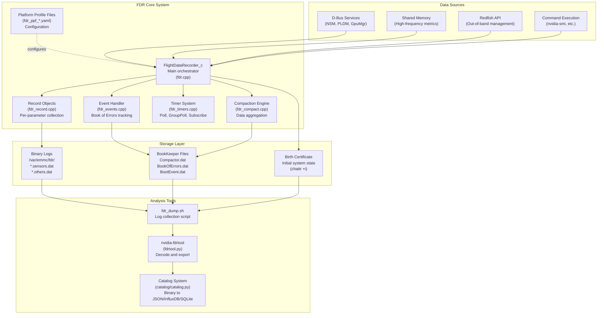
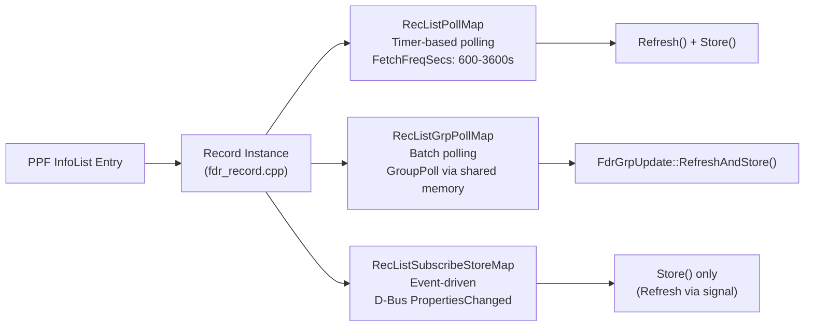
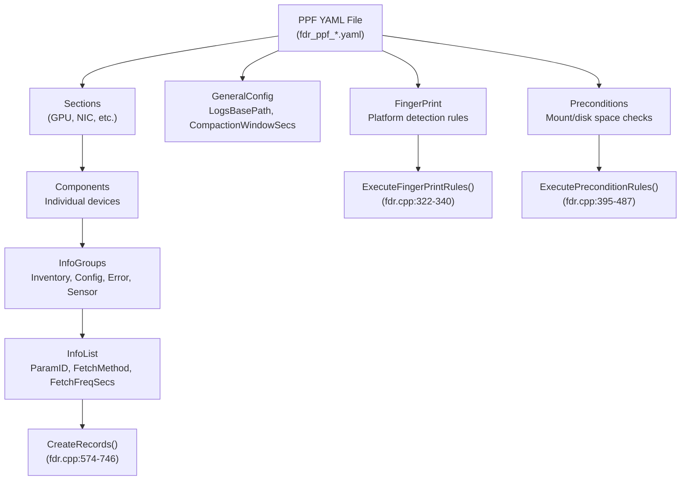
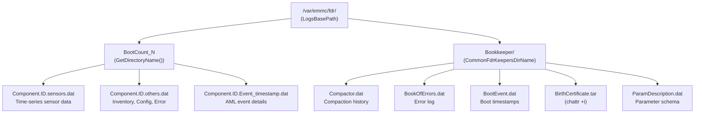
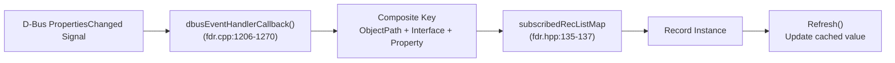

<!-- source: DeepWiki mcp.deepwiki.com · repo NVIDIA/nvidia-fdr · page 1 Overview · fetched 2026-10-26 -->

# Overview

<details>
<summary>Relevant source files</summary>

The following files were used as context for generating this wiki page:

- [README.md](README.md)
- [fdr.cpp](fdr.cpp)
- [fdr.hpp](fdr.hpp)
- [main.cpp](main.cpp)

</details>


## Purpose and Scope

The NVIDIA FDR (Flight Data Recorder) is a telemetry collection and monitoring platform designed for NVIDIA HGX systems. It continuously collects hardware metrics, configuration data, and error information from GPUs, network interfaces, NVLink interconnects, and other system components. The system stores this data in binary protobuf format with intelligent compaction policies, enabling post-mortem analysis of system behavior and error conditions.

This document provides a high-level overview of the FDR architecture, its major components, and how they interact. For specific topics:
- Build and deployment instructions: see [Getting Started](#2)
- Configuration details: see [Platform Profile Files](#3.1)
- Internal architecture details: see [System Architecture](#4)
- Analysis tools: see [Tools and Utilities](#6)

**Sources:** [README.md:1-25](), [fdr.cpp:1-166](), [main.cpp:1-56]()

## System Purpose

FDR serves three primary functions:

1. **Continuous Telemetry Collection**: Monitors hardware metrics at configurable intervals (600-3600 seconds) via multiple data sources including D-Bus services, shared memory, Redfish APIs, and command execution
2. **Error Tracking**: Maintains a "Book of Errors" that logs all hardware errors with timestamps and preserves high-fidelity data around error events
3. **Data Retention Management**: Implements multi-tier storage with compaction policies that balance data granularity with storage constraints

**Sources:** [fdr.cpp:155-166](), [main.cpp:51-66]()

## High-Level Architecture



**Sources:** [fdr.hpp:38-177](), [fdr.cpp:55-166](), [main.cpp:19-148]()

## Core Components

### FlightDataRecorder_c

The `FlightDataRecorder_c` class is the main orchestrator that manages the entire data collection lifecycle. It initializes from a Platform Profile File (PPF), creates Record objects for each configured parameter, manages timers for periodic data collection, and coordinates the compaction engine.

| Component | Location | Purpose |
|-----------|----------|---------|
| Constructor | [fdr.cpp:55-166]() | PPF loading, fingerprint detection, preconditions validation |
| Record Creation | [fdr.cpp:574-746]() | Instantiates Record objects from PPF configuration |
| Event Loop | [main.cpp:83-90]() | Runs timer-based event processing (when `FDR_TIMER_EVENT_ENABLED`) |
| Polling Loop | [main.cpp:95-143]() | Alternative polling-based execution model |

**Sources:** [fdr.hpp:38-177](), [fdr.cpp:55-166]()

### Record System

Each telemetry parameter is represented by a `Record` object that encapsulates:
- Fetch logic (D-Bus property read, shared memory access, Redfish API call, or command execution)
- Storage policy (OnChange, EveryFetch, Periodic)
- Data type conversion and validation
- Reference to parent configuration (Section, Component, InfoGroup)

Records are organized into maps based on their fetch type:



**Sources:** [fdr.cpp:574-746](), [fdr.hpp:42-51]()

### Platform Profile Files (PPF)

PPF files are YAML configuration files that define:
- **Fingerprint**: Shell commands to detect platform type
- **GeneralConfig**: Base paths, compaction windows, logging settings
- **Preconditions**: Mount checks, disk space validation
- **Sections**: Organized by hardware type (GPU, NIC, etc.)
- **Components**: Individual devices within each section
- **InfoGroups**: Categories like Inventory, Config, Error, Sensor
- **InfoList**: Individual parameters with fetch method, frequency, and storage policy



**Sources:** [fdr.cpp:296-319](), [fdr.cpp:211-292]()

## Data Collection Pipeline

The system operates in distinct stages from initialization through continuous monitoring to data export:

```mermaid
flowchart LR
    INIT["Initialization<br/>FindAndLoadPlatformProfile()<br/>(fdr.cpp:211-292)"]
    
    SANITY["PPF Sanity Check<br/>SanityTestPPF()<br/>(fdr.cpp:77-85)"]
    
    PRECON["Preconditions<br/>ExecutePreconditionRules()<br/>(fdr.cpp:395-487)"]
    
    BOOT["Boot Counter Update<br/>UpdateGlobVariables()<br/>(fdr.cpp:1003-1048)"]
    
    RECORDS["Create Records<br/>CreateRecords()<br/>(fdr.cpp:574-746)"]
    
    BIRTH["Birth Certificate<br/>CollectAndArchieveBirthCertificate()<br/>(fdr.cpp:767-832)"]
    
    TIMERS["Initialize Timers<br/>InitTimerEvents()<br/>(fdr_timers.cpp)"]
    
    LOOP["Event Loop<br/>RunEventLoop() or polling<br/>(main.cpp:83-143)"]
    
    INIT --> SANITY --> PRECON --> BOOT --> RECORDS --> BIRTH --> TIMERS --> LOOP
```



During continuous operation, the system processes three types of data collection:

| Fetch Type | Trigger | Implementation | Store Frequency |
|------------|---------|----------------|-----------------|
| **Poll** | Timer (FetchFreqSecs) | `RefreshAndStore()` [fdr.cpp:836-863]() | After each refresh |
| **GroupPoll** | Timer (FetchFreqSecs) | `GroupRefreshAndStore()` [fdr.cpp:865-904]() | After batch refresh |
| **Subscribe** | D-Bus signal | `dbusEventHandlerCallback()` [fdr.cpp:1206-1270]() | Timer (StoreFreqSecs) |

**Sources:** [fdr.cpp:55-166](), [main.cpp:51-90]()

## Storage Architecture

FDR implements a multi-tier storage strategy:

### Directory Structure



**Sources:** [fdr.cpp:491-521](), [fdr.cpp:525-572](), [fdr.cpp:87-149]()

### Compaction Strategy

The compaction engine operates on configurable time windows:

| Setting | Default | Purpose |
|---------|---------|---------|
| `CompactionWindowSecs` | 86400 (24 hours) | Creates new directory, triggers full compaction |
| `CompactionSubWindowSecs` | 1800 (30 minutes) | Generates statistics files (*.sensors.stat.dat) |
| `HiFiDataPreserveTimeSecs` | 300 (±5 minutes) | Preserves full-resolution data around errors |

When a compaction window expires:
1. Creates statistics files with averaged sensor data
2. Preserves high-fidelity data within ±300s of error events
3. Retains one `*.others.dat` file per boot cycle (oldest)
4. Removes original sensor data files after compaction
5. Updates `Compactor.dat` bookkeeper file

**Sources:** [fdr.cpp:1426-1507](), [fdr_common.hpp with GeneralConfig_t structure]()

## Event Handling and Error Tracking

### Book of Errors

The `BookOfErrors.dat` file maintains a chronological log of all hardware errors detected via:
- D-Bus error events (AML events from NSM/PLDM services)
- Error threshold violations in sensor data
- Component-specific error signals

Each error entry includes:
- Error timestamp
- Component ID
- Parameter ID
- Error message
- Event type

When an error occurs, FDR preserves high-fidelity sensor data in `*.sensors.hifi.dat` files within the time window defined by `HiFiDataPreserveTimeSecs` around the error timestamp.

**Sources:** [fdr.cpp:1637-1703](), [fdr_events.cpp implementation]()

### D-Bus Signal Handling



**Sources:** [fdr.cpp:1206-1270](), [fdr.hpp:135-137](), [fdr.cpp:704-716]()

## Runtime Execution Models

FDR supports two execution models, selected at compile time:

### Timer-Based Event Model (Default)

When `FDR_TIMER_EVENT_ENABLED` is defined:
- Uses `sdeventplus` library for event-driven execution
- Registers timers for each unique FetchFreqSecs and StoreFreqSecs value
- Processes D-Bus signals asynchronously
- Runs compaction checks via timer callbacks

**Implementation:** [main.cpp:67-90](), [fdr_timers.cpp implementation]()

### Polling Model

When `FDR_TIMER_EVENT_ENABLED` is not defined:
- Simple while loop with 1-second sleep
- Calls `RefreshAndStore()` and `Compactor()` on each iteration
- Records internally track last execution time to enforce frequency limits
- Processes D-Bus messages via `bus.process_discard()`

**Implementation:** [main.cpp:92-145]()

**Sources:** [main.cpp:67-145](), [fdr.hpp:32-36]()

## Build and Deployment Overview

The FDR system is built using:
- **Native builds**: Meson/Ninja on Ubuntu 22.04 for development
- **Cross-compilation**: Yocto/BitBake for ARM targets (HGX OpenBMC)
- **Dependencies**: sdbusplus, systemd, yaml-cpp, protobuf, curl, spdlog
- **Deployment**: systemd service with D-Bus configuration

Once deployed on HGX systems, FDR runs as a systemd service (`nvidia-fdr.service`) with:
- D-Bus service name: `xyz.openbmc_project.FDR`
- Configuration directory: `/etc/nvidia-fdr/platforms/`
- Data directory: `/var/emmc/fdr/` (or path specified in PPF)
- Environment variable: `PLATFORMS_PATH` points to PPF directory

**Sources:** [README.md:1-171](), [fdr.cpp:218-224]()

## Analysis and Export

Data extraction occurs through:

1. **fdr_dump.sh**: Bash script that collects FDR logs, creates tar.xz archives, and exposes them via Redfish API
2. **nvidia-fdrtool**: Python tool that downloads archives via Redfish and decodes protobuf logs
3. **Catalog System**: Converts binary logs to JSON, InfluxDB line protocol, or SQLite database format

The workflow for analysis:
```
Binary Logs → fdr_dump.sh → Tar Archive → nvidia-fdrtool → Catalog → JSON/InfluxDB/SQLite
```

Detailed information about these tools is available in [Tools and Utilities](#6).

**Sources:** [fdr_dump.sh script](), [fdrtool.py implementation](), [catalog/catalog.py implementation]()

## Data Format

All telemetry data is stored using Protocol Buffers (protobuf) with schema defined in `fdr_logs.proto`. The protobuf format provides:
- Binary serialization for efficient storage
- Schema versioning for backward compatibility
- Language-agnostic decoding
- Type safety and validation

The system tracks format version in `BootEvent.dat` (current version: 2) to handle changes in directory structure and file organization.

**Sources:** [fdr.cpp:42-46](), [fdr.cpp:1053-1070](), [fdr_logs.proto schema file]()

## Exception Handling and Rate Limiting

FDR implements a "leaky bucket" rate limiter to prevent exit due to transient errors:
- **ExceptionAllowNumber**: Maximum uncaught exceptions allowed (capacity)
- **ExceptionAllowRate**: Rate at which exception count decreases
- **Behavior**: FDR exits if exception count exceeds capacity

This prevents cascading failures while allowing recovery from temporary issues.

**Sources:** [fdr.cpp:168-209](), [fdr.hpp:88-89]()

## Next Steps

For detailed information about specific subsystems:
- Configuration file structure: [PPF File Structure Reference](#5.1)
- Internal architecture: [System Architecture](#4)
- Adding new telemetry: [Adding New Parameters](#7.2)
- Troubleshooting: [Troubleshooting and FAQ](#8)

---

