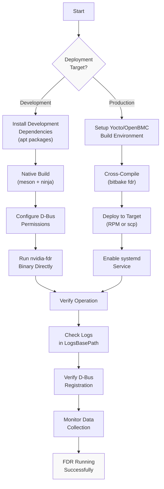
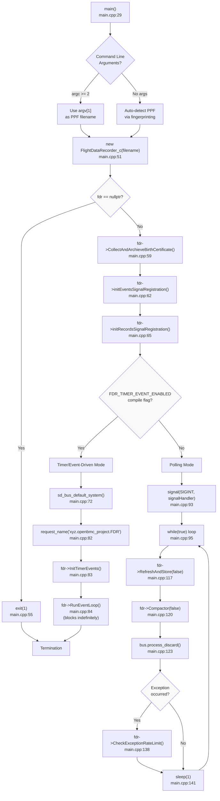
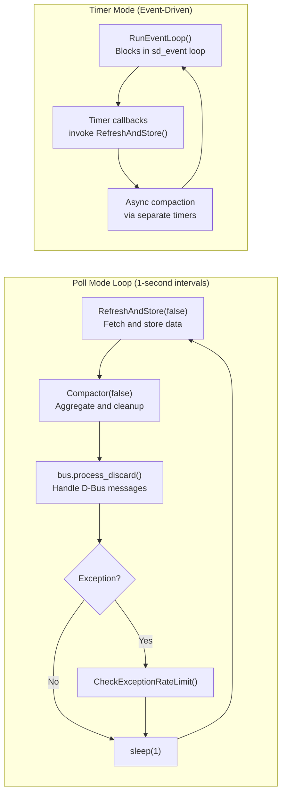

<!-- source: DeepWiki mcp.deepwiki.com · repo NVIDIA/nvidia-fdr · page 2 Getting Started · fetched 2026-10-26 -->

# Getting Started

<details>
<summary>Relevant source files</summary>

The following files were used as context for generating this wiki page:

- [README.md](README.md)
- [fdr_git.bb](fdr_git.bb)
- [main.cpp](main.cpp)

</details>


This page provides a practical guide to building, deploying, and running the NVIDIA FDR (Flight Data Recorder) system. It covers the essential steps needed to get FDR operational on both development machines (native Ubuntu builds) and target HGX platforms (Yocto/OpenBMC cross-compilation).

For architectural concepts and system design, see [Overview](#1). For detailed configuration of platform-specific settings, see [Platform Configuration](#5).

## Scope and Prerequisites

FDR is designed to run on NVIDIA HGX systems with OpenBMC firmware, but can be built and tested on standard Ubuntu development machines. This guide addresses two deployment scenarios:

**Development Environment:**
- Native builds on Ubuntu 22.04 using meson/ninja
- Testing with mock D-Bus services
- Local debugging and validation

**Production Environment:**
- Cross-compilation for ARM targets using Yocto/BitBake
- Deployment as a systemd service on HGX baseboard
- Integration with OpenBMC infrastructure

### System Requirements

| Component | Development | Production |
|-----------|-------------|------------|
| **Operating System** | Ubuntu 22.04 or later | OpenBMC (Yocto-based) |
| **Architecture** | x86_64 (amd64) | ARMv7 (armv7ahf_vfpv4d16) |
| **Compiler** | GCC 12+ or Clang | GCC cross-compiler |
| **Build System** | Meson 0.57+, Ninja | BitBake, CMake |
| **Runtime** | systemd, D-Bus | systemd, D-Bus, HGX hardware |
| **Storage** | Any local filesystem | `/var/emmc/fdr/` (embedded MMC) |

Sources: [README.md:1-18](), [fdr_git.bb:1-35]()

## Getting Started Workflow

The following diagram illustrates the high-level workflow for building and deploying FDR:



Sources: [README.md:1-171](), [main.cpp:29-148]()

## Main Entry Point and Initialization

The FDR application is implemented as a single-threaded C++ program that initializes the `FlightDataRecorder_c` core system and enters either an event-driven loop (timer-based) or a polling loop. Understanding this initialization sequence is critical for debugging deployment issues.



**Key Initialization Steps:**

1. **PPF Selection** [main.cpp:46-50](): If a filename argument is provided, FDR uses that specific Platform Profile File; otherwise, it performs automatic platform detection.

2. **Birth Certificate** [main.cpp:59](): Captures the initial system state for baseline comparison. This is a one-time operation per boot.

3. **Signal Registration** [main.cpp:62-65](): Registers D-Bus signal handlers for both event monitoring and property change notifications.

4. **Runtime Mode**:
   - **Timer Mode** (default on production): Uses `sd_event` based timers with asynchronous callbacks [main.cpp:68-90]()
   - **Polling Mode**: Simple synchronous loop with 1-second sleep intervals [main.cpp:92-145]()

Sources: [main.cpp:29-148]()

## Build Process Overview

FDR supports two build methods depending on the target environment. Both methods produce the same core binary (`nvidia-fdr`) but with different configurations.

| Build Method | Use Case | Output Location | Details |
|--------------|----------|-----------------|---------|
| **Meson/Ninja** | Development, testing, debugging | `build/nvidia-fdr` | See [Building the System](#2.1) |
| **BitBake** | Production deployment on HGX | `build/hgx/tmp/deploy/rpm/` | See [Building the System](#2.1) |

### Native Build Quick Start

For development on Ubuntu 22.04:

```bash
# Install dependencies (see section 2.1 for complete list)
sudo apt install meson ninja-build g++-12 libsystemd-dev \
    nlohmann-json3-dev libyaml-cpp-dev libcurl4-gnutls-dev

# Configure build
meson setup build

# Compile
ninja -C build
```

### Cross-Compilation Quick Start

For production builds targeting ARM HGX platforms:

```bash
# Setup Yocto environment (one-time)
git clone ssh://git@gitlab-master.nvidia.com:12051/dgx/bmc/openbmc.git
cd openbmc
git checkout fdr-integration
. setup hgx

# Build FDR
bitbake fdr
```

For complete dependency lists, build options, and troubleshooting, see [Building the System](#2.1).

Sources: [README.md:1-170](), [fdr_git.bb:27-34]()

## Deployment and Runtime Configuration

Once built, FDR requires proper D-Bus permissions and systemd configuration to operate correctly.

### D-Bus Service Registration

FDR registers on the D-Bus system bus as `xyz.openbmc_project.FDR` [main.cpp:68,82](). This requires appropriate D-Bus policy configuration:

**Development Environment:**
```bash
# Create D-Bus policy file
cat > /etc/dbus-1/system.d/xyz.openbmc_project.FDR.conf << EOF
<!DOCTYPE busconfig PUBLIC
 "-//freedesktop//DTD D-BUS Bus Configuration 1.0//EN"
 "http://www.freedesktop.org/standards/dbus/1.0/busconfig.dtd">
<busconfig>
  <policy user="root">
    <allow own="xyz.openbmc_project.FDR"/>
  </policy>
</busconfig>
EOF

# Reload D-Bus configuration
sudo systemctl reload dbus
```

**Production Environment:**
The OpenBMC build automatically installs the D-Bus configuration file via the BitBake recipe.

### Running FDR

**Manual Execution (Development):**
```bash
cd build
sudo ./nvidia-fdr

# Or specify a custom PPF file
sudo ./nvidia-fdr /path/to/custom_ppf.yaml
```

**Systemd Service (Production):**
```bash
# Check service status
systemctl status nvidia-fdr.service

# Start/stop/restart service
systemctl start nvidia-fdr.service
systemctl stop nvidia-fdr.service
systemctl restart nvidia-fdr.service

# Enable automatic start on boot
systemctl enable nvidia-fdr.service
```

For detailed deployment procedures, environment variables, and configuration options, see [Running and Deployment](#2.2).

Sources: [README.md:66-90,158-166](), [main.cpp:68,82]()

## Verification and Validation

After deployment, verify that FDR is operating correctly:

### 1. Check Process Status

```bash
# Verify the process is running
ps aux | grep nvidia-fdr

# Check D-Bus name ownership
busctl list | grep xyz.openbmc_project.FDR
```

### 2. Inspect Log Output

FDR uses either `spdlog` (development) or `phosphor-logging` (production) for logging [main.cpp:31-35]():

```bash
# View systemd journal logs
journalctl -u nvidia-fdr.service -f

# Look for initialization messages
journalctl -u nvidia-fdr.service | grep -E "(CollectAndArchieveBirthCertificate|initEventsSignalRegistration|initRecordsSignalRegistration)"
```

### 3. Verify Data Collection

FDR writes binary protobuf logs to the path specified in the Platform Profile File (typically `/var/emmc/fdr/`):

```bash
# Check log directory structure
ls -lR /var/emmc/fdr/

# Expected directory structure:
# /var/emmc/fdr/
# ├── BootCount_X/          (current boot cycle)
# │   ├── *.sensors.dat
# │   ├── *.others.dat
# │   └── Event_*.dat
# ├── BootCount_X-1/        (previous boot, compacted)
# │   ├── *.sensors.stat.dat
# │   ├── *.sensors.hifi.dat
# │   └── *.others.dat
# ├── Bookkeeper/
# │   ├── Compactor.dat
# │   ├── BookOfError.dat
# │   └── BootEvent.dat
# └── BirthCertificate_*.tar.xz
```

### 4. Validate D-Bus Communication

```bash
# List FDR's D-Bus objects
busctl tree xyz.openbmc_project.FDR

# Monitor D-Bus signal subscriptions
dbus-monitor --system "sender='xyz.openbmc_project.FDR'"
```

### 5. Test Data Export

Use the FDR collection tools to verify that logs can be decoded:

```bash
# Generate a dump archive
/usr/bin/fdr_dump.sh

# Decode the archive (requires nvidia-fdrtool)
nvidia-fdrtool --collect --local /path/to/dump.tar.xz --output /tmp/fdr_output
```

For troubleshooting common issues, see [Troubleshooting and FAQ](#8).

Sources: [README.md:90-99,158-166](), [main.cpp:31-35,59-65]()

## Core Runtime Loop Components

Understanding the main runtime loop helps diagnose operational issues:



**Key Methods:**

- `RefreshAndStore(false)` [main.cpp:117](): Iterates through all configured records, fetches data based on timer schedules, and writes to disk according to store policies.

- `Compactor(false)` [main.cpp:120](): Checks if compaction window has elapsed and aggregates data into statistics files while preserving high-fidelity data around errors.

- `CheckExceptionRateLimit()` [main.cpp:138](): Monitors exception frequency and terminates FDR if error rate exceeds threshold (fail-safe mechanism).

Sources: [main.cpp:95-145]()

## Next Steps

Once FDR is successfully running:

1. **Understand Configuration**: Review [Platform Profile Files](#3.1) to learn how data collection is configured
2. **Explore Data Collection**: Read [Records and Data Collection](#3.2) to understand fetch methods and store policies
3. **Analyze Collected Data**: Use [nvidia-fdrtool](#6.2) and [Catalog System](#6.3) to decode and export logs
4. **Add Custom Parameters**: Follow [Adding New Parameters](#7.2) to extend telemetry coverage
5. **Validate Coverage**: Use [Testing and Validation](#7.3) tools to ensure all required parameters are being collected

For platform-specific configuration examples, see:
- [Vulcan Platform Configuration](#5.2)
- [HGXB HMC Platform Configuration](#5.3)

---

Sources: [main.cpp:1-153](), [README.md:1-171](), [fdr_git.bb:1-35]()

---

