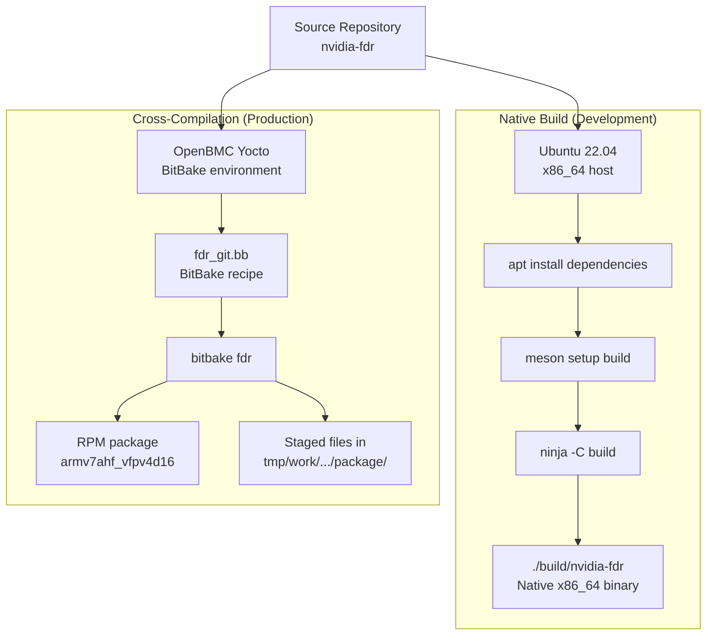
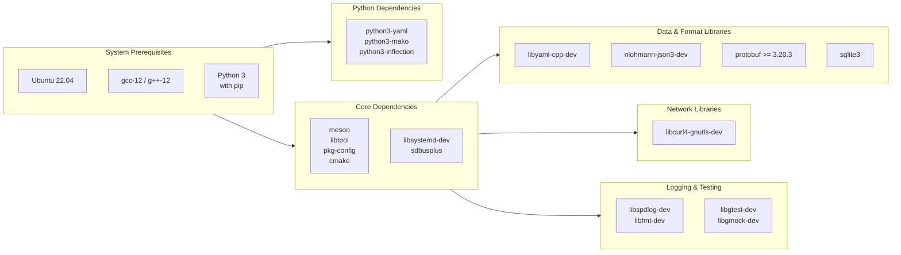
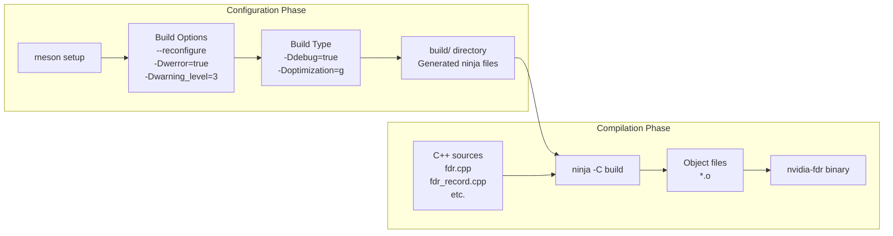
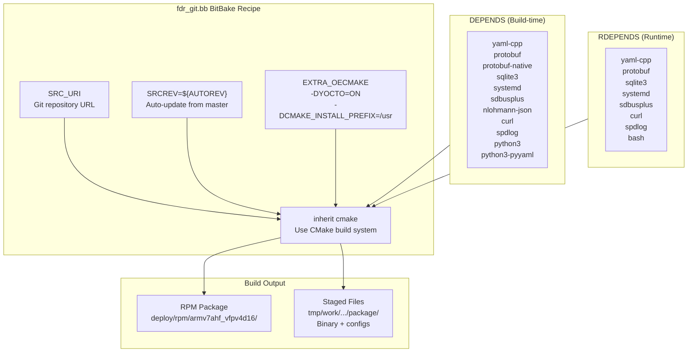
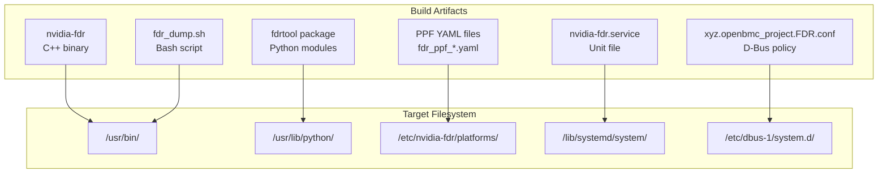

<!-- source: DeepWiki mcp.deepwiki.com · repo NVIDIA/nvidia-fdr · page 2.1 Building the System · fetched 2026-10-26 -->

# Building the System

<details>
<summary>Relevant source files</summary>

The following files were used as context for generating this wiki page:

- [README.md](README.md)
- [fdr_git.bb](fdr_git.bb)

</details>


## Purpose and Scope

This page provides detailed instructions for building the NVIDIA FDR system from source. It covers two primary build methods: native builds for development and testing on x86_64 Ubuntu systems using **meson/ninja**, and cross-compilation builds for ARM-based OpenBMC target platforms using **bitbake**. 

For information about deploying and running the built binaries, see [Running and Deployment](#2.2). For details on the build system internals and dependency management from a development perspective, see [Build System and Dependencies](#7.1).

---

## Build Method Overview

The FDR system supports two distinct build workflows depending on the target environment:



**Build Method Comparison**

| Aspect | Native Build | Cross-Compilation Build |
|--------|-------------|------------------------|
| **Build System** | meson + ninja | cmake via BitBake |
| **Target Platform** | x86_64 Linux | ARM (armv7ahf-vfpv4d16) |
| **Primary Use Case** | Development, testing, debugging | Production deployment to HGX |
| **Dependency Management** | Manual apt install | Automatic via BitBake |
| **Output Format** | Raw binary | RPM package + staged files |
| **Configuration** | `meson setup` options | `EXTRA_OECMAKE` in recipe |

Sources: [README.md:1-171](), [fdr_git.bb:1-35]()

---

## Development Environment Setup

### Host System Requirements

The FDR system has been verified to build on **Ubuntu 22.04**. The build process requires specific compiler versions and system libraries.



### Installing Dependencies

**Step 1: Install sdbusplus dependencies**

The `sdbusplus` library provides D-Bus C++ bindings and is a critical dependency for FDR's communication with system services.

```bash
sudo apt install git meson libtool pkg-config g++-12 libsystemd-dev \
    python3 python3-pip python3-yaml python3-mako python3-inflection
```

**Step 2: Install FDR-specific dependencies**

```bash
sudo apt install cmake clang-tools nlohmann-json3-dev \
    libyaml-cpp-dev libcurl4-gnutls-dev python3-yaml \
    libspdlog-dev libfmt-dev clang-tools libgtest-dev libgmock-dev
```

**Step 3: Build and install Protobuf 3.20.3**

The system requires Protobuf >= 3.20.3 to support the `optional` keyword used in the protobuf schema. The Ubuntu 22.04 bundled version is insufficient.

```bash
wget https://github.com/protocolbuffers/protobuf/releases/download/v3.20.3/protobuf-all-3.20.3.tar.gz
tar zxvf protobuf-all-3.20.3.tar.gz
cd protobuf-3.20.3/
./configure --prefix=/usr
make
sudo make install
```

**Step 4: Set default GCC/G++ version**

The `sdbusplus` headers require GCC 12 for compilation. If multiple GCC versions are installed, set version 12 as the default:

```bash
sudo update-alternatives --install /usr/bin/gcc gcc /usr/bin/gcc-12 10
sudo update-alternatives --install /usr/bin/g++ g++ /usr/bin/g++-12 10
```

The priority value `10` ensures GCC 12 takes precedence.

Sources: [README.md:1-43]()

---

## Native Build (meson/ninja)

### Build Configuration

The native build uses **meson** as the build configuration tool and **ninja** as the build executor. Meson generates the build files, which ninja then uses to compile the source.



**Standard build (Release configuration):**

```bash
meson setup --reconfigure build
ninja -C build
```

**Debug build configuration:**

For debug builds with all warnings enabled (matching CI/CD unit test configuration):

```bash
meson setup --reconfigure build \
    -Db_colorout=never \
    -Dwerror=true \
    -Dwarning_level=3 \
    -Ddebug=true \
    -Doptimization=g
```

**Alternative compilation method:**

```bash
meson compile -C build
```

Both `meson compile` and `ninja` produce identical results. The `ninja` command is more commonly used in the development workflow.

### Build Output

After a successful build, the main binary is located at:

```
./build/nvidia-fdr
```

Additional build artifacts include:
- Compiled object files: `build/*.o`
- Test executables (if tests are enabled)
- Protobuf-generated code

Sources: [README.md:44-62]()

---

## Cross-Compilation Build (Yocto/BitBake)

### OpenBMC Repository Setup

Cross-compilation for ARM targets uses the **OpenBMC Yocto Project** infrastructure with **BitBake** as the build tool.

**Step 1: Clone the OpenBMC repository**

```bash
git clone ssh://git@gitlab-master.nvidia.com:12051/dgx/bmc/openbmc.git
cd openbmc
```

**Step 2: Switch to FDR integration branch**

```bash
git checkout fdr-integration
```

**Step 3: Initialize the HGX build environment**

```bash
. setup hgx
```

This script configures the BitBake environment variables and sets up the build directory structure.

### BitBake Recipe Structure

The `fdr_git.bb` recipe defines how FDR is built within the Yocto environment:



**Key recipe components:**

| Component | Value | Purpose |
|-----------|-------|---------|
| `LICENSE` | `CLOSED` | Proprietary NVIDIA code |
| `SRC_URI` | `git://...nvidia-fdr.git` | Source repository location |
| `SRCREV` | `${AUTOREV}` | Always use latest master commit |
| `inherit cmake` | - | Use CMake as build system (not meson) |
| `EXTRA_OECMAKE` | `-DYOCTO=ON -DCMAKE_INSTALL_PREFIX=/usr` | Yocto-specific build flags |

**Note:** The Yocto build uses **CMake** instead of meson, as specified by `inherit cmake` at [fdr_git.bb:27]().

Sources: [README.md:123-150](), [fdr_git.bb:1-35]()

### Building FDR Package

**Build FDR only:**

```bash
bitbake fdr
```

**Build complete OpenBMC image with FDR:**

```bash
bitbake obmc-phosphor-image
```

### Build Output Locations

After a successful BitBake build:

**RPM Package:**
```
openbmc/build/hgx/tmp/deploy/rpm/armv7ahf_vfpv4d16/
```

**Unpacked files (binary, configs, scripts):**
```
openbmc/build/hgx/tmp/work/armv7ahf-vfpv4d16-openbmc-linux-gnueabi/nvidia-fdr/git-r0/package/
```

The unpacked files location is useful for:
- Manually copying binaries to a running OpenBMC system via SCP
- Inspecting installed file structure
- Debugging packaging issues

**Build logs (if errors occur):**
```
openbmc/build/hgx/tmp/work/armv7ahf-vfpv4d16-openbmc-linux-gnueabi/nvidia-fdr/git-r0/temp/
```

Sources: [README.md:137-149]()

---

## Build Artifacts and Installation Layout

### Installed File Structure

The build process generates several types of artifacts that are installed to specific locations on the target system:

| Artifact Type | Build Output | Target Installation Path | Description |
|--------------|--------------|-------------------------|-------------|
| Main binary | `nvidia-fdr` | `/usr/bin/nvidia-fdr` | Core FDR service executable |
| Collection script | `fdr_dump.sh` | `/usr/bin/fdr_dump.sh` | Log collection utility |
| Python tools | `fdrtool/*` | `/usr/lib/python/site-packages/` | Analysis and decoding tools |
| Platform profiles | `platforms/fdr_ppf_*.yaml` | `/etc/nvidia-fdr/platforms/` | Configuration files |
| Systemd service | `nvidia-fdr.service` | `/lib/systemd/system/` | Service definition |
| D-Bus config | `xyz.openbmc_project.FDR.conf` | `/etc/dbus-1/system.d/` | D-Bus permissions |



### CMake Installation Rules

The installation paths are defined by CMake configuration when using Yocto builds. The `EXTRA_OECMAKE` variable at [fdr_git.bb:30]() sets:

```
-DCMAKE_INSTALL_PREFIX=/usr
```

This ensures all files are installed under `/usr` rather than the CMake default `/usr/local`.

Sources: [fdr_git.bb:30](), [README.md:146-148]()

---

## Build Validation and Testing

### Unit Tests

Unit tests are executed using meson's test framework with code coverage enabled:

```bash
meson setup --reconfigure build_coverage -Db_coverage=True
meson test -v -C build_coverage
```

**Coverage report locations:**
- Text format: `./build_coverage/meson-logs/coverage.txt`
- HTML format: `./build_coverage/meson-logs/coveragehtml/`

### Static Analysis

Run Clang static analyzer:

```bash
ninja scan-build -C builddir
```

### Docker-based Code Coverage

For consistent CI/CD-style coverage testing:

```bash
./coverage/coverage.sh
```

This script runs the test suite in a Docker container matching the CI environment and generates coverage reports.

### Local CI Pipeline Execution

To run the complete CI pipeline locally (requires GitLab Runner):

See: [https://gitlab-master.nvidia.com/dgx/bmc/docs/-/blob/develop/testing/local-ci-build.md](https://gitlab-master.nvidia.com/dgx/bmc/docs/-/blob/develop/testing/local-ci-build.md)

Sources: [README.md:92-120]()

---

## Build Troubleshooting

### Common Issues

**Problem: Protobuf version too old**

Symptom: Build fails with errors about `optional` keyword not supported

Solution: Install Protobuf 3.20.3 or newer as described in the dependencies section above.

**Problem: GCC version mismatch**

Symptom: Compilation errors in `sdbusplus` headers

Solution: Ensure GCC 12 is the default compiler using `update-alternatives` as shown above.

**Problem: BitBake build fails**

Symptom: `bitbake fdr` command fails during compilation

Solution: Check build logs at:
```
openbmc/build/hgx/tmp/work/armv7ahf-vfpv4d16-openbmc-linux-gnueabi/nvidia-fdr/git-r0/temp/
```

Look for specific error messages in `log.do_compile` or `log.do_configure`.

**Problem: Missing PLATFORMS_PATH at runtime**

Symptom: FDR binary cannot find PPF configuration files

Solution: This is a runtime issue, not a build issue. See [Running and Deployment](#2.2) for environment variable configuration.

Sources: [README.md:1-171]()

---

