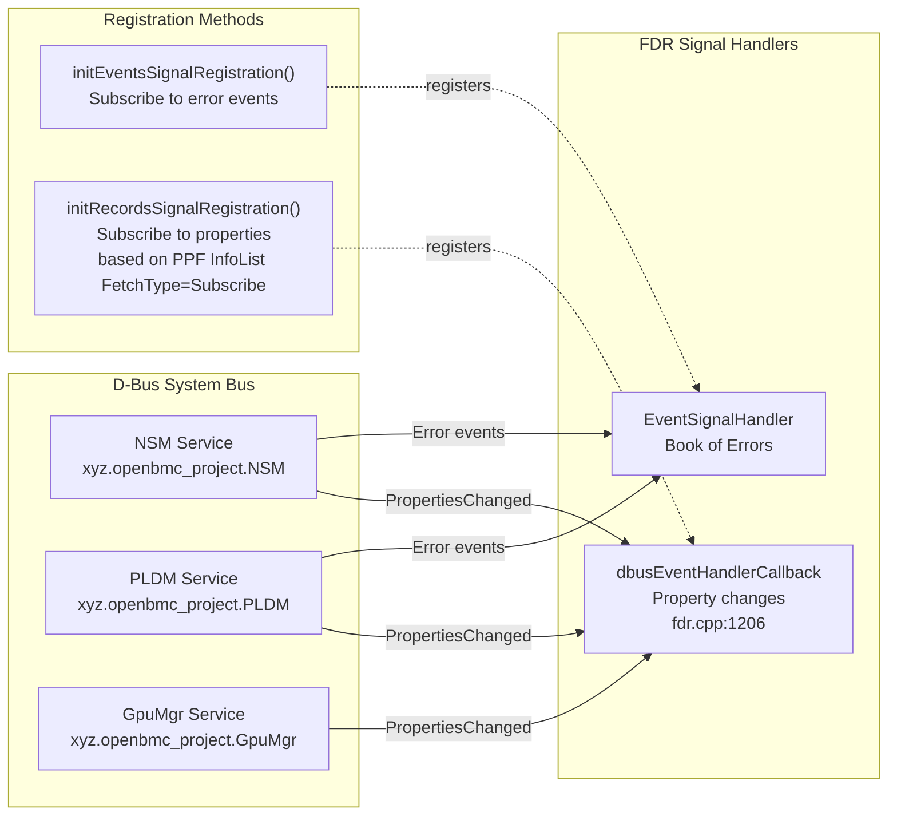
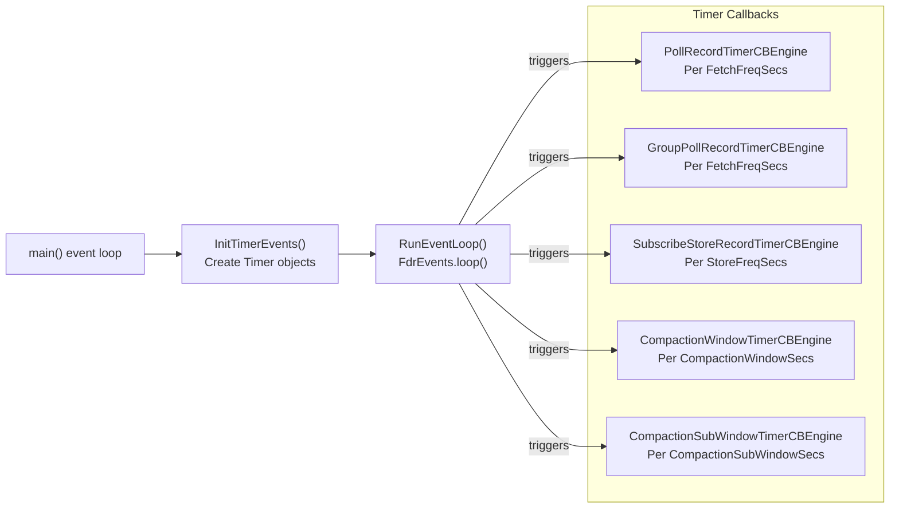
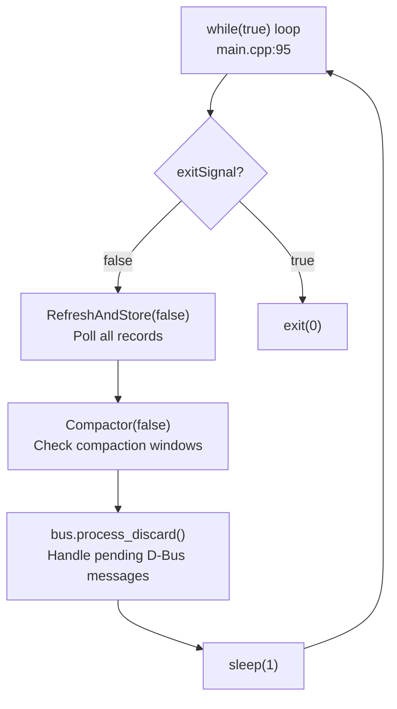
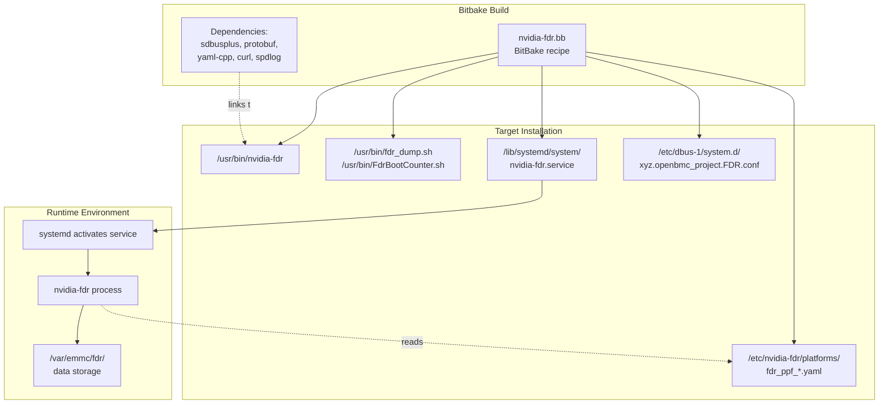
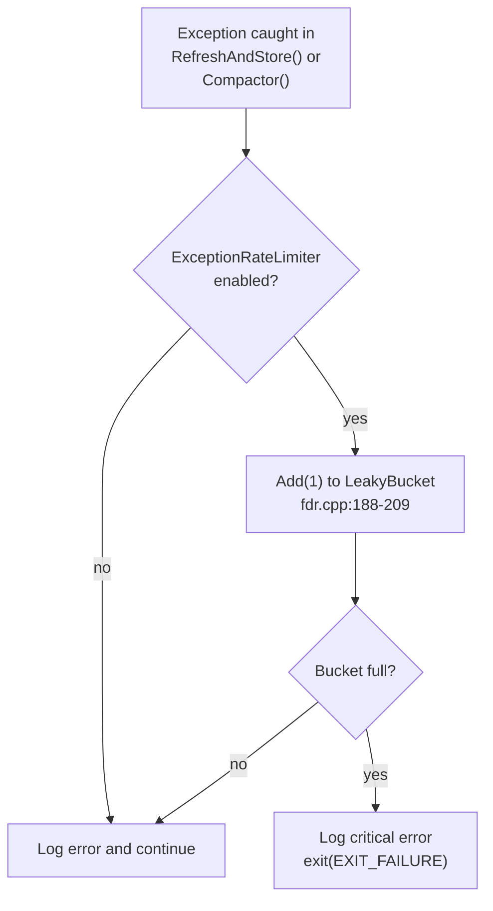

<!-- source: DeepWiki mcp.deepwiki.com · repo NVIDIA/nvidia-fdr · page 2.2 Running and Deployment · fetched 2026-10-26 -->

# Running and Deployment

<details>
<summary>Relevant source files</summary>

The following files were used as context for generating this wiki page:

- [README.md](README.md)
- [fdr.cpp](fdr.cpp)
- [fdr.hpp](fdr.hpp)
- [main.cpp](main.cpp)

</details>


This page describes how to deploy and run the NVIDIA FDR system on target platforms. It covers service configuration, directory requirements, startup procedures, and verification steps for both development and production environments.

For information about building the FDR binary and dependencies, see [Building the System](#2.1). For details on configuring platform-specific telemetry collection, see [Platform Profile Files](#3.1).

## Overview

The FDR system runs as a systemd service (`nvidia-fdr.service`) on NVIDIA HGX platforms. The main components include:

- **Binary**: `nvidia-fdr` executable located in `/usr/bin/`
- **Configuration**: Platform Profile Files (PPF) in `/etc/nvidia-fdr/platforms/`
- **Data Storage**: Binary logs and bookkeeper files in `/var/emmc/fdr/`
- **D-Bus Registration**: Service name `xyz.openbmc_project.FDR`

## Startup Sequence

The following diagram shows the FDR initialization flow from service start to active telemetry collection:

```mermaid
flowchart TD
    START["systemd starts nvidia-fdr.service"]
    MAIN["main() entry point<br/>main.cpp:29"]
    CONSTRUCT["FlightDataRecorder_c constructor<br/>fdr.cpp:55"]
    
    subgraph "Platform Detection & Configuration"
        LOAD_PPF["Load PPF file<br/>- Use cmdline arg if provided<br/>- Otherwise auto-detect via fingerprints<br/>fdr.cpp:59-69"]
        FINGERPRINT["ExecuteFingerPrintRules()<br/>Test shell commands<br/>fdr.cpp:322-340"]
        SANITY["PPFSanity check<br/>Validate PPF structure<br/>fdr.cpp:77-85"]
    end
    
    subgraph "Environment Validation"
        PRECHECK["ExecutePreconditionRules()<br/>fdr.cpp:395"]
        CHECK_MOUNT["Check storage mount<br/>Preconditions.Checks"]
        CHECK_DISK["CheckFdrPartitionDiskUsageAndExit()<br/>Verify free space<br/>fdr.cpp:382"]
    end
    
    subgraph "Initialization"
        BOOT_CTR["UpdateGlobVariables()<br/>Read/update boot counter<br/>fdr.cpp:1003"]
        BOOT_LOG["UpdateBootEventLog()<br/>Log FDR start event<br/>fdr.cpp:1053"]
        CREATE_REC["CreateRecords()<br/>Build Record objects from PPF<br/>fdr.cpp:574"]
        BIRTH_CERT["CollectAndArchieveBirthCertificate()<br/>Create initial snapshot<br/>fdr.cpp:767"]
    end
    
    subgraph "Signal Registration"
        REG_EVENTS["initEventsSignalRegistration()<br/>Book of Errors monitoring"]
        REG_DBUS["initRecordsSignalRegistration()<br/>D-Bus property changes"]
    end
    
    LOOP_CHOICE{FDR_TIMER_EVENT_ENABLED?}
    TIMER_MODE["InitTimerEvents()<br/>Setup periodic timers"]
    EVENT_LOOP["RunEventLoop()<br/>Event-driven execution"]
    POLL_MODE["Polling loop<br/>main.cpp:95-142"]
    
    ACTIVE["Active Telemetry Collection<br/>RefreshAndStore() cycles"]
    
    START --> MAIN
    MAIN --> CONSTRUCT
    CONSTRUCT --> LOAD_PPF
    LOAD_PPF --> FINGERPRINT
    FINGERPRINT --> SANITY
    SANITY --> PRECHECK
    PRECHECK --> CHECK_MOUNT
    CHECK_MOUNT --> CHECK_DISK
    CHECK_DISK --> BOOT_CTR
    BOOT_CTR --> BOOT_LOG
    BOOT_LOG --> CREATE_REC
    CREATE_REC --> BIRTH_CERT
    BIRTH_CERT --> REG_EVENTS
    REG_EVENTS --> REG_DBUS
    REG_DBUS --> LOOP_CHOICE
    LOOP_CHOICE -->|"Defined"| TIMER_MODE
    LOOP_CHOICE -->|"Not defined"| POLL_MODE
    TIMER_MODE --> EVENT_LOOP
    EVENT_LOOP --> ACTIVE
    POLL_MODE --> ACTIVE
```



**Sources**: [main.cpp:29-148](), [fdr.cpp:55-166](), [fdr.cpp:211-292](), [fdr.cpp:322-340](), [fdr.cpp:395-487]()

## Prerequisites

### System Requirements

The following must be available before starting FDR:

| Requirement | Description | Configuration Location |
|-------------|-------------|------------------------|
| **Storage Mount** | Persistent storage partition must be mounted | `Preconditions.Checks` in PPF |
| **Free Disk Space** | Minimum available space threshold | `GeneralConfig.PartitionThresoldCheckMB` |
| **D-Bus System Bus** | Active system D-Bus daemon | systemd dependency |
| **Platform Services** | NSM, PLDM, GpuMgr services running | `Preconditions.Checks` in PPF |

The precondition validation logic in [fdr.cpp:395-487]() executes shell commands defined in the PPF to verify these requirements. Each check can be configured with:
- `CommandRetryPolicy`: Whether to retry on failure
- `ExitOnFailure`: Whether to abort FDR startup if check fails
- `Threshold`: Maximum time to wait for check to pass

**Sources**: [fdr.cpp:395-487]()

### Directory Structure

FDR expects the following directory layout:

```
/etc/nvidia-fdr/platforms/        # PPF configuration files (referenced by PLATFORMS_PATH)
    fdr_ppf_*.yaml                # Platform-specific YAML files

/usr/bin/
    nvidia-fdr                    # Main FDR binary
    fdr_dump.sh                   # Log collection script
    FdrBootCounter.sh             # Boot counter management script

/var/emmc/fdr/                    # Data storage (GeneralConfig.LogsBasePath)
    Bookkeeper/                   # Persistent metadata
        BootCount.txt             # Boot counter value
        BootEvent.dat             # Boot event log (protobuf)
        BirthCertificate.tar      # Initial system state snapshot
        Compactor.dat             # Compaction history (protobuf)
        BookOfErrors.dat          # Error event log (protobuf)
        ParamDescription.dat      # Parameter schema (protobuf)
    <bootcount>_<timestamp>/      # Per-boot telemetry directories
        *.sensors.dat             # Sensor telemetry (protobuf)
        *.others.dat              # Non-sensor data (protobuf)
        *.sensors.stat.dat        # Aggregated statistics (protobuf)
        *.sensors.hifi.dat        # High-fidelity error context (protobuf)

/tmp/
    .fdrHmcAlive                  # Runtime marker file (hidden)
```

**Sources**: [fdr.cpp:87-89](), [fdr.cpp:498-521](), [fdr.cpp:534-572](), [fdr.cpp:962-991]()

## D-Bus Configuration

### Service Registration

FDR registers on the D-Bus system bus with the name `xyz.openbmc_project.FDR`. This requires a policy configuration file:

**File**: `/etc/dbus-1/system.d/xyz.openbmc_project.FDR.conf`

```xml
<!DOCTYPE busconfig PUBLIC
 "-//freedesktop//DTD D-BUS Bus Configuration 1.0//EN"
 "http://www.freedesktop.org/standards/dbus/1.0/busconfig.dtd">
<busconfig>
  <policy user="root">
    <allow own="xyz.openbmc_project.FDR"/>
  </policy>
</busconfig>
```

After creating this file, reload the D-Bus daemon:

```bash
sudo systemctl reload dbus
```

**Sources**: [README.md:66-81](), [main.cpp:68]()

### Signal Subscriptions

FDR subscribes to D-Bus signals for event-driven data collection:



The registration occurs in [main.cpp:62-65]() after the FlightDataRecorder_c object is constructed.

**Sources**: [main.cpp:62-65](), [fdr.cpp:1206-1275]()

## Environment Variables

### PLATFORMS_PATH

The `PLATFORMS_PATH` environment variable specifies the directory containing PPF files. This is typically set in the systemd service file.

**Default behavior** (if not set): Look for PPF files in `./platforms` relative to the binary location (development mode).

**Production deployment**: Set to `/etc/nvidia-fdr/platforms`

```bash
# In systemd service file:
Environment="PLATFORMS_PATH=/etc/nvidia-fdr/platforms"
```

The platform detection logic in [fdr.cpp:218-224]() checks this variable:

```cpp
const char* platforms_path = getenv("PLATFORMS_PATH");
std::string SupportedPlatformsDir = 
    (platforms_path != NULL ? platforms_path : "./platforms");
```

**Sources**: [fdr.cpp:218-224]()

## Running FDR

### Systemd Service (Production)

The recommended deployment method is via systemd service management:

```bash
# Check service status
systemctl status nvidia-fdr.service

# Start the service
systemctl start nvidia-fdr.service

# Stop the service
systemctl stop nvidia-fdr.service

# Restart after configuration changes
systemctl restart nvidia-fdr.service

# Enable auto-start on boot
systemctl enable nvidia-fdr.service

# View service logs
journalctl -u nvidia-fdr.service -f
```

**Sources**: [README.md:158-166]()

### Manual Execution (Development)

For development and testing, FDR can be run directly:

```bash
# Run with automatic PPF detection
sudo ./nvidia-fdr

# Run with specific PPF file
sudo ./nvidia-fdr /path/to/fdr_ppf_custom.yaml

# Set environment variables
sudo PLATFORMS_PATH=/custom/path ./nvidia-fdr
```

The binary requires root privileges to:
- Access D-Bus system bus
- Write to `/var/emmc/fdr/` storage
- Execute privileged shell commands for precondition checks

**Sources**: [README.md:83-90](), [main.cpp:46-51]()

### Command-Line Arguments

The `main()` function accepts an optional PPF file path as the first argument:

| Argument | Description |
|----------|-------------|
| (none) | Auto-detect platform via fingerprint checks |
| `<path>` | Use specified PPF file, skip platform detection |

**Sources**: [main.cpp:46-51](), [fdr.cpp:59-64]()

## Runtime Operation Modes

FDR supports two operational modes controlled by the `FDR_TIMER_EVENT_ENABLED` compile-time flag:

### Timer-Based Mode (Default)

When `FDR_TIMER_EVENT_ENABLED` is defined (default):



This mode uses `sdeventplus::utility::Timer` objects for precise, event-driven scheduling.

**Sources**: [main.cpp:67-90](), [fdr.hpp:32]()

### Polling Mode

When `FDR_TIMER_EVENT_ENABLED` is not defined:



This mode uses a simple 1-second polling loop, suitable for platforms where timer infrastructure is unreliable.

**Sources**: [main.cpp:95-142]()

## Verification

### Service Health Checks

**1. Service Status**
```bash
systemctl status nvidia-fdr.service
```
Expected output should show "active (running)" status.

**2. D-Bus Registration**
```bash
busctl list | grep FDR
```
Should show: `xyz.openbmc_project.FDR`

**3. Process Running**
```bash
ps aux | grep nvidia-fdr
```
Should show the `nvidia-fdr` process with PID.

**4. Log File Creation**
```bash
ls -lh /var/emmc/fdr/
```
Should show:
- `Bookkeeper/` directory with metadata files
- Boot-specific directories named `<bootcount>_<timestamp>/`

**5. Service Logs**
```bash
journalctl -u nvidia-fdr.service -n 50
```
Check for:
- "Found the PPF file" message indicating successful platform detection
- "All precheck conditions passed" indicating preconditions met
- No error messages about disk space or missing services

### Validation Checklist

| Check | Command | Expected Result |
|-------|---------|-----------------|
| PPF Loaded | `journalctl -u nvidia-fdr.service \| grep "PPF file"` | Shows detected PPF filename |
| Boot Counter | `cat /var/emmc/fdr/Bookkeeper/BootCount.txt` | Contains numeric boot count |
| Birth Certificate | `ls /var/emmc/fdr/Bookkeeper/BirthCertificate.tar` | File exists (after first boot) |
| Data Collection | `ls /var/emmc/fdr/<bootcount>_*/` | Shows `.dat` files being created |
| Disk Space | `df -h /var/emmc/fdr` | Available space above threshold |
| D-Bus Connection | `busctl tree xyz.openbmc_project.FDR` | Shows service object tree |

**Sources**: [fdr.cpp:260-286](), [fdr.cpp:1053-1070]()

## Deployment Scenarios

### Development Environment (Native Ubuntu)

For native development on Ubuntu 22.04:

1. **Install D-Bus policy**: Place policy file in `/etc/dbus-1/system.d/` and reload
2. **Set PLATFORMS_PATH**: Point to local PPF directory
   ```bash
   export PLATFORMS_PATH=./platforms
   ```
3. **Create data directory**: 
   ```bash
   sudo mkdir -p /var/emmc/fdr
   sudo chown $USER:$USER /var/emmc/fdr
   ```
4. **Run manually**: `sudo ./build/nvidia-fdr`

**Sources**: [README.md:66-90]()

### Production Deployment (HGX Platform)

On NVIDIA HGX systems deployed via Yocto/OpenBMC:



Key differences from development deployment:
- All files installed via package manager (RPM)
- systemd service auto-starts on boot
- `PLATFORMS_PATH` set in service file to `/etc/nvidia-fdr/platforms`
- Storage on persistent eMMC partition mounted at `/var/emmc/`

**Sources**: [README.md:123-166]()

### Special Runtime Files

**Boot Counter Management**

The `/tmp/.fdrHmcAlive` hidden file is used to distinguish between:
- **HMC reboot**: File does not exist (tmpfs cleared)
- **FDR restart**: File exists (service restart without HMC reboot)

This affects boot counter logic in [fdr.cpp:962-991]() and `/usr/bin/FdrBootCounter.sh`.

**Birth Certificate**

The `BirthCertificate.tar` file in [fdr.cpp:767-832]() contains:
- All `*.others.dat` files from first boot (inventory, config, versions)
- Bookkeeper metadata files

It is made immutable using `chattr +i` in [fdr.cpp:748-762]() to prevent accidental deletion.

**Sources**: [fdr.cpp:748-832](), [fdr.cpp:962-991](), [fdr.cpp:1003-1048]()

## Error Handling and Recovery

### Initialization Failures

FDR will exit with `EXIT_FAILURE` if:

| Failure Condition | Check Location | Action |
|-------------------|----------------|--------|
| PPF not found or invalid | [fdr.cpp:70-74]() | Log error, exit |
| PPF fails sanity check | [fdr.cpp:79-85]() | Log validation errors, exit |
| Preconditions fail with `ExitOnFailure=true` | [fdr.cpp:459-465]() | Log error, exit |
| Disk space below threshold | [fdr.cpp:382-391]() | Log warning, exit with `EXIT_SUCCESS` |

### Runtime Exception Handling

FDR implements a rate limiter for uncaught exceptions (configurable via `GeneralConfig.ExceptionAllowRate` in PPF):



This prevents cascading failures from causing FDR to crash immediately, while still exiting if exceptions become too frequent.

**Sources**: [fdr.cpp:168-209](), [fdr.cpp:838-863]()

### Disk Space Monitoring

FDR continuously monitors disk space in [fdr.cpp:342-378]():
- Checked on startup
- Checked after each compaction window
- If free space falls below `PartitionThresoldCheckMB`, FDR exits gracefully with `EXIT_SUCCESS`
- Creates a critical Redfish log entry before exiting

**Sources**: [fdr.cpp:342-391]()

## Configuration Files Reference

### systemd Service File

Typical systemd unit file for FDR (installed by BitBake):

```ini
[Unit]
Description=NVIDIA Flight Data Recorder Service
After=network.target

[Service]
Type=simple
ExecStart=/usr/bin/nvidia-fdr
Restart=always
RestartSec=10
Environment="PLATFORMS_PATH=/etc/nvidia-fdr/platforms"

[Install]
WantedBy=multi-user.target
```

### Logging Configuration

FDR logging behavior is controlled by PPF `GeneralConfig` section:

```yaml
GeneralConfig:
  LoggingLevel: "debug"  # spdlog level: trace, debug, info, warn, error
  LoggingFileMaxSize: 10485760  # 10MB per log file
  LoggingFileNumber: 5  # Keep 5 rotating log files
```

When compiled with `FDR_USE_SPDLOG`, logs are written to `<LogsBasePath>/fdr.dat`. Otherwise, logs go to phosphor-logging/journald.

**Sources**: [fdr.cpp:90-97]()

---

