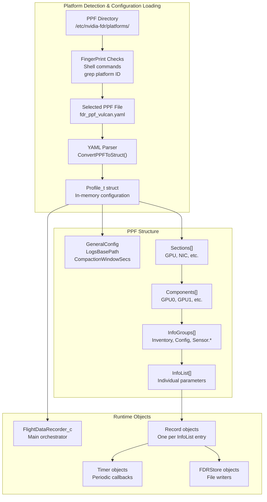
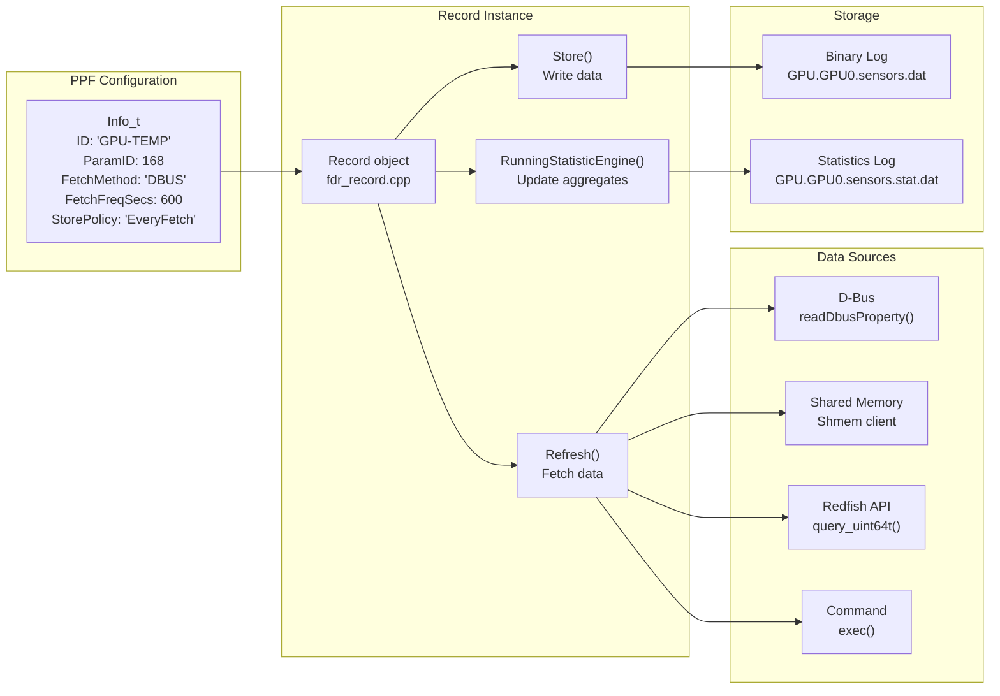
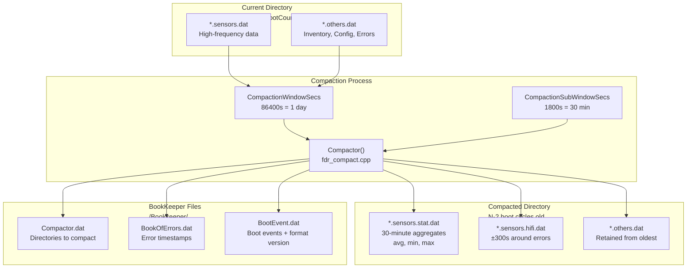

<!-- source: DeepWiki mcp.deepwiki.com · repo NVIDIA/nvidia-fdr · page 3 Core Concepts · fetched 2026-10-26 -->

# Core Concepts

Relevant source files

The following files were used as context for generating this wiki page:

- [fdr.cpp](fdr.cpp)
- [fdr.hpp](fdr.hpp)
- [fdr_compact.cpp](fdr_compact.cpp)
- [fdr_record.cpp](fdr_record.cpp)
- [platforms/fdr_ppf_example.yaml](platforms/fdr_ppf_example.yaml)
- [platforms/fdr_ppf_vulcan.yaml](platforms/fdr_ppf_vulcan.yaml)

This page introduces the fundamental concepts that drive the NVIDIA FDR system's operation. It provides an overview of how configuration files define data collection behavior, how the Record abstraction manages individual parameters, the various data collection methods available, and how data is stored and retained over time.

For detailed information about specific topics, see:
- Platform Profile File structure and syntax: [Platform Profile Files (PPF)](#3.1)
- Record lifecycle, fetch types, and store policies: [Records and Data Collection](#3.2)
- Binary log format and protobuf schema: [Storage Format and Protobuf](#3.3)
- Complete PPF file specifications: [PPF File Structure Reference](#5.1)

---

## Configuration-Driven Architecture

The FDR system operates entirely based on **Platform Profile Files (PPF)**, which are YAML configuration files that define what telemetry to collect, how frequently to sample it, and where to retrieve the data. The system automatically detects the appropriate PPF file at startup by executing fingerprint checks, then constructs the entire monitoring infrastructure from the configuration.

**Sources:** [fdr.cpp:211-292](), [fdr.cpp:296-319](), [fdr.hpp:140](), [platforms/fdr_ppf_vulcan.yaml:18-22]()

---

## Records: The Data Collection Unit

Each parameter defined in a PPF file instantiates a **Record** object, which encapsulates all logic for fetching, processing, and storing that specific metric. The `Record` class ([fdr_record.cpp:23-30]()) maintains:

- References to its configuration (`Info_t`, `InfoGroup_t`, `Component_t`)
- Fetch timing state (`LastFetchedAt`, `LastStoredAt`)
- Current data value (`fdr_sample_ext data`)
- Statistics for compaction (`runningStatus`)
- File writer pointers (`fdrLogReaderWriter`, `fdrStatwriter`)

**Sources:** [fdr_record.cpp:23-69](), [fdr_record.cpp:136-423](), [fdr_record.cpp:578-621]()

---

## Data Collection Methods and Fetch Types

FDR supports multiple **FetchMethods** for retrieving telemetry, each suited to different data sources:

| FetchMethod | Description | Implementation | Use Case |
|-------------|-------------|----------------|----------|
| `DBUS` | D-Bus property reads | `dbus::readDbusProperty()` | GPU Manager, NSM services |
| `Shmem` | Shared memory reads | `telemetry_mrd_client` | High-frequency GPU metrics |
| `Redfish` | HTTP REST API calls | `RedfishClient::query_*()` | Out-of-band BMC data |
| `Command` | Shell command execution | `exec()` | nvidia-smi, shell scripts |
| `DBUS_DGD` | D-Bus Device Get Property | `readDbusDGDProperty()` | GPU device-specific queries |
| `DBUS_PT` | D-Bus Passthrough (FPGA) | `readDbusPTProperty()` | FPGA register reads |

**Sources:** [fdr_record.cpp:152-414](), [fdr_record.cpp:293-357](), [fdr_record.cpp:359-380]()

### Fetch Types

Records are organized by **FetchType**, which determines when data is collected:

```mermaid
graph TB
    subgraph "FetchType: Poll"
        POLL_TIMER["Timer<br/>FetchFreqSecs"]
        POLL_CB["Timer Callback<br/>PollRecordTimerCBEngine()"]
        POLL_RECORDS["RecListPollMap<br/>Map<int, vector<Record*>>"]
        POLL_REFRESH["Refresh() + Store()"]
    end
    
    subgraph "FetchType: GroupPoll"
        GRPPOLL_TIMER["Timer<br/>FetchFreqSecs"]
        GRPPOLL_CB["Timer Callback<br/>GroupPollRecordTimerCBEngine()"]
        GRPPOLL_RECORDS["RecListGrpPollMap<br/>Grouped by key"]
        GRPPOLL_UPDATE["FdrGrpUpdate<br/>Batch fetch from Shmem"]
    end
    
    subgraph "FetchType: Subscribe"
        DBUS_SIGNAL["D-Bus Signal<br/>PropertiesChanged"]
        SIGNAL_CB["Signal Callback<br/>dbusEventHandlerCallback()"]
        SUBS_RECORDS["subscribedRecListMap<br/>Map<string, Record*>"]
        SUBS_REFRESH["refreshDataCallback()"]
        STORE_TIMER["Timer<br/>StoreFreqSecs"]
        SUBS_STORE["Store()"]
    end
    
    POLL_TIMER --> POLL_CB
    POLL_CB --> POLL_RECORDS
    POLL_RECORDS --> POLL_REFRESH
    
    GRPPOLL_TIMER --> GRPPOLL_CB
    GRPPOLL_CB --> GRPPOLL_RECORDS
    GRPPOLL_RECORDS --> GRPPOLL_UPDATE
    
    DBUS_SIGNAL --> SIGNAL_CB
    SIGNAL_CB --> SUBS_RECORDS
    SUBS_RECORDS --> SUBS_REFRESH
    SUBS_REFRESH --> STORE_TIMER
    STORE_TIMER --> SUBS_STORE
```

**Sources:** [fdr.cpp:664-721](), [fdr.hpp:42-51](), [fdr_record.cpp:623-648]()

---

## Store Policies

Once data is fetched, the **StorePolicy** determines when it is written to disk:

| StorePolicy | Behavior | Implementation | Typical Use |
|-------------|----------|----------------|-------------|
| `OnChange` | Write only if value differs | `same_data_values()` comparison | Inventory, configuration |
| `EveryFetch` | Write on every successful fetch | Check `LastFetchedAt` vs `LastStoredAt` | High-value metrics |
| `Periodic` | Write at `StoreFreqSecs` intervals | Check `StoreFreqSecs` elapsed | Low-priority data |

**Sources:** [fdr_record.cpp:578-603](), [fdr_record.cpp:525-563]()

---

## Data Storage and Compaction

FDR writes telemetry to **protobuf-encoded binary files** organized in a directory hierarchy. The system implements a multi-tier retention strategy:

**Sources:** [fdr_compact.cpp:129-176](), [fdr_compact.cpp:179-246](), [fdr_compact.cpp:384-488]()

### Compaction Workflow

1. **Sub-Window Expiry** (every 1800s): Append statistics to `*.sensors.stat.dat` files using running averages computed by `RunningStatisticEngine()` ([fdr_record.cpp:429-487]()).

2. **Main Window Expiry** (every 86400s): 
   - Check `Compactor.dat` for N-2 directories to process
   - Scan `BookOfErrors.dat` for errors in the time range
   - Extract high-fidelity logs (±300s around errors) to `*.sensors.hifi.dat`
   - Delete `*.sensors.dat` files (raw data)
   - Retain `*.others.dat` from oldest boot cycle

3. **Data Format Versioning**: The `currentDataFormatVersion` constant ([fdr.cpp:45]()) tracks the directory structure format. Compaction skips directories with mismatched versions ([fdr_compact.cpp:808-821]()).

**Sources:** [fdr_compact.cpp:285-333](), [fdr_compact.cpp:896-937](), [fdr.cpp:45]()

---

## Protobuf Data Structures

All telemetry is serialized using Protocol Buffers, with the schema defined in `fdr_logs.proto`. Key message types:

| Message Type | Purpose | Fields | File Extension |
|--------------|---------|--------|----------------|
| `fdr_sample` | Individual sample | `timestamp`, `paramid`, `paramvalue*` | `.dat` |
| `fdr_statistic` | Aggregated statistics | `avg`, `min`, `max`, `numsamples`, timestamps | `.stat.dat` |
| `fdr_book_of_errors` | Error event | `erroroccurtimestamp`, `paramid`, `deviceinstance` | `BookOfErrors.dat` |
| `fdr_compactor_bookkeep` | Compaction tracking | `compactdirectory` | `Compactor.dat` |
| `fdr_params` | Parameter metadata | `paramid`, `paramname`, `paramtype`, `compclass` | `ParamDescription.dat` |

The `FDRStore` class ([fdr_store.cpp]()) provides `append()` and `readnext()` methods for reading and writing protobuf messages.

**Sources:** [fdr_record.cpp:429-487](), [fdr_record.cpp:489-523](), [fdr.cpp:726-737]()

---

## Configuration-to-Runtime Mapping

The following table shows how PPF configuration translates to runtime behavior:

| PPF Field | Runtime Effect | Code Location |
|-----------|----------------|---------------|
| `FetchFreqSecs` | Timer interval for Poll/GroupPoll | `RecListPollMap[freq]` |
| `StoreFreqSecs` | Timer interval for Subscribe storage | `RecListSubscribeStoreMap[freq]` |
| `FetchMethod` | Data source selection in `Refresh()` | [fdr_record.cpp:152-414]() |
| `StorePolicy` | Condition checked in `Store()` | [fdr_record.cpp:581-603]() |
| `CompactionMethod: Average` | Enable statistics generation | [fdr_record.cpp:419-422]() |
| `RecordRetentionPolicy: Recreate` | Delete and recreate Record objects | [fdr.cpp:269]() |
| `CompactionWindowSecs` | Main compaction timer | [fdr_compact.cpp:194-195]() |
| `ParamID` | Unique identifier in protobuf | `fdr_sample.set_paramid()` |

**Sources:** [fdr.cpp:664-721](), [fdr_record.cpp:136-143](), [fdr.cpp:252-282]()

---

## Summary

The FDR system's core concepts work together as follows:

1. **PPF files** define the monitoring scope and parameters
2. **Record objects** encapsulate fetch/store logic for each parameter
3. **Fetch methods** retrieve data from various sources (D-Bus, Shmem, Redfish, commands)
4. **Fetch types** organize records by collection pattern (Poll, GroupPoll, Subscribe)
5. **Store policies** optimize disk writes based on data characteristics
6. **Protobuf format** provides efficient binary serialization
7. **Compaction** implements multi-tier retention with statistics and error-triggered high-fidelity preservation

This architecture enables flexible, configuration-driven telemetry collection that scales to monitor hundreds of parameters across multiple hardware components while managing storage efficiently through automatic data aggregation and retention policies.

---

