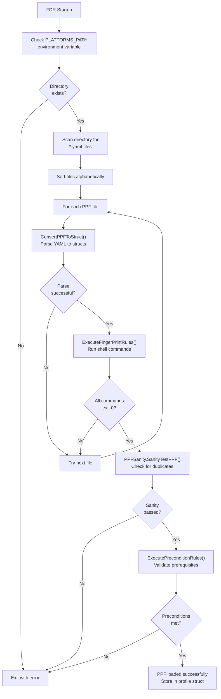
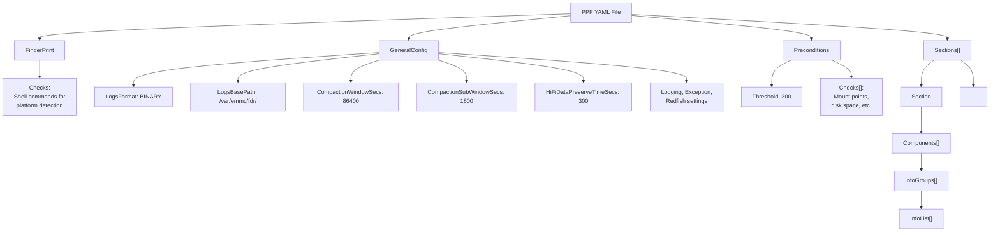
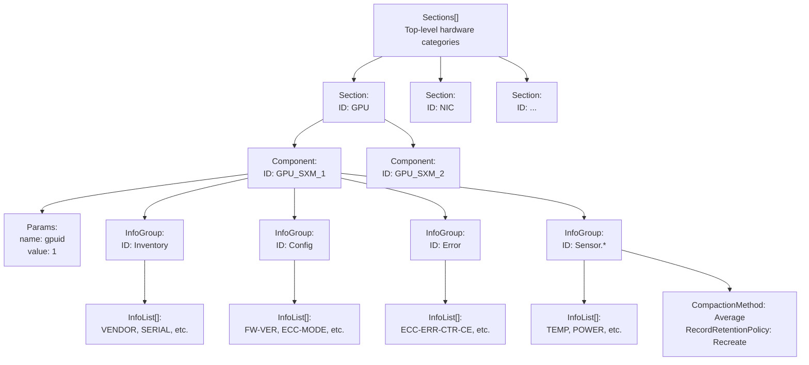
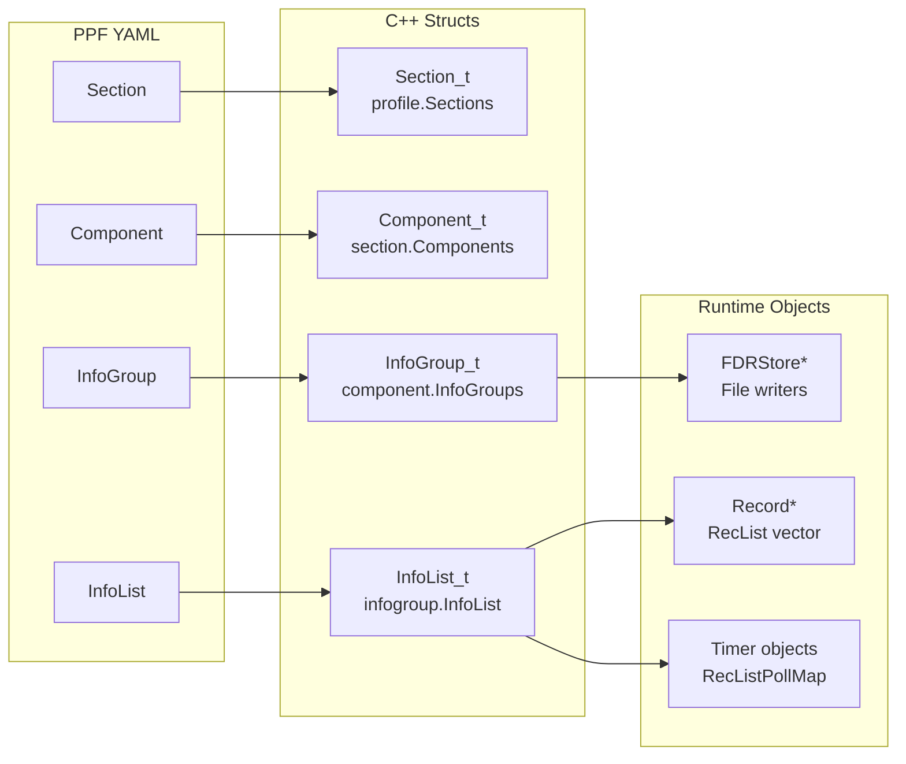
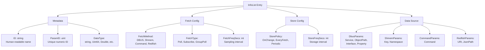
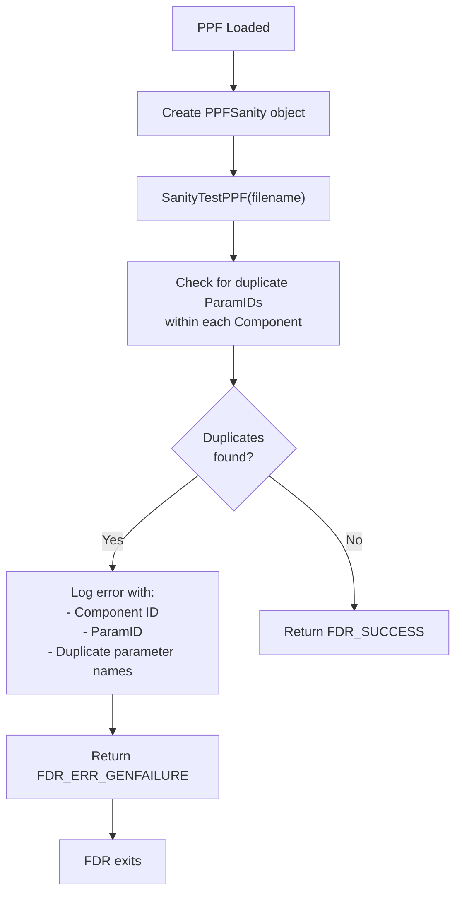
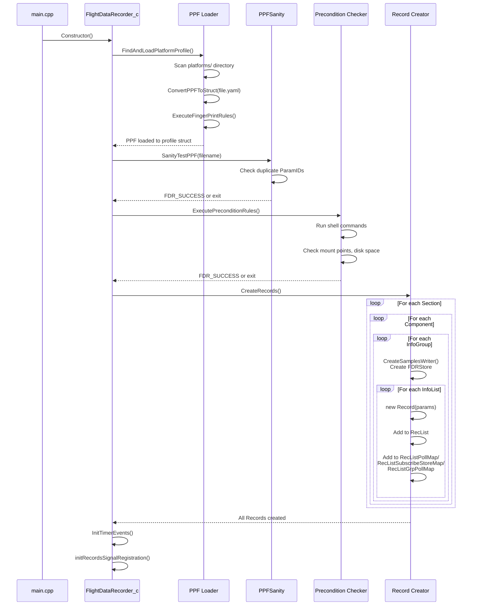

<!-- source: DeepWiki mcp.deepwiki.com · repo NVIDIA/nvidia-fdr · page 3.1 Platform Profile Files (PPF) · fetched 2026-10-26 -->

# Platform Profile Files (PPF)

<details>
<summary>Relevant source files</summary>

The following files were used as context for generating this wiki page:

- [fdr.cpp](fdr.cpp)
- [fdr.hpp](fdr.hpp)
- [fdr_compact.cpp](fdr_compact.cpp)
- [platforms/fdr_ppf_example.yaml](platforms/fdr_ppf_example.yaml)
- [platforms/fdr_ppf_hgxb_hmc.yaml](platforms/fdr_ppf_hgxb_hmc.yaml)
- [platforms/fdr_ppf_vulcan.yaml](platforms/fdr_ppf_vulcan.yaml)
- [tools/data_validation/platform/exempt_telemetry_list_hgxb.yaml](tools/data_validation/platform/exempt_telemetry_list_hgxb.yaml)

</details>


## Purpose and Scope

Platform Profile Files (PPF) are YAML-based configuration files that define what telemetry data FDR collects, how often to collect it, where to fetch it from, and how to store it. Each supported hardware platform has its own PPF that specifies the complete monitoring profile for that system. This page explains the structure, loading process, and core concepts of PPFs.

For detailed parameter reference and field specifications, see [PPF File Structure Reference](#5.1). For platform-specific examples, see [Vulcan Platform Configuration](#5.2) and [HGXB HMC Platform Configuration](#5.3). For how PPF definitions translate to runtime data collection, see [Records and Data Collection](#3.2).

---

## PPF File Organization and Discovery

### File Location and Naming

PPF files are stored in the `platforms/` directory with the naming convention `fdr_ppf_<platform>.yaml`. The system searches this directory at startup to find the appropriate configuration for the running platform.

**Sources:** [fdr.cpp:211-292]()

```
platforms/
├── fdr_ppf_example.yaml
├── fdr_ppf_hgxb_hmc.yaml
└── fdr_ppf_vulcan.yaml
```

### Platform Detection Process



**Sources:** [fdr.cpp:211-292](), [fdr.cpp:296-319](), [fdr.cpp:322-340](), [fdr.cpp:395-487]()

The `FlightDataRecorder_c` constructor calls `FindAndLoadPlatformProfile()` which:
1. Reads `PLATFORMS_PATH` environment variable (defaults to `./platforms`)
2. Iterates through all `.yaml` files alphabetically
3. For each file, parses it using `ConvertPPFToStruct()`
4. Executes the `FingerPrint.Checks` shell commands
5. If all checks pass, validates with `PPFSanity::SanityTestPPF()`
6. Executes `Preconditions` checks
7. Uses the first matching PPF

---

## PPF File Structure Hierarchy

### Top-Level Sections

A PPF file contains four main top-level sections:



**Sources:** [fdr.cpp:296-319](), [platforms/fdr_ppf_hgxb_hmc.yaml:18-51](), [platforms/fdr_ppf_vulcan.yaml:18-52]()

| Section | Purpose | Key Fields |
|---------|---------|------------|
| **FingerPrint** | Platform detection rules | `Checks` (list of shell commands) |
| **GeneralConfig** | System-wide configuration | `LogsFormat`, `LogsBasePath`, `CompactionWindowSecs`, `CompactionSubWindowSecs`, `HiFiDataPreserveTimeSecs`, `PartitionThresoldCheckMB` |
| **Preconditions** | Pre-flight validation checks | `Threshold`, `Checks` (ID, Command, ExitOnFailure) |
| **Sections** | Hardware component definitions | Array of `Section` objects |

---

## Section, Component, and InfoGroup Hierarchy

### Organizational Structure



**Sources:** [fdr.cpp:574-746](), [platforms/fdr_ppf_hgxb_hmc.yaml:53-267]()

### Runtime Object Mapping

The PPF hierarchy maps directly to runtime C++ objects during `CreateRecords()`:



**Sources:** [fdr.cpp:574-746](), [fdr.hpp:38-177]()

The `FlightDataRecorder_c::CreateRecords()` method iterates through the PPF structure:

```cpp
for (auto& section : profile.Sections) {
    for (auto& component : section.Components) {
        for (auto& infogroup : component.InfoGroups) {
            // Create shared FDRStore per InfoGroup
            std::shared_ptr<FDRStore> fdrStoreObj;
            CreateSamplesWriter(profile, section.ID, component.ID, 
                              infogroup.ID, fileExtension, fdrStoreObj);
            
            for (auto& info : infogroup.InfoList) {
                // Create one Record per InfoList item
                Record* resource = new Record(profile, section, component,
                                            fdrStoreObj, fdrStatStoreObj,
                                            infogroup, info);
                RecList.push_back(resource);
                
                // Organize by fetch type
                if (info.FetchType == "Poll") {
                    RecListPollMap[info.FetchFreqSecs].push_back(resource);
                }
                else if (info.FetchType == "Subscribe") {
                    RecListSubscribeStoreMap[info.StoreFreqSecs].push_back(resource);
                }
                else if (info.FetchType == "GroupPoll") {
                    RecListGrpPollMap[info.FetchFreqSecs][groupKey].push_back(resource);
                }
            }
        }
    }
}
```

---

## InfoGroup Organization

### Standard InfoGroup IDs

InfoGroups categorize parameters into logical classes. Common InfoGroup IDs include:

| InfoGroup ID | Purpose | File Extension | Example Parameters |
|--------------|---------|----------------|-------------------|
| `Inventory` | Static hardware identification | `.others.dat` | VENDOR, SERIAL, PART-NUM, UUID |
| `Config` | Configuration and version info | `.others.dat` | FW-VER, DRVR-VER, ECC-MODE |
| `Error` | Error counters and states | `.others.dat` | ECC-ERR-CTR-CE, PCI-ERR-CTR-CORR |
| `Specs` | Hardware specifications | `.others.dat` | MEM-SIZE, CLK-MAX, PWR-LIMIT-MAX |
| `Sensor.*` | Time-series sensor data | `.sensors.dat` | TEMP, POWER, CLOCK, UTILIZATION |

**Sources:** [fdr.cpp:600-644](), [platforms/fdr_ppf_hgxb_hmc.yaml:58-267]()

### Compaction Settings

InfoGroups with `Sensor.*` IDs typically include compaction settings:

```yaml
- ID: Sensor.Thermal
  InfoList:
    - ID: GPU-TEMP
      # ... parameter definition
  RecordRetentionPolicy: Recreate
  CompactionMethod: Average
```

These settings control how data is aggregated and retained during the compaction process (see [Storage and Compaction System](#4.4)).

**Sources:** [platforms/fdr_ppf_hgxb_hmc.yaml:31-34](), [fdr_compact.cpp:317-327]()

---

## InfoList Parameter Definitions

### Parameter Structure

Each InfoList entry defines a single telemetry parameter:



**Sources:** [platforms/fdr_ppf_hgxb_hmc.yaml:59-86](), [platforms/fdr_ppf_vulcan.yaml:60-218]()

### Example Parameter Definition

```yaml
- ID: ECC-ERR-CTR-CE
  ParamID: 11
  DataType: Uint64
  FetchMethod: Shmem
  FetchType: GroupPoll
  FetchFreqSecs: 600
  StorePolicy: OnChange
  StoreFreqSecs: 600
  ShmemParams:
    Key: /xyz/openbmc_project/inventory/system/memory/GPU_SXM_$gpuid_DRAM_0/xyz.openbmc_project.Memory.MemoryECC.ceCount
    Namespace: "nsmd_HGX_MemoryMetrics_0"
  DbusParams:
    Interface: xyz.openbmc_project.Memory.MemoryECC
    ObjectPath: /xyz/openbmc_project/inventory/system/memory/GPU_SXM_$gpuid_DRAM_0
    Property: ceCount
    Service: xyz.openbmc_project.NSM
```

**Sources:** [platforms/fdr_ppf_hgxb_hmc.yaml:233-248]()

### Parameter Field Reference

| Field | Type | Required | Description |
|-------|------|----------|-------------|
| `ID` | string | Yes | Human-readable parameter name |
| `ParamID` | uint | Yes | Unique numeric identifier (never change once assigned) |
| `DataType` | string | Yes | `string`, `Uint64`, `Int64`, `Double`, `Bool` |
| `FetchMethod` | string | Yes | `DBUS`, `Shmem`, `Command`, `Redfish` |
| `FetchType` | string | Yes | `Poll` (timer), `Subscribe` (event), `GroupPoll` (batch) |
| `FetchFreqSecs` | int | Yes | How often to fetch data (seconds) |
| `StorePolicy` | string | Yes | `OnChange`, `EveryFetch`, `Periodic` |
| `StoreFreqSecs` | int | Yes | How often to store data (seconds) |
| `DbusParams` | object | Conditional | Required if `FetchMethod: DBUS` |
| `ShmemParams` | object | Conditional | Required if `FetchMethod: Shmem` |
| `CommandParams` | object | Conditional | Required if `FetchMethod: Command` |
| `RedfishParams` | object | Conditional | Required if `FetchMethod: Redfish` |

---

## YAML Templating with Anchors and Aliases

### Component Templates

PPF files use YAML anchors (`&`) and aliases (`*`) to reduce duplication. A common pattern is defining a component template and reusing it:

```yaml
GPU: &gpu
  Params:
    - name: gpuid
      value: 1
  InfoGroups:
    - ID: Config
      InfoList:
        - ID: FW-VER
          DataType: string
          # ... common parameters

Sections:
  - ID: GPU
    Components:
      - ID: GPU_SXM_1
        <<: *gpu      # Inherit template
        Params:       # Override parameter value
          - name: gpuid
            value: 1
      - ID: GPU_SXM_2
        <<: *gpu
        Params:
          - name: gpuid
            value: 2
```

**Sources:** [platforms/fdr_ppf_hgxb_hmc.yaml:53-86](), [platforms/fdr_ppf_example.yaml:86-295]()

### Parameter Defaults

Similar pattern for parameter defaults:

```yaml
- &gpu-config-defaults
  ID: FW-VER
  DataType: string
  FetchMethod: DBUS
  FetchType: Subscribe
  FetchFreqSecs: 3600
  StorePolicy: OnChange
  StoreFreqSecs: 3600
  ParamID: 16
  
- ID: DRVR-VER
  <<: *gpu-config-defaults
  ParamID: 15
  DbusParams:
    Service: xyz.openbmc_project.GpuMgr
    # ...
```

**Sources:** [platforms/fdr_ppf_vulcan.yaml:205-218]()

### Parameter Substitution

The `Params` section defines variables that are substituted into strings elsewhere in the component definition:

```yaml
Components:
  - ID: GPU_SXM_1
    Params:
      - name: gpuid
        value: 1
    InfoGroups:
      - InfoList:
          - DbusParams:
              ObjectPath: /xyz/openbmc_project/inventory/system/processors/GPU_SXM_$gpuid
              # Becomes: /xyz/openbmc_project/inventory/system/processors/GPU_SXM_1
```

The substitution is performed at runtime during parameter fetching, not during PPF parsing.

**Sources:** [platforms/fdr_ppf_hgxb_hmc.yaml:53-86]()

---

## PPF Validation and Sanity Checks

### PPFSanity Class

After a PPF is loaded, the `PPFSanity` class performs validation:



**Sources:** [fdr.cpp:76-85](), [ppf_sanity.cpp]()

The sanity checker ensures:
- No duplicate `ParamID` values within the same Component
- Each `ParamID` is unique across all InfoGroups in a Component

Example error message:
```
Error: PPF failed sanity test! Please fix the above issue(s) in the PPF /etc/nvidia-fdr/platforms/fdr_ppf_hgxb_hmc.yaml
```

---

## PPF to Record Creation Flow

### Complete Initialization Process



**Sources:** [fdr.cpp:55-166](), [fdr.cpp:574-746]()

---

## Key PPF Processing Functions

| Function | Location | Purpose |
|----------|----------|---------|
| `FindAndLoadPlatformProfile()` | [fdr.cpp:211-292]() | Scans platform directory and loads matching PPF |
| `ConvertPPFToStruct()` | [fdr.cpp:296-319]() | Parses YAML to `Profile_t` struct |
| `ExecuteFingerPrintRules()` | [fdr.cpp:322-340]() | Runs platform detection commands |
| `ExecutePreconditionRules()` | [fdr.cpp:395-487]() | Validates system prerequisites |
| `PPFSanity::SanityTestPPF()` | [ppf_sanity.cpp]() | Checks for duplicate ParamIDs |
| `CreateRecords()` | [fdr.cpp:574-746]() | Creates Record objects from PPF |
| `CreateSamplesWriter()` | [fdr.cpp:525-572]() | Creates FDRStore writers per InfoGroup |

---

## File Naming from PPF Structure

The PPF hierarchy determines output file naming:

```
LogsBasePath/BootCounter_BootID_Timestamp/
├── GPU.GPU_SXM_1.sensors.dat          # Section.Component.sensors.dat
├── GPU.GPU_SXM_1.others.dat           # Section.Component.others.dat
├── GPU.GPU_SXM_1.sensors.stat.dat     # Created during compaction
├── GPU.GPU_SXM_1.sensors.hifi.dat     # Created for error context
├── GPU.GPU_SXM_2.sensors.dat
├── GPU.GPU_SXM_2.others.dat
└── ...
```

**Sources:** [fdr.cpp:534-572](), [fdr.cpp:600-620]()

| File Type | InfoGroup Pattern | Purpose |
|-----------|-------------------|---------|
| `.sensors.dat` | `Sensor.*` | High-frequency time-series data |
| `.others.dat` | `Inventory`, `Config`, `Error`, `Specs` | Low-frequency configuration/state |
| `.sensors.stat.dat` | `Sensor.*` with `CompactionMethod: Average` | Aggregated statistics |
| `.sensors.hifi.dat` | `Sensor.*` near errors | High-fidelity error context |

---

## Summary

Platform Profile Files provide a declarative, hierarchical configuration system that drives all FDR telemetry collection:

1. **Discovery**: FDR scans `platforms/` directory and tests each `.yaml` file against `FingerPrint` rules
2. **Validation**: Sanity checks ensure no duplicate ParamIDs; preconditions verify system readiness
3. **Hierarchy**: PPF structure flows from Section → Component → InfoGroup → InfoList
4. **Templating**: YAML anchors and aliases enable component and parameter reuse
5. **Runtime**: Each InfoList entry creates a `Record` object organized by FetchType
6. **Storage**: InfoGroup ID determines file naming (`.sensors.dat` vs `.others.dat`)

The PPF system enables platform-specific configuration without code changes, supporting different hardware topologies and data sources through declarative YAML.

**Sources:** [fdr.cpp:55-166](), [fdr.cpp:211-487](), [fdr.cpp:574-746](), [platforms/fdr_ppf_hgxb_hmc.yaml](), [platforms/fdr_ppf_vulcan.yaml](), [platforms/fdr_ppf_example.yaml]()

---

