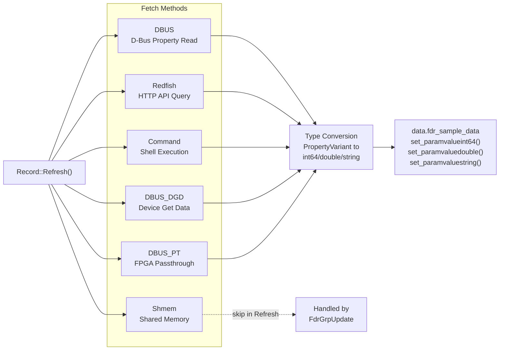
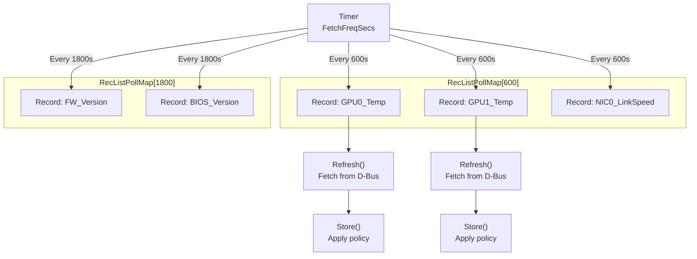
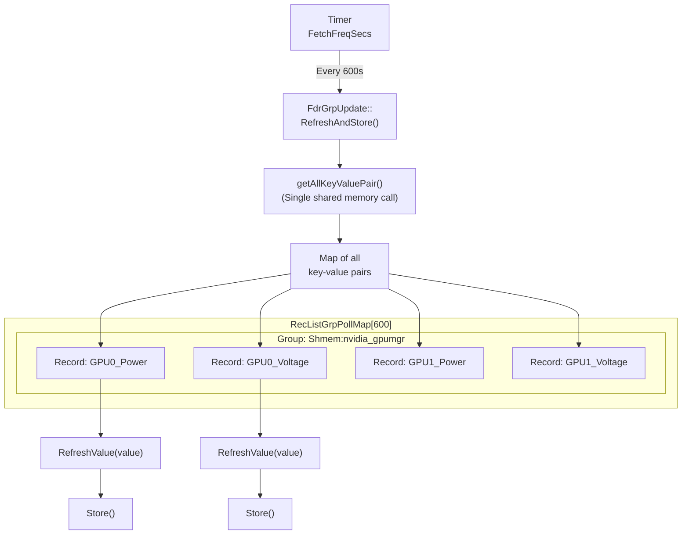
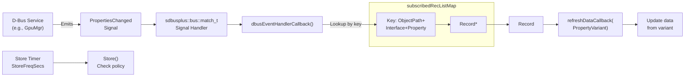
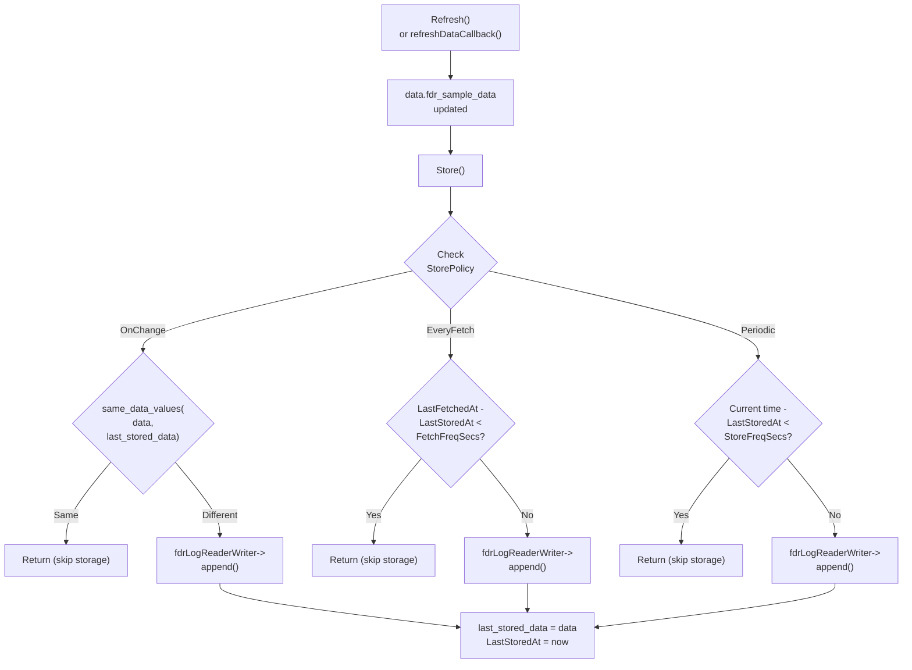
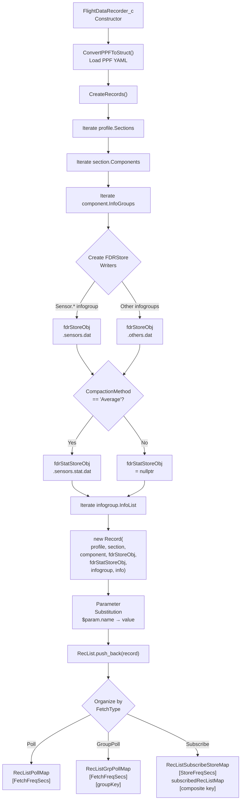
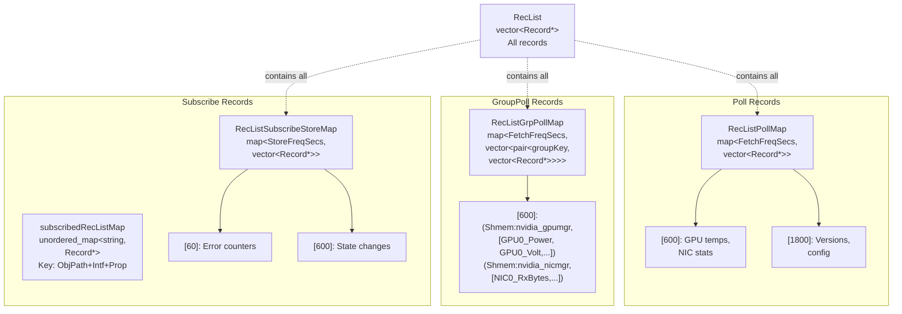
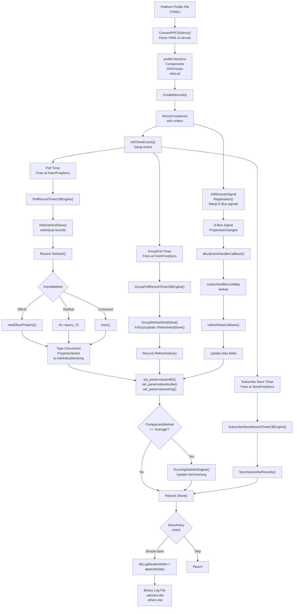
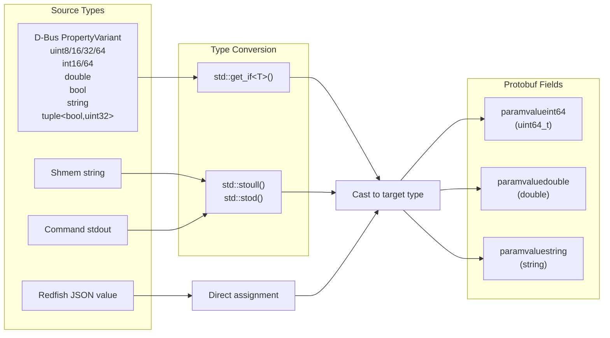

<!-- source: DeepWiki mcp.deepwiki.com · repo NVIDIA/nvidia-fdr · page 3.2 Records and Data Collection · fetched 2026-10-26 -->

# Records and Data Collection

<details>
<summary>Relevant source files</summary>

The following files were used as context for generating this wiki page:

- [dbus_accessor.cpp](dbus_accessor.cpp)
- [dbus_accessor.hpp](dbus_accessor.hpp)
- [fdr.cpp](fdr.cpp)
- [fdr.hpp](fdr.hpp)
- [fdr_grp_update.cpp](fdr_grp_update.cpp)
- [fdr_log.cpp](fdr_log.cpp)
- [fdr_log.hpp](fdr_log.hpp)
- [fdr_record.cpp](fdr_record.cpp)
- [ppf_sanity.cpp](ppf_sanity.cpp)
- [property_variant.hpp](property_variant.hpp)

</details>


This page explains the core data collection mechanism in the FDR system: the `Record` class and its associated data fetching, storage, and organizational patterns. Each Record represents a single telemetry parameter configured in the Platform Profile Files (PPF) and handles the complete lifecycle of data collection for that parameter.

For information about the PPF configuration that defines these records, see [Platform Profile Files (PPF)](#3.1). For details on how collected data is stored and compacted, see [Storage Format and Protobuf](#3.3).

## Purpose and Scope

This document covers:
- The `Record` class structure and lifecycle
- Data fetch methods (D-Bus, Shmem, Redfish, Command)
- Fetch types and timing mechanisms (Poll, GroupPoll, Subscribe)
- Store policies that determine when data is persisted
- Record instantiation and organization within the FDR system
- End-to-end data collection pipeline

## Record Class Structure

The `Record` class ([fdr_record.cpp:23-81]()) is the fundamental unit of data collection in FDR. Each Record instance corresponds to one `InfoList` entry in the PPF and encapsulates all the logic needed to fetch, process, and store that specific telemetry parameter.

### Record Class Diagram

```mermaid
classDef class fill:#fff
classDef storage fill:#fff

class Record {
    +Profile_t& profile
    +Section_t& section
    +Component_t& component
    +InfoGroup_t& infogroup
    +Info_t& info
    +shared_ptr<FDRStore> fdrLogReaderWriter
    +shared_ptr<FDRStore> fdrStatwriter
    +time_t LastFetchedAt
    +time_t LastStoredAt
    +fdr_sample_ext data
    +fdr_sample_ext last_stored_data
    +fdrpb::fdr_statistics runningStatus
    +Refresh(bool viaTimerSkipChecks)
    +RefreshValue(string value)
    +Store()
    +RunningStatisticEngine(fdr_sample)
    +appendRunningStatToStatfile()
    +refreshDataCallback(PropertyVariant)
}

class fdr_sample_ext {
    +fdrpb::fdr_sample fdr_sample_data
    +string paramtype
}

class fdrpb_fdr_sample {
    +uint64_t timestamp
    +uint32_t paramid
    +uint64_t paramvalueint64
    +double paramvaluedouble
    +string paramvaluestring
}

class fdrpb_fdr_statistics {
    +uint32_t paramid
    +uint32_t numsamples
    +double avg
    +double min
    +double max
    +uint64_t fromtime
    +uint64_t totime
    +uint64_t minvaltimestamp
    +uint64_t maxvaltimestamp
}

Record --> fdr_sample_ext : "data, last_stored_data"
Record --> fdrpb_fdr_statistics : "runningStatus"
fdr_sample_ext --> fdrpb_fdr_sample : "contains"
```

**Sources:** [fdr_record.cpp:23-81](), [fdr.hpp:1-181](), [fdr_common.hpp]()

### Key Record Attributes

| Attribute | Type | Purpose |
|-----------|------|---------|
| `info` | `Info_t&` | Reference to PPF InfoList configuration containing ParamID, FetchMethod, FetchType, StorePolicy, etc. |
| `component` | `Component_t&` | Parent component with Params for variable substitution |
| `infogroup` | `InfoGroup_t&` | Parent group defining CompactionMethod and RetentionPolicy |
| `fdrLogReaderWriter` | `shared_ptr<FDRStore>` | Writer for appending samples to binary log files |
| `fdrStatwriter` | `shared_ptr<FDRStore>` | Writer for statistics files (used when CompactionMethod="Average") |
| `LastFetchedAt` | `time_t` | Timestamp of last data fetch |
| `LastStoredAt` | `time_t` | Timestamp of last data storage |
| `data` | `fdr_sample_ext` | Current sample with timestamp, paramid, and value |
| `runningStatus` | `fdrpb::fdr_statistics` | Accumulated statistics (min, max, avg) for compaction |

**Sources:** [fdr_record.cpp:23-69](), [fdr_common.hpp]()

## Fetch Methods

Records use four different methods to fetch data from various system sources. The fetch method is specified in the PPF's `FetchMethod` field.

### Fetch Methods Overview



**Sources:** [fdr_record.cpp:136-423]()

### 1. DBUS Fetch Method

The most common fetch method reads properties from D-Bus services using standard `org.freedesktop.DBus.Properties.Get` calls.

**PPF Configuration:**
```yaml
FetchMethod: "DBUS"
DbusParams:
  Service: "xyz.openbmc_project.GpuMgr"
  ObjectPath: "/xyz/openbmc_project/sensors/temperature/GPU_$gpuid_Temp"
  Interface: "xyz.openbmc_project.Sensor.Value"
  Property: "Value"
```

**Implementation:** [fdr_record.cpp:152-292]()

The D-Bus fetch process:
1. Calls `dbus::readDbusProperty()` ([dbus_accessor.cpp:88-113]())
2. Receives a `PropertyVariant` containing one of many possible types
3. Performs extensive type checking using `std::get_if<T>()` ([fdr_record.cpp:168-291]())
4. Converts to one of three storage types: `uint64_t`, `double`, or `string`
5. Sets the appropriate protobuf field: `set_paramvalueint64()`, `set_paramvaluedouble()`, or `set_paramvaluestring()`

**Supported D-Bus Types:**

| PPF DataType | D-Bus Variant Types Accepted | Protobuf Field |
|--------------|------------------------------|----------------|
| Integer, Uint64, Uint32, Uint16, Uint8, Int64, Int16 | double, uint32_t, uint16_t, uint64_t, int64_t, bool, uint8_t, int16_t, tuple<bool,uint32_t> | paramvalueint64 |
| Double, Float | double, uint32_t, uint16_t, uint64_t, int64_t, bool, uint8_t, int16_t, tuple<bool,uint32_t> | paramvaluedouble |
| string | string | paramvaluestring |

**Sources:** [fdr_record.cpp:152-292](), [dbus_accessor.cpp:88-113](), [property_variant.hpp:40-44]()

### 2. Shmem Fetch Method

Shared memory fetching is optimized for high-frequency telemetry and is handled by the GroupPoll mechanism rather than individual Record refresh.

**PPF Configuration:**
```yaml
FetchMethod: "Shmem"
ShmemParams:
  Namespace: "nvidia_gpumgr"
  Key: "GPU_$gpuid_Power"
```

**Implementation:** Group polling aggregates all Shmem records with the same namespace and fetches all key-value pairs in a single operation via `nv::shmem::sensor_aggregation::getAllKeyValuePair()` ([fdr_grp_update.cpp:19-60]()).

Individual records then call `RefreshValue()` ([fdr_record.cpp:83-134]()) with the string value, which performs type conversion and updates statistics.

**Sources:** [fdr_grp_update.cpp:19-60](), [fdr_record.cpp:83-134]()

### 3. Redfish Fetch Method

Fetches data from the BMC's Redfish API using HTTP queries with JSON Pointer notation.

**PPF Configuration:**
```yaml
FetchMethod: "Redfish"
RedfishParams:
  URI: "/redfish/v1/Chassis/HGX_Baseboard_0/Thermal"
  JSONPointer: "/Temperatures/0/ReadingCelsius"
```

**Implementation:** [fdr_record.cpp:320-357]()

Uses the `RedfishClient` ([fdr_redfish.hpp]()) to query URIs and extract values via JSON pointers. Currently supports `Uint64` and `string` data types.

**Sources:** [fdr_record.cpp:320-357](), [fdr.cpp:101-120]()

### 4. Command Fetch Method

Executes shell commands and parses their output.

**PPF Configuration:**
```yaml
FetchMethod: "Command"
CommandParams:
  Command: "cat /sys/class/hwmon/hwmon0/temp1_input"
```

**Implementation:** [fdr_record.cpp:293-319]()

Executes the command via `exec()` and converts stdout output to the specified DataType (currently supports `Uint64` and `string`).

**Sources:** [fdr_record.cpp:293-319](), [fdr_common.cpp]()

### 5. DBUS_DGD (Device Get Data)

Specialized D-Bus method for reading device properties using the `DeviceGetData` interface with device IDs.

**Implementation:** [fdr_record.cpp:359-380]()
Calls `dbus::readDbusDGDProperty()` ([dbus_accessor.cpp:115-167]()) which returns a 64-bit value from device-specific registers.

**Sources:** [fdr_record.cpp:359-380](), [dbus_accessor.cpp:115-167]()

### 6. DBUS_PT (FPGA Passthrough)

Reads FPGA data via D-Bus passthrough operations with opcode and argument parameters.

**Implementation:** [fdr_record.cpp:382-405]()
Calls `dbus::readDbusPTProperty()` ([dbus_accessor.cpp:169-224]()) with opcode, arg1, and arg2 parameters.

**Sources:** [fdr_record.cpp:382-405](), [dbus_accessor.cpp:169-224]()

## Fetch Types

Fetch types determine **when** and **how** the `Refresh()` method is triggered for a record.

### Fetch Type Comparison

| Fetch Type | Triggering Mechanism | Used For | Timer Frequency |
|------------|---------------------|----------|-----------------|
| **Poll** | Timer-based, individual records | Low-frequency polling | FetchFreqSecs (600-3600s typical) |
| **GroupPoll** | Timer-based, batch operations | High-frequency shared memory reads | FetchFreqSecs (600s typical) |
| **Subscribe** | D-Bus signal-driven | Event-based monitoring (errors, state changes) | N/A (event-driven) |

### Poll Fetch Type

Individual records are refreshed on a timer based on `FetchFreqSecs`.

**Organization:** Records are grouped in `RecListPollMap` by their `FetchFreqSecs` value ([fdr.hpp:45]()).



**Implementation:** 
- Records added to map: [fdr.cpp:719-721]()
- Timer callback: [fdr.cpp:1142-1156]()
- Refresh and store: [fdr.cpp:836-863]()

**Sources:** [fdr.cpp:719-721](), [fdr.cpp:1142-1156](), [fdr.cpp:836-863]()

### GroupPoll Fetch Type

Optimized for batch operations where multiple records share a common data source (typically shared memory). All records in a group are fetched together in a single operation.

**Grouping Key:** Records are grouped by `FetchMethod + Namespace` (for Shmem) creating a composite key.



**Implementation:**
- Records added to map: [fdr.cpp:664-702]()
- Group key generation: [fdr_common.cpp]()
- Timer callback: [fdr.cpp:1158-1172]()
- Group refresh: [fdr.cpp:865-884](), [fdr_grp_update.cpp:19-60]()

**Sources:** [fdr.cpp:664-702](), [fdr.cpp:865-884](), [fdr_grp_update.cpp:19-60]()

### Subscribe Fetch Type

Event-driven collection using D-Bus `PropertiesChanged` signals. The record is refreshed immediately when the property changes.

**Registration:** Records register for D-Bus signal handlers via `registerServicePropertyChanged()` ([dbus_accessor.cpp:24-43]()).



**Key Components:**
- **subscribedRecListMap** ([fdr.hpp:135-137]()): Optimized O(1) lookup map with composite key `ObjectPath+Interface+Property`
- **subscribedPaths** ([fdr.hpp:73]()): List of unique ObjectPath+Interface pairs for signal registration
- **RecListSubscribeStoreMap** ([fdr.hpp:48]()): Grouped by `StoreFreqSecs` for periodic storage timer

**Implementation Flow:**
1. Record creation: [fdr.cpp:704-717]()
2. Signal registration: [fdr_events.cpp]()
3. Callback handling: [fdr.cpp]() (dbusEventHandlerCallback)
4. Data update: [fdr_record.cpp:623-648]() (refreshDataCallback)
5. Periodic storage: [fdr.cpp:1174-1187]()

**Sources:** [fdr.cpp:704-717](), [fdr_record.cpp:623-648](), [dbus_accessor.cpp:24-43]()

## Store Policies

Store policies control **when** data is persisted to disk after being fetched. The policy is specified in the PPF's `StorePolicy` field.

### Store Policy Table

| Policy | Condition | Use Case | Implementation |
|--------|-----------|----------|----------------|
| **OnChange** | Only when value differs from last stored value | Inventory, configuration, infrequently changing data | [fdr_record.cpp:581-587]() |
| **EveryFetch** | Every time data is fetched successfully | Most sensor data with regular polling | [fdr_record.cpp:589-595]() |
| **Periodic** | At fixed intervals defined by `StoreFreqSecs` | Subscribe-type records that update frequently | [fdr_record.cpp:597-603]() |

### Store Policy Implementation



**Sources:** [fdr_record.cpp:578-621]()

### OnChange Store Policy

Compares current value with `last_stored_data` using `same_data_values()` ([fdr_record.cpp:525-563]()). Only stores if values differ.

**Example:** Firmware version strings, hardware serial numbers, operational states.

**Sources:** [fdr_record.cpp:525-563](), [fdr_record.cpp:581-587]()

### EveryFetch Store Policy

Stores data every time a successful fetch occurs, respecting the fetch frequency timing.

**Example:** Temperature sensors, power consumption, GPU utilization.

**Sources:** [fdr_record.cpp:589-595]()

### Periodic Store Policy

Used primarily with Subscribe fetch type. Data is updated on every signal, but storage occurs at fixed intervals defined by `StoreFreqSecs`.

**Example:** Error counters that increment frequently but should only be persisted periodically.

**Sources:** [fdr_record.cpp:597-603]()

## Record Creation and Organization

Records are created during FDR initialization by the `CreateRecords()` method, which iterates through the PPF structure and instantiates a Record object for each `InfoList` entry.

### Record Creation Flow



**Sources:** [fdr.cpp:574-746]()

### Shared FDRStore Writers

Records within the same InfoGroup share `FDRStore` writer objects to optimize file I/O:

**File Naming Convention:**
- Sensor data: `{SectionID}.{ComponentID}.sensors.dat`
- Other data: `{SectionID}.{ComponentID}.others.dat`
- Statistics: `{SectionID}.{ComponentID}.sensors.stat.dat`

**Example:**
- `GPU.GPU_0.sensors.dat` - All sensor records for GPU_0
- `GPU.GPU_0.others.dat` - Inventory, config, error records for GPU_0
- `GPU.GPU_0.sensors.stat.dat` - Statistics for GPU_0 sensors

**Implementation:** [fdr.cpp:600-644]()

**Sources:** [fdr.cpp:600-644](), [fdr.cpp:525-572]()

### Record Organization Maps

Records are organized into multiple maps based on their fetch and store characteristics for efficient timer-based execution:



**Sources:** [fdr.hpp:42-51](), [fdr.hpp:135-137](), [fdr.cpp:664-721]()

## Data Collection Pipeline

The end-to-end data flow from configuration through collection to storage.

### Complete Data Flow



**Sources:** [fdr.cpp:574-746](), [fdr.cpp:836-884](), [fdr.cpp:1142-1187](), [fdr_record.cpp:136-423](), [fdr_record.cpp:578-621]()

### Type Conversion Details

Data fetched from various sources must be converted to one of three protobuf storage types:



**Sources:** [fdr_record.cpp:168-291](), [fdr_record.cpp:95-114]()

## Statistics Collection

When `CompactionMethod` is set to `"Average"` in the InfoGroup configuration, records maintain running statistics for data compaction.

### Running Statistics Engine

Every time data is fetched, `RunningStatisticEngine()` ([fdr_record.cpp:429-487]()) updates the `runningStatus` protobuf message:

**Tracked Statistics:**
- `numsamples` - Count of samples in the current window
- `avg` - Running sum (divided by numsamples when writing)
- `min` - Minimum value observed
- `max` - Maximum value observed
- `fromtime` - Start timestamp of window
- `totime` - End timestamp of window
- `minvaltimestamp` - When min occurred
- `maxvaltimestamp` - When max occurred

**Writing Statistics:** At compaction sub-window expiry (default 1800s), `appendRunningStatToStatfile()` ([fdr_record.cpp:489-523]()) calculates the final average, writes the statistics to the `.sensors.stat.dat` file, and resets the counters.

**Sources:** [fdr_record.cpp:429-487](), [fdr_record.cpp:489-523]()

## Variable Substitution

Record constructors perform parameter substitution to support multiple instances of the same component type (e.g., GPU_0, GPU_1, ...).

**Mechanism:** The `Component.Params` list defines name-value pairs (e.g., `gpuid: 0`). During record creation, all occurrences of `$gpuid` in paths, keys, and commands are replaced with the actual value.

**Example:**
```yaml
Params:
  - name: "gpuid"
    value: "0"
DbusParams:
  ObjectPath: "/xyz/openbmc_project/sensors/temperature/GPU_$gpuid_Temp"
  # Becomes: "/xyz/openbmc_project/sensors/temperature/GPU_0_Temp"
```

**Implementation:** [fdr_record.cpp:36-60]()

**Sources:** [fdr_record.cpp:36-60]()

## Summary

The Record class and associated mechanisms provide a flexible, configurable data collection framework:

1. **Configuration-driven:** All behavior defined in PPF files
2. **Multi-source:** Supports D-Bus, shared memory, Redfish, and command execution
3. **Flexible timing:** Poll, GroupPoll, and Subscribe fetch types
4. **Adaptive storage:** OnChange, EveryFetch, and Periodic policies
5. **Efficient batching:** GroupPoll optimizes shared memory reads
6. **Event-driven:** Subscribe type enables real-time error monitoring
7. **Statistics aggregation:** Built-in support for time-windowed analytics

This architecture enables FDR to collect thousands of telemetry parameters efficiently while maintaining configurability and extensibility for new platforms and parameter types.

---

