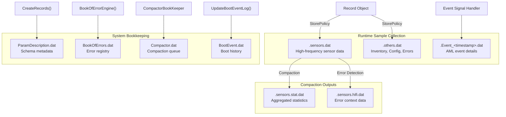
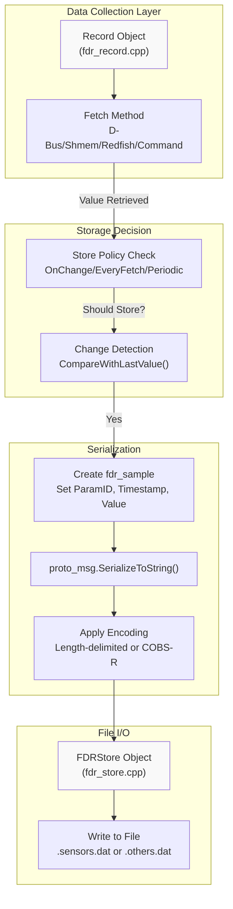
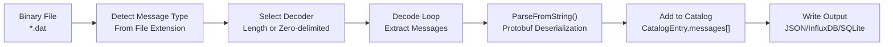

<!-- source: DeepWiki mcp.deepwiki.com · repo NVIDIA/nvidia-fdr · page 3.3 Storage Format and Protobuf · fetched 2026-10-26 -->

# Storage Format and Protobuf

<details>
<summary>Relevant source files</summary>

The following files were used as context for generating this wiki page:

- [fdr.cpp](fdr.cpp)
- [fdr.hpp](fdr.hpp)
- [fdr_compact.cpp](fdr_compact.cpp)
- [fdrtool/catalog/catalog.py](fdrtool/catalog/catalog.py)
- [fdrtool/catalog/json.py](fdrtool/catalog/json.py)
- [platforms/fdr_ppf_example.yaml](platforms/fdr_ppf_example.yaml)
- [platforms/fdr_ppf_vulcan.yaml](platforms/fdr_ppf_vulcan.yaml)

</details>


## Purpose and Scope

This page describes the binary storage format used by FDR, including the protobuf schema, encoding methods, directory organization, and file naming conventions. It covers how telemetry data flows from Record objects into serialized binary files on disk.

For information about how data is collected and which parameters are stored, see [Records and Data Collection](#3.2). For details on data retention and compaction policies, see [Storage and Compaction System](#4.4).

---

## Protobuf Schema Overview

FDR uses Google Protocol Buffers to serialize telemetry data into a compact binary format. The schema defines message types for different data categories stored by the system.

### Core Message Types

| Message Type | Purpose | Used In Files |
|--------------|---------|---------------|
| `fdr_sample` | Individual parameter samples with timestamp and value | `*.sensors.dat`, `*.others.dat`, `*.hifi.dat` |
| `fdr_stat` | Aggregated statistics (min, max, avg) over time windows | `*.sensors.stat.dat` |
| `fdr_params` | Parameter metadata (ID, name, type, class) | `ParamDescription.dat` |
| `fdr_book_of_errors` | Error event records with timestamps and device info | `BookOfErrors.dat` |
| `fdr_compactor_bookkeep` | Directory compaction tracking | `Compactor.dat` |
| `fdr_boot_event` | Boot event logs with system state | `BootEvent.dat` |
| `fdr_event_details` | Detailed AML event information | `*.Event_<timestamp>.dat` |

The catalog system automatically detects message types based on file extensions:

```mermaid
graph TD
    FileExt["File Extension Check"]
    
    FileExt -->|".stat.dat"| StatMsg["fdr_stat"]
    FileExt -->|"ParamDescription.dat"| ParamsMsg["fdr_params"]
    FileExt -->|"BookOfErrors.dat"| ErrorMsg["fdr_book_of_errors"]
    FileExt -->|"Compactor.dat"| CompactMsg["fdr_compactor_bookkeep"]
    FileExt -->|"BootEvent.dat"| BootMsg["fdr_boot_event"]
    FileExt -->|Contains ".Event_"| EventMsg["fdr_event_details"]
    FileExt -->|Default| SampleMsg["fdr_sample"]
    
    StatMsg --> ProtoSchema["fdr_logs_schema_pb2"]
    ParamsMsg --> ProtoSchema
    ErrorMsg --> ProtoSchema
    CompactMsg --> ProtoSchema
    BootMsg --> ProtoSchema
    EventMsg --> ProtoSchema
    SampleMsg --> ProtoSchema
```

**Sources:** [fdrtool/catalog/catalog.py:316-329](), [fdrtool/catalog/catalog.py:49-51]()

---

## Binary Encoding Format

FDR supports two binary encoding methods for protobuf messages. Both methods allow multiple messages to be stored in a single file.

### Length-Delimited Encoding

Messages are prefixed with their length as a varint32:

```
[varint32: msg1_length][msg1_bytes][varint32: msg2_length][msg2_bytes]...
```

This format is decoded by reading the length prefix, then extracting exactly that many bytes:


**Sources:** [fdrtool/catalog/catalog.py:358-384]()

### Zero-Delimited with COBS-R Encoding

Messages are separated by null bytes (`\x00`), with COBS-R encoding applied to ensure no null bytes appear within the message data:

```
[cobsr_encoded_msg1]\x00[cobsr_encoded_msg2]\x00...
```

The decoder splits on null bytes, then applies COBS-R decoding before parsing:


**Configuration:** The `length_delimited_binary` flag in the catalog configuration controls which format is used during decoding.

**Sources:** [fdrtool/catalog/catalog.py:386-409](), [fdrtool/catalog/catalog.py:160-163]()

---

## Directory Structure

FDR organizes telemetry data into a hierarchical directory structure with version control and boot-based segmentation.

### Root Directory Layout

```
/var/emmc/fdr/
├── BootCount_<N>_<timestamp>/          # Current boot cycle directory
│   ├── GPU.0.sensors.dat               # Sensor samples for GPU 0
│   ├── GPU.0.others.dat                # Non-sensor data for GPU 0
│   ├── GPU.0.sensors.stat.dat          # Statistics file (compaction)
│   ├── GPU.0.sensors.hifi.dat          # High-fidelity error logs
│   └── GPU.0.Event_<ts>.dat            # AML event details
├── BootCount_<N-1>_<timestamp>/        # Previous boot cycle
├── BootCount_<N-2>_<timestamp>/        # Older boot cycle (to be compacted)
└── Bookkeeper/                         # Persistent metadata
    ├── BirthCertificate.tar            # Initial system state snapshot
    ├── Compactor.dat                   # Compaction queue
    ├── BookOfErrors.dat                # Global error log
    ├── BootEvent.dat                   # Boot event history
    └── ParamDescription.dat            # Parameter schema
```

### Directory Naming Convention

Boot cycle directories follow the pattern: `BootCount_<bootID>_<epochTimestamp>`

- **bootID**: Monotonically increasing boot counter
- **epochTimestamp**: Unix epoch seconds when directory was created

The directory name is generated by `GetDirectoryName()` using global variables `bootCounter` and `sensorDirTimestamp`.

**Sources:** [fdr.cpp:33-34](), [fdr.cpp:542-548]()

### Data Format Versioning

FDR tracks the directory structure version to handle schema evolution:

| Version | Description | Directory Structure |
|---------|-------------|---------------------|
| 1 | Multi-level directory structure | Nested subdirectories per component |
| 2 | Flat directory structure (current) | Single level with dot-separated names |

```cpp
const uint32_t currentDataFormatVersion = 2;  // fdr.cpp:45
```

During compaction, FDR checks the `DataDirFormatVersion` field in `BootEvent.dat` to ensure compatibility before processing older directories.

**Sources:** [fdr.cpp:42-45](), [fdr_compact.cpp:674-748]()

---

## File Naming Conventions

File names encode component class, component ID, and data type using a dot-separated format.

### Naming Pattern

```
<CompClass>.<CompID>.<FileExtension>
```

Examples:
- `GPU.0.sensors.dat` - Sensor data for GPU component ID 0
- `Baseboard.0.others.dat` - Non-sensor data for Baseboard
- `NIC.1.sensors.stat.dat` - Statistics for NIC component ID 1

### File Extension Mapping



### File Extension Selection Logic

The `CreateSamplesWriter` method determines the file extension based on the `InfoGroup.ID`:

```cpp
if ((infogroup.ID).find("Sensor.") != std::string::npos)
{
    // Sensor groups use .sensors.dat
    CreateSamplesWriter(profile, section.ID, component.ID,
                        infogroup.ID, ".sensors.dat", fdrStoreObj);
}
else
{
    // Non-sensor groups use .others.dat
    CreateSamplesWriter(profile, section.ID, component.ID,
                        infogroup.ID, ".others.dat", fdrStoreObj);
}
```

For fault events, a timestamp-based naming scheme is used:

```cpp
if (paramClass == "FAULTS")
{
    logfile = compClass + "." + compID + ".Event_" + fileTimestamp + fileExtention;
}
```

**Sources:** [fdr.cpp:600-620](), [fdr.cpp:539-550]()

---

## Message Types and Usage

### fdr_sample

Represents a single telemetry sample with timestamp and typed value fields.

**Fields:**
- `TimeStamp` - Unix epoch seconds
- `ParamID` - Parameter identifier (maps to ParamDescription)
- `ParamValue*` - One of: String, Uint64, Int64, Double, Bool

**Usage:** Written by `Record::Store()` method whenever a parameter value is collected according to its `StorePolicy` (OnChange, EveryFetch, Periodic).

**Files:** `*.sensors.dat`, `*.others.dat`, `*.hifi.dat`

**Sources:** [fdr_compact.cpp:444-450]()

### fdr_stat

Aggregated statistics over a time window for sensor parameters with `CompactionMethod: Average`.

**Fields:**
- `FromTime` - Window start timestamp
- `ToTime` - Window end timestamp  
- `ParamID` - Parameter identifier
- `NumSamples` - Number of samples in window
- `Min`, `Max`, `Avg` - Statistical values

**Usage:** Written by `Record::appendRunningStatToStatfile()` every `CompactionSubWindowSecs` (default 1800s).

**Files:** `*.sensors.stat.dat`

**Sources:** [fdr_compact.cpp:317-327]()

### fdr_params

Parameter metadata used for decoding and interpretation.

**Fields:**
- `CompClass` - Component class (e.g., "GPU", "NIC")
- `ParamClass` - Parameter class (e.g., "Sensor_Thermal", "Inventory")
- `ParamName` - Human-readable parameter name
- `ParamID` - Unique parameter identifier
- `ParamType` - Data type (string, Uint64, etc.)

**Usage:** Written once during `CreateRecords()` to build the parameter schema.

**Files:** `Bookkeeper/ParamDescription.dat`

**Sources:** [fdr.cpp:728-737]()

### fdr_book_of_errors

Tracks error events for high-fidelity data preservation during compaction.

**Fields:**
- `BootId` - Boot cycle identifier
- `DeviceType`, `DeviceInstance` - Component identification
- `ErrorType` - Error classification
- `ErrorOccurTimeStamp` - When error occurred
- `ParamID` - Associated parameter
- `StartHiFiTimeStamp`, `StopHiFiTimeStamp` - Time range for HiFi data

**Usage:** Appended by `BookOfErrorEngine()` when errors are detected via D-Bus events or threshold violations.

**Files:** `Bookkeeper/BookOfErrors.dat`

**Sources:** [fdr_compact.cpp:56-127]()

### fdr_compactor_bookkeep

Tracks directories pending compaction.

**Fields:**
- `CompactDirectory` - Directory name to compact
- `CompactStatus` - Processing status

**Usage:** 
- Appended by `CompactorBookKeeperAppendEntry()` when creating new boot directories
- Removed by `CompactorBookKeeperRemoveEntry()` after compaction completes

**Files:** `Bookkeeper/Compactor.dat`

**Sources:** [fdr_compact.cpp:536-541](), [fdr_compact.cpp:544-669]()

### fdr_boot_event

Records boot events with system state and data format version.

**Fields:**
- `EventTimeStamp` - Boot event timestamp
- `HMCBootCount` - Boot counter value
- `UpTime` - System uptime
- `CurrentDate` - Human-readable date
- `DataDirFormatVersion` - FDR structure version

**Usage:** Written by `UpdateBootEventLog()` on each FDR startup to track system lifecycle.

**Files:** `Bookkeeper/BootEvent.dat`

**Sources:** [catalog.py:93-101](), [fdr_compact.cpp:716-742]()

---

## Data Flow: Record to Storage



### Write Path Details

1. **Record Creation**: `CreateRecords()` instantiates Record objects with shared `FDRStore` pointers per InfoGroup
2. **Value Fetch**: Record's `Refresh()` method retrieves current value via fetch method
3. **Store Decision**: `Store()` method checks `StorePolicy` and optionally compares with last value
4. **Protobuf Creation**: Constructs `fdr_sample` message with appropriate `ParamValue*` field set
5. **Serialization**: `FDRStore::append()` serializes message to bytes
6. **Encoding**: Applies length-prefix or COBS-R encoding based on configuration
7. **Disk Write**: Appends encoded bytes to file with appropriate extension

**Sources:** [fdr.cpp:600-620](), [fdr.cpp:836-862]()

---

## Reading and Decoding

The `catalog.py` module provides a generic framework for decoding FDR binary logs:



### Catalog Workflow

1. **File Discovery**: `CreateCatalog()` walks directory tree finding `*.dat` files
2. **Type Detection**: File extension determines protobuf message type via `CatalogEntry.__init__()`
3. **Binary Decoding**: Either `decode_length_delimited_binary()` or `decode_zero_delimited_binary()`
4. **Message Accumulation**: Decoded messages stored in `CatalogEntry.messages` list
5. **Format Conversion**: `WriteEntry()` exports to JSON, InfluxDB, or SQLite

**Sources:** [fdrtool/catalog/catalog.py:111-134](), [fdrtool/catalog/catalog.py:139-165]()

---

## Special Files

### Birth Certificate

The Birth Certificate is an immutable snapshot of initial system state created on first boot.

**Location:** `Bookkeeper/BirthCertificate.tar`

**Contents:** Compressed archive of all `*.others.dat` files (Inventory, Config, Versions) from first boot directory.

**Creation:** `CollectAndArchieveBirthCertificate()` executes all records, archives results, then makes file immutable via `chattr +i`.

**Sources:** [fdr.cpp:767-832](), [fdr.cpp:748-762]()

### BookKeeper Directory

The `Bookkeeper/` directory contains persistent metadata files that survive across boot cycles:

| File | Purpose | Message Type |
|------|---------|--------------|
| `ParamDescription.dat` | Parameter schema mapping ParamID to name/type | `fdr_params` |
| `BookOfErrors.dat` | Global error event log for HiFi preservation | `fdr_book_of_errors` |
| `Compactor.dat` | Queue of directories awaiting compaction | `fdr_compactor_bookkeep` |
| `BootEvent.dat` | Boot event history with format versions | `fdr_boot_event` |
| `BirthCertificate.tar` | Initial system state archive | N/A (tar) |

All BookKeeper files are created via `CreateKeeperWriter()` and persist independently of boot directories.

**Sources:** [fdr.cpp:489-521](), [fdr.cpp:576-582]()

---

## Summary Table: File Types

| File Pattern | Protobuf Message | Update Frequency | Retention | Purpose |
|--------------|------------------|------------------|-----------|---------|
| `*.sensors.dat` | `fdr_sample` | Per FetchFreqSecs | Until compaction | Raw sensor samples |
| `*.others.dat` | `fdr_sample` | Per FetchFreqSecs | Preserved oldest per boot | Inventory/Config/Errors |
| `*.sensors.stat.dat` | `fdr_stat` | Every CompactionSubWindowSecs | Permanent | Aggregated statistics |
| `*.sensors.hifi.dat` | `fdr_sample` | On compaction | Permanent | Error context (±300s) |
| `*.Event_<ts>.dat` | `fdr_event_details` | On AML event | Permanent | Detailed event info |
| `ParamDescription.dat` | `fdr_params` | Once at startup | Permanent | Parameter metadata |
| `BookOfErrors.dat` | `fdr_book_of_errors` | On error detection | Permanent | Error registry |
| `Compactor.dat` | `fdr_compactor_bookkeep` | Per compaction window | Until processed | Compaction queue |
| `BootEvent.dat` | `fdr_boot_event` | Per boot | Permanent | Boot history |

**Sources:** [fdr.cpp:600-620](), [fdrtool/catalog/catalog.py:53-59](), [fdrtool/catalog/catalog.py:316-329]()

---

