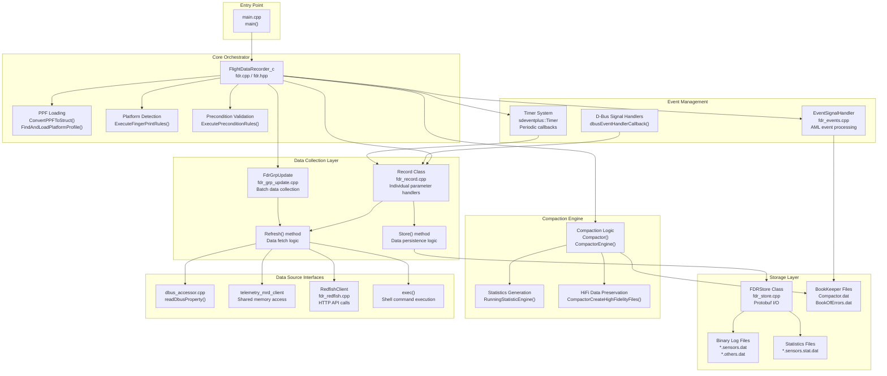
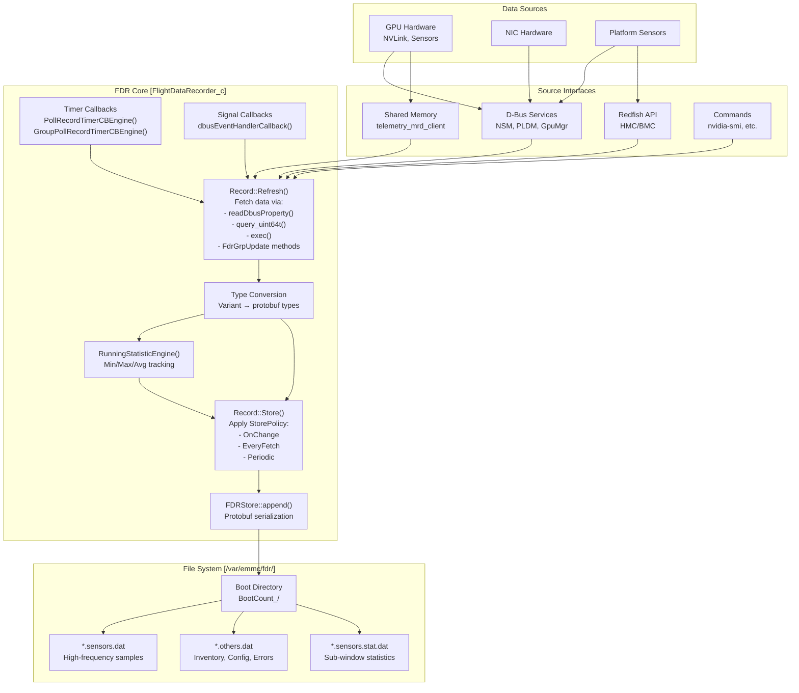
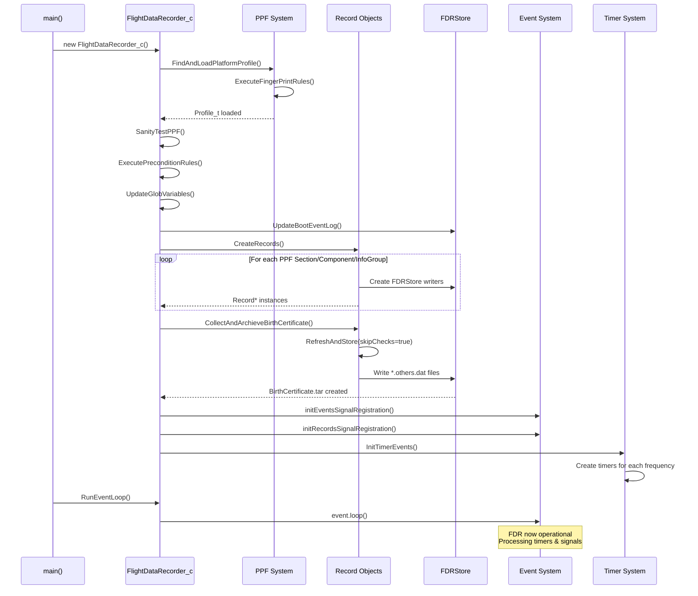

<!-- source: DeepWiki mcp.deepwiki.com · repo NVIDIA/nvidia-fdr · page 4 System Architecture · fetched 2026-10-26 -->

# System Architecture

<details>
<summary>Relevant source files</summary>

The following files were used as context for generating this wiki page:

- [fdr.cpp](fdr.cpp)
- [fdr.hpp](fdr.hpp)
- [fdr_record.cpp](fdr_record.cpp)
- [main.cpp](main.cpp)

</details>


This page provides a comprehensive overview of the FDR system's internal architecture, including its core components, subsystems, and their interactions. It focuses on the C++ implementation layer that orchestrates data collection, storage, and retention.

For build system and deployment details, see [Building the System](#2.1). For PPF configuration structure, see [Platform Profile Files](#3.1). For detailed analysis tools and Python utilities, see [Tools and Utilities](#6).

---

## Overview

The FDR system is architected around a central orchestrator class (`FlightDataRecorder_c`) that manages the complete lifecycle of telemetry collection. The architecture is configuration-driven, using Platform Profile Files (PPF) to define what data to collect, how to fetch it, and how to store it.

The system operates continuously, collecting data through multiple methods (D-Bus properties, shared memory, Redfish API, shell commands), storing it in protobuf binary format, and applying retention policies through a compaction engine.

**Sources:** [fdr.hpp:38-181](), [fdr.cpp:55-166]()

---

## Core Components and Code Mapping

The following diagram maps the architectural components to their implementation in the codebase:



**Sources:** [fdr.hpp:38-181](), [fdr.cpp:55-1400](), [fdr_record.cpp:23-701](), [main.cpp:29-148]()

---

## Component Descriptions

### FlightDataRecorder_c Class

The central orchestrator that manages the entire FDR lifecycle. This class is instantiated once and owns all data collection resources.

| Responsibility | Implementation |
|----------------|----------------|
| PPF loading and parsing | `ConvertPPFToStruct()` [fdr.cpp:296-319]() |
| Platform detection | `FindAndLoadPlatformProfile()` [fdr.cpp:211-292]() |
| Precondition validation | `ExecutePreconditionRules()` [fdr.cpp:395-487]() |
| Record creation | `CreateRecords()` [fdr.cpp:574-746]() |
| Timer management | `InitTimerEvents()` [fdr_timers.cpp]() |
| Signal registration | `initRecordsSignalRegistration()` [fdr.cpp:1315-1338]() |
| Birth certificate generation | `CollectAndArchieveBirthCertificate()` [fdr.cpp:767-832]() |
| Compaction orchestration | `Compactor()` [fdr_compact.cpp]() |

**Key Data Members:**
- `Profile_t profile` - Parsed PPF configuration [fdr.hpp:140]()
- `std::vector<Record*> RecList` - All parameter records [fdr.hpp:42]()
- `std::map<int, std::vector<Record*>> RecListPollMap` - Poll-based records organized by frequency [fdr.hpp:45]()
- `std::map<int, std::vector<groupPollRecords>> RecListGrpPollMap` - Group poll records [fdr.hpp:51]()
- `std::map<int, std::vector<Record*>> RecListSubscribeStoreMap` - Subscribe-based records [fdr.hpp:48]()

**Sources:** [fdr.hpp:38-181](), [fdr.cpp:55-166]()

### Record Class

Represents a single telemetry parameter and encapsulates all logic for fetching and storing that parameter. Each `Record` instance corresponds to one `InfoList` entry in the PPF.

| Attribute | Code Reference |
|-----------|----------------|
| Constructor | [fdr_record.cpp:23-69]() |
| Data fetching | `Refresh()` [fdr_record.cpp:136-423]() |
| Data storage | `Store()` [fdr_record.cpp:578-621]() |
| Type conversion | [fdr_record.cpp:95-134]() |
| Statistics tracking | `RunningStatisticEngine()` [fdr_record.cpp:429-487]() |
| Event callbacks | `refreshDataCallback()` [fdr_record.cpp:623-648]() |

**Key Data Members:**
- `Profile_t& profile` - Reference to PPF configuration
- `Info_t& info` - Parameter definition from PPF
- `fdr_sample_ext data` - Current data value
- `std::shared_ptr<FDRStore>& fdrLogReaderWriter` - Log file writer
- `fdrpb::fdr_stat runningStatus` - Running statistics for compaction

**Sources:** [fdr_record.cpp:23-701]()

### FDRStore Class

Manages protobuf-based binary file I/O. Provides append-only writing and sequential reading of telemetry records.

**Key Operations:**
- `append(fdr_sample)` - Write a sample to disk
- `append(fdr_stat)` - Write statistics to disk
- `append(fdr_book_of_errors)` - Write error entry
- Stream-based reading for compaction

**Sources:** [fdr_store.hpp](), [fdr_store.cpp]()

---

## Data Flow Architecture

The following diagram shows how data flows from hardware sources through the FDR system to persistent storage:



**Key Data Paths:**

1. **Timer-based Poll**: Timer expires → `PollRecordTimerCBEngine()` → `RefreshAndStore()` → `Record::Refresh()` → Data source → `Record::Store()` → `FDRStore::append()` → Disk

2. **Event-based Subscribe**: D-Bus signal → `dbusEventHandlerCallback()` → `Record::refreshDataCallback()` → Timer expires → `Record::Store()` → Disk

3. **Batch Group Poll**: Timer expires → `GroupPollRecordTimerCBEngine()` → `FdrGrpUpdate::RefreshAndStore()` → Shared memory → Multiple `Record::Store()` calls → Disk

**Sources:** [fdr.cpp:836-909](), [fdr_record.cpp:136-423](), [fdr_record.cpp:578-621](), [fdr_timers.cpp]()

---

## Initialization Sequence

The following table describes the FDR initialization sequence from process start to operational state:

| Step | Function | Description | File Reference |
|------|----------|-------------|----------------|
| 1 | `main()` | Entry point, instantiate `FlightDataRecorder_c` | [main.cpp:29-56]() |
| 2 | `FlightDataRecorder_c()` constructor | Begin initialization | [fdr.cpp:55-166]() |
| 3 | `FindAndLoadPlatformProfile()` | Detect platform and load matching PPF | [fdr.cpp:211-292]() |
| 4 | `ExecuteFingerPrintRules()` | Validate platform fingerprint | [fdr.cpp:322-340]() |
| 5 | `ConvertPPFToStruct()` | Parse YAML into `Profile_t` struct | [fdr.cpp:296-319]() |
| 6 | `SanityTestPPF()` | Validate PPF for duplicates and errors | [fdr.cpp:77-85]() |
| 7 | `ExecutePreconditionRules()` | Check disk space, mounts, dependencies | [fdr.cpp:395-487]() |
| 8 | `UpdateGlobVariables()` | Set boot counter and timestamp | [fdr.cpp:1003-1048]() |
| 9 | `UpdateBootEventLog()` | Log boot event to BookKeeper | [fdr.cpp:1053-1070]() |
| 10 | `CreateRecords()` | Instantiate all `Record` objects from PPF | [fdr.cpp:574-746]() |
| 11 | `CollectAndArchieveBirthCertificate()` | Create immutable snapshot of inventory | [fdr.cpp:767-832]() |
| 12 | `initEventsSignalRegistration()` | Register AML event watchers | [fdr.cpp:1351-1365]() |
| 13 | `initRecordsSignalRegistration()` | Register D-Bus property watchers | [fdr.cpp:1315-1338]() |
| 14 | `InitTimerEvents()` | Start all periodic timers | [fdr_timers.cpp]() |
| 15 | `RunEventLoop()` | Enter event processing loop | [fdr_timers.cpp]() |



**Sources:** [main.cpp:29-148](), [fdr.cpp:55-166](), [fdr.cpp:574-746]()

---

## Record Organization and Maps

The FDR system organizes `Record` objects into multiple maps based on their fetch behavior. This enables efficient timer-based and event-based processing.

### Record Collection Maps

| Map Name | Key Type | Value Type | Purpose | Code Reference |
|----------|----------|------------|---------|----------------|
| `RecList` | N/A | `std::vector<Record*>` | Master list of all records | [fdr.hpp:42]() |
| `RecListPollMap` | `int` (FetchFreqSecs) | `std::vector<Record*>` | Timer-based poll records | [fdr.hpp:45]() |
| `RecListGrpPollMap` | `int` (FetchFreqSecs) | `std::vector<groupPollRecords>` | Batch group poll records | [fdr.hpp:51]() |
| `RecListSubscribeStoreMap` | `int` (StoreFreqSecs) | `std::vector<Record*>` | Event-driven subscribe records | [fdr.hpp:48]() |
| `subscribedRecListMap` | `std::string` (composite key) | `Record*` | Fast lookup for D-Bus events | [fdr.hpp:135-137]() |
| `fdrDeviceErrorsWriter` | `std::string` (componentID) | `std::pair<FDRStore*, EventRecord>` | Error event writers | [fdr.hpp:133-134]() |

**Map Population:**
Records are categorized during `CreateRecords()` based on their `FetchType` from the PPF:

```cpp
if (info.FetchType == "GroupPoll") {
    RecListGrpPollMap[info.FetchFreqSecs].push_back(resource);
}
else if (info.FetchType == "Subscribe") {
    RecListSubscribeStoreMap[info.StoreFreqSecs].push_back(resource);
    subscribedRecListMap[key] = resource;
}
else if (info.FetchType == "Poll") {
    RecListPollMap[info.FetchFreqSecs].push_back(resource);
}
```

**Sources:** [fdr.cpp:664-721](), [fdr.hpp:42-51]()

---

## Timer and Event Integration

FDR uses the `sdeventplus` library for event-driven architecture. All timers and D-Bus signal handlers are registered with a central event loop.

### Timer Types

| Timer Purpose | Frequency Source | Callback Function | Scope |
|---------------|------------------|-------------------|-------|
| Poll records | `info.FetchFreqSecs` | `PollRecordTimerCBEngine()` | Per-frequency timer |
| Group poll records | `info.FetchFreqSecs` | `GroupPollRecordTimerCBEngine()` | Per-frequency timer |
| Subscribe store | `info.StoreFreqSecs` | `SubscribeStoreRecordTimerCBEngine()` | Per-frequency timer |
| Compaction window | `GeneralConfig.CompactionWindowSecs` | `CompactionWindowTimerCBEngine()` | Single global timer |
| Compaction sub-window | `GeneralConfig.CompactionSubWindowSecs` | `CompactionSubWindowTimerCBEngine()` | Single global timer |

### Signal Registration

| Signal Type | Handler | Registration Method | Purpose |
|-------------|---------|---------------------|---------|
| D-Bus PropertiesChanged | `dbusEventHandlerCallback()` | `registerServicePropertyChanged()` | Auto-refresh on property changes |
| AML Events | `EventSignalHandler` | `registerEventsSignal()` | Track hardware errors |
| SIGINT/SIGTERM | `sigCb()` | `Signal(FdrEvents, SIGINT, sigCb)` | Graceful shutdown |

**Sources:** [fdr_timers.cpp](), [fdr.cpp:1206-1313](), [fdr.cpp:1315-1365](), [fdr_events.cpp]()

---

## Storage File Structure

FDR creates a hierarchical directory structure under `GeneralConfig.LogsBasePath` (typically `/var/emmc/fdr/`):

```
/var/emmc/fdr/
├── Bookkeeper/
│   ├── BirthCertificate.tar         [Immutable, created once]
│   ├── BootEvent.dat                [Boot timestamp log]
│   ├── Compactor.dat                [Compaction history]
│   ├── BookOfErrors.dat             [Error event log]
│   └── ParamDescription.dat         [Parameter metadata]
│
└── BootCount_<timestamp>/           [New dir every CompactionWindowSecs]
    ├── GPU.GPU0.sensors.dat         [High-frequency GPU data]
    ├── GPU.GPU0.others.dat          [GPU inventory/config/errors]
    ├── GPU.GPU0.sensors.stat.dat    [30-min statistics]
    ├── GPU.GPU0.sensors.hifi.dat    [Error context data]
    ├── NIC.NIC0.sensors.dat
    ├── NIC.NIC0.others.dat
    └── ...
```

### File Naming Convention

| Pattern | Description | Compaction Behavior |
|---------|-------------|---------------------|
| `<Section>.<Component>.sensors.dat` | Raw sensor samples | Deleted after compaction |
| `<Section>.<Component>.others.dat` | Inventory, config, errors | Oldest preserved per boot cycle |
| `<Section>.<Component>.sensors.stat.dat` | Sub-window statistics | Created during compaction |
| `<Section>.<Component>.sensors.hifi.dat` | Error context (±300s) | Created if errors detected |
| `<Section>.<Component>.Event_<timestamp>.dat` | Individual error event | Per-event file |

**Sources:** [fdr.cpp:525-572](), [fdr_compact.cpp]()

---

## Subsystem Cross-References

The following subsystems are documented in detail on separate pages:

| Subsystem | Description | Wiki Page |
|-----------|-------------|-----------|
| `FlightDataRecorder_c` details | PPF loading, lifecycle management, global orchestration | [4.1 FlightDataRecorder_c Core System](#4.1) |
| Data collection methods | D-Bus, Shmem, Redfish, Command fetch implementations | [4.2 Data Collection Pipeline](#4.2) |
| Timer system and events | Timer callbacks, D-Bus signals, AML events, Book of Errors | [4.3 Event Handling and Timers](#4.3) |
| Compaction engine | Directory creation, statistics generation, HiFi preservation | [4.4 Storage and Compaction System](#4.4) |
| D-Bus integration | Accessor layer, service discovery, property operations | [4.5 D-Bus Integration](#4.5) |

---

**Sources:** [fdr.cpp:1-1400](), [fdr.hpp:1-181](), [fdr_record.cpp:1-701](), [main.cpp:1-149]()

---

