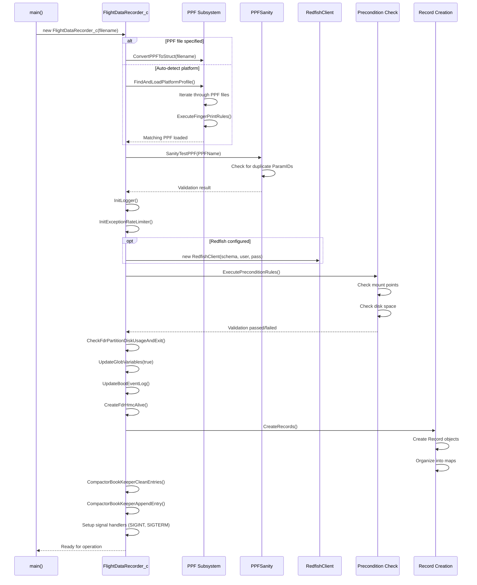
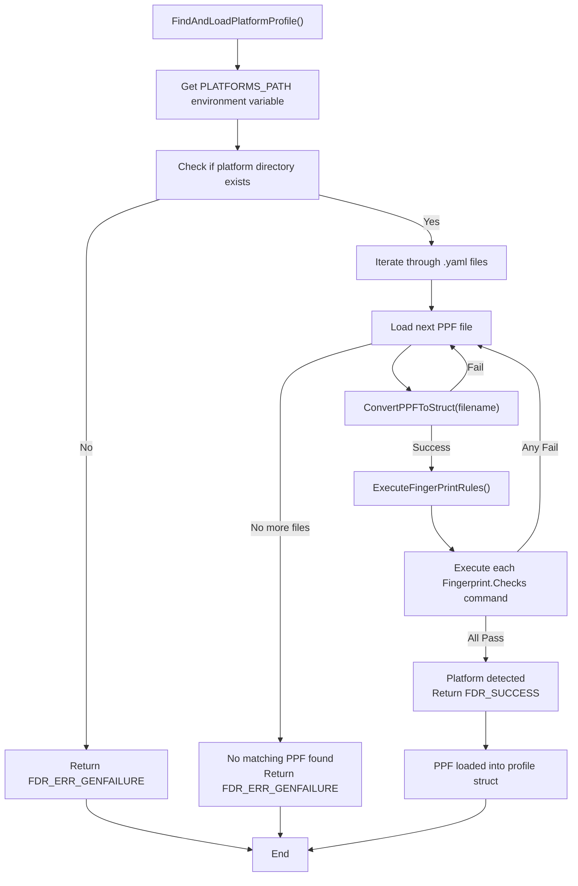
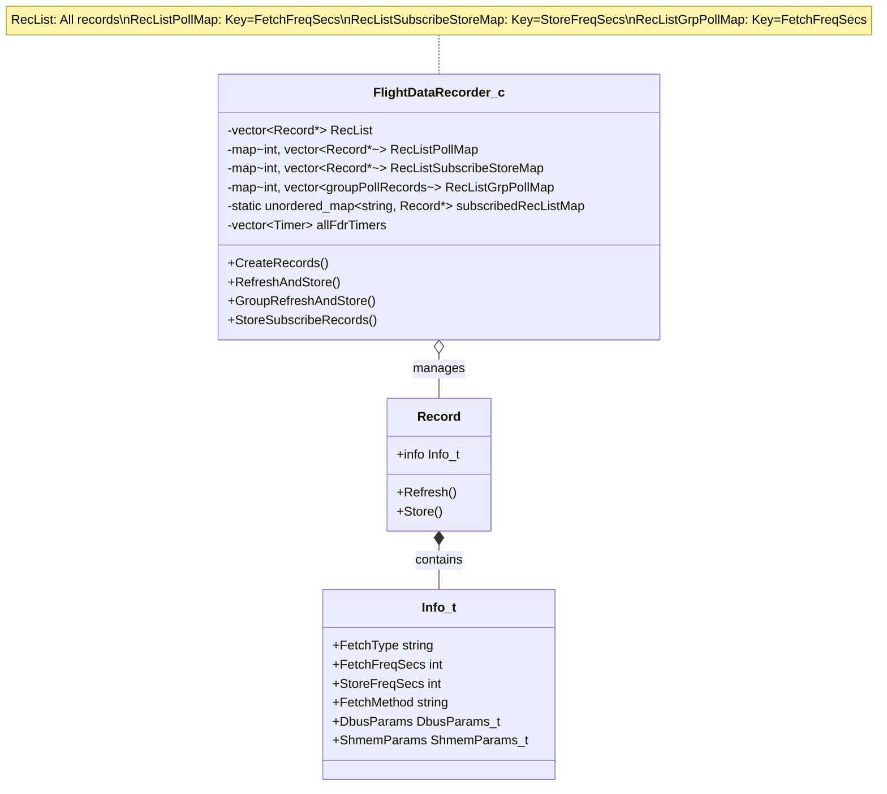
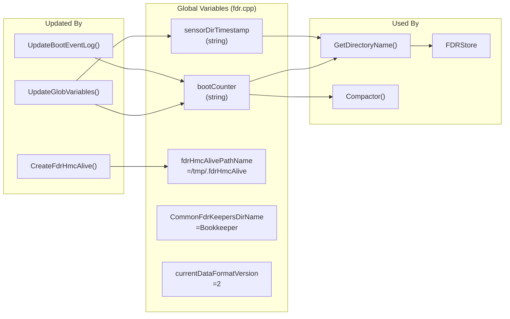
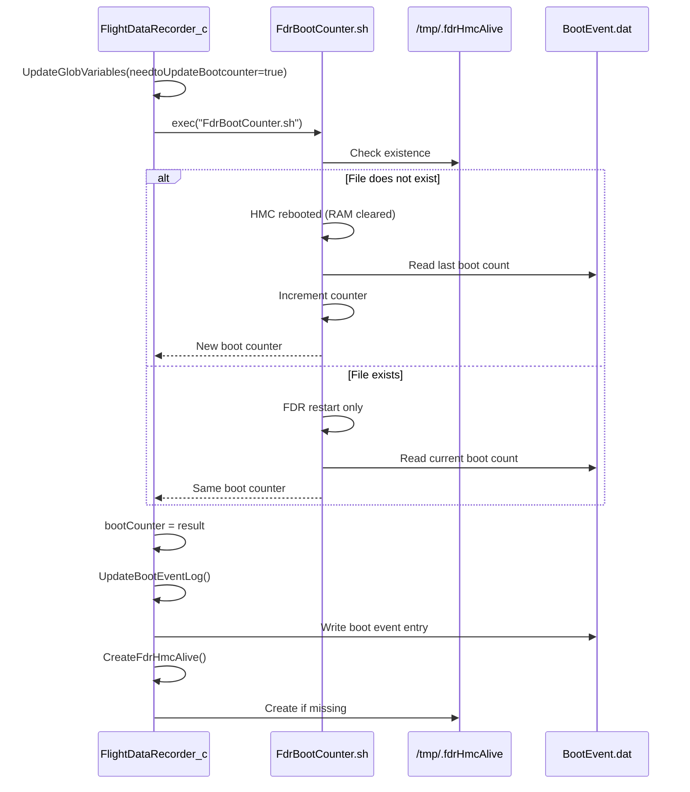
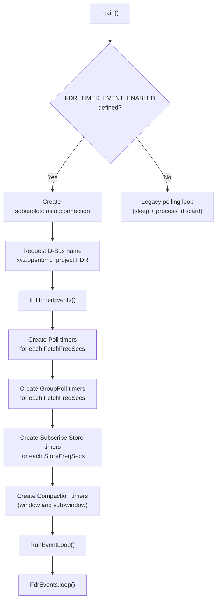
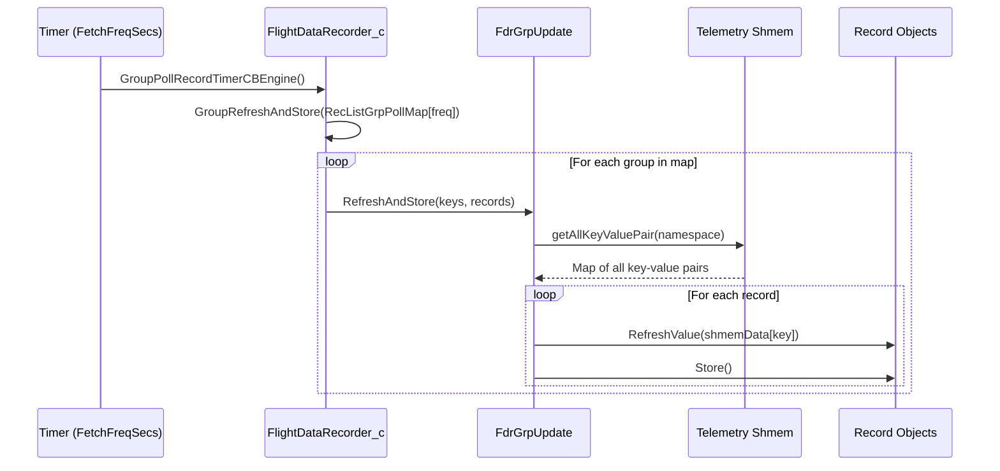
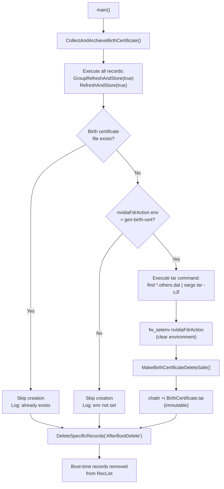
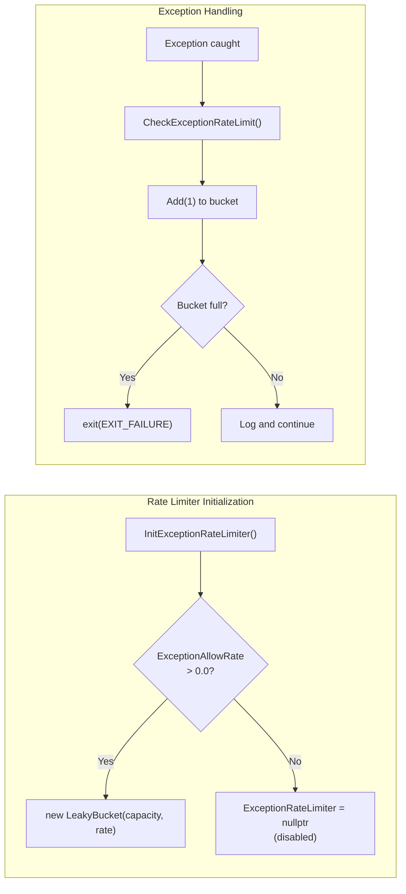
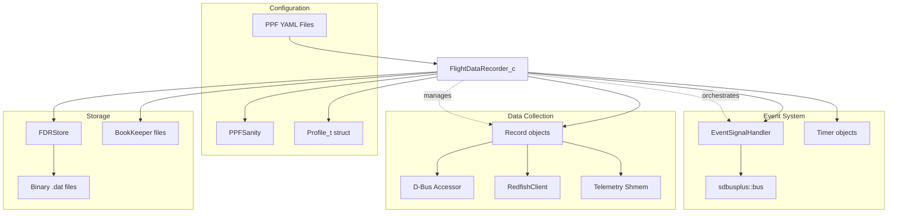

<!-- source: DeepWiki mcp.deepwiki.com · repo NVIDIA/nvidia-fdr · page 4.1 FlightDataRecorder_c Core System · fetched 2026-10-26 -->

# FlightDataRecorder_c Core System

<details>
<summary>Relevant source files</summary>

The following files were used as context for generating this wiki page:

- [dbus_accessor.cpp](dbus_accessor.cpp)
- [dbus_accessor.hpp](dbus_accessor.hpp)
- [fdr.cpp](fdr.cpp)
- [fdr.hpp](fdr.hpp)
- [fdr_grp_update.cpp](fdr_grp_update.cpp)
- [fdr_log.cpp](fdr_log.cpp)
- [fdr_log.hpp](fdr_log.hpp)
- [main.cpp](main.cpp)
- [ppf_sanity.cpp](ppf_sanity.cpp)
- [property_variant.hpp](property_variant.hpp)

</details>


## Purpose and Scope

This document describes the `FlightDataRecorder_c` class, which serves as the main orchestrator for the entire FDR telemetry collection system. It is responsible for initializing all subsystems, managing the lifecycle of data collection, and coordinating between platform configuration, data sources, storage, and event handling.

For information about the underlying data collection mechanisms, see [Data Collection Pipeline](#4.2). For details on event handling and timer systems, see [Event Handling and Timers](#4.3). For storage and compaction details, see [Storage and Compaction System](#4.4).

**Sources:** [fdr.hpp:1-181](), [fdr.cpp:1-100]()

---

## Class Overview

The `FlightDataRecorder_c` class is defined in [fdr.hpp:38-177]() and implemented in [fdr.cpp]().

### Core Responsibilities

| Responsibility | Key Methods | Description |
|---------------|-------------|-------------|
| **Platform Detection** | `FindAndLoadPlatformProfile()`, `ExecuteFingerPrintRules()` | Identifies the hardware platform and loads the appropriate PPF configuration |
| **Configuration Loading** | `ConvertPPFToStruct()` | Parses YAML PPF files into structured C++ data types |
| **Validation** | `ExecutePreconditionRules()` | Validates platform preconditions (mount points, disk space, services) |
| **Record Management** | `CreateRecords()` | Instantiates `Record` objects from PPF configuration |
| **Data Collection** | `RefreshAndStore()`, `GroupRefreshAndStore()`, `StoreSubscribeRecords()` | Orchestrates fetch and store operations across all records |
| **Timer Management** | `InitTimerEvents()`, `RunEventLoop()` | Sets up periodic polling timers |
| **Event Subscription** | `initEventsSignalRegistration()`, `initRecordsSignalRegistration()` | Registers D-Bus signal handlers |
| **Compaction** | `Compactor()`, `CompactorEngine()` | Manages data retention and statistical aggregation |
| **Birth Certificate** | `CollectAndArchieveBirthCertificate()` | Creates immutable snapshot of initial system state |

**Sources:** [fdr.hpp:38-177](), [fdr.cpp:55-166]()

---

## Initialization Sequence

The initialization flow in the constructor is critical to understanding the FDR system's startup behavior.

### Constructor Workflow



**Sources:** [fdr.cpp:55-166](), [main.cpp:29-90]()

### Platform Detection Process

The `FindAndLoadPlatformProfile()` method implements a discovery mechanism to identify the correct PPF configuration:



The fingerprint checks are shell commands specified in the PPF's `FingerPrint.Checks` section. Each command must return exit code 0 for the platform to match.

**Sources:** [fdr.cpp:211-292](), [fdr.cpp:322-340]()

### Precondition Validation

The `ExecutePreconditionRules()` method validates platform readiness before starting data collection:

| Check Type | Purpose | Action on Failure |
|-----------|---------|-------------------|
| **Mount Point** | Verify FDR storage is mounted | Creates Redfish log entry, may exit if `ExitOnFailure: true` |
| **Disk Space** | Ensure sufficient storage | Exit with EXIT_SUCCESS (not failure) |
| **Service Dependencies** | Wait for required D-Bus services | Retry for `Threshold` seconds |

Each precondition has:
- `CommandParams.Command` - Shell command to execute
- `CommandRetryPolicy` - Whether to retry on failure ("true"/"false")
- `ExitOnFailure` - Whether to exit FDR if check fails ("true"/"false")
- `Params.name`/`Params.value` - Variables for command substitution

**Sources:** [fdr.cpp:395-487]()

---

## Record Organization and Data Structures

The `FlightDataRecorder_c` class organizes `Record` objects into multiple maps based on their fetch behavior to enable efficient timer-based execution.

### Record Maps



**Sources:** [fdr.hpp:42-51](), [fdr.cpp:574-746]()

### Record Creation Flow

The `CreateRecords()` method at [fdr.cpp:574-746]() performs the following operations:

1. **Create BookKeeper Writers** - Persistent storage for metadata
   - `CompactorBookKeeperAppender` - Compaction history
   - `fdrbookoferrorswriter` - Error event log
   - `fdrParamsWriter` - Parameter description catalog

2. **Iterate PPF Structure** - Nested loops through Sections → Components → InfoGroups → InfoList

3. **Create FDRStore Objects** - One per Component/InfoGroup combination
   - `*.sensors.dat` - For `Sensor.*` InfoGroups
   - `*.others.dat` - For non-sensor InfoGroups (Inventory, Config, Error, etc.)
   - `*.sensors.stat.dat` - For statistical aggregation (if CompactionMethod="Average")

4. **Instantiate Record Objects** - One per InfoList entry
   ```cpp
   Record* resource = new Record(profile, section, component,
                                 fdrStoreObj, fdrStatStoreObj,
                                 infogroup, info);
   RecList.push_back(resource);
   ```

5. **Organize into Maps** - Based on `FetchType`:
   - **Poll** → `RecListPollMap[info.FetchFreqSecs]`
   - **Subscribe** → `RecListSubscribeStoreMap[info.StoreFreqSecs]` and `subscribedRecListMap[key]`
   - **GroupPoll** → `RecListGrpPollMap[info.FetchFreqSecs]`

**Sources:** [fdr.cpp:574-746]()

### GroupPoll Key Construction

For `GroupPoll` records, the key format is: `"FetchMethod:Namespace:KeySuffix"`

Example: `"Shmem:AggregationData:GroupKey1"`

This allows batching multiple records that share the same data source for efficiency.

**Sources:** [fdr.cpp:664-703](), [fdr_grp_update.cpp:19-60]()

---

## Global State Management

The FDR system maintains several global variables and persistent state files:

### Global Variables



**Sources:** [fdr.cpp:33-45](), [fdr.cpp:993-1037]()

### Boot Counter Logic

The boot counter is managed via the `/usr/bin/FdrBootCounter.sh` script and persisted in `BootEvent.dat`:



This mechanism distinguishes between:
- **HMC Reboot** - `/tmp/.fdrHmcAlive` is cleared (RAM-based), boot counter increments
- **FDR Restart** - File persists, boot counter stays the same

**Sources:** [fdr.cpp:963-991](), [fdr.cpp:993-1037](), [fdr.cpp:1039-1074]()

---

## Timer System Integration

The FDR system uses `sdeventplus::utility::Timer` for periodic execution. Timer-based operation is enabled by the `FDR_TIMER_EVENT_ENABLED` define at [fdr.hpp:32]().

### Timer Initialization



**Sources:** [main.cpp:67-90](), [fdr.cpp:1439-1540]()

### Timer Callback Methods

Each timer type has a dedicated callback engine method:

| Timer Type | Callback Method | Purpose | Key Used |
|-----------|----------------|---------|----------|
| **Poll** | `PollRecordTimerCBEngine(int fetchFreqSecKey)` | Triggers `RefreshAndStore()` for records with specific fetch frequency | `FetchFreqSecs` |
| **GroupPoll** | `GroupPollRecordTimerCBEngine(int fetchFreqSecKey)` | Triggers `GroupRefreshAndStore()` for batch records | `FetchFreqSecs` |
| **Subscribe Store** | `SubscribeStoreRecordTimerCBEngine(int storeFreqSec)` | Triggers `StoreSubscribeRecords()` for subscription records | `StoreFreqSecs` |
| **Compaction Window** | `CompactionWindowTimerCBEngine()` | Triggers main compaction window expiry | Fixed: `CompactionWindowSecs` |
| **Compaction Sub-Window** | `CompactionSubWindowTimerCBEngine()` | Triggers statistical aggregation | Fixed: `CompactionSubWindowSecs` |

**Sources:** [fdr.cpp:1381-1437](), [fdr.cpp:1439-1540]()

---

## Data Collection Orchestration

The `FlightDataRecorder_c` class provides three main methods for data collection, corresponding to the three fetch types.

### Poll Records: RefreshAndStore()

For `FetchType: Poll` records, both fetch and store operations occur at the same frequency (`FetchFreqSecs`).

```cpp
void FlightDataRecorder_c::RefreshAndStore(
    bool viaTimerSkipChecks,
    const std::vector<Record*>& recordListToRefresh)
{
    for (auto& rec : recordListToRefresh)
    {
        try {
            rec->Refresh(viaTimerSkipChecks);  // Fetch from source
            rec->Store();                      // Write to storage
        }
        catch (const std::exception& e) {
            fdrlog::warn("RefreshAndStore(): {}", e.what());
            this->CheckExceptionRateLimit();
        }
    }
}
```

**Sources:** [fdr.cpp:836-909]()

### GroupPoll Records: GroupRefreshAndStore()

For `FetchType: GroupPoll` records, the system batches requests to the same data source (e.g., shared memory namespace).



**Sources:** [fdr.cpp:865-904](), [fdr_grp_update.cpp:19-60]()

### Subscribe Records: StoreSubscribeRecords()

For `FetchType: Subscribe` records, the `Refresh()` is triggered by D-Bus `PropertiesChanged` signals (see [Event Handling and Timers](#4.3)), and `Store()` is called periodically at `StoreFreqSecs`.

```cpp
void FlightDataRecorder_c::StoreSubscribeRecords(
    const std::vector<Record*>& recordListToStore)
{
    for (auto& rec : recordListToStore)
    {
        try {
            rec->Store();  // Only store; refresh was done by signal handler
        }
        catch (const std::exception& e) {
            fdrlog::warn("StoreSubscribeRecords(): {}", e.what());
            this->CheckExceptionRateLimit();
        }
    }
}
```

**Sources:** [fdr.cpp:913-939]()

---

## Birth Certificate Management

The birth certificate is an immutable snapshot of all `*.others.dat` files (Inventory, Config, etc.) captured at first boot.

### Birth Certificate Creation



The tar file is created at: `{LogsBasePath}/Bookkeeper/BirthCertificate.tar`

The `chattr +i` command makes the file immutable (cannot be deleted even by root without first removing the attribute).

**Sources:** [fdr.cpp:767-832](), [fdr.cpp:748-762](), [main.cpp:58-59]()

---

## Exception Rate Limiting

The FDR system includes a leaky bucket rate limiter to prevent uncontrolled exits due to cascading exceptions.

### Rate Limiter Configuration

Configured via PPF `GeneralConfig` section:
- `ExceptionAllowNumber` - Bucket capacity (max exceptions allowed)
- `ExceptionAllowRate` - Leak rate (exceptions per second that drain from bucket)



When disabled (rate = 0.0), FDR will log exceptions but never exit due to rate limiting.

**Sources:** [fdr.cpp:168-209](), [fdr.hpp:88-89]()

---

## Lifecycle Methods

### RunEventLoop()

In timer-enabled mode, this method starts the event loop:

```cpp
void FlightDataRecorder_c::RunEventLoop(void)
{
    FdrEvents.loop();  // Blocks until exit() called
}
```

**Sources:** [fdr.cpp:1542-1545](), [main.cpp:84]()

### Destructor

```cpp
FlightDataRecorder_c::~FlightDataRecorder_c()
{
    // Clean up Record objects
    for (auto& rec : RecList)
    {
        delete rec;
    }
    RecList.clear();
    
    // Clean up RedfishClient
    if (this->rfc)
    {
        delete this->rfc;
    }
    
    // Clean up ExceptionRateLimiter
    if (this->ExceptionRateLimiter)
    {
        delete this->ExceptionRateLimiter;
    }
}
```

**Sources:** [fdr.cpp:1761-1783]()

---

## Key Private Methods

### Disk Space Management

| Method | Purpose | Behavior |
|--------|---------|----------|
| `CheckAvailableFdrPartitionDiskSize()` | Check available space on FDR partition | Returns `FDR_ERR_PARTITION_SIZE_LESS` if below threshold, creates Redfish log entry |
| `CheckFdrPartitionDiskUsageAndExit()` | Validate disk space and exit if insufficient | Calls above method; if insufficient, logs warning and calls `exit(EXIT_SUCCESS)` |

The threshold is configured via `GeneralConfig.PartitionThresoldCheckMB` in the PPF.

**Sources:** [fdr.cpp:342-392]()

### Record Cleanup

```cpp
void FlightDataRecorder_c::DeleteSpecificRecords(std::string recordSubName)
```

Removes records from `RecList` and associated maps where `Info_t.ID` contains `recordSubName`. Used to delete "BootEvent" records after birth certificate creation, as they should only execute once at startup.

**Sources:** [fdr.cpp:1656-1713]()

### Platform File Cleanup

```cpp
void FlightDataRecorder_c::CleanupPlatformFiles(void)
```

Removes non-matching PPF files from the platforms directory after successful platform detection. This prevents confusion during debugging.

**Sources:** [fdr.cpp:1547-1598]()

---

## Integration with Other Subsystems



**Sources:** [fdr.hpp:1-181](), [fdr.cpp:1-100]()

---

## Member Variables Reference

### Public Members

| Member | Type | Purpose |
|--------|------|---------|
| `profile` | `Profile_t` | Parsed PPF configuration structure |
| `rfc` | `RedfishClient*` | Redfish client for out-of-band data collection |
| `fdrbookoferrorswriter` | `unique_ptr<FDRStore>` | Writer for BookOfErrors.dat |
| `fdrDeviceErrorsWriter` | `map<string, pair<shared_ptr<FDRStore>, EventRecord>>` | Per-device error event writers |
| `subscribedRecListMap` | `static unordered_map<string, Record*>` | O(1) lookup map for D-Bus signal handling |
| `book_of_errors` | `fdrpb::fdr_book_of_errors` | Protobuf message for error tracking |

**Sources:** [fdr.hpp:130-141]()

### Private Members

| Member | Type | Purpose |
|--------|------|---------|
| `RecList` | `vector<Record*>` | Master list of all Record objects |
| `RecListPollMap` | `map<int, vector<Record*>>` | Poll records by FetchFreqSecs |
| `RecListSubscribeStoreMap` | `map<int, vector<Record*>>` | Subscribe records by StoreFreqSecs |
| `RecListGrpPollMap` | `map<int, vector<groupPollRecords>>` | GroupPoll records by FetchFreqSecs |
| `FdrEvents` | `sdeventplus::Event` | Event loop object |
| `LastCompactWindowDirCreationSecsAt` | `time_t` | Timestamp of last compaction window |
| `LastCompactSubWindowDirCreationSecsAt` | `time_t` | Timestamp of last sub-window |
| `allFdrTimers` | `vector<Timer>` | Timer objects (kept in scope) |
| `SanityChecker` | `unique_ptr<PPFSanity>` | PPF validation object |
| `subscribedPaths` | `vector<pair<string, string>>` | D-Bus paths for subscription |
| `eventHandlerMatcher` | `vector<unique_ptr<sdbusplus::bus::match_t>>` | D-Bus match objects |
| `ExceptionRateLimiter` | `LeakyBucket*` | Rate limiter for exception handling |

**Sources:** [fdr.hpp:40-89]()

---

## Summary

The `FlightDataRecorder_c` class serves as the central control point for the entire FDR system. It:

1. **Detects and configures** the platform using PPF files
2. **Validates** system preconditions before operation
3. **Creates and organizes** Record objects into efficient execution maps
4. **Manages timers** for periodic polling and compaction
5. **Registers event handlers** for D-Bus subscriptions
6. **Orchestrates data collection** through three distinct patterns (Poll, GroupPoll, Subscribe)
7. **Controls the main event loop** and graceful shutdown
8. **Implements safety features** like exception rate limiting and disk space monitoring
9. **Maintains persistent state** through global variables and BookKeeper files

The class design separates concerns by delegating specific responsibilities to specialized subsystems (Record for data fetch, FDRStore for storage, EventSignalHandler for events) while maintaining centralized control over the lifecycle and coordination of all operations.

---

