<!-- source: DeepWiki mcp.deepwiki.com · repo NVIDIA/nvidia-fdr · page 4.2 Data Collection Pipeline · fetched 2026-10-26 -->

# Data Collection Pipeline

<details>
<summary>Relevant source files</summary>

The following files were used as context for generating this wiki page:

- [dbus_accessor.cpp](dbus_accessor.cpp)
- [dbus_accessor.hpp](dbus_accessor.hpp)
- [fdr.cpp](fdr.cpp)
- [fdr.hpp](fdr.hpp)
- [fdr_grp_update.cpp](fdr_grp_update.cpp)
- [fdr_log.cpp](fdr_log.cpp)
- [fdr_log.hpp](fdr_log.hpp)
- [fdr_record.cpp](fdr_record.cpp)
- [ppf_sanity.cpp](ppf_sanity.cpp)
- [property_variant.hpp](property_variant.hpp)

</details>


## Purpose and Scope

This document describes the end-to-end data collection pipeline in the NVIDIA FDR system, covering how telemetry data flows from hardware sources through the Record abstraction layer to persistent storage. The pipeline encompasses data fetching from multiple sources (D-Bus, Shared Memory, Redfish, Command execution), type conversion, validation, and storage policies.

For information about how Records are created from Platform Profile Files (PPF), see [Platform Profile Files](#3.1). For details on timer management and event handling, see [Event Handling and Timers](#4.3). For storage formats and compaction, see [Storage and Compaction System](#4.4).

## Overview

The data collection pipeline operates as a continuous cycle of fetching, processing, and storing telemetry data. Each parameter defined in a PPF is represented by a `Record` object that encapsulates the complete lifecycle of data collection for that parameter.

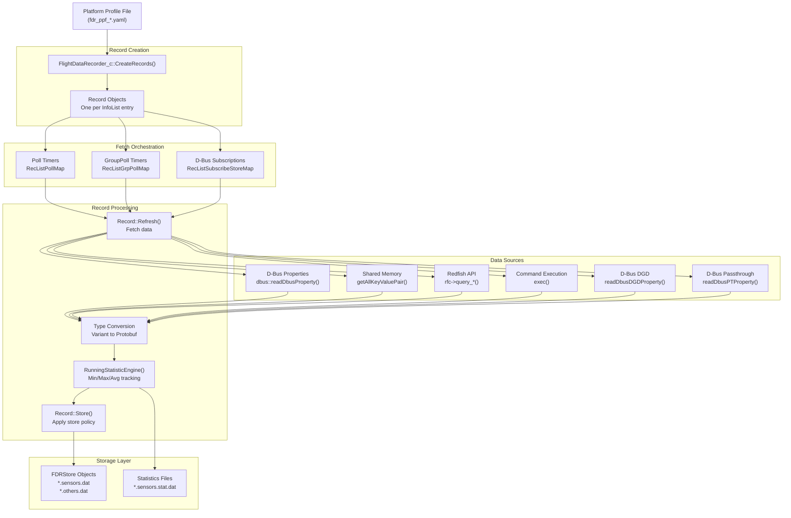

**Sources:** [fdr.cpp:574-746](), [fdr_record.cpp:23-69](), [fdr_record.cpp:136-423]()

## Record Class Architecture

The `Record` class is the fundamental unit of the data collection pipeline. Each `Record` instance represents a single telemetry parameter and encapsulates all logic for fetching, processing, and storing data for that parameter.

### Record Structure

A `Record` object maintains references to its configuration hierarchy and manages its own data lifecycle:

| Component | Type | Purpose |
|-----------|------|---------|
| `profile` | `Profile_t&` | Reference to global configuration |
| `section` | `Section_t&` | Component class (e.g., GPU, NIC) |
| `component` | `Component_t&` | Specific device instance |
| `infogroup` | `InfoGroup_t&` | Parameter grouping (Sensor, Inventory, etc.) |
| `info` | `Info_t&` | Individual parameter configuration |
| `fdrLogReaderWriter` | `std::shared_ptr<FDRStore>` | Writer for raw samples |
| `fdrStatwriter` | `std::shared_ptr<FDRStore>` | Writer for statistics |
| `data` | `fdr_sample_ext` | Current data value |
| `last_stored_data` | `fdr_sample_ext` | Previous stored value |
| `runningStatus` | `fdrpb::fdr_stat` | Accumulated statistics |

**Sources:** [fdr_record.hpp (implied from cpp)](), [fdr_record.cpp:23-69]()

### Record Lifecycle

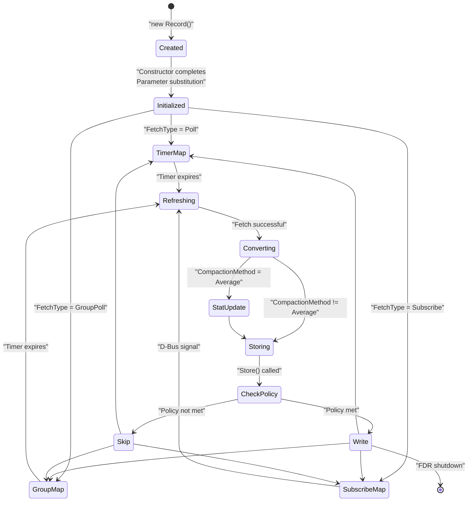

**Sources:** [fdr_record.cpp:23-69](), [fdr_record.cpp:136-423](), [fdr_record.cpp:578-621]()

## Fetch Type Organization

The FDR system organizes Records into three distinct maps based on their `FetchType`, which determines how and when data is fetched:

### RecListPollMap

**Purpose:** Timer-based polling at individual parameter fetch frequencies

**Structure:** `std::map<int, std::vector<Record*>>` where key is `FetchFreqSecs`

Records with `FetchType: Poll` are grouped by their `FetchFreqSecs` value. Each group shares a timer that triggers `Refresh()` and `Store()` for all records in that group.

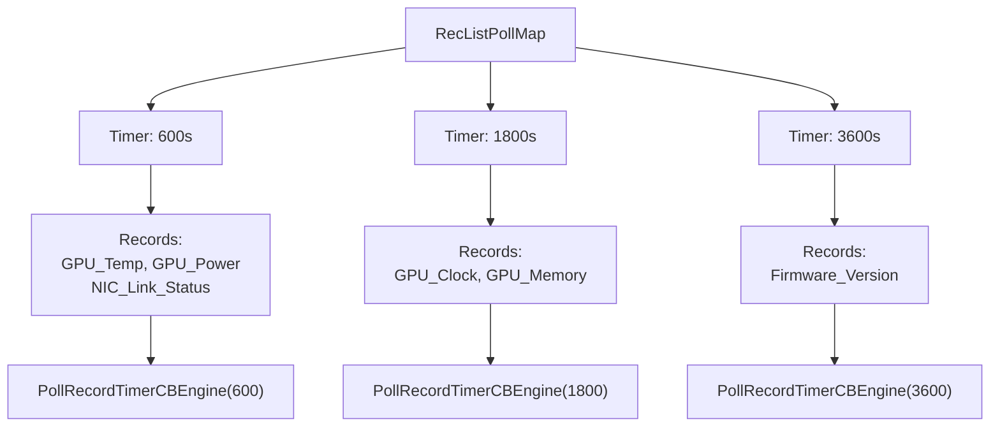

**Sources:** [fdr.cpp:719-721](), [fdr.hpp:45](), [fdr.cpp:123-126 (timer callback reference)]()

### RecListGrpPollMap

**Purpose:** Batch polling for shared memory namespaces to minimize fetch overhead

**Structure:** `std::map<int, std::vector<groupPollRecords>>` where `groupPollRecords` is `std::pair<std::string, std::vector<Record*>>`

Records with `FetchType: GroupPoll` and `FetchMethod: Shmem` are grouped by namespace and fetch frequency. The system fetches all parameters from a shared memory namespace in a single operation.

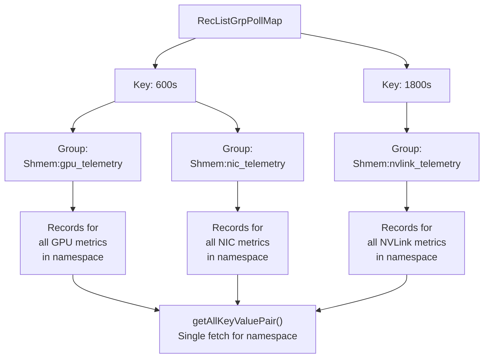

**Key construction:** `getGroupPollRecordKey(info)` creates key: `"GroupPoll:Shmem:<namespace>"`

**Sources:** [fdr.cpp:664-703](), [fdr.hpp:50-51](), [fdr_grp_update.cpp:19-60]()

### RecListSubscribeStoreMap

**Purpose:** Event-driven data collection via D-Bus property change signals

**Structure:** `std::map<int, std::vector<Record*>>` where key is `StoreFreqSecs`

Records with `FetchType: Subscribe` register D-Bus signal handlers. Data is fetched immediately when property changes, but storage is rate-limited by `StoreFreqSecs`.

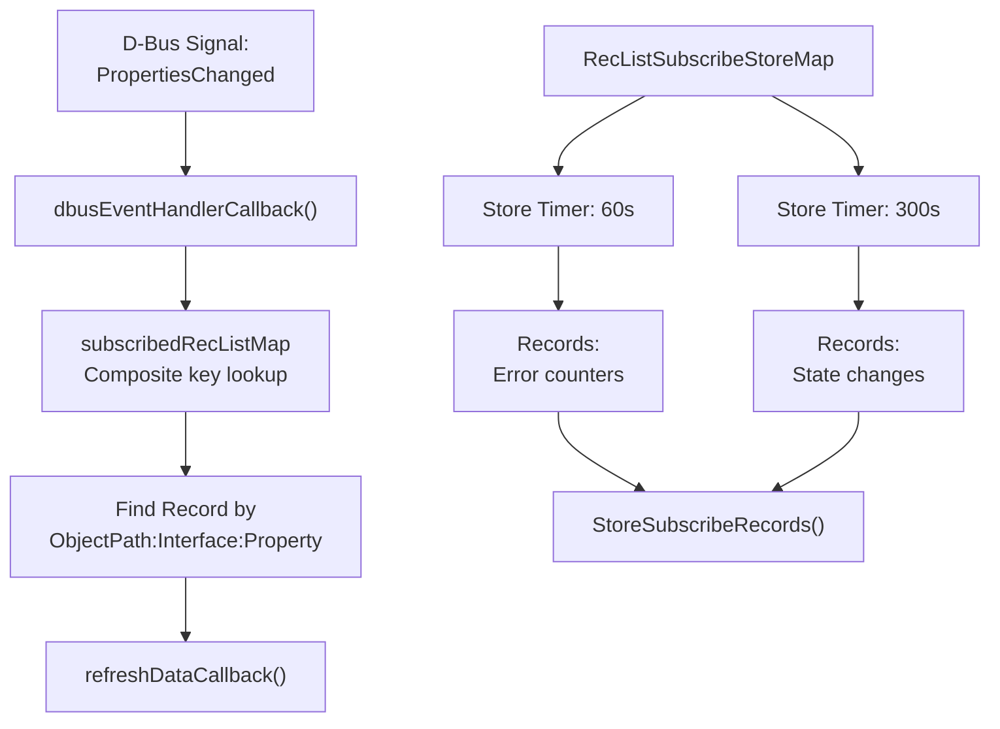

**Composite key:** `getSubsRecordKey(ObjectPath, Interface, Property)` enables O(1) lookup

**Sources:** [fdr.cpp:704-717](), [fdr.hpp:47-48](), [fdr.hpp:135-137](), [fdr_record.cpp:623-648]()

## Data Source Integration

The `Record::Refresh()` method implements a polymorphic fetch strategy based on the `FetchMethod` configuration parameter. Each fetch method interacts with a different data source.

### D-Bus Property Access

**Fetch Method:** `FetchMethod: DBUS`

Reads standard D-Bus properties using the `org.freedesktop.DBus.Properties.Get` interface.

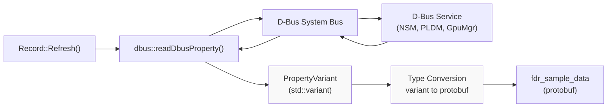

**Type conversion logic:** The system handles numerous D-Bus variant types and converts them to protobuf types:

- **Integer types:** `uint64_t`, `uint32_t`, `uint16_t`, `uint8_t`, `int64_t`, `int16_t`, `bool`, `double` → `paramvalueint64`
- **Floating types:** `double`, `uint32_t`, `uint16_t`, etc. → `paramvaluedouble`
- **String types:** `std::string` → `paramvaluestring`
- **Tuple types:** `std::tuple<bool, unsigned int>` extracts second element

**Sources:** [fdr_record.cpp:152-292](), [dbus_accessor.cpp:88-113](), [property_variant.hpp:40-44]()

### D-Bus Device Get Data (DGD)

**Fetch Method:** `FetchMethod: DBUS_DGD`

Specialized method for GPU device data using SMBPBI (SMBus Post Box Interface) protocol. Calls `DeviceGetData` D-Bus method with device ID and property name.

**Return format:** `std::tuple<int, std::string, uint64_t>` where:
- `int`: Return code (0 = success)
- `std::string`: Human-readable message
- `uint64_t`: Packed value from `data[1] << 32 | data[0]`

**Sources:** [fdr_record.cpp:359-380](), [dbus_accessor.cpp:115-167]()

### D-Bus Passthrough FPGA

**Fetch Method:** `FetchMethod: DBUS_PT`

Reads FPGA registers via passthrough interface using opcode and arguments.

**Parameters:**
- `Opcode`: FPGA register operation code
- `Arg1`, `Arg2`: Operation arguments

**Return format:** `std::tuple<int, uint64_t>` with packed 64-bit value from response

**Sources:** [fdr_record.cpp:382-405](), [dbus_accessor.cpp:169-224]()

### Shared Memory Access

**Fetch Method:** `FetchMethod: Shmem` (via GroupPoll)

Reads from shared memory regions using the telemetry MRD (Memory Region Descriptor) client. Used exclusively with `FetchType: GroupPoll` for efficient batch operations.

**Workflow:**
1. `GroupPollRecordTimerCBEngine()` identifies namespace from group key
2. `FdrGrpUpdate::RefreshAndStore()` fetches all key-value pairs for namespace
3. Individual records extract their value using `ShmemParams.Key`
4. `Record::RefreshValue()` processes string value and updates statistics

**Sources:** [fdr_grp_update.cpp:19-60](), [fdr_record.cpp:83-134]()

### Redfish API Access

**Fetch Method:** `FetchMethod: Redfish`

Queries Redfish API endpoints (typically on HMC/BMC) using HTTP requests with JSON pointer paths.

**Configuration:**
- `RedfishSchema`: Base URL (e.g., `https://hmc-ip/redfish/v1`)
- `RedfishParams.URI`: Resource path
- `RedfishParams.JSONPointer`: JSON path within response

**Client methods:**
- `rfc->query_uint64t(uri, json_pointer)`: Integer values
- `rfc->query_string(uri, json_pointer)`: String values

**Sources:** [fdr_record.cpp:320-357]()

### Command Execution

**Fetch Method:** `FetchMethod: Command`

Executes shell commands and captures stdout. Supports parameter substitution from component params.

**Configuration:**
- `CommandParams.Command`: Shell command with `$param` placeholders
- `CommandParams.WorkingDir`: Execution directory (optional)

**Return handling:**
- `cmdExitstatus == FDR_SUCCESS`: Parse stdout as `Uint64` or `string`
- `cmdExitstatus != FDR_SUCCESS`: Skip this fetch cycle

**Sources:** [fdr_record.cpp:293-319](), [fdr_record.cpp:36-60 (parameter substitution)]()

## Type Conversion Pipeline

The type conversion subsystem transforms data from native source formats (D-Bus variants, string values, JSON) into strongly-typed protobuf messages for storage.

### Conversion Flow

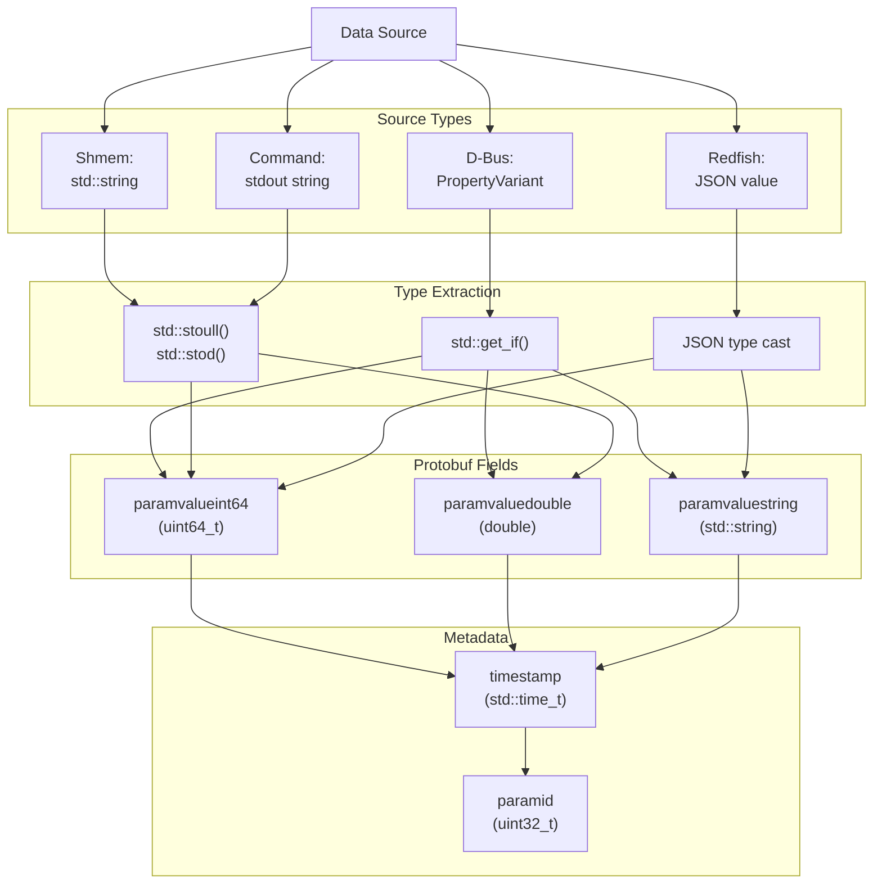

**Sources:** [fdr_record.cpp:168-291 (D-Bus conversion)](), [fdr_record.cpp:96-114 (string conversion)]()

### Type Mapping Tables

**D-Bus Variant to Protobuf (Integer target):**

| Source D-Bus Type | Extraction Method | Target Field |
|-------------------|-------------------|--------------|
| `double` | `std::get_if<double>(&val)` | `set_paramvalueint64((uint64_t)*ptr)` |
| `uint32_t` | `std::get_if<uint32_t>(&val)` | `set_paramvalueint64((uint64_t)*ptr)` |
| `uint16_t` | `std::get_if<uint16_t>(&val)` | `set_paramvalueint64((uint64_t)*ptr)` |
| `uint64_t` | `std::get_if<uint64_t>(&val)` | `set_paramvalueint64((uint64_t)*ptr)` |
| `int64_t` | `std::get_if<int64_t>(&val)` | `set_paramvalueint64((uint64_t)*ptr)` |
| `int16_t` | `std::get_if<int16_t>(&val)` | `set_paramvalueint64((uint64_t)*ptr)` |
| `uint8_t` | `std::get_if<uint8_t>(&val)` | `set_paramvalueint64((uint64_t)*ptr)` |
| `bool` | `std::get_if<bool>(&val)` | `set_paramvalueint64((uint64_t)*ptr)` |
| `std::tuple<bool, uint>` | `std::get_if<std::tuple<bool, unsigned int>>(&val)` | `set_paramvalueint64((uint64_t)std::get<1>(*ptr))` |

**PPF DataType to Protobuf field:**

| PPF DataType | Protobuf Field | C++ Type |
|--------------|----------------|----------|
| `Uint64`, `Integer`, `Uint32`, `Uint16`, `Uint8`, `Int64`, `Int16` | `paramvalueint64` | `uint64_t` |
| `Double`, `Float` | `paramvaluedouble` | `double` |
| `string` | `paramvaluestring` | `std::string` |

**Sources:** [fdr_record.cpp:168-231 (integer conversion)](), [fdr_record.cpp:232-283 (double conversion)](), [fdr_record.cpp:284-291 (string conversion)]()

### Error Handling

**Throttled logging:** Conversion errors are logged with throttling to prevent log spam. The `logThrottle::logThrottling(info)` function limits error messages to once per `LOG_ROTATION` period (86400 seconds).

**Fallback behavior:** 
- If variant extraction fails, the `Refresh()` method returns early without storing
- `LastFetchedAt` is still updated to prevent rapid retry
- Next fetch cycle attempts again after `FetchFreqSecs`

**Sources:** [fdr_record.cpp:121-133 (exception handling)](), [fdr_record.cpp:275-281 (throttled warning)](), [fdr_log.cpp:93-125 (throttle implementation)]()

## Store Policy Enforcement

The `Record::Store()` method implements three distinct storage policies that control when fetched data is written to disk. This mechanism optimizes storage utilization by avoiding redundant writes.

### Policy Comparison

| Policy | Condition | Use Case | Example Parameters |
|--------|-----------|----------|-------------------|
| `OnChange` | Value differs from last stored | Static or infrequently changing data | Firmware version, serial number, device state |
| `EveryFetch` | `LastFetchedAt - LastStoredAt >= FetchFreqSecs` | Regular metrics that change frequently | Temperature, power, clock frequency |
| `Periodic` | `current_time - LastStoredAt >= StoreFreqSecs` | Subscribe-type records with rate limiting | Error counters, event-driven state changes |

### Store Policy Logic Flow

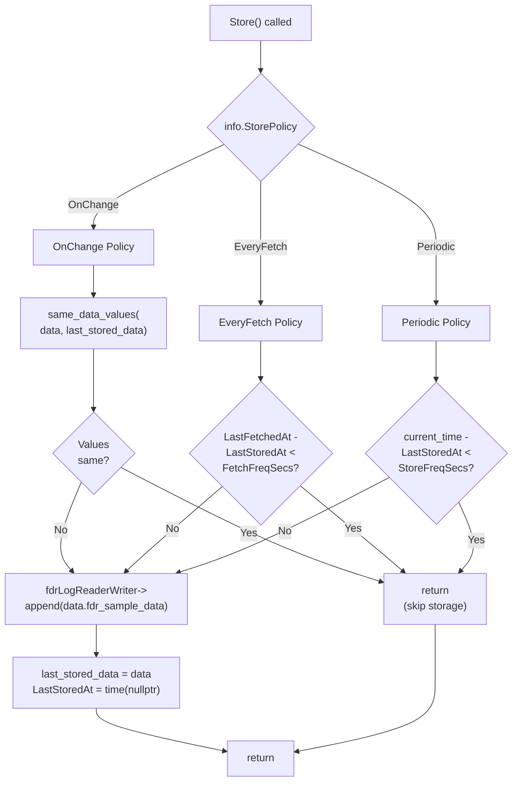

**Sources:** [fdr_record.cpp:578-621]()

### OnChange Policy Implementation

The `same_data_values()` function performs shallow comparison of protobuf fields:

**Comparison logic:**
1. Check if `paramid` matches (safety check)
2. Check if `paramtype` matches
3. For `Uint64`: compare `paramvalueint64()` values
4. For strings: compare `paramvaluestring()` values

**First-time handling:** Static variable `firstTime` returns `false` on first call to ensure initial value is always stored.

**Sources:** [fdr_record.cpp:525-563]()

## Running Statistics Engine

For parameters with `CompactionMethod: Average`, the system maintains running statistics during the collection phase. These statistics are periodically written to `.stat.dat` files for use in data compaction.

### Statistics Tracked

| Statistic | Protobuf Field | Calculation |
|-----------|----------------|-------------|
| Number of samples | `numsamples` | Incremented on each `Refresh()` |
| Sum | `avg` (temporary) | Accumulated sum of all values |
| Minimum value | `min` | Running minimum with epsilon comparison |
| Maximum value | `max` | Running maximum with epsilon comparison |
| Timestamp of min | `minvaltimestamp` | Time when minimum was recorded |
| Timestamp of max | `maxvaltimestamp` | Time when maximum was recorded |
| Window start time | `fromtime` | Timestamp of first sample in window |
| Window end time | `totime` | Timestamp of most recent sample |

**Average calculation:** During `appendRunningStatToStatfile()`, the accumulated sum is divided by `numsamples` and rounded to 3 decimal places.

### Statistics Update Flow

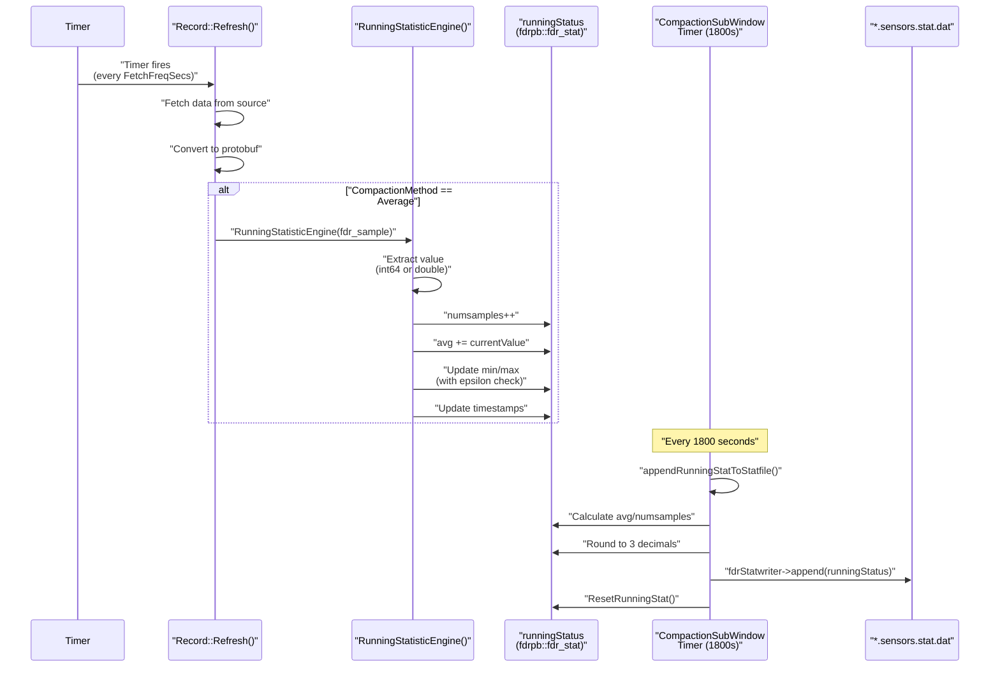

**Sources:** [fdr_record.cpp:429-487 (statistics engine)](), [fdr_record.cpp:489-523 (append to file)]()

### Precision and Epsilon Handling

**Epsilon value:** `1e-10` used for floating-point comparisons when determining min/max values

**Rounding:** Both the running average calculation and final values are rounded:
```cpp
currentRecValue = std::round(readrec.paramvaluedouble() * 1000.0) / 1000.0;
runningStatus.set_avg(std::round(runningStatus.avg() * 1000.0) / 1000.0);
```

This ensures consistent 3-decimal-place precision in statistical data.

**Sources:** [fdr_record.cpp:431-441](), [fdr_record.cpp:503-505]()

## Refresh and Store Orchestration

The `FlightDataRecorder_c` class orchestrates the execution of Record operations through timer callbacks and event handlers. This section describes how the system coordinates fetching and storing across different record types.

### Timer Callback Execution

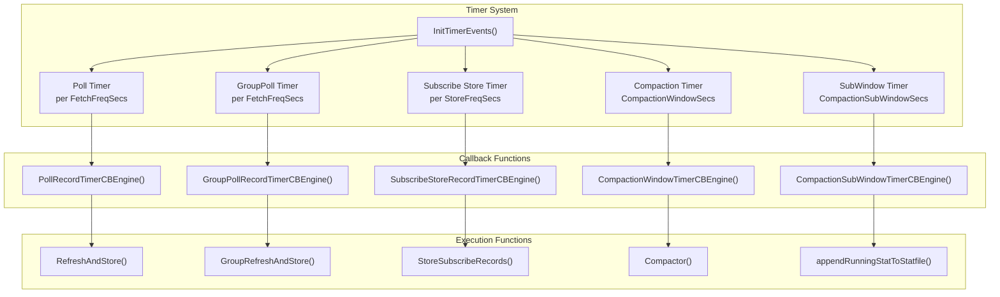

**Sources:** [fdr.cpp (timer initialization section)](), [fdr.hpp:123-127 (callback declarations)]()

### RefreshAndStore() Implementation

**Function signature:** `void RefreshAndStore(bool viaTimerSkipChecks, const std::vector<Record*>& recordListToRefresh)`

**Purpose:** Iterates through a list of Poll-type records and executes their fetch-store cycle.

**Exception handling:**
- Wraps `Refresh()` and `Store()` in try-catch blocks
- Logs exceptions using `fdrlog::warn()`
- Calls `CheckExceptionRateLimit()` if exception occurs
- Uses `LeakyBucket` rate limiter to exit if exception rate exceeds threshold

**Sources:** [fdr.cpp:836-863]()

### GroupRefreshAndStore() Implementation

**Function signature:** `void GroupRefreshAndStore(bool viaTimerSkipChecks, const std::vector<groupPollRecords>& groupList)`

**Purpose:** Executes batch fetches for shared memory namespaces.

**Workflow:**
1. Iterate through group list (one entry per namespace)
2. Extract keys from group (Method, Namespace)
3. Call `FdrGrpUpdate::RefreshAndStore(keys, records)`
4. Fetch all key-value pairs from namespace in single operation
5. Distribute values to individual records
6. Each record calls `RefreshValue()` → `Store()`

**Sources:** [fdr.cpp:865-888](), [fdr_grp_update.cpp:19-60]()

### StoreSubscribeRecords() Implementation

**Function signature:** `void StoreSubscribeRecords(const std::vector<Record*>& recordListToStore)`

**Purpose:** Stores data for Subscribe-type records without fetching (data already updated by signal handlers).

**Key behavior:** Only calls `Store()` method, skips `Refresh()` since data is already current from D-Bus signals.

**Sources:** [fdr.cpp:890-910]()

## D-Bus Event Handling Integration

Subscribe-type records integrate with D-Bus signal handling to receive immediate notifications of property changes.

### Signal Registration

During `CreateRecords()`, Subscribe records are registered:

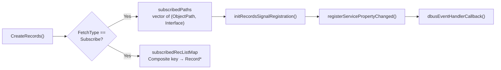

**Composite key construction:**
```cpp
auto key = getSubsRecordKey(
    info.DbusParams.ObjectPath,
    info.DbusParams.Interface,
    info.DbusParams.Property
);
subscribedRecListMap[key] = record;
```

**Sources:** [fdr.cpp:704-716](), [fdr.hpp:48](), [fdr.hpp:135-137]()

### Event Callback Flow

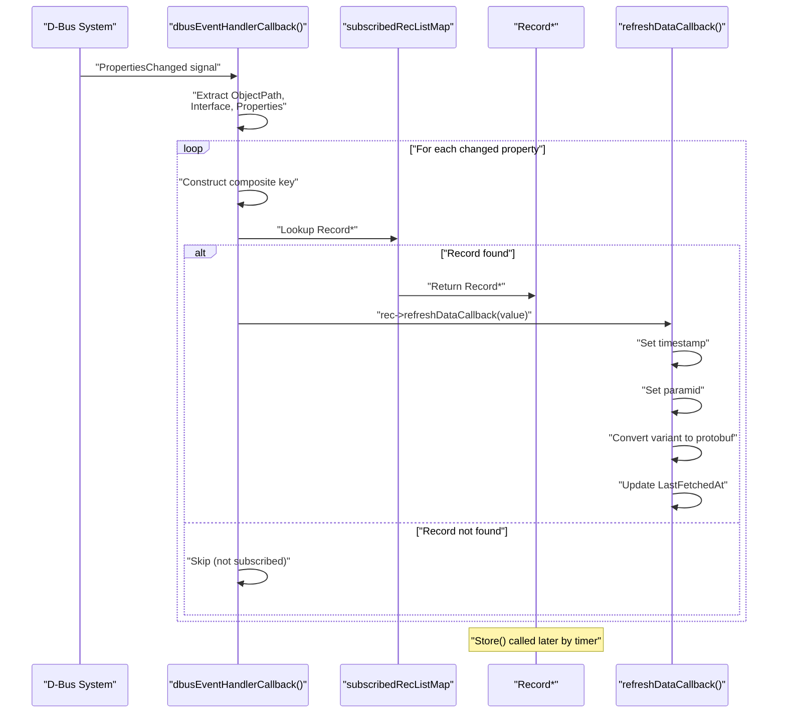

**Sources:** [fdr_events.cpp (implied from hpp)](), [fdr_record.cpp:623-648 (callback implementation)]()

### Decoupling Fetch from Store

**Key design principle:** Subscribe-type records decouple data freshness from storage rate.

- **Data freshness:** Immediate (updated on every D-Bus signal)
- **Storage rate:** Rate-limited by `StoreFreqSecs` timer
- **Benefit:** Capture all property changes without overwhelming storage

**Example:** Error counter with `StoreFreqSecs: 60`
- D-Bus signals arrive at 5-second intervals (when errors occur)
- `refreshDataCallback()` updates `data` field immediately
- `Store()` writes to disk only every 60 seconds
- Most recent value is always available when store timer fires

**Sources:** [fdr.cpp:704-707 (subscribe map initialization)](), [fdr.cpp:890-910 (store-only execution)]()

## Parameter Substitution

During Record construction, the system performs parameter substitution to support multi-instance components (e.g., GPU0, GPU1, GPU2...).

### Substitution Process

**Component params:** Each `Component_t` has a `Params` vector with `{name, value}` pairs (e.g., `{GPU_ID, "0"}`).

**Substitution targets:**
- `CommandParams.Command`
- `DbusParams.Service`
- `DbusParams.ObjectPath`
- `DbusParams.Interface`
- `DbusParams.Property`
- `ShmemParams.Key`

**Pattern:** `$param.name` is replaced with `param.value`

**Example:**
```yaml
Component:
  ID: GPU0
  Params:
    - name: GPU_ID
      value: "0"
  InfoGroups:
    - InfoList:
        - DbusParams:
            ObjectPath: "/xyz/openbmc_project/sensors/temperature/GPU$GPU_ID_Temp"
```

**Result:** `ObjectPath` becomes `/xyz/openbmc_project/sensors/temperature/GPU0_Temp`

**Sources:** [fdr_record.cpp:36-60]()

## Birth Certificate Collection

The birth certificate is a special one-time collection of all Inventory, Config, and Version data that occurs during FDR initialization.

### Birth Certificate Flow

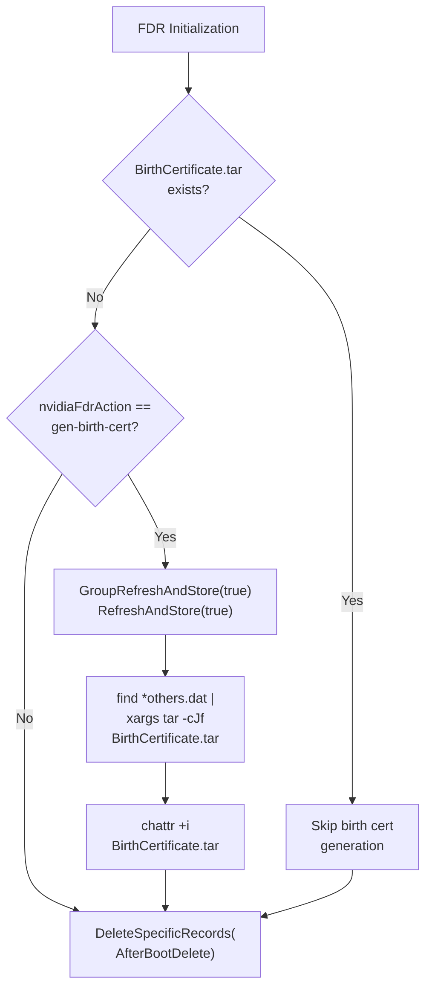

**Purpose:** Captures immutable system configuration at first boot for forensic analysis and system comparison.

**Immutability:** `chattr +i` makes file undeletable even by root to preserve forensic evidence.

**BootEvent records:** Parameters with special handling are deleted after birth certificate creation using `DeleteSpecificRecords("AfterBootDelete")`.

**Sources:** [fdr.cpp:767-832](), [fdr.cpp:748-762 (make immutable)]()

## Complete Data Collection Example

This example traces a single GPU temperature parameter through the entire pipeline:

**PPF Configuration:**
```yaml
Sections:
  - ID: GPU
    Components:
      - ID: GPU0
        Params:
          - name: GPU_ID
            value: "0"
        InfoGroups:
          - ID: Sensor.Thermal
            CompactionMethod: Average
            RecordRetentionPolicy: Recreate
            InfoList:
              - ID: GPU_Temp
                ParamID: 10001
                FetchType: Poll
                FetchMethod: DBUS
                FetchFreqSecs: 600
                StorePolicy: EveryFetch
                DataType: Uint64
                DbusParams:
                  Service: xyz.openbmc_project.Sensor.Value
                  ObjectPath: /xyz/openbmc_project/sensors/temperature/GPU0_Temp
                  Interface: xyz.openbmc_project.Sensor.Value
                  Property: Value
```

**Execution sequence:**

1. **Record Creation** (startup):
   - `CreateRecords()` instantiates `Record` object
   - Parameter substitution: `GPU$GPU_ID_Temp` → `GPU0_Temp`
   - Added to `RecListPollMap[600]`
   - `FDRStore` created for `GPU.GPU0.sensors.dat`
   - `FDRStore` created for `GPU.GPU0.sensors.stat.dat`

2. **Timer Initialization**:
   - 600-second timer created for `RecListPollMap[600]`
   - Timer callback set to `PollRecordTimerCBEngine(600)`

3. **First Fetch** (t=600s):
   - Timer fires → `PollRecordTimerCBEngine(600)`
   - Calls `RefreshAndStore(true, RecListPollMap[600])`
   - `Record::Refresh()` executes:
     - `dbus::readDbusProperty()` fetches value (e.g., `45.5°C`)
     - Returns `PropertyVariant` containing `double`
     - Extracts via `std::get_if<double>(&val)`
     - Converts to `uint64_t`: `45`
     - Sets `data.fdr_sample_data.set_paramvalueint64(45)`
     - Sets `data.fdr_sample_data.set_timestamp(current_time)`
     - Sets `data.fdr_sample_data.set_paramid(10001)`
     - Updates `LastFetchedAt`
   - `RunningStatisticEngine()`:
     - `numsamples = 1`
     - `avg = 45.0`
     - `min = 45.0`, `minvaltimestamp = current_time`
     - `max = 45.0`, `maxvaltimestamp = current_time`
     - `fromtime = current_time`
     - `totime = current_time`
   - `Record::Store()`:
     - Check policy: `EveryFetch`
     - `LastFetchedAt - LastStoredAt >= 600`? Yes (first time)
     - `fdrLogReaderWriter->append(data.fdr_sample_data)`
     - Writes to `GPU.GPU0.sensors.dat`
     - Updates `LastStoredAt`

4. **Subsequent Fetches** (t=1200s, 1800s...):
   - Same flow, accumulating statistics
   - Each fetch updates running min/max/avg
   - Each value written to `.sensors.dat`

5. **SubWindow Expiry** (t=1800s):
   - `CompactionSubWindowTimerCBEngine()` fires
   - `appendRunningStatToStatfile()` for all Average records:
     - Calculate `avg = sum / numsamples`
     - Round to 3 decimals
     - `fdrStatwriter->append(runningStatus)`
     - Writes to `GPU.GPU0.sensors.stat.dat`
     - `ResetRunningStat()` clears statistics

6. **Compaction Window Expiry** (t=86400s):
   - `CompactionWindowTimerCBEngine()` creates new directory
   - Old data moved to compaction queue
   - New `FDRStore` objects created for new directory
   - Record continues with fresh storage files

**Sources:** All sections above, integrated example

---

This completes the documentation of the data collection pipeline. The system provides a flexible, extensible framework for collecting telemetry from diverse sources with fine-grained control over fetch frequency, storage policies, and data retention strategies.

---

