<!-- source: DeepWiki mcp.deepwiki.com · repo NVIDIA/nvidia-fdr · page 4.3 Event Handling and Timers · fetched 2026-10-26 -->

# Event Handling and Timers

<details>
<summary>Relevant source files</summary>

The following files were used as context for generating this wiki page:

- [fdr.cpp](fdr.cpp)
- [fdr.hpp](fdr.hpp)
- [fdr_events.cpp](fdr_events.cpp)
- [fdr_events.hpp](fdr_events.hpp)
- [fdr_timers.cpp](fdr_timers.cpp)

</details>


## Purpose and Scope

This page describes the event-driven and timer-based execution model of the FDR system. It covers:
- The timer infrastructure for periodic data collection (Poll and GroupPoll fetch types)
- D-Bus signal subscription for event-driven data collection (Subscribe fetch type)
- The EventSignalHandler system for monitoring device errors and warnings
- Integration with the Book of Errors for error tracking

For information about the Record class and data collection methods, see [Records and Data Collection](#3.2). For details on the compaction system triggered by timers, see [Storage and Compaction System](#4.4).

Sources: [fdr.hpp:1-181](), [fdr_timers.cpp:1-397](), [fdr_events.cpp:1-391](), [fdr_events.hpp:1-78]()

## System Architecture Overview

The FDR system uses an event-driven architecture built on the `sdeventplus` library, combining multiple timer types with D-Bus signal handlers to orchestrate data collection.

```mermaid
graph TB
    subgraph "FlightDataRecorder_c Core"
        FdrEvents["FdrEvents<br/>(sdeventplus::Event)"]
        allFdrTimers["allFdrTimers<br/>(vector&lt;Timer&gt;)"]
        
        RecListPollMap["RecListPollMap<br/>(map&lt;int, vector&lt;Record*&gt;&gt;)<br/>Poll records by frequency"]
        RecListGrpPollMap["RecListGrpPollMap<br/>(map&lt;int, vector&lt;groupPollRecords&gt;&gt;)<br/>GroupPoll records by frequency"]
        RecListSubscribeStoreMap["RecListSubscribeStoreMap<br/>(map&lt;int, vector&lt;Record*&gt;&gt;)<br/>Subscribe records by store frequency"]
        
        subscribedRecListMap["subscribedRecListMap<br/>(unordered_map&lt;string, Record*&gt;)<br/>Fast O(1) lookup by composite key"]
        subscribedPaths["subscribedPaths<br/>(vector&lt;pair&lt;ObjectPath, Interface&gt;&gt;)"]
        eventHandlerMatcher["eventHandlerMatcher<br/>(vector&lt;unique_ptr&lt;match_t&gt;&gt;)<br/>D-Bus signal matchers"]
    end
    
    subgraph "Timer Callbacks"
        PollCB["PollRecordTimerCBEngine()<br/>Refresh & Store"]
        GrpPollCB["GroupPollRecordTimerCBEngine()<br/>Batch Refresh & Store"]
        SubsCB["SubscribeStoreRecordTimerCBEngine()<br/>Store only"]
        CompactCB["CompactionWindowTimerCBEngine()<br/>Trigger compaction"]
        SubCompactCB["CompactionSubWindowTimerCBEngine()<br/>Statistics generation"]
        LowSpaceCB["FdrLowSpaceMonitor<br/>Disk space check"]
    end
    
    subgraph "Event Handlers"
        EventSigHandler["EventSignalHandler<br/>Device error/warning events"]
        DbusEventHandler["dbusEventHandlerCallback()<br/>Property change events"]
    end
    
    subgraph "Integration Points"
        BookOfErrors["Book of Errors<br/>BookOfErrorEngine()"]
        Records["Record Objects<br/>Refresh() & Store()"]
        FdrGrpUpdate["FdrGrpUpdate<br/>RefreshAndStore()"]
    end
    
    FdrEvents --> allFdrTimers
    allFdrTimers --> PollCB
    allFdrTimers --> GrpPollCB
    allFdrTimers --> SubsCB
    allFdrTimers --> CompactCB
    allFdrTimers --> SubCompactCB
    allFdrTimers --> LowSpaceCB
    
    RecListPollMap --> PollCB
    RecListGrpPollMap --> GrpPollCB
    RecListSubscribeStoreMap --> SubsCB
    
    subscribedPaths --> eventHandlerMatcher
    eventHandlerMatcher --> DbusEventHandler
    subscribedRecListMap --> DbusEventHandler
    
    eventHandlerMatcher --> EventSigHandler
    
    PollCB --> Records
    GrpPollCB --> FdrGrpUpdate
    SubsCB --> Records
    DbusEventHandler --> Records
    
    EventSigHandler --> BookOfErrors
    DbusEventHandler --> BookOfErrors
```

Sources: [fdr.hpp:38-177](), [fdr_timers.cpp:233-389](), [fdr.cpp:574-746]()

## Timer Infrastructure

### Timer Type Hierarchy

The FDR system uses `sdeventplus::utility::Timer<clockId>` with `ClockId::Monotonic` for all timers. Each timer is associated with a specific callback function and interval.

| Timer Type | Purpose | Interval Source | Callback Function |
|------------|---------|----------------|-------------------|
| Poll Record Timer | Fetch and store Poll-type records | `InfoList.FetchFreqSecs` | `PollRecordTimerCBEngine()` |
| Group Poll Record Timer | Batch fetch and store GroupPoll records | `InfoList.FetchFreqSecs` | `GroupPollRecordTimerCBEngine()` |
| Subscribe Store Timer | Store Subscribe-type records | `InfoList.StoreFreqSecs` | `SubscribeStoreRecordTimerCBEngine()` |
| Compaction Window Timer | Trigger main compaction | `GeneralConfig.CompactionWindowSecs` (86400s) | `CompactionWindowTimerCBEngine()` |
| Compaction Sub-Window Timer | Generate statistics | `GeneralConfig.CompactionSubWindowSecs` (1800s) | `CompactionSubWindowTimerCBEngine()` |
| FDR Low Space Monitor | Check disk space | 600s (10 minutes) | Lambda monitoring disk usage |

Sources: [fdr.hpp:32-36](), [fdr_timers.cpp:233-389]()

### Timer Initialization

The `InitTimerEvents()` method creates and registers all timers during FDR initialization:

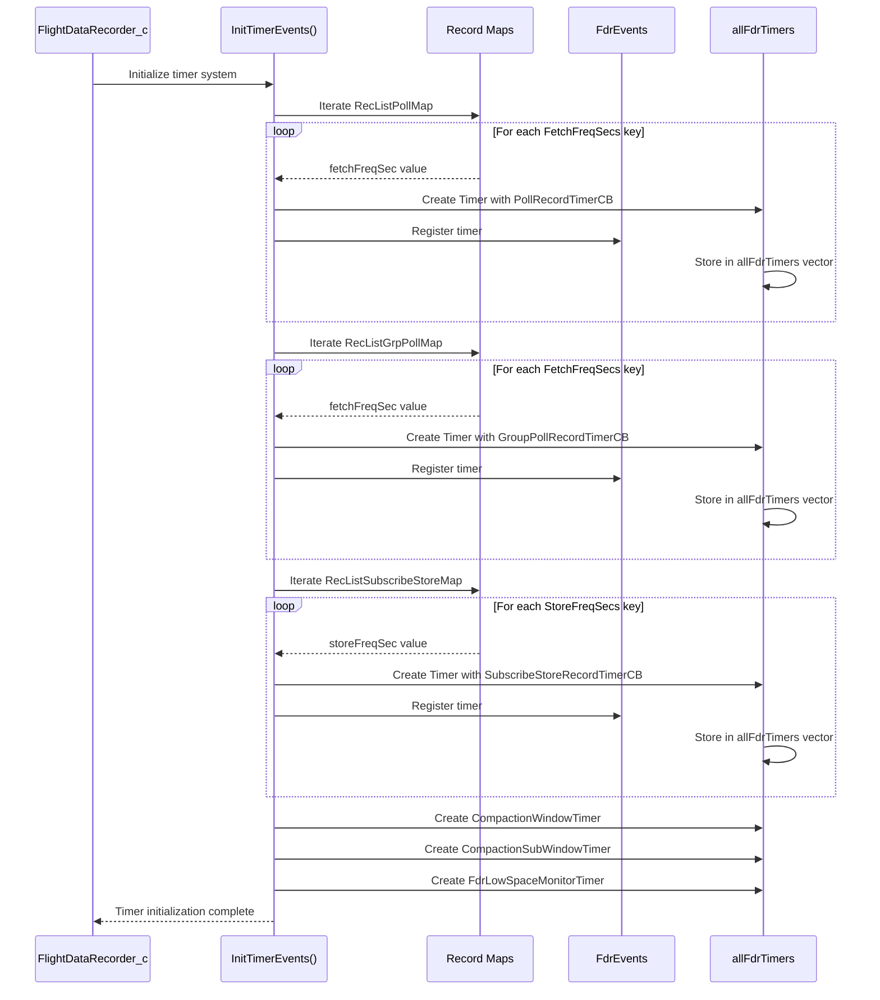

Sources: [fdr_timers.cpp:235-389](), [fdr.hpp:66-68]()

### Record Mapping by Fetch Type

During record creation in `CreateRecords()`, records are segregated into different maps based on their `FetchType`:

**Poll Type Records** → `RecListPollMap[FetchFreqSecs]`
- Key: `info.FetchFreqSecs` (e.g., 600, 3600)
- Value: `vector<Record*>` of all records with that frequency
- Timer triggers both `Refresh()` and `Store()` operations

**GroupPoll Type Records** → `RecListGrpPollMap[FetchFreqSecs]`
- Key: `info.FetchFreqSecs`
- Value: `vector<groupPollRecords>` where `groupPollRecords = pair<string, vector<Record*>>`
- Grouped by fetch method key (e.g., shared memory segment)
- Timer triggers batch refresh via `FdrGrpUpdate::RefreshAndStore()`

**Subscribe Type Records** → `RecListSubscribeStoreMap[StoreFreqSecs]`
- Key: `info.StoreFreqSecs` (note: store frequency, not fetch)
- Value: `vector<Record*>` of subscribed records
- Timer only triggers `Store()` (refresh happens via D-Bus signals)

Sources: [fdr.cpp:664-721](), [fdr.hpp:42-51]()

## Timer Callback Execution

### Poll Record Timer Flow

```mermaid
graph LR
    Timer["Timer fires<br/>after FetchFreqSecs"] --> CB["PollRecordTimerCBEngine(fetchFreqSecKey)"]
    CB --> Lookup["Lookup RecListPollMap[fetchFreqSecKey]"]
    Lookup --> RecList["Get vector&lt;Record*&gt;"]
    RecList --> RefreshStore["RefreshAndStore(true, recListPoll)"]
    
    RefreshStore --> Loop["For each Record*"]
    Loop --> Refresh["rec->Refresh(true)"]
    Refresh --> Store["rec->Store()"]
    Store --> ExcpCheck["CheckExceptionRateLimit()"]
    ExcpCheck --> Loop
```

Sources: [fdr_timers.cpp:144-165](), [fdr.cpp:836-863]()

### Group Poll Record Timer Flow

```mermaid
graph LR
    Timer["Timer fires<br/>after FetchFreqSecs"] --> CB["GroupPollRecordTimerCBEngine(fetchFreqSecKey)"]
    CB --> Lookup["Lookup RecListGrpPollMap[fetchFreqSecKey]"]
    Lookup --> RecList["Get vector&lt;groupPollRecords&gt;"]
    RecList --> GrpRefreshStore["GroupRefreshAndStore(true, recListGroupPoll)"]
    
    GrpRefreshStore --> Loop["For each groupPollRecords"]
    Loop --> Split["splitGroupFetchKeys(grp.first)"]
    Split --> FdrGrpUpdate["FdrGrpUpdate::RefreshAndStore(keys, records)"]
    FdrGrpUpdate --> BatchFetch["Batch fetch from shared memory"]
    BatchFetch --> StoreAll["Store all records in group"]
    StoreAll --> ExcpCheck["CheckExceptionRateLimit()"]
    ExcpCheck --> Loop
```

Sources: [fdr_timers.cpp:170-190](), [fdr.cpp:865-896]()

### Subscribe Store Timer Flow

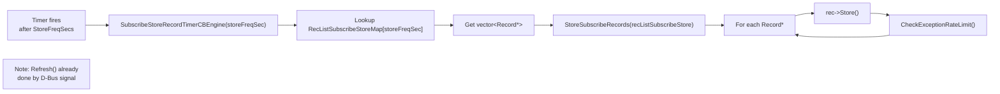

Sources: [fdr_timers.cpp:194-218](), [fdr.cpp:913-939]()

### Compaction Timer Flows

**Main Compaction Window Timer** (typically 86400s / 1 day):
- Calls `CompactionWindowTimerCBEngine()` → `Compactor(true)`
- Creates new directory for next collection window
- Triggers compaction of old directories
- See [Storage and Compaction System](#4.4) for details

**Sub-Window Timer** (typically 1800s / 30 minutes):
- Calls `CompactionSubWindowTimerCBEngine()` → `CheckCompactionSubWindowExpiry()`
- Generates running statistics for sensor data
- Creates `.sensors.stat.dat` files

Sources: [fdr_timers.cpp:220-231](), [fdr.cpp:1248-1435]()

## D-Bus Event Subscription

### Subscription Registration Architecture

FDR uses two mechanisms for D-Bus event monitoring:
1. **Property Change Subscriptions** - For monitoring specific D-Bus properties
2. **Device Error Event Subscriptions** - For monitoring device-level error events

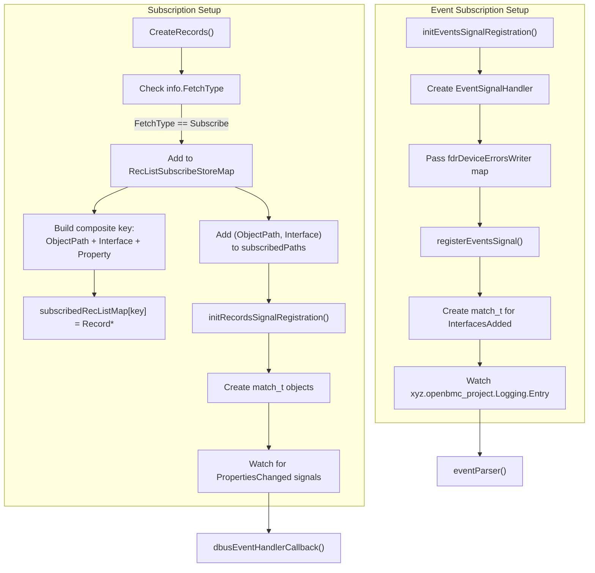

Sources: [fdr.cpp:574-746](), [fdr.cpp:1824-1905](), [fdr_events.cpp:304-335]()

### Property Change Signal Handler

The `dbusEventHandlerCallback()` is invoked when a D-Bus property changes:

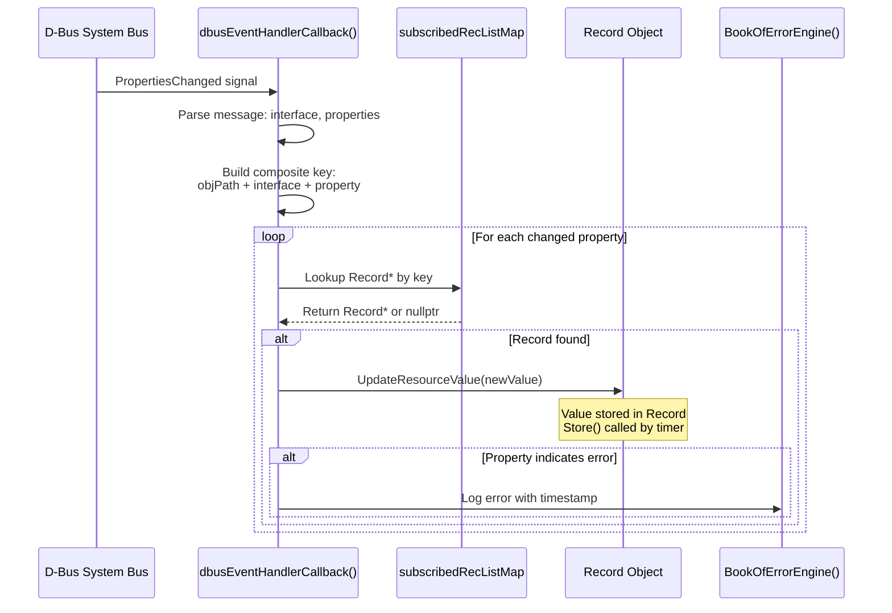

The composite key format is: `ObjectPath/Interface.Property`

Example: `/xyz/openbmc_project/sensors/temperature/GPU0_Temp/xyz.openbmc_project.Sensor.Value.Value`

Sources: [fdr.cpp:1824-1905](), [fdr.hpp:175-176]()

### subscribedRecListMap Optimization

The `subscribedRecListMap` provides O(1) lookup during D-Bus signal handling:

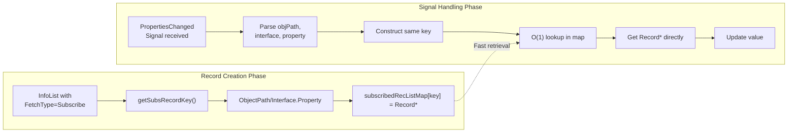

Key construction function: `getSubsRecordKey(objPath, interface, property)`

Sources: [fdr.cpp:703-716](), [fdr.hpp:135-137]()

## Device Error Event Handling

### EventSignalHandler Class

The `EventSignalHandler` monitors D-Bus for device error and warning events, particularly from the AML (Advanced Mezzanine Link) error reporting system:

| Component | Type | Purpose |
|-----------|------|---------|
| `eventObjPath` | `string` | D-Bus path to watch (e.g., `/xyz/openbmc_project/logging`) |
| `eventIface` | `string` | Interface to monitor (e.g., `org.freedesktop.DBus.ObjectManager`) |
| `eventMember` | `string` | Signal member name (e.g., `InterfacesAdded`) |
| `fdrDeviceErrorsWriter` | `map<string, pair<FDRStore, EventRecord>>` | Per-device writers for error logs |
| `eventHandlerMatcher` | `unique_ptr<match_t>` | D-Bus signal matcher |

Sources: [fdr_events.hpp:33-68](), [fdr_events.cpp:304-335]()

### Event Processing Flow

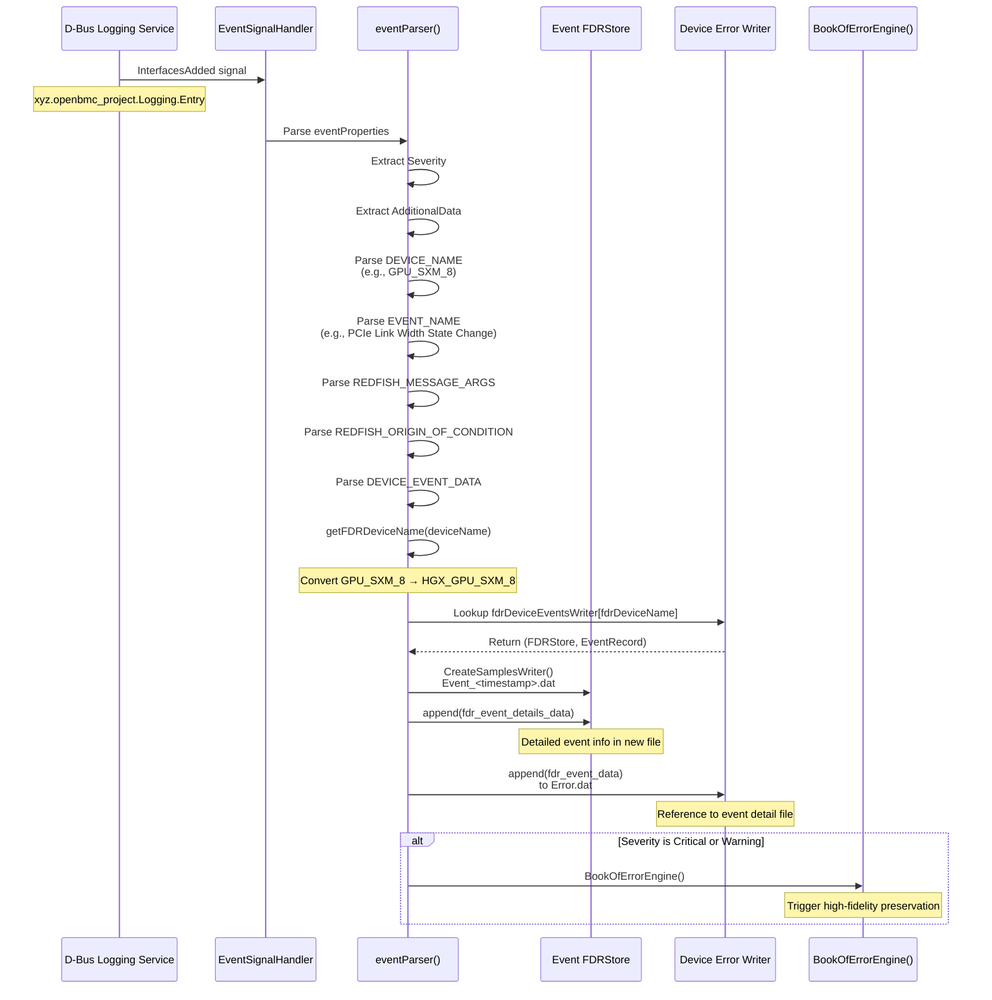

Sources: [fdr_events.cpp:124-302]()

### Event Message Structure

The D-Bus event message contains:

**Core Properties:**
- `Id` (uint32) - Event ID
- `Timestamp` (uint64) - Event timestamp in milliseconds
- `Severity` (string) - Error severity level
- `Message` (string) - Error message
- `Resolved` (boolean) - Resolution status

**AdditionalData Array:**
- `DEVICE_NAME` - Device identifier (e.g., `GPU_SXM_8`)
- `EVENT_NAME` - Error description (e.g., `PCIe Link Width State Change`)
- `RECOVERY_TYPE` - Recovery mechanism (e.g., `property_change`)
- `REDFISH_MESSAGE_ARGS` - Formatted error details
- `REDFISH_MESSAGE_ID` - Redfish message ID (e.g., `ResourceEvent.1.0.ResourceErrorsDetected`)
- `REDFISH_ORIGIN_OF_CONDITION` - D-Bus path of affected component
- `DEVICE_EVENT_DATA` - Additional device-specific data

Sources: [fdr_events.cpp:68-122](), [fdr_events.cpp:133-278]()

### Device Name Translation

The `getFDRDeviceName()` function translates between D-Bus/HMC device naming conventions and FDR naming:

| D-Bus/HMC Name | FDR Name | Translation Rule |
|----------------|----------|------------------|
| `GPU_SXM_1` | `HGX_GPU_SXM_1` | Extract device ID, prepend `HGX_GPU_SXM_` |
| `NVSwitch_0` | `HGX_NVSwitch_0` | Extract device ID, prepend `HGX_NVSwitch_` |
| `HGX_Baseboard_0` | `HGX_Chassis_0` | Extract device ID, prepend `HGX_Chassis_` |

Sources: [fdr_events.cpp:27-66]()

### Event File Organization

When an error event occurs, FDR creates two related files:

**Event Detail File:**
- Path: `BootCount_<id>_<timestamp>/<Section>/<Component>/Event_<event_timestamp>.dat`
- Content: `fdr_event_details` protobuf message
- Contains: Full event metadata, error message, origin of condition, additional info

**Event Reference in Error.dat:**
- Path: `BootCount_<id>_<timestamp>/<Section>/<Component>/Error.dat`
- Content: `fdr_event` protobuf message
- Contains: Event timestamp, event name, path to detail file

Example:
```
/var/emmc/fdr/BootCount_5_1234567890/
├── GPU/
│   └── HGX_GPU_SXM_8/
│       ├── Error.dat                    # References to all events
│       ├── Event_1703001234.dat         # Detailed event info
│       └── Event_1703002345.dat         # Another event
```

Sources: [fdr_events.cpp:232-273](), [fdr.cpp:539-572]()

## Book of Errors Integration

### Book of Errors Overview

The Book of Errors is a critical component that tracks all device errors and warnings, enabling the compaction system to preserve high-fidelity data around error occurrences.

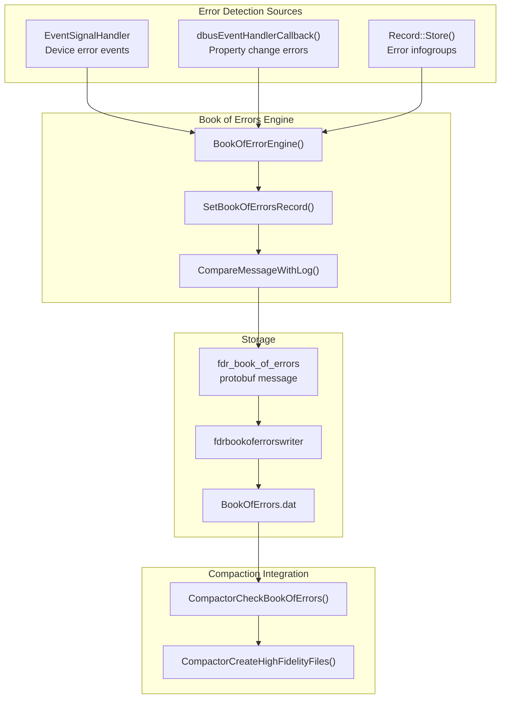

Sources: [fdr.cpp:1636-1730](), [fdr_events.cpp:280-302]()

### BookOfErrorEngine Execution

The `BookOfErrorEngine()` is called when an error is detected:

**Parameters:**
- `infoID` (string) - InfoGroup ID (e.g., "Error", "FAULTS")
- `paramID` (unsigned int) - Parameter ID from PPF (e.g., 9999 for events)
- `componentID` (string) - Component identifier (e.g., "GPU0")
- `current_time` (time_t) - Error timestamp
- `val` (PropertyVariant) - Error value or description

**Processing:**
1. Populate `fdr_book_of_errors` protobuf message:
   - `set_paramid(paramID)`
   - `set_compid(componentID)`
   - `set_errormessage(val)` - Converted to string
   - `set_timestamp(current_time)`

2. Check for duplicate with `CompareMessageWithLog()`:
   - Compare paramID, componentID, and error message
   - Skip if already logged (reduces BookOfErrors.dat size)

3. Append to `BookOfErrors.dat` via `fdrbookoferrorswriter`

Sources: [fdr.cpp:1636-1730](), [fdr.hpp:118-122]()

### Error Data Preservation

When the compaction system processes directories, it checks the Book of Errors to preserve high-fidelity data:

**High-Fidelity Window:** `HiFiDataPreserveTimeSecs` (typically 300 seconds / 5 minutes)

For each error in BookOfErrors.dat:
- Calculate window: `[error_timestamp - 300s, error_timestamp + 300s]`
- Extract all samples in this window from raw `.sensors.dat` files
- Write to `.sensors.hifi.dat` files
- Preserve full-resolution data around errors

This mechanism ensures detailed telemetry is available for root cause analysis even after compaction.

Sources: [fdr.cpp:1450-1552]()

## Event Loop Execution

### Main Event Loop

The `RunEventLoop()` method starts the event processing:

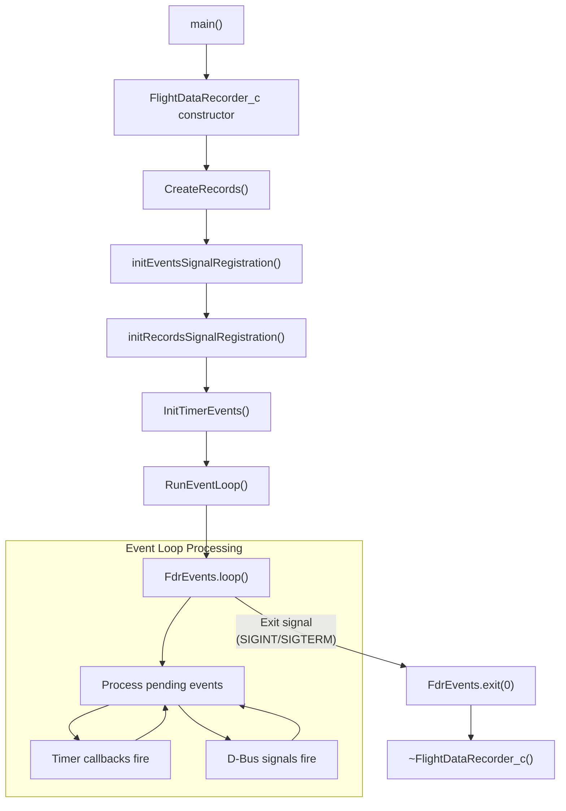

The event loop runs indefinitely until a termination signal is received:
- `SIGINT` (Ctrl+C)
- `SIGTERM` (systemd stop)

Sources: [fdr_timers.cpp:391-397](), [fdr.cpp:161-166]()

### Signal Handler Registration

FDR registers handlers for termination signals during construction:

```cpp
// From fdr.cpp:161-166
stdplus::signal::block(SIGINT);
Signal(FdrEvents, SIGINT, sigCb).set_floating(true);
stdplus::signal::block(SIGTERM);
Signal(FdrEvents, SIGTERM, sigCb).set_floating(true);
```

The `sigCb` callback simply calls `signal.get_event().exit(0)` to gracefully terminate the event loop.

Sources: [fdr.cpp:50-53](), [fdr.cpp:161-166]()

## Exception Rate Limiting

### LeakyBucket Rate Limiter

FDR implements exception rate limiting to prevent cascading failures from overwhelming the system:

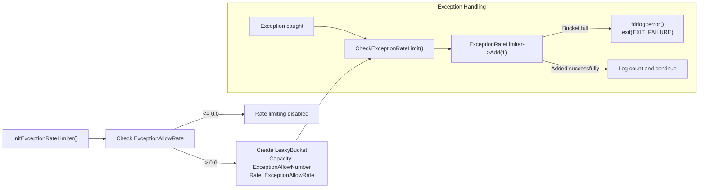

**Configuration Parameters (from PPF):**
- `ExceptionAllowNumber` - Bucket capacity (max exceptions allowed)
- `ExceptionAllowRate` - Token refill rate (exceptions per second)

**Behavior:**
- If rate = 0.0, rate limiting is disabled (FDR never exits due to exceptions)
- Tokens are consumed when exceptions occur
- Tokens refill at the specified rate
- When bucket is full, FDR exits to prevent indefinite error loops

Sources: [fdr.cpp:168-209](), [fdr.cpp:858-861](), [fdr.cpp:891-894]()

## Summary

The event handling and timer system provides:

1. **Periodic Data Collection**: Timers trigger data collection at configured intervals
2. **Event-Driven Updates**: D-Bus signals enable real-time monitoring of property changes
3. **Error Tracking**: EventSignalHandler and Book of Errors capture device errors
4. **Resource Efficiency**: Subscribe-type records reduce polling overhead
5. **High-Fidelity Preservation**: Error events trigger detailed data retention
6. **Graceful Degradation**: Exception rate limiting prevents cascading failures

The architecture separates concerns:
- **Timers** handle periodic operations (Poll, GroupPoll, Compaction)
- **D-Bus Signals** handle asynchronous events (Subscribe, Error events)
- **Maps** organize records by execution schedule
- **Book of Errors** coordinates high-fidelity data preservation

This event-driven design enables FDR to efficiently collect telemetry while maintaining responsiveness to critical system events.

Sources: [fdr.hpp:1-181](), [fdr.cpp:1-2323](), [fdr_timers.cpp:1-397](), [fdr_events.cpp:1-391](), [fdr_events.hpp:1-78]()

---

