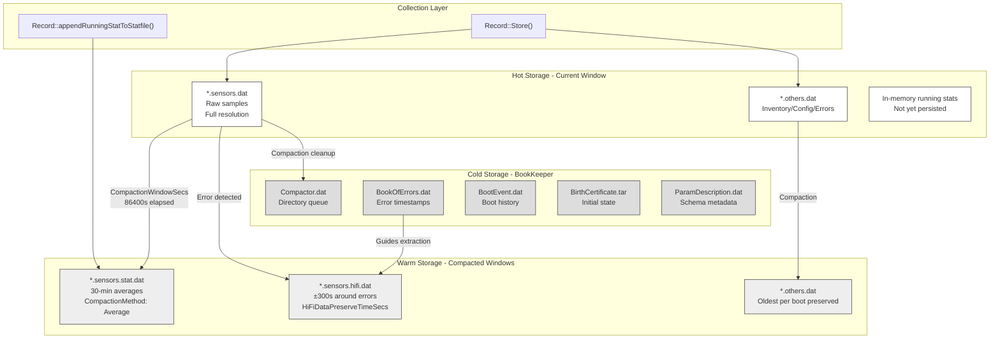
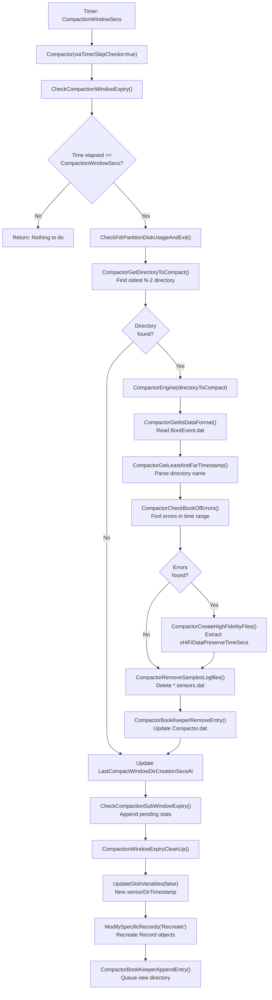
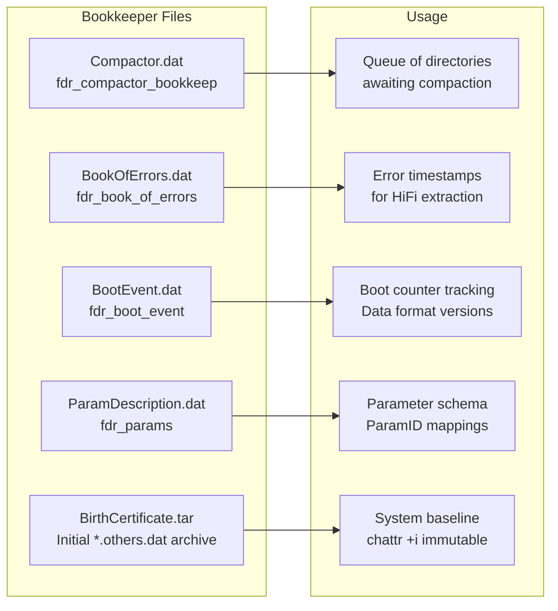
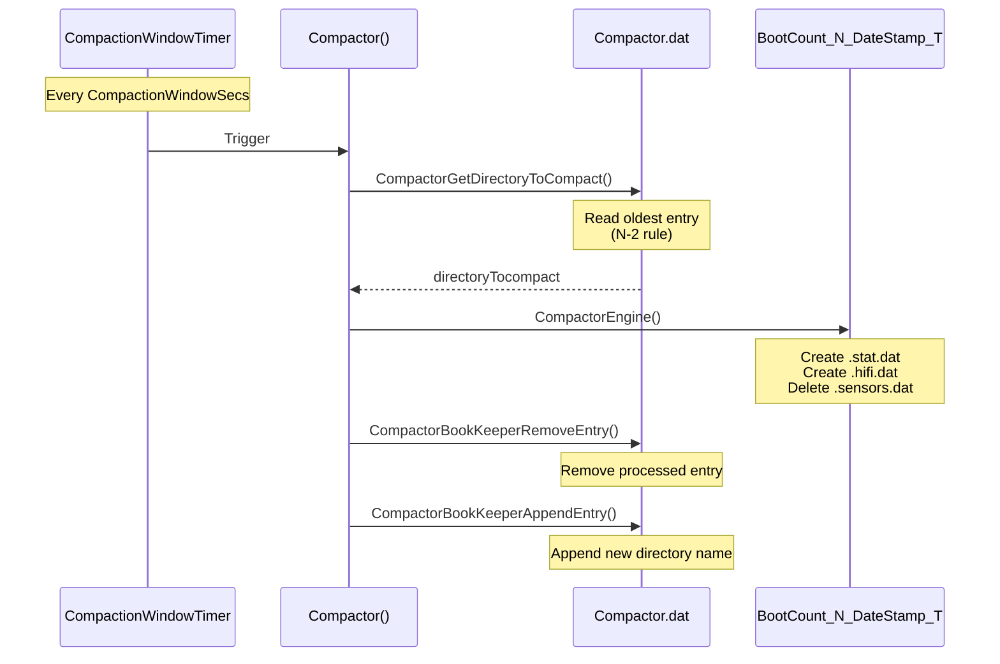
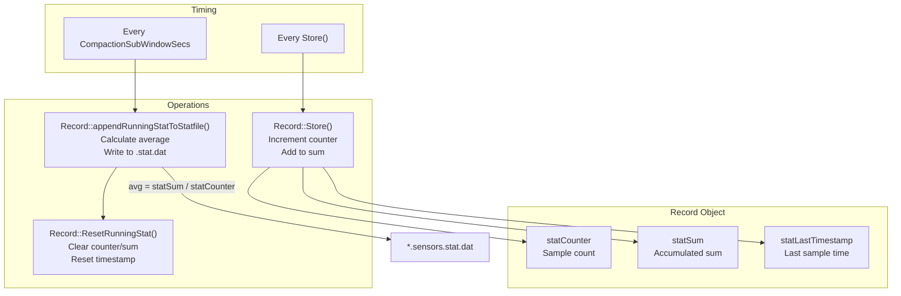
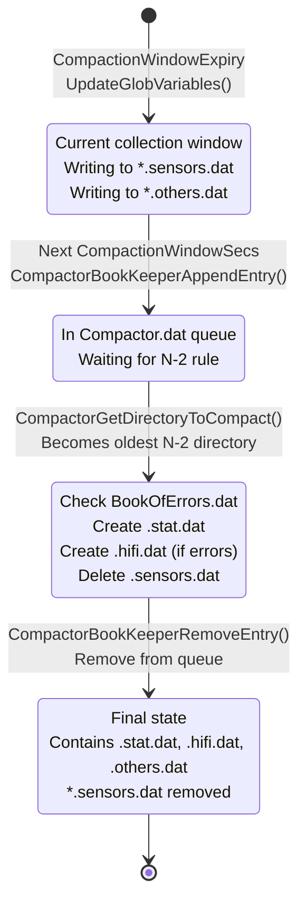
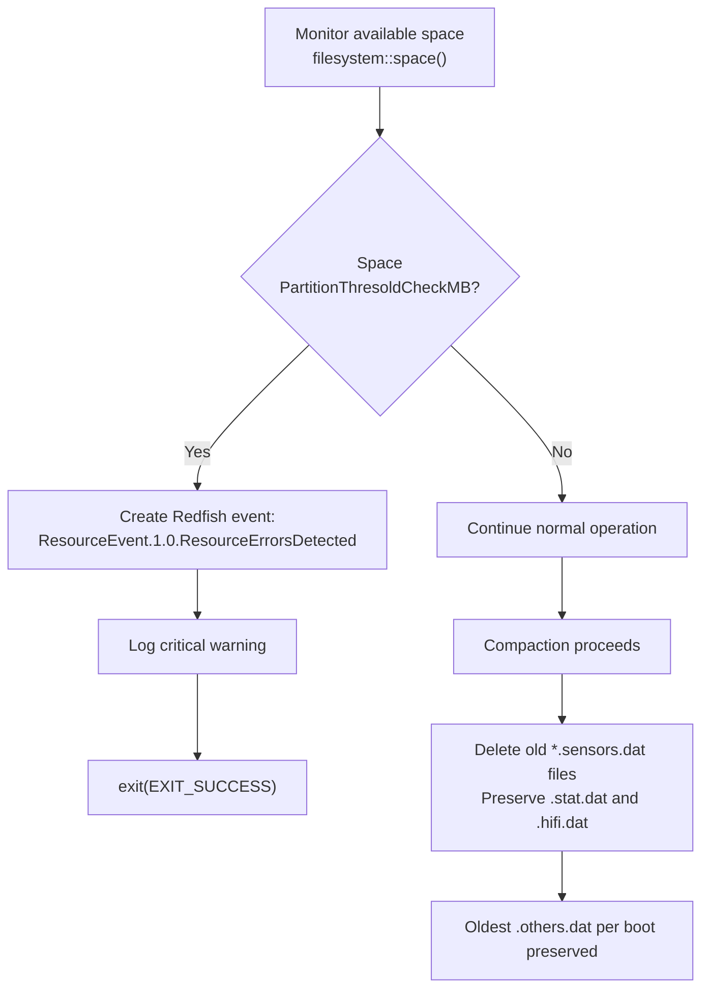

<!-- source: DeepWiki mcp.deepwiki.com · repo NVIDIA/nvidia-fdr · page 4.4 Storage and Compaction System · fetched 2026-10-26 -->

# Storage and Compaction System

<details>
<summary>Relevant source files</summary>

The following files were used as context for generating this wiki page:

- [fdr.cpp](fdr.cpp)
- [fdr.hpp](fdr.hpp)
- [fdr_compact.cpp](fdr_compact.cpp)
- [fdr_events.cpp](fdr_events.cpp)
- [fdr_events.hpp](fdr_events.hpp)
- [fdr_timers.cpp](fdr_timers.cpp)
- [platforms/fdr_ppf_example.yaml](platforms/fdr_ppf_example.yaml)
- [platforms/fdr_ppf_vulcan.yaml](platforms/fdr_ppf_vulcan.yaml)

</details>


## Purpose and Scope

This document describes the FDR storage and compaction subsystem, which manages how telemetry data is organized on disk, when and how historical data is compacted to save space, and how high-fidelity data is preserved around error events. This covers directory structure, file organization, the compaction engine, statistics generation, and BookKeeper file management.

For information about the binary protobuf format and encoding details, see [Storage Format and Protobuf](#3.3). For how data flows from collection to storage, see [Data Collection Pipeline](#4.2). For the overall system orchestration, see [FlightDataRecorder_c Core System](#4.1).

---

## Storage Directory Structure

### Base Layout

FDR uses a hierarchical directory structure rooted at `LogsBasePath` (typically `/var/emmc/fdr/`):

```
/var/emmc/fdr/
├── Bookkeeper/
│   ├── Compactor.dat
│   ├── BookOfErrors.dat
│   ├── BootEvent.dat
│   ├── ParamDescription.dat
│   └── BirthCertificate.tar
├── BootCount_1_DateStamp_1234567890/
│   ├── GPU.GPU0.sensors.dat
│   ├── GPU.GPU0.others.dat
│   ├── GPU.GPU1.sensors.dat
│   ├── GPU.GPU1.others.dat
│   ├── NIC.NIC0.sensors.dat
│   └── ...
├── BootCount_1_DateStamp_1234654290/
│   ├── GPU.GPU0.sensors.stat.dat
│   ├── GPU.GPU0.sensors.hifi.dat
│   ├── GPU.GPU0.others.dat
│   └── ...
└── ...
```

### Directory Naming Convention

Boot directories follow the pattern: `BootCount_<id>_DateStamp_<timestamp>`

- **BootCount**: Incremented on each HMC reboot, tracked via `BootEvent.dat`
- **DateStamp**: Fixed string
- **Timestamp**: Unix epoch seconds when directory was created

The directory name is generated by `GetDirectoryName()` using global variables `bootCounter` and `sensorDirTimestamp`:

| Global Variable | Purpose | Updated When |
|----------------|---------|--------------|
| `bootCounter` | Current boot cycle ID | FDR initialization, read from `BootEvent.dat` |
| `sensorDirTimestamp` | Current collection window timestamp | FDR initialization, compaction window expiry |
| `LastCompactWindowDirCreationSecsAt` | Time of last main window creation | Compaction window expiry |
| `LastCompactSubWindowDirCreationSecsAt` | Time of last stat file append | Sub-window expiry |

**Sources:** [fdr.cpp:33-34](), [fdr.cpp:152-153](), [fdr.hpp:53-59]()

### File Naming Convention

Within each boot directory, files are named: `<Section>.<Component>.<type>.dat`

| File Type | Pattern | Purpose | Created When |
|-----------|---------|---------|--------------|
| `.sensors.dat` | `GPU.GPU0.sensors.dat` | Raw sensor readings (high-frequency) | Every fetch for `Sensor.*` InfoGroups |
| `.others.dat` | `GPU.GPU0.others.dat` | Non-sensor data (inventory, config, errors) | Every fetch for non-sensor InfoGroups |
| `.sensors.stat.dat` | `GPU.GPU0.sensors.stat.dat` | Aggregated statistics (averages) | Sub-window timer expiry |
| `.sensors.hifi.dat` | `GPU.GPU0.sensors.hifi.dat` | High-fidelity data around errors | Compaction when errors detected |
| `Event_<ts>.dat` | `GPU.GPU0.Event_1234567890.dat` | Individual error event details | Error event occurs |

**Sources:** [fdr.cpp:524-572](), [fdr_compact.cpp:406-412]()

---

## Storage Tier Architecture



**Sources:** [fdr.cpp:524-644](), [fdr_compact.cpp:179-246](), [fdr_compact.cpp:285-333]()

---

## Compaction Window System

### Window Types and Configuration

FDR uses a two-tier compaction window system:

| Window Type | PPF Config | Typical Value | Purpose |
|------------|-----------|---------------|---------|
| Main Window | `CompactionWindowSecs` | 86400 (1 day) | Creates new boot directory, triggers compaction |
| Sub Window | `CompactionSubWindowSecs` | 1800 (30 min) | Appends statistics to `.stat.dat` files |
| Error Window | `HiFiDataPreserveTimeSecs` | 300 (5 min) | Time range around errors to preserve |

**Sources:** [platforms/fdr_ppf_vulcan.yaml:29-31](), [platforms/fdr_ppf_example.yaml:60-62]()

### Compaction Workflow



**Sources:** [fdr_compact.cpp:129-176](), [fdr_compact.cpp:179-246](), [fdr_compact.cpp:252-282]()

### Key Compaction Functions

| Function | Purpose | File:Lines |
|----------|---------|-----------|
| `FlightDataRecorder_c::Compactor()` | Main compaction orchestrator | [fdr_compact.cpp:129-176]() |
| `CheckCompactionWindowExpiry()` | Checks if main window expired, initiates compaction | [fdr_compact.cpp:179-246]() |
| `CheckCompactionSubWindowExpiry()` | Checks if sub-window expired, appends stats | [fdr_compact.cpp:285-333]() |
| `CompactorEngine()` | Core compaction logic for one directory | [fdr_compact.cpp:709-862]() |
| `CompactorGetDirectoryToCompact()` | Finds oldest directory to compact (N-2 rule) | [fdr_compact.cpp:865-983]() |
| `CompactorCreateHighFidelityFiles()` | Extracts data around errors to `.hifi.dat` | [fdr_compact.cpp:384-488]() |
| `CompactorRemoveSamplesLogfiles()` | Deletes raw `.sensors.dat` files | [fdr_compact.cpp:492-532]() |

**Sources:** [fdr_compact.cpp:1-862](), [fdr.hpp:92-115]()

---

## BookKeeper System

### BookKeeper Files

The `Bookkeeper/` directory contains metadata files that persist across boot cycles:



| File | Protobuf Message | Purpose | Writer | Reader |
|------|------------------|---------|--------|--------|
| `Compactor.dat` | `fdr_compactor_bookkeep` | Tracks which directories need compaction | [fdr_compact.cpp:536-541]() | [fdr_compact.cpp:709-748]() |
| `BookOfErrors.dat` | `fdr_book_of_errors` | Logs error events with timestamps | [fdr.cpp:1466-1486]() | [fdr_compact.cpp:23-127]() |
| `BootEvent.dat` | `fdr_boot_event` | Records boot events and data format versions | [fdr.cpp:1197-1216]() | [fdr_compact.cpp:674-707]() |
| `ParamDescription.dat` | `fdr_params` | Parameter metadata (ID, type, class) | [fdr.cpp:727-737]() | Analysis tools |
| `BirthCertificate.tar` | Archive | Initial system state snapshot | [fdr.cpp:767-819]() | N/A |

**Sources:** [fdr.hpp:60-65](), [fdr.cpp:577-582](), [fdr_compact.cpp:536-669]()

### Compactor.dat Management

The `Compactor.dat` file maintains a queue of directories pending compaction:



**Operations:**

- **Append**: [fdr_compact.cpp:536-541]() - Adds new directory to queue
- **Remove**: [fdr_compact.cpp:544-669]() - Removes processed directory, handles corruption
- **Read**: [fdr_compact.cpp:865-983]() - Finds oldest N-2 directory to compact
- **Clean**: [fdr.cpp:1377-1402]() - Removes invalid entries on startup

**Sources:** [fdr_compact.cpp:536-669](), [fdr.cpp:158-159]()

---

## High-Fidelity Error Preservation

### Book of Errors Integration

When errors occur, FDR preserves high-resolution data around the error timestamp by extracting samples from `.sensors.dat` into `.sensors.hifi.dat` files.

```mermaid
flowchart LR
    A["Error Event Detected"] --> B["BookOfErrorEngine()"]
    B --> C["fdr_book_of_errors entry<br/>erroroccurtimestamp<br/>deviceinstance<br/>paramid"]
    C --> D["BookOfErrors.dat append"]
    
    D --> E["Later: CompactionWindowSecs expired"]
    E --> F["CompactorCheckBookOfErrors()"]
    F --> G{"Errors in<br/>time range?"}
    
    G -- Yes --> H["Calculate time windows:<br/>startHiFiTimestamp<br/>stopHiFiTimestamp"]
    H --> I["CompactorCreateHighFidelityFiles()"]
    I --> J["Read *.sensors.dat<br/>Filter by timestamp range<br/>Write to *.sensors.hifi.dat"]
    
    G -- No --> K["CompactorRemoveSamplesLogfiles()"]
    
    J --> K
```



**Time Window Calculation:**

```
Error occurs at timestamp T
startHiFiTimestamp = T - HiFiDataPreserveTimeSecs
stopHiFiTimestamp = T + HiFiDataPreserveTimeSecs
```

For `HiFiDataPreserveTimeSecs = 300`:
- Error at T=1000
- Preserve samples from [700, 1300]
- Total window: 600 seconds (10 minutes)

**Sources:** [fdr_compact.cpp:23-127](), [fdr_compact.cpp:384-488](), [fdr.cpp:1410-1492]()

### Book of Errors Schema

```protobuf
message fdr_book_of_errors {
    uint64 erroroccurtimestamp;      // Error event timestamp
    string bootid;                   // Boot cycle ID
    uint32 paramid;                  // Parameter ID
    string deviceinstance;           // Component ID (e.g., "GPU0")
    string errortype;                // Error description
    uint64 startHiFiTimestamp;       // Calculated by compactor
    uint64 stopHiFiTimestamp;        // Calculated by compactor
}
```

**Sources:** [fdr_compact.cpp:88-95](), [fdr.cpp:1462-1486]()

---

## Statistics Generation

### Running Statistics Mechanism

For InfoGroups with `CompactionMethod: Average`, FDR maintains in-memory running statistics:



**Statistics Workflow:**

1. Each `Record::Store()` call increments `statCounter` and adds value to `statSum`
2. Every `CompactionSubWindowSecs` (e.g., 1800s), the timer triggers `CheckCompactionSubWindowExpiry()`
3. For each record with `CompactionMethod: Average`:
   - Call `appendRunningStatToStatfile()` to write average to `.stat.dat`
   - Call `ResetRunningStat()` to clear accumulators
4. Process repeats

**Sources:** [fdr_record.cpp:329-374](), [fdr_compact.cpp:317-327](), [fdr_timers.cpp:227-231]()

### Statistics File Format

Statistics files (`.sensors.stat.dat`) use the same `fdr_sample` protobuf message but contain averaged values:

```protobuf
message fdr_sample {
    uint64 timestamp;        // Window end timestamp
    uint32 paramid;          // Parameter ID
    oneof value {
        string stringvalue;
        int64 intvalue;
        uint64 uintvalue;
        double doublevalue;  // Averaged value for numeric types
    }
}
```

**Sources:** [fdr_record.cpp:345-374](), [fdr_compact.cpp:317-323]()

---

## Data Retention Policy

### Compaction Method Types

| Method | PPF Config | Behavior | Files Generated |
|--------|-----------|----------|-----------------|
| `Average` | `CompactionMethod: Average` | Generate statistics, preserve HiFi data | `.stat.dat`, `.hifi.dat` (if errors) |
| `Recreate` | `RecordRetentionPolicy: Recreate` | Recreate records on new window | New `.dat` files in new directory |

**Sources:** [platforms/fdr_ppf_vulcan.yaml:32-34](), [fdr.cpp:639-644]()

### Directory Lifecycle



**N-2 Compaction Rule:**

FDR compacts directories that are at least 2 windows old (`RUN_TIME_DIR_COUNT = 2`):

- **Window 0**: Active collection (current window)
- **Window 1**: Recently closed (N-1), waiting
- **Window 2**: Eligible for compaction (N-2)
- **Window 3+**: Already compacted or pending

This ensures that:
1. Current data is never compacted during active collection
2. Recent data remains available for immediate error correlation
3. Errors occurring near window boundaries can still capture HiFi data

**Sources:** [fdr_compact.cpp:206-237](), [fdr_compact.cpp:865-983](), [fdr.cpp:252-282]()

---

## Disk Space Management

### Partition Threshold Checks

FDR monitors available disk space and exits when storage is critically low:

| Check Point | Function | Threshold Config | Action |
|------------|----------|------------------|--------|
| FDR Initialization | `CheckFdrPartitionDiskUsageAndExit()` | `PartitionThresoldCheckMB` | Exit if space < threshold |
| Compaction Window Expiry | `CheckFdrPartitionDiskUsageAndExit()` | `PartitionThresoldCheckMB` | Exit if space < threshold |
| Sub-Window Expiry | `CheckFdrPartitionDiskUsageAndExit()` | `PartitionThresoldCheckMB` | Exit if space < threshold |
| Low Space Monitor Timer | `warnFdrLowSpace()` | 1.5 GB warning | Log warning every 10 minutes |

**Threshold Check Logic:**

```cpp
availableSpaceMB = filesystem::space(LogsBasePath).available / ONE_MB;
if (availableSpaceMB <= PartitionThresoldCheckMB) {
    // Create Redfish event
    // Log critical warning
    exit(EXIT_SUCCESS);  // Clean exit
}
```

**Sources:** [fdr.cpp:342-392](), [fdr_compact.cpp:198](), [fdr_compact.cpp:315](), [fdr_timers.cpp:374-387]()

### Space Management Strategy



**Configuration Example:**

```yaml
GeneralConfig:
  PartitionThresoldCheckMB: 1536  # 1.5 GB minimum free space
  LogsBasePath: "/var/emmc/fdr/"
```

**Sources:** [fdr.cpp:342-392](), [platforms/fdr_ppf_vulcan.yaml:28](), [fdr_timers.cpp:374-387]()

---

## Code Entity Map

### Core Storage Classes and Functions

| Component | Class/Function | Responsibility | Source |
|-----------|---------------|----------------|--------|
| **Storage Writer** | `FDRStore` | Binary/JSON file I/O, protobuf serialization | [fdr_store.hpp]() |
| **Sample Writer Creation** | `CreateSamplesWriter()` | Creates FDRStore objects for component data | [fdr.cpp:524-572]() |
| **BookKeeper Writer** | `CreateKeeperWriter()` | Creates FDRStore for metadata files | [fdr.cpp:491-521]() |
| **Directory Name** | `GetDirectoryName()` | Formats `BootCount_X_DateStamp_Y` | [fdr_utils.cpp]() |
| **Global Variables** | `bootCounter`, `sensorDirTimestamp` | Track current boot and collection window | [fdr.cpp:33-34]() |

### Compaction Entry Points

| Timer Callback | Triggers | Worker Function | File:Lines |
|----------------|----------|-----------------|-----------|
| `CompactionWindowTimerCB` | Every `CompactionWindowSecs` | `CompactionWindowTimerCBEngine()` | [fdr_timers.cpp:221-224]() |
| `CompactionSubWindowTimerCB` | Every `CompactionSubWindowSecs` | `CompactionSubWindowTimerCBEngine()` | [fdr_timers.cpp:227-231]() |

### Compaction Operations

| Operation | Function | Called By | Purpose |
|-----------|----------|-----------|---------|
| Main orchestrator | `Compactor(bool viaTimerSkipChecks)` | Timer callback | [fdr_compact.cpp:129-176]() |
| Window check | `CheckCompactionWindowExpiry()` | `Compactor()` | [fdr_compact.cpp:179-246]() |
| Sub-window check | `CheckCompactionSubWindowExpiry()` | `Compactor()` | [fdr_compact.cpp:285-333]() |
| Core engine | `CompactorEngine(string dir)` | `CheckCompactionWindowExpiry()` | [fdr_compact.cpp:709-862]() |
| Directory selection | `CompactorGetDirectoryToCompact()` | `CheckCompactionWindowExpiry()` | [fdr_compact.cpp:865-983]() |
| Error extraction | `CompactorCheckBookOfErrors()` | `CompactorEngine()` | [fdr_compact.cpp:23-127]() |
| HiFi creation | `CompactorCreateHighFidelityFiles()` | `CompactorEngine()` | [fdr_compact.cpp:384-488]() |
| Cleanup | `CompactorRemoveSamplesLogfiles()` | `CompactorEngine()` | [fdr_compact.cpp:492-532]() |

**Sources:** [fdr.hpp:92-115](), [fdr_compact.cpp:1-862](), [fdr_timers.cpp:221-231]()

---

