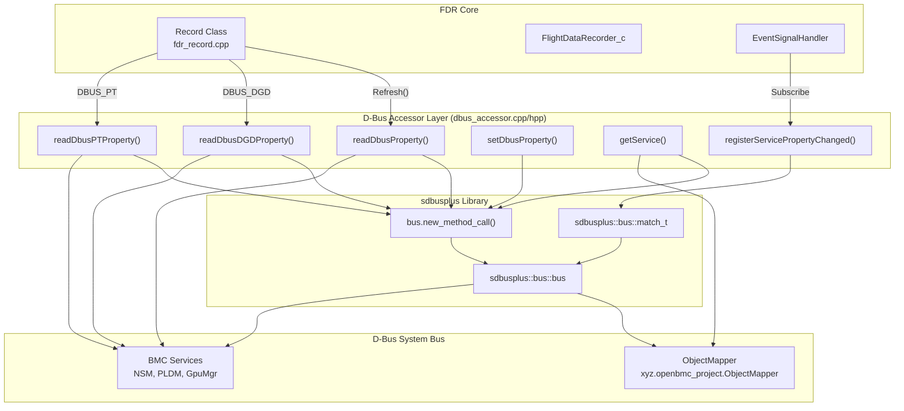
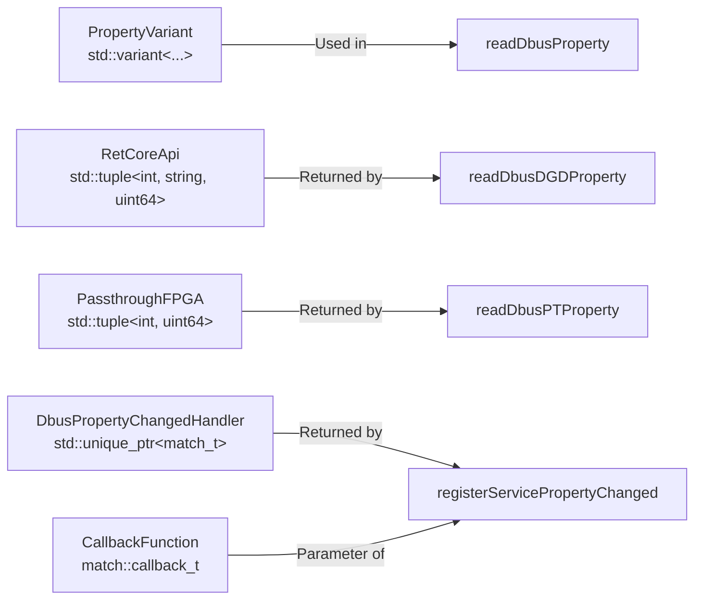
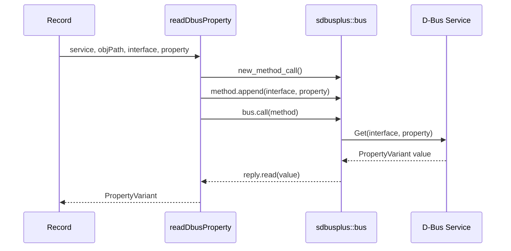
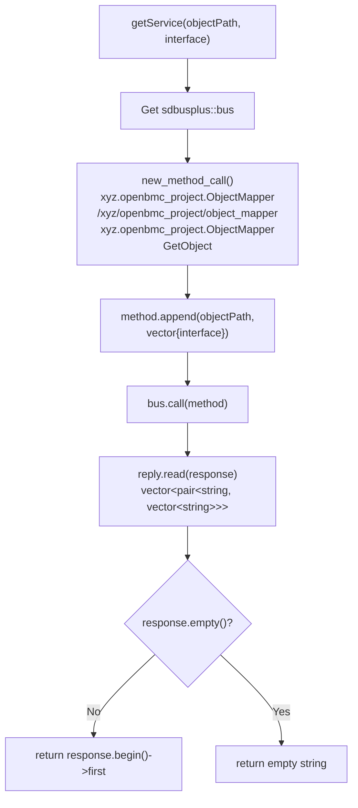
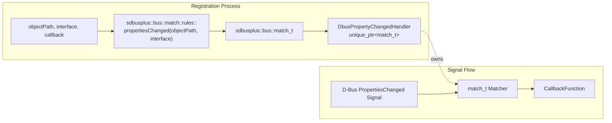
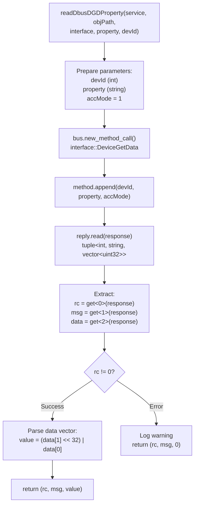
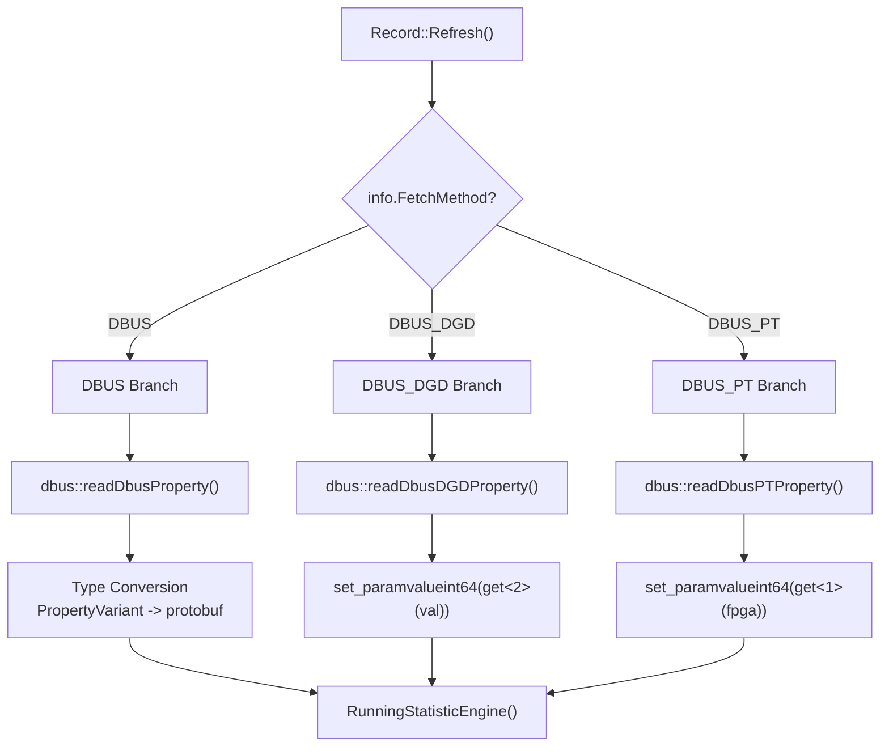
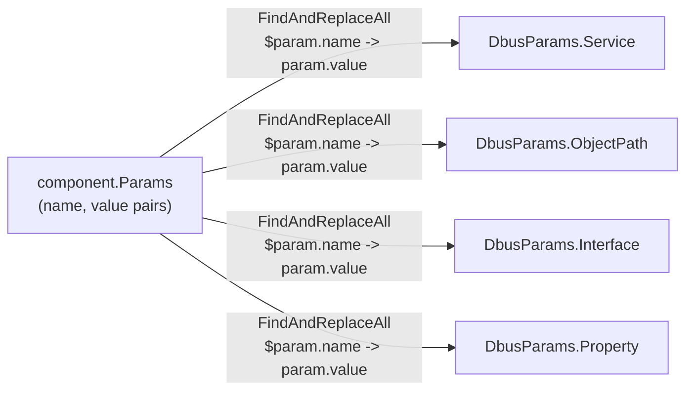
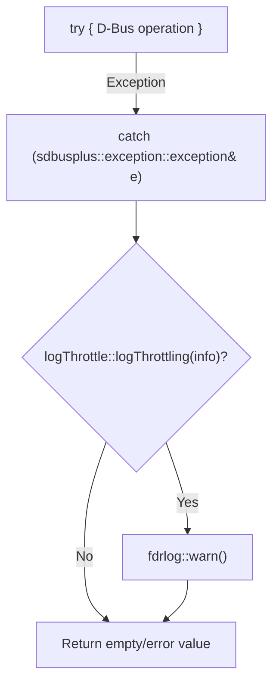
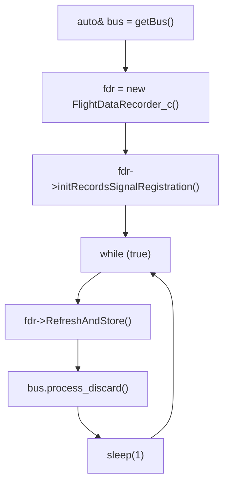

<!-- source: DeepWiki mcp.deepwiki.com · repo NVIDIA/nvidia-fdr · page 4.5 D-Bus Integration · fetched 2026-10-26 -->

# D-Bus Integration

<details>
<summary>Relevant source files</summary>

The following files were used as context for generating this wiki page:

- [dbus_accessor.cpp](dbus_accessor.cpp)
- [dbus_accessor.hpp](dbus_accessor.hpp)
- [fdr_grp_update.cpp](fdr_grp_update.cpp)
- [fdr_log.cpp](fdr_log.cpp)
- [fdr_log.hpp](fdr_log.hpp)
- [fdr_record.cpp](fdr_record.cpp)
- [main.cpp](main.cpp)
- [ppf_sanity.cpp](ppf_sanity.cpp)
- [property_variant.hpp](property_variant.hpp)

</details>


## Purpose and Scope

This document describes the D-Bus integration layer in the NVIDIA FDR system, which provides the primary interface for collecting telemetry data from system services running on the D-Bus system bus. The D-Bus accessor layer abstracts property reading, signal subscription, and device-specific operations, enabling Record objects to fetch data from various BMC services such as NSM (NVIDIA System Manager), PLDM, and GpuMgr.

For information about how Records use D-Bus to collect data, see [Records and Data Collection](#3.2). For details on configuring D-Bus parameters in Platform Profile Files, see [Platform Configuration](#5).

## Architecture Overview

The D-Bus integration is implemented through a dedicated accessor layer that sits between the FDR core system and the D-Bus system bus. This layer provides a clean abstraction for property access, signal handling, and specialized device operations.



**Sources:** [dbus_accessor.cpp:1-251](), [dbus_accessor.hpp:1-100](), [fdr_record.cpp:1-701]()

## D-Bus Accessor Layer

The accessor layer is implemented in the `dbus` namespace and provides five core operations: property reading, property writing, service discovery, and signal registration. All functions operate on the system D-Bus bus obtained via `getBus()`.

### Core Namespace and Constants

The accessor layer defines several key constants used throughout D-Bus operations:

| Constant | Value | Purpose |
|----------|-------|---------|
| `freeDesktopInterface` | `"org.freedesktop.DBus.Properties"` | Standard D-Bus properties interface |
| `getCall` | `"Get"` | Method name for property reads |
| `setCall` | `"Set"` | Method name for property writes |
| `callName` | `"DeviceGetData"` | Method name for device operations |

**Sources:** [dbus_accessor.hpp:22-25]()

### Type Definitions

The accessor layer defines specialized type aliases for D-Bus operations:



The `PropertyVariant` type is a comprehensive variant supporting multiple D-Bus data types including boolean, integers (8/16/32/64-bit signed and unsigned), double, strings, string vectors, associations, and tuples.

**Sources:** [property_variant.hpp:1-69](), [dbus_accessor.hpp:27-28]()

## Property Operations

### Property Reading

The `readDbusProperty()` function retrieves a property value from a D-Bus service using the FreeDesktop Properties interface. It follows the standard D-Bus property access pattern:



The function implements comprehensive error handling with logging throttle support to prevent log flooding when services are unavailable:

**Sources:** [dbus_accessor.cpp:88-113]()

### Property Writing

The `setDbusProperty()` function writes a value to a D-Bus property using the same FreeDesktop Properties interface:

| Parameter | Type | Description |
|-----------|------|-------------|
| `service` | `std::string` | D-Bus service name |
| `objPath` | `std::string` | D-Bus object path |
| `interface` | `std::string` | D-Bus interface name |
| `property` | `std::string` | Property name |
| `val` | `PropertyVariant` | New property value |

Returns `true` if the property was successfully set, `false` otherwise.

**Sources:** [dbus_accessor.cpp:226-249](), [dbus_accessor.hpp:83-85]()

## Service Discovery

The `getService()` function performs service discovery using the ObjectMapper service, which maintains a registry of all D-Bus objects and their owning services:



The ObjectMapper constants used:
- Bus Name: `"xyz.openbmc_project.ObjectMapper"`
- Object Path: `"/xyz/openbmc_project/object_mapper"`
- Interface: `"xyz.openbmc_project.ObjectMapper"`
- Method: `"GetObject"`

**Sources:** [dbus_accessor.cpp:45-86]()

## Signal Subscription

The `registerServicePropertyChanged()` function subscribes to D-Bus PropertyChanged signals for monitoring dynamic property updates:



The function constructs a match rule string that filters for `PropertiesChanged` signals on the specified object path and interface. When a matching signal arrives, the provided callback function is invoked.

**Example Integration:**
Record objects use this for `FetchType: "Subscribe"` parameters, where the callback invokes `refreshDataCallback()` to update the record data without polling.

**Sources:** [dbus_accessor.cpp:24-43](), [fdr_record.cpp:623-648]()

## Device-Specific Operations

The FDR system supports specialized D-Bus methods for device interaction beyond standard property access.

### DBUS_DGD: Device Get Data

The `readDbusDGDProperty()` function implements the Device Get Data (DGD) protocol, which is used for accessing device-specific properties through a specialized interface:



**SMBPBI Protocol:** The data vector follows the SMBPBI specification where `data[0]` contains `dataOut` and `data[1]` contains `exDataOut`, which are combined into a 64-bit value.

**Sources:** [dbus_accessor.cpp:115-167]()

### DBUS_PT: Passthrough FPGA

The `readDbusPTProperty()` function implements FPGA passthrough operations for low-level hardware access:

| Parameter | Type | Description |
|-----------|------|-------------|
| `service` | `std::string` | D-Bus service name |
| `objPath` | `std::string` | D-Bus object path |
| `interface` | `std::string` | D-Bus interface name |
| `opcode` | `uint8_t` | FPGA operation code |
| `arg1` | `uint8_t` | First operation argument |
| `arg2` | `uint8_t` | Second operation argument |

The method calls `PassthroughFpga` on the D-Bus service with:
- `deviceId = 0`
- `dataIn = []` (empty vector)

Returns a tuple of `(rc, fpgavalue)` where the value is extracted from a 4-element `dataOut` vector as `(dataOut[3] << 32) | dataOut[2]`.

**Sources:** [dbus_accessor.cpp:169-224]()

## Integration with Record System

The Record class integrates D-Bus operations through its `Refresh()` method, which dispatches to the appropriate D-Bus function based on `FetchMethod`:



### D-Bus Parameter Substitution

Before accessing D-Bus, Record constructor performs parameter substitution in the `DbusParams` structure:



This enables PPF configurations to use placeholders like `$GPU_ID` that are replaced with actual values from the component's `Params` list.

**Sources:** [fdr_record.cpp:36-60](), [fdr_record.cpp:152-292](), [fdr_record.cpp:359-405]()

## Type Conversion

The Record class implements comprehensive type conversion from `PropertyVariant` to protobuf types. The conversion logic handles multiple D-Bus data types:

### Integer Types

For parameters declared as `Uint64`, `Integer`, `Int64`, `Uint32`, `Uint16`, `Uint8`, or `Int16` in the PPF:

| D-Bus Type | Conversion |
|------------|------------|
| `double` | `(uint64_t)value` |
| `uint32_t` | `(uint64_t)value` |
| `uint16_t` | `(uint64_t)value` |
| `uint64_t` | `(uint64_t)value` |
| `int64_t` | `(uint64_t)value` |
| `bool` | `(uint64_t)value` |
| `tuple<bool, uint32_t>` | `(uint64_t)get<1>(value)` |
| `uint8_t` | `(uint64_t)value` |
| `int16_t` | `(uint64_t)value` |

### Floating Point Types

For parameters declared as `Double` or `Float`:

All integer types listed above are converted to `double` with appropriate casting.

### String Types

For all other data types, the value is extracted as `std::string` from the variant.

**Sources:** [fdr_record.cpp:168-291]()

## Error Handling and Logging

The D-Bus accessor layer implements multiple error handling strategies:

### Exception Handling

All D-Bus operations are wrapped in try-catch blocks that catch `sdbusplus::exception::exception`:



### Log Throttling

The `logThrottle::logThrottling()` function prevents log flooding when D-Bus services are repeatedly unavailable. It tracks the last log timestamp per `Info_t` and only logs if more than `LOG_ROTATION` seconds (86400 seconds / 24 hours) have elapsed.

**Sources:** [dbus_accessor.cpp:79-84](), [dbus_accessor.cpp:104-111](), [fdr_log.cpp:93-125]()

### Error Return Values

| Function | Error Return Value |
|----------|--------------------|
| `readDbusProperty()` | Empty `PropertyVariant` (index 0 variant) |
| `getService()` | Empty string `""` |
| `setDbusProperty()` | `false` |
| `readDbusDGDProperty()` | Tuple with `rc != 0`, descriptive message, `value = 0` |
| `readDbusPTProperty()` | Tuple with `rc != 0`, `fpgavalue = 0` |
| `registerServicePropertyChanged()` | Valid handler (exceptions logged but not propagated) |

**Sources:** [dbus_accessor.cpp:1-251]()

## Main Event Loop Integration

The FDR system initializes D-Bus connectivity during startup and processes D-Bus messages in the main event loop:

### Non-Timer Mode

When `FDR_TIMER_EVENT_ENABLED` is not defined, the system uses a simple polling loop:



The `bus.process_discard()` call processes pending D-Bus messages and signals without blocking.

**Sources:** [main.cpp:40-145]()

### Timer Event Mode

When `FDR_TIMER_EVENT_ENABLED` is defined, the system uses an asynchronous event loop with sdbusplus integration:

1. Creates system bus connection: `sd_bus_default_system(&fdrBus)`
2. Wraps in asio: `sdbusplus::asio::connection(*io, fdrBus)`
3. Requests bus name: `sdbusp->request_name("xyz.openbmc_project.FDR")`
4. Runs event loop: `fdr->RunEventLoop()`

**Sources:** [main.cpp:68-90]()

## Usage Patterns

### Standard Property Reading

PPF configuration for standard D-Bus property:

```yaml
- ID: "GPU_Temperature"
  ParamID: 1001
  FetchMethod: "DBUS"
  FetchType: "Poll"
  FetchFreqSecs: 600
  StorePolicy: "OnChange"
  DataType: "Uint64"
  DbusParams:
    Service: "xyz.openbmc_project.Inventory.Manager"
    ObjectPath: "/xyz/openbmc_project/inventory/system/chassis/GPU$GPU_ID"
    Interface: "xyz.openbmc_project.Sensor.Value"
    Property: "Value"
```

### Device Get Data Pattern

PPF configuration for device-specific data:

```yaml
- ID: "GPU_ErrorStatus"
  ParamID: 1002
  FetchMethod: "DBUS_DGD"
  FetchType: "Poll"
  FetchFreqSecs: 3600
  DataType: "Uint64"
  DbusParams:
    Service: "com.nvidia.NVSwitch.Manager"
    ObjectPath: "/com/nvidia/NVSwitch/Manager"
    Interface: "com.nvidia.NVSwitch.CoreApi"
    Property: "gpu_err_status"
    DevId: 0
```

### Event Subscription Pattern

PPF configuration for D-Bus signal subscription:

```yaml
- ID: "Error_Counter"
  ParamID: 2001
  FetchMethod: "DBUS"
  FetchType: "Subscribe"
  StorePolicy: "EveryFetch"
  DataType: "Uint64"
  DbusParams:
    Service: "xyz.openbmc_project.Logging"
    ObjectPath: "/xyz/openbmc_project/logging/entry/1"
    Interface: "xyz.openbmc_project.Logging.Entry"
    Property: "Severity"
```

**Sources:** [fdr_record.cpp:152-423]()

---

