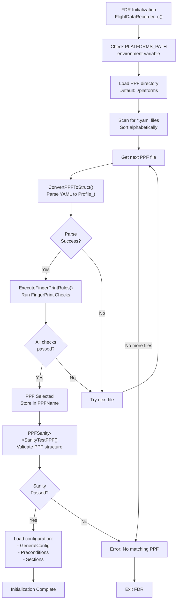
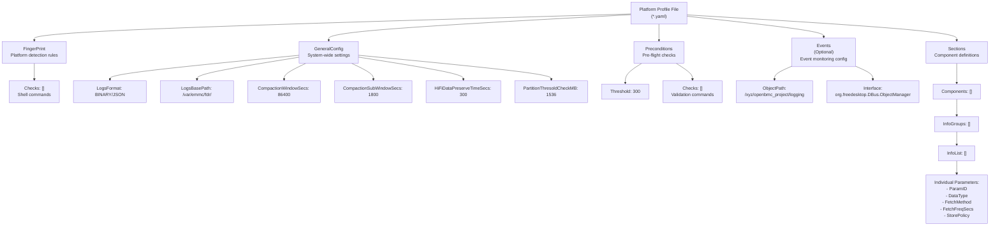
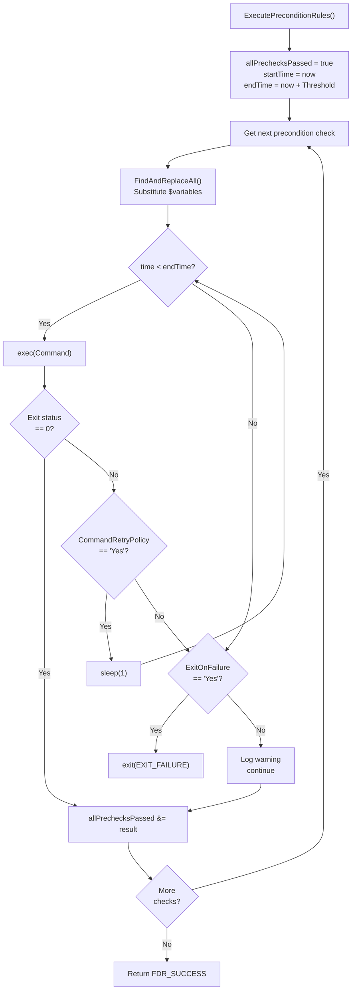
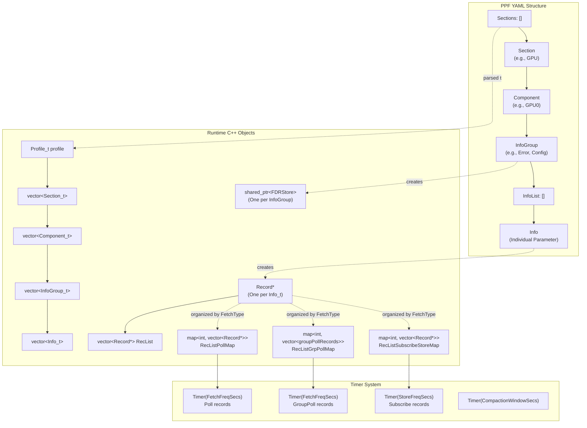

<!-- source: DeepWiki mcp.deepwiki.com · repo NVIDIA/nvidia-fdr · page 5 Platform Configuration · fetched 2026-10-26 -->

# Platform Configuration

<details>
<summary>Relevant source files</summary>

The following files were used as context for generating this wiki page:

- [fdr.cpp](fdr.cpp)
- [fdr.hpp](fdr.hpp)
- [fdr_compact.cpp](fdr_compact.cpp)
- [platforms/fdr_ppf_example.yaml](platforms/fdr_ppf_example.yaml)
- [platforms/fdr_ppf_hgxb_hmc.yaml](platforms/fdr_ppf_hgxb_hmc.yaml)
- [platforms/fdr_ppf_vulcan.yaml](platforms/fdr_ppf_vulcan.yaml)
- [tools/data_validation/platform/exempt_telemetry_list_hgxb.yaml](tools/data_validation/platform/exempt_telemetry_list_hgxb.yaml)

</details>


## Purpose and Scope

This document describes how the NVIDIA FDR system is configured for different hardware platforms through Platform Profile Files (PPF). Platform configuration determines which telemetry parameters are monitored, sampling frequencies, storage policies, and platform-specific behaviors.

For detailed information about PPF file structure and syntax, see [PPF File Structure Reference](#5.1). For platform-specific configurations, see [Vulcan Platform Configuration](#5.2) and [HGXB HMC Platform Configuration](#5.3).

## Platform Detection and PPF Selection

FDR automatically detects the platform it is running on by executing fingerprint checks defined in PPF files. The system iterates through available PPF files until it finds one whose fingerprint rules all succeed.

### Detection Process Flow



**Sources:** [fdr.cpp:211-292](), [fdr.cpp:296-319](), [fdr.cpp:322-340](), [fdr.cpp:76-85]()

### Fingerprint Execution

The `FingerPrint` section of a PPF file contains shell commands that must all succeed for the platform to match. Each check is executed using the `exec()` utility function, and all must return exit status 0.

**Example Fingerprints:**

| Platform | Fingerprint Checks |
|----------|-------------------|
| Vulcan | `grep -q -i openbmc-phosphor /etc/os-release`<br/>`grep -q -i hgx /etc/os-release`<br/>`grep -q -i VULCAN /etc/os-release` |
| HGXB HMC | `grep -q -i openbmc-phosphor /etc/os-release`<br/>`grep -q -i hgxb /etc/os-release` |
| Example | `grep -q -i Ubuntu /etc/os-release` |

**Sources:** [platforms/fdr_ppf_vulcan.yaml:18-22](), [platforms/fdr_ppf_hgxb_hmc.yaml:18-21](), [platforms/fdr_ppf_example.yaml:18-20]()

### PPF File Location

PPF files are loaded from a directory determined by the `PLATFORMS_PATH` environment variable. If not set, FDR searches in `./platforms` relative to the executable.

**Key Variables and Functions:**

```
Environment Variable: PLATFORMS_PATH
Default Directory: ./platforms
Function: FindAndLoadPlatformProfile()
Storage: Profile_t profile (member of FlightDataRecorder_c)
```

**Sources:** [fdr.cpp:218-224](), [fdr.cpp:211-292]()

## PPF File Structure Overview

A PPF file is written in YAML and contains five major sections that control FDR behavior:



**Sources:** [fdr.cpp:301-310](), [platforms/fdr_ppf_hgxb_hmc.yaml:18-50]()

### Configuration Data Structures

The PPF YAML is parsed into C++ data structures defined in `fdr_common.hpp`:

| YAML Section | C++ Structure | Key Fields |
|--------------|---------------|------------|
| `FingerPrint` | `FingerPrint_t` | `Checks` (vector of commands) |
| `GeneralConfig` | `GeneralConfig_t` | `LogsBasePath`, `CompactionWindowSecs`, `LogsFormat` |
| `Preconditions` | `Preconditions_t` | `Threshold`, `Checks` |
| `Sections` | `vector<Section_t>` | `ID`, `Components` |
| `Components` | `Component_t` | `ID`, `InfoGroups`, `Params` |
| `InfoGroups` | `InfoGroup_t` | `ID`, `InfoList`, `CompactionMethod` |
| `InfoList` | `Info_t` | `ParamID`, `DataType`, `FetchMethod`, `FetchType` |

The root structure is `Profile_t`, which contains all parsed configuration:

```
Profile_t profile;
  ├── FingerPrint_t FingerPrint
  ├── GeneralConfig_t GeneralConfig
  ├── Preconditions_t Preconditions
  └── vector<Section_t> Sections
```

**Sources:** [fdr.cpp:303-310](), [fdr.hpp:140]()

## Precondition Validation

Before FDR begins collecting telemetry, it executes precondition checks defined in the PPF. These validate that the platform meets requirements such as filesystem mounts and disk space.

### Precondition Check Structure

Each precondition check includes:

- **ID**: Identifier for the check
- **CommandParams.Command**: Shell command to execute (supports variable substitution)
- **Params**: Variables to substitute in the command
- **CommandRetryPolicy**: Whether to retry on failure ("Yes"/"No")
- **ExitOnFailure**: Whether to exit FDR if check fails ("Yes"/"No")
- **Threshold**: Maximum time (seconds) to retry checks

**Example Precondition:**

```yaml
Preconditions:
  Threshold: 300
  Checks:
  - ID: CheckDumpDirMount
    CommandParams:
      Command: df $logbasepath | grep '/dev/mmcblk'
    Params:
      name: logbasepath
      value: /var/emmc/fdr/
    CommandRetryPolicy: No
    ExitOnFailure: Yes
```

### Execution Logic



**Sources:** [fdr.cpp:395-487]()

## Configuration-Driven Record Creation

The PPF drives FDR's runtime behavior by defining what to monitor and how. During initialization, FDR creates `Record` objects for each parameter defined in the PPF's `InfoList` sections.

### PPF to Runtime Objects Mapping



**Sources:** [fdr.cpp:574-746](), [fdr.hpp:42-51]()

### Record Segregation by FetchType

During `CreateRecords()`, FDR organizes `Record` objects into different maps based on their `FetchType` to enable efficient timer-based execution:

| FetchType | Map | Key | Triggered By |
|-----------|-----|-----|--------------|
| `Poll` | `RecListPollMap` | `FetchFreqSecs` | Timer every `FetchFreqSecs` seconds |
| `GroupPoll` | `RecListGrpPollMap` | `FetchFreqSecs` | Timer every `FetchFreqSecs` seconds |
| `Subscribe` | `RecListSubscribeStoreMap` | `StoreFreqSecs` | D-Bus signal + periodic Store timer |

**Code Flow:**

```
CreateRecords() [fdr.cpp:574-746]
  ├── For each Section in profile.Sections
  │   └── For each Component in section.Components
  │       └── For each InfoGroup in component.InfoGroups
  │           ├── CreateSamplesWriter() → FDRStore object
  │           └── For each Info in infogroup.InfoList
  │               ├── new Record(...) → Record* resource
  │               ├── RecList.push_back(resource)
  │               └── Based on Info.FetchType:
  │                   ├── "Poll" → RecListPollMap[FetchFreqSecs].push_back(resource)
  │                   ├── "GroupPoll" → RecListGrpPollMap[FetchFreqSecs].push_back(...)
  │                   └── "Subscribe" → RecListSubscribeStoreMap[StoreFreqSecs].push_back(resource)
```

**Sources:** [fdr.cpp:574-746](), [fdr.cpp:664-721]()

## Storage File Organization

The PPF drives how log files are created and organized. FDR creates separate storage files based on the `InfoGroup.ID`:

### File Naming Convention

| InfoGroup ID Pattern | File Extension | Purpose |
|---------------------|----------------|---------|
| `Sensor.*` | `.sensors.dat` | High-frequency sensor data |
| All others | `.others.dat` | Inventory, Config, Error, Status |
| N/A | `.sensors.stat.dat` | Statistics (when `CompactionMethod: Average`) |
| N/A | `.sensors.hifi.dat` | High-fidelity error context data |

**File Path Format:**
```
{LogsBasePath}/{DirectoryName}/{SectionID}.{ComponentID}.{extension}

Example:
/var/emmc/fdr/FDR_000123_SENSORS_1234567890/GPU.GPU0.sensors.dat
/var/emmc/fdr/FDR_000123_SENSORS_1234567890/GPU.GPU0.others.dat
```

**Sources:** [fdr.cpp:525-572](), [fdr.cpp:602-620]()

## Supported Platforms

FDR includes PPF files for the following platforms:

### Platform Summary

| Platform | PPF File | Primary Components | D-Bus Service |
|----------|----------|-------------------|---------------|
| Vulcan | `fdr_ppf_vulcan.yaml` | GPU (8 instances), NIC, NVSWITCH, FPGA, HMC | `xyz.openbmc_project.GpuMgr` |
| HGXB HMC | `fdr_ppf_hgxb_hmc.yaml` | GPU (8 instances), NIC, NVSWITCH | `xyz.openbmc_project.NSM`, `xyz.openbmc_project.PLDM` |
| Example | `fdr_ppf_example.yaml` | GPU (4 instances), NIC | Command-based (nvidia-smi) |

### Key Configuration Differences

**Vulcan:**
- Uses `xyz.openbmc_project.GpuMgr` D-Bus service
- Extensive inventory collection (GPU GUID, part numbers, etc.)
- NVLink configuration monitoring across 18 links per GPU
- YAML anchors for template reuse (`&gpu`, `&nic`)

**HGXB HMC:**
- Uses `xyz.openbmc_project.NSM` and `xyz.openbmc_project.PLDM` services
- Heavy use of shared memory (`FetchMethod: Shmem`) for high-frequency metrics
- `FetchType: GroupPoll` for batch updates
- Focus on error counters and throttle durations

**Example:**
- Command-based data collection using `nvidia-smi`
- Suitable for development/testing on Ubuntu systems
- Demonstrates basic FetchType usage (Poll, Subscribe)

**Sources:** [platforms/fdr_ppf_vulcan.yaml:18-23](), [platforms/fdr_ppf_hgxb_hmc.yaml:18-27](), [platforms/fdr_ppf_example.yaml:18-22]()

## Compaction Configuration

The PPF's `GeneralConfig` section controls data retention and compaction behavior:

### Compaction Parameters

| Parameter | Default (HGXB) | Purpose |
|-----------|----------------|---------|
| `CompactionWindowSecs` | 86400 (24 hours) | Frequency to create new directories and compact old ones |
| `CompactionSubWindowSecs` | 1800 (30 minutes) | Frequency to append statistics to `.stat.dat` files |
| `HiFiDataPreserveTimeSecs` | 300 (5 minutes) | Time window (±) around errors to preserve full-resolution data |
| `DefaultCompactionSensors.RecordRetentionPolicy` | `Recreate` | How to handle records during compaction |
| `DefaultCompactionSensors.CompactionMethod` | `Average` | Statistical aggregation method |

These parameters can be overridden at the `InfoGroup` level for fine-grained control.

**Sources:** [platforms/fdr_ppf_hgxb_hmc.yaml:28-33](), [fdr_compact.cpp:179-246](), [fdr_compact.cpp:285-333]()

## Disk Space Management

FDR monitors disk usage and exits gracefully when space is insufficient:

```
Parameter: PartitionThresoldCheckMB
Default: 1536 MB (1.5 GB)
Check Frequency: On boot and every CompactionWindowSecs expiry
Action: Exit with status 0 if available space < threshold
```

**Code Path:**
```
CheckFdrPartitionDiskUsageAndExit() [fdr.cpp:382-392]
  └── CheckAvailableFdrPartitionDiskSize() [fdr.cpp:342-378]
      ├── std::filesystem::space(LogsBasePath)
      └── If space < PartitionThresoldCheckMB:
          ├── rfEvent::createLogEntry("ResourceErrorsDetected")
          └── exit(EXIT_SUCCESS)
```

**Sources:** [fdr.cpp:342-392](), [platforms/fdr_ppf_hgxb_hmc.yaml:27]()

## Event Monitoring Configuration

The optional `Events` section configures D-Bus event monitoring for logging system events:

```yaml
Events:
  ObjectPath: /xyz/openbmc_project/logging
  Interface: org.freedesktop.DBus.ObjectManager
  Member: InterfacesAdded
```

This configuration enables the "Book of Errors" feature, which tracks error events and preserves high-fidelity telemetry data around their occurrence.

**Sources:** [platforms/fdr_ppf_hgxb_hmc.yaml:34-37](), [fdr_events.cpp]() (referenced but not provided)

## Platform-Specific Validation

FDR includes exemption lists for platforms where certain telemetry parameters are intentionally excluded from validation:

**HGXB Exemptions:** `tools/data_validation/platform/exempt_telemetry_list_hgxb.yaml`

This file lists TGUIDs and ParamClasses excluded from coverage checks during data validation, typically because:
- The parameter is not available on the platform
- The parameter is provided by a different method
- The parameter is under development

**Sources:** [tools/data_validation/platform/exempt_telemetry_list_hgxb.yaml:1-50]()

---

**Related Pages:**
- For detailed PPF syntax and field definitions, see [PPF File Structure Reference](#5.1)
- For Vulcan-specific configuration details, see [Vulcan Platform Configuration](#5.2)
- For HGXB HMC-specific configuration details, see [HGXB HMC Platform Configuration](#5.3)
- For understanding how Records execute based on PPF configuration, see [Records and Data Collection](#3.2)
- For adding new platforms or parameters, see [Adding New Parameters](#7.2)

---

