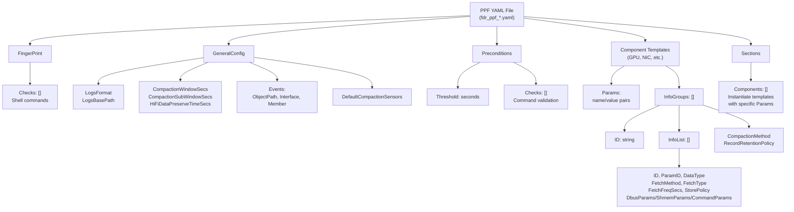
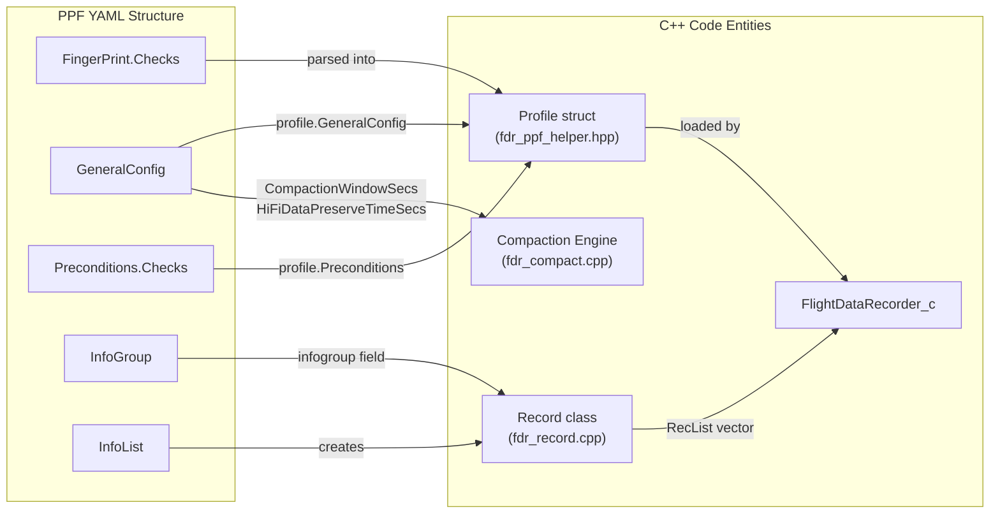
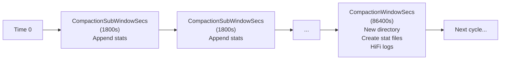
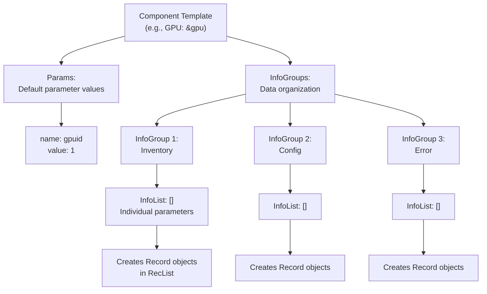
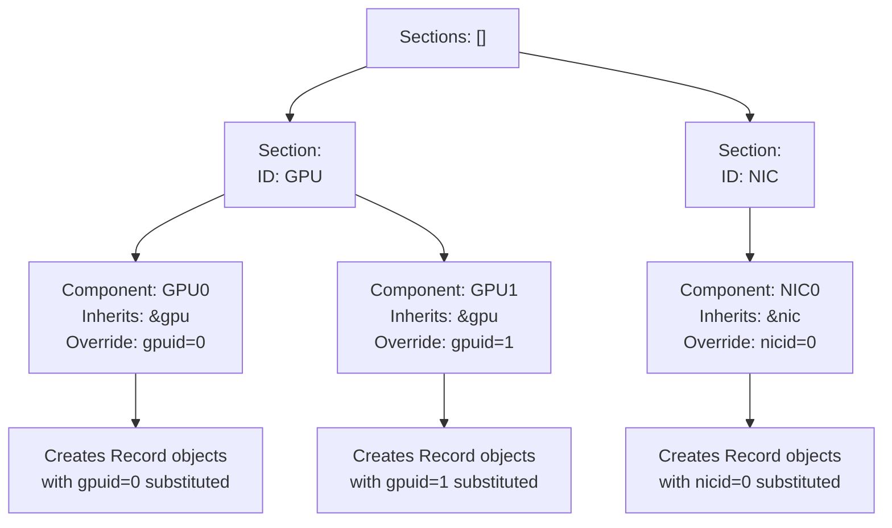
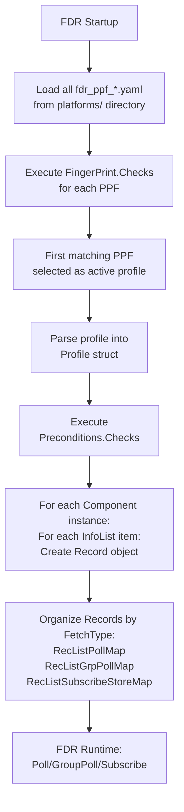

<!-- source: DeepWiki mcp.deepwiki.com · repo NVIDIA/nvidia-fdr · page 5.1 PPF File Structure Reference · fetched 2026-10-26 -->

# PPF File Structure Reference

<details>
<summary>Relevant source files</summary>

The following files were used as context for generating this wiki page:

- [fdr_compact.cpp](fdr_compact.cpp)
- [platforms/fdr_ppf_example.yaml](platforms/fdr_ppf_example.yaml)
- [platforms/fdr_ppf_hgxb_hmc.yaml](platforms/fdr_ppf_hgxb_hmc.yaml)
- [platforms/fdr_ppf_vulcan.yaml](platforms/fdr_ppf_vulcan.yaml)
- [tools/data_validation/platform/exempt_telemetry_list_hgxb.yaml](tools/data_validation/platform/exempt_telemetry_list_hgxb.yaml)

</details>


This page provides a comprehensive reference for the Platform Profile File (PPF) YAML structure. For conceptual understanding of how PPFs work within the FDR system, see [Platform Profile Files (PPF)](#3.1). For platform-specific examples, see [Vulcan Platform Configuration](#5.2) and [HGXB HMC Platform Configuration](#5.3).

## Purpose and Scope

Platform Profile Files (PPF) are YAML configuration files that define what telemetry parameters FDR monitors on a specific hardware platform. Each PPF file specifies:

- Platform detection fingerprint rules
- Data collection and storage policies  
- Component templates and their instantiation
- Timing parameters for polling, storage, and compaction
- Preconditions that must be met before FDR starts

This reference documents all PPF sections, fields, data types, and constraints. It serves as the authoritative specification for creating or modifying PPF files.

## File Structure Overview



**Sources:** [platforms/fdr_ppf_hgxb_hmc.yaml:1-50](), [platforms/fdr_ppf_vulcan.yaml:18-52](), [platforms/fdr_ppf_example.yaml:18-84]()

## PPF to Code Entity Mapping



**Sources:** [fdr_compact.cpp:28-31](), [fdr_compact.cpp:183-190](), [fdr_compact.cpp:292-299]()

## Top-Level Sections

### FingerPrint Section

The `FingerPrint` section defines platform detection rules. All checks must succeed for the PPF to be selected.

| Field | Type | Required | Description |
|-------|------|----------|-------------|
| `Checks` | list of strings | Yes | Shell commands that must return exit code 0 |

**Example:**
```yaml
FingerPrint:
  Checks:
    - "grep -q -i openbmc-phosphor /etc/os-release"
    - "grep -q -i hgxb /etc/os-release"
```

**Sources:** [platforms/fdr_ppf_hgxb_hmc.yaml:18-21](), [platforms/fdr_ppf_vulcan.yaml:18-22]()

### GeneralConfig Section

The `GeneralConfig` section defines system-wide FDR behavior and storage policies.

| Field | Type | Required | Default | Description |
|-------|------|----------|---------|-------------|
| `LogsFormat` | string | Yes | - | `"BINARY"` or `"JSON"` |
| `LogsBasePath` | list | Yes | - | Directory path(s) for FDR logs |
| `PartitionThresoldCheckMB` | integer | Yes | - | Exit FDR if available space < this (MB) |
| `CompactionWindowSecs` | integer | Yes | - | Create new directory every N seconds (typically 86400) |
| `CompactionSubWindowSecs` | integer | Yes | - | Append statistics every N seconds (typically 1800) |
| `HiFiDataPreserveTimeSecs` | integer | Yes | - | Time window around errors to preserve (±N seconds) |
| `DefaultCompactionSensors` | object | No | - | Default compaction policy for sensor InfoGroups |
| `Events` | object | No | - | D-Bus event monitoring configuration |
| `LoggingFileMaxSize` | integer | No | 1048576 | Maximum log file size before rotation |
| `LoggingFileNumber` | integer | No | 3 | Number of log files to keep |
| `LoggingLevel` | string | No | "info" | Logging level: trace, debug, info, warn, err, critical, off |
| `RedfishSchema` | string | No | - | Redfish server URL (e.g., http://192.168.1.31) |
| `RedfishUser` | string | No | - | Redfish authentication username |
| `RedfishPassword` | string | No | - | Redfish authentication password |
| `ExceptionAllowNumber` | integer | No | 128 | Max uncaught exceptions before exiting |
| `ExceptionAllowRate` | float | No | 0.5 | Exceptions allowed per second |

**Compaction Timing Diagram:**



**DefaultCompactionSensors Object:**

| Field | Type | Required | Description |
|-------|------|----------|-------------|
| `RecordRetentionPolicy` | string | Yes | `"Recreate"` - regenerate records on compaction |
| `CompactionMethod` | string | Yes | `"Average"` - compute running averages |

**Events Object:**

| Field | Type | Required | Description |
|-------|------|----------|-------------|
| `ObjectPath` | string | Yes | D-Bus object path to monitor (e.g., `/xyz/openbmc_project/logging`) |
| `Interface` | string | Yes | D-Bus interface (e.g., `org.freedesktop.DBus.ObjectManager`) |
| `Member` | string | Yes | Signal member name (e.g., `InterfacesAdded`) |

**Example:**
```yaml
GeneralConfig:
  LogsFormat: BINARY
  LogsBasePath: &LogsBasePath
    - "/var/emmc/fdr/"
  PartitionThresoldCheckMB: 1536
  CompactionWindowSecs: 86400
  CompactionSubWindowSecs: 1800
  HiFiDataPreserveTimeSecs: 300
  DefaultCompactionSensors: &compaction-definition-sensors
    RecordRetentionPolicy: Recreate
    CompactionMethod: Average
  Events:
    ObjectPath: /xyz/openbmc_project/logging
    Interface: org.freedesktop.DBus.ObjectManager
    Member: InterfacesAdded
```

**Sources:** [platforms/fdr_ppf_hgxb_hmc.yaml:23-38](), [platforms/fdr_ppf_vulcan.yaml:24-40](), [platforms/fdr_ppf_example.yaml:22-65]()

### Preconditions Section

The `Preconditions` section defines validation checks that must pass before FDR starts.

| Field | Type | Required | Description |
|-------|------|----------|-------------|
| `Threshold` | integer | Yes | Maximum seconds to retry failed checks |
| `Checks` | list | Yes | List of precondition check objects |

**Precondition Check Object:**

| Field | Type | Required | Description |
|-------|------|----------|-------------|
| `ID` | string | Yes | Unique identifier for the check |
| `CommandParams` | object | Yes | Command execution parameters |
| `CommandParams.Command` | string | Yes | Shell command to execute |
| `Params` | object | No | Variable substitution parameters |
| `Params.name` | string | Conditional | Variable name (e.g., `logbasepath`) |
| `Params.value` | any | Conditional | Variable value (can use YAML anchors) |
| `CommandRetryPolicy` | string | Yes | `"Yes"` or `"No"` - retry on failure |
| `ExitOnFailure` | string | Yes | `"Yes"` or `"No"` - exit FDR if all retries fail |

**Example:**
```yaml
Preconditions:
  Threshold: 300
  Checks:
    - ID: CheckDumpDirMount
      CommandParams:
        Command: "df $logbasepath | grep '/dev/mmcblk'"
      Params:
        name: logbasepath
        value: *LogsBasePath
      CommandRetryPolicy: No
      ExitOnFailure: Yes
```

**Sources:** [platforms/fdr_ppf_hgxb_hmc.yaml:39-49](), [platforms/fdr_ppf_vulcan.yaml:41-51](), [platforms/fdr_ppf_example.yaml:67-83]()

## Component Template Structure

Component templates define reusable configurations for hardware components (GPU, NIC, etc.). Templates use YAML anchors (`&name`) and are instantiated in the `Sections` area with specific parameters.



**Template Structure:**

| Field | Type | Required | Description |
|-------|------|----------|-------------|
| `Params` | list | Yes | Parameter name/value pairs for variable substitution |
| `InfoGroups` | list | Yes | Logical groupings of telemetry parameters |

**Example:**
```yaml
GPU: &gpu
  Params:
    - name: gpuid
      value: 1
  InfoGroups:
    - ID: Config
      InfoList:
        - ID: DRVR-VER
          # ... parameter definition
    - ID: Error
      InfoList:
        - ID: ECC-ERR-CTR-CE
          # ... parameter definition
```

**Sources:** [platforms/fdr_ppf_hgxb_hmc.yaml:53-56](), [platforms/fdr_ppf_vulcan.yaml:53-56](), [platforms/fdr_ppf_example.yaml:86-89]()

## InfoGroup Structure

InfoGroups organize related parameters and define their compaction policies.

| Field | Type | Required | Description |
|-------|------|----------|-------------|
| `ID` | string | Yes | InfoGroup identifier (e.g., `"Inventory"`, `"Config"`, `"Error"`, `"Sensor.Thermal"`) |
| `InfoList` | list | Yes | List of individual parameter definitions |
| `RecordRetentionPolicy` | string | No | Override default: `"Recreate"` |
| `CompactionMethod` | string | No | Override default: `"Average"` or `null` |

**InfoGroup Categories:**

- **Inventory**: Static hardware information (part numbers, serials, UUIDs)
- **Config**: Configuration settings (firmware versions, clock limits, ECC mode)
- **Error**: Error counters and states
- **Sensor.{Type}**: Time-series sensor data (Thermal, Clock, Power)
- **Specs**: Hardware specifications

**Example:**
```yaml
InfoGroups:
  - ID: Config
    InfoList:
      - ID: DRVR-VER
        # ... fields
  - ID: Sensor.Thermal
    InfoList:
      - ID: GPUTemp
        # ... fields
    RecordRetentionPolicy: Recreate
    CompactionMethod: Average
```

**Sources:** [platforms/fdr_ppf_hgxb_hmc.yaml:57-59](), [platforms/fdr_ppf_vulcan.yaml:57-59](), [platforms/fdr_ppf_example.yaml:90-92]()

## InfoList Parameter Definition

Each InfoList entry defines a single telemetry parameter. This is the most granular level of PPF configuration.

### Core Fields

| Field | Type | Required | Description |
|-------|------|----------|-------------|
| `ID` | string | Yes | Parameter identifier (e.g., `"DRVR-VER"`, `"ECC-ERR-CTR-CE"`) |
| `ParamID` | integer | Yes | **Unique** numeric ID across all parameters. Never change after assignment. |
| `DataType` | string | Yes | Data type: `string`, `Uint64`, `Double`, `Int64`, `Bool` |
| `FetchMethod` | string | Yes | Data source: `DBUS`, `Shmem`, `Command`, `Redfish` |
| `FetchType` | string | Yes | Collection method: `Poll`, `GroupPoll`, `Subscribe` |
| `FetchFreqSecs` | integer | Yes | Data fetch frequency in seconds |
| `StorePolicy` | string | Yes | Storage trigger: `OnChange`, `EveryFetch`, `Periodic` |
| `StoreFreqSecs` | integer | Yes | Storage frequency in seconds (when applicable) |

### Fetch Method Parameters

#### DbusParams (when FetchMethod = DBUS)

| Field | Type | Required | Description |
|-------|------|----------|-------------|
| `Service` | string | Yes | D-Bus service name (e.g., `"xyz.openbmc_project.GpuMgr"`) |
| `ObjectPath` | string | Yes | D-Bus object path (supports `$variable` substitution) |
| `Interface` | string | Yes | D-Bus interface name |
| `Property` | string | Yes | Property name to read |

#### ShmemParams (when FetchMethod = Shmem)

| Field | Type | Required | Description |
|-------|------|----------|-------------|
| `Key` | string | Yes | Shared memory key path |
| `Namespace` | string | Yes | Shared memory namespace (e.g., `"nsmd_HGX_MemoryMetrics_0"`) |

**Note:** ShmemParams often appears alongside DbusParams as a fallback mechanism.

#### CommandParams (when FetchMethod = Command)

| Field | Type | Required | Description |
|-------|------|----------|-------------|
| `Command` | string | Yes | Shell command to execute (supports `$variable` substitution) |

### FetchType Comparison Table

| FetchType | Mechanism | Use Case | Example Frequency |
|-----------|-----------|----------|-------------------|
| `Poll` | Timer-based periodic fetch | Individual parameters | 600-3600s |
| `GroupPoll` | Batched fetch from shared memory | High-frequency sensor data | 600s |
| `Subscribe` | D-Bus signal subscription | Event-driven changes | N/A (event-driven) |

**Sources:** [platforms/fdr_ppf_hgxb_hmc.yaml:60-72](), [platforms/fdr_ppf_vulcan.yaml:60-73](), [platforms/fdr_ppf_example.yaml:93-103]()

### StorePolicy Comparison Table

| StorePolicy | Storage Trigger | Typical Use Case |
|-------------|----------------|------------------|
| `OnChange` | Only when value changes | Config settings, inventory |
| `EveryFetch` | Every fetch operation | High-frequency sensor data |
| `Periodic` | At StoreFreqSecs interval | Controlled storage rate |

## Complete Parameter Examples

### Example 1: D-Bus Subscribe Parameter (Config)

```yaml
- ID: DRVR-VER
  DataType: string
  FetchMethod: DBUS
  FetchFreqSecs: 3600
  StorePolicy: OnChange
  StoreFreqSecs: 3600
  FetchType: Subscribe
  ParamID: 15
  DbusParams:
    Service: "xyz.openbmc_project.GpuMgr"
    ObjectPath: "/xyz/openbmc_project/inventory_software/HGX_Driver_GPU_SXM_$gpuid"
    Interface: "xyz.openbmc_project.Software.Version"
    Property: "Version"
```

**Sources:** [platforms/fdr_ppf_vulcan.yaml:206-218]()

### Example 2: Shared Memory GroupPoll Parameter (Error Counter)

```yaml
- ID: ECC-ERR-CTR-CE
  DataType: Uint64
  ShmemParams:
    Key: /xyz/openbmc_project/inventory/system/memory/GPU_SXM_$gpuid_DRAM_0/xyz.openbmc_project.Memory.MemoryECC.ceCount
    Namespace: "nsmd_HGX_MemoryMetrics_0"
  DbusParams:
    Interface: xyz.openbmc_project.Memory.MemoryECC
    ObjectPath: /xyz/openbmc_project/inventory/system/memory/GPU_SXM_$gpuid_DRAM_0
    Property: ceCount
    Service: xyz.openbmc_project.NSM
  FetchFreqSecs: 600
  FetchMethod: Shmem
  FetchType: GroupPoll
  ParamID: 11
  StoreFreqSecs: 600
  StorePolicy: OnChange
```

**Sources:** [platforms/fdr_ppf_hgxb_hmc.yaml:233-248]()

### Example 3: Command Poll Parameter (nvidia-smi)

```yaml
- ID: GPUTemp
  ParamID: 0
  DataType: Uint64
  FetchMethod: Command
  FetchType: Poll
  FetchFreqSecs: 1
  StorePolicy: EveryFetch
  StoreFreqSecs: 1
  CommandParams:
    Command: "nvidia-smi --id=$gpuid --format=csv,noheader --query-gpu=temperature.gpu"
```

**Sources:** [platforms/fdr_ppf_example.yaml:167-176]()

## Sections: Component Instantiation

The `Sections` section instantiates component templates with specific parameter values.



**Structure:**

| Field | Type | Required | Description |
|-------|------|----------|-------------|
| `Sections` | list | Yes | Top-level list of component sections |
| `ID` | string | Yes | Section identifier (e.g., `"GPU"`, `"NIC"`) |
| `Components` | list | Yes | List of component instances |

**Component Instance:**

| Field | Type | Required | Description |
|-------|------|----------|-------------|
| `ID` | string | Yes | Component instance identifier (e.g., `"GPU0"`, `"NIC1"`) |
| `<<` | anchor reference | Yes | YAML merge key to inherit template (e.g., `*gpu`) |
| `Params` | list | Yes | Override parameter values |

**Example:**
```yaml
Sections:
  - ID: GPU
    Components:
      - ID: GPU0
        <<: *gpu
        Params:
          - name: gpuid
            value: 0
      - ID: GPU1
        <<: *gpu
        Params:
          - name: gpuid
            value: 1
  - ID: NIC
    Components:
      - ID: NIC1
        <<: *nic
        Params:
          - name: nicid
            value: 1
```

**Sources:** [platforms/fdr_ppf_example.yaml:266-295]()

## Data Types Reference

| DataType | C++ Type | Description | Example Values |
|----------|----------|-------------|----------------|
| `string` | `std::string` | Text data | `"NVIDIA"`, `"v1.2.3"`, `"Enabled"` |
| `Uint64` | `uint64_t` | Unsigned 64-bit integer | `0`, `700000000`, `18446744073709551615` |
| `Double` | `double` | Double-precision floating point | `75.5`, `3.14159`, `1.23e-4` |
| `Int64` | `int64_t` | Signed 64-bit integer | `-100`, `0`, `9223372036854775807` |
| `Bool` | `bool` | Boolean | `true`, `false` |

**Note:** String values are automatically converted from command output or D-Bus variant types.

**Sources:** [platforms/fdr_ppf_hgxb_hmc.yaml:61](), [platforms/fdr_ppf_vulcan.yaml:63]()

## YAML Features and Best Practices

### Anchors and Aliases

PPF files extensively use YAML anchors (`&`) and aliases (`*`) to avoid repetition:

```yaml
# Define anchor at GeneralConfig.LogsBasePath
LogsBasePath: &LogsBasePath
  - "/var/emmc/fdr/"

# Reference in Preconditions
Params:
  name: logbasepath
  value: *LogsBasePath

# Define component template anchor
GPU: &gpu
  Params:
    - name: gpuid
      value: 1
  InfoGroups:
    # ... definitions

# Define default fields anchor
- &gpu-config-defaults
  DataType: string
  FetchMethod: DBUS
  FetchFreqSecs: 3600
  StorePolicy: OnChange

# Merge and override using <<
- ID: DRVR-VER
  <<: *gpu-config-defaults
  ParamID: 15
  # ... DbusParams

# Reference in Sections
Components:
  - ID: GPU0
    <<: *gpu
    Params:
      - name: gpuid
        value: 0
```

**Sources:** [platforms/fdr_ppf_hgxb_hmc.yaml:25-26](), [platforms/fdr_ppf_vulcan.yaml:60-73]()

### Variable Substitution

Parameter values support variable substitution using `$variablename` syntax:

```yaml
# In component template
Params:
  - name: gpuid
    value: 1

# In ObjectPath
ObjectPath: "/xyz/openbmc_project/inventory/system/processors/GPU_SXM_$gpuid"
# Resolves to: /xyz/openbmc_project/inventory/system/processors/GPU_SXM_1

# In Command
Command: "nvidia-smi --id=$gpuid --format=csv,noheader --query-gpu=name"
# Resolves to: nvidia-smi --id=1 --format=csv,noheader --query-gpu=name
```

**Sources:** [platforms/fdr_ppf_hgxb_hmc.yaml:64](), [platforms/fdr_ppf_example.yaml:103]()

### Compaction Inheritance

Compaction policies can be defined at InfoGroup level to override defaults:

```yaml
# Define default in GeneralConfig
DefaultCompactionSensors: &compaction-definition-sensors
  RecordRetentionPolicy: Recreate
  CompactionMethod: Average

# Apply to InfoGroup
- ID: Sensor.Thermal
  InfoList:
    - ID: GPUTemp
      # ... parameter fields
  <<: *compaction-definition-sensors

# InfoGroups without compaction inherit no averaging (null CompactionMethod)
- ID: Config
  InfoList:
    - ID: DRVR-VER
      # ... no compaction applied
```

**Sources:** [platforms/fdr_ppf_hgxb_hmc.yaml:31-33](), [platforms/fdr_ppf_example.yaml:63-65](), [platforms/fdr_ppf_example.yaml:187]()

## ParamID Assignment Rules

**Critical Constraints:**

1. **Unique**: Each ParamID must be globally unique across the entire PPF file
2. **Immutable**: Once assigned, ParamID values must NEVER change
3. **Sequential**: Assign the next available number when adding new parameters
4. **Persistent**: ParamIDs are stored in binary logs and used for decoding

**Rationale:** ParamIDs are serialized in protobuf binary logs and serve as the primary key for parameter identification during log decoding. Changing a ParamID breaks backward compatibility with existing logs.

**Example Sequence:**
```yaml
# GPU Config InfoGroup
- ID: DRVR-VER
  ParamID: 0
- ID: ENFORCED-CLK-LIMIT-MAX
  ParamID: 1
- ID: FW-VER
  ParamID: 2

# GPU Error InfoGroup  
- ID: PCI-ERR-CTR-UNSUPPREQ
  ParamID: 10  # Note: gaps are acceptable
- ID: ECC-ERR-CTR-CE
  ParamID: 11
```

**Sources:** [platforms/fdr_ppf_hgxb_hmc.yaml:70](), [platforms/fdr_ppf_vulcan.yaml:62]()

## File Naming Convention

PPF files follow this naming pattern:

```
fdr_ppf_<platform_identifier>.yaml
```

Examples:
- `fdr_ppf_hgxb_hmc.yaml` - HGXB HMC platform
- `fdr_ppf_vulcan.yaml` - Vulcan platform
- `fdr_ppf_example.yaml` - Example/template file

Files are stored in `platforms/` directory and loaded based on FingerPrint matching.

**Sources:** [platforms/fdr_ppf_hgxb_hmc.yaml:1](), [platforms/fdr_ppf_vulcan.yaml:1](), [platforms/fdr_ppf_example.yaml:1]()

## Validation and Exemptions

The FDR system validates PPF configurations against telemetry catalogs. Parameters can be exempted from validation using exemption lists.

**Exemption File Format:**
```yaml
# exempt_telemetry_list_<platform>.yaml
TGUID:
  - NVSWITCH-LINKS
  - GPU-COUNT
  # ... parameter IDs to exempt

ParamClass:
  - Specs
  # ... InfoGroup classes to exempt
```

**Sources:** [tools/data_validation/platform/exempt_telemetry_list_hgxb.yaml:1-50]()

## PPF Processing Flow



**Sources:** [platforms/fdr_ppf_hgxb_hmc.yaml:18-49](), [fdr_compact.cpp:28-31]()

---

This reference provides the complete specification for PPF file structure. For implementation details on how Records are created and managed, see [Records and Data Collection](#3.2). For platform-specific examples with extensive NVLink monitoring and error tracking, see [Vulcan Platform Configuration](#5.2) and [HGXB HMC Platform Configuration](#5.3).

---

