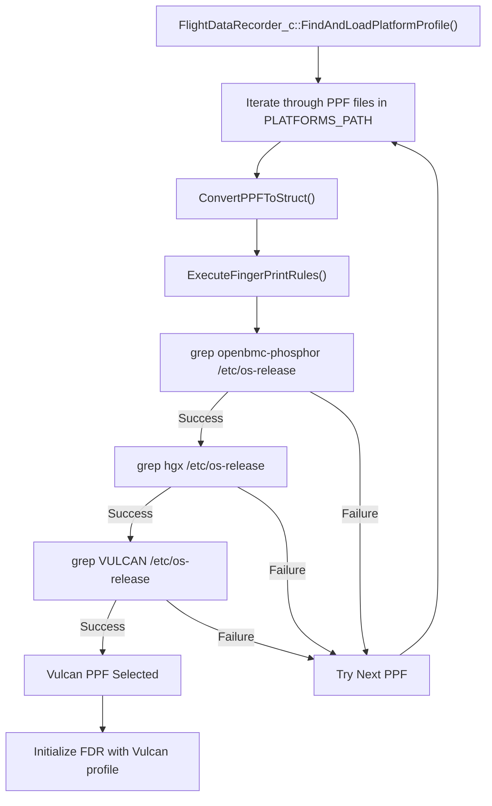
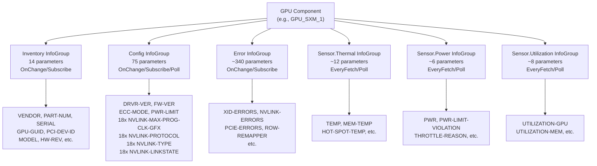
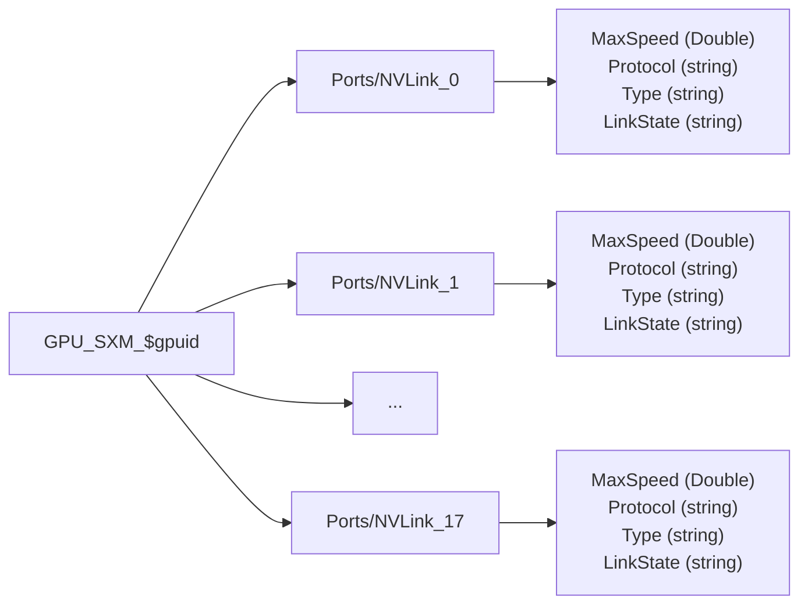
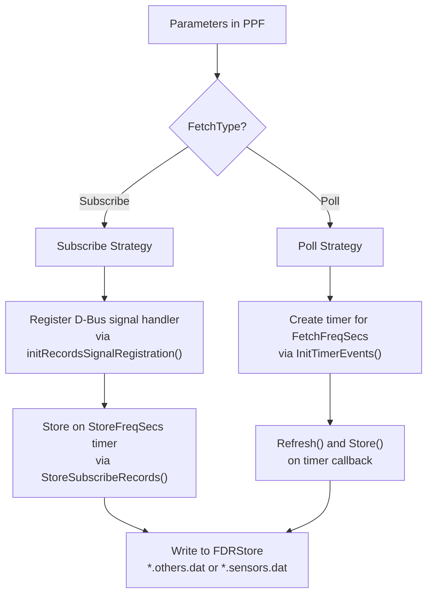
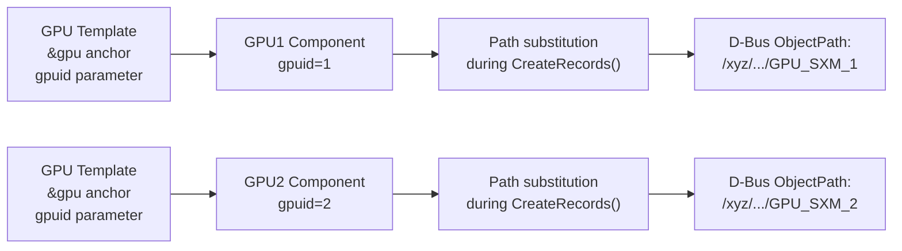

<!-- source: DeepWiki mcp.deepwiki.com · repo NVIDIA/nvidia-fdr · page 5.2 Vulcan Platform Configuration · fetched 2026-10-26 -->

# Vulcan Platform Configuration

<details>
<summary>Relevant source files</summary>

The following files were used as context for generating this wiki page:

- [fdr.cpp](fdr.cpp)
- [fdr.hpp](fdr.hpp)
- [fdr_compact.cpp](fdr_compact.cpp)
- [platforms/fdr_ppf_example.yaml](platforms/fdr_ppf_example.yaml)
- [platforms/fdr_ppf_vulcan.yaml](platforms/fdr_ppf_vulcan.yaml)

</details>


## Purpose and Scope

This document provides a detailed reference for the Vulcan platform configuration as defined in `fdr_ppf_vulcan.yaml`. The Vulcan platform is an HGX-based system running OpenBMC, and this PPF defines comprehensive GPU and NIC telemetry collection using D-Bus as the primary data source.

For general PPF structure and syntax reference, see [PPF File Structure Reference](#5.1). For another platform example, see [HGXB HMC Platform Configuration](#5.3).

Sources: [platforms/fdr_ppf_vulcan.yaml:1-25]()

---

## Platform Identification

The Vulcan platform is identified using fingerprint checks that validate the operating system and platform type:

```yaml
FingerPrint:
  Checks:
    - "grep -q -i openbmc-phosphor /etc/os-release"
    - "grep -q -i hgx /etc/os-release"
    - "grep -q -i VULCAN /etc/os-release"
```

All three checks must succeed for this PPF to be selected. The fingerprint execution occurs in [fdr.cpp:322-340]() within `FlightDataRecorder_c::ExecuteFingerPrintRules()`, which is called during platform detection in [fdr.cpp:211-292]().

**Platform Detection Flow:**



Sources: [platforms/fdr_ppf_vulcan.yaml:18-22](), [fdr.cpp:211-292](), [fdr.cpp:322-340]()

---

## General Configuration

The Vulcan platform uses the following general configuration:

| Parameter | Value | Description |
|-----------|-------|-------------|
| `LogsFormat` | `BINARY` | Protobuf-based binary format |
| `LogsBasePath` | `/var/emmc/fdr/` | Storage location on eMMC |
| `PartitionThresoldCheckMB` | `1536` | Exit if available space < 1.5 GB |
| `CompactionWindowSecs` | `86400` | Create new directory daily (24 hours) |
| `CompactionSubWindowSecs` | `1800` | Append statistics every 30 minutes |
| `HiFiDataPreserveTimeSecs` | `300` | Preserve ±5 minutes around errors |

The partition threshold check is performed at startup and on each compaction window expiry via [fdr.cpp:342-392]() in `CheckAvailableFdrPartitionDiskSize()` and `CheckFdrPartitionDiskUsageAndExit()`.

**Storage and Compaction Configuration:**

```yaml
CompactionWindowSecs: 86400        # New directory every 24 hours
CompactionSubWindowSecs: -1800      # Statistics aggregation every 30 min
HiFiDataPreserveTimeSecs: 300      # ±5 min full-resolution around errors
DefaultCompactionSensors:
  RecordRetentionPolicy: Recreate
  CompactionMethod: Average
```

The compaction logic is implemented in [fdr_compact.cpp:129-176]() in `FlightDataRecorder_c::Compactor()`.

Sources: [platforms/fdr_ppf_vulcan.yaml:24-34](), [fdr.cpp:342-392](), [fdr_compact.cpp:129-176]()

---

## Preconditions

The Vulcan platform requires that the FDR storage partition is mounted before FDR starts:

```yaml
Preconditions:
  Threshold: 300  # Test for up to 5 minutes
  Checks:
    - ID: CheckDumpDirMount
      CommandParams:
        Command: "df $logbasepath | grep '/dev/mmcblk'"
      Params:
        name: logbasepath
        value: /var/emmc/fdr/
      CommandRetryPolicy: No
      ExitOnFailure: Yes
```

This check validates that `/var/emmc/fdr/` is mounted on an eMMC device (`/dev/mmcblk`). If the check fails, FDR exits immediately. The precondition execution is handled in [fdr.cpp:395-487]() within `ExecutePreconditionRules()`.

Sources: [platforms/fdr_ppf_vulcan.yaml:41-51](), [fdr.cpp:395-487]()

---

## GPU Component Structure

The GPU component is the primary monitored component in the Vulcan platform, organized into multiple `InfoGroups`:



Sources: [platforms/fdr_ppf_vulcan.yaml:53-1599]()

---

## GPU Inventory Parameters

The Inventory InfoGroup captures static identification and hardware information. All parameters use the `Subscribe` fetch type with `OnChange` store policy, fetching data via D-Bus from the `xyz.openbmc_project.GpuMgr` service.

**Key Inventory Parameters:**

| ParamID | ID | D-Bus Interface | Property | Description |
|---------|----|--------------------|----------|-------------|
| 0 | `VENDOR` | `Inventory.Decorator.Asset` | `Manufacturer` | GPU manufacturer (NVIDIA) |
| 1 | `PART-NUM` | `Inventory.Decorator.Asset` | `PartNumber` | GPU part number |
| 2 | `SERIAL` | `Inventory.Decorator.Asset` | `SerialNumber` | GPU serial number |
| 7 | `GPU-GUID` | `Common.UUID` | `UUID` | Globally unique GPU identifier |
| 8 | `PCI-DEV-ID` | `Inventory.Item.PCIeDevice` | `Function0DeviceId` | PCIe device ID |
| 10 | `MODEL` | `Inventory.Decorator.Asset` | `Model` | GPU model name |

**D-Bus Object Path Pattern:**

The object path for GPU inventory parameters uses variable substitution:
```
/xyz/openbmc_project/inventory/system/processors/GPU_SXM_$gpuid
```

Where `$gpuid` is replaced with the actual GPU instance (e.g., `1` for GPU 1), resulting in:
```
/xyz/openbmc_project/inventory/system/processors/GPU_SXM_1
```

This substitution is performed in [fdr_record.cpp]() when creating Record objects during [fdr.cpp:574-746]() in `CreateRecords()`.

**Inventory D-Bus Configuration Example:**

```yaml
- ID: VENDOR
  ParamID: 0
  DataType: string
  FetchMethod: DBUS
  FetchFreqSecs: 3600
  StorePolicy: OnChange
  StoreFreqSecs: 3600
  FetchType: Subscribe
  DbusParams:
    Service: "xyz.openbmc_project.GpuMgr"
    ObjectPath: "/xyz/openbmc_project/inventory/system/processors/GPU_SXM_$gpuid"
    Interface: "xyz.openbmc_project.Inventory.Decorator.Asset"
    Property: "Manufacturer"
```

Sources: [platforms/fdr_ppf_vulcan.yaml:58-202](), [fdr.cpp:574-746]()

---

## GPU Configuration Parameters

The Config InfoGroup contains 75+ parameters covering firmware versions, ECC settings, power limits, clock configurations, and NVLink properties. Most use `Subscribe` fetch type with `OnChange` policy, while NVLink link state parameters use `Poll` for active monitoring.

### Software and Firmware Versions

| ParamID | ID | Interface | Property | Fetch Type |
|---------|----|-----------|-----------|----|
| 15 | `DRVR-VER` | `Software.Version` | `Version` | Subscribe |
| 16 | `FW-VER` | `Software.Version` | `Version` | Subscribe |
| 17 | `INFOROM-VER` | `Software.Version` | `Version` | Subscribe |

### ECC and Memory Configuration

| ParamID | ID | Interface | Property | Data Type |
|---------|----|-----------|-----------|----|
| 19 | `ECC-MODE` | `Memory.MemoryECC` | `ECCModeEnabled` | Uint64 |
| 23 | `MEM-TYPE` | `Inventory.Item.Dimm` | `MemoryType` | string |
| 24 | `MEM-ECC` | `Inventory.Item.Dimm` | `ECC` | string |
| 25 | `MEM-SIZE-DRAM` | `Inventory.Item.Dimm` | `MemorySizeInKB` | Uint64 |

### Power Limit Configuration

| ParamID | ID | Interface | Property |
|---------|----|-----------|----|
| 84 | `PWR-LIMIT-MIN` | `com.nvidia.Edpp` | `AllowableMin` |
| 85 | `PWR-LIMIT-MAX` | `com.nvidia.Edpp` | `AllowableMax` |
| 86 | `PWR-LIMIT-TOTAL-MIN` | `Inventory.Decorator.PowerLimit` | `MinPowerWatts` |
| 87 | `PWR-LIMIT-TOTAL-MAX` | `Inventory.Decorator.PowerLimit` | `MaxPowerWatts` |
| 88 | `PWR-LIMIT-REQUESTED` | `Control.Power.Cap` | `PowerCap` |
| 89 | `PWR-LIMIT-ENFORCED` | `Control.Power.Cap` | `DefaultPowerCap` |

Sources: [platforms/fdr_ppf_vulcan.yaml:203-1036]()

---

## NVLink Configuration and Monitoring

The Vulcan platform monitors 18 NVLink connections per GPU (NVLink 0-17), tracking maximum speed, protocol, type, and link state for each.

**NVLink Parameter Structure:**



### NVLink Parameter Categories

**1. Maximum Clock Speed (ParamID 28-45):**
- Object Path: `/xyz/openbmc_project/inventory/system/processors/GPU_SXM_$gpuid/Ports/NVLink_N`
- Interface: `xyz.openbmc_project.Inventory.Item.Port`
- Property: `MaxSpeed`
- Data Type: `Double`
- Fetch Type: `Poll`
- Example IDs: `NVLINK-MAX-PROG-CLK-GFX[0]` through `NVLINK-MAX-PROG-CLK-GFX[17]`

**2. Protocol (ParamID 46-63):**
- Property: `Protocol`
- Data Type: `string`
- Fetch Type: `Poll`
- Example IDs: `NVLINK-PROTOCOL[0]` through `NVLINK-PROTOCOL[17]`

**3. Type (ParamID 64-81):**
- Property: `Type`
- Data Type: `string`
- Fetch Type: `Poll`
- Example IDs: `NVLINK-TYPE[0]` through `NVLINK-TYPE[17]`

**4. Link State (ParamID 90-107):**
- Property: `LinkState`
- Data Type: `string`
- Fetch Type: `Poll`
- Example IDs: `NVLINK-LINKSTATE[0]` through `NVLINK-LINKSTATE[17]`

**NVLink Configuration Example:**

```yaml
- ID: NVLINK-MAX-PROG-CLK-GFX[0]
  ParamID: 28
  DataType: Double
  FetchType: Poll
  FetchFreqSecs: 3600
  StorePolicy: OnChange
  DbusParams:
    Service: "xyz.openbmc_project.GpuMgr"
    ObjectPath: "/xyz/openbmc_project/inventory/system/processors/GPU_SXM_$gpuid/Ports/NVLink_0"
    Interface: "xyz.openbmc_project.Inventory.Item.Port"
    Property: "MaxSpeed"
```

All NVLink configuration parameters use `Poll` fetch type rather than `Subscribe`, indicating they are sampled periodically rather than event-driven. This allows for consistent monitoring of link health and configuration changes.

Sources: [platforms/fdr_ppf_vulcan.yaml:338-1035]()

---

## GPU Error Parameters

The Error InfoGroup tracks various GPU error counters and states. These parameters use `Subscribe` fetch type to capture errors as they occur.

**Error Categories:**

| Category | Parameter Examples | ParamID Range |
|----------|-------------------|---------------|
| XID Errors | `XID-ERRORS`, `XID-ERRORS-CRITICAL-LASTXID` | 108-111 |
| NVLink Errors | `NVLINK-ERRORS[0-17]`, `NVLINK-REPLAY-ERRORS[0-17]`, `NVLINK-RECOVERY-ERRORS[0-17]` | 112-183 |
| PCIe Errors | `PCIE-REPLAY-COUNT`, `PCIE-REPLAY-ROLLOVER-COUNT` | 184-185 |
| Row Remapping | `REMAPPED-ROWS-CORRECTABLE`, `REMAPPED-ROWS-UNCORRECTABLE`, `REMAPPED-ROWS-PENDING`, `REMAPPED-ROWS-FAILURE` | 186-189 |
| ECC Errors | Various memory hierarchy levels (L1, L2, DRAM, SRAM) | 190+ |

**Error D-Bus Configuration:**

Error parameters typically use D-Bus object paths like:
```
/xyz/openbmc_project/inventory/system/processors/GPU_SXM_$gpuid
```

With interfaces like:
- `com.nvidia.XIDError`
- `com.nvidia.NVLinkError`
- `com.nvidia.PCIeError`
- `xyz.openbmc_project.Memory.MemoryECC`

When errors occur, they are logged to the Book of Errors via [fdr.cpp]() and trigger high-fidelity data preservation around the error timestamp (±300 seconds) during compaction in [fdr_compact.cpp:23-127]().

Sources: [platforms/fdr_ppf_vulcan.yaml:1037-1449]()

---

## GPU Sensor Parameters

Sensor parameters provide real-time telemetry and use different InfoGroups with `<<: *compaction-definition-sensors` to enable statistical aggregation.

### Sensor.Thermal InfoGroup

Thermal sensors use `EveryFetch` store policy to capture every sample:

| ParamID | ID | Property | Fetch Freq | Data Type |
|---------|----|----|----|----|
| ~450 | `TEMP` | Temperature sensor reading | 600s | Double |
| ~451 | `MEM-TEMP` | Memory temperature | 600s | Double |
| ~452 | `HOT-SPOT-TEMP` | Hot spot temperature | 600s | Double |

**Thermal Sensor Configuration:**

```yaml
- ID: Sensor.Thermal
  InfoList:
    - ID: TEMP
      ParamID: 450
      DataType: Double
      FetchMethod: DBUS
      FetchFreqSecs: 600
      StorePolicy: EveryFetch
      FetchType: Poll
      DbusParams:
        Service: "xyz.openbmc_project.GpuMgr"
        ObjectPath: "/xyz/openbmc_project/sensors/temperature/HGX_GPU_SXM_$gpuid_TEMP_1"
        Interface: "xyz.openbmc_project.Sensor.Value"
        Property: "Value"
  RecordRetentionPolicy: Recreate
  CompactionMethod: Average
```

The `CompactionMethod: Average` causes FDR to compute running averages over 30-minute windows (CompactionSubWindowSecs) and write them to `.sensors.stat.dat` files. This logic is in [fdr_compact.cpp:285-333]().

### Sensor.Power InfoGroup

Power sensors monitor power draw and throttling:

| ParamID | ID | Fetch Freq | Store Policy |
|---------|----|----|-----|
| ~470 | `PWR` | 600s | EveryFetch |
| ~471 | `PWR-LIMIT-VIOLATION` | 600s | EveryFetch |
| ~472 | `THROTTLE-REASON` | 600s | OnChange |

### Sensor.Utilization InfoGroup

Utilization sensors track GPU and memory usage:

| ParamID | ID | Fetch Freq |
|---------|----|----|
| ~480 | `UTILIZATION-GPU` | 600s |
| ~481 | `UTILIZATION-MEM` | 600s |
| ~482 | `UTILIZATION-ENC` | 600s |
| ~483 | `UTILIZATION-DEC` | 600s |

All sensor InfoGroups inherit the compaction definition:
```yaml
<<: *compaction-definition-sensors
  RecordRetentionPolicy: Recreate
  CompactionMethod: Average
```

This means sensor data files are recreated (not appended) during compaction, and averages are computed for statistical analysis.

Sources: [platforms/fdr_ppf_vulcan.yaml:1450-1599]()

---

## NIC Component Structure

The Vulcan platform monitors Network Interface Cards with a simpler structure than GPUs:

```yaml
NIC: &nic
  Params:
    - name: nicid
      value: 0
  InfoGroups:
    - ID: Inventory
      InfoList:
        # NIC inventory parameters
    - ID: Error
      InfoList:
        # NIC error parameters
    - ID: Sensor.Traffic
      InfoList:
        # Traffic statistics (RX/TX bytes, packets, errors)
```

**NIC D-Bus Configuration:**

NIC parameters use D-Bus service `xyz.openbmc_project.PldmManager` with object paths like:
```
/xyz/openbmc_project/inventory/system/network_interfaces/NIC_$nicid
```

NIC monitoring includes:
- **Inventory:** Part number, serial, MAC address, firmware version
- **Errors:** Link errors, CRC errors
- **Traffic Sensors:** RX/TX bytes, packets, multicast, errors, drops

NIC sensor parameters also use the compaction definition for statistical aggregation.

Sources: [platforms/fdr_ppf_vulcan.yaml:1600-1800]()

---

## Data Collection Strategy

The Vulcan platform uses two primary data collection strategies based on parameter characteristics:

**Fetch Type Mapping:**



### Subscribe Strategy

Used for: Inventory, most Config parameters, Error parameters

- **Mechanism:** D-Bus `PropertiesChanged` signal subscription
- **Trigger:** Event-driven when property changes on D-Bus
- **Fetch Frequency:** Not applicable (event-driven)
- **Store Frequency:** Controlled by `StoreFreqSecs` timer
- **Store Policy:** Typically `OnChange` - only store when value changes

The signal registration occurs in [fdr.cpp]() via `initRecordsSignalRegistration()`, which iterates through all Subscribe-type records and registers D-Bus match rules for their object paths and interfaces.

**Subscribe Record Example:**

```yaml
- ID: FW-VER
  FetchType: Subscribe
  FetchFreqSecs: 3600   # Used as StoreFreqSecs context
  StorePolicy: OnChange
  StoreFreqSecs: 3600
  DbusParams:
    Service: "xyz.openbmc_project.GpuMgr"
    ObjectPath: "/xyz/openbmc_project/inventory/system/processors/GPU_SXM_$gpuid"
    Interface: "xyz.openbmc_project.Software.Version"
    Property: "Version"
```

When `PropertiesChanged` fires for this interface/path, the callback in [fdr.hpp:176]() `dbusEventHandlerCallback()` updates the Record's cached value. The Store() operation happens on a separate timer managed by `RecListSubscribeStoreMap` in [fdr.hpp:48]().

### Poll Strategy

Used for: NVLink parameters, Sensor parameters

- **Mechanism:** Timer-based periodic sampling
- **Trigger:** Time-driven via `sdeventplus::utility::Timer`
- **Fetch Frequency:** Controlled by `FetchFreqSecs`
- **Store Policy:** Typically `EveryFetch` for sensors
- **Timer Implementation:** [fdr.cpp]() in `InitTimerEvents()`

**Poll Record Example:**

```yaml
- ID: NVLINK-LINKSTATE[0]
  FetchType: Poll
  FetchFreqSecs: 3600
  StorePolicy: OnChange
  DbusParams:
    Service: "xyz.openbmc_project.GpuMgr"
    ObjectPath: "/xyz/openbmc_project/inventory/system/processors/GPU_SXM_$gpuid/Ports/NVLink_0"
    Interface: "xyz.openbmc_project.Inventory.Item.Port"
    Property: "LinkState"
```

On each timer expiration, the callback invokes `RefreshAndStore()` in [fdr.cpp:836-863]() which calls both `Refresh()` (fetch from D-Bus) and `Store()` (write to file) for all records in that frequency bucket.

**Timer Organization:**

The FDR system organizes Poll records by fetch frequency in `RecListPollMap`:

```cpp
std::map<int, std::vector<Record*>> RecListPollMap;
// Key: FetchFreqSecs (e.g., 600, 3600)
// Value: Vector of Record pointers with that frequency
```

This allows efficient timer management - one timer per unique frequency rather than per parameter. The timer creation is in [fdr.cpp]() within `InitTimerEvents()`.

Sources: [platforms/fdr_ppf_vulcan.yaml:60-1599](), [fdr.cpp:574-746](), [fdr.cpp:836-863](), [fdr.hpp:42-51]()

---

## Component Instantiation

The Vulcan PPF defines component templates (anchors) and instantiates them in the `Sections` block:

**GPU Instantiation:**

```yaml
Sections:
  - ID: GPU
    Components:
      - ID: GPU1
        <<: *gpu
        Params:
          - name: gpuid
            value: 1
      - ID: GPU2
        <<: *gpu
        Params:
          - name: gpuid
            value: 2
      # ... GPU3-GPU8 ...
```

Each GPU component inherits all InfoGroups from the `&gpu` anchor but overrides the `gpuid` parameter. This results in unique D-Bus object paths for each GPU instance.

**Parameter Substitution Flow:**



The substitution mechanism in [fdr_record.cpp]() replaces `$gpuid` with the actual value when creating Record objects during [fdr.cpp:574-746]() in `CreateRecords()`.

**NIC Instantiation:**

```yaml
  - ID: NIC
    Components:
      - ID: NIC1
        <<: *nic
        Params:
          - name: nicid
            value: 1
      - ID: NIC2
        <<: *nic
        Params:
          - name: nicid
            value: 2
```

This pattern allows the same template to be reused for multiple component instances with parameter-based path differentiation.

Sources: [platforms/fdr_ppf_vulcan.yaml:1800-2000](), [fdr.cpp:574-746]()

---

## Storage Layout for Vulcan

The Vulcan platform generates the following file structure under `/var/emmc/fdr/`:

```
/var/emmc/fdr/
├── Bookkeeper/
│   ├── BirthCertificate.tar      # Initial state snapshot
│   ├── BootEvent.dat              # Boot history with data format versions
│   ├── BookOfErrors.dat           # Error event log
│   ├── Compactor.dat              # Compaction queue
│   └── ParamDescription.dat       # Parameter metadata
├── FdrBoot_<bootid>_<timestamp>/
│   ├── GPU.GPU1.sensors.dat       # GPU1 thermal/power/utilization
│   ├── GPU.GPU1.sensors.stat.dat  # GPU1 30-min averages
│   ├── GPU.GPU1.sensors.hifi.dat  # GPU1 high-fidelity error context
│   ├── GPU.GPU1.others.dat        # GPU1 inventory/config/errors
│   ├── GPU.GPU2.sensors.dat
│   ├── GPU.GPU2.sensors.stat.dat
│   ├── GPU.GPU2.others.dat
│   # ... GPU3-GPU8 ...
│   ├── NIC.NIC1.sensors.dat
│   ├── NIC.NIC1.others.dat
│   └── NIC.NIC2.others.dat
```

**File Naming Convention:**

- `<Section>.<Component>.<type>.dat` - Main data files
- `.sensors.dat` - High-frequency sensor data (from `Sensor.*` InfoGroups)
- `.others.dat` - Low-frequency data (Inventory, Config, Error InfoGroups)
- `.sensors.stat.dat` - Statistical aggregates (30-minute averages)
- `.sensors.hifi.dat` - High-fidelity data preserved around errors

The file segregation logic is in [fdr.cpp:524-572]() within `CreateSamplesWriter()`:

```cpp
if ((infogroup.ID).find("Sensor.") != std::string::npos)
{
    // Create .sensors.dat file
    CreateSamplesWriter(profile, section.ID, component.ID,
                       infogroup.ID, ".sensors.dat", fdrStoreObj);
}
else
{
    // Create .others.dat file
    CreateSamplesWriter(profile, section.ID, component.ID,
                       infogroup.ID, ".others.dat", fdrStoreObj);
}
```

Sources: [fdr.cpp:524-572](), [fdr.cpp:574-746]()

---

## Parameter Summary Tables

### GPU Inventory Summary

| Parameter Count | Fetch Method | Fetch Type | Store Policy | Typical Frequency |
|----------------|--------------|------------|--------------|------------------|
| 14 | D-Bus | Subscribe | OnChange | 3600s context |

### GPU Configuration Summary

| Parameter Category | Count | Fetch Type | Store Policy |
|-------------------|-------|------------|--------------|
| Software Versions | 3 | Subscribe | OnChange |
| ECC/Memory Config | 9 | Subscribe | OnChange |
| Clock Config | 2 | Subscribe | OnChange |
| NVLink Max Speed | 18 | Poll | OnChange |
| NVLink Protocol | 18 | Poll | OnChange |
| NVLink Type | 18 | Poll | OnChange |
| NVLink Link State | 18 | Poll | OnChange |
| Power Limits | 6 | Subscribe | OnChange |
| **Total** | **92** | Mixed | OnChange |

### GPU Error Summary

| Error Category | Parameter Count | Fetch Type | Critical for Book of Errors |
|---------------|----------------|------------|---------------------------|
| XID Errors | 4 | Subscribe | Yes |
| NVLink Errors | 54 (18×3 types) | Subscribe | Yes |
| PCIe Errors | 2 | Subscribe | Yes |
| Row Remapping | 4 | Subscribe | Yes |
| ECC Errors | ~280 | Subscribe | Yes |
| **Total** | **~344** | Subscribe | Yes |

### GPU Sensor Summary

| InfoGroup | Parameters | Fetch Freq | Store Policy | Compaction |
|-----------|-----------|------------|--------------|------------|
| Sensor.Thermal | ~12 | 600s | EveryFetch | Average |
| Sensor.Power | ~6 | 600s | EveryFetch | Average |
| Sensor.Utilization | ~8 | 600s | EveryFetch | Average |
| **Total** | **~26** | 600s | EveryFetch | Average |

### NIC Summary

| InfoGroup | Parameters | Fetch Type | Compaction |
|-----------|-----------|------------|------------|
| Inventory | ~8 | Subscribe | N/A |
| Error | ~10 | Subscribe | N/A |
| Sensor.Traffic | ~10 | Poll | Average |
| **Total** | **~28** | Mixed | Mixed |

Sources: [platforms/fdr_ppf_vulcan.yaml:53-2000]()

---

## Event Monitoring Configuration

The Vulcan platform is configured to capture AML (Advanced Management Link) events from OpenBMC:

```yaml
Events:
  ObjectPath: "/xyz/openbmc_project/logging"
  Interface: "org.freedesktop.DBus.ObjectManager"
  Member: "InterfacesAdded"
```

This configuration enables FDR to subscribe to system-level logging events via D-Bus. When new log entries are created (e.g., error events, warnings), the `InterfacesAdded` signal is emitted, and FDR captures the event details.

The event handling is implemented in [fdr_events.cpp]() and registered via `initEventsSignalRegistration()`. Events are written to:
- `BookOfErrors.dat` for error tracking
- `Event_<timestamp>.dat` files for detailed event context

This integration with OpenBMC's logging infrastructure allows FDR to correlate hardware telemetry with system-level events.

Sources: [platforms/fdr_ppf_vulcan.yaml:36-39]()

---

## Key Differences from Example Platform

Compared to the example PPF ([fdr_ppf_example.yaml]()), the Vulcan platform demonstrates production-grade characteristics:

| Aspect | Example Platform | Vulcan Platform |
|--------|-----------------|-----------------|
| **OS** | Ubuntu (development) | OpenBMC (production) |
| **Storage** | `/tmp/fdr/` (tmpfs) | `/var/emmc/fdr/` (persistent eMMC) |
| **Fetch Method** | `Command` (nvidia-smi) | `DBUS` (GpuMgr service) |
| **GPU Count** | 4 | 8 |
| **NVLink Monitoring** | Not present | 18 links × 4 properties = 72 params/GPU |
| **Error Tracking** | Basic (~5 params) | Comprehensive (~344 params) |
| **Compaction Window** | 300s (5 min, testing) | 86400s (24 hours, production) |
| **Partition Check** | 300 MB | 1536 MB (1.5 GB) |

The Vulcan configuration is optimized for:
- **Reliability:** Persistent storage on eMMC
- **Performance:** D-Bus IPC rather than subprocess execution
- **Scale:** 8 GPUs with extensive per-GPU telemetry
- **Integration:** Native OpenBMC service interaction

Sources: [platforms/fdr_ppf_vulcan.yaml:1-2000](), [platforms/fdr_ppf_example.yaml:1-304]()

---

