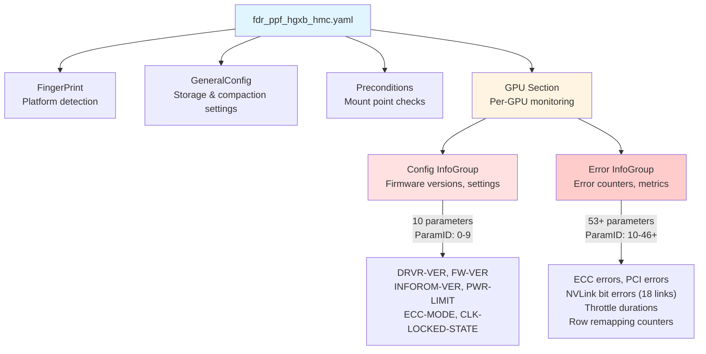
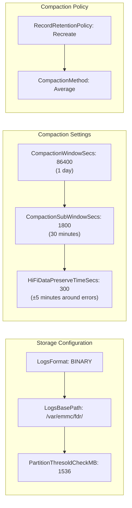
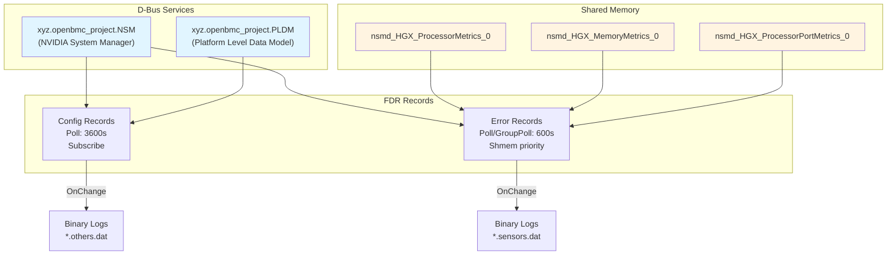
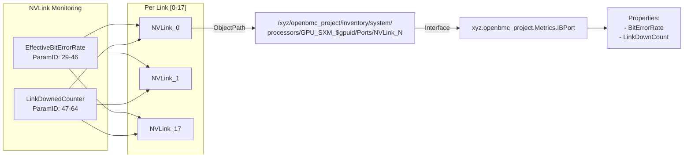
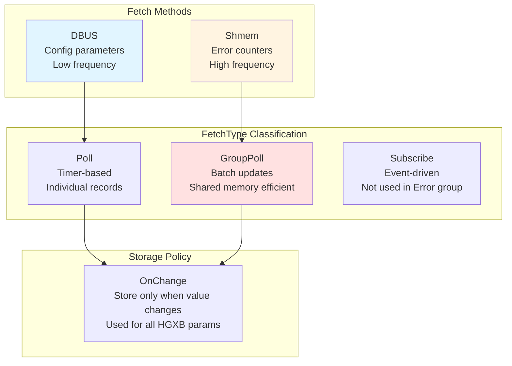
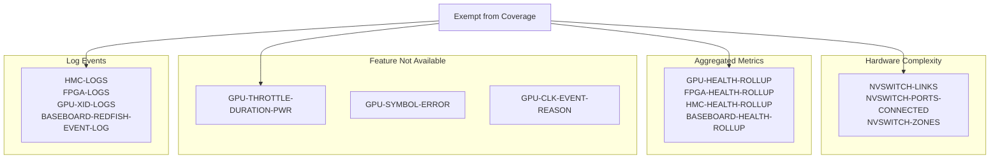

<!-- source: DeepWiki mcp.deepwiki.com · repo NVIDIA/nvidia-fdr · page 5.3 HGXB HMC Platform Configuration · fetched 2026-10-26 -->

# HGXB HMC Platform Configuration

<details>
<summary>Relevant source files</summary>

The following files were used as context for generating this wiki page:

- [fdr_compact.cpp](fdr_compact.cpp)
- [platforms/fdr_ppf_example.yaml](platforms/fdr_ppf_example.yaml)
- [platforms/fdr_ppf_hgxb_hmc.yaml](platforms/fdr_ppf_hgxb_hmc.yaml)
- [platforms/fdr_ppf_vulcan.yaml](platforms/fdr_ppf_vulcan.yaml)
- [tools/data_validation/platform/exempt_telemetry_list_hgxb.yaml](tools/data_validation/platform/exempt_telemetry_list_hgxb.yaml)

</details>


## Purpose and Scope

This page documents the HGXB HMC (HGX Baseboard Host Management Controller) platform configuration for the FDR system. The HGXB HMC platform represents a production HGX system where telemetry is collected from an OpenBMC-based management controller. This configuration defines what telemetry parameters are monitored, how frequently they are sampled, and which D-Bus services provide the data.

For information about the general structure of Platform Profile Files (PPF), see [PPF File Structure Reference](#5.1). For a comparison with development platform configuration, see [Vulcan Platform Configuration](#5.2).

**Sources:** [platforms/fdr_ppf_hgxb_hmc.yaml:1-50]()

## Platform Profile File Structure

The HGXB HMC configuration is defined in `fdr_ppf_hgxb_hmc.yaml` and follows the standard PPF structure with these main sections:



**Sources:** [platforms/fdr_ppf_hgxb_hmc.yaml:18-50](), [platforms/fdr_ppf_hgxb_hmc.yaml:53-1100]()

## Platform Detection

The HGXB HMC platform is identified through fingerprint checks that verify the operating system and platform type:

| Check | Command | Purpose |
|-------|---------|---------|
| OS Type | `grep -q -i openbmc-phosphor /etc/os-release` | Verify OpenBMC-based system |
| Platform | `grep -q -i hgxb /etc/os-release` | Verify HGXB hardware platform |

Both conditions must be satisfied for the PPF to be selected.

**Sources:** [platforms/fdr_ppf_hgxb_hmc.yaml:18-21]()

## General Configuration



Key configuration parameters:

| Parameter | Value | Description |
|-----------|-------|-------------|
| `LogsFormat` | `BINARY` | Uses protobuf binary format for storage |
| `LogsBasePath` | `/var/emmc/fdr/` | Logs stored on eMMC partition |
| `PartitionThresoldCheckMB` | `1536` | Exit FDR if available space < 1.5 GB |
| `CompactionWindowSecs` | `86400` | Create new directory every 24 hours |
| `CompactionSubWindowSecs` | `1800` | Append statistics every 30 minutes |
| `HiFiDataPreserveTimeSecs` | `300` | Preserve 10 minutes of full data around errors |

**Sources:** [platforms/fdr_ppf_hgxb_hmc.yaml:23-33]()

## Event Monitoring Configuration

The HGXB configuration monitors D-Bus events for error logging:

```yaml
Events:
  ObjectPath: /xyz/openbmc_project/logging
  Interface: org.freedesktop.DBus.ObjectManager
  Member: InterfacesAdded
```

This configuration allows FDR to capture and store error events in the Book of Errors for high-fidelity data preservation.

**Sources:** [platforms/fdr_ppf_hgxb_hmc.yaml:34-37]()

## Preconditions

The HGXB configuration verifies that the eMMC partition is properly mounted before starting:

| Check ID | Command | Retry Policy | Exit on Failure |
|----------|---------|--------------|-----------------|
| `CheckDumpDirMount` | `df /var/emmc/fdr/ \| grep '/dev/mmcblk'` | No | Yes |

If the mount check fails, FDR will exit immediately without retry attempts.

**Sources:** [platforms/fdr_ppf_hgxb_hmc.yaml:39-49]()

## Data Collection Architecture



The HGXB platform uses two primary D-Bus services:
- **xyz.openbmc_project.NSM**: NVIDIA System Manager for general GPU properties
- **xyz.openbmc_project.PLDM**: Platform Level Data Model for firmware information

High-frequency error metrics use **Shared Memory** (Shmem) with fallback to D-Bus.

**Sources:** [platforms/fdr_ppf_hgxb_hmc.yaml:62-100](), [platforms/fdr_ppf_hgxb_hmc.yaml:233-265]()

## GPU Config InfoGroup

The Config InfoGroup monitors relatively static GPU configuration parameters with hourly polling:

| ParamID | ID | Data Type | Fetch Method | Frequency | D-Bus Interface |
|---------|----|-----------|--------------|-----------|--------------------|
| 0 | `DRVR-VER` | string | DBUS | 3600s | `xyz.openbmc_project.Software.Version` |
| 1 | `ENFORCED-CLK-LIMIT-MAX` | Uint64 | DBUS | 3600s | `xyz.openbmc_project.Inventory.Item.Cpu.OperatingConfig` |
| 2 | `FW-VER` | string | DBUS | 3600s | `xyz.openbmc_project.Software.Version` |
| 3 | `FW-WP-MODE` | Uint64 | DBUS | 3600s | `xyz.openbmc_project.Software.Settings` |
| 4 | `INFOROM-VER` | string | DBUS | 3600s | `xyz.openbmc_project.Software.Version` |
| 5 | `PWR-LIMIT-REQUESTED` | Uint64 | DBUS | 3600s | `xyz.openbmc_project.Control.Power.Cap` |
| 6 | `PWR-LIMIT-ENFORCED` | Uint64 | DBUS | 3600s | `xyz.openbmc_project.Control.Power.Cap` |
| 7 | `ECC-MODE` | Uint64 | DBUS | 3600s | `xyz.openbmc_project.Memory.MemoryECC` |
| 8 | `CLK-LOCKED-STATE` | Uint64 | DBUS | 3600s | `xyz.openbmc_project.Inventory.Item.Cpu.OperatingConfig` |
| 9 | `CLK-PRESENT-LIMIT-MAX` | Uint64 | DBUS/Shmem | 600s | `xyz.openbmc_project.Inventory.Item.Dimm` |

All Config parameters use `FetchType: Poll` and `StorePolicy: OnChange`, meaning they are stored only when values change.

**Sources:** [platforms/fdr_ppf_hgxb_hmc.yaml:58-201]()

## GPU Error InfoGroup

The Error InfoGroup is the most extensive section, monitoring various error counters and performance metrics at 600-second intervals:

### Error Categories

```mermaid
graph TB
    ERROR["Error InfoGroup<br/>FetchFreqSecs: 600"]
    
    subgraph "PCI Errors"
        PCI_UNSUP["PCI-ERR-CTR-UNSUPPREQ<br/>ParamID: 10"]
        PCI_CORR["PCI-ERR-CTR-CORR<br/>ParamID: 16"]
        PCI_FATAL["PCI-ERR-CTR-FATAL<br/>ParamID: 17"]
        PCI_NONFATAL["PCI-ERR-CTR-NON-FATAL<br/>ParamID: 21"]
        PCI_REPLAY["PCI-ERR-CTR-REPLAY<br/>ParamID: 25"]
        PCI_RETRY["PCI-RETRIES<br/>ParamID: 28"]
    end
    
    subgraph "ECC Errors"
        ECC_CE["ECC-ERR-CTR-CE<br/>ParamID: 11<br/>DRAM"]
        ECC_UCE["ECC-ERR-CTR-UCE<br/>ParamID: 12<br/>DRAM"]
        ECC_CE_CACHE["ECC-ERR-CTR-CE-CACHE<br/>ParamID: 23"]
        ECC_UE_CACHE["ECC-ERR-CTR-UE-CACHE<br/>ParamID: 24"]
    end
    
    subgraph "Row Remapping"
        ROW_UE["ROW-REMAPPED-CTR-UE<br/>ParamID: 13"]
        ROW_CE["ROW-REMAPPED-CTR-CE<br/>ParamID: 14"]
        ROW_FAIL["ROW-REMAP-FAILED<br/>ParamID: 15"]
    end
    
    subgraph "NVLink Metrics"
        NVLINK_BER["EffectiveBitErrorRate[0-17]<br/>ParamID: 29-46<br/>18 links"]
        NVLINK_DOWN["LinkDownedCounter[0-17]<br/>ParamID: 47-64<br/>18 links"]
    end
    
    subgraph "Throttling"
        THROTTLE_SW["THROTTLE-DURATION-SW-VIOLATION<br/>ParamID: 26"]
        THROTTLE_THERMAL["THROTTLE-DURATION-THERMAL<br/>ParamID: 27"]
    end
    
    ERROR --> PCI_UNSUP
    ERROR --> ECC_CE
    ERROR --> ROW_UE
    ERROR --> NVLINK_BER
    ERROR --> THROTTLE_SW
```



**Sources:** [platforms/fdr_ppf_hgxb_hmc.yaml:203-1084]()

### PCI Error Counters

| ParamID | ID | Description | D-Bus Property |
|---------|----|----|----------------|
| 10 | `PCI-ERR-CTR-UNSUPPREQ` | Unsupported request count | `UnsupportedRequestCount` |
| 16 | `PCI-ERR-CTR-CORR` | Correctable errors | `ceCount` |
| 17 | `PCI-ERR-CTR-FATAL` | Fatal errors | `feCount` |
| 18 | `PCI-ERR-CTR-L0-TO-RECOVERY` | L0 to recovery transitions | `L0ToRecoveryCount` |
| 19 | `PCI-ERR-CTR-NAK-RECVD` | NAK received count | `NAKReceivedCount` |
| 20 | `PCI-ERR-CTR-NAK-SENT` | NAK sent count | `NAKSentCount` |
| 21 | `PCI-ERR-CTR-NON-FATAL` | Non-fatal errors | `nonfeCount` |
| 22 | `PCI-ERR-CTR-REPLAY-ROLLOVER` | Replay rollover count | `ReplayRolloverCount` |
| 25 | `PCI-ERR-CTR-REPLAY` | Replay count | `ReplayCount` |
| 28 | `PCI-RETRIES` | PCI retry count | `ReplayCount` |

All PCI error counters use:
- **FetchMethod**: `Shmem` (with D-Bus fallback)
- **FetchType**: `GroupPoll`
- **Namespace**: `nsmd_HGX_ProcessorMetrics_0`
- **Interface**: `xyz.openbmc_project.PCIe.PCIeECC`

**Sources:** [platforms/fdr_ppf_hgxb_hmc.yaml:205-539]()

### ECC Error Counters

| ParamID | ID | Description | Object Path |
|---------|----|----|-------------|
| 11 | `ECC-ERR-CTR-CE` | Correctable ECC errors (DRAM) | `.../GPU_SXM_$gpuid_DRAM_0` |
| 12 | `ECC-ERR-CTR-UCE` | Uncorrectable ECC errors (DRAM) | `.../GPU_SXM_$gpuid_DRAM_0` |
| 23 | `ECC-ERR-CTR-CE-CACHE` | Correctable ECC errors (Cache) | `.../GPU_SXM_$gpuid` |
| 24 | `ECC-ERR-CTR-UE-CACHE` | Uncorrectable ECC errors (Cache) | `.../GPU_SXM_$gpuid` |

ECC counters use:
- **Shmem Namespace**: `nsmd_HGX_MemoryMetrics_0` (DRAM) or `nsmd_HGX_ProcessorMetrics_0` (Cache)
- **Interface**: `xyz.openbmc_project.Memory.MemoryECC`

**Sources:** [platforms/fdr_ppf_hgxb_hmc.yaml:233-469]()

### Row Remapping Counters

Row remapping tracks memory repair operations:

| ParamID | ID | Data Type | Description |
|---------|----|----|-------------|
| 13 | `ROW-REMAPPED-CTR-UE` | Uint64 | Rows remapped due to uncorrectable errors |
| 14 | `ROW-REMAPPED-CTR-CE` | Uint64 | Rows remapped due to correctable errors |
| 15 | `ROW-REMAP-FAILED` | string | Row remapping failure state |

Uses **Interface**: `com.nvidia.MemoryRowRemapping`

**Sources:** [platforms/fdr_ppf_hgxb_hmc.yaml:267-316]()

### NVLink Metrics

The HGXB configuration monitors 18 NVLink ports per GPU, tracking bit error rates and link down events:



Each of the 18 NVLink ports is monitored with:
- **EffectiveBitErrorRate[N]**: ParamID 29-46, property `BitErrorRate`
- **LinkDownedCounter[N]**: ParamID 47-64, property `LinkDownCount`

All use:
- **FetchMethod**: `Shmem`
- **FetchType**: `GroupPoll`
- **Namespace**: `nsmd_HGX_ProcessorPortMetrics_0`
- **FetchFreqSecs**: 600

**Sources:** [platforms/fdr_ppf_hgxb_hmc.yaml:541-1084]()

### Throttling Metrics

| ParamID | ID | Data Type | Property |
|---------|----|----|----------|
| 26 | `THROTTLE-DURATION-SW-VIOLATION` | string | `GlobalSoftwareViolationThrottleDuration` |
| 27 | `THROTTLE-DURATION-THERMAL` | string | `ThermalLimitThrottleDuration` |

Uses **Interface**: `xyz.openbmc_project.State.ProcessorPerformance`

**Sources:** [platforms/fdr_ppf_hgxb_hmc.yaml:488-520]()

## Fetch Methods and Data Sources



The HGXB configuration prioritizes **Shared Memory** for high-frequency error metrics:

**FetchMethod Distribution:**
- **Config InfoGroup**: All use `DBUS` except `CLK-PRESENT-LIMIT-MAX` (uses Shmem with D-Bus fallback)
- **Error InfoGroup**: All use `Shmem` (with D-Bus fallback)

**FetchType Distribution:**
- **Config InfoGroup**: `Poll` (timer-based individual fetches)
- **Error InfoGroup**: `GroupPoll` (batch updates via FdrGrpUpdate)

**StorePolicy**: All parameters use `OnChange` to minimize storage usage.

**Sources:** [platforms/fdr_ppf_hgxb_hmc.yaml:60-1084]()

## Parameter Instantiation

The GPU section uses YAML anchoring to define a template that is instantiated for each GPU:

```yaml
GPU: &gpu
  Params:
  - name: gpuid
    value: 1
  InfoGroups:
    - ID: Config
      InfoList: [...]
    - ID: Error
      InfoList: [...]
```

The `$gpuid` variable is substituted in D-Bus object paths:
- `/xyz/openbmc_project/inventory/system/processors/GPU_SXM_$gpuid`
- `/xyz/openbmc_project/inventory/system/memory/GPU_SXM_$gpuid_DRAM_0`
- `/xyz/openbmc_project/inventory/system/processors/GPU_SXM_$gpuid/Ports/NVLink_$N`

**Sources:** [platforms/fdr_ppf_hgxb_hmc.yaml:53-56]()

## Key Differences from Vulcan Platform

| Aspect | HGXB HMC | Vulcan |
|--------|----------|--------|
| **D-Bus Service** | `xyz.openbmc_project.NSM`, `xyz.openbmc_project.PLDM` | `xyz.openbmc_project.GpuMgr` |
| **Primary Fetch Method** | Shmem (GroupPoll) for errors | DBUS (Subscribe) for most |
| **Platform Type** | Production HMC/BMC system | Development/test system |
| **Focus** | Error monitoring, production telemetry | Inventory, configuration, development |
| **Config Frequency** | 3600s (hourly) | 3600s (hourly) |
| **Error Frequency** | 600s (10 minutes) | 600s (10 minutes) |
| **NVLink Monitoring** | 18 links per GPU | 18 links per GPU |
| **InfoGroups** | Config, Error | Inventory, Config, Versions, Errors, Sensors |
| **Inventory Data** | Not collected | Extensive (VENDOR, SERIAL, PART-NUM, etc.) |

**Sources:** [platforms/fdr_ppf_hgxb_hmc.yaml:53-1084](), [platforms/fdr_ppf_vulcan.yaml:53-1500]()

## Data Validation Exemptions

Certain telemetry parameters are exempt from data validation coverage checks for HGXB:

### Exempt TGUIDs



The exempt list includes parameters that:
1. **Don't apply to HGXB platform** (NVSwitch metrics)
2. **Are aggregated/derived metrics** (health rollups)
3. **Are log/event data** (not continuous telemetry)
4. **Have known limitations** (commented with notes like "check from PLDM")

### Exempt ParamClass

- **Specs**: Specification parameters are not collected in HGXB configuration

**Sources:** [tools/data_validation/platform/exempt_telemetry_list_hgxb.yaml:1-50]()

## Compaction and Storage Behavior

The HGXB configuration uses the default compaction settings:

```yaml
DefaultCompactionSensors:
  RecordRetentionPolicy: Recreate
  CompactionMethod: Average
```

This means:
- **RecordRetentionPolicy: Recreate** - Records are recreated (not preserved) after compaction window expiry
- **CompactionMethod: Average** - Statistics are generated using averaging over the sub-window period

During compaction (see [Storage and Compaction System](#4.4)):
1. Every 1800 seconds (30 minutes): Statistics are appended to `.stat.dat` files
2. Every 86400 seconds (24 hours): New directory created, old directory compacted
3. High-fidelity data preserved ±300 seconds around any errors in Book of Errors

**Sources:** [platforms/fdr_ppf_hgxb_hmc.yaml:31-33](), [fdr_compact.cpp:129-176]()

## Summary

The HGXB HMC platform configuration prioritizes:
- **Production monitoring** over development flexibility
- **Error tracking** with comprehensive PCI, ECC, and NVLink metrics
- **Efficient data collection** using shared memory for high-frequency metrics
- **Storage optimization** with OnChange policy and compaction
- **Reliable operation** with strict preconditions and partition threshold checks

The configuration monitors 60+ parameters per GPU with focus on error detection and system health, using the NSM and PLDM D-Bus services specific to NVIDIA's OpenBMC implementation.

**Sources:** [platforms/fdr_ppf_hgxb_hmc.yaml:1-1084](), [tools/data_validation/platform/exempt_telemetry_list_hgxb.yaml:1-50]()

---

