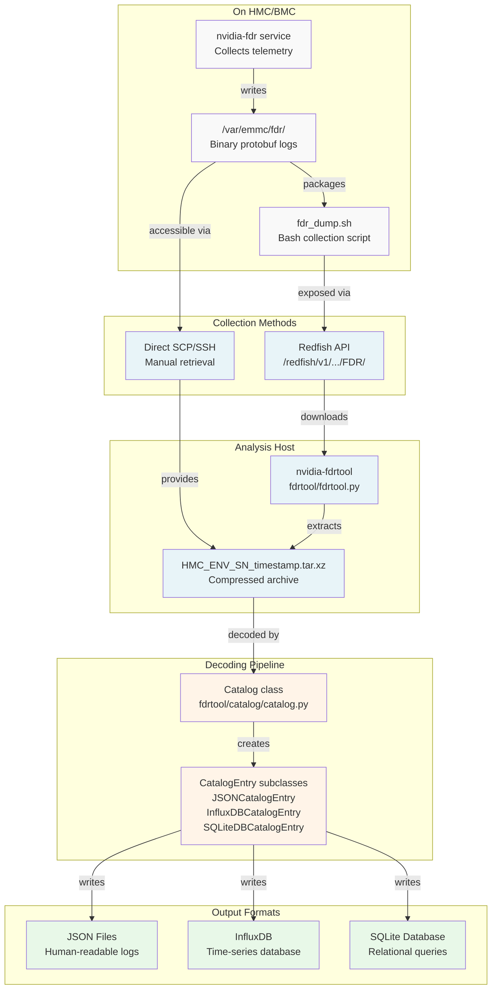
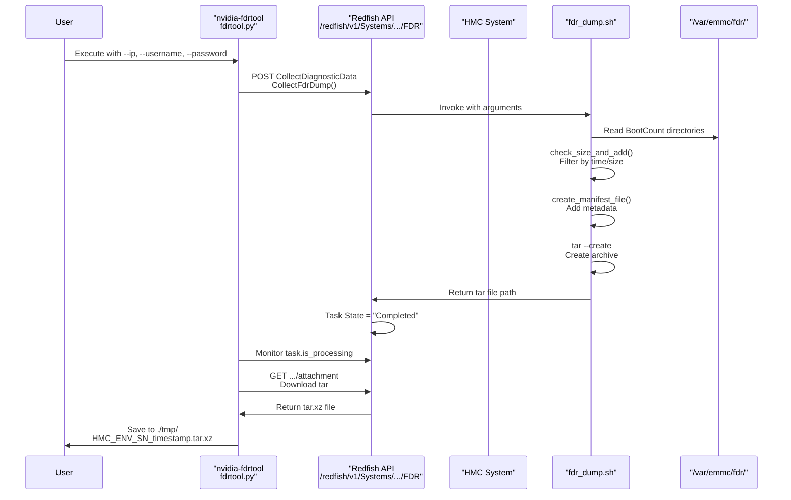
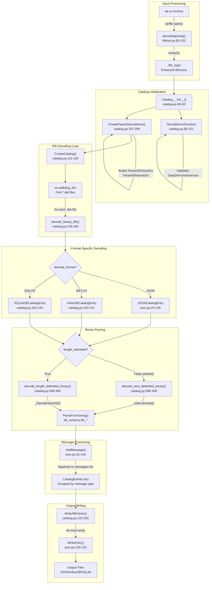
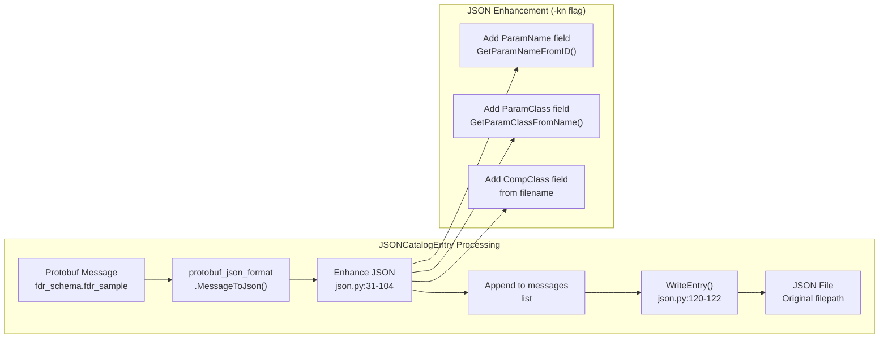
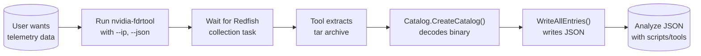
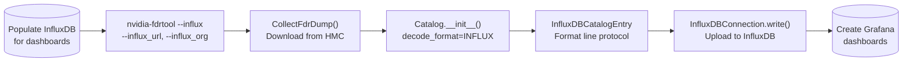
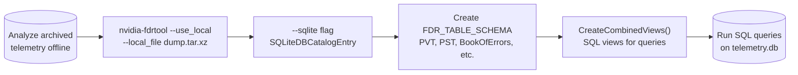

<!-- source: DeepWiki mcp.deepwiki.com · repo NVIDIA/nvidia-fdr · page 6 Tools and Utilities · fetched 2026-10-26 -->

# Tools and Utilities

<details>
<summary>Relevant source files</summary>

The following files were used as context for generating this wiki page:

- [fdrtool/catalog/catalog.py](fdrtool/catalog/catalog.py)
- [fdrtool/catalog/json.py](fdrtool/catalog/json.py)
- [fdrtool/fdrtool.py](fdrtool/fdrtool.py)
- [tools/fdr_dump.sh](tools/fdr_dump.sh)

</details>


## Purpose and Scope

This page provides an overview of the command-line tools used to collect, export, and analyze FDR telemetry data. The FDR system includes three primary utility components that work together to extract binary logs from the HMC and convert them into human-readable or database formats for analysis.

For detailed configuration of data collection parameters, see [Platform Configuration](#5). For information about the binary storage format that these tools decode, see [Storage Format and Protobuf](#3.3).

## Tool Architecture

The FDR tooling ecosystem consists of three main components that operate in sequence:



**Sources:** [tools/fdr_dump.sh:1-475](), [fdrtool/fdrtool.py:1-587](), [fdrtool/catalog/catalog.py:1-556]()

## Component Overview

### fdr_dump.sh - On-Device Collection Script

The `fdr_dump.sh` script runs on the HMC/BMC and is responsible for packaging FDR logs into a compressed archive. This script is typically invoked automatically by the Redfish API but can also be run manually.

| Feature | Description |
|---------|-------------|
| **Location** | [tools/fdr_dump.sh]() |
| **Execution Context** | Runs on HMC/BMC as root |
| **Primary Function** | `main()` at [tools/fdr_dump.sh:214-340]() |
| **Key Operations** | Time-range filtering, size limit enforcement, tar creation |
| **Output** | `obmcdump_<id>_<timestamp>.tar` file |

Key capabilities:
- **Time-range filtering**: Collects logs between specified start/end times using `-s` and `-e` options
- **Size management**: Enforces maximum dump size via `-m` option using `check_size_and_add()` at [tools/fdr_dump.sh:93-160]()
- **File selection**: Prioritizes recent directories and preserves `*.others.dat` files from oldest directories per boot cycle
- **Manifest generation**: Creates `fdr_manifest.txt` with system metadata via `create_manifest_file()` at [tools/fdr_dump.sh:162-198]()
- **Cleanup actions**: Supports `clean` and `genbirthcert` operations via `-a` option

**Sources:** [tools/fdr_dump.sh:1-475]()

### nvidia-fdrtool - Collection and Decoding Tool

The `nvidia-fdrtool` Python application provides a unified interface for both collecting logs from the HMC (via Redfish) and decoding them into various output formats. This is the primary tool used by end users.

| Component | Implementation |
|-----------|----------------|
| **Main Entry Point** | `main()` at [fdrtool/fdrtool.py:153-369]() |
| **Collection Logic** | `CollectFdrDump()` at [fdrtool/fdrtool.py:381-529]() |
| **Redfish Interface** | Uses `python-redfish-library` |
| **Decoding Orchestration** | `dumpCollection()` at [fdrtool/fdrtool.py:43-66]() |
| **Archive Extraction** | `decodingDump()` at [fdrtool/fdrtool.py:83-132]() |

**Sources:** [fdrtool/fdrtool.py:1-587]()

### Catalog System - Binary Decoding Infrastructure

The Catalog system is the core decoding engine that converts binary protobuf logs into structured data. It uses a factory pattern to create format-specific `CatalogEntry` objects.

| Class | Purpose | File Location |
|-------|---------|---------------|
| `Catalog` | Main orchestrator for decoding all files | [fdrtool/catalog/catalog.py:64-296]() |
| `CatalogEntry` | Base class for decoded messages | [fdrtool/catalog/catalog.py:301-556]() |
| `JSONCatalogEntry` | JSON-specific decoding | [fdrtool/catalog/json.py:24-126]() |
| `InfluxDBCatalogEntry` | InfluxDB line protocol | Referenced in [fdrtool/catalog/catalog.py:150-151]() |
| `SQLiteDBCatalogEntry` | SQLite database writes | Referenced in [fdrtool/catalog/catalog.py:152-154]() |

**Sources:** [fdrtool/catalog/catalog.py:1-556](), [fdrtool/catalog/json.py:1-132]()

## Collection and Export Workflow



**Sources:** [fdrtool/fdrtool.py:381-529](), [tools/fdr_dump.sh:214-340]()

### Collection Options

The `CollectFdrDump()` function at [fdrtool/fdrtool.py:381-529]() supports the following workflow:

1. **Authentication**: Logs into Redfish using `redfish.redfish_client()` with basic auth
2. **Service Check**: Verifies FDR service is enabled via `CheckIfNvidaFdrIsActive()` at [fdrtool/fdrtool.py:371-379]()
3. **Dump Trigger**: POSTs to `/redfish/v1/Systems/HGX_Baseboard_0/LogServices/FDR/Actions/LogService.CollectDiagnosticData/`
4. **Task Monitoring**: Polls task status using `response.monitor()` until completion
5. **Download**: Retrieves archive from task's `Payload.HttpHeaders.Location` with `/attachment` suffix
6. **Naming**: Saves as `HMC_<env>_SN<serial>_<timestamp>.tar.xz` at [fdrtool/fdrtool.py:477]()

**Sources:** [fdrtool/fdrtool.py:381-529]()

## Decoding Pipeline Architecture



**Sources:** [fdrtool/fdrtool.py:83-132](), [fdrtool/catalog/catalog.py:64-296](), [fdrtool/catalog/json.py:24-126]()

### Decoding Process Details

The `Catalog` class orchestrates the entire decoding process:

1. **Initialization** ([catalog.py:65-83]()):
   - Sets `decode_format` (JSON/INFLUX/SQLITE)
   - Determines binary delimiter type (`length_delimited` flag)
   - Initializes `CatalogEntries` dictionary keyed by protobuf message type

2. **Version Validation** ([catalog.py:85-101]()):
   - Decodes `BootEvent.dat` file
   - Checks `DataDirFormatVersion` field equals "2"
   - Raises `VersionMisMatch` exception if incompatible

3. **Parameter Description Loading** ([catalog.py:257-290]()):
   - Decodes `ParamDescription.dat` file
   - Builds `ParamIDClassDict`: maps ParamID → ParamClass
   - Builds `ParamIDNameDict`: maps (CompClass, ParamID) → ParamName
   - Creates nested `ParamDescription` dictionary structure

4. **File Walking and Decoding** ([catalog.py:111-130]()):
   - Uses `os.walk()` to find all `.dat` files
   - Skips `ParamDescription.dat` and `BootEvent.dat` (already processed)
   - Calls `decode_binary_file()` for each remaining file
   - Progress tracked with `tqdm` progress bar

5. **Binary Format Handling** ([catalog.py:358-409]()):
   - **Zero-delimited** (default): Splits on `\x00`, applies COBS-R decoding via `cobsr.decode()`
   - **Length-delimited**: Reads varint32 length prefix, extracts exact message bytes

6. **Protobuf Parsing** ([catalog.py:368-383]()):
   - Determines message type from filename extension:
     - `*.stat.dat` → `fdr_stat`
     - `ParamDescription.dat` → `fdr_params`
     - `BookOfErrors.dat` → `fdr_book_of_errors`
     - `Compactor.dat` → `fdr_compactor_bookkeep`
     - `BootEvent.dat` → `fdr_boot_event`
     - `Event_*.dat` → `fdr_event_details`
     - Default → `fdr_sample`
   - Calls `ParseFromString()` on appropriate protobuf message class

**Sources:** [fdrtool/catalog/catalog.py:64-296](), [fdrtool/catalog/catalog.py:301-556]()

## Output Format Handling

### JSON Output (`JSONCatalogEntry`)

The JSON output format is designed for human readability and post-processing with standard tools.



When `--key_name` flag is provided, `JSONCatalogEntry.AddMessage()` at [fdrtool/catalog/json.py:31-104]() enriches each JSON message:

- **ParamName**: Looked up via `GetParamNameFromID()` at [fdrtool/catalog/catalog.py:423-457]()
- **ParamClass**: Looked up via `GetParamClassFromName()` at [fdrtool/catalog/catalog.py:459-495]()
- **CompClass**: Extracted from filename at [fdrtool/catalog/json.py:41-46]()

**Output Location**: Same directory structure as input, with JSON messages written to original filepath.

**Sources:** [fdrtool/catalog/json.py:24-126](), [fdrtool/catalog/catalog.py:423-495]()

### InfluxDB Output

InfluxDB output converts telemetry data into line protocol format for time-series database storage. The `InfluxDBCatalogEntry` class (referenced at [catalog.py:150-151]()) formats data as:

```
measurement,tag1=value1,tag2=value2 field1=value1,field2=value2 timestamp
```

**Connection Parameters**:
- `--influx_url`: Database host URL
- `--influx_org`: Organization name
- `--influx_token`: Authentication token

**Client Initialization**: `InfluxDBConnection` object created at [catalog.py:82]()

**Sources:** [fdrtool/catalog/catalog.py:80-83]()

### SQLite Output

SQLite output creates a relational database with predefined schema for complex queries.

**Schema Definition**: `FDR_TABLE_SCHEMA` dictionary at [catalog.py:34-44]() defines table structures:

| Table Name | Key Columns | Purpose |
|------------|-------------|---------|
| `CDT` | CompClass, CompID, CompLabel | Component definitions |
| `PDT` | ParamID, ParamName, ParamType | Parameter descriptions |
| `PVT` | TimeStamp, ParamID, ParamValue, BootId | Parameter values (time-series) |
| `PST` | FromTime, ToTime, ParamID, Min, Max, Avg | Parameter statistics |
| `BookOfErrors` | BootId, DeviceType, ErrorOccurTimeStamp | Error records |
| `BookKeeper` | CompactDirectory, compactStatus | Compaction metadata |
| `BootEvent` | EventTimeStamp, HMCBootCount | Boot events |
| `EventDetails` | EventTimeStamp, EventName, EventMessage | Detailed event information |

**Connection Management**:
- `SQLiteConnection` initialized at [catalog.py:83]()
- Database filename derived from baseboard serial number via `GetCatalogName()` at [catalog.py:187-215]()
- Append mode controlled by `--append` flag

**View Creation**: `CreateCombinedViews()` called at [catalog.py:248-249]() creates SQL views for convenient querying

**Sources:** [fdrtool/catalog/catalog.py:34-44](), [fdrtool/catalog/catalog.py:223-255]()

## Command-Line Interface Summary

### nvidia-fdrtool Usage Patterns

**Basic Collection and JSON Decoding**:
```bash
nvidia-fdrtool --ip https://HMC_IP --username root --password PASSWORD --json
```

**Use Local Archive**:
```bash
nvidia-fdrtool --use_local --local_file /path/to/dump.tar.xz --json
```

**SQLite Database Creation**:
```bash
nvidia-fdrtool --ip https://HMC_IP --username root --password PASSWORD --sqlite
```

**InfluxDB Upload**:
```bash
nvidia-fdrtool --ip https://HMC_IP --username root --password PASSWORD \
  --influx --influx_url http://influx:8086 --influx_org myorg --influx_token TOKEN
```

**Key Name Resolution**:
```bash
nvidia-fdrtool --use_local --local_file dump.tar.xz --json --key_name
```

**Arguments Table**:

| Argument | Required | Purpose | Example |
|----------|----------|---------|---------|
| `--ip` | Yes (unless `--use_local`) | HMC IP address | `https://10.20.30.40` |
| `--username` | Yes (unless `--use_local`) | Redfish username | `root` |
| `--password` | Yes (unless `--use_local`) | Redfish password | `0penBmc` |
| `--use_local` | No | Use local tar file | Flag only |
| `--local_file` | Yes (if `--use_local`) | Path to tar archive | `/tmp/dump.tar.xz` |
| `--json` | One required | JSON output format | Flag only |
| `--influx` | One required | InfluxDB output | Flag only |
| `--sqlite` | One required | SQLite output | Flag only |
| `--key_name` | No | Add ParamName to JSON | Flag only |
| `--append` | No | Append to existing SQLite DB | Flag only |
| `--log_root_dir` | No | Extract directory | `./fdr_logs/` (default) |

**Sources:** [fdrtool/fdrtool.py:169-221]()

### fdr_dump.sh Usage Patterns

The `fdr_dump.sh` script is typically invoked by Redfish but can be run manually:

**Basic Collection**:
```bash
/usr/bin/fdr_dump.sh -p /tmp/dumps -i 00001
```

**Time-Range Filtering**:
```bash
/usr/bin/fdr_dump.sh -p /tmp/dumps -s "2024-01-01 00:00:00 00:00" \
  -e "2024-01-02 00:00:00 00:00" -m 500000000
```

**Clean Action**:
```bash
/usr/bin/fdr_dump.sh -p /tmp/dumps -a clean
```

**Arguments**:

| Argument | Default | Purpose |
|----------|---------|---------|
| `-p` | Required | Output directory path |
| `-i` | `00000000` | Dump ID for filename |
| `-a` | `collect` | Action: `collect`, `clean`, or `genbirthcert` |
| `-s` | `0` | Start time (ISO8601) |
| `-e` | Current time | End time (ISO8601) |
| `-m` | `1000000000` | Max dump size in bytes |
| `-S` | Empty | Extended source information |

**Sources:** [tools/fdr_dump.sh:26-38](), [tools/fdr_dump.sh:343-398]()

## Common Workflows

### Workflow 1: Routine Telemetry Collection



**Sources:** [fdrtool/fdrtool.py:153-369]()

### Workflow 2: Time-Series Database Population



**Sources:** [fdrtool/fdrtool.py:153-369](), [fdrtool/catalog/catalog.py:80-83]()

### Workflow 3: Offline Analysis with SQLite



**Sources:** [fdrtool/fdrtool.py:153-369](), [fdrtool/catalog/catalog.py:34-44](), [fdrtool/catalog/catalog.py:246-249]()

## File and Directory Conventions

### Archive Structure

A typical FDR dump archive extracted by `decodingDump()` at [fdrtool/fdrtool.py:83-132]() contains:

```
fdr/
├── Bookkeeper/
│   ├── BirthCertificate.tar            # Initial system state (immutable)
│   ├── BookOfErrors.dat                # Error log (protobuf)
│   ├── Compactor.dat                   # Compaction metadata
│   └── BootEvent.dat                   # Boot event records
├── BootCount_<N>_<timestamp>/          # Per-boot telemetry directories
│   ├── ParamDescription.dat            # Parameter metadata (required)
│   ├── GPU.0_SXM.sensors.dat          # GPU sensor data
│   ├── GPU.0_SXM.sensors.stat.dat     # GPU statistics
│   ├── GPU.0_SXM.sensors.hifi.dat     # High-fidelity error data
│   ├── NIC.0_ConnectX7.sensors.dat    # NIC telemetry
│   ├── Baseboard.0.others.dat         # Baseboard configuration
│   └── GPU.0_SXM.Event_<timestamp>.dat # Event details
├── fdr_manifest.txt                    # Dump metadata
├── fdr_ppf_*.yaml                      # Platform profile file
└── journalctl_u_nvidia-fdr.output     # Service logs
```

### File Type Identification

The `CatalogEntry.__init__()` method at [catalog.py:302-330]() determines message type from filename:

- Ends with `.stat.dat` → `PROTO_MSG_TYPE.fdr_stat`
- Ends with `ParamDescription.dat` → `PROTO_MSG_TYPE.fdr_params`
- Ends with `BookOfErrors.dat` → `PROTO_MSG_TYPE.fdr_book_of_errors`
- Ends with `Compactor.dat` → `PROTO_MSG_TYPE.fdr_compactor_bookkeep`
- Ends with `BootEvent.dat` → `PROTO_MSG_TYPE.fdr_boot_event`
- Contains `.Event_` → `PROTO_MSG_TYPE.fdr_event_details`
- All others → `PROTO_MSG_TYPE.fdr_sample`

### Component and Parameter ID Extraction

Filename parsing at [catalog.py:306-309]():
- Split on `.` delimiter
- `compClass` = first field (e.g., "GPU", "NIC", "Baseboard")
- `compID` = last part of second field after `_` (e.g., "0", "1")
- `bootid` = extracted from directory path via `parse_bootid()` at [catalog.py:518-536]()

**Sources:** [fdrtool/catalog/catalog.py:302-330](), [fdrtool/catalog/catalog.py:518-536]()

---

