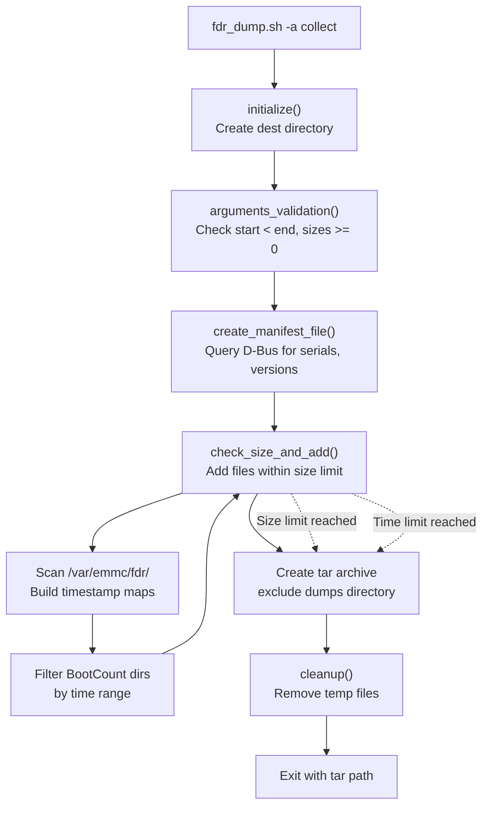
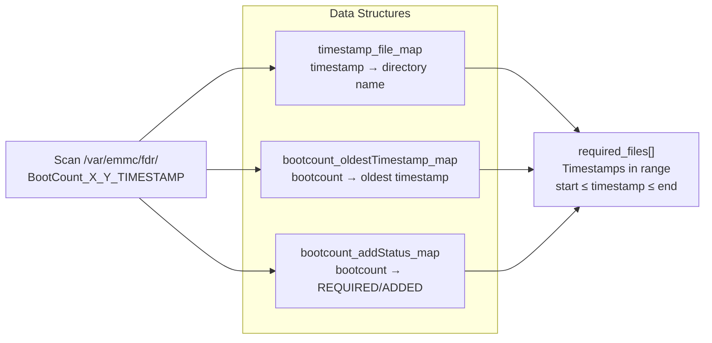
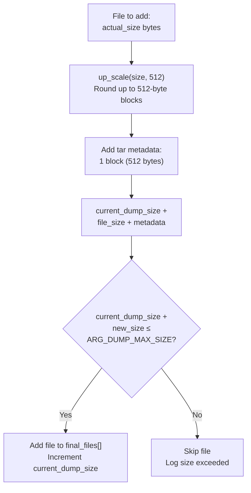
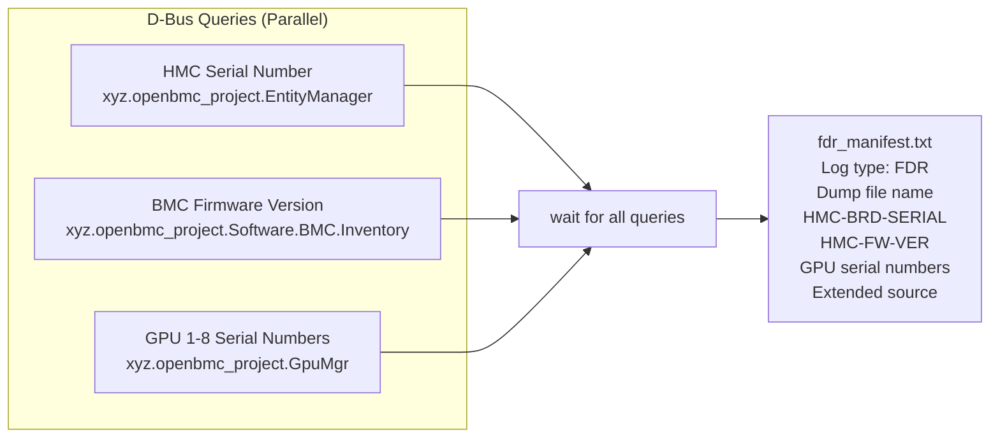
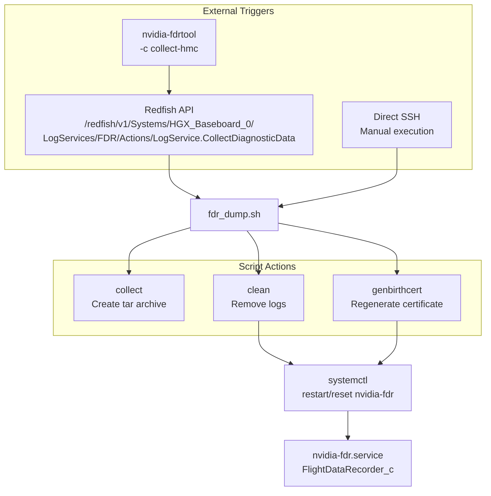

<!-- source: DeepWiki mcp.deepwiki.com · repo NVIDIA/nvidia-fdr · page 6.1 fdr_dump.sh Collection Script · fetched 2026-10-26 -->

# fdr_dump.sh Collection Script

<details>
<summary>Relevant source files</summary>

The following files were used as context for generating this wiki page:

- [fdr.cpp](fdr.cpp)
- [fdr.hpp](fdr.hpp)
- [tools/fdr_dump.sh](tools/fdr_dump.sh)

</details>


The `fdr_dump.sh` script is a bash-based collection utility that packages FDR telemetry logs, system metadata, and supporting files into compressed tar archives for offline analysis or transfer. This script is the primary mechanism for extracting FDR data from the HMC (HGX Management Controller) for diagnostic purposes.

**Scope**: This page covers the `fdr_dump.sh` script's command-line interface, internal algorithms, file selection logic, and integration with the FDR system. For information about processing collected dumps, see [nvidia-fdrtool](#6.2). For understanding the log directory structure being collected, see [Storage Format and Protobuf](#3.3).

## Overview

The script operates on the FDR log directory (`/var/emmc/fdr/`) and creates compressed tar archives containing:
- BootCount directories with telemetry data (within specified time ranges)
- Bookkeeper metadata files (Compactor.dat, BookOfErrors.dat, BootEvent.dat, BirthCertificate.tar)
- System manifest with hardware serial numbers and firmware versions
- Recent journalctl logs for the nvidia-fdr service
- Platform Profile File (PPF) configuration

Key characteristics:
- **Size-aware**: Respects maximum dump size limits with precise tar block size calculations
- **Time-filtered**: Collects data within user-specified start/end timestamps
- **Boot-aware**: Intelligently handles `*.others.dat` files (collected once per boot cycle)
- **Performance-optimized**: Uses parallel operations and early termination when limits are reached
- **Redfish-integrated**: Designed to be invoked via Redfish LogServices API or direct SSH access

Sources: [tools/fdr_dump.sh:1-475]()

## Command-Line Interface

```bash
fdr_dump.sh -p <path> [-i <dump_id>] [-a <action>] [-s <start_date>] [-e <end_date>] 
            [-m <max_size>] [-S <extended_source>]
```

### Required Arguments

| Flag | Parameter | Description |
|------|-----------|-------------|
| `-p` | `<file_path>` | Destination directory for the compressed tar archive |

### Optional Arguments

| Flag | Parameter | Default | Description |
|------|-----------|---------|-------------|
| `-i` | `<dump_id>` | `00000000` | Unique identifier embedded in output filename |
| `-a` | `<action>` | `collect` | Operation mode: `collect`, `clean`, or `genbirthcert` |
| `-s` | `<start_date>` | `0` (epoch) | Start time in ISO8601 format: `YYYY-MM-DD HH:mm:ss TZ` |
| `-e` | `<end_date>` | Current time | End time in ISO8601 format |
| `-m` | `<max_size>` | `1000000000` (1GB) | Maximum dump size in bytes |
| `-S` | `<extended_source>` | Empty | Additional metadata to include in manifest |

### Example Usage

```bash
# Collect all data with 1GB size limit
fdr_dump.sh -p /var/emmc/fdr/dumps -i 12345678 -a collect

# Collect data from last 24 hours only
fdr_dump.sh -p /var/emmc/fdr/dumps -s "2024-01-15 00:00:00 +00:00" -e "2024-01-16 00:00:00 +00:00"

# Clean all FDR logs (preserves BirthCertificate)
fdr_dump.sh -p /var/emmc/fdr/dumps -a clean

# Generate new birth certificate
fdr_dump.sh -p /var/emmc/fdr/dumps -a genbirthcert
```

Sources: [tools/fdr_dump.sh:25-38](), [tools/fdr_dump.sh:343-398]()

## Actions and Workflows

### Action: `collect` (Default)

The primary data collection workflow. Produces a tar archive named `obmcdump_<dump_id>_<epochtime>.tar`.



**Diagram: Collect Action Workflow**

The workflow implements early termination when either the size limit (`-m`) or time limit (2340 seconds of file addition time) is reached.

Sources: [tools/fdr_dump.sh:214-340](), [tools/fdr_dump.sh:454-468]()

### Action: `clean`

Removes all FDR telemetry data while preserving the birth certificate:

```bash
# Removes all BootCount_* directories
find $FDR_LOG_PATH -mindepth 1 -maxdepth 1 -type d \
    ! -name 'Bookkeeper' ! -name 'dumps' -exec rm -rf {} +

# Removes all bookkeeper files except BirthCertificate.tar
find $FDR_LOG_PATH/Bookkeeper -type f \
    ! -name 'BirthCertificate.tar' -exec rm -rf {} +
```

Additionally resets the nvidia-fdr service state via `systemctl reset-failed nvidia-fdr.service`.

Sources: [tools/fdr_dump.sh:41-58](), [tools/fdr_dump.sh:418-428]()

### Action: `genbirthcert`

Triggers birth certificate regeneration by setting U-Boot environment variable and restarting the FDR service:

1. Checks if `BirthCertificate.tar` already exists (no-op if present)
2. Stops nvidia-fdr service
3. Sets `nvidiaFdrAction=gen-birth-cert` via `fw_setenv`
4. Restarts nvidia-fdr service (certificate generated on startup)

The FDR core system detects this environment variable and creates the birth certificate archive containing all `*.others.dat` files and bookkeeper metadata.

Sources: [tools/fdr_dump.sh:430-452](), [fdr.cpp:767-820]()

## Collection Algorithm

### Directory Scanning and Time Filtering

The script builds three key data structures by scanning the FDR log directory:



**Diagram: Directory Scanning Data Structures**

Each `BootCount_X_Y_TIMESTAMP` directory is parsed:
- `X`: Boot counter value (from `BootCount.txt`)
- `Y`: Reserved
- `TIMESTAMP`: Unix epoch seconds when directory was created

Sources: [tools/fdr_dump.sh:268-288]()

### File Selection and Priority Order

Files are added to the tar archive in this priority order:

| Priority | File/Directory | Handling |
|----------|----------------|----------|
| 1 | `Bookkeeper/` | Always added first (Compactor.dat, BookOfErrors.dat, BootEvent.dat, BirthCertificate.tar) |
| 2 | `fdr_manifest.txt` | Generated manifest with system info |
| 3 | `journalctl_u_nvidia-fdr.output` | Recent nvidia-fdr service logs (since yesterday) |
| 4 | `fdr_ppf_*.yaml` | Active Platform Profile File |
| 5 | `*.others.dat` | One set per boot cycle (oldest directory for each bootcount) |
| 6 | BootCount directories | Newest to oldest, excluding `*.others.dat` |

**Rationale for `*.others.dat` handling**: These files contain inventory, configuration, and error data that changes infrequently. To avoid duplication, only the oldest directory per boot cycle is collected (where "oldest" means the first compaction window after boot).

Sources: [tools/fdr_dump.sh:249-323]()

### Size Calculation and Overhead Management

The script implements precise tar size estimation to avoid exceeding the maximum dump size:



**Diagram: Tar Size Calculation Algorithm**

**Tar overhead components**:
- Per-file metadata: 512 bytes (TAR_BLOCK_SZ)
- File data padding: Round up to 512-byte boundary
- End-of-archive markers: 2 × 512 bytes
- Live data buffer: 10240 bytes (accounts for new data written during collection)

Initial overhead budget:
```bash
dump_size_buffer = 2 * TAR_BLOCK_SZ + TAR_BLOCK_SZ + LIVE_DATA_BUFFER
                 = 2 * 512 + 512 + 10240
                 = 11,264 bytes
```

Sources: [tools/fdr_dump.sh:83-160](), [tools/fdr_dump.sh:236-248]()

### Time-Bounded Collection

To prevent timeout issues (especially when invoked via Redfish with limited operation time), the script enforces a file addition time limit:

```bash
FILE_ADDITION_TIME_LIMIT=2340  # ~39 minutes (90% of 44-minute timeout)
```

Every file addition checks elapsed time:
```bash
script_elapsed_time=$((script_current_time - script_start_time))
if ((script_elapsed_time >= FILE_ADDITION_TIME_LIMIT)); then
    STOP_FILE_ADDITION=1
fi
```

This ensures sufficient time remains for tar creation and compression, which can be time-intensive for large archives.

Sources: [tools/fdr_dump.sh:11-12](), [tools/fdr_dump.sh:146-153]()

## Manifest File Generation

The manifest file (`fdr_manifest.txt`) provides essential system identification and is included in every dump:



**Diagram: Manifest File Data Collection**

The script runs all D-Bus queries in parallel using background processes (`&`) and then waits for completion, significantly reducing manifest generation time from ~8 seconds (sequential) to ~1 second (parallel).

**Example manifest content**:
```
Log type: FDR
Dump file name: /var/emmc/fdr/dumps/obmcdump_12345678_1705363200.tar
HMC-BRD-SERIAL: s "SN123456789"
HMC-FW-VER: s "1.2.3-build456"
GPU SXM 1 SerialNumber: s "GPU-SN-001"
GPU SXM 2 SerialNumber: s "GPU-SN-002"
...
Extended source information: Customer-provided context
```

Sources: [tools/fdr_dump.sh:162-198]()

## Integration with FDR System

### Directory Structure Context

The script operates on the FDR directory hierarchy created by the core FDR system:

```
/var/emmc/fdr/
├── Bookkeeper/
│   ├── BirthCertificate.tar          # Immutable (chattr +i)
│   ├── BootEvent.dat                 # fdrpb::fdr_boot_event
│   ├── Compactor.dat                 # fdrpb::fdr_compactor
│   ├── BookOfErrors.dat              # fdrpb::fdr_book_of_errors
│   └── ParamDescription.dat          # fdrpb::fdr_params
├── BootCount_1_0_1705363200/         # Current boot cycle
│   ├── GPU.GPU_SXM_1.sensors.dat
│   ├── GPU.GPU_SXM_1.sensors.stat.dat
│   ├── GPU.GPU_SXM_1.sensors.hifi.dat
│   ├── GPU.GPU_SXM_1.others.dat
│   └── ...
├── BootCount_0_0_1705276800/         # Previous boot cycle
│   └── ...
└── dumps/                             # fdr_dump.sh output destination
```

Sources: [fdr.cpp:33-40](), [fdr.cpp:87-149]()

### Invocation Methods



**Diagram: fdr_dump.sh Integration Points**

The script is typically invoked via:
1. **Redfish API**: HMC's Redfish service executes the script when LogService.CollectDiagnosticData action is called
2. **nvidia-fdrtool**: Python utility that wraps Redfish calls for remote collection
3. **Direct execution**: SSH access for debugging or manual collection

Sources: [tools/fdr_dump.sh:1-475](), [fdr.cpp:767-820]()

### Birth Certificate Integration

The `genbirthcert` action coordinates with the FDR core system via environment variable signaling:

**Script side (fdr_dump.sh)**:
```bash
fw_setenv nvidiaFdrAction gen-birth-cert
systemctl start nvidia-fdr.service
```

**FDR core side (fdr.cpp)**:
```cpp
if (systemUtils::checkEnvValue("nvidiaFdrAction", "gen-birth-cert"))
{
    // Create archive of all *.others.dat files
    std::string commandStr = "find " + fdrDumpPath + 
        " -type f -name *others.dat | xargs tar -cJf " + birthCertFilePath;
    exec(commandStr.c_str());
    
    // Clear environment variable
    exec("fw_setenv nvidiaFdrAction");
}
```

This mechanism allows the birth certificate to be regenerated after a clean operation or system reconfiguration.

Sources: [tools/fdr_dump.sh:430-452](), [fdr.cpp:767-809]()

## Performance Characteristics

### File Count Limits

To prevent tar operation timeouts and memory exhaustion, the script enforces a file count limit:

```bash
file_cnt_limit=20000  # Maximum files in tar archive
```

When this limit is reached, `STOP_FILE_ADDITION` is set and no further files are added, even if size constraints allow.

Sources: [tools/fdr_dump.sh:23](), [tools/fdr_dump.sh:136-143]()

### Parallel Operations

Three operations run in parallel to reduce collection time:

1. **D-Bus manifest queries**: All serial number and version queries execute concurrently
2. **journalctl capture**: Runs in background while directory scanning proceeds
3. **PPF file copy**: Executed in background during directory processing

```bash
journalctl --since yesterday -u 'nvidia-fdr' &> "..." &
JOURNALCTL_PID=$!

cp $FDR_PPF_FILE_PATH "$FDR_LOG_DIR_BASE_NAME/" &
CP_PID=$!

# ... proceed with directory scanning ...

wait $JOURNALCTL_PID
wait $CP_PID
```

Sources: [tools/fdr_dump.sh:257-266](), [tools/fdr_dump.sh:173-183]()

### Cleanup Operations

The script removes temporary files after tar creation:

| File | Purpose | Cleanup Timing |
|------|---------|----------------|
| `fdr_manifest.txt` | System identification | After tar creation |
| `journalctl_u_nvidia-fdr.output` | Service logs | After tar creation |
| `fdr_ppf_*.yaml` (copy) | Configuration snapshot | After tar creation |

Original files in `/var/emmc/fdr/` remain untouched unless the `clean` action is explicitly invoked.

Sources: [tools/fdr_dump.sh:73-81](), [tools/fdr_dump.sh:468-472]()

## Error Handling and Exit Codes

The script uses standard bash exit codes:

| Exit Code | Condition |
|-----------|-----------|
| `0` | Success (tar created, or clean/genbirthcert completed) |
| `1` | Failure (invalid arguments, directory creation failed, tar failed, cleanup failed) |

**Critical validation checks**:
- Start time must be less than or equal to end time
- All time and size parameters must be non-negative
- Destination directory must be creatable
- Required `-p` argument must be provided

Sources: [tools/fdr_dump.sh:200-212](), [tools/fdr_dump.sh:405-413]()

## Output Format

### Filename Convention

```
obmcdump_<dump_id>_<epochtime>.tar
```

Example: `obmcdump_12345678_1705363200.tar`

Where:
- `dump_id`: From `-i` argument (default: `00000000`)
- `epochtime`: Unix timestamp when script was invoked

### Archive Contents Structure

```
obmcdump_12345678_1705363200.tar
├── fdr/
│   ├── fdr_manifest.txt
│   ├── journalctl_u_nvidia-fdr.output
│   ├── fdr_ppf_vulcan.yaml
│   ├── Bookkeeper/
│   │   ├── BirthCertificate.tar
│   │   ├── BootEvent.dat
│   │   ├── Compactor.dat
│   │   ├── BookOfErrors.dat
│   │   └── ParamDescription.dat
│   ├── BootCount_2_0_1705363200/
│   │   ├── GPU.GPU_SXM_1.sensors.dat
│   │   ├── GPU.GPU_SXM_1.sensors.stat.dat
│   │   └── ...
│   ├── BootCount_1_0_1705276800/
│   │   ├── GPU.GPU_SXM_1.others.dat
│   │   ├── GPU.GPU_SXM_2.sensors.dat
│   │   └── ...
│   └── BootCount_0_0_1705190400/
│       └── ...
```

**Note**: The `dumps/` subdirectory (where output tar files are stored) is explicitly excluded from the archive to prevent recursive inclusion.

Sources: [tools/fdr_dump.sh:62-63](), [tools/fdr_dump.sh:330]()

---

