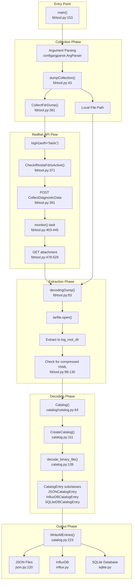
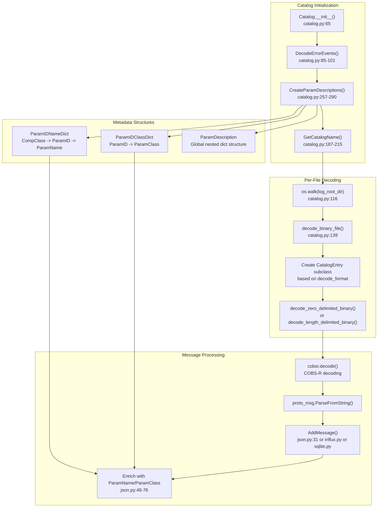

<!-- source: DeepWiki mcp.deepwiki.com · repo NVIDIA/nvidia-fdr · page 6.2 nvidia-fdrtool · fetched 2026-10-26 -->

# nvidia-fdrtool

<details>
<summary>Relevant source files</summary>

The following files were used as context for generating this wiki page:

- [fdrtool/catalog/catalog.py](fdrtool/catalog/catalog.py)
- [fdrtool/catalog/json.py](fdrtool/catalog/json.py)
- [fdrtool/fdrtool.py](fdrtool/fdrtool.py)

</details>


## Purpose and Scope

`nvidia-fdrtool` is a Python-based command-line utility that collects and decodes FDR (Flight Data Recorder) telemetry logs from NVIDIA HGX systems. The tool serves two primary functions:

1. **Collection**: Retrieves FDR log archives from HGX systems via Redfish API or processes local archive files
2. **Decoding**: Converts binary protobuf logs into human-readable formats (JSON, InfluxDB line protocol, or SQLite database)

This page covers the `nvidia-fdrtool` command-line interface, collection workflow, and integration with the decoding pipeline. For details on the bash-based collection script that runs on the HMC itself, see [fdr_dump.sh Collection Script](#6.1). For in-depth information about the binary decoding mechanisms, see [Catalog System and Decoding](#6.3).

**Sources:** [fdrtool/fdrtool.py:1-586]()

---

## Command-Line Interface

The tool is invoked as `nvidia-fdrtool` and provides extensive configuration options through command-line arguments. A configuration file can also be specified using the `-c` or `--config_file` option.

### Core Operation Modes

| Argument | Type | Description |
|----------|------|-------------|
| `-ul`, `--use_local` | flag | Use local tar archive instead of Redfish collection |
| `-l`, `--local_file` | string | Path to local tar archive (required with `-ul`) |
| `-i`, `--ip` | string | HMC/BMC address (e.g., `https://123.45.6.7:8000`) |
| `-u`, `--username` | string | Redfish authentication username |
| `-p`, `--password` | string | Redfish authentication password |
| `-e`, `--environment` | string | Environment tag: `FIE` (Field), `FAC` (Factory), or `UNK` (Unknown) |

### Decoding Format Selection (Mutually Exclusive)

| Argument | Description |
|----------|-------------|
| `--json` | Decode to JSON format and write to local files |
| `--influx` | Decode to InfluxDB line protocol and write to InfluxDB server |
| `--sqlite` | Decode to SQLite database format |

### Format-Specific Options

**JSON Options:**
- `-kn`, `--key_name`: Replace ParamIDs with human-readable ParamName in output

**InfluxDB Options:**
- `--influx_url`: InfluxDB server URL
- `--influx_org`: InfluxDB organization name
- `--influx_token`: Authentication token for InfluxDB

**SQLite Options:**
- `-a`, `--append`: Append to existing database instead of overwriting

### Additional Options

| Argument | Description |
|----------|-------------|
| `-lr`, `--log_root_dir` | Directory to store extracted logs (default: `./fdr_logs/`) |
| `-bc`, `--birth_certificate` | Decode BirthCertificate.tar after main processing |
| `-ld`, `--length_delimited` | Support length-delimited binary format (default: zero-delimited COBS-R) |
| `-flc`, `--clean_fdr_log_dir` | Cleanup FDR log directory on BMC/HMC |

**Sources:** [fdrtool/fdrtool.py:169-218]()

---

## Architecture Overview



**Sources:** [fdrtool/fdrtool.py:153-369](), [fdrtool/catalog/catalog.py:64-165]()

---

## Collection Workflow

### Redfish Collection Process

When invoked without the `-ul` flag, `nvidia-fdrtool` performs the following steps to collect logs from an HGX system:

#### 1. Redfish Authentication and Validation

The `CollectFdrDump()` function establishes a connection to the HMC/BMC:

```python
REDFISH_OBJ = redfish.redfish_client(
    base_url=host_ip,
    username=username, 
    password=password,
    default_prefix='/redfish/v1/'
)
REDFISH_OBJ.login(auth="basic")
```

The function then verifies that the FDR service is enabled by querying `/redfish/v1/Systems/HGX_Baseboard_0/LogServices/FDR` and checking the `ServiceEnabled` property.

**Sources:** [fdrtool/fdrtool.py:384-388](), [fdrtool/fdrtool.py:371-379]()

#### 2. Triggering FDR Dump Generation

A POST request initiates the dump collection process:

```
POST /redfish/v1/Systems/HGX_Baseboard_0/LogServices/FDR/Actions/LogService.CollectDiagnosticData/
Body: {"DiagnosticDataType":"OEM", "OEMDiagnosticDataType":"DiagnosticType=FDR"}
```

This triggers the HMC to execute `fdr_dump.sh` (see [fdr_dump.sh Collection Script](#6.1)) and create a tar archive. The response includes a task ID for monitoring.

**Sources:** [fdrtool/fdrtool.py:389-400]()

#### 3. Task Monitoring with Progress Indication

The tool monitors the asynchronous task using `response.monitor()` with a visual progress bar:

- Polls task status every `retry_after` seconds (default: 5s)
- Updates progress bar with elapsed time and current status
- Timeout after 300 seconds (5 minutes)
- Suppresses redfish library logging during progress display

Task states include `Running`, `Completed`, and various error states.

**Sources:** [fdrtool/fdrtool.py:402-454]()

#### 4. Dump Download

Once the task completes, the tool extracts the download URL from the task's `Payload.HttpHeaders` containing the `Location` field:

```
GET /redfish/v1/Systems/HGX_Baseboard_0/LogServices/FDR/Entries/{entry_id}/attachment
```

The downloaded file is named using the pattern:
```
HMC_{environment}_SN{serial_number}_{timestamp}.tar.xz
```

Where:
- `environment`: FIE, FAC, or UNK from `-e` argument
- `serial_number`: Retrieved from `/redfish/v1/Chassis/HGX_BMC_0` SerialNumber field
- `timestamp`: Format `MMDDYYYY_HHMMSS`

**Sources:** [fdrtool/fdrtool.py:469-529]()

### Local File Collection

When invoked with `-ul` and `-l`, the tool skips the Redfish collection phase and directly uses the specified local tar file. A mock progress bar is displayed for UI consistency.

**Sources:** [fdrtool/fdrtool.py:58-61]()

---

## Extraction and Preprocessing

### Archive Extraction

The `decodingDump()` function handles tar archive extraction:

1. **Directory Cleanup**: Removes existing `log_root_dir` if present
2. **Extraction**: Uses `tarfile.open()` to extract all members with progress tracking
3. **YAML Decompression**: Scans for compressed YAML files and decompresses them

#### Compressed YAML Handling

Platform Profile Files (PPF) may be stored in compressed format. The tool:

1. Recursively scans for `.yaml` files
2. Uses `file` command to detect compressed archives
3. Extracts compressed YAML using `tar --strip-components=1`
4. Replaces compressed file with uncompressed version
5. Cleans up temporary extraction directories

This ensures PPF files are available in plain text for inspection.

**Sources:** [fdrtool/fdrtool.py:83-132]()

### Birth Certificate Decoding

The Birth Certificate is a special immutable archive containing the initial system state. When `-bc` is specified, the tool:

1. Locates `BirthCertificate.tar` in the Bookkeeper directory
2. Extracts to a separate subdirectory
3. Decodes using a new Catalog instance
4. Continues on error to avoid blocking main dump processing

**Sources:** [fdrtool/fdrtool.py:135-148](), [fdrtool/fdrtool.py:304-320]()

---

## Decoding Architecture



**Sources:** [fdrtool/catalog/catalog.py:64-296](), [fdrtool/catalog/json.py:24-104]()

### Catalog Initialization Sequence

#### 1. Version Validation

The Catalog validates dump version compatibility by decoding `BootEvent.dat` and checking `DataDirFormatVersion`:

```python
version_number = str(message_dict.get('DataDirFormatVersion'))
if version_number != '2':
    raise VersionMisMatch("Version of the fdr-dump is not matching with the FDRTool.")
```

**Sources:** [fdrtool/catalog/catalog.py:85-101]()

#### 2. Parameter Description Loading

The `ParamDescription.dat` file maps ParamIDs to human-readable metadata. The Catalog:

1. Decodes the protobuf messages of type `fdr_params`
2. Builds nested dictionary structure: `ParamDescription[CompClass][ParamClass][ParamID] = {ParamName, DataType, Units, Notes}`
3. Creates lookup dictionaries:
   - `ParamIDClassDict`: Maps ParamID to ParamClass (e.g., `1234 -> "NVLink_Error"`)
   - `ParamIDNameDict`: Maps CompClass and ParamID to ParamName (e.g., `GPU[1234] -> "NVLINK_CRC_ERROR"`)

**Sources:** [fdrtool/catalog/catalog.py:257-290]()

#### 3. Serial Number Extraction

The Catalog name is derived from the baseboard serial number (`BRD-SERIAL` parameter). The process:

1. Locates `Baseboard.*.others.dat` files
2. Decodes to find `BRD-SERIAL` parameter
3. Uses serial number as catalog name (fallback: "xyz" if not found)

**Sources:** [fdrtool/catalog/catalog.py:187-221]()

### File Type Detection

Each binary file's type is inferred from its path and extension:

| File Pattern | Message Type | Description |
|--------------|--------------|-------------|
| `*.stat.dat` | `fdr_stat` | Statistics aggregates |
| `ParamDescription.dat` | `fdr_params` | Parameter metadata |
| `BookOfErrors.dat` | `fdr_book_of_errors` | Error log entries |
| `Compactor.dat` | `fdr_compactor_bookkeep` | Compaction bookkeeping |
| `BootEvent.dat` | `fdr_boot_event` | Boot cycle metadata |
| `*Event_*.dat` | `fdr_event_details` | Event details |
| `*.others.dat` | `fdr_sample` or `fdr_event` | Mixed inventory/config or events |
| `*.sensors.dat` | `fdr_sample` | Sensor telemetry |
| `*.sensors.hifi.dat` | `fdr_sample` | High-fidelity error data |

**Sources:** [fdrtool/catalog/catalog.py:316-329]()

### Binary Decoding Formats

#### Zero-Delimited COBS-R Format (Default)

The standard format uses:
1. COBS-R encoding to eliminate zeros in payload
2. `\x00` (null byte) as message delimiter
3. Decoding sequence: Split on `\x00` → COBS-R decode → Protobuf parse

**Sources:** [fdrtool/catalog/catalog.py:386-409]()

#### Length-Delimited Format (Development)

Enabled with `-ld` flag:
1. Varint32 length prefix for each message
2. Decoding sequence: Read varint length → Extract message bytes → Protobuf parse

**Sources:** [fdrtool/catalog/catalog.py:358-384]()

### Mixed File Type Handling

Files ending in `.others.dat` can contain both `fdr_sample` and `fdr_event` messages. The decoder:

1. Initially parses as `fdr_sample`
2. Checks if decoded message contains `ParamID` field
3. If absent, re-parses the same buffer as `fdr_event`
4. Passes `is_event_type` flag to `AddMessage()` for correct handling

**Sources:** [fdrtool/catalog/catalog.py:372-383](), [fdrtool/catalog/catalog.py:398-403]()

---

## Output Format Implementations

### JSON Output

The `JSONCatalogEntry` class converts protobuf messages to JSON with optional parameter name enrichment.

#### Basic JSON Conversion

```python
proto_msg_str = json.loads(protobuf_json_format.MessageToJson(
    proto_msg, 
    including_default_value_fields=True
))
```

All values are converted to strings for consistency:
```python
proto_msg_str = {
    key: str(value) if not isinstance(value, str) else value 
    for key, value in proto_msg_str.items()
}
```

**Sources:** [fdrtool/catalog/json.py:31-93]()

#### Parameter Name Enrichment (`-kn` flag)

When `--key_name` is specified, the tool enriches JSON output with human-readable names:

1. **CompClass Extraction**: Parsed from filename (e.g., `GPU.0_0.sensors.dat` → `GPU`)
2. **ParamName Lookup**: Uses `GetParamNameFromID(proto_msg, CompClass)` with caching
3. **ParamClass Lookup**: Uses `GetParamClassFromName(paramName)` with reverse map
4. **JSON Augmentation**: Adds `ParamName`, `ParamClass`, and `CompClass` fields

The implementation uses caching to avoid repeated dictionary lookups:
- `_param_name_cache`: Caches (CompClass, ParamID) → ParamName
- `_param_class_cache`: Caches ParamName → ParamClass
- `_param_name_to_class_map`: Reverse lookup built once from ParamDescription

**Sources:** [fdrtool/catalog/json.py:34-83](), [fdrtool/catalog/catalog.py:423-495]()

#### Serial Number Detection

The JSON encoder watches for `BRD-SERIAL` parameters and writes the serial number to a local `brd_serial` file for use by the Catalog naming logic.

**Sources:** [fdrtool/catalog/json.py:97-103]()

### InfluxDB Output

The InfluxDB output format converts telemetry data to InfluxDB line protocol for time-series storage. Key aspects:

- **Measurement Names**: Derived from component class and parameter class
- **Tags**: Include bootid, component ID, parameter metadata
- **Fields**: Contain actual telemetry values
- **Timestamps**: Preserved from protobuf messages

Connection is established via `InfluxDBConnection` class with URL, organization, and token parameters.

**Sources:** [fdrtool/catalog/catalog.py:80-82]()

### SQLite Output

The SQLite output creates a relational database with predefined schema defined in `FDR_TABLE_SCHEMA`:

| Table | Key Columns | Purpose |
|-------|-------------|---------|
| `CDT` (Component Description) | CompClass, CompID, CompLabel | Component metadata |
| `PDT` (Parameter Description) | CompClass, ParamClass, ParamName, ParamID | Parameter definitions |
| `PVT` (Parameter Value) | TimeStamp, ParamID, ParamValue, BootId | Time-series data |
| `PST` (Parameter Statistics) | FromTime, ToTime, ParamID, NumSamples, Min, Max, Avg | Statistical aggregates |
| `BookOfErrors` | BootId, DeviceType, ErrorType, ErrorOccurTimeStamp | Error log |
| `BookKeeper` | CompactDirectory, compactStatus | Compaction metadata |
| `BootEvent` | EventTimeStamp, HMCBootCount, DataDirFormatVersion | Boot cycle info |
| `EventDetails` | EventTimeStamp, EventName, EventMessage | Event details |

The `-a` (append) flag controls whether existing databases are preserved or overwritten.

**Sources:** [fdrtool/catalog/catalog.py:34-44](), [fdrtool/catalog/catalog.py:83]()

---

## Key Components and Functions

### Main Execution Flow

```mermaid
graph LR
    main["main()<br/>fdrtool.py:153"]
    args["ArgParser.parse_args()"]
    validate["Argument Validation<br/>fdrtool.py:222-286"]
    dump["dumpCollection(args)<br/>fdrtool.py:43"]
    extract["decodingDump()<br/>fdrtool.py:83"]
    catalog["Catalog(vars(args))<br/>fdrtool.py:296"]
    write["MyCatalog.WriteAllEntries()<br/>fdrtool.py:299"]
    close["MyCatalog.Close()<br/>fdrtool.py:325"]
    
    main --> args
    args --> validate
    validate --> dump
    dump --> extract
    extract --> catalog
    catalog --> write
    write --> close
```



**Sources:** [fdrtool/fdrtool.py:153-369]()

### Core Classes

#### `Catalog` Class

Located in `fdrtool/catalog/catalog.py`, this is the main orchestrator for binary log decoding.

**Key Attributes:**
- `CatalogEntries`: Dictionary of message lists, keyed by protobuf message type
- `decode_format`: Enum specifying output format (JSON, INFLUX, SQLITE)
- `ParamIDClassDict`: Maps ParamID to ParamClass
- `ParamIDNameDict`: Maps CompClass and ParamID to ParamName
- `influxClient`: InfluxDB connection (if applicable)
- `sqliteClient`: SQLite connection (if applicable)

**Key Methods:**
- `CreateCatalog()`: Walks log directory and decodes all `.dat` files
- `decode_binary_file(filepath)`: Creates appropriate CatalogEntry and decodes protobuf
- `CreateParamDescriptions()`: Builds parameter metadata structures
- `WriteAllEntries()`: Writes all decoded entries in target format
- `Close()`: Closes database connections

**Sources:** [fdrtool/catalog/catalog.py:64-296]()

#### `CatalogEntry` Base Class

Abstract base class for holding decoded messages from a single file.

**Key Attributes:**
- `messages`: List of decoded messages
- `msg_type`: Enum indicating protobuf message type
- `compClass`: Component class from filename
- `compID`: Component instance ID from filename
- `bootid`: Boot cycle ID from directory path

**Key Methods:**
- `decode_zero_delimited_binary(buf)`: Default COBS-R decoding
- `decode_length_delimited_binary(buf)`: Length-prefixed decoding
- `AddMessage(proto_msg)`: Abstract method implemented by subclasses
- `GetParamNameFromID()`: Cached parameter name lookup
- `parse_bootid(filepath)`: Static method to extract boot ID from path

**Sources:** [fdrtool/catalog/catalog.py:301-556]()

#### `JSONCatalogEntry` Class

Subclass for JSON output format.

**Key Methods:**
- `AddMessage(proto_msg, is_event_type)`: Converts protobuf to JSON with optional enrichment
- `GetParamValue(message, paramId, paramName)`: Extracts parameter value from JSON message
- `WriteEntry()`: Writes JSON messages to file

**Sources:** [fdrtool/catalog/json.py:24-131]()

### Redfish API Functions

#### `CollectFdrDump(host_ip, username, password, env_tag)`

Main function for Redfish-based collection.

**Flow:**
1. Create `redfish.redfish_client` and login
2. Call `CheckIfNvidaFdrIsActive()` to verify service
3. POST to CollectDiagnosticData endpoint
4. Monitor task with progress bar using `response.monitor()`
5. Extract download URL from task response
6. GET attachment endpoint
7. Write to tar file with naming convention
8. Logout

**Returns:** Path to downloaded tar file

**Sources:** [fdrtool/fdrtool.py:381-529]()

#### `CheckIfNvidaFdrIsActive(REDFISH_OBJ)`

Validates that FDR service is enabled on the target system.

**Redfish URL:** `/redfish/v1/Systems/HGX_Baseboard_0/LogServices/FDR`

**Check:** `response.dict.get('ServiceEnabled') == True`

**Sources:** [fdrtool/fdrtool.py:371-379]()

#### `cleanUpFDRLogDirectory(ip, username, password)`

Triggers log directory cleanup on HMC.

**Redfish URL:** `/redfish/v1/Systems/HGX_Baseboard_0/LogServices/FDR/Actions/LogService.ClearLog/`

**Method:** POST (no body required)

**Sources:** [fdrtool/fdrtool.py:67-81]()

### Utility Functions

#### `decodingDump(binary_log_tar_file, log_root_dir)`

Extracts tar archive and preprocesses YAML files.

**Returns:** Path to extraction directory

**Sources:** [fdrtool/fdrtool.py:83-132]()

#### `decodeBirthCertificate(file_location, log_root_dir)`

Extracts Birth Certificate tar to separate subdirectory.

**Returns:** Path to Birth Certificate extraction directory

**Sources:** [fdrtool/fdrtool.py:135-148]()

---

## Usage Examples

### Example 1: Collect from Redfish and Decode to JSON

```bash
nvidia-fdrtool \
  --ip https://10.20.30.40:8000 \
  --username admin \
  --password password123 \
  --environment FIE \
  --json \
  --key_name
```

This command:
1. Connects to HMC at specified IP
2. Triggers FDR dump via Redfish
3. Downloads tar archive
4. Extracts and decodes to JSON format
5. Enriches JSON with human-readable parameter names

**Output:** JSON files in `./fdr_logs/fdr/` mirroring directory structure

### Example 2: Decode Local Archive to SQLite

```bash
nvidia-fdrtool \
  --use_local \
  --local_file HMC_FIE_SN12345_01152024_143022.tar.xz \
  --sqlite \
  --log_root_dir ./my_logs/
```

This command:
1. Uses existing local tar file
2. Extracts to `./my_logs/`
3. Decodes to SQLite database
4. Creates new database (overwrites if exists)

**Output:** SQLite database named after serial number

### Example 3: Send to InfluxDB

```bash
nvidia-fdrtool \
  --ip https://10.20.30.40:8000 \
  --username admin \
  --password password123 \
  --influx \
  --influx_url http://influxdb.example.com:8086 \
  --influx_org nvidia \
  --influx_token myInfluxToken123
```

This command:
1. Collects dump from HMC
2. Decodes to InfluxDB line protocol
3. Writes directly to InfluxDB server
4. No local JSON/SQLite output

### Example 4: Decode Birth Certificate

```bash
nvidia-fdrtool \
  --use_local \
  --local_file dump.tar.xz \
  --json \
  --birth_certificate
```

This command:
1. Decodes main dump to JSON
2. Additionally decodes `BirthCertificate.tar` from Bookkeeper directory
3. Outputs Birth Certificate to separate subdirectory

### Example 5: Cleanup FDR Logs on HMC

```bash
nvidia-fdrtool \
  --ip https://10.20.30.40:8000 \
  --username admin \
  --password password123 \
  --clean_fdr_log_dir
```

This command triggers Redfish ClearLog action to remove old FDR logs from the HMC's storage.

**Sources:** [fdrtool/fdrtool.py:224-232]()

---

## Progress Indication and User Experience

The tool provides comprehensive progress feedback through `tqdm` progress bars:

### Collection Phase

```
🔄 Collecting FDR data... (42s)
|████████████████████████████| [00:42<00:18] ⏳ Processing
```

Displays task monitoring with elapsed time and status updates.

**Sources:** [fdrtool/fdrtool.py:413-453]()

### Download Phase

```
📦 Download size: 45,231,098 bytes (43.1 MB)
📥 Downloading |████████████████| 43.1MB/43.1MB [00:12<00:00, 3.59MB/s]
```

Shows file size and download progress with transfer rate.

**Sources:** [fdrtool/fdrtool.py:493-523]()

### Extraction Phase

```
Extracting files |████████████████████| 1247/1247 [00:03<00:00, 412.33 files/s]
```

Tracks tar extraction progress with file count and rate.

**Sources:** [fdrtool/fdrtool.py:95-96]()

### Decoding Phase

```
Decoding files |█████████████████████| 1247/1247 [00:15<00:00, 80.45 files/s]
```

Shows binary decoding progress across all `.dat` files.

**Sources:** [fdrtool/catalog/catalog.py:123-127]()

### Writing Phase

```
Writing Logs |████████████████████████████████| 9000000/9000000 [00:08<00:00]
```

Displays output writing progress (mock progress for user feedback).

**Sources:** [fdrtool/catalog/catalog.py:253-254]()

---

## Error Handling and Validation

### Version Mismatch Detection

The tool validates dump version compatibility early in the process:

```python
if version_number != '2':
    raise VersionMisMatch("Version of the fdr-dump is not matching with the FDRTool.")
```

This prevents attempting to decode incompatible binary formats.

**Sources:** [fdrtool/catalog/catalog.py:97-98]()

### Missing File Detection

Critical files are checked during initialization:

```python
if param_filename is None:
    raise FileNotFound("%s file is not found in the dump." % Boot_event_filename)
```

The tool fails fast if required files like `BootEvent.dat` or `ParamDescription.dat` are missing.

**Sources:** [fdrtool/catalog/catalog.py:88-89](), [fdrtool/catalog/catalog.py:262-263]()

### Service Validation

Before triggering collection, the tool verifies FDR service status:

```python
if not service_enabled:
    raise Exception("Nvidia-FDR service is not enabled on HMC, Exiting...")
```

**Sources:** [fdrtool/fdrtool.py:378-379]()

### Redfish Task Timeout

Collection tasks have a 5-minute timeout to prevent indefinite hanging:

```python
if time.time() - task_start_time > 300:
    raise Exception("FDR dump task timed out after 5 minutes")
```

**Sources:** [fdrtool/fdrtool.py:447-450]()

### Birth Certificate Graceful Failure

Birth Certificate decoding errors don't halt main processing:

```python
except Exception as e:
    print(f"    {e}        ")
    print("  Skipping BirthCertificate Decode. Continuting....      ")
```

**Sources:** [fdrtool/fdrtool.py:310-315]()

---

## Integration with Other Components

### Relationship to fdr_dump.sh

The Redfish CollectDiagnosticData action triggers execution of `fdr_dump.sh` on the HMC (see [fdr_dump.sh Collection Script](#6.1)). The bash script:

1. Collects binary logs from `/var/emmc/fdr/`
2. Collects PPF files, manifests, and journalctl logs
3. Creates compressed tar archive
4. Makes archive available via Redfish attachment endpoint

`nvidia-fdrtool` is the client-side tool that triggers this server-side script and downloads the result.

**Sources:** [fdrtool/fdrtool.py:389-399]()

### Relationship to Catalog System

`nvidia-fdrtool` is the command-line interface that:
1. Handles collection logistics (Redfish, tar extraction)
2. Instantiates the Catalog system
3. Configures output format and parameters

The actual binary decoding is delegated to the Catalog system (see [Catalog System and Decoding](#6.3)), which handles:
- Protobuf parsing
- COBS-R decoding
- Parameter metadata enrichment
- Output format conversion

**Sources:** [fdrtool/fdrtool.py:296-299]()

### Relationship to Core FDR System

The binary logs processed by `nvidia-fdrtool` are generated by the core FDR daemon (`nvidia-fdr` service). The tool:
- Reads protobuf schema defined in `fdr_logs_schema_pb2` (generated from `fdr_logs.proto`)
- Understands directory structure created by compaction system
- Interprets BookKeeper files and error logs
- Decodes Birth Certificate archives

The tool is read-only and never modifies FDR's operational state.

---

## Performance Characteristics

### Decoding Performance

Typical decoding performance on a development workstation:

| Metric | Value |
|--------|-------|
| Decoding Speed | ~80-100 files/second |
| Extraction Speed | ~400 files/second |
| Download Speed | Network-dependent (typically 2-5 MB/s) |
| Task Monitoring | 5-30 seconds for dump generation |

**Sources:** [fdrtool/catalog/catalog.py:129-130]()

### Memory Usage

The Catalog system loads all decoded messages into memory before writing. For large dumps (multiple GB), this can result in significant memory usage. The tool processes files sequentially but accumulates results.

### Optimization: Parameter Lookup Caching

To improve performance, the tool implements multiple levels of caching:

1. **Parameter Name Cache**: Avoids repeated dictionary lookups for (CompClass, ParamID) → ParamName
2. **Parameter Class Cache**: Caches ParamName → ParamClass mappings
3. **Reverse Lookup Map**: Built once during initialization for efficient reverse lookups

These optimizations significantly reduce overhead when processing files with thousands of telemetry samples.

**Sources:** [fdrtool/catalog/catalog.py:423-495]()

---

