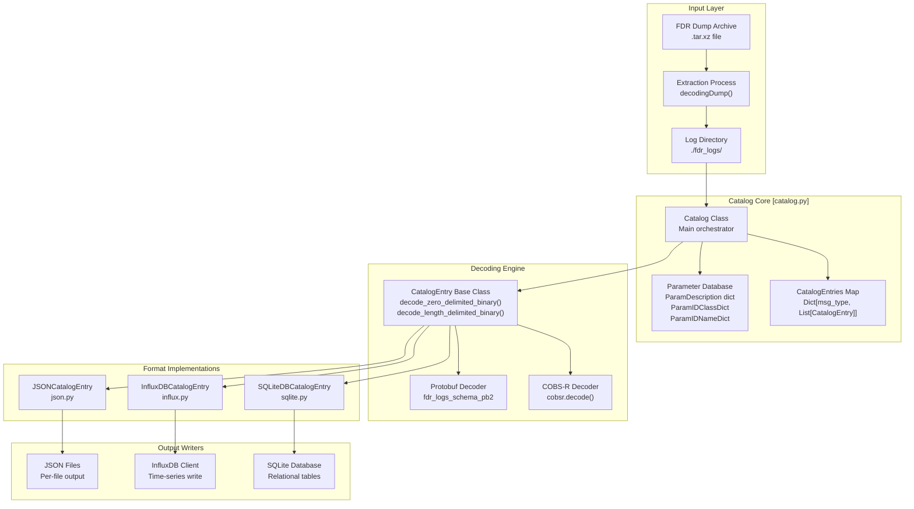
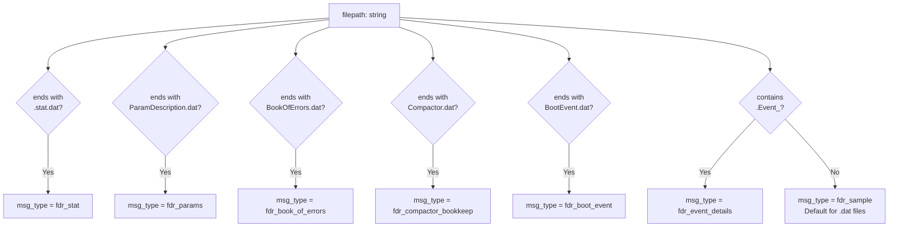
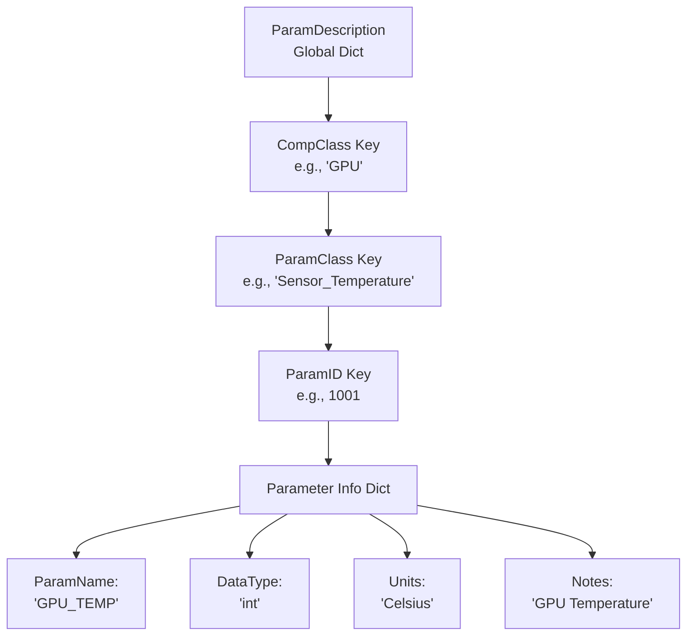
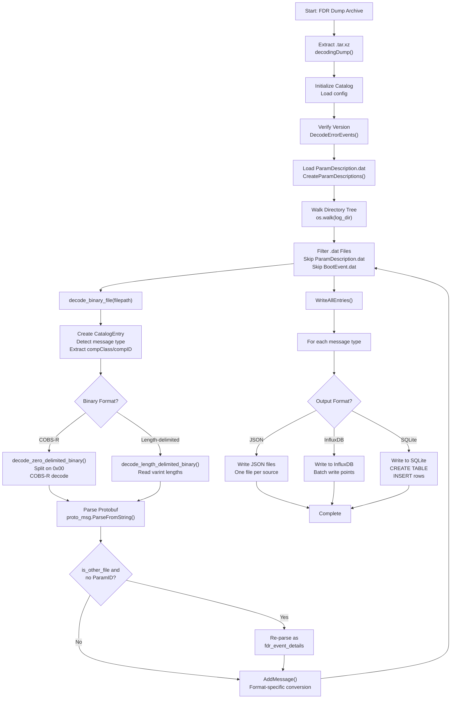

<!-- source: DeepWiki mcp.deepwiki.com · repo NVIDIA/nvidia-fdr · page 6.3 Catalog System and Decoding · fetched 2026-10-26 -->

# Catalog System and Decoding

<details>
<summary>Relevant source files</summary>

The following files were used as context for generating this wiki page:

- [fdr.cpp](fdr.cpp)
- [fdr.hpp](fdr.hpp)
- [fdrtool/catalog/catalog.py](fdrtool/catalog/catalog.py)
- [fdrtool/catalog/json.py](fdrtool/catalog/json.py)
- [fdrtool/fdrtool.py](fdrtool/fdrtool.py)

</details>


## Purpose and Scope

This document describes the Python-based Catalog System that decodes binary protobuf logs generated by the FDR core system into human-readable and analyzable formats. The catalog system is the primary interface for extracting telemetry data from FDR dumps collected from HGX systems.

For information about collecting FDR dumps from the HMC, see [nvidia-fdrtool](#6.2). For details about the binary storage format and protobuf schema, see [Storage Format and Protobuf](#3.3).

**Sources:** [fdrtool/catalog/catalog.py:1-556]()

---

## System Overview

The Catalog System performs the following key functions:

1. **Binary Log Decoding**: Parses protobuf-encoded binary files (`.dat` files) from FDR dumps
2. **Schema Resolution**: Maps numeric ParamIDs to human-readable parameter names and classes
3. **Format Conversion**: Transforms decoded data into JSON, InfluxDB line protocol, or SQLite tables
4. **Data Organization**: Maintains relationships between components, parameters, and time-series samples

The system operates on extracted FDR dump directories containing:
- Binary log files: `*.sensors.dat`, `*.others.dat`, `*.stat.dat`
- Metadata files: `ParamDescription.dat`, `BookOfErrors.dat`, `Compactor.dat`, `BootEvent.dat`
- Event files: `*.Event_<timestamp>.dat`

**Sources:** [fdrtool/catalog/catalog.py:64-297](), [fdrtool/fdrtool.py:83-149]()

---

## Architecture

### Component Diagram



**Sources:** [fdrtool/catalog/catalog.py:64-297](), [fdrtool/catalog/json.py:24-126](), [fdrtool/fdrtool.py:83-149]()

---

## Core Components

### Catalog Class

The `Catalog` class ([catalog.py:64-297]()) serves as the main orchestrator for the decoding process. It maintains a dictionary of `CatalogEntry` objects organized by protobuf message type.

#### Key Attributes

| Attribute | Type | Purpose |
|-----------|------|---------|
| `CatalogEntries` | `Dict[str, List[CatalogEntry]]` | Stores all decoded entries by message type |
| `decode_format` | `DECODE_FORMAT` enum | Target output format (JSON/INFLUX/SQLITE) |
| `ParamIDClassDict` | `Dict[int, str]` | Maps ParamID → ParamClass (e.g., "Sensor_Temperature") |
| `ParamIDNameDict` | `Dict[str, Dict[int, str]]` | Maps CompClass → ParamID → ParamName |
| `length_delimited_binary` | `bool` | Binary format flag (COBS-R vs length-delimited) |
| `log_dir` | `str` | Root directory of extracted logs |
| `catalog_name` | `str` | Baseboard serial number used for naming |

**Sources:** [fdrtool/catalog/catalog.py:64-84]()

#### Initialization Workflow

```mermaid
sequenceDiagram
    participant Main as fdrtool.main()
    participant Cat as Catalog.__init__()
    participant Dec as DecodeErrorEvents()
    participant Param as CreateParamDescriptions()
    participant Create as CreateCatalog()
    participant Write as WriteAllEntries()
    
    Main->>Cat: Create Catalog(config, log_root_dir)
    Cat->>Dec: Verify version from BootEvent.dat
    Note over Dec: Checks DataDirFormatVersion == 2
    Cat->>Param: Load ParamDescription.dat
    Note over Param: Builds ParamIDClassDict<br/>and ParamIDNameDict
    Cat->>Create: Walk directory tree
    loop For each .dat file
        Create->>Create: decode_binary_file(filepath)
        Note over Create: Creates CatalogEntry<br/>Decodes protobuf messages
    end
    Main->>Write: Write decoded data
    loop For each message type
        Write->>Write: entry.WriteEntry()
    end
```

**Sources:** [fdrtool/catalog/catalog.py:64-100](), [fdrtool/catalog/catalog.py:111-134](), [fdrtool/catalog/catalog.py:223-256]()

#### Version Verification

The catalog system verifies compatibility by checking `DataDirFormatVersion` from `BootEvent.dat`:

```python
# From catalog.py:85-101
def DecodeErrorEvents(self):
    # Load BootEvent.dat
    for entry in self.CatalogEntries[PROTO_MSG_TYPE.fdr_boot_event.name]:
        for message in entry.messages:
            version_number = str(message_dict.get('DataDirFormatVersion'))
            if version_number != '2':
                raise VersionMisMatch("Version of the fdr-dump is not matching with the FDRTool.")
```

This ensures the tool can only decode dumps from the current flat directory structure (Version 2).

**Sources:** [fdrtool/catalog/catalog.py:85-101](), [fdr.cpp:42-45]()

---

### CatalogEntry Class

The `CatalogEntry` base class ([catalog.py:301-556]()) handles the decoding of individual binary log files. It determines the message type from the file extension and delegates to format-specific subclasses.

#### File Type Detection



**Sources:** [fdrtool/catalog/catalog.py:316-329]()

#### Metadata Extraction

The `CatalogEntry` constructor extracts component information from the filepath:

```python
# From catalog.py:302-313
def __init__(self, filepath, ParamIDClassDict=None, ParamIDNameDict=None):
    file_name = os.path.split(filepath)[1]
    self.compClass = file_name.split('.')[0]  # e.g., "GPU"
    self.compID = file_name.split('.')[1].split('_')[-1]  # e.g., "0"
    self.bootid = CatalogEntry.parse_bootid(filepath)  # Extracts from BootCount directory
```

Example: `GPU.0.sensors.dat` → `compClass="GPU"`, `compID="0"`

**Sources:** [fdrtool/catalog/catalog.py:301-313]()

---

## Binary Decoding Process

### Protobuf Message Types

The system decodes seven protobuf message types defined in `fdr_logs_schema_pb2`:

| Message Type | Purpose | Source File Pattern |
|--------------|---------|---------------------|
| `fdr_sample` | Individual parameter samples with timestamp | `*.sensors.dat`, `*.others.dat`, `*.hifi.dat` |
| `fdr_stat` | Statistical aggregations (min/max/avg) | `*.sensors.stat.dat` |
| `fdr_params` | Parameter metadata (ParamID, ParamName, DataType) | `ParamDescription.dat` |
| `fdr_book_of_errors` | Error event records | `BookOfErrors.dat` |
| `fdr_compactor_bookkeep` | Compaction metadata | `Compactor.dat` |
| `fdr_boot_event` | Boot cycle information | `BootEvent.dat` |
| `fdr_event_details` | AML event details | `*.Event_<timestamp>.dat` |

**Sources:** [fdrtool/catalog/catalog.py:46-52](), [fdr.cpp:725-736]()

### Decoding Methods

#### Zero-Delimited Binary (COBS-R)

The default encoding format uses COBS-R (Consistent Overhead Byte Stuffing - Reduced) with null-byte delimiters:


**Implementation:**

```python
# From catalog.py:386-409
def decode_zero_delimited_binary(self, buf):
    split_buf = filter(None, buf.split(b'\x00'))  # Split on null bytes
    for msg_buf in split_buf:
        msg_buf = cobsr.decode(msg_buf)  # Decode COBS-R
        proto_msg = getattr(fdr_schema, self.msg_type.name)()
        proto_msg.ParseFromString(msg_buf)  # Parse protobuf
        # Handle event type detection for .others.dat files
        if self.is_other_file:
            proto_msg_temp = json.loads(protobuf_json_format.MessageToJson(proto_msg))
            if "ParamID" not in proto_msg_temp.keys():
                proto_msg = getattr(fdr_schema, PROTO_MSG_TYPE.fdr_event.name)()
                proto_msg.ParseFromString(msg_buf)
                is_event_type = True
        self.AddMessage(proto_msg, is_event_type)
```

**Sources:** [fdrtool/catalog/catalog.py:386-409]()

#### Length-Delimited Binary

Alternative format using varint length prefixes (used with `--length_delimited` flag):

```python
# From catalog.py:358-384
def decode_length_delimited_binary(self, buf):
    n = 0
    while n < len(buf):
        msg_len, new_pos = _DecodeVarint32(buf, n)  # Read varint length
        n = new_pos
        msg_buf = buf[n:n+msg_len]  # Extract message
        n += msg_len
        proto_msg = getattr(fdr_schema, self.msg_type.name)()
        proto_msg.ParseFromString(msg_buf)
        self.AddMessage(proto_msg, is_event_type)
```

**Sources:** [fdrtool/catalog/catalog.py:358-384]()

### Event Type Detection

Files with `.others.dat` extension may contain both `fdr_sample` and `fdr_event_details` messages. The decoder attempts to parse as `fdr_sample` first, then falls back to `fdr_event_details` if `ParamID` is missing:

```python
# From catalog.py:398-403
if self.is_other_file:
    proto_msg_temp = json.loads(protobuf_json_format.MessageToJson(proto_msg))
    if "ParamID" not in proto_msg_temp.keys():
        proto_msg = getattr(fdr_schema, PROTO_MSG_TYPE.fdr_event.name)()
        proto_msg.ParseFromString(msg_buf)
        is_event_type = True
```

**Sources:** [fdrtool/catalog/catalog.py:398-403](), [fdrtool/catalog/catalog.py:371-379]()

---

## Parameter Description System

The Parameter Description system provides the mapping between numeric ParamIDs and human-readable metadata. This is essential for interpreting the binary logs.

### ParamDescription Structure



**Sources:** [fdrtool/catalog/catalog.py:257-290]()

### Loading ParamDescription.dat

The `CreateParamDescriptions()` method ([catalog.py:257-290]()) builds the parameter database:

```python
# From catalog.py:257-290
def CreateParamDescriptions(self):
    param_filename = self.FindParamFilename('ParamDescription.dat')
    self.decode_binary_file(param_filename)
    
    global ParamDescription
    ParamDescription = {}
    for entry in self.CatalogEntries[PROTO_MSG_TYPE.fdr_params.name]:
        for message in entry.messages:
            message_dict = entry.GetMessageDict(message)
            message_CompClass = message_dict.get("CompClass")
            message_ParamClass = message_dict.get("ParamClass").replace('.', '_')
            message_ParamID = message_dict.get("ParamID")
            
            # Build nested dictionary structure
            if not ParamDescription.get(message_CompClass):
                ParamDescription[message_CompClass] = {}
            if not ParamDescription[message_CompClass].get(message_ParamClass):
                ParamDescription[message_CompClass][message_ParamClass] = {}
            
            # Store lookup maps
            self.ParamIDClassDict[message_ParamID] = message_ParamClass
            if message_CompClass not in self.ParamIDNameDict:
                self.ParamIDNameDict[message_CompClass] = {}
            self.ParamIDNameDict[message_CompClass][message_ParamID] = message_dict.get('ParamName')
```

**Sources:** [fdrtool/catalog/catalog.py:257-290]()

### Caching Strategy

The system uses caching to optimize parameter name lookups during decoding:

```python
# From catalog.py:440-457
def GetParamNameFromID(self, proto_msg, compClass):
    # Create cache if it doesn't exist
    if not hasattr(self, '_param_name_cache'):
        self._param_name_cache = {}
    
    paramID = proto_msg.ParamID
    cache_key = (str(compClass), str(paramID))
    
    # Check cache first
    if cache_key in self._param_name_cache:
        return self._param_name_cache[cache_key]
    
    # Lookup and cache result
    result = None
    if str(compClass) in self.ParamIDNameDict:
        result = self.ParamIDNameDict[str(compClass)].get(str(paramID))
    
    self._param_name_cache[cache_key] = result
    return result
```

This two-level caching strategy (for both ParamName and ParamClass lookups) significantly improves decoding performance for large dumps.

**Sources:** [fdrtool/catalog/catalog.py:423-495]()

---

## Format-Specific Implementations

### JSON Format

The `JSONCatalogEntry` class ([json.py:24-126]()) converts protobuf messages to JSON with optional parameter name resolution.

#### Key Features

1. **ParamID Replacement**: When `--key_name` flag is used, replaces numeric ParamIDs with ParamNames
2. **Metadata Enrichment**: Adds `ParamName`, `ParamClass`, and `CompClass` fields to each message
3. **Per-File Output**: Writes decoded JSON to the same filepath as the binary source

**Implementation:**

```python
# From json.py:31-104
def AddMessage(self, proto_msg, is_event_type=False):
    proto_msg_str = json.loads(protobuf_json_format.MessageToJson(
        proto_msg, including_default_value_fields=True))
    
    if (not is_event_type) and self.primary_key_name:
        # Extract CompClass from filepath
        parts = self.filepath.split('/')
        filename = parts[-1].split('.')
        CompClass = filename[0]
        
        # Get parameter metadata
        paramName = self.GetParamNameFromID(proto_msg, CompClass)
        paramClass = self.GetParamClassFromName(paramName)
        
        # Enrich JSON with metadata
        if paramName:
            proto_msg_str.update({"ParamName": paramName})
        if paramClass:
            proto_msg_str.update({"ParamClass": paramClass})
        if CompClass:
            proto_msg_str.update({"CompClass": CompClass})
    
    # Convert all values to strings for consistency
    proto_msg_str = {key: str(value) if not isinstance(value, str) else value 
                     for key, value in proto_msg_str.items()}
    
    json_str = json.dumps(proto_msg_str) + '\n'
    self.messages.append(json_str)
```

**Sources:** [fdrtool/catalog/json.py:31-104]()

#### JSON Output Example

Without `--key_name`:
```json
{"TimeStamp": "1234567890", "ParamID": "1001", "ParamValueInt": "75"}
```

With `--key_name`:
```json
{"TimeStamp": "1234567890", "ParamID": "1001", "ParamName": "GPU_TEMP", "ParamClass": "Sensor_Temperature", "CompClass": "GPU", "ParamValueInt": "75"}
```

**Sources:** [fdrtool/catalog/json.py:31-104]()

### InfluxDB Format

The `InfluxDBCatalogEntry` converts messages to InfluxDB line protocol and writes to a time-series database. Key design choices:

1. **Measurement Names**: Combines ParamClass and CompClass (e.g., `Sensor_Temperature_GPU`)
2. **Tags**: Uses CompID, ParamID, ParamName, BootId as tags for efficient querying
3. **Fields**: Stores parameter values with type-specific field names
4. **Timestamp**: Uses nanosecond precision for InfluxDB compatibility

**Sources:** [fdrtool/catalog/catalog.py:80-83](), [fdrtool/catalog/catalog.py:149-154]()

### SQLite Format

The `SQLiteDBCatalogEntry` creates relational database tables with predefined schemas:

#### Table Schema

| Table Name | Purpose | Key Columns |
|------------|---------|-------------|
| `PDT` | Parameter Description Table | CompClass, ParamClass, ParamName, ParamID, ParamType |
| `PVT` | Parameter Value Table | TimeStamp, ParamID, ParamValue, BootId |
| `PST` | Parameter Statistics Table | FromTime, ToTime, ParamID, NumSamples, Min, Max, Avg |
| `BookOfErrors` | Error events | BootId, DeviceType, ErrorType, ErrorOccurTimeStamp, ParamID |
| `BookKeeper` | Compaction metadata | CompactDirectory, compactStatus |
| `BootEvent` | Boot cycle info | EventTimeStamp, HMCBootCount, UpTime, DataDirFormatVersion |
| `EventDetails` | AML events | EventTimeStamp, EventName, EventDeviceName, EventMessage |

**Schema Definition:**

```python
# From catalog.py:34-44
FDR_TABLE_SCHEMA = {
    "CDT": {"CompClass": "TEXT", "CompID": "INTEGER", "CompLabel": "TEXT"},
    "PDT": {"CompClass": "TEXT", "ParamClass": "TEXT", "ParamName": "TEXT", 
            "ParamID": "INTEGER", "ParamType": "TEXT", "ParamUnit": "TEXT", 
            "ParamNotes": "TEXT"},
    "PVT": {"TimeStamp": "INTEGER", "ParamID": "INTEGER", "ParamValue": "TEXT", 
            "BootId": "INTEGER"},
    "PST": {"FromTime": "INTEGER", "ToTime": "INTEGER", "ParamID": "INTEGER",
            "NumSamples": "INTEGER", "Min": "INTEGER", "Max": "INTEGER", 
            "Avg": "INTEGER"},
    # ... additional tables
}
```

**Sources:** [fdrtool/catalog/catalog.py:34-44](), [fdrtool/catalog/catalog.py:152-154]()

---

## Data Flow and Processing Pipeline

### Complete Decoding Workflow



**Sources:** [fdrtool/catalog/catalog.py:111-134](), [fdrtool/catalog/catalog.py:139-165](), [fdrtool/catalog/catalog.py:223-256]()

### Boot ID Parsing

The system extracts Boot ID from directory paths to correlate samples with boot cycles:

```python
# From catalog.py:518-536
@staticmethod
def parse_bootid(filepath):
    bootid = None
    if 'BootCount' in filepath:
        for pathpart in Path(filepath).parts:
            if 'BootCount' in pathpart:
                fields = re.findall(r'(\d+)', pathpart)
                if len(fields) == 2: 
                    bootid, timestamp = fields
                elif len(fields) == 1:
                    bootid = 0
                    timestamp = fields[0]
    return bootid
```

Example: `/var/emmc/fdr/BootCount_5_1234567890/GPU.0.sensors.dat` → `bootid=5`

**Sources:** [fdrtool/catalog/catalog.py:518-536]()

---

## Usage Examples

### Decoding to JSON

```bash
# Basic JSON decoding
nvidia-fdrtool --json -ul -l /path/to/dump.tar.xz

# JSON with parameter name resolution
nvidia-fdrtool --json --key_name -ul -l /path/to/dump.tar.xz

# Specify output directory
nvidia-fdrtool --json -ul -l /path/to/dump.tar.xz --log_root_dir ./decoded_logs/
```

**Sources:** [fdrtool/fdrtool.py:169-221]()

### Decoding to InfluxDB

```bash
nvidia-fdrtool --influx \
  --influx_url http://localhost:8086 \
  --influx_org myorg \
  --influx_token mytoken \
  -ul -l /path/to/dump.tar.xz
```

**Sources:** [fdrtool/fdrtool.py:210-212]()

### Decoding to SQLite

```bash
# Create new database
nvidia-fdrtool --sqlite -ul -l /path/to/dump.tar.xz

# Append to existing database
nvidia-fdrtool --sqlite --append -ul -l /path/to/dump.tar.xz
```

**Sources:** [fdrtool/fdrtool.py:215](), [fdrtool/fdrtool.py:254-256]()

### Programmatic Usage

```python
from catalog.catalog import Catalog, DECODE_FORMAT

# Configure catalog
config = {
    'decode_format': DECODE_FORMAT.JSON,
    'length_delimited': False,  # Use COBS-R
    'key_name': True,  # Replace ParamIDs with names
    'influx_url': None,
    'influx_org': None,
    'influx_token': None,
    'append': False
}

# Create and process catalog
catalog = Catalog(config, './fdr_logs/')
catalog.WriteAllEntries()
catalog.Close()
```

**Sources:** [fdrtool/catalog/catalog.py:64-84](), [fdrtool/fdrtool.py:296-299]()

---

## Performance Considerations

### Optimization Techniques

1. **Parameter Name Caching**: Two-level cache (ParamName and ParamClass) eliminates redundant lookups ([catalog.py:440-495]())
2. **Progress Bars**: `tqdm` integration provides user feedback during long operations ([catalog.py:123-128]())
3. **Lazy Loading**: ParamDescription loaded once, reused across all files
4. **Batch Writing**: InfluxDB and SQLite use batch operations for efficiency

**Sources:** [fdrtool/catalog/catalog.py:423-495](), [fdrtool/catalog/catalog.py:123-128]()

### Typical Processing Times

From the code comments and progress bar implementations:
- Small dumps (< 100 MB): ~10-30 seconds for JSON decoding
- Medium dumps (100-500 MB): ~30-120 seconds
- Large dumps (> 500 MB): Several minutes, dominated by protobuf parsing

**Sources:** [fdrtool/catalog/catalog.py:129-130](), [fdrtool/fdrtool.py:253-255]()

---

## Error Handling

### Exception Types

| Exception | Trigger | Action |
|-----------|---------|--------|
| `FileNotFound` | ParamDescription.dat or BootEvent.dat missing | Abort with error message |
| `VersionMisMatch` | DataDirFormatVersion != 2 | Abort with version error |
| Decoding exceptions | Corrupted binary data | Log error, skip file, continue |

**Sources:** [fdrtool/catalog/catalog.py:88-89](), [fdrtool/catalog/catalog.py:97-98]()

### Graceful Degradation

The system continues processing even if individual files fail:

```python
# From catalog.py:123-128
for filepath in tqdm(files_to_process, desc="Decoding files", ncols=100):
    try:
        self.decode_binary_file(filepath)
    except Exception as e:
        logging.error(f"Exception occurred while decoding file {filepath}: {e}")
        # Continue with next file
```

**Sources:** [fdrtool/catalog/catalog.py:123-128]()

---

## Integration with FDR Core System

The catalog system is tightly integrated with the FDR core C++ system through:

1. **Protobuf Schema**: Shared `fdr_logs_schema_pb2` generated from `fdr_logs.proto`
2. **Binary Format**: COBS-R encoding/decoding compatibility
3. **Directory Structure**: Understands BootCount directory naming convention
4. **Parameter IDs**: Matches ParamID assignments from PPF files

The C++ side generates binary logs ([fdr.cpp:517-572]()), and the Python catalog system decodes them ([catalog.py:139-165]()).

**Sources:** [fdr.cpp:517-572](), [fdrtool/catalog/catalog.py:139-165](), [fdr.cpp:725-736]()

---

