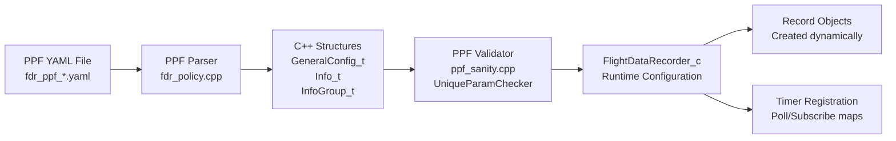
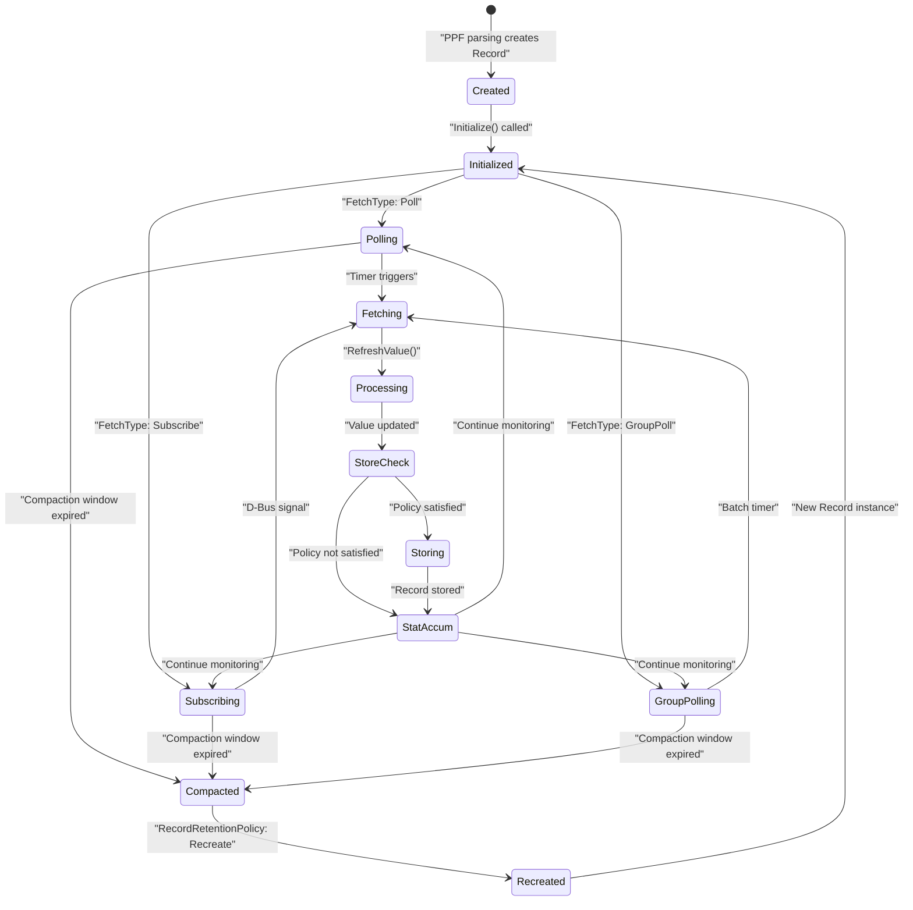
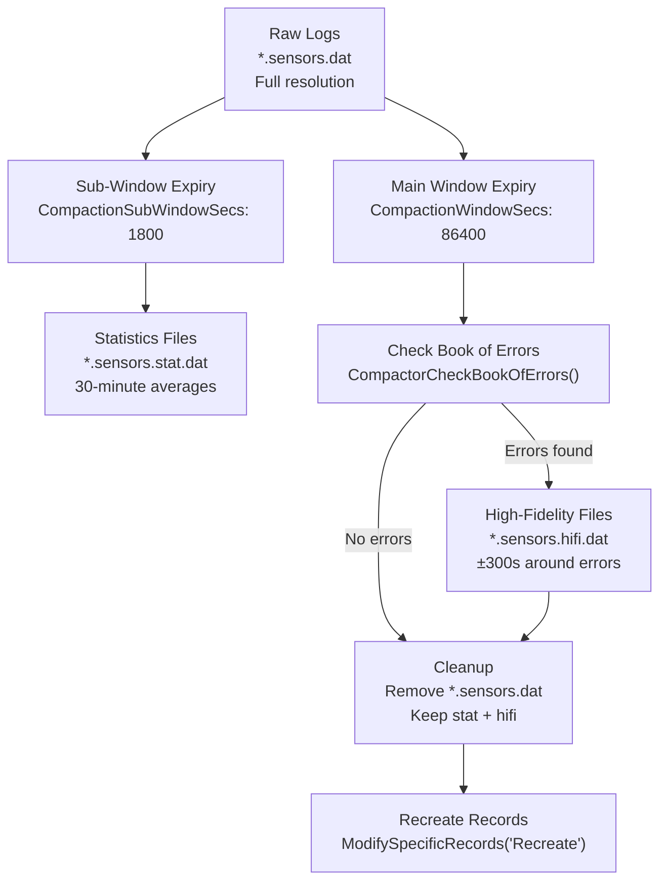
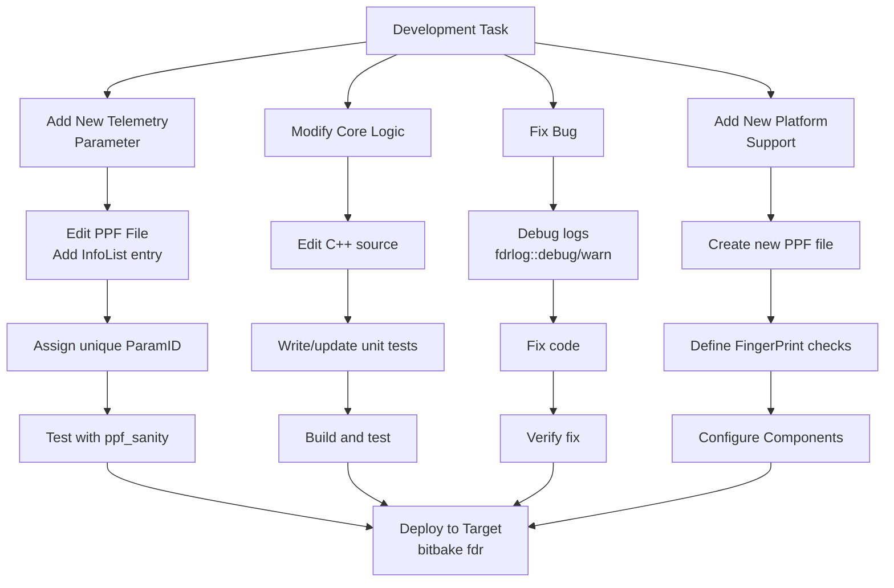
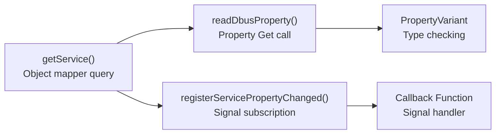

<!-- source: DeepWiki mcp.deepwiki.com · repo NVIDIA/nvidia-fdr · page 7 Development Guide · fetched 2026-10-26 -->

# Development Guide

<details>
<summary>Relevant source files</summary>

The following files were used as context for generating this wiki page:

- [README.md](README.md)
- [dbus_accessor.cpp](dbus_accessor.cpp)
- [dbus_accessor.hpp](dbus_accessor.hpp)
- [fdr_compact.cpp](fdr_compact.cpp)
- [fdr_grp_update.cpp](fdr_grp_update.cpp)
- [fdr_log.cpp](fdr_log.cpp)
- [fdr_log.hpp](fdr_log.hpp)
- [platforms/fdr_ppf_example.yaml](platforms/fdr_ppf_example.yaml)
- [platforms/fdr_ppf_vulcan.yaml](platforms/fdr_ppf_vulcan.yaml)
- [ppf_sanity.cpp](ppf_sanity.cpp)
- [property_variant.hpp](property_variant.hpp)

</details>


This page provides guidance for developers contributing to or extending the NVIDIA FDR system. It covers the project structure, core development concepts, extension points, and coding patterns. For detailed information on specific topics, see:

- **Build System and Dependencies**: See [Build System and Dependencies](#7.1)
- **Adding New Parameters**: See [Adding New Parameters](#7.2)
- **Testing and Validation**: See [Testing and Validation](#7.3)
- **Platform Configuration**: See [Platform Configuration](#5)

## Project Structure

The FDR repository is organized into functional modules with clear separation between core logic, platform-specific configurations, and utility tools.

### Directory Layout

```mermaid
graph TB
    ROOT["nvidia-fdr/"]
    
    ROOT --> SRC["Source Files<br/>(*.cpp, *.hpp)"]
    ROOT --> PLATFORMS["platforms/"]
    ROOT --> TOOLS["tools/"]
    ROOT --> PROTO["fdr_logs.proto"]
    ROOT --> BUILD_FILES["Build Files"]
    ROOT --> TESTS["test/"]
    ROOT --> COVERAGE["coverage/"]
    
    SRC --> FDR_MAIN["fdr.cpp/hpp<br/>FlightDataRecorder_c"]
    SRC --> RECORD["fdr_record.cpp/hpp<br/>Record class"]
    SRC --> COMPACT["fdr_compact.cpp<br/>Compaction logic"]
    SRC --> EVENTS["fdr_events.cpp/hpp<br/>Event handling"]
    SRC --> TIMERS["fdr_timers.cpp/hpp<br/>Timer system"]
    SRC --> STORE["fdr_store.cpp/hpp<br/>File I/O"]
    SRC --> DBUS["dbus_accessor.cpp/hpp<br/>D-Bus interface"]
    SRC --> GRP["fdr_grp_update.cpp/hpp<br/>Batch updates"]
    SRC --> UTILS["fdr_utils.cpp/hpp<br/>Utility functions"]
    SRC --> LOG["fdr_log.cpp/hpp<br/>Logging"]
    SRC --> PPF_SANITY["ppf_sanity.cpp/hpp<br/>PPF validation"]
    SRC --> MAIN["main.cpp<br/>Entry point"]
    
    PLATFORMS --> VULCAN["fdr_ppf_vulcan.yaml"]
    PLATFORMS --> HGXB["fdr_ppf_hgxb_hmc.yaml"]
    PLATFORMS --> EXAMPLE["fdr_ppf_example.yaml"]
    
    TOOLS --> DUMP["fdr_dump.sh"]
    TOOLS --> CATALOG["catalog/"]
    
    CATALOG --> PY_CATALOG["catalog.py<br/>Catalog class"]
    CATALOG --> PY_DECODE["decode.py<br/>Protobuf decoder"]
    CATALOG --> PY_JSON["json.py<br/>JSON writer"]
    
    BUILD_FILES --> MESON["meson.build"]
    BUILD_FILES --> CMAKE["CMakeLists.txt"]
    BUILD_FILES --> RECIPE["recipes-phosphor/<br/>fdr/fdr_git.bb"]
    
    TESTS --> TEST_FILES["*_test.cpp"]
    
    COVERAGE --> COV_SCRIPT["coverage.sh"]
```



**Sources**: [README.md:1-171]()

### Core Components

| Component | Files | Purpose |
|-----------|-------|---------|
| **Main Orchestrator** | `fdr.cpp/hpp`, `main.cpp` | `FlightDataRecorder_c` class, lifecycle management |
| **Data Collection** | `fdr_record.cpp/hpp` | `Record` class, fetch and store logic |
| **Batch Processing** | `fdr_grp_update.cpp/hpp` | `FdrGrpUpdate` class for shared memory batch reads |
| **Event System** | `fdr_events.cpp/hpp` | D-Bus signal handling, Book of Errors |
| **Timer System** | `fdr_timers.cpp/hpp` | Periodic polling, subscription management |
| **Compaction** | `fdr_compact.cpp` | Data aggregation, retention, high-fidelity preservation |
| **Storage** | `fdr_store.cpp/hpp` | `FDRStore` class, protobuf serialization |
| **D-Bus Interface** | `dbus_accessor.cpp/hpp` | Property reading, signal registration |
| **PPF Processing** | `fdr_policy.cpp/hpp`, `ppf_sanity.cpp/hpp` | Configuration parsing, validation |
| **Logging** | `fdr_log.cpp/hpp` | spdlog/phosphor-logging abstraction |
| **Protobuf Schema** | `fdr_logs.proto` | Binary log format definitions |

**Sources**: [README.md:1-171](), [fdr_compact.cpp:1-15](), [dbus_accessor.cpp:1-252](), [ppf_sanity.cpp:1-132]()

## Development Environment Setup

### Prerequisites

The FDR system requires specific dependencies and toolchain versions. Development is typically done on Ubuntu 22.04.

**Key Dependencies**:
- **C++ Toolchain**: g++-12, clang-tools
- **Build System**: meson, ninja, cmake
- **D-Bus Libraries**: libsystemd-dev, sdbusplus
- **Data Libraries**: protobuf ≥3.20.3, nlohmann-json, yaml-cpp, libcurl
- **Logging**: spdlog/libfmt or phosphor-logging
- **Testing**: libgtest-dev, libgmock-dev
- **Python**: python3 with yaml, mako, inflection packages

**Protobuf Version**: The system requires protobuf 3.20.3+ for the `optional` keyword support. The Ubuntu 22.04 bundled version is insufficient.

For complete setup instructions, see [Build System and Dependencies](#7.1).

**Sources**: [README.md:1-31]()

### Quick Start

```bash
# Configure build
meson setup --reconfigure build

# Compile
ninja -C build

# Run unit tests
meson test -v -C build

# Static analysis
ninja scan-build -C build
```

**Sources**: [README.md:44-105]()

## Core Development Concepts

### PPF-Driven Configuration

The FDR system is **configuration-driven** rather than hard-coded. All platform-specific behavior is defined in Platform Profile Files (PPF). This design allows supporting new platforms without modifying core code.



**Key Concept**: Adding new telemetry parameters typically involves editing a PPF file, not writing new C++ code. See [Adding New Parameters](#7.2).

**Sources**: [platforms/fdr_ppf_vulcan.yaml:1-50](), [ppf_sanity.cpp:28-43]()

### Record Lifecycle Pattern

Each telemetry parameter is represented by a `Record` object that encapsulates:
- Fetch logic (D-Bus, Shmem, Command, Redfish)
- Store policy (OnChange, EveryFetch, Periodic)
- Value tracking and change detection
- Statistics accumulation for compaction



**Key Classes**:
- `Record`: Defined in `fdr_record.cpp/hpp`
- `FdrGrpUpdate`: Batch processing in `fdr_grp_update.cpp/hpp`

**Sources**: [fdr_grp_update.cpp:19-61]()

### Fetch Methods and Store Policies

FDR supports multiple data sources through abstracted fetch methods:

| Fetch Method | Implementation | Use Case |
|--------------|----------------|----------|
| **DBUS** | `dbus_accessor.cpp::readDbusProperty()` | Properties from OpenBMC services |
| **Shmem** | `telemetry_mrd_client` library | High-frequency GPU metrics |
| **Command** | `fdr_utils.cpp::executeShellCommand()` | Shell command output |
| **Redfish** | `fdr_redfish.cpp` (if configured) | Out-of-band management data |

**Store Policies**:
- **OnChange**: Store only when value differs from previous
- **EveryFetch**: Store on every poll/event regardless of change
- **Periodic**: Store at specified intervals (controlled by `StoreFreqSecs`)

**Example from PPF**:
```yaml
- ID: GPU-TEMP
  FetchMethod: DBUS
  FetchType: Poll
  FetchFreqSecs: 600
  StorePolicy: EveryFetch
  DbusParams:
    Service: "xyz.openbmc_project.GpuMgr"
    ObjectPath: "/xyz/openbmc_project/sensors/temperature/..."
```

**Sources**: [platforms/fdr_ppf_vulcan.yaml:53-73](), [dbus_accessor.cpp:88-113](), [fdr_grp_update.cpp:19-61]()

### Compaction and Data Retention

The compaction system balances storage efficiency with error diagnostics:



**Key Methods**:
- `FlightDataRecorder_c::Compactor()` - Main entry point in [fdr_compact.cpp:129-176]()
- `FlightDataRecorder_c::CheckCompactionWindowExpiry()` - [fdr_compact.cpp:179-246]()
- `FlightDataRecorder_c::CompactorCheckBookOfErrors()` - [fdr_compact.cpp:23-127]()
- `FlightDataRecorder_c::CompactorCreateHighFidelityFiles()` - [fdr_compact.cpp:384-488]()

**Sources**: [fdr_compact.cpp:1-800]()

## Development Workflow

### Typical Development Tasks



**Sources**: [README.md:123-166]()

### Code Modification Checklist

When modifying FDR core code:

1. **Maintain PPF Compatibility**: Ensure existing PPF files continue to work
2. **Add Unit Tests**: For new functionality in `test/` directory
3. **Update ParamID Mapping**: If adding to protobuf schema
4. **Run Static Analysis**: `ninja scan-build -C build`
5. **Check Code Coverage**: `./coverage/coverage.sh`
6. **Test on Target Platform**: Cross-compile with bitbake
7. **Validate PPF Files**: Use `ppf_sanity.cpp` checks

**Sources**: [README.md:92-120](), [ppf_sanity.cpp:28-96]()

## Extension Points

### 1. Adding New Fetch Methods

To add a new data source (e.g., IPMI, proprietary API):

**Files to modify**:
- `fdr_policy.hpp`: Add new `FetchMethod` enum value
- `fdr_record.cpp`: Implement fetch logic in `Record::Refresh()`
- PPF files: Use new `FetchMethod` value

**Example pattern** (see D-Bus implementation):
```cpp
// In fdr_record.cpp::Refresh()
if (info.FetchMethod == "NewMethod") {
    auto value = fetchFromNewSource(info.NewMethodParams);
    RefreshValue(value);
}
```

**Sources**: [dbus_accessor.cpp:88-113]()

### 2. Adding New Store Policies

To add custom storage logic:

**Files to modify**:
- `fdr_policy.hpp`: Add `StorePolicy` enum
- `fdr_record.cpp`: Implement in `Record::Store()`

**Sources**: Referenced logic throughout `fdr_record.cpp`

### 3. Custom Compaction Strategies

To add new compaction methods beyond `Average`:

**Files to modify**:
- `fdr_compact.cpp`: Add logic in `Record::appendRunningStatToStatfile()`
- PPF files: Set `CompactionMethod` in InfoGroup

**Current implementation**: [fdr_compact.cpp:310-333]()

### 4. Platform-Specific Handlers

For platform-specific quirks:

**Approach**: Use PPF `Preconditions` and `FingerPrint` sections rather than modifying core code

**Example**:
```yaml
FingerPrint:
  Checks:
    - "grep -q -i VULCAN /etc/os-release"
    
Preconditions:
  Checks:
    - ID: CustomPlatformCheck
      CommandParams:
        Command: "custom_validation_script.sh"
```

**Sources**: [platforms/fdr_ppf_vulcan.yaml:18-52]()

## Code Organization Patterns

### Type Definitions and Data Structures

Key type definitions are centralized:

| Header File | Key Types | Purpose |
|-------------|-----------|---------|
| `fdr_policy.hpp` | `Info_t`, `InfoGroup_t`, `GeneralConfig_t` | PPF structure mapping |
| `property_variant.hpp` | `PropertyVariant`, `RetCoreApi` | D-Bus type abstraction |
| `fdr_common.hpp` | Return codes, constants | Common definitions |
| `fdr_logs.proto` | `fdr_sample`, `fdr_book_of_errors` | Protobuf messages |

**Sources**: [property_variant.hpp:1-69](), [dbus_accessor.hpp:1-100]()

### Error Handling Pattern

FDR uses a combination of return codes and exception handling:

```cpp
// Return code pattern
int retval = FDR_SUCCESS;
if (error_condition) {
    fdrlog::error("Operation failed: {}", details);
    return FDR_ERR_GENFAILURE;
}

// Exception catching (in critical paths)
try {
    riskyOperation();
} catch (const std::exception& e) {
    fdrlog::error("Exception: {}", e.what());
    // Continue or exit based on severity
}
```

**Exception Handling**: Compaction operations catch exceptions to prevent interrupting data collection [fdr_compact.cpp:141-162]()

**Sources**: [fdr_compact.cpp:129-176](), [ppf_sanity.cpp:28-43]()

### Logging Patterns

FDR abstracts logging to support both spdlog and phosphor-logging:

```cpp
// Conditional compilation
#ifdef FDR_USE_SPDLOG
    spdlog::info(msg);
#else
    if (LogLevel() >= LOG_INFO)
        lg2::info(msg.c_str());
#endif
```

**Log Throttling**: Prevents log spam for recurring errors using `logThrottle::logThrottling()` [fdr_log.cpp:94-125]()

**Levels**: `debug`, `info`, `warn`, `error`, `critical`

**Sources**: [fdr_log.cpp:1-126](), [fdr_log.hpp:1-135]()

### D-Bus Integration Pattern

D-Bus operations follow a consistent pattern:



**Key Functions**:
- `dbus::getService()` - Service discovery [dbus_accessor.cpp:45-86]()
- `dbus::readDbusProperty()` - Property reading [dbus_accessor.cpp:88-113]()
- `dbus::registerServicePropertyChanged()` - Signal registration [dbus_accessor.cpp:24-43]()

**Sources**: [dbus_accessor.cpp:1-252](), [dbus_accessor.hpp:1-100]()

## Coding Standards

### Naming Conventions

- **Classes**: PascalCase with `_c` suffix for main classes (e.g., `FlightDataRecorder_c`)
- **Methods**: PascalCase (e.g., `RefreshValue()`, `CheckCompactionWindowExpiry()`)
- **Variables**: camelCase (e.g., `leastWindowTimestamp`, `directoryTocompact`)
- **Constants**: UPPER_SNAKE_CASE (e.g., `FDR_SUCCESS`, `RUN_TIME_DIR_COUNT`)
- **Type Aliases**: PascalCase with `_t` suffix (e.g., `Info_t`, `InfoGroup_t`)

**Sources**: Observed throughout codebase

### File Organization

- **Headers**: Declare interface, minimal inline implementations
- **Source Files**: Implement logic, group related functions
- **Single Responsibility**: Each file focuses on one subsystem
- **Include Guards**: `#pragma once` preferred

### Comments and Documentation

- **Copyright Headers**: Required at file start [fdr_compact.cpp:1-10]()
- **Function Comments**: Brief description of purpose, parameters, return values
- **Complex Logic**: Inline comments explaining non-obvious behavior
- **TODO/FIXME**: Mark areas needing future work

**Sources**: [fdr_compact.cpp:1-15](), [dbus_accessor.cpp:1-11]()

## Testing Strategy

Testing is multi-layered:

1. **Unit Tests**: Test individual classes and functions in isolation
2. **PPF Validation**: Sanity checks via `ppf_sanity.cpp`
3. **Integration Testing**: End-to-end testing on target platform
4. **Static Analysis**: clang scan-build
5. **Code Coverage**: Measure test coverage with gcov/lcov

For detailed testing procedures, see [Testing and Validation](#7.3).

**Sources**: [README.md:92-120](), [ppf_sanity.cpp:28-96]()

## Build System Details

FDR uses a dual build system:

- **Native Development**: meson + ninja for x86_64 development
- **Target Deployment**: bitbake for ARM cross-compilation

### Meson Configuration

Key meson options:
```bash
-Dwerror=true          # Treat warnings as errors
-Dwarning_level=3      # Maximum warning level
-Ddebug=true           # Debug symbols
-Db_coverage=True      # Enable coverage
```

### Bitbake Integration

Recipe location: `openbmc/meta-nvidia/recipes-phosphor/fdr/fdr_git.bb`

Build commands:
```bash
. setup hgx              # Initialize environment
bitbake fdr             # Build FDR package
bitbake obmc-phosphor-image  # Full system image
```

For complete build instructions, see [Build System and Dependencies](#7.1).

**Sources**: [README.md:44-171]()

## Contributing to FDR

### Before Submitting Changes

1. **Run all tests**: Unit tests, static analysis, code coverage
2. **Validate PPF files**: Ensure no duplicate ParamIDs or IDs
3. **Test on target**: Deploy to actual HGX hardware if possible
4. **Update documentation**: Reflect changes in wiki and comments
5. **Follow coding standards**: Match existing code style

### Common Pitfalls

- **ParamID conflicts**: Always check for uniqueness using `ppf_sanity.cpp` validation
- **D-Bus service availability**: Services may not be ready at startup; implement retry logic
- **Disk space**: Compaction assumes sufficient space; test low-space scenarios
- **Exception handling**: Critical paths (compaction) must not crash FDR
- **Log verbosity**: Use appropriate log levels; avoid debug spam in production

**Sources**: [ppf_sanity.cpp:98-131](), [fdr_compact.cpp:141-162]()

## Key Files Reference

### Core Implementation Files

| File | Lines | Key Classes/Functions | Purpose |
|------|-------|----------------------|---------|
| `fdr.cpp/hpp` | ~3000 | `FlightDataRecorder_c` | Main orchestrator |
| `fdr_record.cpp/hpp` | ~1500 | `Record` | Per-parameter logic |
| `fdr_compact.cpp` | ~800 | Compaction methods | Data retention |
| `fdr_store.cpp/hpp` | ~500 | `FDRStore` | File I/O |
| `dbus_accessor.cpp/hpp` | ~250 | D-Bus helpers | D-Bus abstraction |
| `ppf_sanity.cpp/hpp` | ~130 | `PPFSanity` | PPF validation |
| `main.cpp` | ~100 | `main()` | Entry point |

### Configuration Files

| File | Purpose |
|------|---------|
| `platforms/fdr_ppf_vulcan.yaml` | Vulcan platform configuration |
| `platforms/fdr_ppf_hgxb_hmc.yaml` | HGXB HMC configuration |
| `platforms/fdr_ppf_example.yaml` | Development example |

**Sources**: All referenced files throughout this document

---

## Next Steps

- **Building the System**: See [Build System and Dependencies](#7.1) for environment setup and build procedures
- **Adding Parameters**: See [Adding New Parameters](#7.2) for step-by-step guide to extending telemetry
- **Testing Your Changes**: See [Testing and Validation](#7.3) for comprehensive testing strategies

**Sources**: [README.md:1-171](), [platforms/fdr_ppf_vulcan.yaml:1-100](), [fdr_compact.cpp:1-800](), [dbus_accessor.cpp:1-252](), [ppf_sanity.cpp:1-132](), [fdr_grp_update.cpp:1-61](), [fdr_log.cpp:1-126](), [dbus_accessor.hpp:1-100](), [property_variant.hpp:1-69](), [fdr_log.hpp:1-135]()

---

