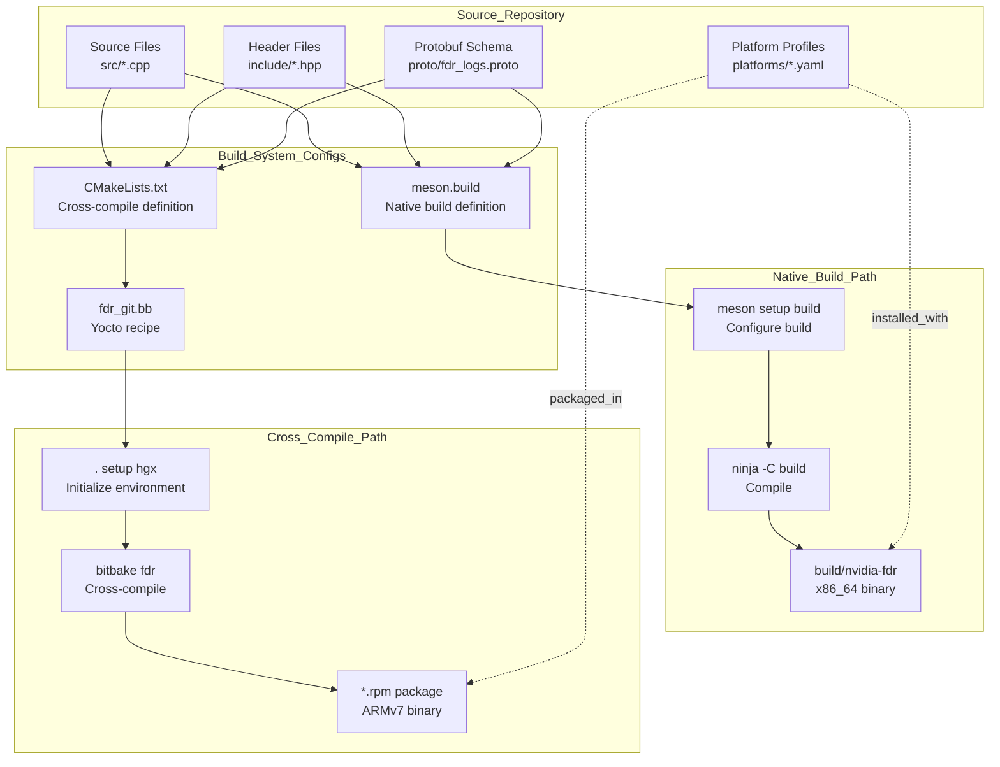
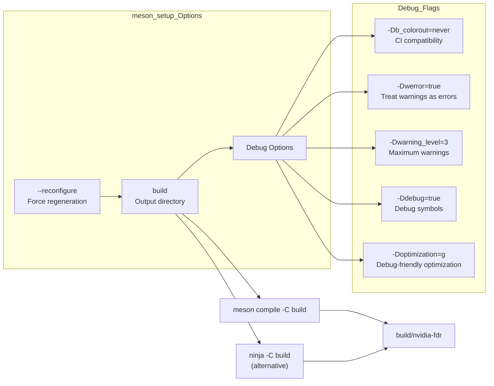
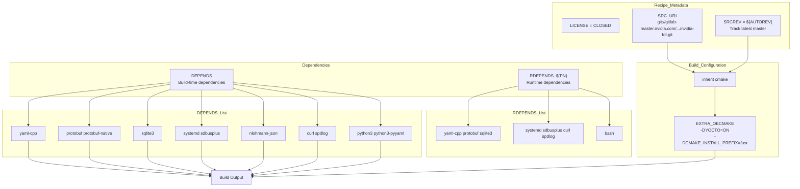
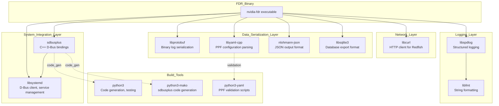

<!-- source: DeepWiki mcp.deepwiki.com · repo NVIDIA/nvidia-fdr · page 7.1 Build System and Dependencies · fetched 2026-10-26 -->

# Build System and Dependencies

<details>
<summary>Relevant source files</summary>

The following files were used as context for generating this wiki page:

- [README.md](README.md)
- [fdr_git.bb](fdr_git.bb)

</details>


## Purpose and Scope

This document describes the build system configuration, dependency management, and compilation procedures for the NVIDIA FDR project. It covers both native development builds on Ubuntu 22.04 using `meson`/`ninja` and cross-compilation for ARM targets using Yocto/OpenBMC's `bitbake` system. 

For information about running and deploying the built binaries, see [Running and Deployment](#2.2). For testing and validation procedures, see [Testing and Validation](#7.3).

---

## Build System Overview

The FDR project uses a dual build system approach to support different deployment scenarios:

- **Native Development Builds**: Uses `meson` build system with `ninja` backend for rapid development and testing on x86_64 Ubuntu hosts
- **Production Cross-Compilation**: Uses Yocto Project's `bitbake` which wraps the `cmake` build system for ARM target deployment on OpenBMC



**Build System Selection Rationale**:
- `meson` provides faster incremental builds and simpler configuration for development
- `cmake` integrates seamlessly with Yocto's build infrastructure for production deployment
- Both systems compile identical source code with equivalent dependency requirements

Sources: [README.md:1-171](), [fdr_git.bb:27-30]()

---

## Native Build Environment

### System Requirements

Native builds are verified on **Ubuntu 22.04 LTS** with the following toolchain requirements:

| Component | Minimum Version | Notes |
|-----------|----------------|-------|
| **g++** | 12 | Required for `sdbusplus` header compatibility |
| **gcc** | 12 | Must match g++ version |
| **meson** | Latest from apt | Build system orchestrator |
| **ninja** | Latest from apt | Build backend |
| **python3** | 3.10+ | Required for meson and code generation |

Sources: [README.md:5-10](), [README.md:33-42]()

### Dependency Installation

The build requires two categories of dependencies: those for the `sdbusplus` D-Bus library and those specific to FDR.

#### sdbusplus Dependencies

```bash
sudo apt install git meson libtool pkg-config g++-12 libsystemd-dev \
    python3 python3-pip python3-yaml python3-mako python3-inflection
```

| Package | Purpose |
|---------|---------|
| `libsystemd-dev` | D-Bus client library and systemd integration |
| `python3-yaml` | YAML parsing for code generation |
| `python3-mako` | Template engine for D-Bus binding generation |
| `python3-inflection` | String transformation for interface generation |

#### FDR-Specific Dependencies

```bash
sudo apt install cmake clang-tools nlohmann-json3-dev \
    libyaml-cpp-dev libcurl4-gnutls-dev python3-yaml \
    libspdlog-dev libfmt-dev clang-tools libgtest-dev libgmock-dev
```

| Package | Purpose | Used By |
|---------|---------|---------|
| `nlohmann-json3-dev` | JSON parsing and serialization | Configuration validation, data export |
| `libyaml-cpp-dev` | YAML configuration parsing | PPF file loading via `FdrPlatforms_c` |
| `libcurl4-gnutls-dev` | HTTP client library | Redfish API access in `RedfishClient` |
| `libspdlog-dev` | Structured logging framework | All logging via `spdlog::logger` |
| `libfmt-dev` | String formatting library | Dependency of spdlog |
| `libgtest-dev` | Google Test framework | Unit test execution |
| `libgmock-dev` | Google Mock framework | Test mocking |

Sources: [README.md:5-18]()

#### Protobuf Special Case

The Ubuntu 22.04 bundled `protobuf3` does not support the `optional` keyword required by the FDR protobuf schema. Manual installation of **protobuf 3.20.3+** is required:

```bash
wget https://github.com/protocolbuffers/protobuf/releases/download/v3.20.3/protobuf-all-3.20.3.tar.gz
tar zxvf protobuf-all-3.20.3.tar.gz
cd protobuf-3.20.3/
./configure --prefix=/usr
make
sudo make install
```

The `optional` keyword is used throughout [proto/fdr_logs.proto]() to distinguish between unset values and default values in the serialized binary format.

Sources: [README.md:20-31]()

### Compiler Configuration

If multiple GCC versions are installed, set GCC 12 as the default:

```bash
sudo update-alternatives --install /usr/bin/gcc gcc /usr/bin/gcc-12 10
sudo update-alternatives --install /usr/bin/g++ g++ /usr/bin/g++-12 10
```

The priority value `10` determines precedence when multiple versions are registered.

Sources: [README.md:33-42]()

### Build Configuration



**Standard Configuration**:
```bash
meson setup --reconfigure build
```

**Debug Configuration** (used in Docker unit tests):
```bash
meson setup --reconfigure build \
    -Db_colorout=never \
    -Dwerror=true \
    -Dwarning_level=3 \
    -Ddebug=true \
    -Doptimization=g
```

**Compilation**:
```bash
meson compile -C build
# or
ninja -C build
```

Sources: [README.md:44-62]()

---

## Cross-Compilation with Yocto

### OpenBMC Repository Setup

The FDR project integrates into NVIDIA's OpenBMC fork:

```bash
git clone ssh://git@gitlab-master.nvidia.com:12051/dgx/bmc/openbmc.git
cd openbmc
git checkout fdr-integration
. setup hgx
```

The `. setup hgx` command initializes the Yocto build environment, setting `MACHINE`, `DISTRO`, and other OpenEmbedded variables.

Sources: [README.md:123-135]()

### BitBake Recipe Structure

The `fdr_git.bb` recipe defines the Yocto build configuration:



**Key Recipe Variables**:

| Variable | Value | Purpose |
|----------|-------|---------|
| `SRCREV` | `${AUTOREV}` | Automatically tracks latest master branch commit |
| `EXTRA_OECMAKE` | `-DYOCTO=ON -DCMAKE_INSTALL_PREFIX:PATH=/usr` | CMake configuration for Yocto environment |
| `DEPENDS` | Build dependencies | Required packages during compilation |
| `RDEPENDS_${PN}` | Runtime dependencies | Required packages on target system |
| `S` | `${WORKDIR}/git` | Source directory after git checkout |

Sources: [fdr_git.bb:1-35]()

### Build Commands

```bash
# Build FDR package only
bitbake fdr

# Build complete OpenBMC image with FDR included
bitbake obmc-phosphor-image
```

**Build Artifacts**:
- **RPM Package**: `openbmc/build/hgx/tmp/deploy/rpm/armv7ahf_vfpv4d16/`
- **Unpacked Files**: `openbmc/build/hgx/tmp/work/armv7ahf-vfpv4d16-openbmc-linux-gnueabi/nvidia-fdr/git-r0/package/`
- **Build Logs**: `openbmc/build/hgx/tmp/work/armv7ahf-vfpv4d16-openbmc-linux-gnueabi/nvidia-fdr/git-r0/temp/`

Sources: [README.md:137-150]()

---

## Dependency Architecture

### Dependency Categories



### Core Dependencies Detail

#### System Integration

**libsystemd** (`libsystemd-dev`)
- Provides `sd-bus` API for D-Bus communication
- Used by `DbusAccessor` class for all D-Bus property reads/writes
- Enables D-Bus signal subscription in `EventSignalHandler`

**sdbusplus** (custom package)
- NVIDIA's C++ wrapper around `sd-bus`
- Provides type-safe D-Bus method calls and property access
- Generates C++ bindings from D-Bus XML interface definitions
- Used extensively in [src/dbus_accessor.cpp]()

#### Data Serialization

**libprotobuf** (≥3.20.3)
- Serializes all collected telemetry to binary logs
- Schema defined in [proto/fdr_logs.proto]()
- Generates `fdr_logs.pb.h` and `fdr_logs.pb.cc` during build
- Used by `FDRStore` class for writing `*.dat` files

**libyaml-cpp** (`libyaml-cpp-dev`)
- Parses Platform Profile Files (PPF)
- Used by `FdrPlatforms_c::ReadYAML()` to load configuration
- Deserializes YAML structure into C++ structs defined in [include/fdr_ppf.hpp]()

**nlohmann-json** (`nlohmann-json3-dev`)
- Header-only JSON library
- Used in Python tools for JSON export format
- Enables JSON-based data exchange with analysis systems

**libsqlite3** (`libsqlite3-dev`)
- Embedded SQL database engine
- Used by catalog system to create queryable databases from binary logs
- Enables SQL-based telemetry analysis

#### Network

**libcurl** (`libcurl4-gnutls-dev`)
- HTTP/HTTPS client library
- Used by `RedfishClient` class to fetch data from BMC Redfish API
- Supports authentication and TLS for secure communication

#### Logging

**libspdlog** (`libspdlog-dev`)
- Fast C++ logging library
- Provides structured logging with log levels (trace, debug, info, warning, error, critical)
- All FDR components log through `spdlog::logger` instances
- Dependency: requires `libfmt` for formatting

**libfmt** (`libfmt-dev`)
- Modern C++ formatting library
- Required dependency of spdlog
- Provides compile-time format string validation

Sources: [README.md:5-18](), [fdr_git.bb:32-34]()

---

## Build Configuration Options

### CMake Configuration Variables

The CMake build system (used by Yocto) supports the following configuration options:

| Variable | Default | Purpose |
|----------|---------|---------|
| `YOCTO` | `OFF` | Enable Yocto-specific build paths and installation rules |
| `CMAKE_INSTALL_PREFIX` | `/usr/local` | Installation prefix (set to `/usr` in Yocto) |
| `CMAKE_BUILD_TYPE` | `Release` | Build type: `Debug`, `Release`, `RelWithDebInfo` |

**Yocto Build**:
```cmake
cmake -DYOCTO=ON -DCMAKE_INSTALL_PREFIX=/usr ..
```

When `YOCTO=ON`:
- Systemd service files installed to `/usr/lib/systemd/system/`
- D-Bus configuration files installed to `/usr/share/dbus-1/system.d/`
- Platform profiles installed to `/usr/share/nvidia-fdr/platforms/`

Sources: [fdr_git.bb:30]()

### Meson Configuration Options

The meson build system supports the following build options:

| Option | Values | Purpose |
|--------|--------|---------|
| `-Doptimization` | `0`, `g`, `1`, `2`, `3`, `s` | Optimization level (`g` = debug-friendly) |
| `-Ddebug` | `true`, `false` | Include debug symbols |
| `-Dwerror` | `true`, `false` | Treat compiler warnings as errors |
| `-Dwarning_level` | `0`, `1`, `2`, `3` | Warning verbosity level |
| `-Db_coverage` | `true`, `false` | Enable code coverage instrumentation |
| `-Db_colorout` | `always`, `never`, `auto` | Colorized build output |

**Coverage Build** (for unit testing):
```bash
meson setup --reconfigure build_coverage -Db_coverage=True
meson test -v -C build_coverage
```

Sources: [README.md:52-53](), [README.md:97-99]()

---

## Build Output and Installation

### Native Build Artifacts

```
build/
├── nvidia-fdr                    # Main executable binary
├── meson-logs/
│   ├── meson-log.txt            # Build log
│   └── coverage.txt             # Coverage report (if enabled)
├── src/
│   └── *.o                      # Compiled object files
└── proto/
    ├── fdr_logs.pb.h            # Generated protobuf header
    └── fdr_logs.pb.cc           # Generated protobuf implementation
```

### Yocto Package Contents

The `fdr` RPM package contains:

| Path | Content |
|------|---------|
| `/usr/bin/nvidia-fdr` | Main FDR daemon binary |
| `/usr/bin/fdr_dump.sh` | Log collection script |
| `/usr/lib/python3.10/site-packages/fdrtool/` | Python analysis tools |
| `/usr/lib/systemd/system/nvidia-fdr.service` | Systemd service unit |
| `/usr/share/dbus-1/system.d/xyz.openbmc_project.FDR.conf` | D-Bus policy configuration |
| `/usr/share/nvidia-fdr/platforms/*.yaml` | Platform Profile Files |

Sources: [README.md:146-148]()

---

## Verification and Testing

### Static Analysis

```bash
ninja scan-build -C builddir
```

Runs Clang static analyzer on the codebase to detect potential bugs.

### Unit Tests

```bash
meson test -v -C build
```

Executes all unit tests defined in the test suite. Requires `libgtest-dev` and `libgmock-dev`.

### Code Coverage

```bash
./coverage/coverage.sh
```

Generates coverage reports:
- **Text**: `build_coverage/meson-logs/coverage.txt`
- **HTML**: `build_coverage/meson-logs/coverage.html`

Sources: [README.md:92-117]()

---

## Continuous Integration

The project includes CI pipeline definitions for automated builds and testing. To run the CI pipeline locally:

```bash
# See NVIDIA internal documentation
https://gitlab-master.nvidia.com/dgx/bmc/docs/-/blob/develop/testing/local-ci-build.md
```

Sources: [README.md:118-121]()

---

## Common Build Issues

### Issue: Protobuf Compilation Errors

**Symptom**: Errors related to `optional` keyword in protobuf files

**Solution**: Ensure protobuf ≥3.20.3 is installed (Ubuntu bundled version is too old)

### Issue: sdbusplus Header Compilation Failure

**Symptom**: C++ standard library errors when including sdbusplus headers

**Solution**: Ensure g++-12 is set as default compiler

```bash
sudo update-alternatives --config g++
```

### Issue: Missing D-Bus Registration Permission

**Symptom**: `nvidia-fdr` fails to start with D-Bus registration error

**Solution**: Install D-Bus policy configuration file and reload D-Bus daemon

```bash
sudo systemctl reload dbus
```

Sources: [README.md:33-42](), [README.md:66-81]()

---

