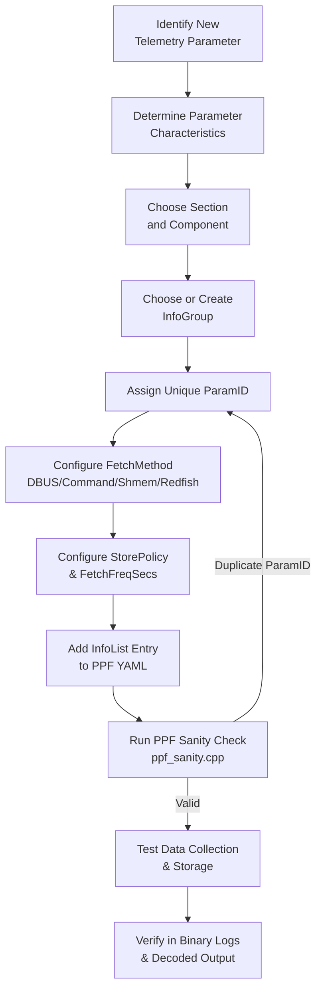
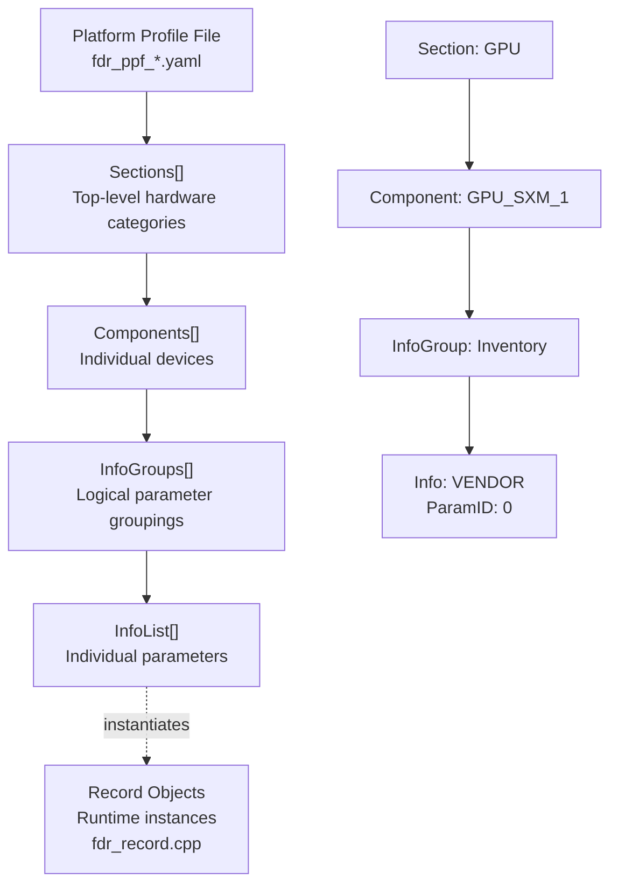
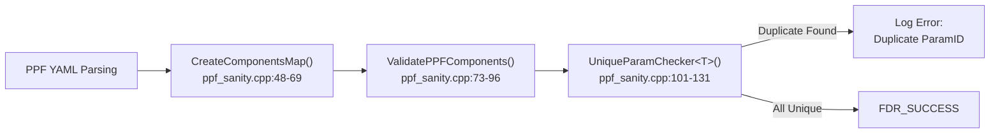
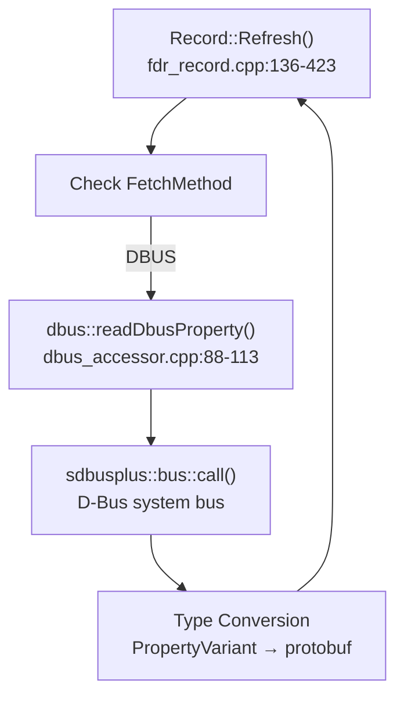
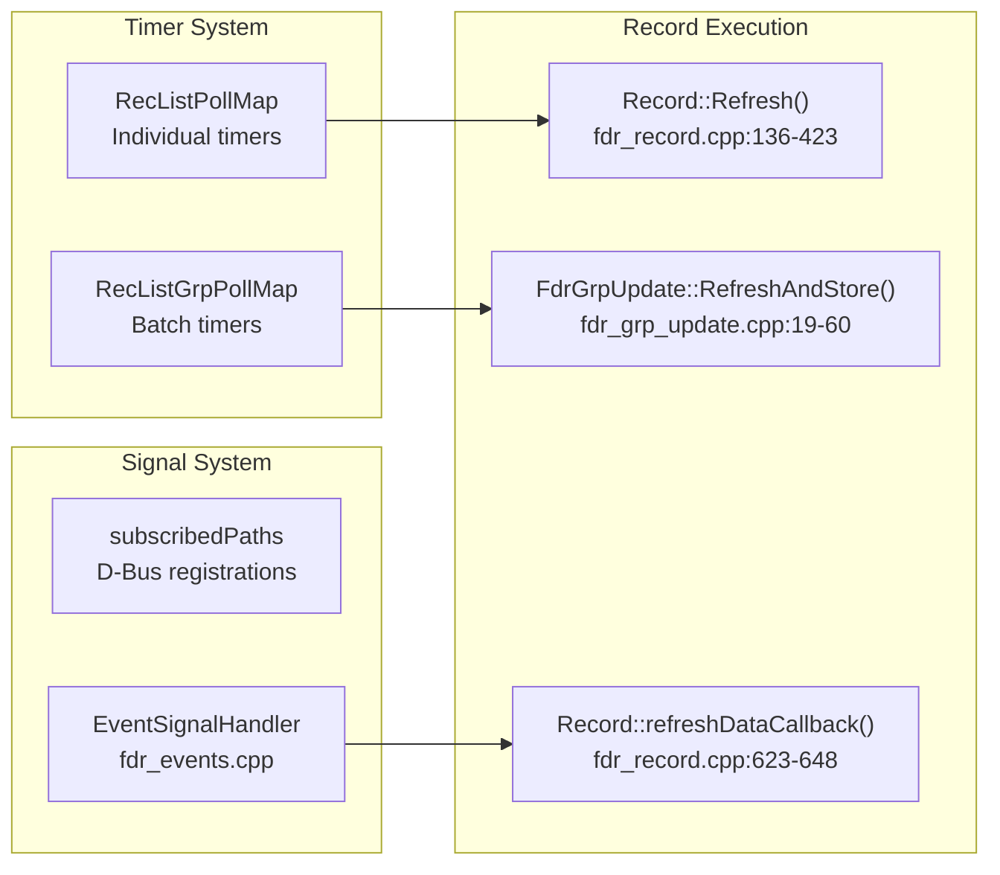
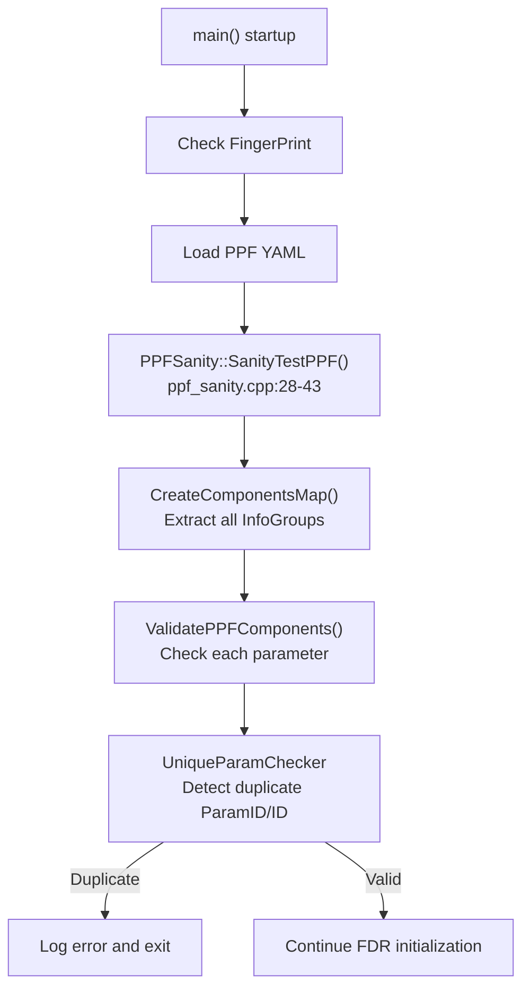

<!-- source: DeepWiki mcp.deepwiki.com · repo NVIDIA/nvidia-fdr · page 7.2 Adding New Parameters · fetched 2026-10-26 -->

# Adding New Parameters

<details>
<summary>Relevant source files</summary>

The following files were used as context for generating this wiki page:

- [dbus_accessor.cpp](dbus_accessor.cpp)
- [dbus_accessor.hpp](dbus_accessor.hpp)
- [fdr_compact.cpp](fdr_compact.cpp)
- [fdr_grp_update.cpp](fdr_grp_update.cpp)
- [fdr_log.cpp](fdr_log.cpp)
- [fdr_log.hpp](fdr_log.hpp)
- [fdr_record.cpp](fdr_record.cpp)
- [platforms/fdr_ppf_example.yaml](platforms/fdr_ppf_example.yaml)
- [platforms/fdr_ppf_vulcan.yaml](platforms/fdr_ppf_vulcan.yaml)
- [ppf_sanity.cpp](ppf_sanity.cpp)
- [property_variant.hpp](property_variant.hpp)

</details>


This page provides a step-by-step guide for developers adding new telemetry parameters to the FDR system. It covers PPF file modifications, ParamID assignment, data collection method configuration, and validation procedures.

For information about the overall PPF file structure and syntax, see [PPF File Structure Reference](#5.1). For platform-specific configuration examples, see [Vulcan Platform Configuration](#5.2) and [HGXB HMC Platform Configuration](#5.3).

## Overview

Adding a new parameter to FDR requires modifying the Platform Profile File (PPF) and ensuring the parameter has a unique identifier and correct configuration. The FDR system automatically creates `Record` objects from PPF definitions, which handle data fetching, storage, and compaction without requiring code changes.



**Parameter Addition Flow**

Sources: [platforms/fdr_ppf_vulcan.yaml:1-2000](), [ppf_sanity.cpp:28-43](), [fdr_record.cpp:23-69]()

## Parameter Characteristics

Before adding a parameter, determine its characteristics:

| Characteristic | Description | Impact |
|----------------|-------------|---------|
| **Data Source** | Where the data originates (GPU, NIC, sensor, etc.) | Determines Section and Component placement |
| **Update Frequency** | How often the value changes | Sets FetchFreqSecs (1-3600s typical) |
| **Change Pattern** | Static, slowly changing, or frequently changing | Determines StorePolicy |
| **Access Method** | How to read the value | Sets FetchMethod (DBUS, Command, etc.) |
| **Data Type** | Value type | Sets DataType (string, Uint64, Double) |
| **Criticality** | Importance for error analysis | Influences InfoGroup placement |

Sources: [fdr_record.cpp:136-423]()

## Step 1: Locate Appropriate InfoGroup

Parameters are organized hierarchically in PPF files:



**PPF Hierarchy and Record Creation**

Common InfoGroup categories:
- **Inventory**: Static device identification (serial numbers, part numbers)
- **Config**: Configuration settings (firmware versions, operating modes)
- **Errors**: Error counters and status
- **Sensor.Thermal**: Temperature readings
- **Sensor.Clock**: Clock frequencies
- **Sensor.Power**: Power consumption metrics

Sources: [platforms/fdr_ppf_vulcan.yaml:53-243](), [platforms/fdr_ppf_example.yaml:86-243]()

## Step 2: Assign Unique ParamID

The `ParamID` is a critical identifier that must be unique within each InfoGroup of a Component. ParamIDs are used in protobuf serialization and must never be changed once assigned.

### ParamID Assignment Rules

1. **Uniqueness Scope**: ParamID must be unique within an InfoGroup
2. **Sequential Assignment**: Use the next available integer (0, 1, 2, ...)
3. **Immutability**: Never change a ParamID after deployment
4. **Validation**: The `ppf_sanity.cpp` module detects duplicates



**ParamID Validation Flow**

### Finding the Next Available ParamID

To find the next available ParamID for an InfoGroup:

1. Open the relevant PPF file (e.g., `fdr_ppf_vulcan.yaml`)
2. Navigate to the target InfoGroup
3. Find the highest existing `ParamID` value
4. Use the next integer (highest + 1)

**Example from Vulcan GPU Inventory InfoGroup:**

```yaml
# Existing parameters
- ID: VENDOR
  ParamID: 0
- ID: PART-NUM
  ParamID: 1
- ID: SERIAL
  ParamID: 2

# New parameter would use ParamID: 3
- ID: NEW_PARAMETER
  ParamID: 3
```

Sources: [ppf_sanity.cpp:88-92](), [platforms/fdr_ppf_vulcan.yaml:60-139]()

## Step 3: Configure Data Collection Method

The `FetchMethod` determines how FDR retrieves the parameter value. Each method requires specific configuration parameters.

### FetchMethod Configuration Table

| FetchMethod | Use Case | Required Fields | Runtime Handler |
|-------------|----------|-----------------|-----------------|
| **DBUS** | OpenBMC D-Bus properties | `DbusParams.Service`<br/>`DbusParams.ObjectPath`<br/>`DbusParams.Interface`<br/>`DbusParams.Property` | [dbus_accessor.cpp:88-113]() |
| **DBUS_DGD** | Device Get Data API | `DbusParams.Service`<br/>`DbusParams.ObjectPath`<br/>`DbusParams.Interface`<br/>`DbusParams.Property`<br/>`DbusParams.DevId` | [dbus_accessor.cpp:115-167]() |
| **DBUS_PT** | FPGA Passthrough | `DbusParams.Service`<br/>`DbusParams.ObjectPath`<br/>`DbusParams.Interface`<br/>`DbusParams.Opcode`<br/>`DbusParams.Arg1`<br/>`DbusParams.Arg2` | [dbus_accessor.cpp:169-224]() |
| **Command** | Shell command execution | `CommandParams.Command` | [fdr_record.cpp:293-319]() |
| **Shmem** | Shared memory telemetry | `ShmemParams.Key` | [fdr_grp_update.cpp:19-60]() |
| **Redfish** | Redfish API queries | `RedfishParams.URI`<br/>`RedfishParams.JSONPointer` | [fdr_record.cpp:320-357]() |

### DBUS Method Configuration

The most common method for HGX platforms. The Record class performs parameter substitution for `$paramname` placeholders.



**DBUS Data Fetch Flow**

**DBUS Parameter Example:**

```yaml
- ID: GPU-TEMP
  ParamID: 100
  DataType: Double
  FetchMethod: DBUS
  FetchFreqSecs: 60
  StorePolicy: EveryFetch
  DbusParams:
    Service: "xyz.openbmc_project.GpuMgr"
    ObjectPath: "/xyz/openbmc_project/sensors/temperature/HGX_GPU_SXM_$gpuid_TEMP_1"
    Interface: "xyz.openbmc_project.Sensor.Value"
    Property: "Value"
```

The `$gpuid` placeholder is replaced with the value from `Component.Params`.

Sources: [fdr_record.cpp:152-292](), [dbus_accessor.cpp:88-113](), [platforms/fdr_ppf_vulcan.yaml:258-276]()

### Command Method Configuration

For parameters accessible via shell commands (e.g., `nvidia-smi`).

**Command Parameter Example:**

```yaml
- ID: GPU-UUID
  ParamID: 2
  DataType: string
  FetchMethod: Command
  FetchFreqSecs: 3600
  StorePolicy: OnChange
  CommandParams:
    Command: "nvidia-smi --id=$gpuid --format=csv,noheader --query-gpu=uuid"
```

Sources: [fdr_record.cpp:293-319](), [platforms/fdr_ppf_example.yaml:109-113]()

### Shmem Method Configuration

For high-frequency telemetry accessed via shared memory. Shmem parameters are typically collected using `GroupPoll` for efficiency.

**Shmem Parameter Example:**

```yaml
- ID: GPU-POWER-INSTANT
  ParamID: 500
  DataType: Uint64
  FetchMethod: Shmem
  FetchFreqSecs: 1
  StorePolicy: EveryFetch
  FetchType: GroupPoll
  ShmemParams:
    Key: "gpu_$gpuid_power"
    Namespace: "telemetry_aggregation"
```

Sources: [fdr_grp_update.cpp:19-60](), [fdr_record.cpp:55-59]()

## Step 4: Configure Collection and Storage Policies

### FetchType Options

| FetchType | Mechanism | Use Case | Timer Handler |
|-----------|-----------|----------|---------------|
| **Poll** | Timer-based periodic fetch | Standard telemetry (every 60-3600s) | Individual timer per Record |
| **GroupPoll** | Batch fetch for multiple parameters | High-frequency shared memory (1-60s) | Single timer per namespace |
| **Subscribe** | D-Bus signal subscription | Event-driven parameters | D-Bus PropertiesChanged signal |



**FetchType Execution Paths**

Sources: [fdr_record.cpp:136-143](), [fdr_grp_update.cpp:19-60](), [fdr_record.cpp:623-648]()

### StorePolicy Options

| StorePolicy | Condition | Typical Use Case |
|-------------|-----------|------------------|
| **OnChange** | Store only when value differs from previous | Static/slowly changing data (inventory, versions) |
| **EveryFetch** | Store after every fetch | Sensor readings, frequently changing data |
| **Periodic** | Store at `StoreFreqSecs` intervals | Data with specific recording frequency requirements |

The `Record::Store()` method implements the logic:

Sources: [fdr_record.cpp:578-621]()

### DataType Options

| DataType | Protobuf Field | Supported FetchMethods |
|----------|----------------|------------------------|
| **string** | `paramvaluestring` | All methods |
| **Uint64** | `paramvalueint64` | DBUS, Command, Shmem, Redfish, DBUS_DGD, DBUS_PT |
| **Double** | `paramvaluedouble` | DBUS, Shmem (Command and Redfish have limited support) |
| **Float** | `paramvaluedouble` | DBUS (stored as double) |
| **Integer** | `paramvalueint64` | DBUS (deprecated, use Uint64) |
| **Uint32** | `paramvalueint64` | DBUS (auto-converted) |
| **Uint16** | `paramvalueint64` | DBUS (auto-converted) |
| **Uint8** | `paramvalueint64` | DBUS (auto-converted) |
| **Int64** | `paramvalueint64` | DBUS (auto-converted) |
| **Int16** | `paramvalueint64` | DBUS (auto-converted) |

Type conversion is handled automatically in `Record::Refresh()`.

Sources: [fdr_record.cpp:97-114](), [fdr_record.cpp:168-282]()

## Step 5: Add Parameter to PPF File

### Complete Parameter Definition Template

```yaml
- ID: PARAMETER_NAME               # Descriptive identifier
  ParamID: N                        # Unique integer within InfoGroup
  DataType: string|Uint64|Double    # Data type
  FetchMethod: DBUS|Command|Shmem   # Collection method
  FetchFreqSecs: 60                 # Fetch interval in seconds
  StoreFreqSecs: 60                 # Store interval (for Periodic)
  StorePolicy: OnChange|EveryFetch|Periodic
  FetchType: Poll|GroupPoll|Subscribe
  
  # Method-specific parameters (choose one):
  DbusParams:
    Service: "service.name"
    ObjectPath: "/object/path/$param"
    Interface: "interface.name"
    Property: "PropertyName"
    
  CommandParams:
    Command: "shell command $param"
    
  ShmemParams:
    Key: "shmem_key_$param"
    Namespace: "namespace_name"
    
  RedfishParams:
    URI: "/redfish/v1/path"
    JSONPointer: "/field/path"
```

### Using YAML Anchors for Defaults

PPF files extensively use YAML anchors to reduce duplication:

```yaml
# Define defaults anchor
- &sensor-defaults
  DataType: Double
  FetchMethod: DBUS
  FetchFreqSecs: 60
  StorePolicy: EveryFetch
  FetchType: Poll
  DbusParams:
    Service: "xyz.openbmc_project.GpuMgr"
    Interface: "xyz.openbmc_project.Sensor.Value"
    Property: "Value"

# Use defaults and override specific fields
- ID: GPU-TEMP
  <<: *sensor-defaults
  ParamID: 100
  DbusParams:
    Service: "xyz.openbmc_project.GpuMgr"
    ObjectPath: "/xyz/openbmc_project/sensors/temperature/GPU_$gpuid_TEMP"
    Interface: "xyz.openbmc_project.Sensor.Value"
    Property: "Value"
```

Sources: [platforms/fdr_ppf_vulcan.yaml:60-73](), [platforms/fdr_ppf_example.yaml:93-103]()

## Step 6: Validation and Testing

### PPF Sanity Check

Before running FDR, validate the PPF file for duplicate ParamIDs:



**PPF Validation During Startup**

The validator checks:
- Duplicate `ParamID` within each InfoGroup
- Duplicate `ID` (parameter name) within each InfoGroup

Sources: [ppf_sanity.cpp:28-131]()

### Testing Parameter Collection

After adding a parameter:

1. **Build and Deploy**: Compile FDR and deploy to target platform
2. **Start FDR Service**: `systemctl start nvidia-fdr`
3. **Monitor Logs**: Check for collection errors
   ```
   journalctl -u nvidia-fdr -f
   ```
4. **Verify Binary Logs**: Check that data is being written
   ```
   ls -lh /var/emmc/fdr/BootCnt_*/
   # Look for *.sensors.dat or *.others.dat files
   ```
5. **Decode and Inspect**: Use nvidia-fdrtool to verify data
   ```
   nvidia-fdrtool collect --output /tmp/fdr_dump.tar.xz
   nvidia-fdrtool decode /tmp/fdr_dump.tar.xz --format json
   ```

### Common Issues and Resolutions

| Issue | Symptom | Resolution |
|-------|---------|------------|
| **Duplicate ParamID** | FDR exits at startup with error | Assign a unique ParamID |
| **D-Bus property not found** | Warning logs about failed reads | Verify ObjectPath, Interface, Property are correct |
| **Command execution fails** | Warning logs about command failure | Test command manually, check syntax |
| **No data being stored** | Binary log file size not growing | Check StorePolicy, verify FetchMethod works |
| **Type conversion errors** | Exception logs during RefreshValue | Ensure DataType matches actual data |
| **Parameter substitution fails** | Malformed paths/commands | Verify Component.Params defines all placeholders |

Sources: [fdr_record.cpp:95-133](), [dbus_accessor.cpp:103-111](), [fdr_log.cpp:94-124]()

## Compaction Configuration

For sensor parameters that should be compacted into statistics, add compaction configuration to the InfoGroup:

```yaml
- ID: Sensor.Thermal
  InfoList:
    # ... parameter definitions ...
  RecordRetentionPolicy: Recreate
  CompactionMethod: Average
```

This enables automatic statistical aggregation:
- **Running statistics** are updated on each fetch
- **Statistics files** are written every `CompactionSubWindowSecs`
- **High-fidelity data** is preserved around errors

The statistics include:
- Average value over the sub-window
- Minimum and maximum values
- Timestamps of min/max occurrences
- Number of samples

Sources: [fdr_record.cpp:429-523](), [fdr_compact.cpp:285-333](), [platforms/fdr_ppf_vulcan.yaml:32-34]()

## Parameter Organization Best Practices

### Grouping Guidelines

1. **Inventory**: Static identifiers that rarely change
   - Serial numbers, part numbers, UUIDs
   - Hardware revisions, model names
   - `FetchType: Subscribe`, `StorePolicy: OnChange`

2. **Config**: Configuration settings
   - Firmware versions, driver versions
   - Operating modes, thresholds
   - `FetchType: Subscribe`, `StorePolicy: OnChange`
   - `FetchFreqSecs: 3600` (check periodically)

3. **Errors**: Error counters and status
   - ECC errors, link errors, thermal events
   - `FetchType: Subscribe` (for event-driven)
   - `FetchFreqSecs: 600-3600` (for polling)

4. **Sensor groups**: High-frequency telemetry
   - Temperature, power, clock speeds
   - `FetchType: Poll` or `GroupPoll`
   - `FetchFreqSecs: 1-60`
   - Enable compaction with `CompactionMethod: Average`

### Naming Conventions

- Use uppercase with hyphens for `ID`: `GPU-TEMP`, `MEM-PART-NUM`
- Use array notation for indexed parameters: `NVLINK-PROTOCOL[0]`, `PART-NUM[1]`
- Keep names concise but descriptive
- Maintain consistency with existing parameters in the same InfoGroup

Sources: [platforms/fdr_ppf_vulcan.yaml:58-243](), [platforms/fdr_ppf_example.yaml:86-243]()

## Example: Adding a New Temperature Parameter

Complete example of adding GPU memory temperature monitoring:

```yaml
# In GPU InfoGroup Config section
- ID: Config
  InfoList:
    # ... existing config parameters ...
    
    # New parameter: Memory temperature threshold
    - ID: MEM-TEMP-THRESH-WARNING
      <<: *gpu-config-defaults      # Inherit common settings
      ParamID: 999                   # Next available ID (check existing)
      DataType: Double
      DbusParams:
        Service: "xyz.openbmc_project.GpuMgr"
        ObjectPath: "/xyz/openbmc_project/sensors/temperature/HGX_GPU_SXM_$gpuid_DRAM_0_Temp_0"
        Interface: "xyz.openbmc_project.Sensor.Threshold.Warning"
        Property: "WarningHigh"
```

Steps taken:
1. Identified appropriate InfoGroup: `Config` (threshold configuration)
2. Found next available ParamID in Config group: 999 (example)
3. Used YAML anchor `*gpu-config-defaults` for common fields
4. Specified `DataType: Double` for temperature threshold
5. Configured D-Bus parameters with `$gpuid` substitution
6. Used existing D-Bus interface pattern from similar parameters

Sources: [platforms/fdr_ppf_vulcan.yaml:203-276]()

## Related Configuration

After adding parameters, you may need to update:

- **Exemption lists**: If parameter should be excluded from coverage reports [platforms/fdr_ppf_hgxb_hmc.yaml]()
- **Fingerprint checks**: If adding platform-specific parameters [platforms/fdr_ppf_vulcan.yaml:18-22]()
- **Preconditions**: If parameter requires specific system state [platforms/fdr_ppf_vulcan.yaml:41-51]()

For troubleshooting data collection issues, see [Troubleshooting and FAQ](#8).

---

Sources: [fdr_record.cpp:1-701](), [platforms/fdr_ppf_vulcan.yaml:1-2000](), [ppf_sanity.cpp:1-132](), [dbus_accessor.cpp:1-252](), [fdr_grp_update.cpp:1-61](), [platforms/fdr_ppf_example.yaml:1-304]()

---

