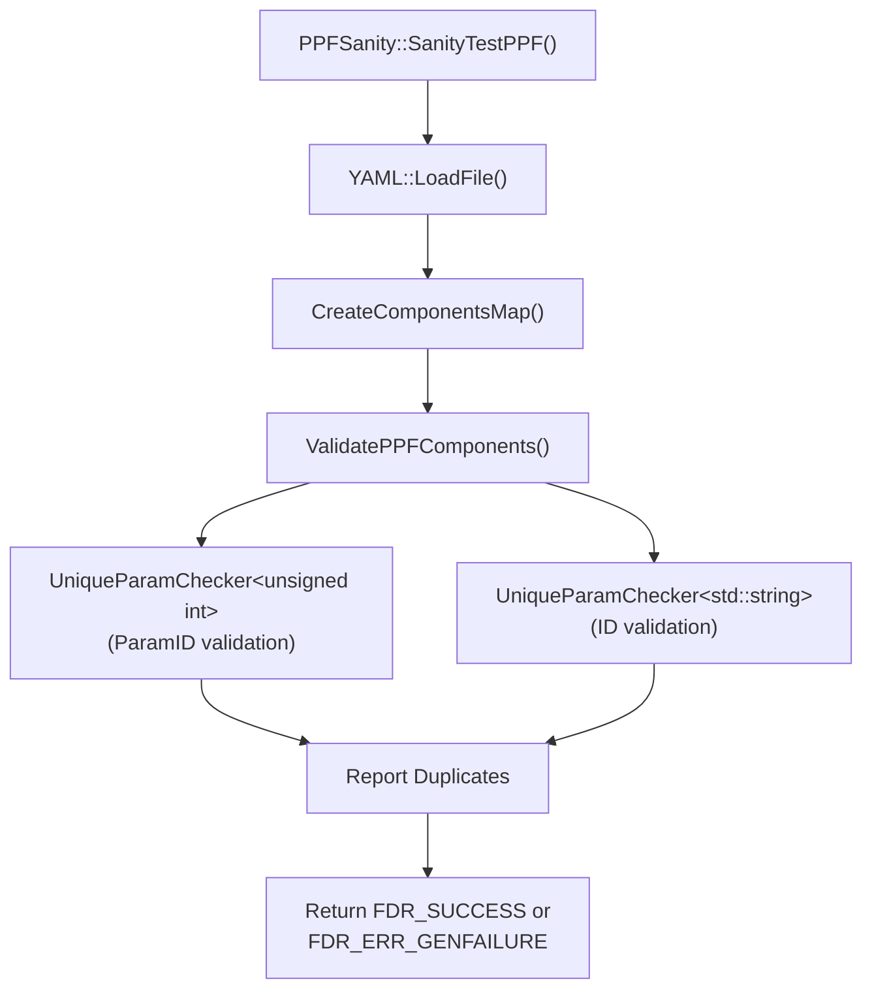
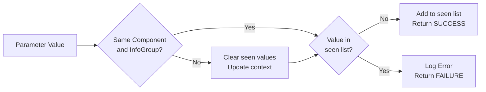
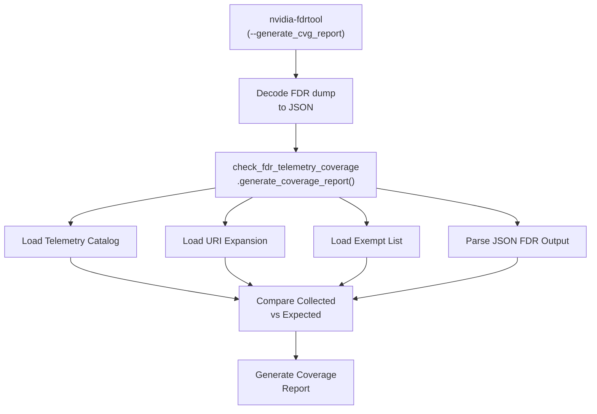
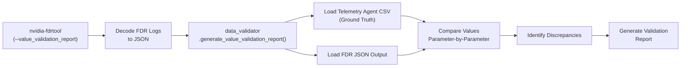
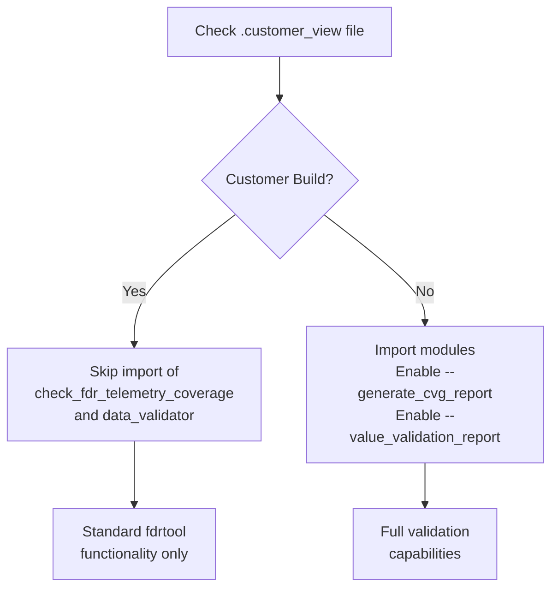
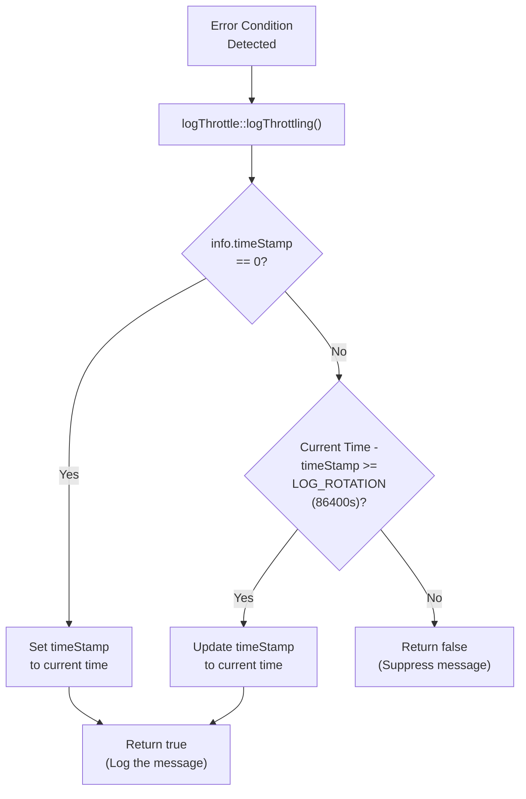
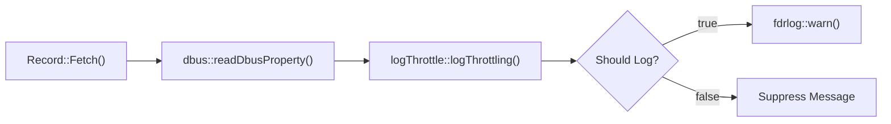
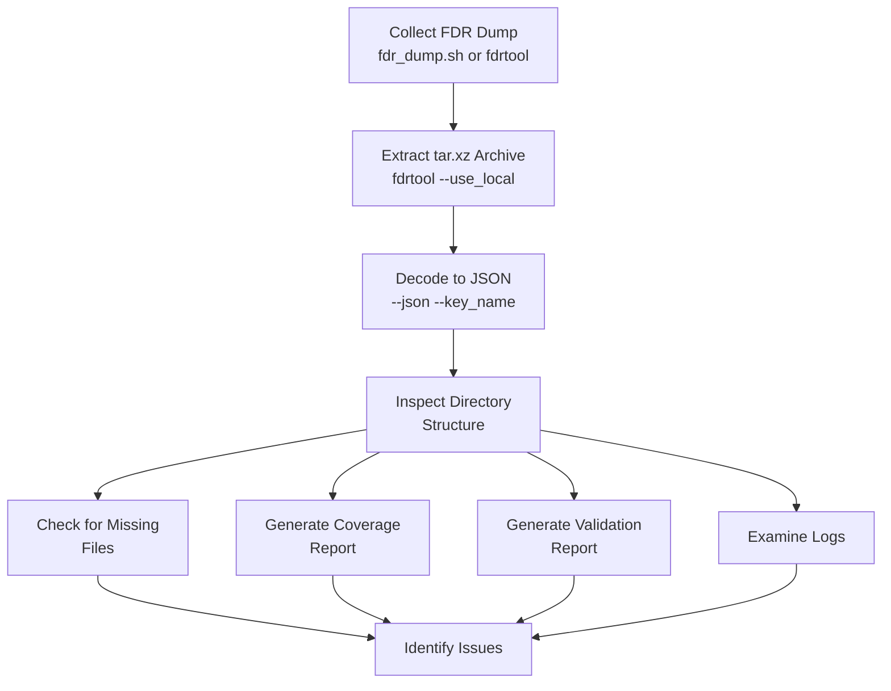
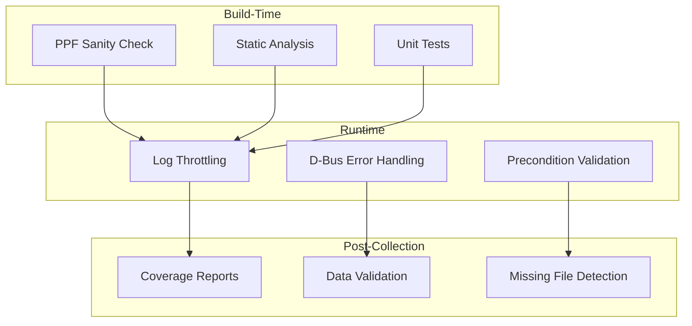

<!-- source: DeepWiki mcp.deepwiki.com · repo NVIDIA/nvidia-fdr · page 7.3 Testing and Validation · fetched 2026-10-26 -->

# Testing and Validation

<details>
<summary>Relevant source files</summary>

The following files were used as context for generating this wiki page:

- [README.md](README.md)
- [dbus_accessor.cpp](dbus_accessor.cpp)
- [dbus_accessor.hpp](dbus_accessor.hpp)
- [fdr_grp_update.cpp](fdr_grp_update.cpp)
- [fdr_log.cpp](fdr_log.cpp)
- [fdr_log.hpp](fdr_log.hpp)
- [fdrtool/fdrtool.py](fdrtool/fdrtool.py)
- [ppf_sanity.cpp](ppf_sanity.cpp)
- [property_variant.hpp](property_variant.hpp)

</details>


This document covers the testing and validation infrastructure for the NVIDIA FDR system. It describes mechanisms for validating Platform Profile Files (PPF), generating telemetry coverage reports, performing data validation, running unit tests, and debugging FDR deployments. For information about building the system, see [Build System and Dependencies](#7.1). For guidance on adding new parameters, see [Adding New Parameters](#7.2).

---

## PPF Sanity Checking

The FDR system includes automated sanity checking for Platform Profile Files to detect configuration errors before deployment. The primary validation ensures that parameter identifiers are unique within each component and InfoGroup.

### Validation Process

The `PPFSanity` class performs compile-time validation of PPF files through the following workflow:



**Sources:** [ppf_sanity.cpp:28-43]()

### Duplicate Detection

The validation system checks two critical identifier types:

| Identifier Type | Data Type | Scope | Purpose |
|----------------|-----------|-------|---------|
| `ParamID` | `unsigned int` | Per InfoGroup within Component | Unique numeric identifier for telemetry parameter |
| `ID` | `std::string` | Per InfoGroup within Component | Human-readable parameter name |

The `UniqueParamChecker` template function maintains static vectors of seen values and reports errors when duplicates are detected:



**Sources:** [ppf_sanity.cpp:100-131](), [ppf_sanity.cpp:84-96]()

### Validation Output

Errors are logged with detailed context:
- **Component name** (e.g., "GPU", "NIC")
- **InfoGroup ID** (e.g., "Inventory", "Error")
- **Duplicate parameter** (ParamID or ID)
- **Parameter type** (to distinguish between the two identifier types)

Example error output:
```
Error: Duplicate ParamID 1001 assigned in Error of GPU
Error: Duplicate ID gpu_temp assigned in Config of GPU
```

**Sources:** [ppf_sanity.cpp:126-127]()

---

## Coverage Reports

Coverage reports validate that FDR is collecting all expected telemetry parameters as defined in the telemetry catalog. This feature is available only in non-customer builds.

### Generating Coverage Reports

Coverage reports require JSON-decoded FDR logs and telemetry catalog files:

```bash
nvidia-fdrtool \
  --ip https://10.0.0.1:8000 \
  --username admin \
  --password admin123 \
  --json \
  --generate_cvg_report \
  --telemetry_catalog /path/to/catalog.json \
  --telemetry_uri_exp /path/to/uri_expansion.json \
  --platform Vulcan \
  --exempt_list /path/to/exempt_list.csv
```

### Coverage Validation Workflow



**Sources:** [fdrtool/fdrtool.py:195-200](), [fdrtool/fdrtool.py:328-332]()

### Required Inputs

| Parameter | Flag | Description |
|-----------|------|-------------|
| Decode Format | `--json` | Must decode to JSON format |
| Coverage Flag | `--generate_cvg_report` | Enable coverage report generation |
| Telemetry Catalog | `--telemetry_catalog` | JSON file defining expected telemetry |
| URI Expansion | `--telemetry_uri_exp` | URI mapping definitions |
| Platform | `--platform` | Target platform name (default: "Vulcan") |
| Exempt List | `--exempt_list` | CSV of parameters to exclude from validation |
| FDR Output | `--fdr_output_dir` | Path to decoded JSON logs (auto-detected if not specified) |

**Sources:** [fdrtool/fdrtool.py:263-274]()

### Coverage Report Contents

The coverage report identifies:
- **Collected parameters**: Telemetry successfully captured by FDR
- **Missing parameters**: Expected telemetry not found in FDR logs
- **Exempt parameters**: Parameters excluded from coverage requirements
- **Coverage percentage**: Ratio of collected to expected parameters

---

## Data Validation Reports

Data validation reports compare FDR-collected values against ground truth from the telemetry agent to detect data integrity issues.

### Generating Validation Reports

```bash
nvidia-fdrtool \
  --ip https://10.0.0.1:8000 \
  --username admin \
  --password admin123 \
  --json \
  --value_validation_report \
  --telemetry_agent_output /path/to/telemetry.csv \
  --fdr_output /path/to/decoded/json
```

### Validation Workflow



**Sources:** [fdrtool/fdrtool.py:203-205](), [fdrtool/fdrtool.py:334-339]()

### Required Inputs

| Parameter | Flag | Description |
|-----------|------|-------------|
| Decode Format | `--json` | Must decode to JSON format |
| Validation Flag | `--value_validation_report` | Enable data validation |
| Telemetry Agent Output | `--telemetry_agent_output` | CSV with expected values |
| FDR Output | `--fdr_output` | Path to decoded JSON logs |

**Sources:** [fdrtool/fdrtool.py:276-283]()

### Customer vs Non-Customer Builds

The coverage and validation features are gated behind a customer view flag:



**Sources:** [fdrtool/fdrtool.py:154-166](), [fdrtool/fdrtool.py:195](), [fdrtool/fdrtool.py:203]()

---

## Unit Testing

The FDR system uses the Meson build system with integrated unit testing support.

### Running Unit Tests

```bash
# Configure build with coverage support
meson setup --reconfigure build_coverage -Db_coverage=True

# Run all unit tests
meson test -v -C build_coverage

# View coverage results
cat build_coverage/meson-logs/coverage.txt
# Or open HTML report
xdg-open build_coverage/meson-logs/coverage.html
```

**Sources:** [README.md:97-99](), [README.md:107-116]()

### Test Configuration Options

| Option | Purpose |
|--------|---------|
| `-Db_coverage=True` | Enable code coverage instrumentation |
| `-Dwerror=true` | Treat warnings as errors |
| `-Dwarning_level=3` | Maximum warning sensitivity |
| `-Ddebug=true` | Include debug symbols |
| `-Doptimization=g` | Optimize for debugging |

**Sources:** [README.md:51-52]()

### Docker-Based Testing

For consistent CI/CD testing:

```bash
./coverage/coverage.sh
```

This script:
1. Builds FDR in a Docker container
2. Runs all unit tests
3. Generates coverage reports
4. Outputs results to `build_coverage/meson-logs/`

**Sources:** [README.md:109-116]()

---

## Static Analysis

FDR supports Clang static analysis for detecting potential bugs:

```bash
# Install clang-tools
sudo apt install clang-tools

# Run static analysis
ninja scan-build -C builddir
```

**Sources:** [README.md:103-105]()

---

## Log Throttling and Error Handling

FDR implements log throttling to prevent excessive error message generation while maintaining diagnostic value.

### Throttling Mechanism



**Sources:** [fdr_log.cpp:95-125]()

### Throttling Configuration

| Constant | Value | Description |
|----------|-------|-------------|
| `LOG_ROTATION` | 86400 seconds | Minimum time between repeated log messages |
| `THROTTLE_LOG_DISABLE` | Compile flag | Disables throttling if defined |

The `Info_t` structure includes a `timeStamp` field that tracks the last time an error was logged for each parameter:

**Sources:** [fdr_log.cpp:21-23](), [fdr_log.cpp:98]()

### Throttled Logging Locations

Log throttling is applied in several critical paths:

1. **D-Bus Property Read Failures**
   - Location: `dbus::readDbusProperty()`
   - Prevents spam from temporarily unavailable services
   
2. **Shared Memory Access Errors**
   - Location: `FdrGrpUpdate::RefreshAndStore()`
   - Handles missing keys in shared memory namespaces



**Sources:** [dbus_accessor.cpp:104-112](), [fdr_grp_update.cpp:49-55]()

---

## Debugging Techniques

### Missing File Detection

The `fdrtool` automatically checks for critical files after decoding:

```python
patterns_to_find = [
    'Bookkeeper',
    'fdr_manifest.txt',
    'fdr_ppf_*.yaml',
    'journalctl*',
]
```

Missing files are reported to help diagnose collection issues:
```
Did not find following files:
- fdr_manifest.txt
- journalctl*
```

**Sources:** [fdrtool/fdrtool.py:341-362]()

### Log Inspection Workflow



**Sources:** [fdrtool/fdrtool.py:83-132](), [fdrtool/fdrtool.py:153-169]()

### Decoding Birth Certificate

The Birth Certificate requires special handling:

```bash
# Include birth certificate in decoding
nvidia-fdrtool --use_local -l dump.tar.xz --json --birth_certificate
```

The tool will:
1. Decode main FDR logs
2. Extract `fdr/Bookkeeper/BirthCertificate.tar`
3. Decode birth certificate separately
4. Handle errors gracefully if birth certificate is corrupted

**Sources:** [fdrtool/fdrtool.py:304-320]()

### Common Validation Checks

| Check | Location | Purpose |
|-------|----------|---------|
| Service Enabled | `CheckIfNvidaFdrIsActive()` | Verify FDR service is running |
| Download Size | After Redfish GET | Ensure non-empty dump |
| File Extraction | After tar extraction | Verify all files extracted |
| YAML Decompression | After extraction | Handle compressed PPF files |

**Sources:** [fdrtool/fdrtool.py:371-379](), [fdrtool/fdrtool.py:516-519](), [fdrtool/fdrtool.py:98-130]()

### Error Logging Best Practices

When debugging FDR issues:

1. **Check systemd logs**:
   ```bash
   journalctl -u nvidia-fdr.service -f
   ```

2. **Verify D-Bus registration**:
   ```bash
   busctl list | grep FDR
   ```

3. **Inspect FDR directory structure**:
   ```bash
   tree /var/emmc/fdr/
   ```

4. **Decode recent logs locally**:
   ```bash
   nvidia-fdrtool --use_local -l /path/to/dump.tar.xz --json --key_name
   ```

5. **Check for duplicate parameters** in PPF before deployment

**Sources:** [README.md:159-166]()

---

## FDR Log Directory Cleanup

The `fdrtool` provides a cleanup operation for clearing FDR logs on the HMC:

```bash
nvidia-fdrtool \
  --ip https://10.0.0.1:8000 \
  --username admin \
  --password admin123 \
  --clean_fdr_log_dir
```

This triggers a Redfish POST to:
```
/redfish/v1/Systems/HGX_Baseboard_0/LogServices/FDR/Actions/LogService.ClearLog/
```

**Sources:** [fdrtool/fdrtool.py:67-81](), [fdrtool/fdrtool.py:224-232]()

---

## Validation Integration Points

### Build-Time Validation

- **PPF Sanity Check**: Runs during PPF loading via `PPFSanity::SanityTestPPF()`
- **Static Analysis**: Manual execution via `ninja scan-build`
- **Unit Tests**: Integrated with meson build system

### Runtime Validation

- **Log Throttling**: Automatic via `logThrottle::logThrottling()`
- **D-Bus Error Handling**: Try-catch blocks with logged warnings
- **Precondition Checks**: Disk space, mount points (see [Platform Configuration](#5))

### Post-Collection Validation

- **Coverage Reports**: Compare against telemetry catalog
- **Data Validation**: Compare against telemetry agent output
- **Missing File Detection**: Automatic check after decode



**Sources:** [ppf_sanity.cpp:28-43](), [README.md:97-105](), [fdrtool/fdrtool.py:328-339]()

---

